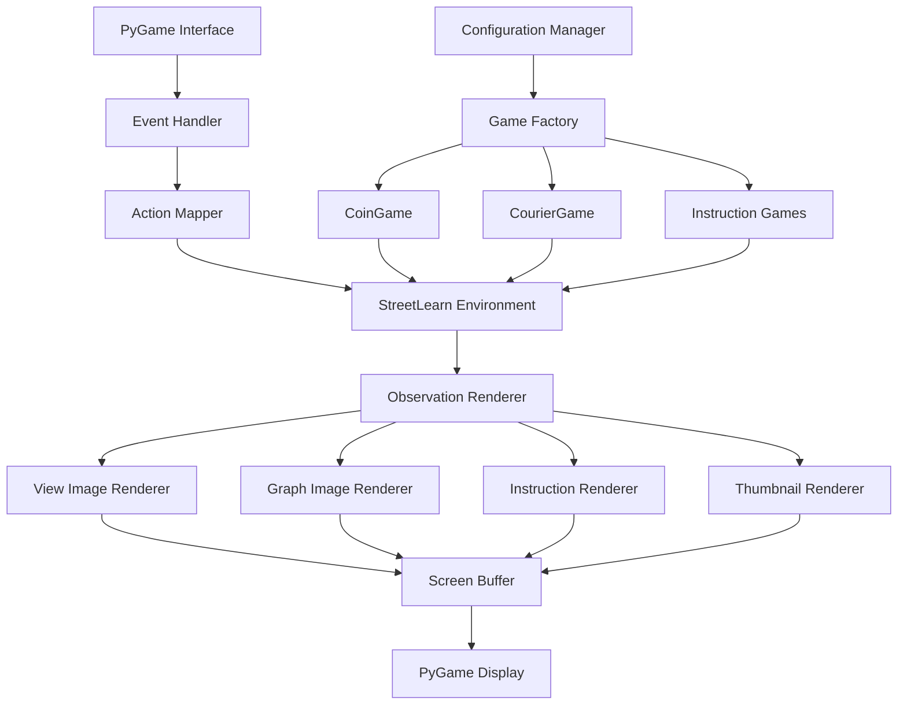
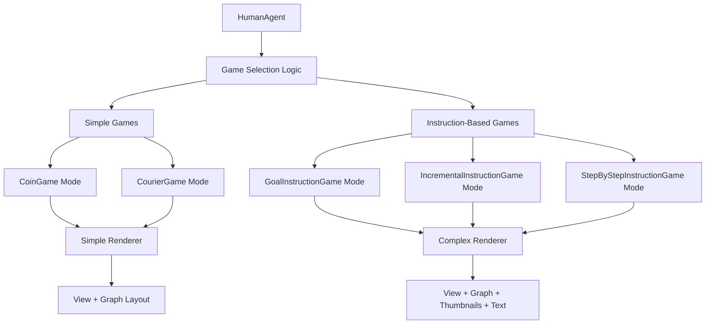
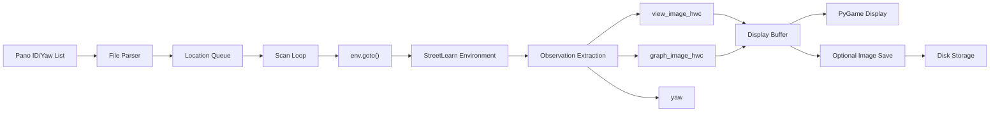
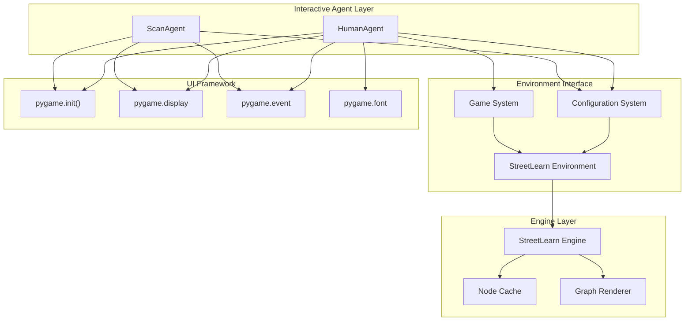

<!-- source: DeepWiki mcp.deepwiki.com · repo google-deepmind/streetlearn · page 4.3 Interactive Agents · fetched 2026-10-26 -->

# Interactive Agents

<details>
<summary>Relevant source files</summary>

The following files were used as context for generating this wiki page:

- [streetlearn/python/ui/human_agent.py](streetlearn/python/ui/human_agent.py)
- [streetlearn/python/ui/scan_agent.py](streetlearn/python/ui/scan_agent.py)

</details>


This section describes agents designed for human interaction and data exploration within the StreetLearn environment. Interactive agents provide interfaces for manual control, debugging, and dataset exploration, serving as essential tools for understanding agent behavior and validating environment functionality.

For neural network-based learning agents, see [AI Learning Agents](#4.1). For baseline agents using ground truth information, see [Oracle Agents](#4.2).

## Human Agent

The `HumanAgent` provides a PyGame-based interface for manual navigation through StreetLearn environments. This agent enables researchers to experience navigation tasks firsthand, test environment configurations, and generate demonstrations for analysis.

### Architecture and Components

The human agent consists of several key components working together to provide an interactive navigation experience:



**Sources:** [streetlearn/python/ui/human_agent.py:1-260]()

### Input Controls and Actions

The human agent maps keyboard inputs to navigation actions within the StreetLearn environment:

| Key | Action | Function |
|-----|---------|----------|
| `SPACE` | `move_forward` | Move to adjacent panorama |
| `A` | `horizontal_rotation` (negative) | Rotate view left |
| `D` | `horizontal_rotation` (positive) | Rotate view right |
| `W` | `vertical_rotation` (negative) | Look up |
| `S` | `vertical_rotation` (positive) | Look down |
| `I` | `map_zoom` (positive) | Zoom into graph |
| `O` | `map_zoom` (negative) | Zoom out of graph |
| `P` | Screenshot | Save current view to file |
| `ESC` | Exit | Terminate agent |

**Sources:** [streetlearn/python/ui/human_agent.py:167-192]()

### Multi-Game Support

The human agent supports multiple game types through a unified interface, adapting its rendering and observation display based on the selected game:



**Sources:** [streetlearn/python/ui/human_agent.py:117-153](), [streetlearn/python/ui/human_agent.py:222-236]()

### Observation Rendering System

The human agent implements sophisticated rendering logic to display multiple observation types simultaneously:

For simple games (coin_game, courier_game), the display shows:
- View image (top half)
- Graph image (bottom half)

For instruction-based games, the display includes:
- View image (top-left)
- Graph image (bottom-left) 
- Thumbnail images (top-right, subsampled)
- Text instructions (bottom-right)

The rendering system uses color coding to highlight the current instruction step and goal location.

**Sources:** [streetlearn/python/ui/human_agent.py:117-153]()

## Scan Agent

The `ScanAgent` provides a utility interface for systematic exploration of panorama data at predetermined locations and orientations. This agent is designed for dataset validation, image collection, and automated exploration tasks.

### Core Functionality

The scan agent operates by reading a list of panorama IDs and yaw angles, then using the `goto()` method to navigate directly to each specified location:



**Sources:** [streetlearn/python/ui/scan_agent.py:44-66]()

### Input Format and Processing

The scan agent expects a tab-separated file containing panorama IDs and corresponding yaw angles:

```
pano_id_1    yaw_angle_1
pano_id_2    yaw_angle_2
...
```

This format enables batch processing of specific viewpoints for systematic data collection or validation.

**Sources:** [streetlearn/python/ui/scan_agent.py:78-81]()

## Interactive Agent Integration

Both interactive agents integrate with the broader StreetLearn system through standard environment interfaces while providing specialized user interaction capabilities:



**Sources:** [streetlearn/python/ui/human_agent.py:240-256](), [streetlearn/python/ui/scan_agent.py:86-88]()

## Usage Patterns

### Human Agent Execution

The human agent is typically launched with dataset and game configuration parameters:

```bash
python human_agent.py \
  --dataset_path=/path/to/dataset \
  --game=coin_game \
  --width=400 \
  --height=400 \
  --field_of_view=60
```

**Sources:** [streetlearn/python/ui/human_agent.py:40-70]()

### Scan Agent Execution

The scan agent requires a dataset path and a file containing panorama locations:

```bash
python scan_agent.py \
  --dataset_path=/path/to/dataset \
  --list_pano_ids_yaws=/path/to/locations.txt \
  --save_images=True
```

**Sources:** [streetlearn/python/ui/scan_agent.py:34-41]()

Both agents serve complementary roles in the StreetLearn ecosystem: the human agent provides interactive exploration and validation capabilities, while the scan agent enables systematic data collection and batch processing workflows.

---

