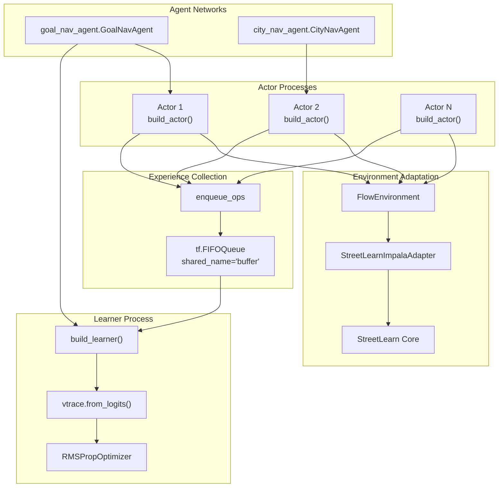
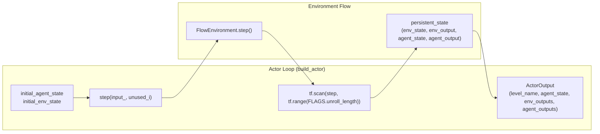
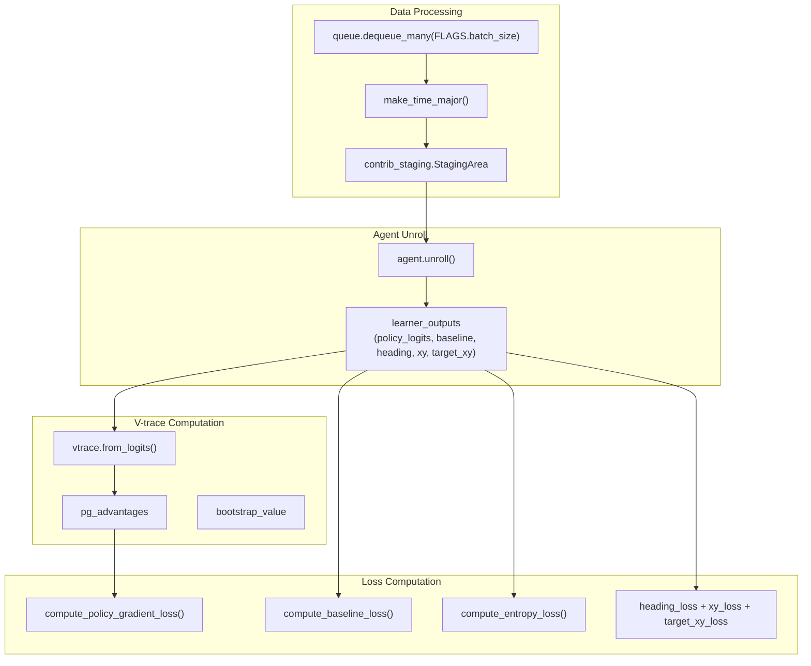
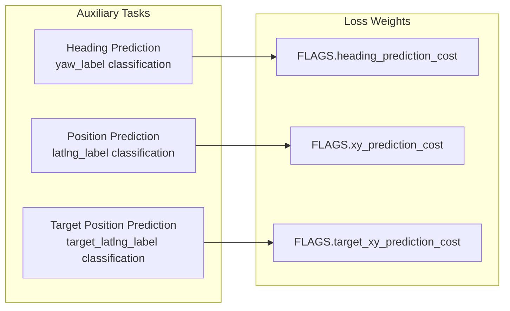
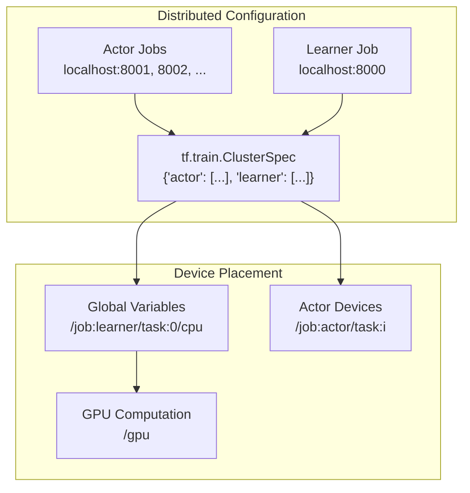

<!-- source: DeepWiki mcp.deepwiki.com · repo google-deepmind/streetlearn · page 5 Training and Experimentation · fetched 2026-10-26 -->

# Training and Experimentation

<details>
<summary>Relevant source files</summary>

The following files were used as context for generating this wiki page:

- [streetlearn/python/experiment.py](streetlearn/python/experiment.py)

</details>


This document covers the training and experimentation framework for StreetLearn agents, specifically the IMPALA-based distributed reinforcement learning system. The framework enables training neural network agents on navigation tasks using importance weighted actor-learner architectures with V-trace off-policy correction.

For information about the agent architectures themselves, see [AI Learning Agents](#4.1). For environment configuration and games, see [Environment System](#3).

## Overview

The training system is built around a distributed IMPALA (Importance Weighted Actor-Learner Architectures) implementation that allows scalable training of navigation agents. The core framework consists of actors that collect experience from StreetLearn environments and learners that update agent parameters using V-trace off-policy correction.

The main entry point is the `experiment.py` module, which provides both training and testing modes for agents navigating in Street View environments.

**Sources:** [streetlearn/python/experiment.py:15-29]()

## IMPALA Architecture Implementation

The training system implements the IMPALA architecture with the following key components:



### Actor System

The actor system is responsible for collecting experience trajectories by interacting with the environment. Each actor runs independently and maintains its own environment state.



The actor loop uses `tf.scan` to unroll agent-environment interaction for a fixed number of steps (`FLAGS.unroll_length`), collecting sequences of states, actions, rewards, and observations.

**Sources:** [streetlearn/python/experiment.py:319-401](), [streetlearn/python/experiment.py:161-245]()

### Environment Adaptation Layer

The `StreetLearnImpalaAdapter` provides the interface between the IMPALA training framework and the StreetLearn environment:

| Method | Purpose | Return Type |
|--------|---------|-------------|
| `initial()` | Returns initial observation | Observation tensor |
| `step(action)` | Takes environment step | `(reward, done, observation)` |
| `_reshape_observation()` | Formats observations for neural networks | List of tensors |
| `_tensor_specs()` | Defines tensor specifications | TensorSpec nest |

The adapter reshapes observations into the expected format for neural network processing, converting images from channel-first to channel-last format and organizing all observation components into a standardized list.

**Sources:** [streetlearn/python/experiment.py:247-318]()

## Training Pipeline

### Learner System

The learner processes batched experience from actors and updates the agent's neural network parameters:



The learner implements the following key steps:

1. **Experience Batching**: Dequeues batched trajectories from actors
2. **Agent Unroll**: Runs the agent network on the collected sequences
3. **V-trace Computation**: Computes importance-weighted returns and advantages
4. **Loss Calculation**: Combines RL losses with auxiliary supervision tasks
5. **Parameter Update**: Applies gradients using RMSProp optimizer

**Sources:** [streetlearn/python/experiment.py:438-611]()

### V-trace Implementation

The system uses V-trace for off-policy correction, which handles the difference between the behavior policy (used by actors) and the target policy (being learned):

```python
# V-trace computation on CPU for efficiency
with tf.device('/cpu'):
    vtrace_returns = vtrace.from_logits(
        behaviour_policy_logits=agent_outputs.policy_logits,
        target_policy_logits=learner_outputs.policy_logits,
        actions=agent_outputs.action,
        discounts=discounts,
        rewards=clipped_rewards,
        values=learner_outputs.baseline,
        bootstrap_value=bootstrap_value)
```

**Sources:** [streetlearn/python/experiment.py:479-491]()

## Loss Functions and Auxiliary Tasks

The training objective combines multiple loss components:

### Primary RL Losses

| Loss Type | Formula | Weight Flag |
|-----------|---------|-------------|
| Policy Gradient | `cross_entropy * advantages` | N/A |
| Baseline | `0.5 * (advantages)²` | `FLAGS.baseline_cost` |
| Entropy | `-sum(policy * log_policy)` | `FLAGS.entropy_cost` |

### Auxiliary Supervision Tasks

The system supports additional supervised learning tasks that provide auxiliary training signals:



These auxiliary tasks help the agent learn spatial representations and orientation awareness, which are crucial for navigation performance.

**Sources:** [streetlearn/python/experiment.py:503-529](), [streetlearn/python/experiment.py:403-429]()

## Distributed Training Setup

The system supports both single-machine and distributed training configurations:

### Single Machine Setup
- All actors and learners run in the same process
- Uses `QueueRunner` for threading
- Simplified device placement

### Distributed Setup
- Separate processes for actors and learners
- Cluster specification with multiple worker nodes
- Shared variables on learner CPU for efficient synchronization



**Sources:** [streetlearn/python/experiment.py:688-716](), [streetlearn/python/experiment.py:691-717]()

## Testing Framework

The testing system evaluates trained agents across multiple episodes and environments:

### Test Configuration

| Parameter | Purpose | Default |
|-----------|---------|---------|
| `FLAGS.test_num_episodes` | Episodes per evaluation | 10 |
| `FLAGS.mode` | Training or testing mode | 'train' |

### Test Execution Flow

1. **Environment Setup**: Creates test environments for each level
2. **Agent Loading**: Loads trained agent from checkpoint
3. **Episode Rollouts**: Runs multiple episodes per level
4. **Performance Metrics**: Collects episode returns and statistics

```python
# Test loop structure
for level_name in level_names:
    while len(returns) < FLAGS.test_num_episodes:
        # Run episode and collect returns
        returns.extend(infos_v.episode_return[done_v])
    # Report mean performance
    tf.logging.info('Mean episode return: %f', np.mean(returns))
```

**Sources:** [streetlearn/python/experiment.py:848-875]()

## Configuration Management

The experiment system uses extensive command-line flags for configuration:

### Core Training Parameters

| Flag Group | Key Parameters |
|------------|----------------|
| Training | `total_environment_frames`, `batch_size`, `unroll_length` |
| Loss Weights | `entropy_cost`, `baseline_cost`, `discounting` |
| Environment | `game_name`, `level_names`, `width`, `height` |
| Agent | `agent` (goal_nav_agent \| city_nav_agent) |
| Optimizer | `learning_rate`, `decay`, `momentum`, `epsilon` |

### Curriculum Learning Support

The system includes built-in curriculum learning capabilities:

- `timestamp_start_curriculum`: Training start time
- `hours_curriculum_part_1`, `hours_curriculum_part_2`: Curriculum phases
- `min_goal_distance_curriculum`, `max_goal_distance_curriculum`: Distance progression

**Sources:** [streetlearn/python/experiment.py:58-143]()

---

