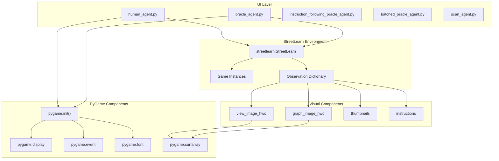
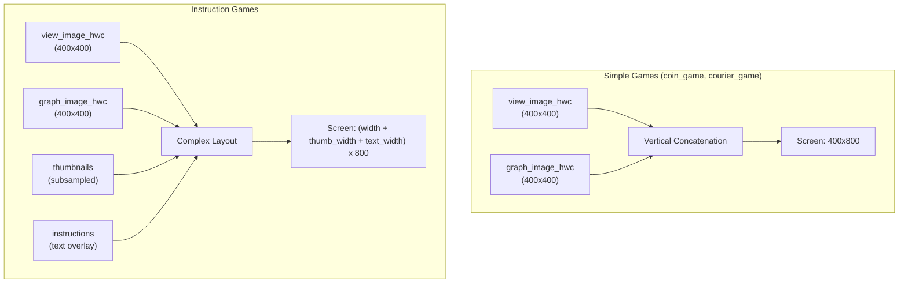
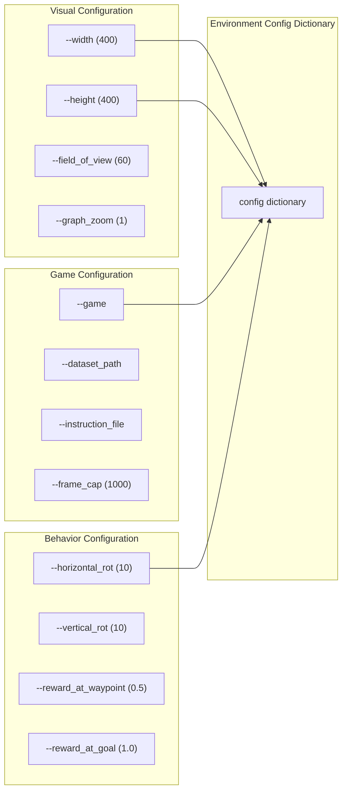
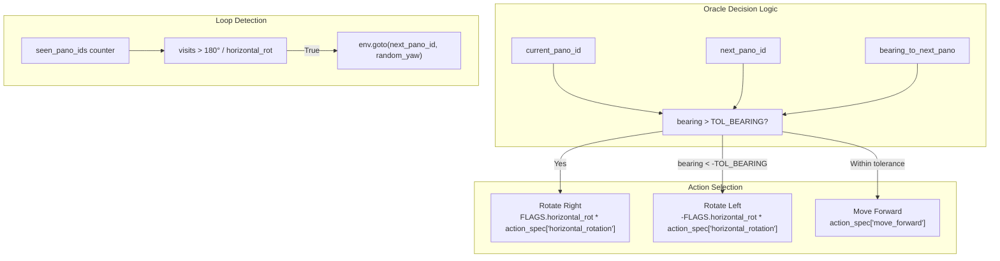
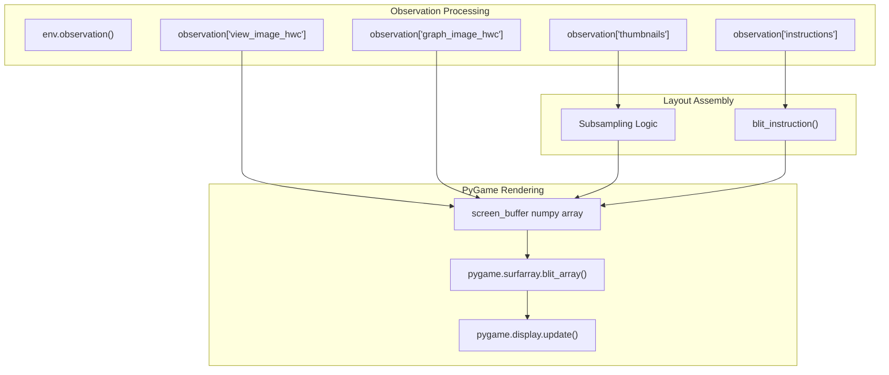
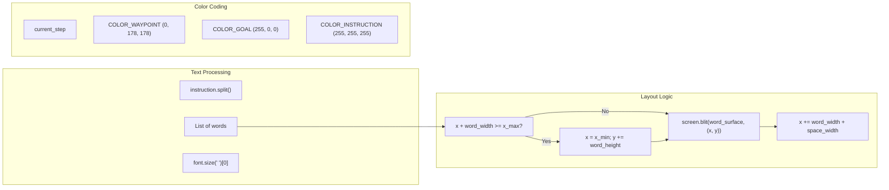

<!-- source: DeepWiki mcp.deepwiki.com · repo google-deepmind/streetlearn · page 6 User Interfaces · fetched 2026-10-26 -->

# User Interfaces

Relevant source files

The following files were used as context for generating this wiki page:

- [streetlearn/python/ui/BUILD](streetlearn/python/ui/BUILD)
- [streetlearn/python/ui/human_agent.py](streetlearn/python/ui/human_agent.py)
- [streetlearn/python/ui/oracle_agent.py](streetlearn/python/ui/oracle_agent.py)

This document covers the PyGame-based user interface systems in StreetLearn that enable human interaction with navigation environments and provide visualization capabilities for different agent types. The UI layer serves as the primary interface between human users, agent behaviors, and the StreetLearn environment system.

For information about the underlying environment system that these UIs interact with, see [Environment System](#3). For details about the agents that these UIs support, see [Agent System](#4).

## UI Architecture Overview

The StreetLearn UI system is built on PyGame and provides interactive interfaces for multiple agent types. The system follows a modular design where each agent type has its own dedicated UI implementation while sharing common rendering and input handling patterns.

Sources: [streetlearn/python/ui/BUILD:23-76](), [streetlearn/python/ui/human_agent.py:240-254](), [streetlearn/python/ui/oracle_agent.py:194-196]()

## Human Agent Interface

The `HumanAgent` provides a comprehensive PyGame interface for manual navigation through StreetLearn environments. It supports multiple game types with adaptive screen layouts and keyboard controls.

### Screen Layout System

The UI dynamically adjusts its layout based on the selected game type:

Sources: [streetlearn/python/ui/human_agent.py:117-137](), [streetlearn/python/ui/human_agent.py:242-252]()

### Keyboard Control System

The human agent implements a comprehensive keyboard control scheme:

| Key | Action | Implementation |
|-----|--------|----------------|
| `SPACE` | Move forward | `action_spec['move_forward']` |
| `A` | Rotate left | `-FLAGS.horizontal_rot * action_spec['horizontal_rotation']` |
| `D` | Rotate right | `FLAGS.horizontal_rot * action_spec['horizontal_rotation']` |
| `W` | Look up | `-FLAGS.vertical_rot * action_spec['vertical_rotation']` |
| `S` | Look down | `FLAGS.vertical_rot * action_spec['vertical_rotation']` |
| `I` | Zoom in | `action_spec['map_zoom']` |
| `O` | Zoom out | `-action_spec['map_zoom']` |
| `P` | Screenshot | Save to `/tmp/human_agent_YYYYMMDD_HHMMSS.bmp` |
| `ESC` | Exit | Terminate application |

Sources: [streetlearn/python/ui/human_agent.py:164-190]()

### Configuration System

The human agent uses extensive command-line configuration:

Sources: [streetlearn/python/ui/human_agent.py:40-70](), [streetlearn/python/ui/human_agent.py:195-218]()

## Oracle Agent Interface

The `OracleAgent` provides a streamlined PyGame interface focused on visualizing automated navigation using ground truth information.

### Oracle Navigation System

Sources: [streetlearn/python/ui/oracle_agent.py:127-168](), [streetlearn/python/ui/oracle_agent.py:53]()

### Oracle UI Features

The oracle interface includes specialized functionality:

- **Video Recording**: Press `V` to start, `C` to stop recording frames to `/tmp/oracle_agent_video_*`
- **Statistics Logging**: Optional `--stats_path` for episode performance metrics
- **Zoom Controls**: `I`/`O` keys for map zoom
- **Loop Breaking**: Automatic teleportation when stuck in navigation loops

Sources: [streetlearn/python/ui/oracle_agent.py:77-86](), [streetlearn/python/ui/oracle_agent.py:99-103](), [streetlearn/python/ui/oracle_agent.py:119-123]()

## Visual Rendering System

The UI system uses a consistent approach to render environment observations:

Sources: [streetlearn/python/ui/human_agent.py:113-137](), [streetlearn/python/ui/oracle_agent.py:92-96]()

### Text Rendering System

The `blit_instruction` function provides multiline text rendering with word wrapping:

Sources: [streetlearn/python/ui/human_agent.py:77-90](), [streetlearn/python/ui/human_agent.py:72-74](), [streetlearn/python/ui/human_agent.py:144-152]()

## UI Agent Registry

The BUILD file defines multiple UI executables as entry points:

| Binary | Purpose | Primary Game Support |
|--------|---------|---------------------|
| `human_agent` | Manual keyboard control | All games with full UI |
| `oracle_agent` | Automated optimal navigation | `courier_game` focused |
| `instruction_following_oracle_agent` | Oracle with instruction following | Instruction-based games |
| `batched_oracle_agent` | Parallel oracle processing | Batch evaluation |
| `scan_agent` | Environment scanning utility | Data exploration |

All UI agents depend on:
- `//streetlearn/engine/python:streetlearn_engine` - C++ engine bindings
- `//streetlearn/python/environment:environment_py` - Python environment layer

Sources: [streetlearn/python/ui/BUILD:23-76]()

---

