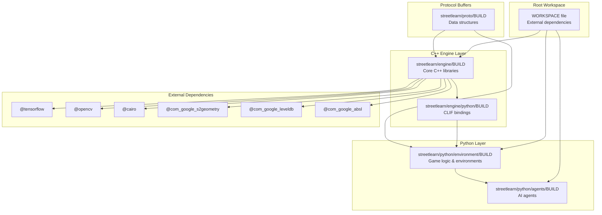
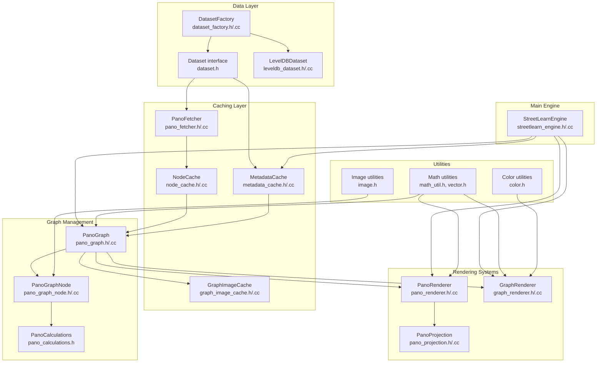
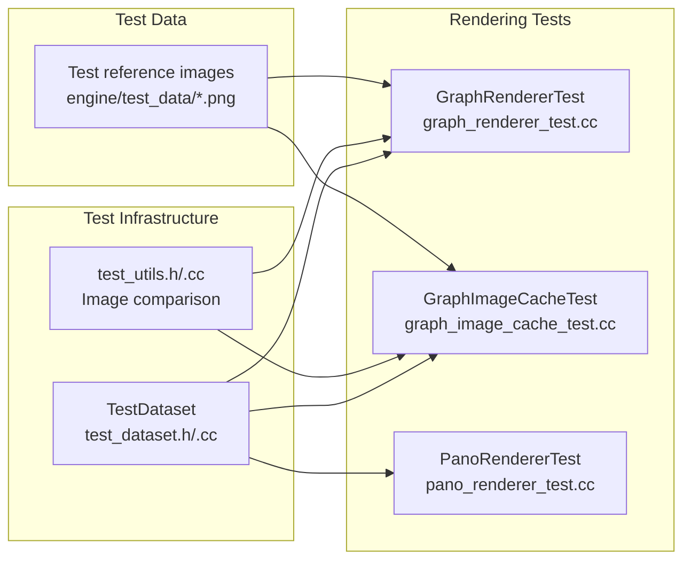
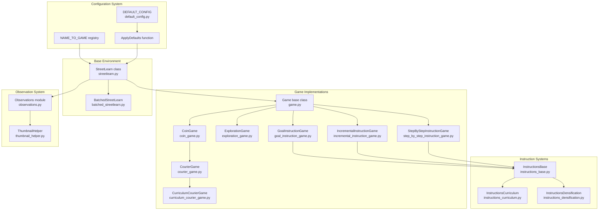
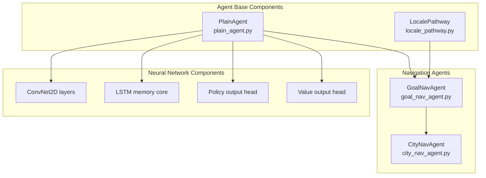

<!-- source: DeepWiki mcp.deepwiki.com · repo google-deepmind/streetlearn · page 7 Development Guide · fetched 2026-10-26 -->

# Development Guide

Relevant source files

The following files were used as context for generating this wiki page:

- [streetlearn/engine/BUILD](streetlearn/engine/BUILD)
- [streetlearn/engine/graph_image_cache_test.cc](streetlearn/engine/graph_image_cache_test.cc)
- [streetlearn/engine/graph_renderer_test.cc](streetlearn/engine/graph_renderer_test.cc)
- [streetlearn/python/agents/BUILD](streetlearn/python/agents/BUILD)
- [streetlearn/python/environment/BUILD](streetlearn/python/environment/BUILD)

This document provides instructions for developers working on the StreetLearn codebase, covering build configuration, extending C++ engine components, and developing new Python environment features. For general system architecture information, see [System Architecture](#2). For specific guidance on training agents, see [Training and Experimentation](#5).

## Build System Overview

StreetLearn uses Bazel as its build system with a modular architecture separating C++ engine components from Python interfaces. The build configuration manages complex dependencies including computer vision libraries, geographical computation tools, and machine learning frameworks.

### Build Structure

**Sources:** [streetlearn/engine/BUILD:1-615](), [streetlearn/python/environment/BUILD:1-49](), [streetlearn/python/agents/BUILD:1-33]()

### Key Build Targets

| Target | Purpose | Dependencies |
|--------|---------|--------------|
| `//streetlearn/engine:streetlearn_engine` | Core C++ engine | Cairo, OpenCV, S2Geometry, LevelDB |
| `//streetlearn/engine:pano_graph` | Panorama graph management | Dataset, caching, math utilities |
| `//streetlearn/engine:graph_renderer` | Graph visualization | Cairo, image processing |
| `//streetlearn/python/environment:environment_py` | Python environment API | Engine bindings, protocol buffers |
| `//streetlearn/python/agents:agents_py` | AI agent implementations | Environment, neural network components |

**Sources:** [streetlearn/engine/BUILD:119-139](), [streetlearn/engine/BUILD:142-158](), [streetlearn/engine/BUILD:279-301](), [streetlearn/python/environment/BUILD:23-49](), [streetlearn/python/agents/BUILD:23-32]()

## Engine Development

The C++ engine provides high-performance components for panorama processing, graph management, and rendering. Development involves working with computer vision libraries, caching systems, and geographical computations.

### Core Engine Architecture

**Sources:** [streetlearn/engine/BUILD:81-88](), [streetlearn/engine/BUILD:104-116](), [streetlearn/engine/BUILD:119-139](), [streetlearn/engine/BUILD:142-158](), [streetlearn/engine/BUILD:219-231](), [streetlearn/engine/BUILD:279-301]()

### Adding New Rendering Features

To extend the rendering system, developers typically work with the `GraphRenderer` and `PanoRenderer` classes:

1. **Graph Rendering Extensions**: Modify `graph_renderer.h/.cc` for new visualization features
2. **Panorama Processing**: Extend `pano_renderer.h/.cc` for new projection methods
3. **Caching Optimization**: Update cache classes for new data types

Testing new rendering features requires test data and image comparison utilities:

**Sources:** [streetlearn/engine/graph_renderer_test.cc:1-155](), [streetlearn/engine/graph_image_cache_test.cc:1-125](), [streetlearn/engine/BUILD:322-338](), [streetlearn/engine/BUILD:575-604]()

### Cache System Development

The caching system uses LRU policies and thread-safe operations. Key classes for extension:

| Class | Purpose | Thread Safety | Cache Policy |
|-------|---------|---------------|--------------|
| `NodeCache` | Panorama data caching | Thread-safe | LRU eviction |
| `MetadataCache` | Panorama metadata | Thread-safe | Size-based |
| `GraphImageCache` | Rendered graph images | Not specified | Custom regions |

**Sources:** [streetlearn/engine/BUILD:219-231](), [streetlearn/engine/BUILD:208-217](), [streetlearn/engine/BUILD:260-276]()

## Environment Development

Python environment development focuses on creating new games, observation types, and agent interfaces. The system uses a factory pattern for game instantiation and modular observation processing.

### Environment System Structure

**Sources:** [streetlearn/python/environment/BUILD:23-49]()

### Creating New Games

To implement a new game type:

1. **Inherit from Game Base**: Extend the base `Game` class in `game.py`
2. **Register in Factory**: Add to `NAME_TO_GAME` registry in appropriate module
3. **Implement Required Methods**: Override `on_reset()`, `on_step()`, `get_reward()`, `get_info()`
4. **Define Observations**: Specify observation space and observation processing

### Agent Development Structure

**Sources:** [streetlearn/python/agents/BUILD:23-32]()

### Testing Environment Extensions

Environment testing involves:

1. **Unit Tests**: Test individual game logic components
2. **Integration Tests**: Verify environment-agent interactions
3. **Observation Validation**: Ensure correct observation space definitions
4. **Reward Function Testing**: Validate reward calculations and game termination

The build system provides test targets that can be extended for new components:

| Test Type | Build Pattern | Example |
|-----------|---------------|---------|
| C++ Unit Tests | `cc_test` | `streetlearn_engine_test` |
| Python Unit Tests | `py_test` | Environment game tests |
| Integration Tests | Cross-language | Engine-Python binding tests |

**Sources:** [streetlearn/engine/BUILD:340-604]()

---

