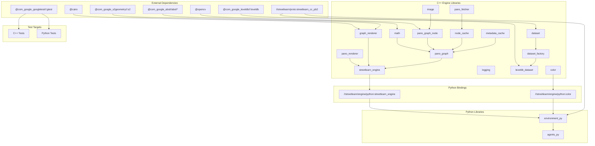
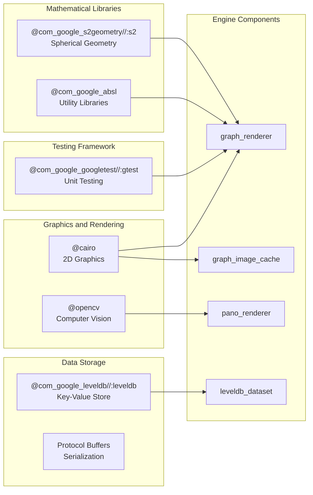

<!-- source: DeepWiki mcp.deepwiki.com · repo google-deepmind/streetlearn · page 7.1 Build System · fetched 2026-10-26 -->

# Build System

<details>
<summary>Relevant source files</summary>

The following files were used as context for generating this wiki page:

- [streetlearn/engine/BUILD](streetlearn/engine/BUILD)
- [streetlearn/engine/graph_image_cache_test.cc](streetlearn/engine/graph_image_cache_test.cc)
- [streetlearn/engine/graph_renderer_test.cc](streetlearn/engine/graph_renderer_test.cc)
- [streetlearn/python/agents/BUILD](streetlearn/python/agents/BUILD)
- [streetlearn/python/environment/BUILD](streetlearn/python/environment/BUILD)

</details>


This document explains the Bazel build configuration, dependencies, and compilation process for StreetLearn components. It covers how to build the C++ engine, Python environment, agents, and associated tests.

For information about extending the engine or environment systems, see [Engine Development](#7.2) and [Environment Development](#7.3).

## Overview

StreetLearn uses **Bazel** as its build system to manage the complex dependency relationships between C++ engine components, Python interfaces, external libraries, and test suites. The build system is organized into distinct layers with clear separation between high-performance C++ code and flexible Python interfaces.

## Build System Architecture

The build system follows a layered architecture that mirrors the software architecture, with C++ engine components at the base and Python components depending on them through CLIF bindings.

### Build Target Hierarchy



**Sources:** [streetlearn/engine/BUILD:1-615](), [streetlearn/python/environment/BUILD:1-49](), [streetlearn/python/agents/BUILD:1-33]()

### Core Build Targets

The build system defines several key target categories:

| Target Type | Purpose | Examples |
|------------|---------|----------|
| `cc_library` | C++ libraries for engine components | `streetlearn_engine`, `pano_graph`, `graph_renderer` |
| `py_library` | Python libraries for environment and agents | `environment_py`, `agents_py` |
| `cc_test` | C++ unit tests | `streetlearn_engine_test`, `pano_graph_test` |
| `py_test` | Python unit tests | Environment and agent tests |

**Sources:** [streetlearn/engine/BUILD:21-301](), [streetlearn/python/environment/BUILD:23-49]()

## External Dependencies

StreetLearn integrates numerous external libraries through Bazel's dependency management system.

### Core Engine Dependencies



**Sources:** [streetlearn/engine/BUILD:70-72](), [streetlearn/engine/BUILD:168-169](), [streetlearn/engine/BUILD:114-115](), [streetlearn/engine/BUILD:271-274]()

### Python Dependencies

The Python components depend on the C++ engine through CLIF bindings and additional Python packages:

- `dm-sonnet` for neural network components
- `pygame` for user interface
- `numpy` for numerical computing
- `absl-py` for application framework

**Sources:** [streetlearn/python/environment/BUILD:44-48]()

## Build Configuration

### License and Visibility

All BUILD files specify Apache License 2.0 and public visibility:

```python
package(default_visibility = ["//visibility:public"])
licenses(["notice"])  # Apache v2
```

**Sources:** [streetlearn/engine/BUILD:17-19](), [streetlearn/python/environment/BUILD:17-19]()

### Python Version Support

Python libraries are configured for Python 2 and 3 compatibility:

```python
srcs_version = "PY2AND3"
```

**Sources:** [streetlearn/python/environment/BUILD:43](), [streetlearn/python/agents/BUILD:31]()

## Building Components

### C++ Engine Components

The engine libraries follow a dependency hierarchy where core utilities support higher-level components:

1. **Base Libraries**: `math`, `image`, `color`, `logging`
2. **Data Access**: `dataset`, `leveldb_dataset`, `dataset_factory`  
3. **Graph Components**: `pano_graph_node`, `pano_graph`, caching systems
4. **Rendering**: `pano_renderer`, `graph_renderer`
5. **Main Engine**: `streetlearn_engine`

**Sources:** [streetlearn/engine/BUILD:119-139]()

### Python Environment

The Python environment library aggregates all game implementations and interfaces:

```python
py_library(
    name = "environment_py",
    srcs = [
        "batched_streetlearn.py",
        "coin_game.py", 
        "courier_game.py",
        "curriculum_courier_game.py",
        "default_config.py",
        "exploration_game.py",
        "game.py",
        "goal_instruction_game.py",
        "incremental_instruction_game.py",
        "instructions_base.py",
        "instructions_curriculum.py", 
        "instructions_densification.py",
        "observations.py",
        "step_by_step_instruction_game.py",
        "streetlearn.py",
        "thumbnail_helper.py",
    ],
    deps = [
        "//streetlearn/engine/python:color",
        "//streetlearn/engine/python:streetlearn_engine", 
        "//streetlearn/proto:streetlearn_py_pb2",
    ],
)
```

**Sources:** [streetlearn/python/environment/BUILD:23-49]()

### Agent Libraries

Agent implementations depend on the environment library:

```python
py_library(
    name = "agents_py",
    srcs = [
        "city_nav_agent.py",
        "goal_nav_agent.py", 
        "locale_pathway.py",
        "plain_agent.py",
    ],
)
```

**Sources:** [streetlearn/python/agents/BUILD:23-32]()

## Testing Infrastructure

The build system includes comprehensive testing for both C++ and Python components.

### C++ Test Configuration

C++ tests use GoogleTest and follow naming conventions:

- Test files end with `_test.cc`
- Test targets end with `_test`
- Size annotations control test timeouts: `"small"`, `"medium"`
- Data dependencies specify test assets

Example test configuration:

```python
cc_test(
    name = "graph_renderer_test",
    size = "small", 
    srcs = ["graph_renderer_test.cc"],
    data = [
        "test_data/graph_test.png",
        "test_data/graph_test_observer.png",
        "test_data/graph_test_zoom2.png",
        "test_data/graph_test_zoom4.png", 
        "test_data/graph_test_zoom8.png",
    ],
    deps = [
        ":graph_renderer",
        ":test_utils",
        "@com_google_googletest//:gtest",
        "@com_google_googletest//:gtest_main",
    ],
)
```

**Sources:** [streetlearn/engine/BUILD:575-604]()

### Test Utilities

The build system provides shared testing utilities:

- `test_utils` for C++ test helpers
- `test_dataset` for generating test data
- Image comparison utilities for visual tests

**Sources:** [streetlearn/engine/BUILD:304-338]()

## Special Build Considerations

### Exception Handling

Some targets require special compiler flags for exception handling:

```python
copts = ["-fexceptions"]
features = ["-use_header_modules"]
```

**Sources:** [streetlearn/engine/BUILD:37-38](), [streetlearn/engine/BUILD:579-587]()

### Test Data Dependencies

Visual tests depend on reference images stored in `test_data/` directories, specified as `data` dependencies in test targets.

**Sources:** [streetlearn/engine/BUILD:402-404](), [streetlearn/engine/BUILD:580-586]()

---

