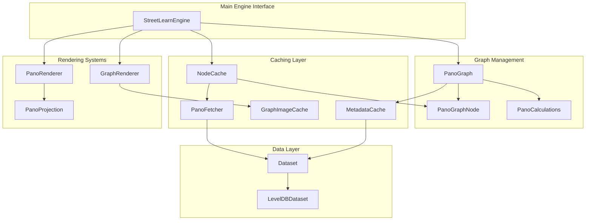
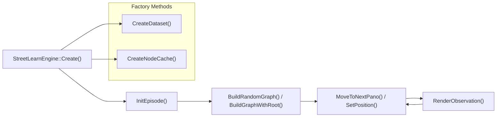
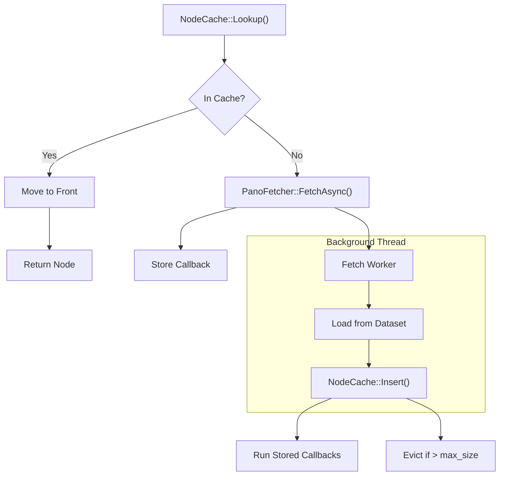
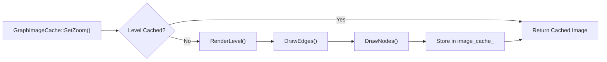
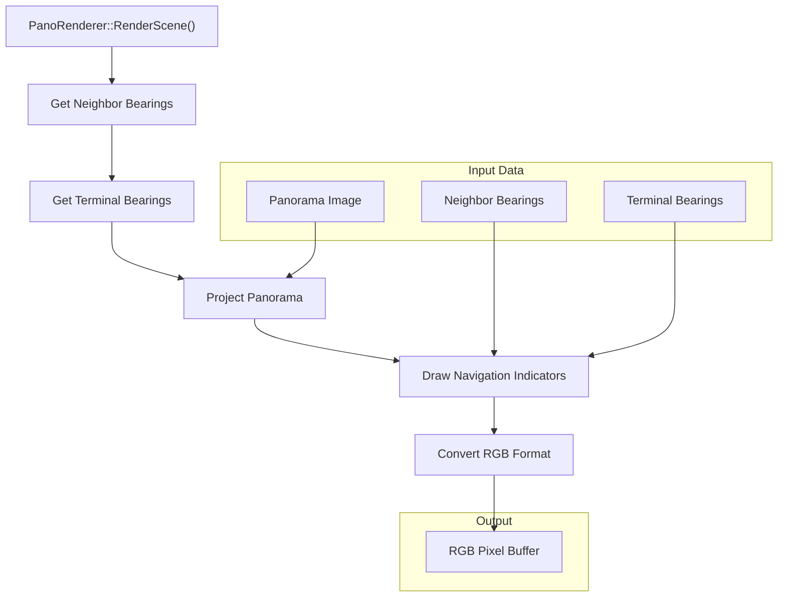
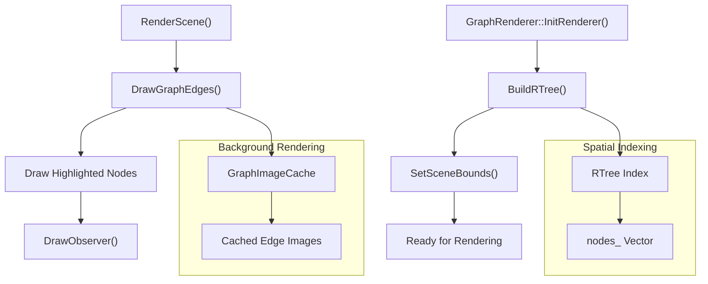

<!-- source: DeepWiki mcp.deepwiki.com · repo google-deepmind/streetlearn · page 7.2 Engine Development · fetched 2026-10-26 -->

# Engine Development

Relevant source files

The following files were used as context for generating this wiki page:

- [streetlearn/engine/BUILD](streetlearn/engine/BUILD)
- [streetlearn/engine/graph_image_cache.h](streetlearn/engine/graph_image_cache.h)
- [streetlearn/engine/graph_image_cache_test.cc](streetlearn/engine/graph_image_cache_test.cc)
- [streetlearn/engine/graph_renderer.cc](streetlearn/engine/graph_renderer.cc)
- [streetlearn/engine/graph_renderer.h](streetlearn/engine/graph_renderer.h)
- [streetlearn/engine/graph_renderer_test.cc](streetlearn/engine/graph_renderer_test.cc)
- [streetlearn/engine/node_cache.cc](streetlearn/engine/node_cache.cc)
- [streetlearn/engine/pano_graph_test.cc](streetlearn/engine/pano_graph_test.cc)
- [streetlearn/engine/streetlearn_engine.cc](streetlearn/engine/streetlearn_engine.cc)

This document provides guidance for developers working with the C++ engine components of StreetLearn. The engine layer handles the performance-critical aspects of the system including panorama processing, graph management, caching, and rendering. For information about building and compiling the engine, see [Build System](#7.1). For creating new games and Python environment extensions, see [Environment Development](#7.3).

## Engine Architecture Overview

The StreetLearn engine is built around several core C++ components that work together to provide efficient navigation and rendering capabilities. The main entry point is the `StreetLearnEngine` class, which coordinates between graph management, caching, and rendering subsystems.

**Core Engine Component Architecture**

**Sources:** [streetlearn/engine/streetlearn_engine.h](), [streetlearn/engine/BUILD:119-139](), [streetlearn/engine/pano_graph.h]()

## Core Engine Components

### StreetLearnEngine Class

The `StreetLearnEngine` class serves as the main interface for all engine operations. It manages the coordination between graph navigation, rendering, and caching systems.

**Key Methods and Lifecycle**

The engine creation process involves several steps as shown in [streetlearn/engine/streetlearn_engine.cc:50-68]():

1. **Dataset Creation**: Uses `CreateDataset()` to initialize the data source
2. **Cache Setup**: Creates a `NodeCache` with specified thread count and size
3. **Engine Construction**: Combines dataset and cache with rendering parameters

**Sources:** [streetlearn/engine/streetlearn_engine.cc:50-77](), [streetlearn/engine/streetlearn_engine.h]()

### PanoGraph Management

The `PanoGraph` class manages the navigation graph structure and provides methods for building subgraphs and navigating between panoramas.

**Graph Building Operations**

| Method | Purpose | Use Case |
|--------|---------|----------|
| `BuildRandomGraph()` | Creates graph from random starting point | Episode initialization |
| `BuildGraphWithRoot()` | Creates graph from specific panorama | Deterministic starting positions |
| `BuildEntireGraph()` | Loads complete dataset graph | Full exploration scenarios |
| `SetPosition()` | Moves to specific panorama | Direct navigation |
| `MoveToNeighbor()` | Moves based on bearing and tolerance | Agent movement actions |

The graph maintains depth constraints as defined in [streetlearn/engine/streetlearn_engine.cc:93-94]() with configurable `min_graph_depth` and `max_graph_depth` parameters.

**Sources:** [streetlearn/engine/pano_graph.h](), [streetlearn/engine/streetlearn_engine.cc:113-153](), [streetlearn/engine/pano_graph_test.cc:104-138]()

## Caching Systems

The engine implements a multi-layer caching strategy to optimize performance for repeated panorama access and rendering operations.

### NodeCache Architecture

The `NodeCache` provides asynchronous loading and LRU-based caching of `PanoGraphNode` objects:

**Cache Flow and Threading**

The cache implements thread-safe operations using `absl::Mutex` as shown in [streetlearn/engine/node_cache.cc:40-52]() and supports cancellation of pending fetches for cleanup.

**Sources:** [streetlearn/engine/node_cache.cc:19-112](), [streetlearn/engine/node_cache.h]()

### GraphImageCache System

The `GraphImageCache` provides multi-resolution caching of rendered graph images to support zoom operations efficiently:

**Zoom Level Management**

The system supports both standard and inverted color schemes through the `black_on_white` parameter and maintains separate image buffers for different zoom levels as implemented in [streetlearn/engine/graph_image_cache.h:114]().

**Sources:** [streetlearn/engine/graph_image_cache.h:38-115](), [streetlearn/engine/graph_image_cache_test.cc:94-121]()

## Rendering Systems

### PanoRenderer

The `PanoRenderer` handles panorama image projection and scene composition including neighbor indicators and terminal node visualization.

**Rendering Pipeline Components**

The renderer supports field-of-view adjustments and observer rotation as configured in [streetlearn/engine/streetlearn_engine.cc:155-160]() with angle constraints to prevent invalid orientations.

**Sources:** [streetlearn/engine/pano_renderer.h](), [streetlearn/engine/streetlearn_engine.cc:162-199]()

### GraphRenderer

The `GraphRenderer` creates top-down visualizations of the navigation graph with support for highlighting nodes and displaying observer position/orientation.

**Graph Rendering Architecture**

The renderer uses an R-tree spatial index for efficient node querying as implemented in [streetlearn/engine/graph_renderer.cc:132-154]() and supports zoom-dependent node visibility thresholds.

**Sources:** [streetlearn/engine/graph_renderer.cc:85-325](), [streetlearn/engine/graph_renderer.h:53-141](), [streetlearn/engine/graph_renderer_test.cc:92-151]()

## Development Patterns

### Adding New Rendering Features

When extending the rendering systems, follow these patterns:

1. **Extend Renderer Classes**: Add new methods to `PanoRenderer` or `GraphRenderer` for specific visualization needs
2. **Update Cache Systems**: Modify `GraphImageCache` if new visual elements need caching support  
3. **Coordinate with Engine**: Update `StreetLearnEngine` methods to expose new rendering options

### Memory Management

The engine uses RAII and smart pointers consistently:
- `std::shared_ptr` for shared resources like `Dataset` and `NodeCache`
- `std::unique_ptr` for owned objects like renderers
- Explicit cache size limits to prevent unbounded memory growth

### Thread Safety

Critical sections are protected using `absl::Mutex`:
- `NodeCache` operations use mutex for thread-safe access patterns
- `PanoFetcher` coordinates background loading threads
- Cache eviction policies maintain consistency under concurrent access

**Sources:** [streetlearn/engine/node_cache.cc:40-102](), [streetlearn/engine/BUILD:21-615]()

---

