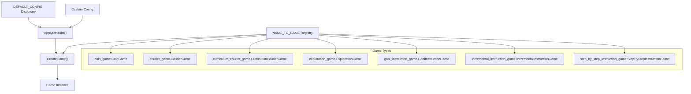
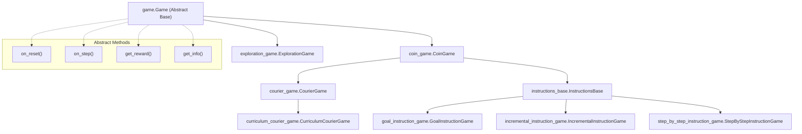
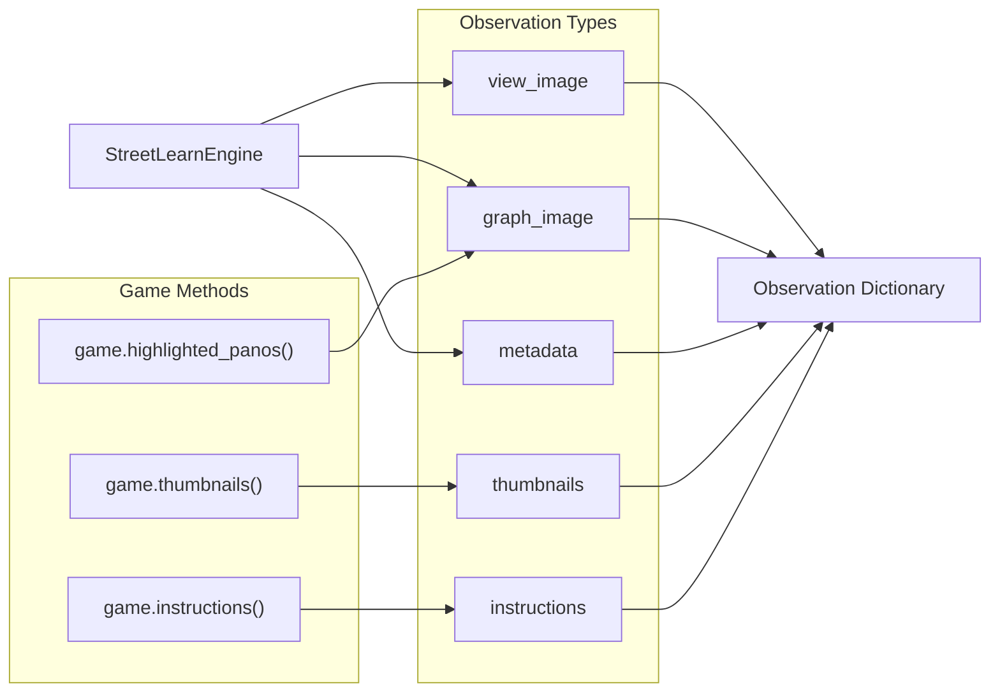
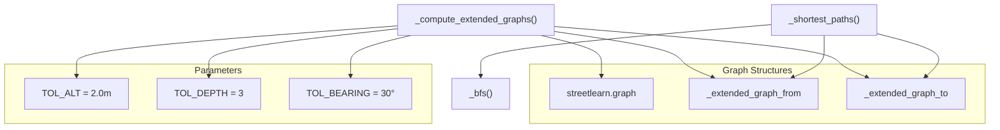

<!-- source: DeepWiki mcp.deepwiki.com · repo google-deepmind/streetlearn · page 7.3 Environment Development · fetched 2026-10-26 -->

# Environment Development

<details>
<summary>Relevant source files</summary>

The following files were used as context for generating this wiki page:

- [WORKSPACE](WORKSPACE)
- [streetlearn/python/environment/courier_game.py](streetlearn/python/environment/courier_game.py)
- [streetlearn/python/environment/curriculum_courier_game.py](streetlearn/python/environment/curriculum_courier_game.py)
- [streetlearn/python/environment/default_config.py](streetlearn/python/environment/default_config.py)
- [streetlearn/python/environment/game.py](streetlearn/python/environment/game.py)
- [streetlearn/python/environment/instructions_base.py](streetlearn/python/environment/instructions_base.py)

</details>


This document provides comprehensive instructions for extending the StreetLearn Python environment system by creating new games, implementing custom observation types, and modifying the environment configuration. It covers the core framework for developing navigation learning environments within the StreetLearn platform.

For information about the C++ engine components, see [Engine Development](#7.2). For details about the training system, see [Training and Experimentation](#5).

## Configuration System

The StreetLearn environment uses a centralized configuration system built around `DEFAULT_CONFIG` and a game factory pattern. All environment parameters are defined in a single configuration dictionary that can be customized per experiment.

### Configuration Architecture



**Sources:** [streetlearn/python/environment/default_config.py:31-90](), [streetlearn/python/environment/default_config.py:92-107](), [streetlearn/python/environment/default_config.py:109-121]()

### Key Configuration Parameters

| Parameter Category | Key Parameters | Purpose |
|-------------------|----------------|---------|
| **Display Settings** | `width`, `height`, `graph_width`, `graph_height` | Control output image dimensions |
| **Navigation** | `field_of_view`, `rotation_speed`, `action_spec` | Define agent movement capabilities |
| **Caching** | `max_cache_size`, `min_graph_depth`, `max_graph_depth` | Performance optimization |
| **Rewards** | `reward_per_coin`, `reward_at_waypoint`, `reward_at_goal` | Game-specific reward structures |
| **Curriculum** | `min_goal_distance_curriculum`, `max_goal_distance_curriculum` | Progressive difficulty |
| **Observations** | `observations` | List of observation types to include |

**Sources:** [streetlearn/python/environment/default_config.py:31-90]()

### Adding New Configuration Parameters

To add new configuration parameters:

1. Add the parameter to `DEFAULT_CONFIG` with a sensible default value
2. Access the parameter in your game constructor: `config['your_parameter']`
3. Ensure type consistency is maintained through `ApplyDefaults()`

**Sources:** [streetlearn/python/environment/default_config.py:109-117]()

## Game Development Framework

All StreetLearn games inherit from the abstract `Game` base class, which defines the core interface for environment interaction.

### Game Class Hierarchy



**Sources:** [streetlearn/python/environment/game.py:40-108](), [streetlearn/python/environment/courier_game.py:32-36](), [streetlearn/python/environment/curriculum_courier_game.py:33-39](), [streetlearn/python/environment/instructions_base.py:38-40]()

### Required Abstract Methods

Every game implementation must override these abstract methods:

| Method | Purpose | Return Value |
|--------|---------|-------------|
| `on_reset(streetlearn)` | Initialize game state after environment reset | Dictionary mapping pano IDs to colors |
| `on_step(streetlearn)` | Update game state after each agent step | None |
| `get_reward(streetlearn)` | Calculate reward for current step | Float reward value |
| `get_info(streetlearn)` | Provide environment information | Dictionary with game-specific info |

**Sources:** [streetlearn/python/environment/game.py:44-81]()

### Optional Methods and Properties

Games can optionally override these methods for additional functionality:

| Method/Property | Purpose | Default Return |
|----------------|---------|----------------|
| `goal_id` | Return ID of current goal pano | `None` |
| `done` | Indicate episode termination | `True` |
| `ground_truth_direction()` | Provide optimal action direction | Empty array |
| `thumbnails()` | Return observation thumbnails | Empty array |
| `instructions()` | Return instruction text | Empty string |
| `highlighted_panos()` | Return panos to highlight on map | Empty dictionary |

**Sources:** [streetlearn/python/environment/game.py:83-107]()

## Creating New Games

### Basic Game Implementation

To create a new game, follow this pattern:

1. **Inherit from appropriate base class**
   - For simple coin-collection games: inherit from `CoinGame`
   - For goal-directed navigation: inherit from `CourierGame`
   - For instruction-following: inherit from `InstructionsBase`
   - For completely new paradigms: inherit from `Game`

2. **Register the game in the factory**
   ```python
   NAME_TO_GAME = {
       'your_game_name': YourGameClass,
       # ... existing games
   }
   ```

3. **Implement required methods**

**Sources:** [streetlearn/python/environment/default_config.py:92-107]()

### Example: Courier Game Implementation

The `CourierGame` demonstrates key patterns for goal-directed navigation:

```mermaid
graph TD
    CourierGame["CourierGame"]
    CoinGame["CoinGame (parent)"]
    
    subgraph "Core Methods"
        on_reset_courier["on_reset()"]
        get_reward_courier["get_reward()"]
        get_info_courier["get_info()"]
        done_courier["done()"]
    end
    
    subgraph "Helper Methods"
        pick_random_goal["_pick_random_goal()"]
        sample_random_goal["_sample_random_goal()"]
        compute_reward["_compute_reward()"]
        compute_spl["_compute_spl_current_goal()"]
    end
    
    subgraph "State Variables"
        current_goal_id["_current_goal_id"]
        num_steps_this_goal["_num_steps_this_goal"]
        visited_panos["_visited_panos"]
        min_distance_reached["_min_distance_reached"]
    end
    
    CourierGame --> CoinGame
    CourierGame --> on_reset_courier
    CourierGame --> get_reward_courier
    CourierGame --> get_info_courier
    CourierGame --> done_courier
    
    CourierGame --> pick_random_goal
    CourierGame --> sample_random_goal
    CourierGame --> compute_reward
    CourierGame --> compute_spl
    
    CourierGame --> current_goal_id
    CourierGame --> num_steps_this_goal
    CourierGame --> visited_panos
    CourierGame --> min_distance_reached
```



**Sources:** [streetlearn/python/environment/courier_game.py:32-287]()

### Key Implementation Patterns

#### Goal Management
```python
def _pick_random_goal(self, streetlearn):
    """Randomly sets a new pano for the current goal."""
    self._visited_panos.clear()
    self._sample_random_goal(streetlearn)
    # Update shortest path computation
    shortest_path, num_panos = self._shortest_paths(
        streetlearn, self._current_goal_id, streetlearn.current_pano_id)
```

**Sources:** [streetlearn/python/environment/courier_game.py:190-219]()

#### Reward Calculation
```python
def _compute_reward(self, streetlearn):
    """Reward is a piecewise linear function of distance to the goal."""
    distance_to_goal = streetlearn.engine.GetPanoDistance(
        streetlearn.current_pano_id, self.goal_id)
    if distance_to_goal < self._min_radius_meters:
        reward = self._reward_current_goal
        found_goal = True
```

**Sources:** [streetlearn/python/environment/courier_game.py:220-261]()

#### State Tracking
Games should maintain relevant state variables and update them in `on_step()` and `get_reward()` methods.

**Sources:** [streetlearn/python/environment/courier_game.py:58-66]()

## Observation System

StreetLearn provides multiple observation types that can be enabled through configuration.

### Available Observation Types

| Observation Type | Description | Configuration Key |
|-----------------|-------------|-------------------|
| `view_image` | First-person panorama view | `'view_image'` |
| `graph_image` | Top-down graph visualization | `'graph_image'` |
| `metadata` | Pano coordinates and properties | Various metadata fields |
| `thumbnails` | Waypoint preview images | Returned by `thumbnails()` method |
| `instructions` | Text instructions | Returned by `instructions()` method |
| `lat_lng` | Geographic coordinates | Metadata fields |

**Sources:** [streetlearn/python/environment/default_config.py:78]()

### Observation Flow



**Sources:** [streetlearn/python/environment/game.py:92-98](), [streetlearn/python/environment/instructions_base.py:459-477]()

### Adding Custom Observations

To add new observation types:

1. **Extend the game class** to provide the observation data through new methods
2. **Modify the environment layer** to include the new observation in the observation dictionary
3. **Update configuration** to allow enabling/disabling the new observation type

Example pattern from instruction-following games:
```python
def thumbnails(self):
    """Returns observation thumbnails array of shape (batch_size, 3, h, w)."""
    return self._thumbnails

def instructions(self):
    """Returns a string containing game specific instructions."""
    return self._instructions
```

**Sources:** [streetlearn/python/environment/instructions_base.py:459-477]()

## Graph Operations and Pathfinding

Games often need to compute shortest paths and analyze graph connectivity. The base `Game` class provides sophisticated graph analysis capabilities.

### Extended Graph Computation



**Sources:** [streetlearn/python/environment/game.py:109-181](), [streetlearn/python/environment/game.py:31-37]()

### Using Pathfinding in Games

Games can use the built-in pathfinding for:
- Computing optimal actions for oracle agents
- Calculating reward based on path efficiency (SPL metric)
- Visualizing shortest paths on the graph

**Sources:** [streetlearn/python/environment/game.py:212-328](), [streetlearn/python/environment/courier_game.py:263-285]()

## Integration with Engine

Games interact with the StreetLearn C++ engine through the `streetlearn` parameter passed to all methods.

### Key Engine Interactions

| Engine Method | Purpose | Example Usage |
|---------------|---------|---------------|
| `GetPanoDistance(pano1, pano2)` | Calculate distance between panos | Distance-based rewards |
| `GetPanoBearing(pano1, pano2)` | Get bearing from pano1 to pano2 | Navigation ground truth |
| `GetMetadata(pano_id)` | Retrieve pano metadata | Coordinate information |
| `SetPosition(pano_id)` | Move agent to specific pano | Initial positioning |
| `RotateObserver(yaw, pitch)` | Set agent orientation | Camera control |
| `GetYaw()` | Get current agent orientation | Relative bearing calculations |

**Sources:** [streetlearn/python/environment/courier_game.py:186-188](), [streetlearn/python/environment/courier_game.py:158-160](), [streetlearn/python/environment/instructions_base.py:217-219]()

### Color and Visualization

Games can highlight panos on the graph visualization by returning color mappings:

```python
def on_reset(self, streetlearn):
    pano_id_to_color = {}
    pano_id_to_color[goal_pano_id] = self._colors['goal']
    pano_id_to_color[waypoint_pano_id] = self._colors['waypoint']
    return pano_id_to_color
```

**Sources:** [streetlearn/python/environment/courier_game.py:213-218](), [streetlearn/python/environment/instructions_base.py:235]()

This development framework provides the foundation for creating sophisticated navigation learning environments within the StreetLearn platform. The modular design allows for progressive complexity while maintaining consistency across different game types.