# Page: Overview

# Overview

<details>
<summary>Relevant source files</summary>

The following files were used as context for generating this wiki page:

- [README.md](README.md)

</details>


## Purpose and Scope

StreetLearn is a navigation learning platform that enables training AI agents in real-world photographic street environments using Google Street View data. This system provides a C++ engine for high-performance panorama processing and a Python environment interface for implementing navigation games and training agents.

This document covers the high-level architecture and core components of StreetLearn. For detailed information about specific subsystems, see [System Architecture](#2), [Environment System](#3), [Agent System](#4), and [Training and Experimentation](#5).

Sources: [README.md:1-425]()

## System Architecture Overview

StreetLearn follows a layered architecture with clear separation between the high-performance C++ engine and the flexible Python environment layer.

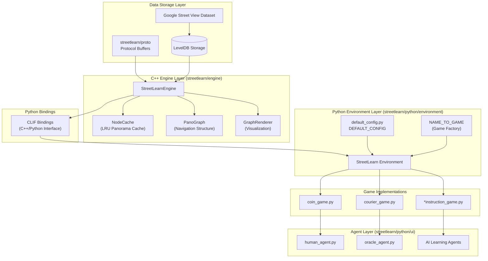

The system processes Google Street View panoramas through a multi-layered caching and rendering pipeline, exposing navigation functionality through Python interfaces that support various game types and agent implementations.

Sources: [README.md:32-62]()

## Core Components

### C++ Engine (`streetlearn/engine`)

The `StreetLearnEngine` provides high-performance panorama processing with the following key capabilities:

| Component | Function | Description |
|-----------|----------|-------------|
| `StreetLearnEngine` | Core engine | Loads, caches, and serves Street View panoramas |
| `NodeCache` | Caching | LRU cache for panorama data |
| `PanoGraph` | Navigation | Street graph structure for movement |
| `GraphRenderer` | Visualization | Renders top-down graph images |

The engine projects panoramas from equirectangular representation to first-person view at specified yaw, pitch, and field of view parameters.

Sources: [README.md:36-41]()

### Python Environment (`streetlearn/python/environment`)

The Python layer provides OpenAI Gym-compatible interfaces through:

- `StreetLearn` environment class with `step(action)` and `reset()` methods
- `BatchedStreetLearn` for multi-environment parallelization  
- Game factory system using `NAME_TO_GAME` registry
- Configuration management through `DEFAULT_CONFIG`

Sources: [README.md:45-51](), [README.md:259-264]()

### Protocol Buffers (`streetlearn/proto`)

Message definitions for storing panorama metadata and street graph structure, enabling efficient serialization and cross-language compatibility.

Sources: [README.md:42-44]()

## Data Flow Architecture

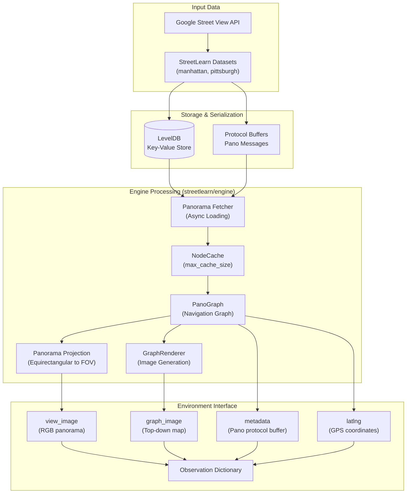

The data flows from raw Street View panoramas through caching and processing layers to produce rich observations for agent training. The `NodeCache` uses LRU eviction with configurable `max_cache_size`, while the `PanoGraph` maintains navigation connectivity.

Sources: [README.md:268-383]()

## Environment Configuration and Games

### Configuration System

Environment settings are managed through `streetlearn/python/default_config.py` with key parameters:

| Parameter Category | Key Settings | Purpose |
|-------------------|--------------|---------|
| Visual | `width`, `height`, `field_of_view` | Panorama rendering |
| Graph | `min_graph_depth`, `max_graph_depth` | BFS exploration bounds |
| Caching | `max_cache_size` | Memory management |
| Games | `game_name`, `action_spec` | Game selection and controls |

Sources: [README.md:266-343]()

### Game Factory System

Games are registered in the `NAME_TO_GAME` dictionary and instantiated dynamically:

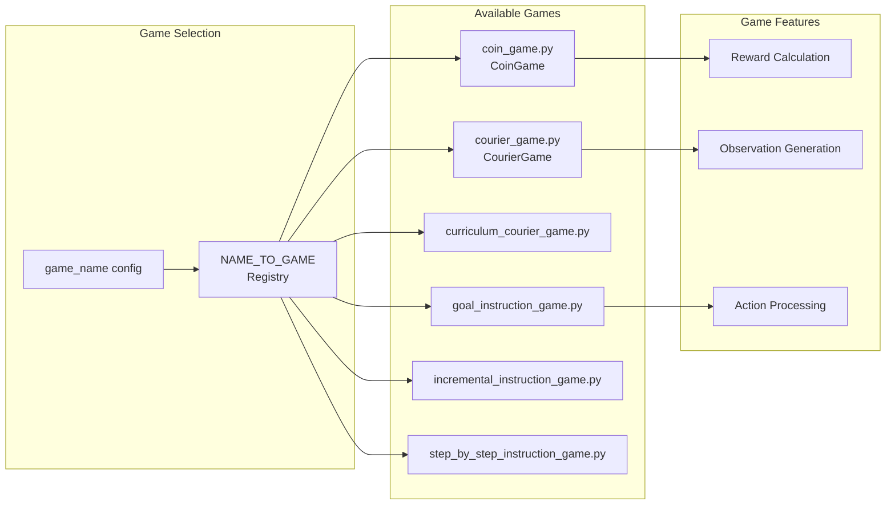

Each game implements specific reward structures and observation types, from simple coin collection to complex instruction-following navigation tasks.

Sources: [README.md:384-416]()

## Agent and Interface Architecture

StreetLearn supports multiple agent types through the UI system in `streetlearn/python/ui`:

| Agent Type | Implementation | Purpose |
|------------|----------------|---------|
| `human_agent.py` | Interactive control | Manual navigation and testing |
| `oracle_agent.py` | Ground truth navigation | Performance baselines |
| `batched_oracle_agent.py` | Parallel oracle processing | Batch evaluation |
| AI Learning Agents | Neural network-based | Reinforcement learning training |

The system uses PyGame for visualization, displaying both `view_image` (first-person view) and `graph_image` (top-down map) with navigation indicators and status information.

Sources: [README.md:52-62](), [README.md:173-216]()

---

# Page: System Architecture

# System Architecture

<details>
<summary>Relevant source files</summary>

The following files were used as context for generating this wiki page:

- [README.md](README.md)
- [WORKSPACE](WORKSPACE)
- [streetlearn/python/environment/game.py](streetlearn/python/environment/game.py)
- [streetlearn/python/environment/observations.py](streetlearn/python/environment/observations.py)
- [streetlearn/python/environment/streetlearn.py](streetlearn/python/environment/streetlearn.py)

</details>


## Purpose and Scope

This document explains the overall architecture of StreetLearn, a navigation learning platform that enables training AI agents in real-world photographic street environments using Google Street View data. It covers the multi-layer system design, component interactions, and data flow patterns across the C++ engine core, Python environment layer, and agent interfaces.

For information about specific environment games and observation types, see [Environment System](#3). For details on agent implementations and training, see [Agent System](#4) and [Training and Experimentation](#5).

## Architecture Overview

StreetLearn follows a layered architecture that separates high-performance computation (C++) from flexible environment logic (Python), connected through CLIF bindings.

### System Layers

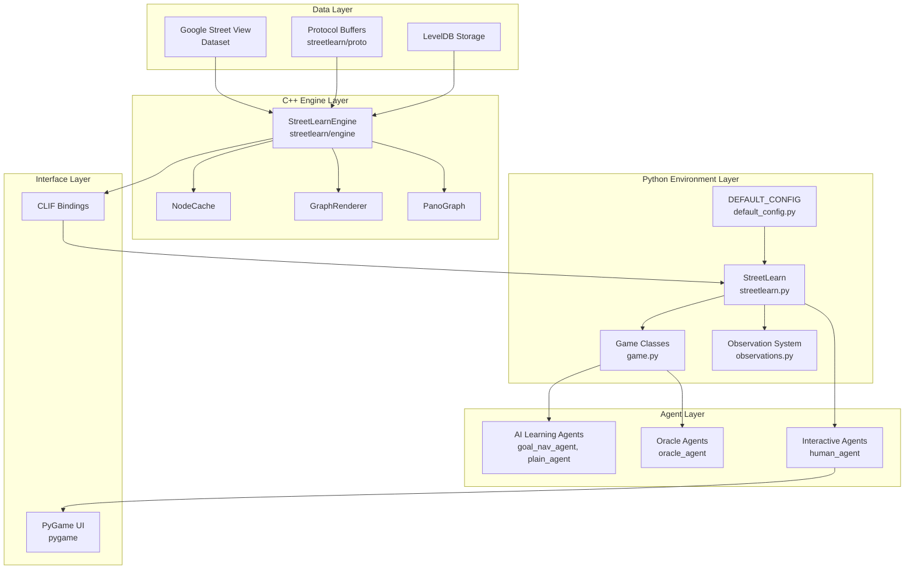

**Sources**: [README.md:32-63](), [streetlearn/python/environment/streetlearn.py:108-183]()

## Core Component Architecture

### Engine and Environment Interface

The C++ engine provides high-performance panorama processing and graph operations, while the Python environment handles game logic and agent interactions.

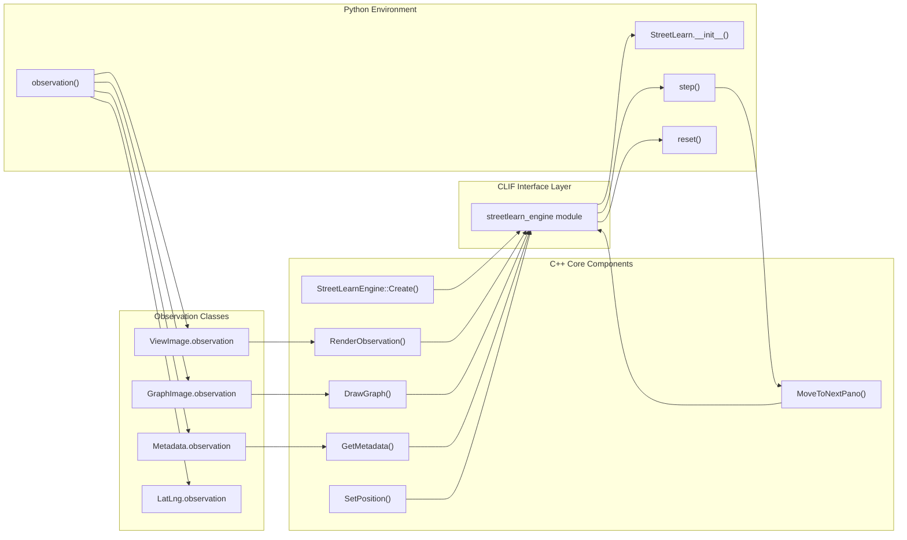

**Sources**: [streetlearn/python/environment/streetlearn.py:172-182](), [streetlearn/python/environment/observations.py:77-135]()

### Configuration and Game System

The environment uses a factory pattern with configuration-driven game instantiation and observation selection.

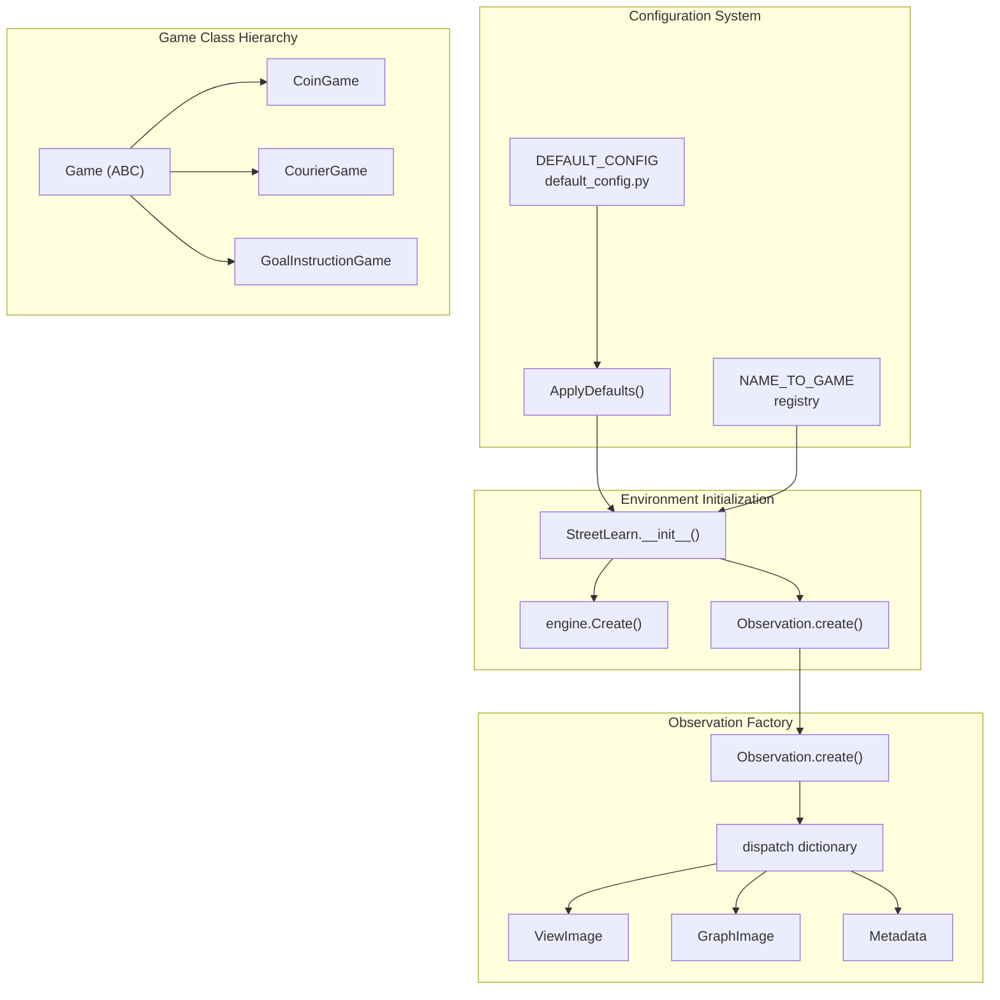

**Sources**: [streetlearn/python/environment/streetlearn.py:111-189](), [streetlearn/python/environment/observations.py:62-74](), [streetlearn/python/environment/game.py:40-107]()

## Data Flow and Caching Architecture

### Multi-Level Caching System

StreetLearn implements sophisticated caching to optimize Street View data access and rendering performance.

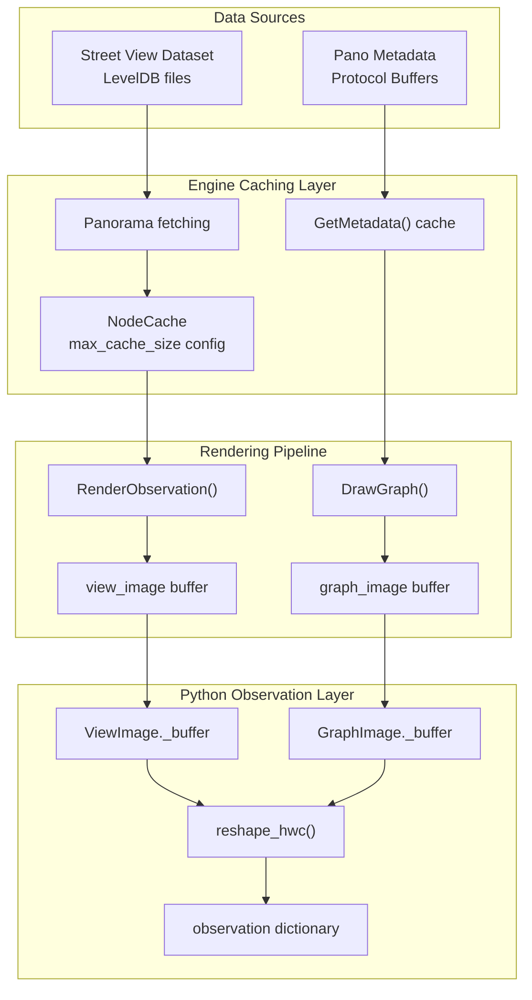

**Sources**: [streetlearn/python/environment/streetlearn.py:172-183](), [streetlearn/python/environment/observations.py:87-134](), [streetlearn/python/environment/observations.py:30-43]()

### Action Processing and State Updates

The environment processes actions through a structured pipeline that updates agent state and triggers game logic.

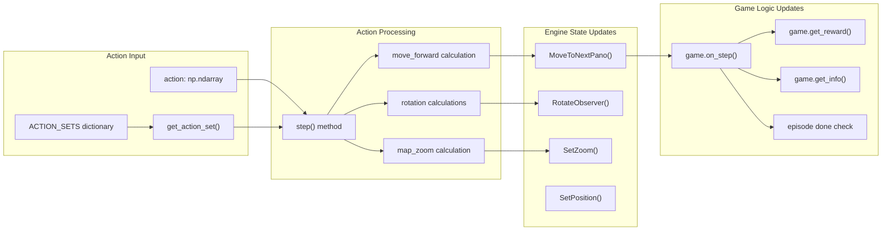

**Sources**: [streetlearn/python/environment/streetlearn.py:332-377](), [streetlearn/python/environment/streetlearn.py:60-98]()

## Build System and Dependencies

### External Dependencies Architecture

The system relies on multiple external libraries coordinated through Bazel build configuration.

| Component | Library | Purpose | Build Integration |
|-----------|---------|---------|-------------------|
| Machine Learning | TensorFlow | Neural network training | `@org_tensorflow` |
| Computer Vision | OpenCV | Image processing | `@opencv` local repository |
| Graphics Rendering | Cairo | 2D graphics rendering | `@cairo` local repository |
| Geometry | S2 Geometry | Spherical calculations | `@com_google_s2geometry` |
| Storage | LevelDB | Key-value panorama storage | `@com_google_leveldb` |
| Serialization | Protocol Buffers | Data structure serialization | `@com_google_protobuf` |
| Python Bindings | CLIF | C++/Python interface | `@clif` environment variable |

**Sources**: [WORKSPACE:1-106](), [README.md:64-201]()

### Component Interaction Boundaries

The architecture maintains clear separation between performance-critical C++ components and flexible Python logic through well-defined interfaces.

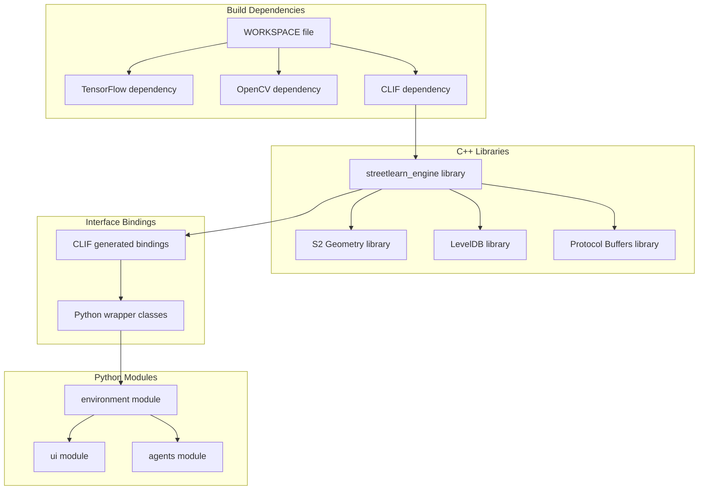

**Sources**: [WORKSPACE:89-106](), [README.md:97-104](), [README.md:158-171]()

---

# Page: Core Engine

# Core Engine

<details>
<summary>Relevant source files</summary>

The following files were used as context for generating this wiki page:

- [streetlearn/engine/graph_image_cache.h](streetlearn/engine/graph_image_cache.h)
- [streetlearn/engine/graph_renderer.cc](streetlearn/engine/graph_renderer.cc)
- [streetlearn/engine/graph_renderer.h](streetlearn/engine/graph_renderer.h)
- [streetlearn/engine/node_cache.cc](streetlearn/engine/node_cache.cc)
- [streetlearn/engine/node_cache.h](streetlearn/engine/node_cache.h)
- [streetlearn/engine/pano_fetcher.h](streetlearn/engine/pano_fetcher.h)
- [streetlearn/engine/pano_graph_test.cc](streetlearn/engine/pano_graph_test.cc)
- [streetlearn/engine/streetlearn_engine.cc](streetlearn/engine/streetlearn_engine.cc)

</details>


The Core Engine is the high-performance C++ component that forms the computational backbone of StreetLearn. It handles computationally intensive tasks including panorama loading, caching, graph management, and rendering operations. The engine provides the foundational infrastructure that enables efficient navigation simulation in Google Street View environments.

This document covers the C++ engine components and their interactions. For information about the Python environment that interfaces with this engine, see [Python Environment Layer](#2.2). For details on data management and caching strategies, see [Data Management and Caching](#2.3).

## Architecture Overview

The Core Engine consists of several interconnected C++ components that work together to provide efficient panorama processing and graph navigation capabilities.

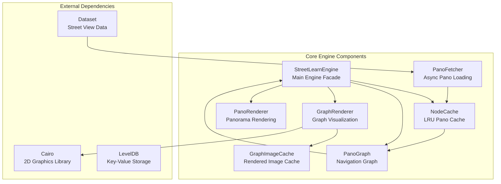

Sources: [streetlearn/engine/streetlearn_engine.cc:50-98](), [streetlearn/engine/node_cache.h:33-47](), [streetlearn/engine/graph_renderer.h:53-82]()

## StreetLearnEngine - Main Engine Facade

The `StreetLearnEngine` class serves as the primary interface to the Core Engine, coordinating all subsystems and providing a unified API for panorama navigation and rendering.

### Core Functionality

| Component | Responsibility |
|-----------|----------------|
| Graph Management | Building and navigating panorama graphs |
| Rendering Pipeline | Coordinating scene and observation rendering |
| Observer Control | Managing camera position and orientation |
| Metadata Access | Providing panorama and graph metadata |

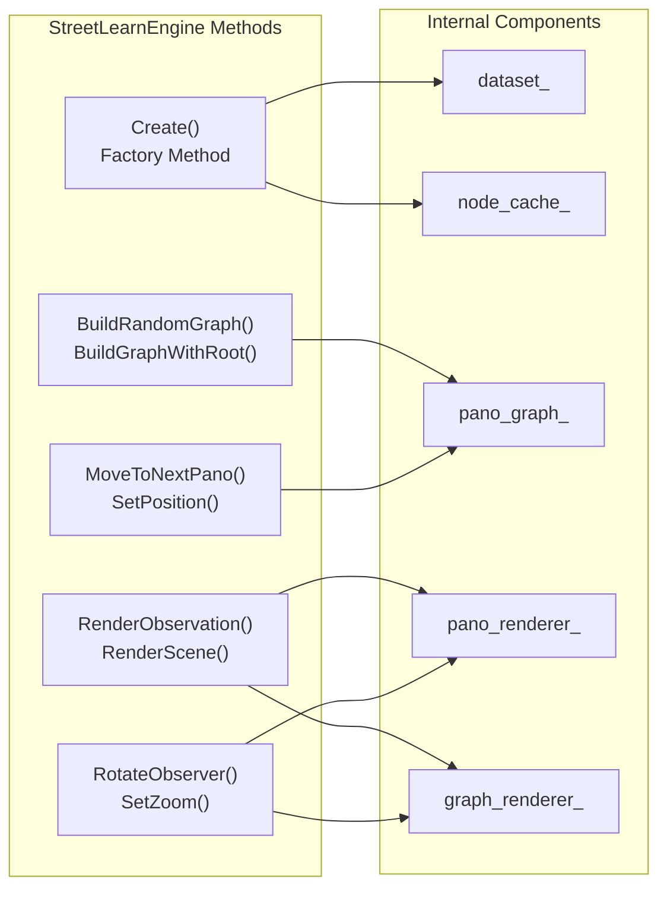

The engine initializes with specific rendering dimensions and caching parameters:

- **Panorama rendering**: Configurable width/height and field of view
- **Graph visualization**: Separate dimensions for graph images
- **Threading**: Uses 16 threads for panorama fetching by default
- **Caching**: Configurable maximum cache size for loaded panoramas

Sources: [streetlearn/engine/streetlearn_engine.cc:50-77](), [streetlearn/engine/streetlearn_engine.h:79-96]()

## NodeCache - LRU Panorama Caching

The `NodeCache` implements a thread-safe Least Recently Used (LRU) cache for `PanoGraphNode` objects, providing efficient access to frequently used panoramas while managing memory usage.

### Cache Architecture

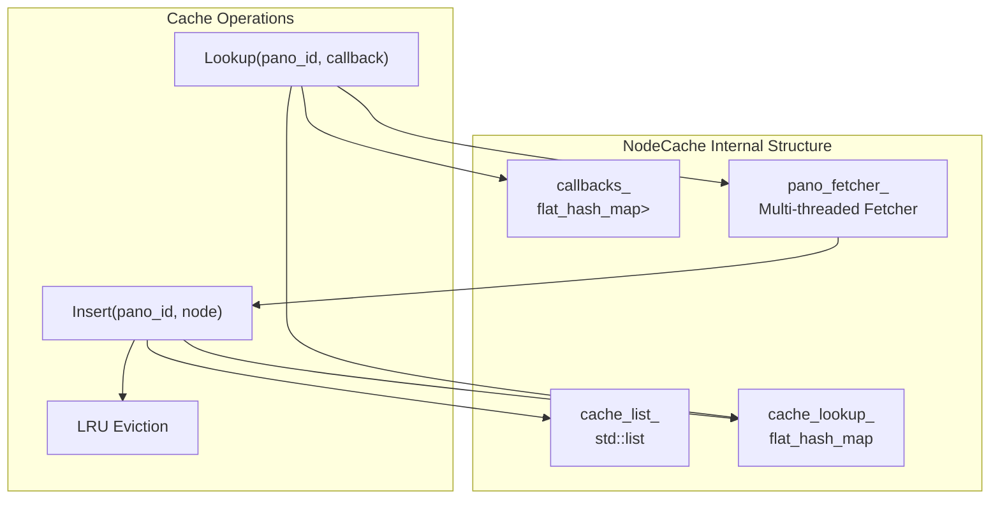

### Cache Behavior

The cache operates with the following characteristics:

- **Thread Safety**: All operations are protected by `absl::Mutex`
- **Asynchronous Loading**: Uses callback mechanism for non-blocking access
- **LRU Eviction**: Automatically removes least recently used items when capacity exceeded
- **Callback Management**: Queues callbacks for pending fetches and executes them when items become available

Key methods include:
- `Lookup(pano_id, callback)`: Returns `true` if item is cached, `false` if fetch required
- `Insert(pano_id, node)`: Adds item to cache and triggers pending callbacks
- `CancelPendingFetches()`: Cancels outstanding fetch requests

Sources: [streetlearn/engine/node_cache.h:33-127](), [streetlearn/engine/node_cache.cc:40-110]()

## PanoFetcher - Asynchronous Panorama Loading

The `PanoFetcher` provides multi-threaded, asynchronous loading of panorama data from the dataset storage, using a producer-consumer pattern with a synchronized queue.

### Threading Architecture

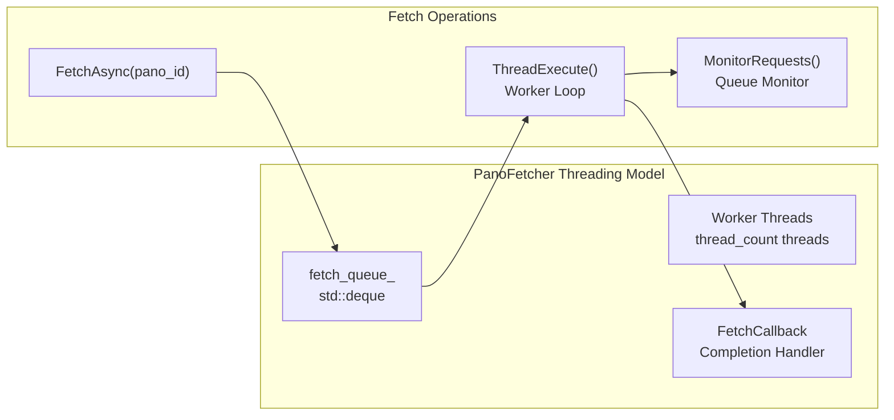

### Key Features

- **Thread Pool**: Configurable number of worker threads for parallel fetching
- **Queue Management**: Synchronized queue with non-blocking queue operations
- **Graceful Shutdown**: Proper thread termination and resource cleanup
- **Cancellation Support**: Ability to cancel pending fetches and return cancelled IDs

The fetcher integrates with the `NodeCache` through a callback mechanism, allowing the cache to be populated asynchronously without blocking client threads.

Sources: [streetlearn/engine/pano_fetcher.h:56-106](), [streetlearn/engine/pano_fetcher.cc:80-110]()

## Graph Rendering System

The graph rendering system consists of two main components that work together to provide efficient visualization of panorama graphs at different scales and zoom levels.

### GraphRenderer - Main Rendering Controller

The `GraphRenderer` class manages the overall graph visualization pipeline, including node positioning, observer visualization, and zoom management.

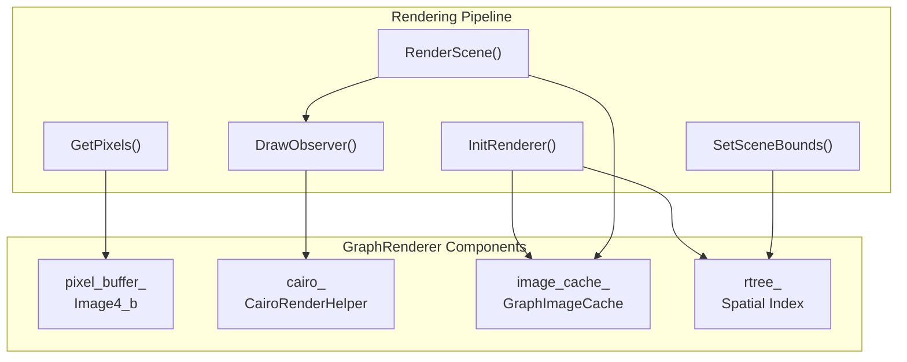

Key rendering features:
- **Spatial Indexing**: Uses R-tree for efficient node visibility culling
- **Observer Visualization**: Draws view cones showing agent orientation and field of view
- **Dynamic Bounds**: Automatically calculates optimal viewing regions
- **Color Mapping**: Supports custom node coloring for different visualization modes

### GraphImageCache - Multi-Level Image Caching

The `GraphImageCache` provides efficient caching of rendered graph images at multiple zoom levels, reducing redundant rendering operations.

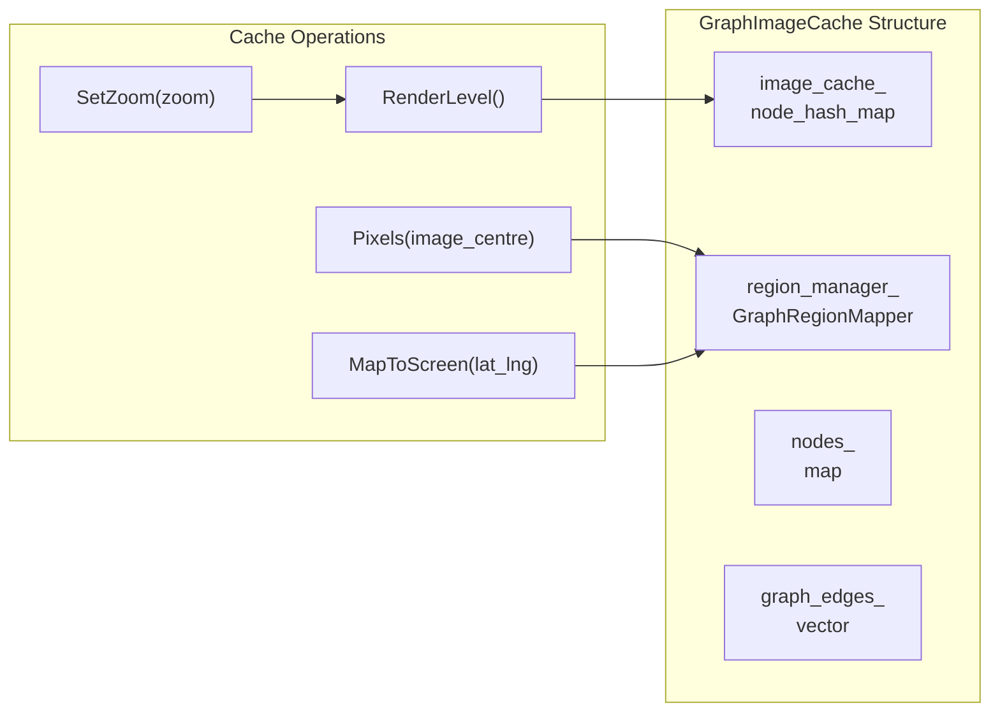

The cache operates with:
- **Multi-Level Storage**: Different images cached for each zoom level
- **On-Demand Rendering**: Images generated only when requested for new zoom levels
- **Coordinate Mapping**: Efficient lat/lng to screen coordinate transformation
- **Memory Management**: Automatic cleanup of unused zoom levels

Sources: [streetlearn/engine/graph_renderer.h:53-141](), [streetlearn/engine/graph_renderer.cc:85-325](), [streetlearn/engine/graph_image_cache.h:38-115]()

## Performance Characteristics

The Core Engine is designed for high-performance navigation simulation with several optimization strategies:

### Caching Strategy
- **Multi-Level Caching**: Panorama nodes, graph images, and metadata cached separately
- **LRU Eviction**: Intelligent memory management for long-running simulations
- **Asynchronous Loading**: Non-blocking panorama fetching prevents UI freezes

### Threading Model
- **Parallel Fetching**: Multiple threads for concurrent panorama loading
- **Thread-Safe Operations**: All shared data structures properly synchronized
- **Producer-Consumer Pattern**: Efficient queue-based work distribution

### Rendering Optimizations
- **Spatial Culling**: R-tree based visibility determination for large graphs
- **Image Caching**: Pre-rendered graph images reduce redundant drawing operations
- **Zoom-Level Management**: Different detail levels for different viewing scales

Sources: [streetlearn/engine/streetlearn_engine.cc:36-37](), [streetlearn/engine/node_cache.h:105-127](), [streetlearn/engine/graph_renderer.cc:37-40]()

---

# Page: Python Environment Layer

# Python Environment Layer

<details>
<summary>Relevant source files</summary>

The following files were used as context for generating this wiki page:

- [streetlearn/python/environment/courier_game.py](streetlearn/python/environment/courier_game.py)
- [streetlearn/python/environment/curriculum_courier_game.py](streetlearn/python/environment/curriculum_courier_game.py)
- [streetlearn/python/environment/default_config.py](streetlearn/python/environment/default_config.py)
- [streetlearn/python/environment/observations.py](streetlearn/python/environment/observations.py)
- [streetlearn/python/environment/streetlearn.py](streetlearn/python/environment/streetlearn.py)

</details>


The Python Environment Layer provides the primary interface between the C++ StreetLearn engine and Python-based reinforcement learning agents. This layer abstracts the low-level C++ functionality into a clean, extensible Python API that supports multiple game types, rich observations, and flexible configuration. 

For information about the underlying C++ engine components, see [Core Engine](#2.1). For details about specific game implementations and reward structures, see [Game Types](#3.2).

## Core Architecture

The Python Environment Layer consists of four main components that work together to provide a complete RL environment interface:

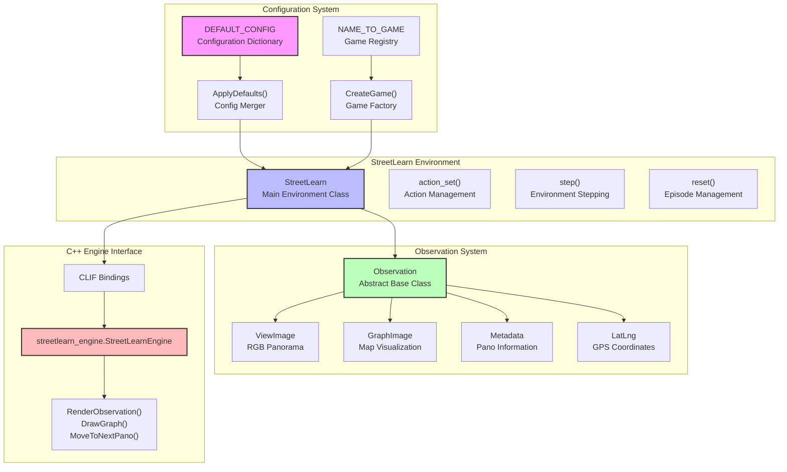

**Sources:** [streetlearn/python/environment/default_config.py:31-122](), [streetlearn/python/environment/streetlearn.py:108-419](), [streetlearn/python/environment/observations.py:46-396]()

## Configuration System

The configuration system provides centralized management of environment settings through a dictionary-based approach with intelligent defaults and game factory registration.

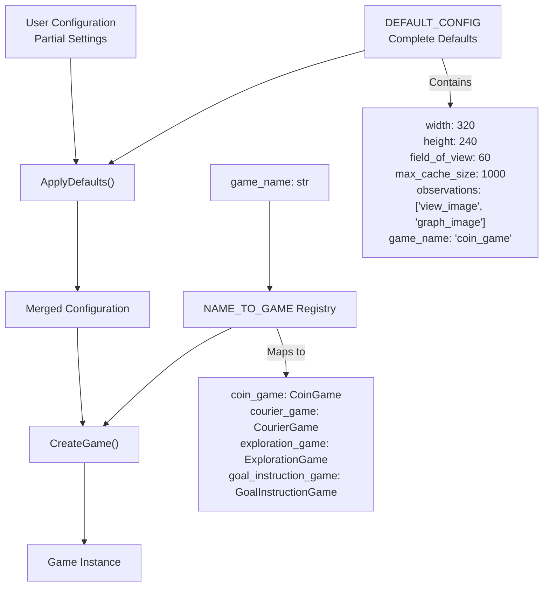

The `DEFAULT_CONFIG` dictionary at [streetlearn/python/environment/default_config.py:31-90]() contains comprehensive defaults for all environment parameters:

| Category | Key Parameters | Purpose |
|----------|----------------|---------|
| **Rendering** | `width`, `height`, `field_of_view` | Control visual output dimensions |
| **Graph** | `graph_width`, `graph_height`, `max_graph_depth` | Configure map visualization |
| **Caching** | `max_cache_size` | Control memory usage |
| **Actions** | `action_spec`, `rotation_speed` | Define available agent actions |
| **Observations** | `observations` | Specify which observation types to include |
| **Games** | `game_name`, reward parameters | Configure game-specific settings |

The `ApplyDefaults()` function at [streetlearn/python/environment/default_config.py:109-117]() merges user configuration with defaults while performing type checking to ensure consistency.

**Sources:** [streetlearn/python/environment/default_config.py:31-122]()

## StreetLearn Environment Class

The `StreetLearn` class at [streetlearn/python/environment/streetlearn.py:108-419]() serves as the main environment orchestrator, managing the complete RL episode lifecycle:

```mermaid
graph TD
    subgraph "Initialization"
        Constructor["__init__()"]
        CreateEngine["Create/Clone Engine"]
        SetupObservations["Setup Observations"]
        ConfigureActions["Configure Action Set"]
    end
    
    subgraph "Episode Management"
        Reset["reset()"]
        BuildGraph["Build/Reuse Graph"]
        InitGame["Initialize Game"]
        SetupRenderer["Setup Graph Renderer"]
    end
    
    subgraph "Step Execution"
        Step["step(action)"]
        ProcessAction["Process Action Components"]
        UpdateEngine["Update Engine State"]
        ComputeReward["Compute Game Reward"]
        CheckDone["Check Episode End"]
        GetObservation["Get Observations"]
    end
    
    subgraph "Action Processing"
        ActionSet["get_action_set()"]
        MoveForward["move_forward"]
        HorizontalRotation["horizontal_rotation"]
        VerticalRotation["vertical_rotation"]
        MapZoom["map_zoom"]
    end
    
    Constructor --> CreateEngine
    CreateEngine --> SetupObservations
    SetupObservations --> ConfigureActions
    
    Reset --> BuildGraph
    BuildGraph --> InitGame
    InitGame --> SetupRenderer
    
    Step --> ProcessAction
    ProcessAction --> UpdateEngine
    UpdateEngine --> ComputeReward
    ComputeReward --> CheckDone
    CheckDone --> GetObservation
    
    ActionSet --> MoveForward
    ActionSet --> HorizontalRotation
    ActionSet --> VerticalRotation
    ActionSet --> MapZoom
```

### Key Methods

- **`__init__()`** at [streetlearn/python/environment/streetlearn.py:111-196](): Initializes engine connection, applies configuration, and sets up observation pipeline
- **`reset()`** at [streetlearn/python/environment/streetlearn.py:274-314](): Manages episode initialization, graph building, and game setup
- **`step()`** at [streetlearn/python/environment/streetlearn.py:332-377](): Processes agent actions, updates environment state, and returns observations
- **`observation()`** at [streetlearn/python/environment/streetlearn.py:379-381](): Collects and returns current observations from all configured observers

### Action System

The environment supports flexible action specifications through the `ACTION_SETS` dictionary at [streetlearn/python/environment/streetlearn.py:69-86]():

- **`streetlearn_default`**: Basic movement and rotation (3 actions)
- **`streetlearn_fast_rotate`**: Extended rotation speeds (5 actions)  
- **`streetlearn_tilt`**: Includes vertical camera control (5 actions)

**Sources:** [streetlearn/python/environment/streetlearn.py:108-419]()

## Observation System

The observation system provides rich, multi-modal environmental information through a polymorphic class hierarchy rooted at the abstract `Observation` base class:

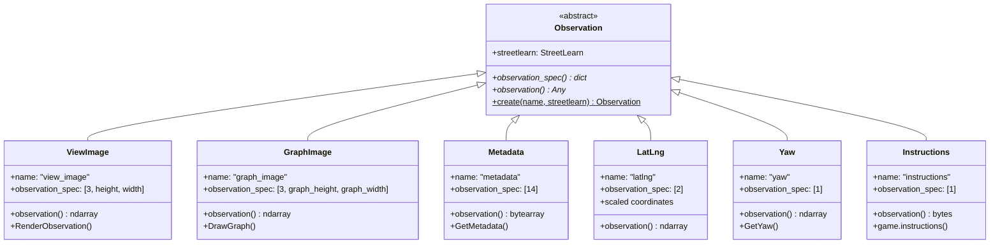

### Core Observation Types

| Observation | Shape | Description | Engine Method |
|-------------|-------|-------------|---------------|
| **`view_image`** | `[3, H, W]` | RGB panorama view | `RenderObservation()` |
| **`graph_image`** | `[3, H, W]` | Map visualization | `DrawGraph()` |
| **`metadata`** | `[14]` | Pano protocol buffer | `GetMetadata()` |
| **`latlng`** | `[2]` | Scaled GPS coordinates | `GetMetadata().coords` |
| **`yaw`** | `[1]` | Camera heading | `GetYaw()` |
| **`instructions`** | `[1]` | Game instructions | `game.instructions()` |

The observation factory at [streetlearn/python/environment/observations.py:62-74]() uses a dispatch pattern to instantiate the correct observation type based on string names from the configuration.

**Sources:** [streetlearn/python/environment/observations.py:46-396]()

## Game Framework Integration

The environment integrates with the game framework through a clean interface that allows games to customize rewards, visualization, and episode logic:

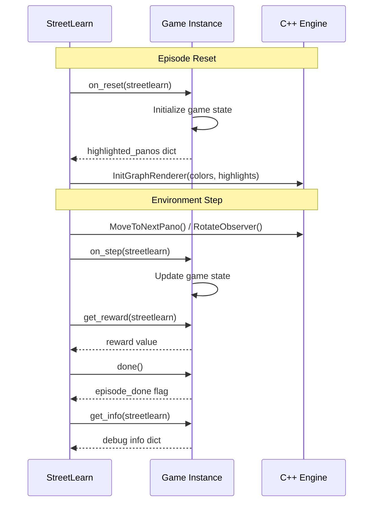

Games interact with the environment through several key methods:
- **`on_reset()`**: Initialize game state and return highlighted panoramas for visualization
- **`on_step()`**: Update game state after each environment step  
- **`get_reward()`**: Compute step reward based on current environment state
- **`done()`**: Determine if episode should terminate
- **`get_info()`**: Provide debugging and analysis information

Example game implementations include `CourierGame` at [streetlearn/python/environment/courier_game.py:32-286]() and `CurriculumCourierGame` at [streetlearn/python/environment/curriculum_courier_game.py:33-145]().

**Sources:** [streetlearn/python/environment/courier_game.py:67-161](), [streetlearn/python/environment/curriculum_courier_game.py:94-123]()

## C++ Engine Interface

The Python environment interfaces with the C++ engine through CLIF-generated bindings that expose core engine functionality:

| Engine Method | Purpose | Usage in Python Layer |
|---------------|---------|----------------------|
| **`Create()`** | Initialize engine | [streetlearn.py:172-182]() |
| **`RenderObservation()`** | Generate view image | [observations.py:96]() |
| **`DrawGraph()`** | Render map visualization | [observations.py:134]() |
| **`MoveToNextPano()`** | Navigate to adjacent pano | [streetlearn.py:354]() |
| **`RotateObserver()`** | Change camera orientation | [streetlearn.py:361]() |
| **`GetMetadata()`** | Retrieve pano information | [observations.py:208]() |
| **`GetYaw()`** | Get camera heading | [observations.py:164]() |

The engine reference is stored in `self._engine` at [streetlearn/python/environment/streetlearn.py:159-182]() and accessed throughout the observation system to retrieve real-time environmental data.

**Sources:** [streetlearn/python/environment/streetlearn.py:159-182](), [streetlearn/python/environment/observations.py:96](), [streetlearn/python/environment/observations.py:134]()

---

# Page: Data Management and Caching

# Data Management and Caching

<details>
<summary>Relevant source files</summary>

The following files were used as context for generating this wiki page:

- [streetlearn/engine/graph_image_cache.cc](streetlearn/engine/graph_image_cache.cc)
- [streetlearn/engine/node_cache.h](streetlearn/engine/node_cache.h)
- [streetlearn/engine/pano_fetcher.h](streetlearn/engine/pano_fetcher.h)
- [streetlearn/engine/pano_graph.cc](streetlearn/engine/pano_graph.cc)
- [streetlearn/python/environment/coin_game.py](streetlearn/python/environment/coin_game.py)

</details>


## Purpose and Scope

This document describes the multi-layered caching and data management system in StreetLearn that efficiently handles Street View panorama data, metadata, and rendered visualizations. The system consists of three main caching components: the `NodeCache` for panorama nodes, the `PanoFetcher` for asynchronous data loading, and the `GraphImageCache` for rendered graph visualizations.

For information about the core engine architecture, see [2.1](#2.1). For details about the Python environment layer that consumes cached data, see [2.2](#2.2).

## Data Flow Overview

The StreetLearn caching system implements a sophisticated multi-tier architecture that optimizes data access patterns for navigation learning environments.

```mermaid
graph TD
    subgraph "Storage Layer"
        Dataset[Dataset]
        LevelDB[(LevelDB Storage)]
        ProtoBuffers["Protocol Buffers<br/>(streetlearn.pb.h)"]
    end
    
    subgraph "Fetching Layer"
        PanoFetcher["PanoFetcher<br/>(async loading)"]
        FetchQueue["fetch_queue_<br/>(deque<string>)"]
        WorkerThreads["Worker Threads<br/>(std::vector<thread>)"]
    end
    
    subgraph "Caching Layer"
        NodeCache["NodeCache<br/>(LRU cache)"]
        CacheList["cache_list_<br/>(list<CacheEntry>)"]
        CacheLookup["cache_lookup_<br/>(flat_hash_map)"]
        MetadataCache["MetadataCache<br/>(metadata storage)"]
    end
    
    subgraph "Rendering Cache"
        GraphImageCache["GraphImageCache<br/>(rendered images)"]
        ImageCache["image_cache_<br/>(map<zoom, Image4_b>)"]
        RegionManager["RegionManager<br/>(coordinate mapping)"]
    end
    
    subgraph "Consumer Layer"
        PanoGraph["PanoGraph<br/>(navigation graph)"]
        Environment["StreetLearn Environment"]
        Observations["Observation System"]
    end
    
    Dataset --> PanoFetcher
    LevelDB --> PanoFetcher
    ProtoBuffers --> PanoFetcher
    
    PanoFetcher --> FetchQueue
    FetchQueue --> WorkerThreads
    WorkerThreads --> NodeCache
    
    NodeCache --> CacheList
    NodeCache --> CacheLookup
    NodeCache --> PanoGraph
    
    MetadataCache --> PanoGraph
    PanoGraph --> GraphImageCache
    GraphImageCache --> ImageCache
    GraphImageCache --> RegionManager
    
    PanoGraph --> Environment
    GraphImageCache --> Environment
    Environment --> Observations
```

**Data Flow Architecture**

Sources: [streetlearn/engine/node_cache.h:47-128](), [streetlearn/engine/pano_fetcher.h:56-106](), [streetlearn/engine/graph_image_cache.cc:47-194]()

## Node Caching System

The `NodeCache` class implements a thread-safe LRU (Least Recently Used) cache for `PanoGraphNode` objects, which contain panorama images and associated metadata.

### NodeCache Architecture

```mermaid
graph LR
    subgraph "NodeCache Internal Structure"
        Lookup["Lookup(pano_id, callback)"]
        CacheList["cache_list_<br/>(LRU ordered list)"]
        CacheLookup["cache_lookup_<br/>(hash map for O(1) access)"]
        Callbacks["callbacks_<br/>(pending load callbacks)"]
        PanoFetcher["pano_fetcher_<br/>(async loader)"]
    end
    
    subgraph "Thread Safety"
        Mutex["mutex_<br/>(absl::Mutex)"]
        ThreadAnnotations["STREETLEARN_LOCKS_EXCLUDED<br/>STREETLEARN_GUARDED_BY"]
    end
    
    subgraph "Cache Operations"
        Insert["Insert(pano_id, node)"]
        RunCallbacks["RunCallbacks()"]
        CancelFetches["CancelPendingFetches()"]
    end
    
    Lookup --> CacheList
    Lookup --> CacheLookup
    Lookup --> Callbacks
    CacheList --> Insert
    Insert --> RunCallbacks
    PanoFetcher --> Insert
    
    Mutex --> CacheList
    Mutex --> CacheLookup
    Mutex --> Callbacks
```

**NodeCache Component Relationships**

The cache uses a dual data structure approach for optimal performance:

| Component | Type | Purpose |
|-----------|------|---------|
| `cache_list_` | `std::list<CacheEntry>` | Maintains LRU ordering |
| `cache_lookup_` | `absl::flat_hash_map` | Provides O(1) lookup access |
| `callbacks_` | `absl::flat_hash_map<string, list<LoadCallback>>` | Manages pending async requests |
| `pano_fetcher_` | `PanoFetcher` | Handles disk I/O operations |

### Cache Lookup Flow

The `NodeCache::Lookup` method implements an efficient callback-based async loading pattern:

```mermaid
graph TD
    LookupCall["Lookup(pano_id, callback)"]
    CheckCache{"pano_id in cache?"}
    ReturnImmediate["Return true<br/>(immediate callback)"]
    AddCallback["Add callback to<br/>callbacks_[pano_id]"]
    StartFetch["pano_fetcher_.FetchAsync(pano_id)"]
    ReturnPending["Return false<br/>(pending fetch)"]
    
    FetchComplete["Fetch completes"]
    InsertCall["Insert(pano_id, node)"]
    RunCallbacks["RunCallbacks(callbacks, node)"]
    
    LookupCall --> CheckCache
    CheckCache -->|Yes| ReturnImmediate
    CheckCache -->|No| AddCallback
    AddCallback --> StartFetch
    StartFetch --> ReturnPending
    
    FetchComplete --> InsertCall
    InsertCall --> RunCallbacks
```

**Cache Lookup State Machine**

Sources: [streetlearn/engine/node_cache.h:63-67](), [streetlearn/engine/node_cache.h:82-94]()

## Asynchronous Data Fetching

The `PanoFetcher` class provides asynchronous panorama loading using a thread pool and synchronized queue system.

### PanoFetcher Threading Model

```mermaid
graph TB
    subgraph "Main Thread"
        FetchAsync["FetchAsync(pano_id)"]
        FetchSync["Fetch(pano_id)"]
    end
    
    subgraph "Synchronization"
        QueueMutex["queue_mutex_<br/>(absl::Mutex)"]
        FetchQueue["fetch_queue_<br/>(deque<string>)"]
        ShutdownFlag["shutdown_<br/>(bool)"]
    end
    
    subgraph "Worker Thread Pool"
        Thread1["Thread 1<br/>ThreadExecute()"]
        Thread2["Thread 2<br/>ThreadExecute()"]
        ThreadN["Thread N<br/>ThreadExecute()"]
    end
    
    subgraph "Fetch Process"
        MonitorRequests["MonitorRequests()"]
        LoadFromDisk["Load from Dataset"]
        FetchCallback["FetchCallback<br/>(to NodeCache)"]
    end
    
    FetchAsync --> QueueMutex
    QueueMutex --> FetchQueue
    
    Thread1 --> MonitorRequests
    Thread2 --> MonitorRequests
    ThreadN --> MonitorRequests
    
    MonitorRequests --> LoadFromDisk
    LoadFromDisk --> FetchCallback
    
    FetchQueue --> MonitorRequests
    ShutdownFlag --> MonitorRequests
```

**PanoFetcher Thread Pool Architecture**

The fetcher implements a producer-consumer pattern where the main thread queues requests and worker threads process them:

- **Thread Count**: Configurable via constructor parameter
- **Queue Management**: Thread-safe `std::deque<std::string>` for pano IDs
- **Callback Mechanism**: `FetchCallback` function called on completion
- **Cancellation**: `CancelPendingFetches()` clears queue and returns cancelled IDs

Sources: [streetlearn/engine/pano_fetcher.h:62-63](), [streetlearn/engine/pano_fetcher.h:81-87](), [streetlearn/engine/pano_fetcher.h:95-105]()

## Graph Image Caching

The `GraphImageCache` class manages rendered visualizations of the navigation graph at different zoom levels using Cairo graphics.

### GraphImageCache Structure

```mermaid
graph LR
    subgraph "Cache Storage"
        ImageCache["image_cache_<br/>(map<double, Image4_b>)"]
        CurrentZoom["current_zoom_<br/>(double)"]
        ScreenSize["screen_size_<br/>(Vector2_i)"]
    end
    
    subgraph "Rendering System"
        RegionManager["region_manager_<br/>(coordinate mapping)"]
        CairoContext["CairoRenderHelper<br/>(graphics context)"]
        GraphEdges["graph_edges_<br/>(vector<Edge>)"]
        Nodes["nodes_<br/>(map<string, S2LatLng>)"]
    end
    
    subgraph "Visual Elements"
        DrawEdges["DrawEdges()"]
        DrawNodes["DrawNodes()"]
        HighlightedNodes["highlighted_nodes_<br/>(map<string, Color>)"]
    end
    
    ImageCache --> CurrentZoom
    RegionManager --> CairoContext
    GraphEdges --> DrawEdges
    Nodes --> DrawNodes
    HighlightedNodes --> DrawNodes
    
    DrawEdges --> CairoContext
    DrawNodes --> CairoContext
```

**GraphImageCache Rendering Pipeline**

### Zoom Level Management

The cache maintains separate rendered images for different zoom levels:

| Zoom Range | Rendering Features | Performance Characteristics |
|------------|-------------------|---------------------------|
| 1-32 | Full graph with edges | Pre-rendered and cached |
| ≥ 1 | Node visualization enabled | Conditional rendering |
| < 1 | Edges only | Minimal detail level |

The `SetZoom()` method triggers on-demand rendering:

```mermaid
graph TD
    SetZoom["SetZoom(zoom)"]
    ValidateRange{"zoom in [1, 32]?"}
    CheckCache{"zoom in image_cache_?"}
    ResetBounds["region_manager_.ResetCurrentBounds(zoom)"]
    RenderLevel["RenderLevel()"]
    UseExisting["Use cached image"]
    
    SetZoom --> ValidateRange
    ValidateRange -->|Yes| CheckCache
    ValidateRange -->|No| Error["CHECK failure"]
    CheckCache -->|No| ResetBounds
    CheckCache -->|Yes| UseExisting
    ResetBounds --> RenderLevel
```

**Zoom Level Processing Flow**

Sources: [streetlearn/engine/graph_image_cache.cc:61-71](), [streetlearn/engine/graph_image_cache.cc:97-124](), [streetlearn/engine/graph_image_cache.cc:126-157]()

## Cache Integration and Performance

### PanoGraph Cache Coordination

The `PanoGraph` class orchestrates multiple caching systems to provide efficient navigation graph operations:

```mermaid
graph TB
    subgraph "PanoGraph"
        BuildGraph["BuildGraph()"]
        PrefetchGraph["PrefetchGraph()"]
        SetPosition["SetPosition()"]
    end
    
    subgraph "Cache Systems"
        NodeCache["node_cache_<br/>(shared_ptr<NodeCache>)"]
        MetadataCache["metadata_cache_<br/>(MetadataCache)"]
        BlockingCounter["blockingCounter_<br/>(BlockingCounter)"]
    end
    
    subgraph "Prefetch Strategy"
        FetchRoot["FetchNode(root) - sync"]
        FetchSubtree["PrefetchNode(node_id) - async"]
        WaitCompletion["blockingCounter_->Wait()"]
    end
    
    BuildGraph --> MetadataCache
    PrefetchGraph --> NodeCache
    PrefetchGraph --> FetchRoot
    PrefetchGraph --> FetchSubtree
    FetchSubtree --> BlockingCounter
    SetPosition --> PrefetchGraph
```

**PanoGraph Cache Orchestration**

### Performance Characteristics

| Operation | Synchronization | Typical Latency | Cache Behavior |
|-----------|----------------|-----------------|----------------|
| `NodeCache::Lookup` (hit) | Lock-free read | < 1ms | Immediate callback |
| `NodeCache::Lookup` (miss) | Async fetch | 10-100ms | Queued for loading |
| `GraphImageCache::SetZoom` (cached) | None | < 1ms | Direct image access |
| `GraphImageCache::SetZoom` (new) | Rendering | 50-200ms | Cairo rendering |

### Thread Safety Implementation

All caching systems implement thread safety using different strategies:

- **NodeCache**: `absl::Mutex` with thread annotations (`STREETLEARN_LOCKS_EXCLUDED`, `STREETLEARN_GUARDED_BY`)
- **PanoFetcher**: Queue-based synchronization with worker thread pool
- **GraphImageCache**: Single-threaded rendering with cached results

Sources: [streetlearn/engine/pano_graph.cc:121-164](), [streetlearn/engine/pano_graph.cc:429-455](), [streetlearn/engine/node_cache.h:105-127]()

## Cache Configuration and Sizing

### NodeCache Configuration

Cache size is determined at construction and affects memory usage and hit rates:

```cpp
// From node_cache.h constructor
NodeCache(const Dataset* dataset, int thread_count, std::size_t max_size);
```

The cache maintains current size via `cache_size_` and evicts LRU entries when `max_size_` is exceeded.

### Usage in Environment Games

Games like `CoinGame` monitor cache performance through the StreetLearn environment:

```python
# Cache size monitoring in coin_game.py
logging.info('seed %d, %d/%d coins left, cache size %d, current pano: %s',
             streetlearn.seed, len(self._coin_pano_id_set), self._num_coins,
             streetlearn.cache_size, streetlearn.current_pano_id)
```

### Memory Management Strategy

The caching system implements several memory optimization techniques:

- **LRU Eviction**: Automatic removal of least recently used panorama nodes
- **Async Loading**: Non-blocking I/O prevents thread starvation  
- **Zoom-based Rendering**: Multiple zoom levels cached independently
- **Shared Pointers**: `std::shared_ptr<const PanoGraphNode>` for safe memory sharing

Sources: [streetlearn/engine/node_cache.h:54-60](), [streetlearn/python/environment/coin_game.py:91-94](), [streetlearn/engine/graph_image_cache.cc:100-102]()

---

# Page: Environment System

# Environment System

<details>
<summary>Relevant source files</summary>

The following files were used as context for generating this wiki page:

- [streetlearn/python/environment/courier_game.py](streetlearn/python/environment/courier_game.py)
- [streetlearn/python/environment/curriculum_courier_game.py](streetlearn/python/environment/curriculum_courier_game.py)
- [streetlearn/python/environment/default_config.py](streetlearn/python/environment/default_config.py)
- [streetlearn/python/environment/observations.py](streetlearn/python/environment/observations.py)
- [streetlearn/python/environment/streetlearn.py](streetlearn/python/environment/streetlearn.py)

</details>


This document covers the StreetLearn environment system, which provides the core interface between agents and the StreetView navigation world. The environment system handles configuration management, game instantiation, observation generation, and the step-by-step execution of navigation episodes.

For information about the underlying C++ engine components, see [Core Engine](#2.1). For details about specific game implementations and their mechanics, see [Game Types](#3.2).

## Configuration Management

The environment system uses a centralized configuration approach with sensible defaults and a factory pattern for game instantiation. The `DEFAULT_CONFIG` dictionary in [streetlearn/python/environment/default_config.py:31-90]() defines all configurable parameters for the environment.

```mermaid
graph TD
    subgraph "Configuration Flow"
        DefaultConfig["DEFAULT_CONFIG<br/>streetlearn/python/environment/default_config.py"]
        UserConfig["User Config<br/>Dictionary"]
        ApplyDefaults["ApplyDefaults()<br/>Function"]
        FinalConfig["Final Config<br/>Merged Dictionary"]
    end
    
    subgraph "Game Factory"
        NameToGame["NAME_TO_GAME<br/>Registry"]
        CreateGame["CreateGame()<br/>Function"]
        GameInstance["Game Instance"]
    end
    
    DefaultConfig --> ApplyDefaults
    UserConfig --> ApplyDefaults
    ApplyDefaults --> FinalConfig
    
    NameToGame --> CreateGame
    FinalConfig --> CreateGame
    CreateGame --> GameInstance
```

**Configuration Merging Process**

The `ApplyDefaults` function [streetlearn/python/environment/default_config.py:109-117]() merges user-provided configuration with defaults, ensuring type consistency and completeness. Key configuration categories include:

| Category | Parameters | Purpose |
|----------|------------|---------|
| Visual | `width`, `height`, `field_of_view` | Control rendered image dimensions |
| Graph | `graph_width`, `graph_height`, `graph_zoom` | Configure graph visualization |
| Caching | `max_cache_size`, `max_graph_depth` | Memory and performance tuning |
| Rewards | `max_reward_per_goal`, `reward_per_coin` | Game-specific reward structure |
| Actions | `action_spec`, `rotation_speed` | Agent movement capabilities |

**Game Factory Pattern**

The `NAME_TO_GAME` registry [streetlearn/python/environment/default_config.py:92-107]() maps string identifiers to game classes, enabling dynamic game instantiation through the `CreateGame` function [streetlearn/python/environment/default_config.py:119-121]().

Sources: [streetlearn/python/environment/default_config.py:31-121]()

## Core Environment Architecture

The `StreetLearn` class [streetlearn/python/environment/streetlearn.py:108-419]() serves as the primary environment interface, orchestrating interactions between the C++ engine, games, and observation systems.

```mermaid
graph TD
    subgraph "StreetLearn Environment"
        StreetLearnClass["StreetLearn<br/>streetlearn.py:108"]
        Engine["StreetLearnEngine<br/>C++ Backend"]
        Game["Game Instance<br/>Pluggable Logic"]
        ObservationList["_observations<br/>List[Observation]"]
    end
    
    subgraph "Action Processing"
        ActionSet["_action_set<br/>np.array"]
        ActionSpecs["ACTION_SETS<br/>streetlearn.py:69"]
        GetActionSet["get_action_set()<br/>streetlearn.py:89"]
    end
    
    subgraph "Episode Management"
        Reset["reset()<br/>streetlearn.py:274"]
        Step["step()<br/>streetlearn.py:332"]
        Observation["observation()<br/>streetlearn.py:379"]
    end
    
    StreetLearnClass --> Engine
    StreetLearnClass --> Game
    StreetLearnClass --> ObservationList
    
    ActionSpecs --> GetActionSet
    GetActionSet --> ActionSet
    StreetLearnClass --> ActionSet
    
    StreetLearnClass --> Reset
    StreetLearnClass --> Step
    StreetLearnClass --> Observation
```

**Action System**

The environment supports multiple action configurations through `ACTION_SETS` [streetlearn/python/environment/streetlearn.py:69-86]():

- `streetlearn_default`: Basic movement and rotation (3 actions)
- `streetlearn_fast_rotate`: Adds fast rotation options (5 actions)  
- `streetlearn_tilt`: Includes vertical head movement (5 actions)

Each action is a 4-dimensional vector controlling movement, horizontal rotation, vertical rotation, and map zoom [streetlearn/python/environment/streetlearn.py:60-65]().

**Episode Lifecycle**

The environment follows a standard RL episode pattern:

1. `reset()` [streetlearn/python/environment/streetlearn.py:274-313]() initializes new episodes, builds navigation graphs, and calls game-specific reset logic
2. `step(action)` [streetlearn/python/environment/streetlearn.py:332-377]() processes agent actions, updates engine state, and returns observations
3. `observation()` [streetlearn/python/environment/streetlearn.py:379-381]() generates current observations from all configured observation types

Sources: [streetlearn/python/environment/streetlearn.py:108-419]()

## Observation System

The observation system provides a flexible, extensible framework for generating different types of environmental data. The base `Observation` class [streetlearn/python/environment/observations.py:46-75]() defines the interface, with specific implementations for various data types.

```mermaid
graph TD
    subgraph "Observation Factory"
        ObservationBase["Observation<br/>observations.py:46"]
        CreateMethod["Observation.create()<br/>observations.py:63"]
        ObservationRegistry["observations list<br/>observations.py:65-69"]
    end
    
    subgraph "Visual Observations"
        ViewImage["ViewImage<br/>observations.py:77"]
        ViewImageHWC["ViewImageHWC<br/>observations.py:99"]
        GraphImage["GraphImage<br/>observations.py:114"]
        GraphImageHWC["GraphImageHWC<br/>observations.py:137"]
        Thumbnails["Thumbnails<br/>observations.py:310"]
    end
    
    subgraph "Spatial Observations"
        Yaw["Yaw<br/>observations.py:153"]
        Pitch["Pitch<br/>observations.py:167"]
        LatLng["LatLng<br/>observations.py:230"]
        TargetLatLng["TargetLatLng<br/>observations.py:283"]
        Neighbors["Neighbors<br/>observations.py:353"]
    end
    
    subgraph "Metadata Observations"
        Metadata["Metadata<br/>observations.py:196"]
        TargetMetadata["TargetMetadata<br/>observations.py:212"]
        Instructions["Instructions<br/>observations.py:324"]
        GroundTruthDirection["GroundTruthDirection<br/>observations.py:338"]
    end
    
    ObservationBase --> CreateMethod
    CreateMethod --> ObservationRegistry
    
    ObservationBase --> ViewImage
    ObservationBase --> ViewImageHWC
    ObservationBase --> GraphImage
    ObservationBase --> GraphImageHWC
    ObservationBase --> Thumbnails
    
    ObservationBase --> Yaw
    ObservationBase --> Pitch
    ObservationBase --> LatLng
    ObservationBase --> TargetLatLng
    ObservationBase --> Neighbors
    
    ObservationBase --> Metadata
    ObservationBase --> TargetMetadata
    ObservationBase --> Instructions
    ObservationBase --> GroundTruthDirection
```

**Observation Types**

| Type | Class | Data Format | Purpose |
|------|-------|-------------|---------|
| Visual | `ViewImage` | `uint8[3,H,W]` | RGB street view imagery |
| Visual | `GraphImage` | `uint8[3,H,W]` | Navigation graph visualization |
| Spatial | `Yaw`/`Pitch` | `float64[1]` | Agent orientation |
| Spatial | `LatLng` | `float64[2]` | Geographic coordinates |
| Meta | `Metadata` | `bytearray` | Protobuf pano metadata |
| Meta | `Instructions` | `str` | Natural language guidance |

**Observation Generation Process**

1. Environment initialization creates observation instances based on `config["observations"]` [streetlearn/python/environment/streetlearn.py:184-189]()
2. Each observation implements `observation_spec` property defining data shape and type
3. The `observation` property generates current data by querying the engine or game state
4. `reshape_hwc()` [streetlearn/python/environment/observations.py:30-43]() converts between planar and interleaved image formats

**Coordinate Scaling**

Geographic coordinates use bounding box normalization [streetlearn/python/environment/observations.py:238-244]() to map lat/lng values to [0,1] range within configured boundaries, enabling consistent spatial representations across different cities.

Sources: [streetlearn/python/environment/observations.py:46-397]()

## Game Integration

Games define task-specific logic, rewards, and termination conditions while leveraging the shared environment infrastructure. The environment system provides hooks for games to customize behavior at key lifecycle points.

```mermaid
graph TD
    subgraph "Game Interface"
        GameBase["Game Base Class"]
        OnReset["on_reset(streetlearn)<br/>Game initialization"]
        OnStep["on_step(streetlearn)<br/>Per-step updates"]
        GetReward["get_reward(streetlearn)<br/>Reward calculation"]
        GetInfo["get_info(streetlearn)<br/>Debug information"]
        Done["done()<br/>Termination logic"]
    end
    
    subgraph "Example: CourierGame"
        CourierGame["CourierGame<br/>courier_game.py:32"]
        PickRandomGoal["_pick_random_goal()<br/>courier_game.py:190"]
        ComputeReward["_compute_reward()<br/>courier_game.py:220"]
        GoalTimeout["_goal_timeout<br/>Configuration"]
    end
    
    subgraph "Environment Integration"
        StreetLearnReset["StreetLearn.reset()"]
        StreetLearnStep["StreetLearn.step()"]
        HighlightedPanos["highlighted_panos()<br/>Visual feedback"]
    end
    
    GameBase --> OnReset
    GameBase --> OnStep
    GameBase --> GetReward
    GameBase --> GetInfo
    GameBase --> Done
    
    CourierGame --> PickRandomGoal
    CourierGame --> ComputeReward
    CourierGame --> GoalTimeout
    
    StreetLearnReset --> OnReset
    StreetLearnStep --> OnStep
    StreetLearnStep --> GetReward
    OnReset --> HighlightedPanos
```

**Game Lifecycle Integration**

The environment calls game methods at specific points:

1. `on_reset(streetlearn)` [streetlearn/python/environment/courier_game.py:67-89]() during episode initialization to set up game state
2. `on_step(streetlearn)` during action processing for per-step game logic
3. `get_reward(streetlearn)` [streetlearn/python/environment/courier_game.py:96-132]() after each step to calculate rewards
4. `done()` [streetlearn/python/environment/courier_game.py:163-174]() to determine episode termination

**Highlighted Panos System**

Games can return dictionaries mapping pano IDs to colors through `highlighted_panos()`, enabling visual feedback in graph observations. The CourierGame uses this to highlight goals, shortest paths, and coin locations [streetlearn/python/environment/courier_game.py:214-218]().

Sources: [streetlearn/python/environment/courier_game.py:32-287]()

## Environment Instantiation

The complete environment setup process demonstrates the integration of all system components:

```mermaid
sequenceDiagram
    participant User
    participant DefaultConfig
    participant StreetLearn
    participant Engine
    participant Game
    participant Observations
    
    User->>DefaultConfig: ApplyDefaults(user_config)
    DefaultConfig->>User: merged_config
    
    User->>DefaultConfig: CreateGame(game_name, config)
    DefaultConfig->>Game: instantiate game class
    
    User->>StreetLearn: __init__(dataset_path, config, game)
    StreetLearn->>Engine: StreetLearnEngine.Create()
    StreetLearn->>Observations: create observation instances
    
    User->>StreetLearn: reset()
    StreetLearn->>Engine: BuildRandomGraph() / BuildEntireGraph()
    StreetLearn->>Game: on_reset(streetlearn)
    Game->>StreetLearn: highlighted_panos
    StreetLearn->>Engine: InitGraphRenderer()
    
    User->>StreetLearn: step(action)
    StreetLearn->>Engine: MoveToNextPano() / RotateObserver()
    StreetLearn->>Game: on_step() / get_reward() / done()
    StreetLearn->>Observations: generate observations
    StreetLearn->>User: obs, reward, done, info
```

This sequence illustrates how configuration defaults, game instantiation, engine initialization, and observation setup work together to create a fully functional navigation environment.

Sources: [streetlearn/python/environment/default_config.py:109-121](), [streetlearn/python/environment/streetlearn.py:111-195](), [streetlearn/python/environment/streetlearn.py:274-377]()

---

# Page: Environment Configuration

# Environment Configuration

<details>
<summary>Relevant source files</summary>

The following files were used as context for generating this wiki page:

- [streetlearn/python/environment/courier_game.py](streetlearn/python/environment/courier_game.py)
- [streetlearn/python/environment/curriculum_courier_game.py](streetlearn/python/environment/curriculum_courier_game.py)
- [streetlearn/python/environment/default_config.py](streetlearn/python/environment/default_config.py)

</details>


This document covers the StreetLearn environment configuration system, including the default configuration parameters, game factory system, and how to customize environment settings. The configuration system provides a centralized way to control visual rendering, game mechanics, reward structures, and behavioral parameters across all StreetLearn games.

For information about specific game implementations that use these configurations, see [Game Types](#3.2). For details about how observations are configured and processed, see [Observation System](#3.3).

## Configuration System Overview

The StreetLearn configuration system is built around a centralized `DEFAULT_CONFIG` dictionary that defines default values for all environment parameters. This configuration is processed through utility functions that handle defaults application and game instantiation.

```mermaid
graph TD
    UserConfig["User Config Dict"]
    DEFAULT_CONFIG["DEFAULT_CONFIG<br/>default_config.py"]
    ApplyDefaults["ApplyDefaults()<br/>Function"]
    MergedConfig["Merged Config Dict"]
    NAME_TO_GAME["NAME_TO_GAME<br/>Registry"]
    CreateGame["CreateGame()<br/>Function"]
    GameInstance["Game Instance<br/>(CoinGame, CourierGame, etc.)"]
    
    UserConfig --> ApplyDefaults
    DEFAULT_CONFIG --> ApplyDefaults
    ApplyDefaults --> MergedConfig
    MergedConfig --> CreateGame
    NAME_TO_GAME --> CreateGame
    CreateGame --> GameInstance
    
    style DEFAULT_CONFIG fill:#f9f9f9
    style ApplyDefaults fill:#e8f5e8
    style CreateGame fill:#e3f2fd
```

**Configuration Flow Diagram**
This diagram shows how user configurations are merged with defaults and used to instantiate games.

Sources: [streetlearn/python/environment/default_config.py:109-122]()

## DEFAULT_CONFIG Structure

The `DEFAULT_CONFIG` dictionary contains all configurable parameters organized into functional categories:

### Visual Rendering Parameters

| Parameter | Default | Description |
|-----------|---------|-------------|
| `width` | 320 | Viewport width in pixels |
| `height` | 240 | Viewport height in pixels |
| `field_of_view` | 60 | Camera field of view in degrees |
| `graph_width` | 320 | Graph visualization width |
| `graph_height` | 240 | Graph visualization height |
| `status_height` | 10 | Status bar height |

### Graph and Caching Parameters

| Parameter | Default | Description |
|-----------|---------|-------------|
| `min_graph_depth` | 200 | Minimum graph traversal depth |
| `max_graph_depth` | 200 | Maximum graph traversal depth |
| `max_cache_size` | 1000 | Maximum panorama cache size |
| `full_graph` | True | Whether to load full graph |
| `sample_graph_depth` | True | Whether to sample graph depth |

### Spatial Bounds and Navigation

| Parameter | Default | Description |
|-----------|---------|-------------|
| `bbox_lat_min` | -90.0 | Minimum latitude boundary |
| `bbox_lat_max` | 90.0 | Maximum latitude boundary |
| `bbox_lng_min` | -180.0 | Minimum longitude boundary |
| `bbox_lng_max` | 180.0 | Maximum longitude boundary |
| `neighbor_resolution` | 8 | Navigation neighbor resolution |

Sources: [streetlearn/python/environment/default_config.py:31-90]()

## Game Factory System

The environment uses a factory pattern to create game instances dynamically. The `NAME_TO_GAME` registry maps string identifiers to game classes, enabling runtime game selection.

```mermaid
graph LR
    subgraph "Game Registry"
        NameToGame["NAME_TO_GAME"]
        CoinGameRef["'coin_game' -> CoinGame"]
        CourierGameRef["'courier_game' -> CourierGame"]
        CurriculumRef["'curriculum_courier_game' -> CurriculumCourierGame"]
        ExplorationRef["'exploration_game' -> ExplorationGame"]
        GoalInstructionRef["'goal_instruction_game' -> GoalInstructionGame"]
        IncrementalRef["'incremental_instruction_game' -> IncrementalInstructionGame"]
        StepByStepRef["'step_by_step_instruction_game' -> StepByStepInstructionGame"]
    end
    
    subgraph "Game Classes"
        CoinGame["coin_game.CoinGame"]
        CourierGame["courier_game.CourierGame"]
        CurriculumCourierGame["curriculum_courier_game.CurriculumCourierGame"]
        ExplorationGame["exploration_game.ExplorationGame"]
        GoalInstructionGame["goal_instruction_game.GoalInstructionGame"]
        IncrementalInstructionGame["incremental_instruction_game.IncrementalInstructionGame"]
        StepByStepInstructionGame["step_by_step_instruction_game.StepByStepInstructionGame"]
    end
    
    CoinGameRef --> CoinGame
    CourierGameRef --> CourierGame
    CurriculumRef --> CurriculumCourierGame
    ExplorationRef --> ExplorationGame
    GoalInstructionRef --> GoalInstructionGame
    IncrementalRef --> IncrementalInstructionGame
    StepByStepRef --> StepByStepInstructionGame
```

**Game Factory Registry Mapping**
This diagram shows the mapping between game name strings and their corresponding class implementations.

### Game Creation Process

The `CreateGame()` function handles game instantiation:

```mermaid
graph TD
    GameName["game_name<br/>(string)"]
    Config["config<br/>(dict)"]
    CreateGameFunc["CreateGame(name, config)"]
    RegistryLookup["NAME_TO_GAME[name]"]
    GameClass["Game Class<br/>(e.g., CourierGame)"]
    GameConstructor["Class Constructor<br/>game_class(config)"]
    GameInstance["Game Instance"]
    
    GameName --> CreateGameFunc
    Config --> CreateGameFunc
    CreateGameFunc --> RegistryLookup
    RegistryLookup --> GameClass
    GameClass --> GameConstructor
    Config --> GameConstructor
    GameConstructor --> GameInstance
    
    style CreateGameFunc fill:#e8f5e8
    style RegistryLookup fill:#fff3e0
```

**Game Instantiation Flow**
This diagram shows how the `CreateGame()` function uses the registry to instantiate game objects.

Sources: [streetlearn/python/environment/default_config.py:92-122]()

## Configuration Categories

### Reward and Game Mechanics

| Parameter | Default | Description |
|-----------|---------|-------------|
| `max_reward_per_goal` | 10.0 | Maximum reward for reaching goals |
| `reward_per_coin` | 1.0 | Reward for collecting coins |
| `reward_at_waypoint` | 0.5 | Reward for reaching waypoints |
| `reward_at_goal` | 1.0 | Base reward for goal completion |
| `max_reward_per_cone` | 0.49 | Maximum reward per cone collection |
| `goal_timeout` | 1000 | Steps before goal timeout |
| `frame_cap` | 1000 | Maximum frames per episode |

### Spatial and Distance Parameters

| Parameter | Default | Description |
|-----------|---------|-------------|
| `min_radius_meters` | 100.0 | Minimum goal completion radius |
| `max_radius_meters` | 200.0 | Maximum goal detection radius |
| `cone_radius_meters` | 50.0 | Cone collection radius |

### Curriculum Learning Parameters

| Parameter | Default | Description |
|-----------|---------|-------------|
| `timestamp_start_curriculum` | 0.0 | Curriculum start timestamp |
| `annealing_rate_curriculum` | 2.0 | Curriculum difficulty annealing rate |
| `hours_curriculum_part_1` | 0.0 | Duration of curriculum phase 1 |
| `hours_curriculum_part_2` | 24.0 | Duration of curriculum phase 2 |
| `min_goal_distance_curriculum` | 500.0 | Minimum curriculum goal distance |
| `max_goal_distance_curriculum` | 3500.0 | Maximum curriculum goal distance |

Sources: [streetlearn/python/environment/default_config.py:46-58]()

## Configuration Merging

The `ApplyDefaults()` function merges user-provided configuration with `DEFAULT_CONFIG`, ensuring all required parameters are present while allowing customization:

```mermaid
graph TD
    UserConfig["User Config<br/>{game_name: 'courier_game',<br/>width: 640}"]
    DefaultConfig["DEFAULT_CONFIG<br/>{width: 320, height: 240,<br/>game_name: 'coin_game', ...}"]
    ApplyDefaultsFunc["ApplyDefaults(config)"]
    TypeCheck["Type Checking<br/>assert type(default_value) == type(result[key])"]
    MergedResult["Merged Config<br/>{width: 640, height: 240,<br/>game_name: 'courier_game', ...}"]
    
    UserConfig --> ApplyDefaultsFunc
    DefaultConfig --> ApplyDefaultsFunc
    ApplyDefaultsFunc --> TypeCheck
    TypeCheck --> MergedResult
    
    style ApplyDefaultsFunc fill:#e8f5e8
    style TypeCheck fill:#ffebee
```

**Configuration Merging Process**
This diagram shows how user configurations override defaults while maintaining type safety.

The function performs type checking to ensure configuration values match expected types and prevents configuration errors at runtime.

Sources: [streetlearn/python/environment/default_config.py:109-117]()

## Color Configuration

Visual elements are configured through color parameters that define the appearance of different game objects:

| Parameter | Default RGB | Purpose |
|-----------|-------------|---------|
| `color_for_touched_pano` | (1.0, 0.5, 0.5) | Visited panorama nodes |
| `color_for_observer` | (0.5, 0.5, 1.0) | Current player position |
| `color_for_coin` | (1.0, 1.0, 0.0) | Collectible coins |
| `color_for_goal` | (1.0, 0.0, 0.0) | Goal destinations |
| `color_for_shortest_path` | (1.0, 0.0, 1.0) | Optimal path visualization |
| `color_for_waypoint` | (0, 0.7, 0.7) | Navigation waypoints |

Sources: [streetlearn/python/environment/default_config.py:72-77]()

## Game Configuration Usage

Games access configuration parameters through their constructors. Here's how `CourierGame` uses configuration:

```mermaid
graph TD
    ConfigDict["config<br/>(dict)"]
    CourierGame["CourierGame.__init__(config)"]
    ConfigAccess1["config['max_reward_per_goal']"]
    ConfigAccess2["config['min_radius_meters']"]
    ConfigAccess3["config['max_radius_meters']"]
    ConfigAccess4["config['goal_timeout']"]
    ConfigAccess5["config['color_for_goal']"]
    
    InstanceVars["Instance Variables:<br/>self._reward_current_goal<br/>self._min_radius_meters<br/>self._max_radius_meters<br/>self._goal_timeout<br/>self._colors['goal']"]
    
    ConfigDict --> CourierGame
    CourierGame --> ConfigAccess1
    CourierGame --> ConfigAccess2
    CourierGame --> ConfigAccess3
    CourierGame --> ConfigAccess4
    CourierGame --> ConfigAccess5
    
    ConfigAccess1 --> InstanceVars
    ConfigAccess2 --> InstanceVars
    ConfigAccess3 --> InstanceVars
    ConfigAccess4 --> InstanceVars
    ConfigAccess5 --> InstanceVars
    
    style CourierGame fill:#e3f2fd
    style InstanceVars fill:#f3e5f5
```

**Game Configuration Access Pattern**
This diagram shows how games extract and store configuration parameters as instance variables.

Sources: [streetlearn/python/environment/courier_game.py:38-66]()

## Customizing Environment Configuration

To customize the StreetLearn environment:

1. **Create a custom configuration dictionary** with desired parameter overrides
2. **Apply defaults** using `ApplyDefaults()` to ensure completeness
3. **Select game type** by setting `game_name` parameter
4. **Create game instance** using `CreateGame()` function

Example configuration customization for a high-resolution courier game with extended timeouts:

```python
custom_config = {
    'width': 640,
    'height': 480,
    'game_name': 'courier_game',
    'goal_timeout': 2000,
    'max_reward_per_goal': 20.0,
    'frame_cap': 2000
}

complete_config = ApplyDefaults(custom_config)
game = CreateGame(complete_config['game_name'], complete_config)
```

The configuration system ensures type safety and parameter completeness while providing flexibility for experimental setups and different learning scenarios.

Sources: [streetlearn/python/environment/default_config.py:109-122](), [streetlearn/python/environment/curriculum_courier_game.py:41-66]()

---

# Page: Game Types

# Game Types

<details>
<summary>Relevant source files</summary>

The following files were used as context for generating this wiki page:

- [WORKSPACE](WORKSPACE)
- [streetlearn/python/environment/courier_game.py](streetlearn/python/environment/courier_game.py)
- [streetlearn/python/environment/curriculum_courier_game.py](streetlearn/python/environment/curriculum_courier_game.py)
- [streetlearn/python/environment/default_config.py](streetlearn/python/environment/default_config.py)
- [streetlearn/python/environment/game.py](streetlearn/python/environment/game.py)

</details>


This document details the different game implementations available in StreetLearn and their reward structures. Game types define the objectives, reward mechanisms, and termination conditions for navigation episodes. For information about environment configuration, see [Environment Configuration](#3.1). For details about observation types, see [Observation System](#3.3).

## Game Architecture Overview

StreetLearn implements a hierarchical game system where all games inherit from a base `Game` class and are instantiated through a factory pattern. The system supports various navigation tasks from basic coin collection to complex instruction-following scenarios.

### Game Class Hierarchy

```mermaid
graph TD
    GameBase["Game (Abstract Base)"] --> CoinGame["CoinGame"]
    GameBase --> ExplorationGame["ExplorationGame"]
    GameBase --> GoalInstructionGame["GoalInstructionGame"] 
    GameBase --> IncrementalInstructionGame["IncrementalInstructionGame"]
    GameBase --> StepByStepInstructionGame["StepByStepInstructionGame"]
    
    CoinGame --> CourierGame["CourierGame"]
    CourierGame --> CurriculumCourierGame["CurriculumCourierGame"]
    
    GameBase -.-> |"Abstract Methods"| OnReset["on_reset()"]
    GameBase -.-> |"Abstract Methods"| OnStep["on_step()"]
    GameBase -.-> |"Abstract Methods"| GetReward["get_reward()"]
    GameBase -.-> |"Abstract Methods"| GetInfo["get_info()"]
```

**Sources:** [streetlearn/python/environment/game.py:40-107](), [streetlearn/python/environment/default_config.py:92-107]()

### Game Factory System

```mermaid
graph LR
    Config["Configuration"] --> ApplyDefaults["ApplyDefaults()"]
    ApplyDefaults --> CreateGame["CreateGame()"]
    
    NameToGame["NAME_TO_GAME Registry"] --> CreateGame
    CreateGame --> GameInstance["Game Instance"]
    
    subgraph "Registry Mappings"
        CoinGameKey["'coin_game'"] --> CoinGameClass["coin_game.CoinGame"]
        CourierGameKey["'courier_game'"] --> CourierGameClass["courier_game.CourierGame"]
        CurriculumKey["'curriculum_courier_game'"] --> CurriculumClass["curriculum_courier_game.CurriculumCourierGame"]
        ExplorationKey["'exploration_game'"] --> ExplorationClass["exploration_game.ExplorationGame"]
        GoalInstructionKey["'goal_instruction_game'"] --> GoalInstructionClass["goal_instruction_game.GoalInstructionGame"]
        IncrementalKey["'incremental_instruction_game'"] --> IncrementalClass["incremental_instruction_game.IncrementalInstructionGame"]
        StepByStepKey["'step_by_step_instruction_game'"] --> StepByStepClass["step_by_step_instruction_game.StepByStepInstructionGame"]
    end
```

**Sources:** [streetlearn/python/environment/default_config.py:92-107](), [streetlearn/python/environment/default_config.py:109-121]()

## Base Game Interface

All games implement the abstract `Game` class which defines the core interface for game mechanics.

### Abstract Methods

| Method | Purpose | Return Type |
|--------|---------|-------------|
| `on_reset(streetlearn)` | Initialize game state after environment reset | `dict` (pano_id_to_color) |
| `on_step(streetlearn)` | Update game state after each step | `None` |
| `get_reward(streetlearn)` | Calculate reward for current step | `float` |
| `get_info(streetlearn)` | Provide environment information | `dict` |

### Optional Properties

| Property | Purpose | Default |
|----------|---------|---------|
| `goal_id` | ID of current goal panorama | `None` |
| `done` | Episode termination flag | `True` |
| `ground_truth_direction()` | Optimal direction angle | Empty array |
| `thumbnails()` | Observation thumbnails | Empty array |
| `instructions()` | Game-specific instructions | Empty string |
| `highlighted_panos()` | Panos with special colors | Empty dict |

**Sources:** [streetlearn/python/environment/game.py:44-107]()

## Core Game Types

### CoinGame

The fundamental game type where agents collect rewards by visiting panoramas containing coins.

**Key Features:**
- Random coin placement on panoramas
- One-time reward collection per coin
- Configurable coin density via `proportion_of_panos_with_coins`
- Reward amount controlled by `reward_per_coin`

**Configuration Parameters:**
- `reward_per_coin`: Reward value for each coin collected (default: 1.0)
- `proportion_of_panos_with_coins`: Fraction of panoramas containing coins (default: 0.5)
- `color_for_coin`: RGB color for coin visualization (default: [1.0, 1.0, 0.0])

**Sources:** [streetlearn/python/environment/default_config.py:79-85]()

### CourierGame

Extends `CoinGame` with goal-directed navigation where agents receive additional rewards for reaching specific target panoramas.

**Key Features:**
- Dynamic goal selection from available panoramas
- Distance-based reward shaping
- Goal timeout mechanism
- Success metrics including Success weighted by Path Length (SPL)

**Reward Structure:**
```mermaid
graph TD
    Start["Agent Step"] --> CheckVisited["Already Visited?"]
    CheckVisited -->|"Yes"| NoReward["Reward = 0"]
    CheckVisited -->|"No"| MarkVisited["Mark as Visited"]
    
    MarkVisited --> CalcDistance["Calculate Distance to Goal"]
    CalcDistance --> WithinMin["Distance < min_radius_meters?"]
    
    WithinMin -->|"Yes"| GoalReward["Reward = reward_current_goal<br/>Found Goal = True"]
    WithinMin -->|"No"| WithinMax["Distance < max_radius_meters?"]
    
    WithinMax -->|"Yes"| ShapedReward["Reward = (max_radius - distance) /<br/>(max_radius - min_radius) * goal_reward"]
    WithinMax -->|"No"| NoReward
    
    GoalReward --> AddCoin["Add Coin Reward if Present"]
    ShapedReward --> AddCoin
    NoReward --> AddCoin
    AddCoin --> Return["Return Total Reward"]
```

**Configuration Parameters:**
- `max_reward_per_goal`: Maximum reward for reaching goal
- `min_radius_meters`: Distance for full goal reward (default: 100.0)
- `max_radius_meters`: Distance threshold for any goal reward (default: 200.0)
- `goal_timeout`: Maximum steps before goal reset (default: 1000)

**Sources:** [streetlearn/python/environment/courier_game.py:32-287](), [streetlearn/python/environment/default_config.py:46-62]()

### CurriculumCourierGame

Extends `CourierGame` with curriculum learning that gradually increases goal distance over training time.

**Key Features:**
- Time-based curriculum progression
- Two-phase training schedule
- Configurable annealing rate
- Distance constraints based on training hours

**Curriculum Phases:**
1. **Phase 1**: Goals within `min_goal_distance_curriculum` for `hours_curriculum_part_1` hours
2. **Phase 2**: Goals gradually increase to `max_goal_distance_curriculum` over `hours_curriculum_part_2` hours

**Distance Calculation:**
```
allowed_distance = min_distance + (max_distance - min_distance) * time_factor^annealing_rate
```

**Configuration Parameters:**
- `timestamp_start_curriculum`: Training start timestamp
- `annealing_rate_curriculum`: Curriculum difficulty scaling (default: 2.0)
- `hours_curriculum_part_1`: Duration of phase 1 (default: 0.0)
- `hours_curriculum_part_2`: Duration of phase 2 (default: 24.0)
- `min_goal_distance_curriculum`: Minimum goal distance (default: 500.0)
- `max_goal_distance_curriculum`: Maximum goal distance (default: 3500.0)

**Sources:** [streetlearn/python/environment/curriculum_courier_game.py:33-145](), [streetlearn/python/environment/default_config.py:49-59]()

## Instruction-Based Games

### GoalInstructionGame

Provides natural language instructions to guide agents toward goals using landmark descriptions and directional cues.

### IncrementalInstructionGame

Delivers instructions progressively as agents make progress toward goals, simulating real-world navigation assistance.

### StepByStepInstructionGame

Provides detailed turn-by-turn instructions for navigation, similar to GPS guidance systems.

**Common Features:**
- Natural language instruction generation
- Instruction curriculum support
- Configurable instruction complexity
- Integration with landmark detection

**Configuration Parameters:**
- `instruction_file`: Path to instruction dataset
- `num_instructions`: Number of instructions per episode (default: 5)
- `max_instructions`: Maximum instruction limit (default: 5)
- `instruction_curriculum_type`: Curriculum progression type (default: 0)

**Sources:** [streetlearn/python/environment/default_config.py:82-84](), [streetlearn/python/environment/default_config.py:55-59]()

## ExplorationGame

Focuses on environment exploration without specific goals, encouraging agents to discover new areas and build spatial knowledge.

**Key Features:**
- Exploration-based rewards
- Coverage metrics
- No specific goal targets
- Suitable for pre-training and spatial learning

**Sources:** [streetlearn/python/environment/default_config.py:99-100]()

## Game Selection and Configuration

Games are selected through the `game_name` configuration parameter and instantiated via the factory pattern:

```python
# Default game selection
config['game_name'] = 'coin_game'

# Game instantiation
game_instance = CreateGame(config['game_name'], config)
```

The `ApplyDefaults()` function ensures all games receive consistent configuration parameters, with game-specific settings overriding defaults as needed.

**Sources:** [streetlearn/python/environment/default_config.py:86](), [streetlearn/python/environment/default_config.py:119-121]()

---

# Page: Observation System

# Observation System

<details>
<summary>Relevant source files</summary>

The following files were used as context for generating this wiki page:

- [streetlearn/python/environment/observations.py](streetlearn/python/environment/observations.py)
- [streetlearn/python/environment/streetlearn.py](streetlearn/python/environment/streetlearn.py)

</details>


The Observation System provides a modular framework for delivering environmental information to agents in StreetLearn. It converts raw data from the C++ engine into structured observations that agents can use for navigation and learning. The system supports multiple observation types including visual data, spatial information, metadata, and navigation history.

For information about how observations are used in specific games, see [Game Types](#3.2). For details about environment configuration, see [Environment Configuration](#3.1).

## Architecture Overview

The observation system follows an object-oriented design with a factory pattern for creating observation instances. Each observation type is implemented as a class that inherits from the abstract `Observation` base class.

### Observation Class Hierarchy

```mermaid
graph TD
    ObservationBase["Observation (Base Class)"]
    
    subgraph "Visual Observations"
        ViewImage["ViewImage"]
        ViewImageHWC["ViewImageHWC"]
        GraphImage["GraphImage"] 
        GraphImageHWC["GraphImageHWC"]
        Thumbnails["Thumbnails"]
    end
    
    subgraph "Spatial Observations"
        Yaw["Yaw"]
        Pitch["Pitch"]
        YawLabel["YawLabel"]
        LatLng["LatLng"]
        TargetLatLng["TargetLatLng"]
        LatLngLabel["LatLngLabel"]
        TargetLatLngLabel["TargetLatLngLabel"]
        Neighbors["Neighbors"]
    end
    
    subgraph "Metadata Observations"
        Metadata["Metadata"]
        TargetMetadata["TargetMetadata"]
        Instructions["Instructions"]
        GroundTruthDirection["GroundTruthDirection"]
    end
    
    subgraph "History Observations"
        PrevReward["PrevReward"]
        PrevAction["PrevAction"]
    end
    
    ObservationBase --> ViewImage
    ObservationBase --> ViewImageHWC
    ObservationBase --> GraphImage
    ObservationBase --> GraphImageHWC
    ObservationBase --> Thumbnails
    ObservationBase --> Yaw
    ObservationBase --> Pitch
    ObservationBase --> YawLabel
    ObservationBase --> LatLng
    ObservationBase --> TargetLatLng
    ObservationBase --> LatLngLabel
    ObservationBase --> TargetLatLngLabel
    ObservationBase --> Neighbors
    ObservationBase --> Metadata
    ObservationBase --> TargetMetadata
    ObservationBase --> Instructions
    ObservationBase --> GroundTruthDirection
    ObservationBase --> PrevReward
    ObservationBase --> PrevAction
```

**Sources:** [streetlearn/python/environment/observations.py:46-75]()

### Integration with StreetLearn Environment

```mermaid
graph LR
    Config["config['observations']"]
    Factory["Observation.create()"]
    StreetLearnEnv["StreetLearn Environment"]
    Engine["StreetLearnEngine"]
    ObservationDict["observation()"]
    
    subgraph "Observation Instances"
        ObsInstance1["ViewImage instance"]
        ObsInstance2["GraphImage instance"]
        ObsInstanceN["... other instances"]
    end
    
    Config --> Factory
    Factory --> ObsInstance1
    Factory --> ObsInstance2
    Factory --> ObsInstanceN
    StreetLearnEnv --> Factory
    ObsInstance1 --> ObservationDict
    ObsInstance2 --> ObservationDict
    ObsInstanceN --> ObservationDict
    Engine --> ObsInstance1
    Engine --> ObsInstance2
    Engine --> ObsInstanceN
```

**Sources:** [streetlearn/python/environment/streetlearn.py:184-189](), [streetlearn/python/environment/streetlearn.py:379-381]()

## Observation Types

### Visual Observations

| Observation | Shape | Data Type | Description |
|-------------|-------|-----------|-------------|
| `view_image` | `[3, height, width]` | `np.uint8` | RGB pixel data of current street view (CHW format) |
| `view_image_hwc` | `[height, width, 3]` | `np.uint8` | RGB pixel data of current street view (HWC format) |
| `graph_image` | `[3, graph_height, graph_width]` | `np.uint8` | RGB pixel data of navigation graph (CHW format) |
| `graph_image_hwc` | `[graph_height, graph_width, 3]` | `np.uint8` | RGB pixel data of navigation graph (HWC format) |
| `thumbnails` | Variable | `np.uint8` | Thumbnail images provided by the game |

The visual observations provide the primary sensory input for navigation. The `view_image` observations render the current panoramic view using the C++ engine's `RenderObservation()` method, while `graph_image` observations visualize the navigation graph with highlighted panos using `DrawGraph()`.

**Sources:** [streetlearn/python/environment/observations.py:77-151](), [streetlearn/python/environment/observations.py:310-322]()

### Spatial Observations

| Observation | Shape | Data Type | Description |
|-------------|-------|-----------|-------------|
| `yaw` | `[1]` | `np.float64` | Agent's current yaw angle in degrees |
| `pitch` | `[1]` | `np.float64` | Agent's current pitch angle in degrees |
| `yaw_label` | `[1]` | `np.uint8` | Discretized yaw into 16 bins |
| `latlng` | `[2]` | `np.float64` | Scaled latitude/longitude coordinates [0,1] |
| `target_latlng` | `[2]` | `np.float64` | Scaled target coordinates [0,1] |
| `latlng_label` | `[1]` | `np.int32` | Discretized lat/lng into 32x32 grid |
| `target_latlng_label` | `[1]` | `np.int32` | Discretized target lat/lng |
| `neighbors` | `[neighbor_resolution]` | `np.uint8` | Occupancy information for neighboring panos |

Spatial observations provide geometric and positional information. The `LatLng` class implements coordinate scaling using bounding box parameters to normalize coordinates to the [0,1] range within the dataset area.

**Sources:** [streetlearn/python/environment/observations.py:153-194](), [streetlearn/python/environment/observations.py:230-308](), [streetlearn/python/environment/observations.py:353-368]()

### Metadata and Navigation Observations

| Observation | Shape | Data Type | Description |
|-------------|-------|-----------|-------------|
| `metadata` | `[14]` | `bytearray` | Serialized protocol buffer with current pano metadata |
| `target_metadata` | `[14]` | `bytearray` | Serialized protocol buffer with target pano metadata |
| `instructions` | `[1]` | `str` | UTF-8 encoded navigation instructions |
| `ground_truth_direction` | `[1]` | `np.float32` | Oracle direction to target in degrees |

These observations provide high-level navigation information and ground truth data for training and evaluation.

**Sources:** [streetlearn/python/environment/observations.py:196-227](), [streetlearn/python/environment/observations.py:324-351]()

### History Observations

| Observation | Shape | Data Type | Description |
|-------------|-------|-----------|-------------|
| `prev_reward` | `[1]` | `np.float32` | Reward from previous time step |
| `prev_action` | `[4]` | `np.float32` | Action taken at previous time step |

History observations provide temporal context by exposing information from the previous time step.

**Sources:** [streetlearn/python/environment/observations.py:370-396]()

## Configuration and Usage

### Observation Configuration

Observations are configured through the `observations` parameter in the environment configuration. This parameter is a list of observation names that determines which observations will be available to the agent.

```python
config = {
    "observations": ["view_image", "graph_image", "metadata", "yaw"]
}
```

The configuration is processed during environment initialization:

**Sources:** [streetlearn/python/environment/streetlearn.py:184-189]()

### Factory Pattern Implementation

The observation system uses a factory pattern implemented in the `Observation.create()` class method. The factory maintains a dispatch dictionary mapping observation names to their corresponding classes:

```mermaid
graph TD
    CreateMethod["Observation.create(name, streetlearn)"]
    DispatchDict["dispatch = {o.name: o for o in observations}"]
    
    subgraph "Available Observations"
        ViewImageClass["ViewImage"]
        GraphImageClass["GraphImage"]
        MetadataClass["Metadata"]
        OtherClasses["... other observation classes"]
    end
    
    CreateMethod --> DispatchDict
    DispatchDict --> ViewImageClass
    DispatchDict --> GraphImageClass
    DispatchDict --> MetadataClass
    DispatchDict --> OtherClasses
```

**Sources:** [streetlearn/python/environment/observations.py:62-74]()

### Observation Specification

Each observation class defines two key properties:
- `observation_spec`: Returns the shape/dimensions of the observation data
- `observation`: Returns the actual observation data

The environment exposes observation specifications through the `observation_spec()` method, which returns a dictionary mapping observation names to their specifications.

**Sources:** [streetlearn/python/environment/observations.py:52-60](), [streetlearn/python/environment/streetlearn.py:261-264]()

## Implementation Details

### Data Flow Architecture

```mermaid
graph TD
    StreetLearnEngine["StreetLearnEngine"]
    GameInstance["Game Instance"]
    ObservationObjects["Observation Objects"]
    ObservationDict["observation() Dict"]
    Agent["Agent"]
    
    subgraph "Engine Data Sources"
        RenderObservation["RenderObservation()"]
        DrawGraph["DrawGraph()"]
        GetMetadata["GetMetadata()"]
        GetYaw["GetYaw()"]
        GetPitch["GetPitch()"]
        GetNeighborOccupancy["GetNeighborOccupancy()"]
    end
    
    subgraph "Game Data Sources"
        HighlightedPanos["highlighted_panos()"]
        Thumbnails["thumbnails()"]
        Instructions["instructions()"]
        GroundTruthDir["ground_truth_direction()"]
    end
    
    StreetLearnEngine --> RenderObservation
    StreetLearnEngine --> DrawGraph
    StreetLearnEngine --> GetMetadata
    StreetLearnEngine --> GetYaw
    StreetLearnEngine --> GetPitch
    StreetLearnEngine --> GetNeighborOccupancy
    
    GameInstance --> HighlightedPanos
    GameInstance --> Thumbnails
    GameInstance --> Instructions
    GameInstance --> GroundTruthDir
    
    RenderObservation --> ObservationObjects
    DrawGraph --> ObservationObjects
    GetMetadata --> ObservationObjects
    GetYaw --> ObservationObjects
    GetPitch --> ObservationObjects
    GetNeighborOccupancy --> ObservationObjects
    HighlightedPanos --> ObservationObjects
    Thumbnails --> ObservationObjects
    Instructions --> ObservationObjects
    GroundTruthDir --> ObservationObjects
    
    ObservationObjects --> ObservationDict
    ObservationDict --> Agent
```

**Sources:** [streetlearn/python/environment/observations.py:95-96](), [streetlearn/python/environment/observations.py:133-134](), [streetlearn/python/environment/observations.py:207-209]()

### Memory Management

Visual observations like `ViewImage` and `GraphImage` use pre-allocated numpy buffers to avoid memory allocation overhead during environment steps. The buffers are allocated once during initialization and reused for each observation.

**Sources:** [streetlearn/python/environment/observations.py:87-88](), [streetlearn/python/environment/observations.py:124-125]()

### Coordinate Scaling

The `LatLng` observation class implements coordinate normalization using bounding box parameters from the environment configuration. This ensures coordinates are scaled to [0,1] within the dataset's geographic extent.

**Sources:** [streetlearn/python/environment/observations.py:238-244]()

---

# Page: Agent System

# Agent System

<details>
<summary>Relevant source files</summary>

The following files were used as context for generating this wiki page:

- [streetlearn/python/agents/goal_nav_agent.py](streetlearn/python/agents/goal_nav_agent.py)
- [streetlearn/python/agents/plain_agent.py](streetlearn/python/agents/plain_agent.py)
- [streetlearn/python/ui/BUILD](streetlearn/python/ui/BUILD)

</details>


The Agent System provides the core abstraction layer for implementing navigation agents that interact with StreetLearn environments. This system encompasses reinforcement learning agents, oracle baselines, and interactive interfaces for human control and data exploration.

For detailed information about training agents with IMPALA, see [Training and Experimentation](#5). For environment interactions and observation types, see [Environment System](#3).

## Overview

The StreetLearn agent system implements multiple agent types ranging from simple baselines to sophisticated neural network architectures. All agents interface with the environment through a standardized action-observation loop, while internally employing different strategies for navigation decision-making.

```mermaid
graph TB
    subgraph "Environment Interface"
        EnvironmentPy["streetlearn.python.environment"]
        ObservationDict["Observation Dictionary"]
        ActionSpace["Action Space"]
    end
    
    subgraph "Agent Categories"
        AIAgents["AI Learning Agents"]
        OracleAgents["Oracle Agents"] 
        InteractiveAgents["Interactive Agents"]
    end
    
    subgraph "AI Agent Implementations"
        PlainAgent["PlainAgent"]
        GoalNavAgent["GoalNavAgent"]
        CityNavAgent["CityNavAgent"]
    end
    
    subgraph "Oracle Implementations"
        OracleAgent["OracleAgent"]
        BatchedOracleAgent["BatchedOracleAgent"] 
        InstructionOracleAgent["InstructionFollowingOracleAgent"]
    end
    
    subgraph "Interactive Implementations"
        HumanAgent["HumanAgent"]
        ScanAgent["ScanAgent"]
    end
    
    EnvironmentPy --> ObservationDict
    EnvironmentPy --> ActionSpace
    
    ObservationDict --> AIAgents
    ObservationDict --> OracleAgents
    ObservationDict --> InteractiveAgents
    
    ActionSpace <-- AIAgents
    ActionSpace <-- OracleAgents  
    ActionSpace <-- InteractiveAgents
    
    AIAgents --> PlainAgent
    AIAgents --> GoalNavAgent
    AIAgents --> CityNavAgent
    
    OracleAgents --> OracleAgent
    OracleAgents --> BatchedOracleAgent
    OracleAgents --> InstructionOracleAgent
    
    InteractiveAgents --> HumanAgent
    InteractiveAgents --> ScanAgent
```

Sources: [streetlearn/python/ui/BUILD:1-77](), [streetlearn/python/agents/goal_nav_agent.py:1-246](), [streetlearn/python/agents/plain_agent.py:1-193]()

## Agent Architecture Components

StreetLearn agents are built using modular neural network components that can be combined for different navigation tasks. The core architecture follows a torso-core-head pattern.

```mermaid
graph TB
    subgraph "Input Processing (Torso)"
        ViewImage["view_image observation"]
        GoalInput["goal/target observation"]
        ActionReward["last_action + last_reward"]
        ConvNet2D["snt.nets.ConvNet2D"]
    end
    
    subgraph "Core Processing"
        LSTMCore["contrib_rnn.LSTMBlockCell"]
        LocalePathway["locale_pathway.LocalePathway"]
    end
    
    subgraph "Output Generation (Head)"
        PolicyLogits["policy_logits"]
        Baseline["baseline value"]
        HeadingPred["heading prediction"]
        XYPred["xy position prediction"]
        TargetXYPred["target_xy prediction"]
    end
    
    subgraph "Agent Output"
        AgentOutput["AgentOutput namedtuple"]
        MultinomialSample["tf.multinomial action sampling"]
    end
    
    ViewImage --> ConvNet2D
    GoalInput --> LocalePathway
    ActionReward --> LSTMCore
    ActionReward --> LocalePathway
    
    ConvNet2D --> LSTMCore
    ConvNet2D --> LocalePathway
    
    LSTMCore --> PolicyLogits
    LSTMCore --> Baseline
    LocalePathway --> PolicyLogits
    LocalePathway --> Baseline
    LocalePathway --> HeadingPred
    LocalePathway --> XYPred
    LocalePathway --> TargetXYPred
    
    PolicyLogits --> MultinomialSample
    PolicyLogits --> AgentOutput
    Baseline --> AgentOutput
    HeadingPred --> AgentOutput
    XYPred --> AgentOutput
    TargetXYPred --> AgentOutput
    MultinomialSample --> AgentOutput
```

Sources: [streetlearn/python/agents/plain_agent.py:84-192](), [streetlearn/python/agents/goal_nav_agent.py:112-245]()

## Agent Types and Implementations

### AI Learning Agents

AI learning agents use neural networks trained with reinforcement learning to develop navigation policies. These agents process visual observations and learn to navigate through trial and error.

| Agent Class | Architecture | Key Features |
|-------------|-------------|--------------|
| `PlainAgent` | ConvNet + LSTM | Basic visual processing, no goal conditioning |
| `GoalNavAgent` | ConvNet + LocalePathway + LSTM | Goal-conditioned navigation with spatial reasoning |
| `CityNavAgent` | Extended GoalNavAgent | City-scale navigation capabilities |

The `PlainAgent` implements the simplest learning architecture with a residual convolutional network followed by an LSTM core:

- **Torso**: Residual ConvNet with (16,32,32) channels and max pooling
- **Core**: `LSTMBlockCell` with configurable hidden units (default 256)
- **Head**: Linear layers for policy logits and baseline value

Sources: [streetlearn/python/agents/plain_agent.py:42-193]()

The `GoalNavAgent` extends this with goal-conditioning and spatial prediction capabilities:

- **Goal Processing**: Handles `target_latlng` or `target_landmarks` observations
- **LocalePathway**: Specialized module for spatial reasoning and prediction
- **Auxiliary Outputs**: Heading, position, and target position predictions

Sources: [streetlearn/python/agents/goal_nav_agent.py:43-246]()

### Oracle Agents

Oracle agents utilize ground truth information from the environment to provide optimal or near-optimal navigation policies. These serve as upper bounds for learning agent performance and debugging tools.

| Agent Binary | Purpose | Implementation Location |
|-------------|---------|------------------------|
| `oracle_agent` | Basic shortest-path navigation | [streetlearn/python/ui/oracle_agent.py]() |
| `batched_oracle_agent` | Parallel oracle processing | [streetlearn/python/ui/batched_oracle_agent.py]() |
| `instruction_following_oracle_agent` | Instruction-guided optimal navigation | [streetlearn/python/ui/instruction_following_oracle_agent.py]() |

Sources: [streetlearn/python/ui/BUILD:34-65]()

### Interactive Agents

Interactive agents provide interfaces for human control and automated data exploration, enabling manual testing and dataset analysis.

| Agent Binary | Interface | Purpose |
|-------------|-----------|---------|
| `human_agent` | Keyboard control via PyGame | Manual navigation and testing |
| `scan_agent` | Automated panorama scanning | Data exploration and visualization |

Sources: [streetlearn/python/ui/BUILD:23-76]()

## Agent-Environment Interface

All agents interact with the StreetLearn environment through a standardized interface that supports batched observations and recurrent neural network state management.

```mermaid
graph LR
    subgraph "Environment Step"
        EnvOutput["env_output tuple"]
        LastReward["last_reward"]
        Done["done flag"]  
        Observation["observation dict"]
    end
    
    subgraph "Agent Processing"
        AgentState["core_state (LSTM/RNN)"]
        AgentCore["agent._build() or agent.unroll()"]
        TorsoProcessing["_torso() method"]
        CoreProcessing["_core() method"]
        HeadProcessing["_head() method"]
    end
    
    subgraph "Agent Output"
        NewAction["new_action"]
        PolicyLogits["policy_logits"]
        BaselineValue["baseline"]
        AuxOutputs["auxiliary outputs"]
    end
    
    EnvOutput --> TorsoProcessing
    LastReward --> TorsoProcessing
    Done --> CoreProcessing
    Observation --> TorsoProcessing
    
    AgentState --> CoreProcessing
    TorsoProcessing --> CoreProcessing
    CoreProcessing --> HeadProcessing
    CoreProcessing --> AgentState
    
    HeadProcessing --> NewAction
    HeadProcessing --> PolicyLogits
    HeadProcessing --> BaselineValue
    HeadProcessing --> AuxOutputs
    
    NewAction --> EnvOutput
```

Sources: [streetlearn/python/agents/plain_agent.py:165-192](), [streetlearn/python/agents/goal_nav_agent.py:201-245]()

## Configuration and Instantiation

Agents are configured through observation specifications and hyperparameters. The key configuration parameters include:

- **`num_actions`**: Size of the discrete action space
- **`observation_names`**: Semicolon-separated list of observation types (e.g., `"view_image;target_latlng"`)
- **`lstm_num_hiddens`**: LSTM core hidden unit count
- **`feed_action_and_reward`**: Whether to append previous action and reward to inputs
- **`max_reward`**: Reward clipping threshold for input preprocessing

Both `PlainAgent` and `GoalNavAgent` implement the `snt.RNNCore` interface, providing `initial_state()`, `_build()`, and `unroll()` methods for integration with TensorFlow training loops.

Sources: [streetlearn/python/agents/plain_agent.py:45-83](), [streetlearn/python/agents/goal_nav_agent.py:46-127]()

# Agent System

The Agent System provides the core abstraction layer for implementing navigation agents that interact with StreetLearn environments. This system encompasses reinforcement learning agents, oracle baselines, and interactive interfaces for human control and data exploration.

For detailed information about training agents with IMPALA, see [Training and Experimentation](#5). For environment interactions and observation types, see [Environment System](#3).

## Overview

The StreetLearn agent system implements multiple agent types ranging from simple baselines to sophisticated neural network architectures. All agents interface with the environment through a standardized action-observation loop, while internally employing different strategies for navigation decision-making.

```mermaid
graph TB
    subgraph "Environment Interface"
        EnvironmentPy["streetlearn.python.environment"]
        ObservationDict["Observation Dictionary"]
        ActionSpace["Action Space"]
    end
    
    subgraph "Agent Categories"
        AIAgents["AI Learning Agents"]
        OracleAgents["Oracle Agents"] 
        InteractiveAgents["Interactive Agents"]
    end
    
    subgraph "AI Agent Implementations"
        PlainAgent["PlainAgent"]
        GoalNavAgent["GoalNavAgent"]
        CityNavAgent["CityNavAgent"]
    end
    
    subgraph "Oracle Implementations"
        OracleAgent["OracleAgent"]
        BatchedOracleAgent["BatchedOracleAgent"] 
        InstructionOracleAgent["InstructionFollowingOracleAgent"]
    end
    
    subgraph "Interactive Implementations"
        HumanAgent["HumanAgent"]
        ScanAgent["ScanAgent"]
    end
    
    EnvironmentPy --> ObservationDict
    EnvironmentPy --> ActionSpace
    
    ObservationDict --> AIAgents
    ObservationDict --> OracleAgents
    ObservationDict --> InteractiveAgents
    
    ActionSpace <-- AIAgents
    ActionSpace <-- OracleAgents  
    ActionSpace <-- InteractiveAgents
    
    AIAgents --> PlainAgent
    AIAgents --> GoalNavAgent
    AIAgents --> CityNavAgent
    
    OracleAgents --> OracleAgent
    OracleAgents --> BatchedOracleAgent
    OracleAgents --> InstructionOracleAgent
    
    InteractiveAgents --> HumanAgent
    InteractiveAgents --> ScanAgent
```

Sources: [streetlearn/python/ui/BUILD:1-77](), [streetlearn/python/agents/goal_nav_agent.py:1-246](), [streetlearn/python/agents/plain_agent.py:1-193]()

## Agent Architecture Components

StreetLearn agents are built using modular neural network components that can be combined for different navigation tasks. The core architecture follows a torso-core-head pattern.

```mermaid
graph TB
    subgraph "Input Processing (Torso)"
        ViewImage["view_image observation"]
        GoalInput["goal/target observation"]
        ActionReward["last_action + last_reward"]
        ConvNet2D["snt.nets.ConvNet2D"]
    end
    
    subgraph "Core Processing"
        LSTMCore["contrib_rnn.LSTMBlockCell"]
        LocalePathway["locale_pathway.LocalePathway"]
    end
    
    subgraph "Output Generation (Head)"
        PolicyLogits["policy_logits"]
        Baseline["baseline value"]
        HeadingPred["heading prediction"]
        XYPred["xy position prediction"]
        TargetXYPred["target_xy prediction"]
    end
    
    subgraph "Agent Output"
        AgentOutput["AgentOutput namedtuple"]
        MultinomialSample["tf.multinomial action sampling"]
    end
    
    ViewImage --> ConvNet2D
    GoalInput --> LocalePathway
    ActionReward --> LSTMCore
    ActionReward --> LocalePathway
    
    ConvNet2D --> LSTMCore
    ConvNet2D --> LocalePathway
    
    LSTMCore --> PolicyLogits
    LSTMCore --> Baseline
    LocalePathway --> PolicyLogits
    LocalePathway --> Baseline
    LocalePathway --> HeadingPred
    LocalePathway --> XYPred
    LocalePathway --> TargetXYPred
    
    PolicyLogits --> MultinomialSample
    PolicyLogits --> AgentOutput
    Baseline --> AgentOutput
    HeadingPred --> AgentOutput
    XYPred --> AgentOutput
    TargetXYPred --> AgentOutput
    MultinomialSample --> AgentOutput
```

Sources: [streetlearn/python/agents/plain_agent.py:84-192](), [streetlearn/python/agents/goal_nav_agent.py:112-245]()

## Agent Types and Implementations

### AI Learning Agents

AI learning agents use neural networks trained with reinforcement learning to develop navigation policies. These agents process visual observations and learn to navigate through trial and error.

| Agent Class | Architecture | Key Features |
|-------------|-------------|--------------|
| `PlainAgent` | ConvNet + LSTM | Basic visual processing, no goal conditioning |
| `GoalNavAgent` | ConvNet + LocalePathway + LSTM | Goal-conditioned navigation with spatial reasoning |
| `CityNavAgent` | Extended GoalNavAgent | City-scale navigation capabilities |

The `PlainAgent` implements the simplest learning architecture with a residual convolutional network followed by an LSTM core:

- **Torso**: Residual ConvNet with (16,32,32) channels and max pooling
- **Core**: `LSTMBlockCell` with configurable hidden units (default 256)
- **Head**: Linear layers for policy logits and baseline value

Sources: [streetlearn/python/agents/plain_agent.py:42-193]()

The `GoalNavAgent` extends this with goal-conditioning and spatial prediction capabilities:

- **Goal Processing**: Handles `target_latlng` or `target_landmarks` observations
- **LocalePathway**: Specialized module for spatial reasoning and prediction
- **Auxiliary Outputs**: Heading, position, and target position predictions

Sources: [streetlearn/python/agents/goal_nav_agent.py:43-246]()

### Oracle Agents

Oracle agents utilize ground truth information from the environment to provide optimal or near-optimal navigation policies. These serve as upper bounds for learning agent performance and debugging tools.

| Agent Binary | Purpose | Implementation Location |
|-------------|---------|------------------------|
| `oracle_agent` | Basic shortest-path navigation | [streetlearn/python/ui/oracle_agent.py]() |
| `batched_oracle_agent` | Parallel oracle processing | [streetlearn/python/ui/batched_oracle_agent.py]() |
| `instruction_following_oracle_agent` | Instruction-guided optimal navigation | [streetlearn/python/ui/instruction_following_oracle_agent.py]() |

Sources: [streetlearn/python/ui/BUILD:34-65]()

### Interactive Agents

Interactive agents provide interfaces for human control and automated data exploration, enabling manual testing and dataset analysis.

| Agent Binary | Interface | Purpose |
|-------------|-----------|---------|
| `human_agent` | Keyboard control via PyGame | Manual navigation and testing |
| `scan_agent` | Automated panorama scanning | Data exploration and visualization |

Sources: [streetlearn/python/ui/BUILD:23-76]()

## Agent-Environment Interface

All agents interact with the StreetLearn environment through a standardized interface that supports batched observations and recurrent neural network state management.

```mermaid
graph LR
    subgraph "Environment Step"
        EnvOutput["env_output tuple"]
        LastReward["last_reward"]
        Done["done flag"]  
        Observation["observation dict"]
    end
    
    subgraph "Agent Processing"
        AgentState["core_state (LSTM/RNN)"]
        AgentCore["agent._build() or agent.unroll()"]
        TorsoProcessing["_torso() method"]
        CoreProcessing["_core() method"]
        HeadProcessing["_head() method"]
    end
    
    subgraph "Agent Output"
        NewAction["new_action"]
        PolicyLogits["policy_logits"]
        BaselineValue["baseline"]
        AuxOutputs["auxiliary outputs"]
    end
    
    EnvOutput --> TorsoProcessing
    LastReward --> TorsoProcessing
    Done --> CoreProcessing
    Observation --> TorsoProcessing
    
    AgentState --> CoreProcessing
    TorsoProcessing --> CoreProcessing
    CoreProcessing --> HeadProcessing
    CoreProcessing --> AgentState
    
    HeadProcessing --> NewAction
    HeadProcessing --> PolicyLogits
    HeadProcessing --> BaselineValue
    HeadProcessing --> AuxOutputs
    
    NewAction --> EnvOutput
```

Sources: [streetlearn/python/agents/plain_agent.py:165-192](), [streetlearn/python/agents/goal_nav_agent.py:201-245]()

## Configuration and Instantiation

Agents are configured through observation specifications and hyperparameters. The key configuration parameters include:

- **`num_actions`**: Size of the discrete action space
- **`observation_names`**: Semicolon-separated list of observation types (e.g., `"view_image;target_latlng"`)
- **`lstm_num_hiddens`**: LSTM core hidden unit count
- **`feed_action_and_reward`**: Whether to append previous action and reward to inputs
- **`max_reward`**: Reward clipping threshold for input preprocessing

Both `PlainAgent` and `GoalNavAgent` implement the `snt.RNNCore` interface, providing `initial_state()`, `_build()`, and `unroll()` methods for integration with TensorFlow training loops.

Sources: [streetlearn/python/agents/plain_agent.py:45-83](), [streetlearn/python/agents/goal_nav_agent.py:46-127]()

---

# Page: AI Learning Agents

# AI Learning Agents

<details>
<summary>Relevant source files</summary>

The following files were used as context for generating this wiki page:

- [streetlearn/python/agents/city_nav_agent.py](streetlearn/python/agents/city_nav_agent.py)
- [streetlearn/python/agents/goal_nav_agent.py](streetlearn/python/agents/goal_nav_agent.py)
- [streetlearn/python/agents/locale_pathway.py](streetlearn/python/agents/locale_pathway.py)
- [streetlearn/python/agents/plain_agent.py](streetlearn/python/agents/plain_agent.py)

</details>


This page covers the neural network-based learning agents in StreetLearn that use reinforcement learning to navigate through street-view environments. These agents process visual observations and learn navigation policies through training with algorithms like IMPALA.

For information about agents that use ground truth navigation data, see [Oracle Agents](#4.2). For human-controlled and utility agents, see [Interactive Agents](#4.3). For the training infrastructure that powers these agents, see [Training and Experimentation](#5).

## Agent Architecture Overview

The AI learning agents in StreetLearn follow a hierarchical architecture with three main agent types of increasing complexity:

```mermaid
graph TD
    subgraph "Base Components"
        ConvNet2D["ConvNet2D<br/>Visual Processing"]
        LSTMCore["LSTMBlockCell<br/>Memory & Recurrence"]
        LocalePathway["LocalePathway<br/>Spatial Processing"]
    end
    
    subgraph "Agent Hierarchy"
        PlainAgent["PlainAgent<br/>Basic RL Agent"]
        GoalNavAgent["GoalNavAgent<br/>Goal-Directed Navigation"]
        CityNavAgent["CityNavAgent<br/>Urban Navigation"]
    end
    
    subgraph "Agent Outputs"
        BasicOutput["AgentOutput<br/>(action, policy_logits, baseline)"]
        GoalOutput["AgentOutput<br/>(action, policy_logits, baseline,<br/>heading, xy, target_xy)"]
    end
    
    subgraph "Training System"
        IMPALA["IMPALA Training<br/>Distributed RL"]
        VTrace["V-trace Algorithm<br/>Off-policy Correction"]
    end
    
    ConvNet2D --> PlainAgent
    LSTMCore --> PlainAgent
    PlainAgent --> BasicOutput
    
    ConvNet2D --> GoalNavAgent
    LocalePathway --> GoalNavAgent
    GoalNavAgent --> GoalOutput
    
    GoalNavAgent --> CityNavAgent
    CityNavAgent --> GoalOutput
    
    PlainAgent --> IMPALA
    GoalNavAgent --> IMPALA
    CityNavAgent --> IMPALA
    IMPALA --> VTrace
```

**Agent Evolution and Capabilities**

The agents represent an evolutionary progression in navigation capabilities, from basic visual processing to sophisticated spatial reasoning.

Sources: [streetlearn/python/agents/plain_agent.py:42-43](), [streetlearn/python/agents/goal_nav_agent.py:43-44](), [streetlearn/python/agents/city_nav_agent.py:32-33]()

## PlainAgent - Basic RL Agent

The `PlainAgent` provides a foundational implementation of a reinforcement learning agent using a residual convolutional network and LSTM architecture.

### Architecture Components

```mermaid
graph TD
    subgraph "Input Processing"
        ViewImage["view_image<br/>RGB Observation"]
        LastAction["last_action<br/>One-hot Encoded"]
        LastReward["last_reward<br/>Clipped Scalar"]
    end
    
    subgraph "Visual Processing"
        ResidualBlocks["Residual Conv Blocks<br/>[(16,2), (32,2), (32,2)]"]
        MaxPool["Max Pooling<br/>3x3, stride=2"]
        LinearLayer["Linear Layer<br/>256 units"]
    end
    
    subgraph "Recurrent Core"
        LSTMBlockCell["LSTMBlockCell<br/>256 hiddens"]
    end
    
    subgraph "Policy Head"
        PolicyLogits["policy_logits<br/>Linear(num_actions)"]
        Baseline["baseline<br/>Linear(1)"]
        Action["action<br/>multinomial sample"]
    end
    
    ViewImage --> ResidualBlocks
    ResidualBlocks --> MaxPool
    MaxPool --> LinearLayer
    LinearLayer --> LSTMBlockCell
    LastAction --> LSTMBlockCell
    LastReward --> LSTMBlockCell
    
    LSTMBlockCell --> PolicyLogits
    LSTMBlockCell --> Baseline
    PolicyLogits --> Action
```

**Key Implementation Details**

| Component | Configuration | Purpose |
|-----------|---------------|---------|
| Residual Blocks | 3 stages: (16,2), (32,2), (32,2) | Visual feature extraction with skip connections |
| LSTM Core | 256 hidden units | Temporal memory and state management |
| Action/Reward Feed | Configurable via `feed_action_and_reward` | History-aware decision making |
| Reward Clipping | `[-max_reward, max_reward]` | Stable training dynamics |

The agent's `_torso` method processes visual inputs through residual blocks, while the `_core` method handles recurrent processing and the `_head` method produces policy outputs.

Sources: [streetlearn/python/agents/plain_agent.py:111-133](), [streetlearn/python/agents/plain_agent.py:84-86](), [streetlearn/python/agents/plain_agent.py:151-163]()

## GoalNavAgent - Goal-Directed Navigation

The `GoalNavAgent` extends basic RL with goal-oriented navigation capabilities, incorporating spatial reasoning through the `LocalePathway` component.

### Enhanced Architecture

```mermaid
graph TD
    subgraph "Inputs"
        ViewImage["view_image<br/>RGB Observation"]
        GoalType["goal_type<br/>(target_latlng | target_landmarks)"]
        ActionReward["action_reward<br/>History Features"]
    end
    
    subgraph "Visual Processing"
        ConvNet2D["ConvNet2D<br/>output_channels=(16,32)<br/>kernel_shapes=(8,4)<br/>strides=(4,2)"]
        LinearConv["Linear(256)<br/>+ ReLU"]
    end
    
    subgraph "Spatial Processing"
        LocalePathway["LocalePathway<br/>Spatial Core"]
        HeadingMLP["heading_logits<br/>MLP(256, 16)"]
        XYMLP["xy_logits<br/>MLP(256, lat*lng)"]
        TargetXYMLP["target_xy_logits<br/>MLP(256, lat*lng)"]
    end
    
    subgraph "Policy Output"
        PolicyHead["_head<br/>policy + baseline"]
        AgentOutput["AgentOutput<br/>(action, policy_logits, baseline,<br/>heading, xy, target_xy)"]
    end
    
    ViewImage --> ConvNet2D
    ConvNet2D --> LinearConv
    LinearConv --> LocalePathway
    GoalType --> LocalePathway
    ActionReward --> LocalePathway
    
    LocalePathway --> HeadingMLP
    LocalePathway --> XYMLP  
    LocalePathway --> TargetXYMLP
    LocalePathway --> PolicyHead
    
    PolicyHead --> AgentOutput
    HeadingMLP --> AgentOutput
    XYMLP --> AgentOutput
    TargetXYMLP --> AgentOutput
```

**Auxiliary Task Configuration**

The `GoalNavAgent` supports multiple auxiliary prediction tasks that aid in spatial understanding:

| Task | Default Bins | Purpose | Stop Gradient |
|------|--------------|---------|---------------|
| Heading Prediction | 16 bins | Absolute orientation estimation | Configurable |
| XY Position | 32×32 lat/lng bins | Current location estimation | True (default) |
| Target XY | 32×32 lat/lng bins | Goal location prediction | True (default) |

Sources: [streetlearn/python/agents/goal_nav_agent.py:114-127](), [streetlearn/python/agents/goal_nav_agent.py:183-199]()

## CityNavAgent - Urban Navigation

The `CityNavAgent` represents the most sophisticated navigation agent, designed specifically for complex urban environments with additional architectural components.

### Advanced Architecture

```mermaid
graph TD
    subgraph "Dual LSTM Architecture"
        LocaleLSTM["Locale LSTM<br/>256 hiddens<br/>(spatial processing)"]
        PolicyLSTM["Policy LSTM<br/>256 hiddens<br/>(action selection)"]
    end
    
    subgraph "Processing Pipeline"
        ConvOutput["conv_output<br/>Visual Features"]
        LocaleBottleneck["locale_bottleneck<br/>MLP with Tanh"]
        SkipConnection["skip_connection<br/>Direct ConvNet bypass"]
        PolicyInput["policy_input<br/>Combined features"]
    end
    
    subgraph "State Management"
        PolicyState["policy_state<br/>LSTMBlockCell state"]
        LocaleState["locale_state<br/>LocalePathway state"]
        CoreState["core_state<br/>tuple(policy_state, locale_state)"]
    end
    
    ConvOutput --> LocaleLSTM
    LocaleLSTM --> LocaleBottleneck
    LocaleBottleneck --> PolicyInput
    ConvOutput --> SkipConnection
    SkipConnection --> PolicyInput
    PolicyInput --> PolicyLSTM
    
    PolicyState --> PolicyLSTM
    LocaleState --> LocaleLSTM
    PolicyLSTM --> PolicyState
    LocaleLSTM --> LocaleState
```

**Key Architectural Innovations**

The `CityNavAgent` introduces several enhancements over the `GoalNavAgent`:

- **Dual LSTM Design**: Separates spatial processing (locale pathway) from action selection (policy LSTM)
- **Bottleneck Layer**: Optional compression layer with tanh activation between locale and policy pathways
- **Skip Connections**: Direct connection from ConvNet to policy LSTM, controlled by `skip_connection` parameter
- **Hierarchical State**: Manages separate states for both LSTM components

Sources: [streetlearn/python/agents/city_nav_agent.py:141-169](), [streetlearn/python/agents/city_nav_agent.py:115-129]()

## LocalePathway - Spatial Processing Core

The `LocalePathway` is a specialized RNN core that handles spatial reasoning and auxiliary task prediction for navigation agents.

### Spatial Processing Architecture

```mermaid
graph TD
    subgraph "Input Processing"
        Embedding["embedding<br/>Visual Features"]
        TargetPosition["target_position<br/>Goal Coordinates"]
        LSTMInput["lstm_input<br/>concat([embedding, target])"]
    end
    
    subgraph "Core Processing"
        LSTMBlockCell["LSTMBlockCell<br/>locale_lstm_num_hiddens"]
        LSTMOutput["lstm_output<br/>Core representation"]
        DropoutLayer["Dropout<br/>configurable keep_prob"]
    end
    
    subgraph "Auxiliary Heads"
        HeadingLogits["heading_logits<br/>MLP(hiddens, bins)"]
        XYLogits["xy_logits<br/>MLP(hiddens, lat*lng)"]
        TargetXYLogits["target_xy_logits<br/>MLP(hiddens, lat*lng)"]
    end
    
    subgraph "Stop Gradients"
        HeadingStop["heading_stop_gradient<br/>Optional gradient blocking"]
        XYStop["xy_stop_gradient<br/>Optional gradient blocking"]
        TargetXYStop["target_xy_stop_gradient<br/>Optional gradient blocking"]
    end
    
    Embedding --> LSTMInput
    TargetPosition --> LSTMInput
    LSTMInput --> LSTMBlockCell
    LSTMBlockCell --> LSTMOutput
    LSTMOutput --> DropoutLayer
    
    LSTMOutput --> HeadingStop
    LSTMOutput --> XYStop
    LSTMOutput --> TargetXYStop
    
    HeadingStop --> HeadingLogits
    XYStop --> XYLogits
    TargetXYStop --> TargetXYLogits
```

**Gradient Control Strategy**

The `LocalePathway` implements selective gradient blocking to control auxiliary task learning:

| Parameter | Default | Purpose |
|-----------|---------|---------|
| `heading_stop_gradient` | False | Allow heading prediction to influence main policy |
| `xy_stop_gradient` | True | Prevent position prediction from affecting navigation |
| `target_xy_stop_gradient` | True | Isolate target prediction from main learning |

**Output Structure**

The pathway returns a `LocalePathwayOutput` namedtuple containing:
- `lstm_output`: Core hidden state for policy decisions
- `heading`: Absolute orientation predictions  
- `xy`: Current position estimates
- `target_xy`: Target location predictions

Sources: [streetlearn/python/agents/locale_pathway.py:106-174](), [streetlearn/python/agents/locale_pathway.py:27-28](), [streetlearn/python/agents/locale_pathway.py:137-158]()

## Common Components and Training Integration

All AI learning agents in StreetLearn share common architectural patterns and training interfaces designed for distributed reinforcement learning.

### Shared Interface Pattern

```mermaid
graph TD
    subgraph "RNNCore Interface"
        Build["_build(input_, core_state)<br/>Single-step processing"]
        Unroll["unroll(actions, env_outputs, core_state)<br/>Sequence processing"]
        InitialState["initial_state(batch_size)<br/>Zero state initialization"]
    end
    
    subgraph "Processing Pipeline"
        Torso["_torso(input_)<br/>Input preprocessing"]
        Core["_core(core_input, core_state)<br/>Recurrent processing"]  
        Head["_head(core_output)<br/>Output generation"]
    end
    
    subgraph "State Management"
        StateReset["Episode-based state reset<br/>tf.where(done, initial, current)"]
        BatchApply["snt.BatchApply<br/>Vectorized processing"]
    end
    
    Build --> Torso
    Build --> Core
    Build --> Head
    Unroll --> BatchApply
    BatchApply --> StateReset
```

**Training Compatibility**

All agents implement the `snt.RNNCore` interface required for IMPALA training:

- **Observation Processing**: Handle multi-modal observations via `observation_names` parameter
- **Action History**: Optional integration of previous actions and rewards
- **Episode Handling**: Automatic state reset on episode boundaries using `done` flags
- **Batch Processing**: Support for parallel environment execution

**Configuration Management**

Agents accept standardized configuration parameters:

| Parameter Category | Common Options |
|-------------------|----------------|
| Architecture | `lstm_num_hiddens`, `dropout`, `num_actions` |
| Training | `feed_action_and_reward`, `max_reward` |
| Observations | `observation_names` (semicolon-separated) |
| Goals | `goal_type` (target_latlng, target_landmarks) |

Sources: [streetlearn/python/agents/plain_agent.py:173-192](), [streetlearn/python/agents/goal_nav_agent.py:209-245](), [streetlearn/python/agents/goal_nav_agent.py:39-41]()

---

# Page: Oracle Agents

# Oracle Agents

<details>
<summary>Relevant source files</summary>

The following files were used as context for generating this wiki page:

- [streetlearn/python/ui/instruction_following_oracle_agent.py](streetlearn/python/ui/instruction_following_oracle_agent.py)
- [streetlearn/python/ui/oracle_agent.py](streetlearn/python/ui/oracle_agent.py)

</details>


This document covers Oracle Agents in StreetLearn, which are baseline agents that use perfect knowledge of the environment for navigation. These agents serve as upper bounds for performance evaluation and provide reference implementations for testing navigation algorithms. For information about neural network-based learning agents, see [AI Learning Agents](#4.1). For human-controlled and utility agents, see [Interactive Agents](#4.3).

## Overview

Oracle agents leverage ground truth information from the StreetLearn environment to achieve optimal navigation performance. Unlike learning agents that must discover navigation strategies through trial and error, oracle agents have access to perfect information such as optimal paths, bearings to targets, and complete graph connectivity. This makes them valuable for establishing performance baselines and validating environment correctness.

The system provides two main oracle agent implementations:

| Agent Type | Primary Use Case | Game Compatibility |
|------------|------------------|-------------------|
| `OracleAgent` | Basic navigation tasks | `CourierGame` |
| `InstructionFollowingOracleAgent` | Instruction-guided navigation | Instruction games |

```mermaid
graph TD
    subgraph "Oracle Agent System"
        BasicOracle[OracleAgent]
        InstructionOracle[InstructionFollowingOracleAgent]
    end
    
    subgraph "Ground Truth Data"
        BearingInfo["bearing_to_next_pano"]
        NextPano["next_pano_id"]
        GroundTruthDir["ground_truth_direction"]
        CurrentPano["current_pano_id"]
    end
    
    subgraph "Navigation Strategy"
        BearingNav["Bearing-based Navigation"]
        TeleportLogic["Teleport on Cycles"]
        ActionSelection["Action Selection"]
    end
    
    subgraph "UI Components"
        PyGameUI["PyGame Interface"]
        Visualization["Screen Rendering"]
        KeyboardInput["Keyboard Controls"]
    end
    
    BasicOracle --> BearingInfo
    BasicOracle --> NextPano
    InstructionOracle --> GroundTruthDir
    
    BearingInfo --> BearingNav
    NextPano --> ActionSelection
    GroundTruthDir --> ActionSelection
    
    BearingNav --> TeleportLogic
    ActionSelection --> PyGameUI
    
    PyGameUI --> Visualization
    PyGameUI --> KeyboardInput
```

Sources: [streetlearn/python/ui/oracle_agent.py:1-200](), [streetlearn/python/ui/instruction_following_oracle_agent.py:1-234]()

## Basic Oracle Agent

The `OracleAgent` implementation provides fundamental oracle navigation capabilities using bearing-based pathfinding. It accesses ground truth navigation information through the environment's info dictionary and implements a simple but effective navigation strategy.

### Core Navigation Logic

The agent uses a tolerance-based bearing navigation system centered around the `TOL_BEARING` constant:

```mermaid
flowchart TD
    StepStart["env.step(action)"]
    GetBearing["bearing = info['bearing_to_next_pano']"]
    CheckTolerance{"bearing > TOL_BEARING?"}
    
    CheckLargeBearing{"bearing > TOL_BEARING + 2*horizontal_rot?"}
    LargeRotation["action = 3 * horizontal_rot * action_spec['horizontal_rotation']"]
    SmallRotation["action = horizontal_rot * action_spec['horizontal_rotation']"]
    
    CheckNegative{"bearing < -TOL_BEARING?"}
    CheckLargeNegative{"bearing < -TOL_BEARING - 2*horizontal_rot?"}
    LargeNegRotation["action = -3 * horizontal_rot * action_spec['horizontal_rotation']"]
    SmallNegRotation["action = -horizontal_rot * action_spec['horizontal_rotation']"]
    
    MoveForward["action = action_spec['move_forward']"]
    CheckCycles["seen_pano_ids[current_pano_id] > 180/horizontal_rot?"]
    Teleport["env.goto(next_pano_id, random_bearing)"]
    
    StepStart --> GetBearing
    GetBearing --> CheckTolerance
    
    CheckTolerance -->|Yes| CheckLargeBearing
    CheckLargeBearing -->|Yes| LargeRotation
    CheckLargeBearing -->|No| SmallRotation
    
    CheckTolerance -->|No| CheckNegative
    CheckNegative -->|Yes| CheckLargeNegative
    CheckLargeNegative -->|Yes| LargeNegRotation
    CheckLargeNegative -->|No| SmallNegRotation
    
    CheckNegative -->|No| MoveForward
    MoveForward --> CheckCycles
    CheckCycles -->|Yes| Teleport
    CheckCycles -->|No| StepStart
    
    LargeRotation --> StepStart
    SmallRotation --> StepStart
    LargeNegRotation --> StepStart
    SmallNegRotation --> StepStart
    Teleport --> StepStart
```

The navigation algorithm implements anti-cycling logic by tracking panorama visit counts and teleporting when excessive revisits are detected, preventing infinite loops in complex graph topologies.

Sources: [streetlearn/python/ui/oracle_agent.py:127-169]()

### Action Specification and Configuration

The oracle agent uses the `streetlearn_fast_rotate` action specification and configures specific observations required for ground truth navigation:

```mermaid
graph LR
    subgraph "Configuration"
        ActionSpec["action_spec: 'streetlearn_fast_rotate'"]
        Observations["observations: ['view_image_hwc', 'graph_image_hwc', 'target_latlng', 'prev_reward', 'prev_action']"]
    end
    
    subgraph "Game Setup"
        CourierGame["courier_game.CourierGame(config)"]
        StreetLearnEnv["streetlearn.StreetLearn(dataset_path, config, game)"]
    end
    
    subgraph "Key Parameters"
        TOL_BEARING["TOL_BEARING = 30"]
        HorizontalRot["horizontal_rot (default: 22.5)"]
        FrameCap["frame_cap (default: 1000)"]
    end
    
    ActionSpec --> StreetLearnEnv
    Observations --> StreetLearnEnv
    CourierGame --> StreetLearnEnv
    
    TOL_BEARING --> Navigation
    HorizontalRot --> Navigation
    Navigation["Navigation Logic"]
```

Sources: [streetlearn/python/ui/oracle_agent.py:171-192](), [streetlearn/python/ui/oracle_agent.py:53]()

## Instruction Following Oracle Agent

The `InstructionFollowingOracleAgent` extends oracle capabilities to instruction-guided navigation tasks. It supports multiple instruction-based games and provides enhanced visualization for multi-step navigation scenarios.

### Game Compatibility

The instruction oracle agent supports three specialized instruction games:

| Game Class | Description | Key Features |
|------------|-------------|--------------|
| `GoalInstructionGame` | Single goal instruction | Basic instruction following |
| `IncrementalInstructionGame` | Step-by-step waypoints | Progressive instruction reveal |
| `StepByStepInstructionGame` | Detailed step guidance | Granular navigation steps |

```mermaid
graph TD
    subgraph "Game Selection Logic"
        GameFlag["FLAGS.game"]
        GoalGame["goal_instruction_game.GoalInstructionGame(config)"]
        IncrementalGame["incremental_instruction_game.IncrementalInstructionGame(config)"]
        StepGame["step_by_step_instruction_game.StepByStepInstructionGame(config)"]
    end
    
    subgraph "Required Observations"
        ViewImage["'view_image_hwc'"]
        GraphImage["'graph_image_hwc'"]
        Thumbnails["'thumbnails'"]
        Instructions["'instructions'"]
        GroundTruth["'ground_truth_direction'"]
    end
    
    subgraph "Navigation Data"
        CurrentStep["info.get('current_step', -1)"]
        GroundTruthDir["observation['ground_truth_direction']"]
        BearingInfo["info['bearing_to_next_pano']"]
    end
    
    GameFlag -->|"goal_instruction_game"| GoalGame
    GameFlag -->|"incremental_instruction_game"| IncrementalGame
    GameFlag -->|"step_by_step_instruction_game"| StepGame
    
    GoalGame --> ViewImage
    IncrementalGame --> Thumbnails
    StepGame --> Instructions
    
    CurrentStep --> GroundTruthDir
    GroundTruthDir --> BearingInfo
```

Sources: [streetlearn/python/ui/instruction_following_oracle_agent.py:206-216](), [streetlearn/python/ui/instruction_following_oracle_agent.py:201-203]()

### Enhanced Visualization System

The instruction oracle provides sophisticated visual feedback including instruction text rendering, thumbnail displays, and progress indicators:

```mermaid
graph TB
    subgraph "Visual Components"
        ScreenBuffer["screen_buffer[x_max, y_max, 3]"]
        ViewArea["view_image[:width, :height]"]
        GraphArea["graph_image[:width, height:height*2]"]
        ThumbArea["thumbnails[width:width+thumb_width, 0:thumb_height]"]
        TextArea["instructions[x_max-width_text:x_max, y_range]"]
    end
    
    subgraph "Color Coding"
        WaypointColor["COLOR_WAYPOINT = (0, 178, 178)"]
        GoalColor["COLOR_GOAL = (255, 0, 0)"]
        InstructionColor["COLOR_INSTRUCTION = (255, 255, 255)"]
    end
    
    subgraph "Text Rendering"
        BlitInstruction["blit_instruction(screen, instruction, font, color, x_min, y, x_max)"]
        WordWrapping["Word wrapping logic"]
        MultilineSupport["Multiline text support"]
    end
    
    ViewArea --> ScreenBuffer
    GraphArea --> ScreenBuffer
    ThumbArea --> ScreenBuffer
    TextArea --> ScreenBuffer
    
    WaypointColor --> BlitInstruction
    GoalColor --> BlitInstruction
    InstructionColor --> BlitInstruction
    
    BlitInstruction --> WordWrapping
    WordWrapping --> MultilineSupport
```

Sources: [streetlearn/python/ui/instruction_following_oracle_agent.py:134-166](), [streetlearn/python/ui/instruction_following_oracle_agent.py:67-69](), [streetlearn/python/ui/instruction_following_oracle_agent.py:72-85]()

## Navigation Strategy Implementation

Both oracle agents implement bearing-based navigation but with different ground truth sources and precision requirements. The core strategy involves angular alignment followed by forward movement, with anti-cycling mechanisms for robust navigation.

### Bearing Calculation and Action Selection

The navigation logic differs between the two oracle implementations:

| Agent Type | Bearing Source | Tolerance | Action Strategy |
|------------|----------------|-----------|-----------------|
| Basic Oracle | `info['bearing_to_next_pano']` | `TOL_BEARING = 30` | Multi-speed rotation |
| Instruction Oracle | `observation['ground_truth_direction']` | `FLAGS.horizontal_rot` | Incremental rotation |

```mermaid
flowchart LR
    subgraph "Basic Oracle Logic"
        BasicBearing["bearing = info['bearing_to_next_pano']"]
        BasicTolerance["if bearing > TOL_BEARING (30°)"]
        BasicAction["Rotate by 1x or 3x horizontal_rot"]
    end
    
    subgraph "Instruction Oracle Logic"
        InstrBearing["bearing = observation['ground_truth_direction']"]
        InstrTolerance["if bearing > FLAGS.horizontal_rot"]
        InstrAction["Rotate by 1x or 3x horizontal_rot"]
    end
    
    subgraph "Common Forward Logic"
        ForwardCondition["if abs(bearing) <= tolerance"]
        ForwardAction["action = action_spec['move_forward']"]
    end
    
    BasicBearing --> BasicTolerance
    BasicTolerance --> BasicAction
    
    InstrBearing --> InstrTolerance
    InstrTolerance --> InstrAction
    
    BasicAction --> ForwardCondition
    InstrAction --> ForwardCondition
    ForwardCondition --> ForwardAction
```

Sources: [streetlearn/python/ui/oracle_agent.py:140-156](), [streetlearn/python/ui/instruction_following_oracle_agent.py:119-131]()

## UI Integration and Control Interface

Oracle agents provide interactive PyGame-based interfaces for manual control, visualization, and data collection. The UI systems support real-time observation display, screenshot capture, and video recording capabilities.

### Control Schemes and Interaction

Both agents implement similar keyboard control schemes for user interaction:

| Key | Function | Implementation |
|-----|----------|----------------|
| `ESC` | Exit application | `pygame.K_ESCAPE` |
| `P` | Save screenshot | `pygame.image.save()` |
| `V` | Start video recording | Toggle `save_video = True` |
| `C` | Stop video recording | Toggle `save_video = False` |
| `I/O` | Zoom in/out | Map zoom actions (Basic Oracle only) |

```mermaid
graph LR
    subgraph "Event Handling"
        EventLoop["pygame.event.get()"]
        KeydownEvent["event.type == pygame.KEYDOWN"]
        QuitEvent["event.type == pygame.QUIT"]
    end
    
    subgraph "Action Mapping"
        ScreenshotKey["event.key == pygame.K_p"]
        VideoStartKey["event.key == pygame.K_v"]
        VideoStopKey["event.key == pygame.K_c"]
        ZoomKeys["event.key == pygame.K_i/o"]
    end
    
    subgraph "File Operations"
        ScreenshotSave["pygame.image.save(screen, filename)"]
        VideoFrameSave["Save individual frame files"]
        TimestampFile["time.strftime('%Y%m%d_%H%M%S')"]
    end
    
    EventLoop --> KeydownEvent
    EventLoop --> QuitEvent
    
    KeydownEvent --> ScreenshotKey
    KeydownEvent --> VideoStartKey
    KeydownEvent --> VideoStopKey
    KeydownEvent --> ZoomKeys
    
    ScreenshotKey --> ScreenshotSave
    VideoStartKey --> VideoFrameSave
    ScreenshotSave --> TimestampFile
    VideoFrameSave --> TimestampFile
```

Sources: [streetlearn/python/ui/oracle_agent.py:68-86](), [streetlearn/python/ui/instruction_following_oracle_agent.py:168-176]()

## Usage Patterns and Performance Metrics

Oracle agents serve multiple purposes in the StreetLearn ecosystem, from baseline establishment to debugging and demonstration. They track comprehensive performance metrics and support various evaluation scenarios.

### Performance Tracking and Statistics

Both oracle implementations track detailed navigation statistics:

```mermaid
graph TD
    subgraph "Reward Tracking"
        SumRewards["sum_rewards"]
        SumRewardsAtGoal["sum_rewards_at_goal"]
        PreviousGoalId["previous_goal_id"]
    end
    
    subgraph "Success Metrics"
        NumSuccesses["info['num_successes']"]
        SPL["info['spl']"]
        SPLWithoutLast["info['spl_without_last_goal']"]
    end
    
    subgraph "Statistics Output"
        StatsPath["FLAGS.stats_path"]
        FileOutput["Tab-separated values file"]
        EpisodeReports["Console episode summaries"]
    end
    
    SumRewards --> NumSuccesses
    SumRewardsAtGoal --> SPL
    PreviousGoalId --> SPLWithoutLast
    
    NumSuccesses --> StatsPath
    SPL --> FileOutput
    SPLWithoutLast --> EpisodeReports
```

The agents output comprehensive episode statistics including Success-weighted Path Length (SPL) metrics, which provide standardized navigation performance evaluation comparable across different agent implementations.

Sources: [streetlearn/python/ui/oracle_agent.py:105-126](), [streetlearn/python/ui/instruction_following_oracle_agent.py:91-108]()

---

# Page: Interactive Agents

# Interactive Agents

<details>
<summary>Relevant source files</summary>

The following files were used as context for generating this wiki page:

- [streetlearn/python/ui/human_agent.py](streetlearn/python/ui/human_agent.py)
- [streetlearn/python/ui/scan_agent.py](streetlearn/python/ui/scan_agent.py)

</details>


This section describes agents designed for human interaction and data exploration within the StreetLearn environment. Interactive agents provide interfaces for manual control, debugging, and dataset exploration, serving as essential tools for understanding agent behavior and validating environment functionality.

For neural network-based learning agents, see [AI Learning Agents](#4.1). For baseline agents using ground truth information, see [Oracle Agents](#4.2).

## Human Agent

The `HumanAgent` provides a PyGame-based interface for manual navigation through StreetLearn environments. This agent enables researchers to experience navigation tasks firsthand, test environment configurations, and generate demonstrations for analysis.

### Architecture and Components

The human agent consists of several key components working together to provide an interactive navigation experience:

```mermaid
graph TD
    PyGameUI["PyGame Interface"] --> EventHandler["Event Handler"]
    EventHandler --> ActionMapper["Action Mapper"]
    ActionMapper --> StreetLearnEnv["StreetLearn Environment"]
    
    StreetLearnEnv --> ObservationRenderer["Observation Renderer"]
    ObservationRenderer --> ViewRenderer["View Image Renderer"]
    ObservationRenderer --> GraphRenderer["Graph Image Renderer"]
    ObservationRenderer --> InstructionRenderer["Instruction Renderer"]
    ObservationRenderer --> ThumbnailRenderer["Thumbnail Renderer"]
    
    ViewRenderer --> ScreenBuffer["Screen Buffer"]
    GraphRenderer --> ScreenBuffer
    InstructionRenderer --> ScreenBuffer
    ThumbnailRenderer --> ScreenBuffer
    
    ScreenBuffer --> PyGameDisplay["PyGame Display"]
    
    ConfigManager["Configuration Manager"] --> GameFactory["Game Factory"]
    GameFactory --> CoinGame["CoinGame"]
    GameFactory --> CourierGame["CourierGame"] 
    GameFactory --> InstructionGames["Instruction Games"]
    
    CoinGame --> StreetLearnEnv
    CourierGame --> StreetLearnEnv
    InstructionGames --> StreetLearnEnv
```

**Sources:** [streetlearn/python/ui/human_agent.py:1-260]()

### Input Controls and Actions

The human agent maps keyboard inputs to navigation actions within the StreetLearn environment:

| Key | Action | Function |
|-----|---------|----------|
| `SPACE` | `move_forward` | Move to adjacent panorama |
| `A` | `horizontal_rotation` (negative) | Rotate view left |
| `D` | `horizontal_rotation` (positive) | Rotate view right |
| `W` | `vertical_rotation` (negative) | Look up |
| `S` | `vertical_rotation` (positive) | Look down |
| `I` | `map_zoom` (positive) | Zoom into graph |
| `O` | `map_zoom` (negative) | Zoom out of graph |
| `P` | Screenshot | Save current view to file |
| `ESC` | Exit | Terminate agent |

**Sources:** [streetlearn/python/ui/human_agent.py:167-192]()

### Multi-Game Support

The human agent supports multiple game types through a unified interface, adapting its rendering and observation display based on the selected game:

```mermaid
graph TB
    HumanAgent["HumanAgent"] --> GameSelector["Game Selection Logic"]
    
    GameSelector --> SimpleGames["Simple Games"]
    GameSelector --> InstructionGames["Instruction-Based Games"]
    
    SimpleGames --> CoinGameMode["CoinGame Mode"]
    SimpleGames --> CourierGameMode["CourierGame Mode"]
    
    InstructionGames --> GoalInstructionMode["GoalInstructionGame Mode"]
    InstructionGames --> IncrementalMode["IncrementalInstructionGame Mode"]
    InstructionGames --> StepByStepMode["StepByStepInstructionGame Mode"]
    
    CoinGameMode --> SimpleRenderer["Simple Renderer"]
    CourierGameMode --> SimpleRenderer
    SimpleRenderer --> ViewGraphLayout["View + Graph Layout"]
    
    GoalInstructionMode --> ComplexRenderer["Complex Renderer"]
    IncrementalMode --> ComplexRenderer
    StepByStepMode --> ComplexRenderer
    ComplexRenderer --> ViewGraphThumbText["View + Graph + Thumbnails + Text"]
```

**Sources:** [streetlearn/python/ui/human_agent.py:117-153](), [streetlearn/python/ui/human_agent.py:222-236]()

### Observation Rendering System

The human agent implements sophisticated rendering logic to display multiple observation types simultaneously:

For simple games (coin_game, courier_game), the display shows:
- View image (top half)
- Graph image (bottom half)

For instruction-based games, the display includes:
- View image (top-left)
- Graph image (bottom-left) 
- Thumbnail images (top-right, subsampled)
- Text instructions (bottom-right)

The rendering system uses color coding to highlight the current instruction step and goal location.

**Sources:** [streetlearn/python/ui/human_agent.py:117-153]()

## Scan Agent

The `ScanAgent` provides a utility interface for systematic exploration of panorama data at predetermined locations and orientations. This agent is designed for dataset validation, image collection, and automated exploration tasks.

### Core Functionality

The scan agent operates by reading a list of panorama IDs and yaw angles, then using the `goto()` method to navigate directly to each specified location:

```mermaid
graph LR
    InputFile["Pano ID/Yaw List"] --> FileParser["File Parser"]
    FileParser --> LocationQueue["Location Queue"]
    
    LocationQueue --> ScanLoop["Scan Loop"]
    ScanLoop --> GotoMethod["env.goto()"]
    GotoMethod --> StreetLearnEnv["StreetLearn Environment"]
    
    StreetLearnEnv --> ObservationExtract["Observation Extraction"]
    ObservationExtract --> ViewImage["view_image_hwc"]
    ObservationExtract --> GraphImage["graph_image_hwc"]
    ObservationExtract --> YawData["yaw"]
    
    ViewImage --> DisplayBuffer["Display Buffer"]
    GraphImage --> DisplayBuffer
    DisplayBuffer --> PyGameDisplay["PyGame Display"]
    
    OptionalSave["Optional Image Save"] --> DiskStorage["Disk Storage"]
    DisplayBuffer --> OptionalSave
```

**Sources:** [streetlearn/python/ui/scan_agent.py:44-66]()

### Input Format and Processing

The scan agent expects a tab-separated file containing panorama IDs and corresponding yaw angles:

```
pano_id_1    yaw_angle_1
pano_id_2    yaw_angle_2
...
```

This format enables batch processing of specific viewpoints for systematic data collection or validation.

**Sources:** [streetlearn/python/ui/scan_agent.py:78-81]()

## Interactive Agent Integration

Both interactive agents integrate with the broader StreetLearn system through standard environment interfaces while providing specialized user interaction capabilities:

```mermaid
graph TB
    subgraph "Interactive Agent Layer"
        HumanAgent["HumanAgent"]
        ScanAgent["ScanAgent"]
    end
    
    subgraph "Environment Interface"
        StreetLearnEnv["StreetLearn Environment"]
        ConfigSystem["Configuration System"]
        GameSystem["Game System"]
    end
    
    subgraph "Engine Layer"
        StreetLearnEngine["StreetLearn Engine"]
        NodeCache["Node Cache"]
        GraphRenderer["Graph Renderer"]
    end
    
    subgraph "UI Framework"
        PyGameInit["pygame.init()"]
        PyGameDisplay["pygame.display"]
        PyGameEvents["pygame.event"]
        PyGameFont["pygame.font"]
    end
    
    HumanAgent --> ConfigSystem
    HumanAgent --> GameSystem
    ScanAgent --> ConfigSystem
    
    ConfigSystem --> StreetLearnEnv
    GameSystem --> StreetLearnEnv
    
    StreetLearnEnv --> StreetLearnEngine
    StreetLearnEngine --> NodeCache
    StreetLearnEngine --> GraphRenderer
    
    HumanAgent --> PyGameInit
    HumanAgent --> PyGameDisplay
    HumanAgent --> PyGameEvents
    HumanAgent --> PyGameFont
    
    ScanAgent --> PyGameInit
    ScanAgent --> PyGameDisplay
    ScanAgent --> PyGameEvents
```

**Sources:** [streetlearn/python/ui/human_agent.py:240-256](), [streetlearn/python/ui/scan_agent.py:86-88]()

## Usage Patterns

### Human Agent Execution

The human agent is typically launched with dataset and game configuration parameters:

```bash
python human_agent.py \
  --dataset_path=/path/to/dataset \
  --game=coin_game \
  --width=400 \
  --height=400 \
  --field_of_view=60
```

**Sources:** [streetlearn/python/ui/human_agent.py:40-70]()

### Scan Agent Execution

The scan agent requires a dataset path and a file containing panorama locations:

```bash
python scan_agent.py \
  --dataset_path=/path/to/dataset \
  --list_pano_ids_yaws=/path/to/locations.txt \
  --save_images=True
```

**Sources:** [streetlearn/python/ui/scan_agent.py:34-41]()

Both agents serve complementary roles in the StreetLearn ecosystem: the human agent provides interactive exploration and validation capabilities, while the scan agent enables systematic data collection and batch processing workflows.

---

# Page: Training and Experimentation

# Training and Experimentation

<details>
<summary>Relevant source files</summary>

The following files were used as context for generating this wiki page:

- [streetlearn/python/experiment.py](streetlearn/python/experiment.py)

</details>


This document covers the training and experimentation framework for StreetLearn agents, specifically the IMPALA-based distributed reinforcement learning system. The framework enables training neural network agents on navigation tasks using importance weighted actor-learner architectures with V-trace off-policy correction.

For information about the agent architectures themselves, see [AI Learning Agents](#4.1). For environment configuration and games, see [Environment System](#3).

## Overview

The training system is built around a distributed IMPALA (Importance Weighted Actor-Learner Architectures) implementation that allows scalable training of navigation agents. The core framework consists of actors that collect experience from StreetLearn environments and learners that update agent parameters using V-trace off-policy correction.

The main entry point is the `experiment.py` module, which provides both training and testing modes for agents navigating in Street View environments.

**Sources:** [streetlearn/python/experiment.py:15-29]()

## IMPALA Architecture Implementation

The training system implements the IMPALA architecture with the following key components:

```mermaid
graph TB
    subgraph "Actor Processes"
        Actor1["Actor 1<br/>build_actor()"]
        Actor2["Actor 2<br/>build_actor()"]
        ActorN["Actor N<br/>build_actor()"]
    end
    
    subgraph "Environment Adaptation"
        FlowEnv["FlowEnvironment"]
        ImpalaAdapter["StreetLearnImpalaAdapter"]
        StreetLearnCore["StreetLearn Core"]
    end
    
    subgraph "Experience Collection"
        Queue["tf.FIFOQueue<br/>shared_name='buffer'"]
        EnqueueOps["enqueue_ops"]
    end
    
    subgraph "Learner Process"
        Learner["build_learner()"]
        VTrace["vtrace.from_logits()"]
        Optimizer["RMSPropOptimizer"]
    end
    
    subgraph "Agent Networks"
        GoalNavAgent["goal_nav_agent.GoalNavAgent"]
        CityNavAgent["city_nav_agent.CityNavAgent"]
    end
    
    Actor1 --> FlowEnv
    Actor2 --> FlowEnv
    ActorN --> FlowEnv
    
    FlowEnv --> ImpalaAdapter
    ImpalaAdapter --> StreetLearnCore
    
    Actor1 --> EnqueueOps
    Actor2 --> EnqueueOps
    ActorN --> EnqueueOps
    
    EnqueueOps --> Queue
    Queue --> Learner
    
    Learner --> VTrace
    VTrace --> Optimizer
    
    GoalNavAgent --> Actor1
    GoalNavAgent --> Learner
    CityNavAgent --> Actor2
```

### Actor System

The actor system is responsible for collecting experience trajectories by interacting with the environment. Each actor runs independently and maintains its own environment state.

```mermaid
graph LR
    subgraph "Actor Loop (build_actor)"
        InitialState["initial_agent_state<br/>initial_env_state"]
        StepFunction["step(input_, unused_i)"]
        UnrollScan["tf.scan(step, tf.range(FLAGS.unroll_length))"]
        ActorOutput["ActorOutput<br/>(level_name, agent_state, env_outputs, agent_outputs)"]
    end
    
    subgraph "Environment Flow"
        FlowEnvironment["FlowEnvironment.step()"]
        PersistentState["persistent_state<br/>(env_state, env_output, agent_state, agent_output)"]
    end
    
    InitialState --> StepFunction
    StepFunction --> FlowEnvironment
    FlowEnvironment --> UnrollScan
    UnrollScan --> PersistentState
    PersistentState --> ActorOutput
```

The actor loop uses `tf.scan` to unroll agent-environment interaction for a fixed number of steps (`FLAGS.unroll_length`), collecting sequences of states, actions, rewards, and observations.

**Sources:** [streetlearn/python/experiment.py:319-401](), [streetlearn/python/experiment.py:161-245]()

### Environment Adaptation Layer

The `StreetLearnImpalaAdapter` provides the interface between the IMPALA training framework and the StreetLearn environment:

| Method | Purpose | Return Type |
|--------|---------|-------------|
| `initial()` | Returns initial observation | Observation tensor |
| `step(action)` | Takes environment step | `(reward, done, observation)` |
| `_reshape_observation()` | Formats observations for neural networks | List of tensors |
| `_tensor_specs()` | Defines tensor specifications | TensorSpec nest |

The adapter reshapes observations into the expected format for neural network processing, converting images from channel-first to channel-last format and organizing all observation components into a standardized list.

**Sources:** [streetlearn/python/experiment.py:247-318]()

## Training Pipeline

### Learner System

The learner processes batched experience from actors and updates the agent's neural network parameters:

```mermaid
graph TB
    subgraph "Data Processing"
        QueueDequeue["queue.dequeue_many(FLAGS.batch_size)"]
        MakeTimeMajor["make_time_major()"]
        StagingArea["contrib_staging.StagingArea"]
    end
    
    subgraph "Agent Unroll"
        AgentUnroll["agent.unroll()"]
        LearnerOutputs["learner_outputs<br/>(policy_logits, baseline, heading, xy, target_xy)"]
    end
    
    subgraph "V-trace Computation"
        VTraceReturns["vtrace.from_logits()"]
        PGAdvantages["pg_advantages"]
        Bootstrap["bootstrap_value"]
    end
    
    subgraph "Loss Computation"
        PolicyLoss["compute_policy_gradient_loss()"]
        BaselineLoss["compute_baseline_loss()"]
        EntropyLoss["compute_entropy_loss()"]
        AuxiliaryLosses["heading_loss + xy_loss + target_xy_loss"]
    end
    
    QueueDequeue --> MakeTimeMajor
    MakeTimeMajor --> StagingArea
    StagingArea --> AgentUnroll
    AgentUnroll --> LearnerOutputs
    LearnerOutputs --> VTraceReturns
    VTraceReturns --> PGAdvantages
    PGAdvantages --> PolicyLoss
    LearnerOutputs --> BaselineLoss
    LearnerOutputs --> EntropyLoss
    LearnerOutputs --> AuxiliaryLosses
```

The learner implements the following key steps:

1. **Experience Batching**: Dequeues batched trajectories from actors
2. **Agent Unroll**: Runs the agent network on the collected sequences
3. **V-trace Computation**: Computes importance-weighted returns and advantages
4. **Loss Calculation**: Combines RL losses with auxiliary supervision tasks
5. **Parameter Update**: Applies gradients using RMSProp optimizer

**Sources:** [streetlearn/python/experiment.py:438-611]()

### V-trace Implementation

The system uses V-trace for off-policy correction, which handles the difference between the behavior policy (used by actors) and the target policy (being learned):

```python
# V-trace computation on CPU for efficiency
with tf.device('/cpu'):
    vtrace_returns = vtrace.from_logits(
        behaviour_policy_logits=agent_outputs.policy_logits,
        target_policy_logits=learner_outputs.policy_logits,
        actions=agent_outputs.action,
        discounts=discounts,
        rewards=clipped_rewards,
        values=learner_outputs.baseline,
        bootstrap_value=bootstrap_value)
```

**Sources:** [streetlearn/python/experiment.py:479-491]()

## Loss Functions and Auxiliary Tasks

The training objective combines multiple loss components:

### Primary RL Losses

| Loss Type | Formula | Weight Flag |
|-----------|---------|-------------|
| Policy Gradient | `cross_entropy * advantages` | N/A |
| Baseline | `0.5 * (advantages)²` | `FLAGS.baseline_cost` |
| Entropy | `-sum(policy * log_policy)` | `FLAGS.entropy_cost` |

### Auxiliary Supervision Tasks

The system supports additional supervised learning tasks that provide auxiliary training signals:

```mermaid
graph LR
    subgraph "Auxiliary Tasks"
        HeadingPred["Heading Prediction<br/>yaw_label classification"]
        XYPred["Position Prediction<br/>latlng_label classification"]  
        TargetXYPred["Target Position Prediction<br/>target_latlng_label classification"]
    end
    
    subgraph "Loss Weights"
        HeadingCost["FLAGS.heading_prediction_cost"]
        XYCost["FLAGS.xy_prediction_cost"]
        TargetXYCost["FLAGS.target_xy_prediction_cost"]
    end
    
    HeadingPred --> HeadingCost
    XYPred --> XYCost
    TargetXYPred --> TargetXYCost
```

These auxiliary tasks help the agent learn spatial representations and orientation awareness, which are crucial for navigation performance.

**Sources:** [streetlearn/python/experiment.py:503-529](), [streetlearn/python/experiment.py:403-429]()

## Distributed Training Setup

The system supports both single-machine and distributed training configurations:

### Single Machine Setup
- All actors and learners run in the same process
- Uses `QueueRunner` for threading
- Simplified device placement

### Distributed Setup
- Separate processes for actors and learners
- Cluster specification with multiple worker nodes
- Shared variables on learner CPU for efficient synchronization

```mermaid
graph TB
    subgraph "Distributed Configuration"
        ClusterSpec["tf.train.ClusterSpec<br/>{'actor': [...], 'learner': [...]}"]
        ActorJobs["Actor Jobs<br/>localhost:8001, 8002, ..."]
        LearnerJob["Learner Job<br/>localhost:8000"]
    end
    
    subgraph "Device Placement"
        GlobalVars["Global Variables<br/>/job:learner/task:0/cpu"]
        ActorDevices["Actor Devices<br/>/job:actor/task:i"]
        GPUCompute["GPU Computation<br/>/gpu"]
    end
    
    ActorJobs --> ClusterSpec
    LearnerJob --> ClusterSpec
    ClusterSpec --> GlobalVars
    ClusterSpec --> ActorDevices
    GlobalVars --> GPUCompute
```

**Sources:** [streetlearn/python/experiment.py:688-716](), [streetlearn/python/experiment.py:691-717]()

## Testing Framework

The testing system evaluates trained agents across multiple episodes and environments:

### Test Configuration

| Parameter | Purpose | Default |
|-----------|---------|---------|
| `FLAGS.test_num_episodes` | Episodes per evaluation | 10 |
| `FLAGS.mode` | Training or testing mode | 'train' |

### Test Execution Flow

1. **Environment Setup**: Creates test environments for each level
2. **Agent Loading**: Loads trained agent from checkpoint
3. **Episode Rollouts**: Runs multiple episodes per level
4. **Performance Metrics**: Collects episode returns and statistics

```python
# Test loop structure
for level_name in level_names:
    while len(returns) < FLAGS.test_num_episodes:
        # Run episode and collect returns
        returns.extend(infos_v.episode_return[done_v])
    # Report mean performance
    tf.logging.info('Mean episode return: %f', np.mean(returns))
```

**Sources:** [streetlearn/python/experiment.py:848-875]()

## Configuration Management

The experiment system uses extensive command-line flags for configuration:

### Core Training Parameters

| Flag Group | Key Parameters |
|------------|----------------|
| Training | `total_environment_frames`, `batch_size`, `unroll_length` |
| Loss Weights | `entropy_cost`, `baseline_cost`, `discounting` |
| Environment | `game_name`, `level_names`, `width`, `height` |
| Agent | `agent` (goal_nav_agent \| city_nav_agent) |
| Optimizer | `learning_rate`, `decay`, `momentum`, `epsilon` |

### Curriculum Learning Support

The system includes built-in curriculum learning capabilities:

- `timestamp_start_curriculum`: Training start time
- `hours_curriculum_part_1`, `hours_curriculum_part_2`: Curriculum phases
- `min_goal_distance_curriculum`, `max_goal_distance_curriculum`: Distance progression

**Sources:** [streetlearn/python/experiment.py:58-143]()

---

# Page: User Interfaces

# User Interfaces

<details>
<summary>Relevant source files</summary>

The following files were used as context for generating this wiki page:

- [streetlearn/python/ui/BUILD](streetlearn/python/ui/BUILD)
- [streetlearn/python/ui/human_agent.py](streetlearn/python/ui/human_agent.py)
- [streetlearn/python/ui/oracle_agent.py](streetlearn/python/ui/oracle_agent.py)

</details>


This document covers the PyGame-based user interface systems in StreetLearn that enable human interaction with navigation environments and provide visualization capabilities for different agent types. The UI layer serves as the primary interface between human users, agent behaviors, and the StreetLearn environment system.

For information about the underlying environment system that these UIs interact with, see [Environment System](#3). For details about the agents that these UIs support, see [Agent System](#4).

## UI Architecture Overview

The StreetLearn UI system is built on PyGame and provides interactive interfaces for multiple agent types. The system follows a modular design where each agent type has its own dedicated UI implementation while sharing common rendering and input handling patterns.

```mermaid
graph TB
    subgraph "UI Layer"
        HumanAgentUI["human_agent.py"]
        OracleAgentUI["oracle_agent.py"]
        InstructionOracleUI["instruction_following_oracle_agent.py"]
        BatchedOracleUI["batched_oracle_agent.py"]
        ScanAgentUI["scan_agent.py"]
    end
    
    subgraph "PyGame Components"
        PyGameInit["pygame.init()"]
        PyGameDisplay["pygame.display"]
        PyGameEvent["pygame.event"]
        PyGameFont["pygame.font"]
        PyGameSurface["pygame.surfarray"]
    end
    
    subgraph "StreetLearn Environment"
        StreetLearnEnv["streetlearn.StreetLearn"]
        GameInstances["Game Instances"]
        Observations["Observation Dictionary"]
    end
    
    subgraph "Visual Components"
        ViewImage["view_image_hwc"]
        GraphImage["graph_image_hwc"]
        Thumbnails["thumbnails"]
        Instructions["instructions"]
    end
    
    HumanAgentUI --> PyGameInit
    OracleAgentUI --> PyGameInit
    
    PyGameInit --> PyGameDisplay
    PyGameInit --> PyGameEvent
    PyGameInit --> PyGameFont
    
    HumanAgentUI --> StreetLearnEnv
    OracleAgentUI --> StreetLearnEnv
    
    StreetLearnEnv --> GameInstances
    StreetLearnEnv --> Observations
    
    Observations --> ViewImage
    Observations --> GraphImage
    Observations --> Thumbnails
    Observations --> Instructions
    
    ViewImage --> PyGameSurface
    GraphImage --> PyGameSurface
```

Sources: [streetlearn/python/ui/BUILD:23-76](), [streetlearn/python/ui/human_agent.py:240-254](), [streetlearn/python/ui/oracle_agent.py:194-196]()

## Human Agent Interface

The `HumanAgent` provides a comprehensive PyGame interface for manual navigation through StreetLearn environments. It supports multiple game types with adaptive screen layouts and keyboard controls.

### Screen Layout System

The UI dynamically adjusts its layout based on the selected game type:

```mermaid
graph TB
    subgraph "Simple Games (coin_game, courier_game)"
        ViewImg1["view_image_hwc<br/>(400x400)"]
        GraphImg1["graph_image_hwc<br/>(400x400)"]
        ViewImg1 --> ConcatSimple["Vertical Concatenation"]
        GraphImg1 --> ConcatSimple
        ConcatSimple --> SimpleScreen["Screen: 400x800"]
    end
    
    subgraph "Instruction Games"
        ViewImg2["view_image_hwc<br/>(400x400)"]
        GraphImg2["graph_image_hwc<br/>(400x400)"]
        ThumbImg["thumbnails<br/>(subsampled)"]
        InstrText["instructions<br/>(text overlay)"]
        
        ViewImg2 --> ComplexLayout["Complex Layout"]
        GraphImg2 --> ComplexLayout
        ThumbImg --> ComplexLayout
        InstrText --> ComplexLayout
        ComplexLayout --> ComplexScreen["Screen: (width + thumb_width + text_width) x 800"]
    end
```

Sources: [streetlearn/python/ui/human_agent.py:117-137](), [streetlearn/python/ui/human_agent.py:242-252]()

### Keyboard Control System

The human agent implements a comprehensive keyboard control scheme:

| Key | Action | Implementation |
|-----|--------|----------------|
| `SPACE` | Move forward | `action_spec['move_forward']` |
| `A` | Rotate left | `-FLAGS.horizontal_rot * action_spec['horizontal_rotation']` |
| `D` | Rotate right | `FLAGS.horizontal_rot * action_spec['horizontal_rotation']` |
| `W` | Look up | `-FLAGS.vertical_rot * action_spec['vertical_rotation']` |
| `S` | Look down | `FLAGS.vertical_rot * action_spec['vertical_rotation']` |
| `I` | Zoom in | `action_spec['map_zoom']` |
| `O` | Zoom out | `-action_spec['map_zoom']` |
| `P` | Screenshot | Save to `/tmp/human_agent_YYYYMMDD_HHMMSS.bmp` |
| `ESC` | Exit | Terminate application |

Sources: [streetlearn/python/ui/human_agent.py:164-190]()

### Configuration System

The human agent uses extensive command-line configuration:

```mermaid
graph LR
    subgraph "Visual Configuration"
        WidthFlag["--width (400)"]
        HeightFlag["--height (400)"]
        FOVFlag["--field_of_view (60)"]
        ZoomFlag["--graph_zoom (1)"]
    end
    
    subgraph "Game Configuration"
        GameFlag["--game"]
        DatasetFlag["--dataset_path"]
        InstructionFlag["--instruction_file"]
        FrameCapFlag["--frame_cap (1000)"]
    end
    
    subgraph "Behavior Configuration"
        HRotFlag["--horizontal_rot (10)"]
        VRotFlag["--vertical_rot (10)"]
        RewardWaypointFlag["--reward_at_waypoint (0.5)"]
        RewardGoalFlag["--reward_at_goal (1.0)"]
    end
    
    subgraph "Environment Config Dictionary"
        ConfigDict["config dictionary"]
    end
    
    WidthFlag --> ConfigDict
    HeightFlag --> ConfigDict
    GameFlag --> ConfigDict
    HRotFlag --> ConfigDict
```

Sources: [streetlearn/python/ui/human_agent.py:40-70](), [streetlearn/python/ui/human_agent.py:195-218]()

## Oracle Agent Interface

The `OracleAgent` provides a streamlined PyGame interface focused on visualizing automated navigation using ground truth information.

### Oracle Navigation System

```mermaid
graph TB
    subgraph "Oracle Decision Logic"
        CurrentPano["current_pano_id"]
        NextPano["next_pano_id"]
        Bearing["bearing_to_next_pano"]
        
        CurrentPano --> BearingCheck["bearing > TOL_BEARING?"]
        NextPano --> BearingCheck
        Bearing --> BearingCheck
    end
    
    subgraph "Action Selection"
        BearingCheck -->|"Yes"| RotateRight["Rotate Right<br/>FLAGS.horizontal_rot * action_spec['horizontal_rotation']"]
        BearingCheck -->|"bearing < -TOL_BEARING"| RotateLeft["Rotate Left<br/>-FLAGS.horizontal_rot * action_spec['horizontal_rotation']"]
        BearingCheck -->|"Within tolerance"| MoveForward["Move Forward<br/>action_spec['move_forward']"]
    end
    
    subgraph "Loop Detection"
        SeenPanos["seen_pano_ids counter"]
        LoopThreshold["visits > 180° / horizontal_rot"]
        TeleportAction["env.goto(next_pano_id, random_yaw)"]
        
        SeenPanos --> LoopThreshold
        LoopThreshold -->|"True"| TeleportAction
    end
```

Sources: [streetlearn/python/ui/oracle_agent.py:127-168](), [streetlearn/python/ui/oracle_agent.py:53]()

### Oracle UI Features

The oracle interface includes specialized functionality:

- **Video Recording**: Press `V` to start, `C` to stop recording frames to `/tmp/oracle_agent_video_*`
- **Statistics Logging**: Optional `--stats_path` for episode performance metrics
- **Zoom Controls**: `I`/`O` keys for map zoom
- **Loop Breaking**: Automatic teleportation when stuck in navigation loops

Sources: [streetlearn/python/ui/oracle_agent.py:77-86](), [streetlearn/python/ui/oracle_agent.py:99-103](), [streetlearn/python/ui/oracle_agent.py:119-123]()

## Visual Rendering System

The UI system uses a consistent approach to render environment observations:

```mermaid
graph TB
    subgraph "Observation Processing"
        EnvObs["env.observation()"]
        ViewImageHWC["observation['view_image_hwc']"]
        GraphImageHWC["observation['graph_image_hwc']"]
        Thumbnails["observation['thumbnails']"]
        Instructions["observation['instructions']"]
    end
    
    subgraph "PyGame Rendering"
        ScreenBuffer["screen_buffer numpy array"]
        SurfArray["pygame.surfarray.blit_array()"]
        DisplayUpdate["pygame.display.update()"]
    end
    
    subgraph "Layout Assembly"
        ViewImageHWC --> ScreenBuffer
        GraphImageHWC --> ScreenBuffer
        Thumbnails --> SubsamplingLogic["Subsampling Logic"]
        SubsamplingLogic --> ScreenBuffer
        Instructions --> TextRendering["blit_instruction()"]
        TextRendering --> ScreenBuffer
    end
    
    ScreenBuffer --> SurfArray
    SurfArray --> DisplayUpdate
```

Sources: [streetlearn/python/ui/human_agent.py:113-137](), [streetlearn/python/ui/oracle_agent.py:92-96]()

### Text Rendering System

The `blit_instruction` function provides multiline text rendering with word wrapping:

```mermaid
graph LR
    subgraph "Text Processing"
        InstructionStr["instruction.split()"]
        WordList["List of words"]
        SpaceWidth["font.size(' ')[0]"]
    end
    
    subgraph "Layout Logic"
        WordList --> WidthCheck["x + word_width >= x_max?"]
        WidthCheck -->|"Yes"| NewLine["x = x_min; y += word_height"]
        WidthCheck -->|"No"| BlitWord["screen.blit(word_surface, (x, y))"]
        NewLine --> BlitWord
        BlitWord --> IncrementX["x += word_width + space_width"]
    end
    
    subgraph "Color Coding"
        CurrentStep["current_step"]
        ColorWaypoint["COLOR_WAYPOINT (0, 178, 178)"]
        ColorGoal["COLOR_GOAL (255, 0, 0)"]
        ColorInstruction["COLOR_INSTRUCTION (255, 255, 255)"]
    end
```

Sources: [streetlearn/python/ui/human_agent.py:77-90](), [streetlearn/python/ui/human_agent.py:72-74](), [streetlearn/python/ui/human_agent.py:144-152]()

## UI Agent Registry

The BUILD file defines multiple UI executables as entry points:

| Binary | Purpose | Primary Game Support |
|--------|---------|---------------------|
| `human_agent` | Manual keyboard control | All games with full UI |
| `oracle_agent` | Automated optimal navigation | `courier_game` focused |
| `instruction_following_oracle_agent` | Oracle with instruction following | Instruction-based games |
| `batched_oracle_agent` | Parallel oracle processing | Batch evaluation |
| `scan_agent` | Environment scanning utility | Data exploration |

All UI agents depend on:
- `//streetlearn/engine/python:streetlearn_engine` - C++ engine bindings
- `//streetlearn/python/environment:environment_py` - Python environment layer

Sources: [streetlearn/python/ui/BUILD:23-76]()

---

# Page: Development Guide

# Development Guide

<details>
<summary>Relevant source files</summary>

The following files were used as context for generating this wiki page:

- [streetlearn/engine/BUILD](streetlearn/engine/BUILD)
- [streetlearn/engine/graph_image_cache_test.cc](streetlearn/engine/graph_image_cache_test.cc)
- [streetlearn/engine/graph_renderer_test.cc](streetlearn/engine/graph_renderer_test.cc)
- [streetlearn/python/agents/BUILD](streetlearn/python/agents/BUILD)
- [streetlearn/python/environment/BUILD](streetlearn/python/environment/BUILD)

</details>


This document provides instructions for developers working on the StreetLearn codebase, covering build configuration, extending C++ engine components, and developing new Python environment features. For general system architecture information, see [System Architecture](#2). For specific guidance on training agents, see [Training and Experimentation](#5).

## Build System Overview

StreetLearn uses Bazel as its build system with a modular architecture separating C++ engine components from Python interfaces. The build configuration manages complex dependencies including computer vision libraries, geographical computation tools, and machine learning frameworks.

### Build Structure

```mermaid
graph TB
    subgraph "Root Workspace"
        WORKSPACE["WORKSPACE file<br/>External dependencies"]
    end
    
    subgraph "C++ Engine Layer"
        EngineBuild["streetlearn/engine/BUILD<br/>Core C++ libraries"]
        PythonBindings["streetlearn/engine/python/BUILD<br/>CLIF bindings"]
    end
    
    subgraph "Python Layer"
        EnvironmentBuild["streetlearn/python/environment/BUILD<br/>Game logic & environments"]
        AgentsBuild["streetlearn/python/agents/BUILD<br/>AI agents"]
    end
    
    subgraph "Protocol Buffers"
        ProtoBuild["streetlearn/proto/BUILD<br/>Data structures"]
    end
    
    subgraph "External Dependencies"
        TensorFlow["@tensorflow"]
        OpenCV["@opencv"]
        Cairo["@cairo"]
        S2Geometry["@com_google_s2geometry"]
        LevelDB["@com_google_leveldb"]
        AbslCpp["@com_google_absl"]
    end
    
    WORKSPACE --> EngineBuild
    WORKSPACE --> EnvironmentBuild
    WORKSPACE --> AgentsBuild
    
    EngineBuild --> TensorFlow
    EngineBuild --> OpenCV
    EngineBuild --> Cairo
    EngineBuild --> S2Geometry
    EngineBuild --> LevelDB
    EngineBuild --> AbslCpp
    
    EngineBuild --> PythonBindings
    PythonBindings --> EnvironmentBuild
    ProtoBuild --> EngineBuild
    ProtoBuild --> EnvironmentBuild
    
    EnvironmentBuild --> AgentsBuild
```

**Sources:** [streetlearn/engine/BUILD:1-615](), [streetlearn/python/environment/BUILD:1-49](), [streetlearn/python/agents/BUILD:1-33]()

### Key Build Targets

| Target | Purpose | Dependencies |
|--------|---------|--------------|
| `//streetlearn/engine:streetlearn_engine` | Core C++ engine | Cairo, OpenCV, S2Geometry, LevelDB |
| `//streetlearn/engine:pano_graph` | Panorama graph management | Dataset, caching, math utilities |
| `//streetlearn/engine:graph_renderer` | Graph visualization | Cairo, image processing |
| `//streetlearn/python/environment:environment_py` | Python environment API | Engine bindings, protocol buffers |
| `//streetlearn/python/agents:agents_py` | AI agent implementations | Environment, neural network components |

**Sources:** [streetlearn/engine/BUILD:119-139](), [streetlearn/engine/BUILD:142-158](), [streetlearn/engine/BUILD:279-301](), [streetlearn/python/environment/BUILD:23-49](), [streetlearn/python/agents/BUILD:23-32]()

## Engine Development

The C++ engine provides high-performance components for panorama processing, graph management, and rendering. Development involves working with computer vision libraries, caching systems, and geographical computations.

### Core Engine Architecture

```mermaid
graph TD
    subgraph "Data Layer"
        Dataset["Dataset interface<br/>dataset.h"]
        LevelDBDataset["LevelDBDataset<br/>leveldb_dataset.h/.cc"]
        DatasetFactory["DatasetFactory<br/>dataset_factory.h/.cc"]
    end
    
    subgraph "Caching Layer"
        NodeCache["NodeCache<br/>node_cache.h/.cc"]
        MetadataCache["MetadataCache<br/>metadata_cache.h/.cc"]
        GraphImageCache["GraphImageCache<br/>graph_image_cache.h/.cc"]
        PanoFetcher["PanoFetcher<br/>pano_fetcher.h/.cc"]
    end
    
    subgraph "Graph Management"
        PanoGraph["PanoGraph<br/>pano_graph.h/.cc"]
        PanoGraphNode["PanoGraphNode<br/>pano_graph_node.h/.cc"]
        PanoCalculations["PanoCalculations<br/>pano_calculations.h"]
    end
    
    subgraph "Rendering Systems"
        PanoRenderer["PanoRenderer<br/>pano_renderer.h/.cc"]
        GraphRenderer["GraphRenderer<br/>graph_renderer.h/.cc"]
        PanoProjection["PanoProjection<br/>pano_projection.h/.cc"]
    end
    
    subgraph "Main Engine"
        StreetLearnEngine["StreetLearnEngine<br/>streetlearn_engine.h/.cc"]
    end
    
    subgraph "Utilities"
        MathUtil["Math utilities<br/>math_util.h, vector.h"]
        ColorUtils["Color utilities<br/>color.h"]
        ImageUtils["Image utilities<br/>image.h"]
    end
    
    DatasetFactory --> LevelDBDataset
    DatasetFactory --> Dataset
    Dataset --> PanoFetcher
    PanoFetcher --> NodeCache
    Dataset --> MetadataCache
    PanoGraph --> GraphImageCache
    
    NodeCache --> PanoGraph
    MetadataCache --> PanoGraph
    PanoGraph --> PanoGraphNode
    PanoGraphNode --> PanoCalculations
    
    PanoGraph --> PanoRenderer
    PanoGraph --> GraphRenderer
    PanoRenderer --> PanoProjection
    
    StreetLearnEngine --> PanoGraph
    StreetLearnEngine --> PanoRenderer
    StreetLearnEngine --> GraphRenderer
    StreetLearnEngine --> MetadataCache
    
    MathUtil --> PanoGraph
    MathUtil --> PanoRenderer
    MathUtil --> GraphRenderer
    ColorUtils --> GraphRenderer
    ImageUtils --> PanoGraphNode
```

**Sources:** [streetlearn/engine/BUILD:81-88](), [streetlearn/engine/BUILD:104-116](), [streetlearn/engine/BUILD:119-139](), [streetlearn/engine/BUILD:142-158](), [streetlearn/engine/BUILD:219-231](), [streetlearn/engine/BUILD:279-301]()

### Adding New Rendering Features

To extend the rendering system, developers typically work with the `GraphRenderer` and `PanoRenderer` classes:

1. **Graph Rendering Extensions**: Modify `graph_renderer.h/.cc` for new visualization features
2. **Panorama Processing**: Extend `pano_renderer.h/.cc` for new projection methods
3. **Caching Optimization**: Update cache classes for new data types

Testing new rendering features requires test data and image comparison utilities:

```mermaid
graph LR
    subgraph "Test Infrastructure"
        TestDataset["TestDataset<br/>test_dataset.h/.cc"]
        TestUtils["test_utils.h/.cc<br/>Image comparison"]
    end
    
    subgraph "Rendering Tests"
        GraphRendererTest["GraphRendererTest<br/>graph_renderer_test.cc"]
        GraphImageCacheTest["GraphImageCacheTest<br/>graph_image_cache_test.cc"]
        PanoRendererTest["PanoRendererTest<br/>pano_renderer_test.cc"]
    end
    
    subgraph "Test Data"
        TestImages["Test reference images<br/>engine/test_data/*.png"]
    end
    
    TestDataset --> GraphRendererTest
    TestDataset --> GraphImageCacheTest
    TestDataset --> PanoRendererTest
    TestUtils --> GraphRendererTest
    TestUtils --> GraphImageCacheTest
    TestImages --> GraphRendererTest
    TestImages --> GraphImageCacheTest
```

**Sources:** [streetlearn/engine/graph_renderer_test.cc:1-155](), [streetlearn/engine/graph_image_cache_test.cc:1-125](), [streetlearn/engine/BUILD:322-338](), [streetlearn/engine/BUILD:575-604]()

### Cache System Development

The caching system uses LRU policies and thread-safe operations. Key classes for extension:

| Class | Purpose | Thread Safety | Cache Policy |
|-------|---------|---------------|--------------|
| `NodeCache` | Panorama data caching | Thread-safe | LRU eviction |
| `MetadataCache` | Panorama metadata | Thread-safe | Size-based |
| `GraphImageCache` | Rendered graph images | Not specified | Custom regions |

**Sources:** [streetlearn/engine/BUILD:219-231](), [streetlearn/engine/BUILD:208-217](), [streetlearn/engine/BUILD:260-276]()

## Environment Development

Python environment development focuses on creating new games, observation types, and agent interfaces. The system uses a factory pattern for game instantiation and modular observation processing.

### Environment System Structure

```mermaid
graph TB
    subgraph "Configuration System"
        DefaultConfig["DEFAULT_CONFIG<br/>default_config.py"]
        ApplyDefaults["ApplyDefaults function"]
        NameToGame["NAME_TO_GAME registry"]
    end
    
    subgraph "Base Environment"
        StreetLearn["StreetLearn class<br/>streetlearn.py"]
        BatchedStreetLearn["BatchedStreetLearn<br/>batched_streetlearn.py"]
    end
    
    subgraph "Game Implementations"
        GameBase["Game base class<br/>game.py"]
        CoinGame["CoinGame<br/>coin_game.py"]
        CourierGame["CourierGame<br/>courier_game.py"]
        CurriculumCourierGame["CurriculumCourierGame<br/>curriculum_courier_game.py"]
        ExplorationGame["ExplorationGame<br/>exploration_game.py"]
        GoalInstructionGame["GoalInstructionGame<br/>goal_instruction_game.py"]
        IncrementalInstructionGame["IncrementalInstructionGame<br/>incremental_instruction_game.py"]
        StepByStepInstructionGame["StepByStepInstructionGame<br/>step_by_step_instruction_game.py"]
    end
    
    subgraph "Observation System"
        Observations["Observations module<br/>observations.py"]
        ThumbnailHelper["ThumbnailHelper<br/>thumbnail_helper.py"]
    end
    
    subgraph "Instruction Systems"
        InstructionsBase["InstructionsBase<br/>instructions_base.py"]
        InstructionsCurriculum["InstructionsCurriculum<br/>instructions_curriculum.py"]
        InstructionsDensification["InstructionsDensification<br/>instructions_densification.py"]
    end
    
    DefaultConfig --> ApplyDefaults
    NameToGame --> StreetLearn
    ApplyDefaults --> StreetLearn
    StreetLearn --> BatchedStreetLearn
    
    StreetLearn --> GameBase
    GameBase --> CoinGame
    CoinGame --> CourierGame
    CourierGame --> CurriculumCourierGame
    GameBase --> ExplorationGame
    GameBase --> GoalInstructionGame
    GameBase --> IncrementalInstructionGame
    GameBase --> StepByStepInstructionGame
    
    StreetLearn --> Observations
    Observations --> ThumbnailHelper
    
    GoalInstructionGame --> InstructionsBase
    IncrementalInstructionGame --> InstructionsBase
    StepByStepInstructionGame --> InstructionsBase
    InstructionsBase --> InstructionsCurriculum
    InstructionsBase --> InstructionsDensification
```

**Sources:** [streetlearn/python/environment/BUILD:23-49]()

### Creating New Games

To implement a new game type:

1. **Inherit from Game Base**: Extend the base `Game` class in `game.py`
2. **Register in Factory**: Add to `NAME_TO_GAME` registry in appropriate module
3. **Implement Required Methods**: Override `on_reset()`, `on_step()`, `get_reward()`, `get_info()`
4. **Define Observations**: Specify observation space and observation processing

### Agent Development Structure

```mermaid
graph TD
    subgraph "Agent Base Components"
        LocalePathway["LocalePathway<br/>locale_pathway.py"]
        PlainAgent["PlainAgent<br/>plain_agent.py"]
    end
    
    subgraph "Navigation Agents"
        GoalNavAgent["GoalNavAgent<br/>goal_nav_agent.py"]
        CityNavAgent["CityNavAgent<br/>city_nav_agent.py"]
    end
    
    subgraph "Neural Network Components"
        ConvNet["ConvNet2D layers"]
        LSTMCore["LSTM memory core"]
        PolicyHead["Policy output head"]
        ValueHead["Value output head"]
    end
    
    PlainAgent --> ConvNet
    PlainAgent --> LSTMCore
    PlainAgent --> PolicyHead
    PlainAgent --> ValueHead
    
    LocalePathway --> GoalNavAgent
    PlainAgent --> GoalNavAgent
    GoalNavAgent --> CityNavAgent
```

**Sources:** [streetlearn/python/agents/BUILD:23-32]()

### Testing Environment Extensions

Environment testing involves:

1. **Unit Tests**: Test individual game logic components
2. **Integration Tests**: Verify environment-agent interactions
3. **Observation Validation**: Ensure correct observation space definitions
4. **Reward Function Testing**: Validate reward calculations and game termination

The build system provides test targets that can be extended for new components:

| Test Type | Build Pattern | Example |
|-----------|---------------|---------|
| C++ Unit Tests | `cc_test` | `streetlearn_engine_test` |
| Python Unit Tests | `py_test` | Environment game tests |
| Integration Tests | Cross-language | Engine-Python binding tests |

**Sources:** [streetlearn/engine/BUILD:340-604]()

---

# Page: Build System

# Build System

<details>
<summary>Relevant source files</summary>

The following files were used as context for generating this wiki page:

- [streetlearn/engine/BUILD](streetlearn/engine/BUILD)
- [streetlearn/engine/graph_image_cache_test.cc](streetlearn/engine/graph_image_cache_test.cc)
- [streetlearn/engine/graph_renderer_test.cc](streetlearn/engine/graph_renderer_test.cc)
- [streetlearn/python/agents/BUILD](streetlearn/python/agents/BUILD)
- [streetlearn/python/environment/BUILD](streetlearn/python/environment/BUILD)

</details>


This document explains the Bazel build configuration, dependencies, and compilation process for StreetLearn components. It covers how to build the C++ engine, Python environment, agents, and associated tests.

For information about extending the engine or environment systems, see [Engine Development](#7.2) and [Environment Development](#7.3).

## Overview

StreetLearn uses **Bazel** as its build system to manage the complex dependency relationships between C++ engine components, Python interfaces, external libraries, and test suites. The build system is organized into distinct layers with clear separation between high-performance C++ code and flexible Python interfaces.

## Build System Architecture

The build system follows a layered architecture that mirrors the software architecture, with C++ engine components at the base and Python components depending on them through CLIF bindings.

### Build Target Hierarchy

```mermaid
graph TB
    subgraph "External Dependencies"
        Cairo["@cairo"]
        OpenCV["@opencv"]
        LevelDB["@com_google_leveldb//:leveldb"]
        S2Geometry["@com_google_s2geometry//:s2"]
        Absl["@com_google_absl//absl/*"]
        GoogleTest["@com_google_googletest//:gtest"]
        ProtoBuf["//streetlearn/proto:streetlearn_cc_pb2"]
    end
    
    subgraph "C++ Engine Libraries"
        MathLib["math"]
        ImageLib["image"]
        ColorLib["color"]
        LoggingLib["logging"]
        DatasetLib["dataset"]
        DatasetFactory["dataset_factory"]
        LevelDBDataset["leveldb_dataset"]
        PanoGraphNode["pano_graph_node"]
        PanoGraph["pano_graph"]
        NodeCache["node_cache"]
        MetadataCache["metadata_cache"]
        PanoFetcher["pano_fetcher"]
        PanoRenderer["pano_renderer"]
        GraphRenderer["graph_renderer"]
        StreetLearnEngine["streetlearn_engine"]
    end
    
    subgraph "Python Bindings"
        EngineBindings["//streetlearn/engine/python:streetlearn_engine"]
        ColorBindings["//streetlearn/engine/python:color"]
    end
    
    subgraph "Python Libraries"
        EnvironmentPy["environment_py"]
        AgentsPy["agents_py"]
    end
    
    subgraph "Test Targets"
        EngineTests["C++ Tests"]
        PythonTests["Python Tests"]
    end
    
    Cairo --> GraphRenderer
    OpenCV --> PanoGraphNode
    LevelDB --> LevelDBDataset
    S2Geometry --> GraphRenderer
    Absl --> MathLib
    ProtoBuf --> DatasetLib
    
    MathLib --> PanoGraph
    ImageLib --> PanoGraphNode
    DatasetLib --> DatasetFactory
    DatasetFactory --> LevelDBDataset
    PanoGraphNode --> PanoGraph
    NodeCache --> PanoGraph
    MetadataCache --> PanoGraph
    PanoFetcher --> NodeCache
    PanoRenderer --> StreetLearnEngine
    GraphRenderer --> StreetLearnEngine
    PanoGraph --> StreetLearnEngine
    
    StreetLearnEngine --> EngineBindings
    ColorLib --> ColorBindings
    
    EngineBindings --> EnvironmentPy
    ColorBindings --> EnvironmentPy
    ProtoBuf --> EnvironmentPy
    
    EnvironmentPy --> AgentsPy
    
    GoogleTest --> EngineTests
    GoogleTest --> PythonTests
```

**Sources:** [streetlearn/engine/BUILD:1-615](), [streetlearn/python/environment/BUILD:1-49](), [streetlearn/python/agents/BUILD:1-33]()

### Core Build Targets

The build system defines several key target categories:

| Target Type | Purpose | Examples |
|------------|---------|----------|
| `cc_library` | C++ libraries for engine components | `streetlearn_engine`, `pano_graph`, `graph_renderer` |
| `py_library` | Python libraries for environment and agents | `environment_py`, `agents_py` |
| `cc_test` | C++ unit tests | `streetlearn_engine_test`, `pano_graph_test` |
| `py_test` | Python unit tests | Environment and agent tests |

**Sources:** [streetlearn/engine/BUILD:21-301](), [streetlearn/python/environment/BUILD:23-49]()

## External Dependencies

StreetLearn integrates numerous external libraries through Bazel's dependency management system.

### Core Engine Dependencies

```mermaid
graph LR
    subgraph "Graphics and Rendering"
        Cairo["@cairo<br/>2D Graphics"]
        OpenCV["@opencv<br/>Computer Vision"]
    end
    
    subgraph "Data Storage"
        LevelDB["@com_google_leveldb//:leveldb<br/>Key-Value Store"]
        ProtoBuf["Protocol Buffers<br/>Serialization"]
    end
    
    subgraph "Mathematical Libraries"
        S2Geometry["@com_google_s2geometry//:s2<br/>Spherical Geometry"]
        Absl["@com_google_absl<br/>Utility Libraries"]
    end
    
    subgraph "Testing Framework"
        GoogleTest["@com_google_googletest//:gtest<br/>Unit Testing"]
    end
    
    subgraph "Engine Components"
        GraphRenderer["graph_renderer"]
        PanoRenderer["pano_renderer"]
        LevelDBDataset["leveldb_dataset"]
        GraphImageCache["graph_image_cache"]
    end
    
    Cairo --> GraphRenderer
    Cairo --> GraphImageCache
    OpenCV --> PanoRenderer
    LevelDB --> LevelDBDataset
    S2Geometry --> GraphRenderer
    Absl --> GraphRenderer
    GoogleTest --> GraphRenderer
```

**Sources:** [streetlearn/engine/BUILD:70-72](), [streetlearn/engine/BUILD:168-169](), [streetlearn/engine/BUILD:114-115](), [streetlearn/engine/BUILD:271-274]()

### Python Dependencies

The Python components depend on the C++ engine through CLIF bindings and additional Python packages:

- `dm-sonnet` for neural network components
- `pygame` for user interface
- `numpy` for numerical computing
- `absl-py` for application framework

**Sources:** [streetlearn/python/environment/BUILD:44-48]()

## Build Configuration

### License and Visibility

All BUILD files specify Apache License 2.0 and public visibility:

```python
package(default_visibility = ["//visibility:public"])
licenses(["notice"])  # Apache v2
```

**Sources:** [streetlearn/engine/BUILD:17-19](), [streetlearn/python/environment/BUILD:17-19]()

### Python Version Support

Python libraries are configured for Python 2 and 3 compatibility:

```python
srcs_version = "PY2AND3"
```

**Sources:** [streetlearn/python/environment/BUILD:43](), [streetlearn/python/agents/BUILD:31]()

## Building Components

### C++ Engine Components

The engine libraries follow a dependency hierarchy where core utilities support higher-level components:

1. **Base Libraries**: `math`, `image`, `color`, `logging`
2. **Data Access**: `dataset`, `leveldb_dataset`, `dataset_factory`  
3. **Graph Components**: `pano_graph_node`, `pano_graph`, caching systems
4. **Rendering**: `pano_renderer`, `graph_renderer`
5. **Main Engine**: `streetlearn_engine`

**Sources:** [streetlearn/engine/BUILD:119-139]()

### Python Environment

The Python environment library aggregates all game implementations and interfaces:

```python
py_library(
    name = "environment_py",
    srcs = [
        "batched_streetlearn.py",
        "coin_game.py", 
        "courier_game.py",
        "curriculum_courier_game.py",
        "default_config.py",
        "exploration_game.py",
        "game.py",
        "goal_instruction_game.py",
        "incremental_instruction_game.py",
        "instructions_base.py",
        "instructions_curriculum.py", 
        "instructions_densification.py",
        "observations.py",
        "step_by_step_instruction_game.py",
        "streetlearn.py",
        "thumbnail_helper.py",
    ],
    deps = [
        "//streetlearn/engine/python:color",
        "//streetlearn/engine/python:streetlearn_engine", 
        "//streetlearn/proto:streetlearn_py_pb2",
    ],
)
```

**Sources:** [streetlearn/python/environment/BUILD:23-49]()

### Agent Libraries

Agent implementations depend on the environment library:

```python
py_library(
    name = "agents_py",
    srcs = [
        "city_nav_agent.py",
        "goal_nav_agent.py", 
        "locale_pathway.py",
        "plain_agent.py",
    ],
)
```

**Sources:** [streetlearn/python/agents/BUILD:23-32]()

## Testing Infrastructure

The build system includes comprehensive testing for both C++ and Python components.

### C++ Test Configuration

C++ tests use GoogleTest and follow naming conventions:

- Test files end with `_test.cc`
- Test targets end with `_test`
- Size annotations control test timeouts: `"small"`, `"medium"`
- Data dependencies specify test assets

Example test configuration:

```python
cc_test(
    name = "graph_renderer_test",
    size = "small", 
    srcs = ["graph_renderer_test.cc"],
    data = [
        "test_data/graph_test.png",
        "test_data/graph_test_observer.png",
        "test_data/graph_test_zoom2.png",
        "test_data/graph_test_zoom4.png", 
        "test_data/graph_test_zoom8.png",
    ],
    deps = [
        ":graph_renderer",
        ":test_utils",
        "@com_google_googletest//:gtest",
        "@com_google_googletest//:gtest_main",
    ],
)
```

**Sources:** [streetlearn/engine/BUILD:575-604]()

### Test Utilities

The build system provides shared testing utilities:

- `test_utils` for C++ test helpers
- `test_dataset` for generating test data
- Image comparison utilities for visual tests

**Sources:** [streetlearn/engine/BUILD:304-338]()

## Special Build Considerations

### Exception Handling

Some targets require special compiler flags for exception handling:

```python
copts = ["-fexceptions"]
features = ["-use_header_modules"]
```

**Sources:** [streetlearn/engine/BUILD:37-38](), [streetlearn/engine/BUILD:579-587]()

### Test Data Dependencies

Visual tests depend on reference images stored in `test_data/` directories, specified as `data` dependencies in test targets.

**Sources:** [streetlearn/engine/BUILD:402-404](), [streetlearn/engine/BUILD:580-586]()

---

# Page: Engine Development

# Engine Development

<details>
<summary>Relevant source files</summary>

The following files were used as context for generating this wiki page:

- [streetlearn/engine/BUILD](streetlearn/engine/BUILD)
- [streetlearn/engine/graph_image_cache.h](streetlearn/engine/graph_image_cache.h)
- [streetlearn/engine/graph_image_cache_test.cc](streetlearn/engine/graph_image_cache_test.cc)
- [streetlearn/engine/graph_renderer.cc](streetlearn/engine/graph_renderer.cc)
- [streetlearn/engine/graph_renderer.h](streetlearn/engine/graph_renderer.h)
- [streetlearn/engine/graph_renderer_test.cc](streetlearn/engine/graph_renderer_test.cc)
- [streetlearn/engine/node_cache.cc](streetlearn/engine/node_cache.cc)
- [streetlearn/engine/pano_graph_test.cc](streetlearn/engine/pano_graph_test.cc)
- [streetlearn/engine/streetlearn_engine.cc](streetlearn/engine/streetlearn_engine.cc)

</details>


This document provides guidance for developers working with the C++ engine components of StreetLearn. The engine layer handles the performance-critical aspects of the system including panorama processing, graph management, caching, and rendering. For information about building and compiling the engine, see [Build System](#7.1). For creating new games and Python environment extensions, see [Environment Development](#7.3).

## Engine Architecture Overview

The StreetLearn engine is built around several core C++ components that work together to provide efficient navigation and rendering capabilities. The main entry point is the `StreetLearnEngine` class, which coordinates between graph management, caching, and rendering subsystems.

**Core Engine Component Architecture**

```mermaid
graph TB
    subgraph "Main Engine Interface"
        StreetLearnEngine["StreetLearnEngine"]
    end
    
    subgraph "Graph Management"
        PanoGraph["PanoGraph"]
        PanoGraphNode["PanoGraphNode"] 
        PanoCalculations["PanoCalculations"]
    end
    
    subgraph "Caching Layer"
        NodeCache["NodeCache"]
        MetadataCache["MetadataCache"]
        GraphImageCache["GraphImageCache"]
        PanoFetcher["PanoFetcher"]
    end
    
    subgraph "Rendering Systems"
        PanoRenderer["PanoRenderer"]
        GraphRenderer["GraphRenderer"]
        PanoProjection["PanoProjection"]
    end
    
    subgraph "Data Layer"
        Dataset["Dataset"]
        LevelDBDataset["LevelDBDataset"]
    end
    
    StreetLearnEngine --> PanoGraph
    StreetLearnEngine --> NodeCache
    StreetLearnEngine --> PanoRenderer
    StreetLearnEngine --> GraphRenderer
    
    PanoGraph --> PanoGraphNode
    PanoGraph --> MetadataCache
    PanoGraph --> PanoCalculations
    
    NodeCache --> PanoFetcher
    NodeCache --> PanoGraphNode
    
    GraphRenderer --> GraphImageCache
    PanoRenderer --> PanoProjection
    
    PanoFetcher --> Dataset
    MetadataCache --> Dataset
    Dataset --> LevelDBDataset
```

**Sources:** [streetlearn/engine/streetlearn_engine.h](), [streetlearn/engine/BUILD:119-139](), [streetlearn/engine/pano_graph.h]()

## Core Engine Components

### StreetLearnEngine Class

The `StreetLearnEngine` class serves as the main interface for all engine operations. It manages the coordination between graph navigation, rendering, and caching systems.

**Key Methods and Lifecycle**

```mermaid
graph LR
    Create["StreetLearnEngine::Create()"] --> Init["InitEpisode()"]
    Init --> BuildGraph["BuildRandomGraph() / BuildGraphWithRoot()"]
    BuildGraph --> Navigate["MoveToNextPano() / SetPosition()"]
    Navigate --> Render["RenderObservation()"]
    Render --> Navigate
    
    subgraph "Factory Methods"
        CreateDataset["CreateDataset()"]
        CreateNodeCache["CreateNodeCache()"] 
    end
    
    Create --> CreateDataset
    Create --> CreateNodeCache
```

The engine creation process involves several steps as shown in [streetlearn/engine/streetlearn_engine.cc:50-68]():

1. **Dataset Creation**: Uses `CreateDataset()` to initialize the data source
2. **Cache Setup**: Creates a `NodeCache` with specified thread count and size
3. **Engine Construction**: Combines dataset and cache with rendering parameters

**Sources:** [streetlearn/engine/streetlearn_engine.cc:50-77](), [streetlearn/engine/streetlearn_engine.h]()

### PanoGraph Management

The `PanoGraph` class manages the navigation graph structure and provides methods for building subgraphs and navigating between panoramas.

**Graph Building Operations**

| Method | Purpose | Use Case |
|--------|---------|----------|
| `BuildRandomGraph()` | Creates graph from random starting point | Episode initialization |
| `BuildGraphWithRoot()` | Creates graph from specific panorama | Deterministic starting positions |
| `BuildEntireGraph()` | Loads complete dataset graph | Full exploration scenarios |
| `SetPosition()` | Moves to specific panorama | Direct navigation |
| `MoveToNeighbor()` | Moves based on bearing and tolerance | Agent movement actions |

The graph maintains depth constraints as defined in [streetlearn/engine/streetlearn_engine.cc:93-94]() with configurable `min_graph_depth` and `max_graph_depth` parameters.

**Sources:** [streetlearn/engine/pano_graph.h](), [streetlearn/engine/streetlearn_engine.cc:113-153](), [streetlearn/engine/pano_graph_test.cc:104-138]()

## Caching Systems

The engine implements a multi-layer caching strategy to optimize performance for repeated panorama access and rendering operations.

### NodeCache Architecture

The `NodeCache` provides asynchronous loading and LRU-based caching of `PanoGraphNode` objects:

**Cache Flow and Threading**

```mermaid
graph TD
    Lookup["NodeCache::Lookup()"] --> CacheHit{In Cache?}
    CacheHit -->|Yes| UpdateLRU["Move to Front"] --> ReturnNode["Return Node"]
    CacheHit -->|No| AsyncFetch["PanoFetcher::FetchAsync()"]
    AsyncFetch --> Callbacks["Store Callback"]
    
    subgraph "Background Thread"
        FetchWorker["Fetch Worker"] --> LoadData["Load from Dataset"]
        LoadData --> Insert["NodeCache::Insert()"]
    end
    
    Insert --> RunCallbacks["Run Stored Callbacks"]
    Insert --> EvictOld["Evict if > max_size"]
    
    AsyncFetch --> FetchWorker
```

The cache implements thread-safe operations using `absl::Mutex` as shown in [streetlearn/engine/node_cache.cc:40-52]() and supports cancellation of pending fetches for cleanup.

**Sources:** [streetlearn/engine/node_cache.cc:19-112](), [streetlearn/engine/node_cache.h]()

### GraphImageCache System

The `GraphImageCache` provides multi-resolution caching of rendered graph images to support zoom operations efficiently:

**Zoom Level Management**

```mermaid
graph LR
    SetZoom["GraphImageCache::SetZoom()"] --> CheckCache{Level Cached?}
    CheckCache -->|Yes| UseCache["Return Cached Image"]
    CheckCache -->|No| RenderLevel["RenderLevel()"]
    RenderLevel --> DrawEdges["DrawEdges()"]
    DrawEdges --> DrawNodes["DrawNodes()"] 
    DrawNodes --> StoreCache["Store in image_cache_"]
    StoreCache --> UseCache
```

The system supports both standard and inverted color schemes through the `black_on_white` parameter and maintains separate image buffers for different zoom levels as implemented in [streetlearn/engine/graph_image_cache.h:114]().

**Sources:** [streetlearn/engine/graph_image_cache.h:38-115](), [streetlearn/engine/graph_image_cache_test.cc:94-121]()

## Rendering Systems

### PanoRenderer

The `PanoRenderer` handles panorama image projection and scene composition including neighbor indicators and terminal node visualization.

**Rendering Pipeline Components**

```mermaid
graph TB
    RenderScene["PanoRenderer::RenderScene()"] --> GetBearings["Get Neighbor Bearings"]
    GetBearings --> GetTerminals["Get Terminal Bearings"]
    GetTerminals --> Project["Project Panorama"]
    Project --> DrawIndicators["Draw Navigation Indicators"]
    DrawIndicators --> ConvertFormat["Convert RGB Format"]
    
    subgraph "Input Data"
        PanoImage["Panorama Image"]
        NeighborData["Neighbor Bearings"]
        TerminalData["Terminal Bearings"]
    end
    
    subgraph "Output"
        PixelBuffer["RGB Pixel Buffer"]
    end
    
    PanoImage --> Project
    NeighborData --> DrawIndicators
    TerminalData --> DrawIndicators
    ConvertFormat --> PixelBuffer
```

The renderer supports field-of-view adjustments and observer rotation as configured in [streetlearn/engine/streetlearn_engine.cc:155-160]() with angle constraints to prevent invalid orientations.

**Sources:** [streetlearn/engine/pano_renderer.h](), [streetlearn/engine/streetlearn_engine.cc:162-199]()

### GraphRenderer

The `GraphRenderer` creates top-down visualizations of the navigation graph with support for highlighting nodes and displaying observer position/orientation.

**Graph Rendering Architecture**

```mermaid
graph TB
    InitRenderer["GraphRenderer::InitRenderer()"] --> BuildRTree["BuildRTree()"]
    BuildRTree --> SetBounds["SetSceneBounds()"]
    SetBounds --> Ready["Ready for Rendering"]
    
    RenderScene["RenderScene()"] --> DrawBackground["DrawGraphEdges()"]
    DrawBackground --> DrawNodes["Draw Highlighted Nodes"]
    DrawNodes --> DrawObserver["DrawObserver()"]
    
    subgraph "Spatial Indexing"
        RTree["RTree Index"]
        NodeList["nodes_ Vector"]
    end
    
    subgraph "Background Rendering"
        ImageCache["GraphImageCache"]
        CachedEdges["Cached Edge Images"]
    end
    
    BuildRTree --> RTree
    RTree --> NodeList
    DrawBackground --> ImageCache
    ImageCache --> CachedEdges
```

The renderer uses an R-tree spatial index for efficient node querying as implemented in [streetlearn/engine/graph_renderer.cc:132-154]() and supports zoom-dependent node visibility thresholds.

**Sources:** [streetlearn/engine/graph_renderer.cc:85-325](), [streetlearn/engine/graph_renderer.h:53-141](), [streetlearn/engine/graph_renderer_test.cc:92-151]()

## Development Patterns

### Adding New Rendering Features

When extending the rendering systems, follow these patterns:

1. **Extend Renderer Classes**: Add new methods to `PanoRenderer` or `GraphRenderer` for specific visualization needs
2. **Update Cache Systems**: Modify `GraphImageCache` if new visual elements need caching support  
3. **Coordinate with Engine**: Update `StreetLearnEngine` methods to expose new rendering options

### Memory Management

The engine uses RAII and smart pointers consistently:
- `std::shared_ptr` for shared resources like `Dataset` and `NodeCache`
- `std::unique_ptr` for owned objects like renderers
- Explicit cache size limits to prevent unbounded memory growth

### Thread Safety

Critical sections are protected using `absl::Mutex`:
- `NodeCache` operations use mutex for thread-safe access patterns
- `PanoFetcher` coordinates background loading threads
- Cache eviction policies maintain consistency under concurrent access

**Sources:** [streetlearn/engine/node_cache.cc:40-102](), [streetlearn/engine/BUILD:21-615]()

---

# Page: Environment Development

# Environment Development

<details>
<summary>Relevant source files</summary>

The following files were used as context for generating this wiki page:

- [WORKSPACE](WORKSPACE)
- [streetlearn/python/environment/courier_game.py](streetlearn/python/environment/courier_game.py)
- [streetlearn/python/environment/curriculum_courier_game.py](streetlearn/python/environment/curriculum_courier_game.py)
- [streetlearn/python/environment/default_config.py](streetlearn/python/environment/default_config.py)
- [streetlearn/python/environment/game.py](streetlearn/python/environment/game.py)
- [streetlearn/python/environment/instructions_base.py](streetlearn/python/environment/instructions_base.py)

</details>


This document provides comprehensive instructions for extending the StreetLearn Python environment system by creating new games, implementing custom observation types, and modifying the environment configuration. It covers the core framework for developing navigation learning environments within the StreetLearn platform.

For information about the C++ engine components, see [Engine Development](#7.2). For details about the training system, see [Training and Experimentation](#5).

## Configuration System

The StreetLearn environment uses a centralized configuration system built around `DEFAULT_CONFIG` and a game factory pattern. All environment parameters are defined in a single configuration dictionary that can be customized per experiment.

### Configuration Architecture

```mermaid
graph TD
    DEFAULT_CONFIG["DEFAULT_CONFIG Dictionary"]
    CustomConfig["Custom Config"]
    ApplyDefaults["ApplyDefaults()"]
    NAME_TO_GAME["NAME_TO_GAME Registry"]
    CreateGame["CreateGame()"]
    GameInstance["Game Instance"]
    
    DEFAULT_CONFIG --> ApplyDefaults
    CustomConfig --> ApplyDefaults
    ApplyDefaults --> CreateGame
    NAME_TO_GAME --> CreateGame
    CreateGame --> GameInstance
    
    subgraph "Game Types"
        CoinGame["coin_game.CoinGame"]
        CourierGame["courier_game.CourierGame"]
        CurriculumCourierGame["curriculum_courier_game.CurriculumCourierGame"]
        ExplorationGame["exploration_game.ExplorationGame"]
        GoalInstructionGame["goal_instruction_game.GoalInstructionGame"]
        IncrementalInstructionGame["incremental_instruction_game.IncrementalInstructionGame"]
        StepByStepInstructionGame["step_by_step_instruction_game.StepByStepInstructionGame"]
    end
    
    NAME_TO_GAME --> CoinGame
    NAME_TO_GAME --> CourierGame
    NAME_TO_GAME --> CurriculumCourierGame
    NAME_TO_GAME --> ExplorationGame
    NAME_TO_GAME --> GoalInstructionGame
    NAME_TO_GAME --> IncrementalInstructionGame
    NAME_TO_GAME --> StepByStepInstructionGame
```

**Sources:** [streetlearn/python/environment/default_config.py:31-90](), [streetlearn/python/environment/default_config.py:92-107](), [streetlearn/python/environment/default_config.py:109-121]()

### Key Configuration Parameters

| Parameter Category | Key Parameters | Purpose |
|-------------------|----------------|---------|
| **Display Settings** | `width`, `height`, `graph_width`, `graph_height` | Control output image dimensions |
| **Navigation** | `field_of_view`, `rotation_speed`, `action_spec` | Define agent movement capabilities |
| **Caching** | `max_cache_size`, `min_graph_depth`, `max_graph_depth` | Performance optimization |
| **Rewards** | `reward_per_coin`, `reward_at_waypoint`, `reward_at_goal` | Game-specific reward structures |
| **Curriculum** | `min_goal_distance_curriculum`, `max_goal_distance_curriculum` | Progressive difficulty |
| **Observations** | `observations` | List of observation types to include |

**Sources:** [streetlearn/python/environment/default_config.py:31-90]()

### Adding New Configuration Parameters

To add new configuration parameters:

1. Add the parameter to `DEFAULT_CONFIG` with a sensible default value
2. Access the parameter in your game constructor: `config['your_parameter']`
3. Ensure type consistency is maintained through `ApplyDefaults()`

**Sources:** [streetlearn/python/environment/default_config.py:109-117]()

## Game Development Framework

All StreetLearn games inherit from the abstract `Game` base class, which defines the core interface for environment interaction.

### Game Class Hierarchy

```mermaid
graph TD
    GameBase["game.Game (Abstract Base)"]
    CoinGame["coin_game.CoinGame"]
    CourierGame["courier_game.CourierGame"]
    CurriculumCourierGame["curriculum_courier_game.CurriculumCourierGame"]
    InstructionsBase["instructions_base.InstructionsBase"]
    GoalInstructionGame["goal_instruction_game.GoalInstructionGame"]
    IncrementalInstructionGame["incremental_instruction_game.IncrementalInstructionGame"]
    StepByStepInstructionGame["step_by_step_instruction_game.StepByStepInstructionGame"]
    ExplorationGame["exploration_game.ExplorationGame"]
    
    GameBase --> CoinGame
    CoinGame --> CourierGame
    CourierGame --> CurriculumCourierGame
    CoinGame --> InstructionsBase
    InstructionsBase --> GoalInstructionGame
    InstructionsBase --> IncrementalInstructionGame
    InstructionsBase --> StepByStepInstructionGame
    GameBase --> ExplorationGame
    
    subgraph "Abstract Methods"
        on_reset["on_reset()"]
        on_step["on_step()"]
        get_reward["get_reward()"]
        get_info["get_info()"]
    end
    
    GameBase -.-> on_reset
    GameBase -.-> on_step
    GameBase -.-> get_reward
    GameBase -.-> get_info
```

**Sources:** [streetlearn/python/environment/game.py:40-108](), [streetlearn/python/environment/courier_game.py:32-36](), [streetlearn/python/environment/curriculum_courier_game.py:33-39](), [streetlearn/python/environment/instructions_base.py:38-40]()

### Required Abstract Methods

Every game implementation must override these abstract methods:

| Method | Purpose | Return Value |
|--------|---------|-------------|
| `on_reset(streetlearn)` | Initialize game state after environment reset | Dictionary mapping pano IDs to colors |
| `on_step(streetlearn)` | Update game state after each agent step | None |
| `get_reward(streetlearn)` | Calculate reward for current step | Float reward value |
| `get_info(streetlearn)` | Provide environment information | Dictionary with game-specific info |

**Sources:** [streetlearn/python/environment/game.py:44-81]()

### Optional Methods and Properties

Games can optionally override these methods for additional functionality:

| Method/Property | Purpose | Default Return |
|----------------|---------|----------------|
| `goal_id` | Return ID of current goal pano | `None` |
| `done` | Indicate episode termination | `True` |
| `ground_truth_direction()` | Provide optimal action direction | Empty array |
| `thumbnails()` | Return observation thumbnails | Empty array |
| `instructions()` | Return instruction text | Empty string |
| `highlighted_panos()` | Return panos to highlight on map | Empty dictionary |

**Sources:** [streetlearn/python/environment/game.py:83-107]()

## Creating New Games

### Basic Game Implementation

To create a new game, follow this pattern:

1. **Inherit from appropriate base class**
   - For simple coin-collection games: inherit from `CoinGame`
   - For goal-directed navigation: inherit from `CourierGame`
   - For instruction-following: inherit from `InstructionsBase`
   - For completely new paradigms: inherit from `Game`

2. **Register the game in the factory**
   ```python
   NAME_TO_GAME = {
       'your_game_name': YourGameClass,
       # ... existing games
   }
   ```

3. **Implement required methods**

**Sources:** [streetlearn/python/environment/default_config.py:92-107]()

### Example: Courier Game Implementation

The `CourierGame` demonstrates key patterns for goal-directed navigation:

```mermaid
graph TD
    CourierGame["CourierGame"]
    CoinGame["CoinGame (parent)"]
    
    subgraph "Core Methods"
        on_reset_courier["on_reset()"]
        get_reward_courier["get_reward()"]
        get_info_courier["get_info()"]
        done_courier["done()"]
    end
    
    subgraph "Helper Methods"
        pick_random_goal["_pick_random_goal()"]
        sample_random_goal["_sample_random_goal()"]
        compute_reward["_compute_reward()"]
        compute_spl["_compute_spl_current_goal()"]
    end
    
    subgraph "State Variables"
        current_goal_id["_current_goal_id"]
        num_steps_this_goal["_num_steps_this_goal"]
        visited_panos["_visited_panos"]
        min_distance_reached["_min_distance_reached"]
    end
    
    CourierGame --> CoinGame
    CourierGame --> on_reset_courier
    CourierGame --> get_reward_courier
    CourierGame --> get_info_courier
    CourierGame --> done_courier
    
    CourierGame --> pick_random_goal
    CourierGame --> sample_random_goal
    CourierGame --> compute_reward
    CourierGame --> compute_spl
    
    CourierGame --> current_goal_id
    CourierGame --> num_steps_this_goal
    CourierGame --> visited_panos
    CourierGame --> min_distance_reached
```

**Sources:** [streetlearn/python/environment/courier_game.py:32-287]()

### Key Implementation Patterns

#### Goal Management
```python
def _pick_random_goal(self, streetlearn):
    """Randomly sets a new pano for the current goal."""
    self._visited_panos.clear()
    self._sample_random_goal(streetlearn)
    # Update shortest path computation
    shortest_path, num_panos = self._shortest_paths(
        streetlearn, self._current_goal_id, streetlearn.current_pano_id)
```

**Sources:** [streetlearn/python/environment/courier_game.py:190-219]()

#### Reward Calculation
```python
def _compute_reward(self, streetlearn):
    """Reward is a piecewise linear function of distance to the goal."""
    distance_to_goal = streetlearn.engine.GetPanoDistance(
        streetlearn.current_pano_id, self.goal_id)
    if distance_to_goal < self._min_radius_meters:
        reward = self._reward_current_goal
        found_goal = True
```

**Sources:** [streetlearn/python/environment/courier_game.py:220-261]()

#### State Tracking
Games should maintain relevant state variables and update them in `on_step()` and `get_reward()` methods.

**Sources:** [streetlearn/python/environment/courier_game.py:58-66]()

## Observation System

StreetLearn provides multiple observation types that can be enabled through configuration.

### Available Observation Types

| Observation Type | Description | Configuration Key |
|-----------------|-------------|-------------------|
| `view_image` | First-person panorama view | `'view_image'` |
| `graph_image` | Top-down graph visualization | `'graph_image'` |
| `metadata` | Pano coordinates and properties | Various metadata fields |
| `thumbnails` | Waypoint preview images | Returned by `thumbnails()` method |
| `instructions` | Text instructions | Returned by `instructions()` method |
| `lat_lng` | Geographic coordinates | Metadata fields |

**Sources:** [streetlearn/python/environment/default_config.py:78]()

### Observation Flow

```mermaid
graph LR
    StreetLearnEngine["StreetLearnEngine"]
    ObservationDict["Observation Dictionary"]
    
    subgraph "Observation Types"
        ViewImage["view_image"]
        GraphImage["graph_image"]
        Metadata["metadata"]
        Thumbnails["thumbnails"]
        Instructions["instructions"]
    end
    
    subgraph "Game Methods"
        GameThumbnails["game.thumbnails()"]
        GameInstructions["game.instructions()"]
        GameHighlighted["game.highlighted_panos()"]
    end
    
    StreetLearnEngine --> ViewImage
    StreetLearnEngine --> GraphImage
    StreetLearnEngine --> Metadata
    
    GameThumbnails --> Thumbnails
    GameInstructions --> Instructions
    GameHighlighted --> GraphImage
    
    ViewImage --> ObservationDict
    GraphImage --> ObservationDict
    Metadata --> ObservationDict
    Thumbnails --> ObservationDict
    Instructions --> ObservationDict
```

**Sources:** [streetlearn/python/environment/game.py:92-98](), [streetlearn/python/environment/instructions_base.py:459-477]()

### Adding Custom Observations

To add new observation types:

1. **Extend the game class** to provide the observation data through new methods
2. **Modify the environment layer** to include the new observation in the observation dictionary
3. **Update configuration** to allow enabling/disabling the new observation type

Example pattern from instruction-following games:
```python
def thumbnails(self):
    """Returns observation thumbnails array of shape (batch_size, 3, h, w)."""
    return self._thumbnails

def instructions(self):
    """Returns a string containing game specific instructions."""
    return self._instructions
```

**Sources:** [streetlearn/python/environment/instructions_base.py:459-477]()

## Graph Operations and Pathfinding

Games often need to compute shortest paths and analyze graph connectivity. The base `Game` class provides sophisticated graph analysis capabilities.

### Extended Graph Computation

```mermaid
graph TD
    ComputeExtendedGraphs["_compute_extended_graphs()"]
    ShortestPaths["_shortest_paths()"]
    BFS["_bfs()"]
    
    subgraph "Graph Structures"
        DirectGraph["streetlearn.graph"]
        ExtendedGraphFrom["_extended_graph_from"]
        ExtendedGraphTo["_extended_graph_to"]
    end
    
    subgraph "Parameters"
        TOL_ALT["TOL_ALT = 2.0m"]
        TOL_DEPTH["TOL_DEPTH = 3"]
        TOL_BEARING["TOL_BEARING = 30°"]
    end
    
    ComputeExtendedGraphs --> DirectGraph
    ComputeExtendedGraphs --> ExtendedGraphFrom
    ComputeExtendedGraphs --> ExtendedGraphTo
    ComputeExtendedGraphs --> TOL_ALT
    ComputeExtendedGraphs --> TOL_DEPTH
    ComputeExtendedGraphs --> TOL_BEARING
    
    ShortestPaths --> BFS
    ShortestPaths --> ExtendedGraphFrom
    ShortestPaths --> ExtendedGraphTo
```

**Sources:** [streetlearn/python/environment/game.py:109-181](), [streetlearn/python/environment/game.py:31-37]()

### Using Pathfinding in Games

Games can use the built-in pathfinding for:
- Computing optimal actions for oracle agents
- Calculating reward based on path efficiency (SPL metric)
- Visualizing shortest paths on the graph

**Sources:** [streetlearn/python/environment/game.py:212-328](), [streetlearn/python/environment/courier_game.py:263-285]()

## Integration with Engine

Games interact with the StreetLearn C++ engine through the `streetlearn` parameter passed to all methods.

### Key Engine Interactions

| Engine Method | Purpose | Example Usage |
|---------------|---------|---------------|
| `GetPanoDistance(pano1, pano2)` | Calculate distance between panos | Distance-based rewards |
| `GetPanoBearing(pano1, pano2)` | Get bearing from pano1 to pano2 | Navigation ground truth |
| `GetMetadata(pano_id)` | Retrieve pano metadata | Coordinate information |
| `SetPosition(pano_id)` | Move agent to specific pano | Initial positioning |
| `RotateObserver(yaw, pitch)` | Set agent orientation | Camera control |
| `GetYaw()` | Get current agent orientation | Relative bearing calculations |

**Sources:** [streetlearn/python/environment/courier_game.py:186-188](), [streetlearn/python/environment/courier_game.py:158-160](), [streetlearn/python/environment/instructions_base.py:217-219]()

### Color and Visualization

Games can highlight panos on the graph visualization by returning color mappings:

```python
def on_reset(self, streetlearn):
    pano_id_to_color = {}
    pano_id_to_color[goal_pano_id] = self._colors['goal']
    pano_id_to_color[waypoint_pano_id] = self._colors['waypoint']
    return pano_id_to_color
```

**Sources:** [streetlearn/python/environment/courier_game.py:213-218](), [streetlearn/python/environment/instructions_base.py:235]()

This development framework provides the foundation for creating sophisticated navigation learning environments within the StreetLearn platform. The modular design allows for progressive complexity while maintaining consistency across different game types.