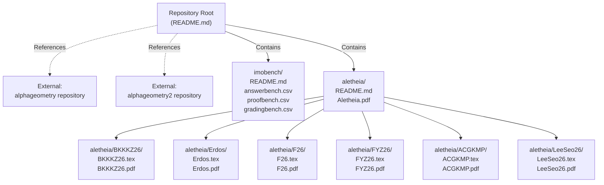
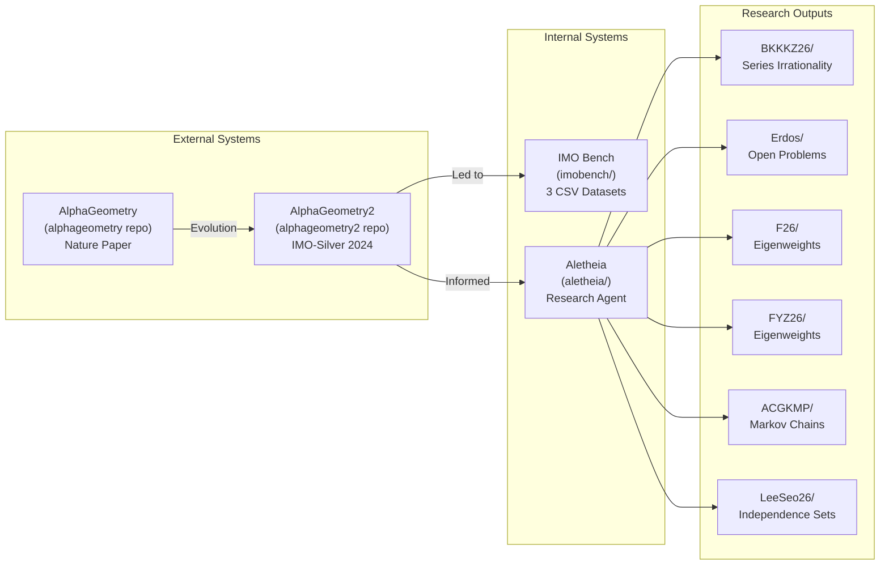
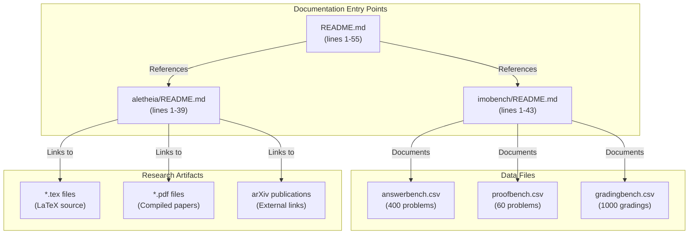
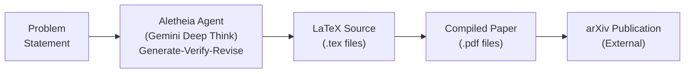

<!-- source: DeepWiki mcp.deepwiki.com · repo google-deepmind/superhuman · page 1 Overview · fetched 2026-10-26 -->

# Overview

Relevant source files

The following files were used as context for generating this wiki page:

- [README.md](README.md)
- [aletheia/Aletheia.pdf](aletheia/Aletheia.pdf)
- [aletheia/README.md](aletheia/README.md)
- [imobench/README.md](imobench/README.md)

This document introduces the **Superhuman Reasoning** repository, a collection of AI systems and datasets for advanced mathematical reasoning developed by Google DeepMind. This page covers the repository's mission, team structure, major project categories, and organizational structure. For detailed licensing information, see [Repository Structure and Licensing](#1.1). For specific project documentation, see [AlphaGeometry Projects](#2), [Aletheia Math Research Agent](#3), and [IMO Bench Evaluation Suite](#4).

**Sources:** [README.md:1-55]()

## Purpose and Mission

The Superhuman Reasoning repository serves as the central hub for mathematical AI research conducted by Google DeepMind's Superhuman Reasoning team, led by Thang Luong. The repository encompasses systems that span from competitive problem-solving (geometry theorem proving at IMO medal level) to autonomous mathematical research (generating novel proofs and results) to comprehensive evaluation infrastructure (benchmarking mathematical reasoning capabilities).

**Sources:** [README.md:1-4]()

## Repository Organization

The repository employs a hybrid organizational structure, distinguishing between externally-hosted mature systems and internally-hosted current projects:

| Category | Projects | Location | Status |
|----------|----------|----------|---------|
| External References | AlphaGeometry, AlphaGeometry2 | Separate repositories | Production systems with independent version control |
| Internal Projects | IMO Bench, Aletheia | `imobench/`, `aletheia/` directories | Active development and research outputs |

### Directory Structure

**Sources:** [README.md:1-55](), [aletheia/README.md:1-39](), [imobench/README.md:1-43]()

## Major Project Categories

### AlphaGeometry: Geometry Theorem Proving

AlphaGeometry represents the foundational geometry theorem proving system published in Nature. AlphaGeometry2 extended this work to achieve IMO-silver medal performance in 2024. Both systems are maintained in external repositories.

**Key Achievements:**
- Nature publication for AlphaGeometry
- IMO-silver medal standard for AlphaGeometry2
- Focus: Euclidean geometry theorem proving

**Sources:** [README.md:7-13]()

### Aletheia: Autonomous Mathematical Research Agent

Aletheia is a math research agent powered by Gemini Deep Think that employs an iterative generate-verify-revise approach. It produces research-level mathematical results across multiple domains including number theory, algebraic geometry, combinatorics, and applied mathematics.

**Repository Structure:**
- Main documentation: `aletheia/README.md`
- System paper: `aletheia/Aletheia.pdf`
- Research outputs: Six subdirectories containing LaTeX source, compiled PDFs, and arXiv publications

**Research Outputs:**
- **BKKKZ26**: Irrationality proofs for rapidly converging series
- **Erdos**: Semi-autonomous study of open Erdős problems
- **F26**: Eigenweight computations for Arithmetic Hirzebruch Proportionality Principle
- **FYZ26**: Initial non-trivial eigenweight case
- **ACGKMP**: Mathematical input for robust Markov chains paper
- **LeeSeo26**: Bounds for independence sets

For detailed system architecture, see [Aletheia System Architecture](#3.1). For individual research outputs, see sections [3.2](#3.2) through [3.6](#3.6).

**Sources:** [README.md:28-33](), [aletheia/README.md:1-18]()

### IMO Bench: Comprehensive Evaluation Suite

IMO Bench is a three-pronged benchmarking suite released following the 2025 IMO-gold achievement. It provides comprehensive evaluation across problem-solving breadth, formal reasoning depth, and evaluation system quality.

**Components:**

| Benchmark | File | Size | Purpose |
|-----------|------|------|---------|
| IMO-AnswerBench | `answerbench.csv` | 400 problems | Short-answer problems for breadth assessment |
| IMO-ProofBench | `proofbench.csv` | 60 problems | Expert-vetted proof problems for depth assessment |
| IMO-GradingBench | `gradingbench.csv` | 1000 gradings | Human gradings for meta-evaluation |

**External Resources:**
- Website: https://imobench.github.io
- Publication: 2025 EMNLP conference proceedings

For detailed benchmark documentation, see sections [4.1](#4.1) through [4.3](#4.3).

**Sources:** [README.md:15-26](), [imobench/README.md:1-43]()

## System Architecture: Project Relationships

**Sources:** [README.md:1-55](), [aletheia/README.md:1-18]()

## File Organization and Key Entry Points

**Sources:** [README.md:1-55](), [imobench/README.md:1-43](), [aletheia/README.md:1-39]()

## Research Output Pipeline

The Aletheia system follows a standardized pipeline for producing mathematical research:

**Pattern Applied Across All Six Research Outputs:**

Each subdirectory in `aletheia/` follows this structure:
- `<ProjectName>/<ProjectName>.tex` - LaTeX source with mathematical proofs
- `<ProjectName>/<ProjectName>.pdf` - Compiled document
- arXiv link in `aletheia/README.md` lines 11-17

**Sources:** [aletheia/README.md:1-18]()

## Team and Leadership

The Superhuman Reasoning team is led by **Thang Luong** at Google DeepMind. The team is responsible for all systems and publications in this repository.

**Publications Attribution:**
- IMO Bench paper (EMNLP 2025): Thang Luong et al., [imobench/README.md:14-20]()
- Aletheia research outputs: Available with arXiv links in [aletheia/README.md:11-17]()

**Sources:** [README.md:1-4](), [imobench/README.md:14-20]()

## Timeline of Achievements

| Year | Achievement | System | Reference |
|------|-------------|--------|-----------|
| 2023 | Nature publication | AlphaGeometry | [README.md:8]() |
| 2024 | IMO-Silver medal | AlphaGeometry2 | [README.md:12]() |
| 2025 | IMO-Gold achievement | Gemini Deep Think | [README.md:18]() |
| 2025 | IMO Bench release | Three-pronged evaluation suite | [README.md:15-26]() |
| 2025 | Aletheia research outputs | Six mathematical publications | [aletheia/README.md:11-17]() |

**Sources:** [README.md:1-55](), [aletheia/README.md:1-39]()

## Navigation to Detailed Documentation

For comprehensive information about specific systems and components:

- **Repository structure and licensing**: See [Repository Structure and Licensing](#1.1)
- **AlphaGeometry systems**: See [AlphaGeometry Projects](#2)
- **Aletheia architecture and outputs**: See [Aletheia Math Research Agent](#3) and subsections [3.1](#3.1) through [3.8](#3.8)
- **IMO Bench benchmarks**: See [IMO Bench Evaluation Suite](#4) and subsections [4.1](#4.1) through [4.4](#4.4)
- **Project evolution**: See [Project Timeline and Evolution](#5)
- **Contributing**: See [Development and Contribution](#6)

**Sources:** [README.md:1-55]()

---

