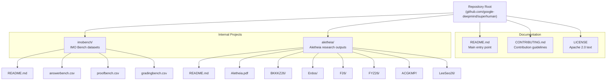
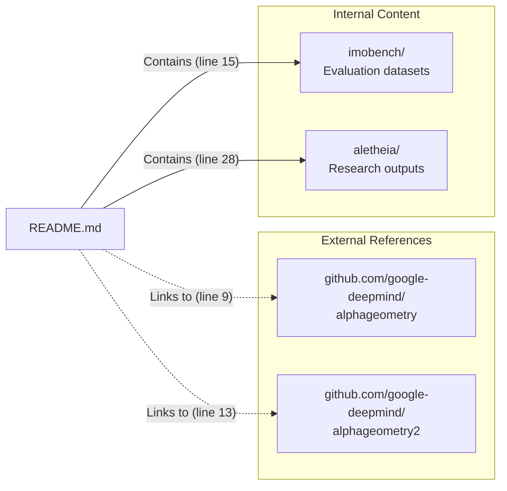
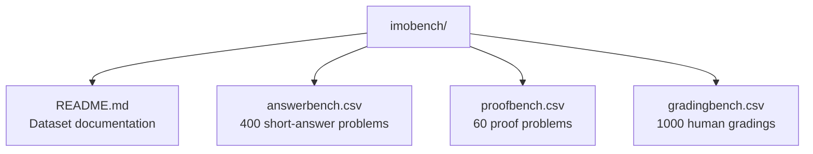
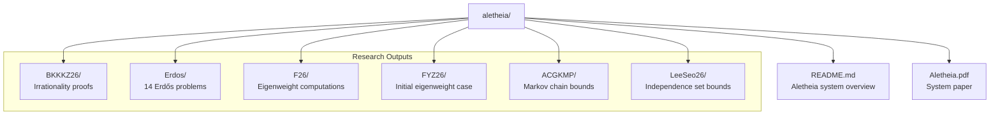
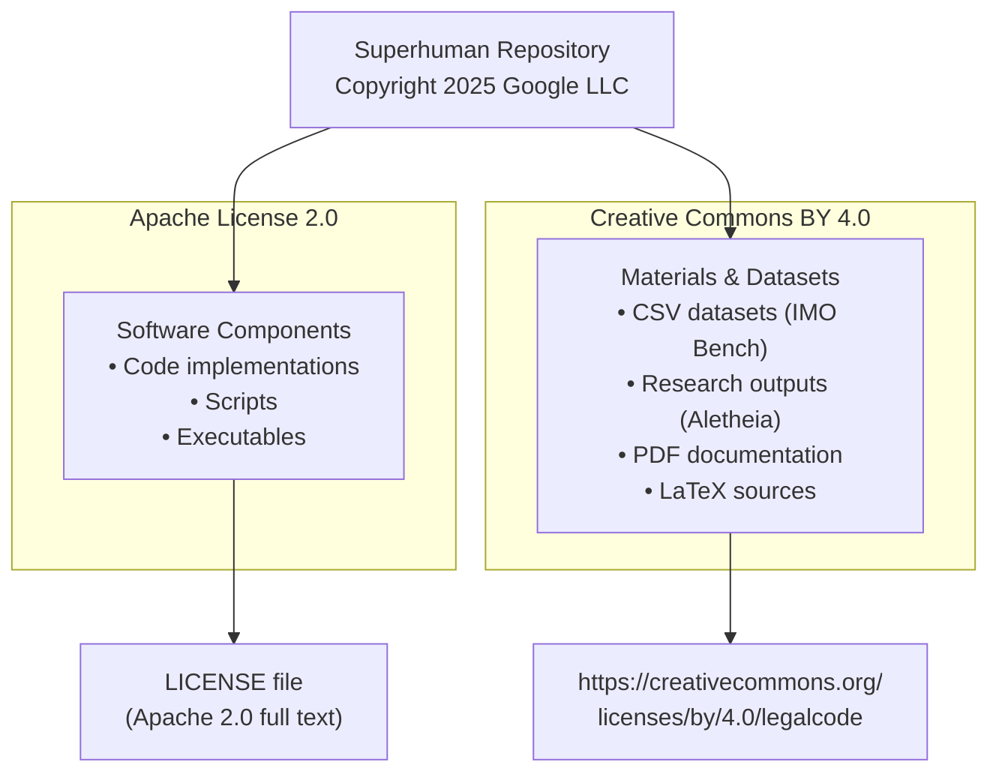
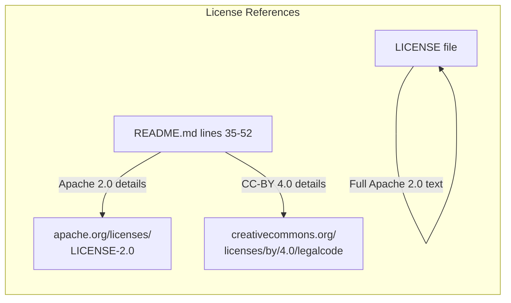
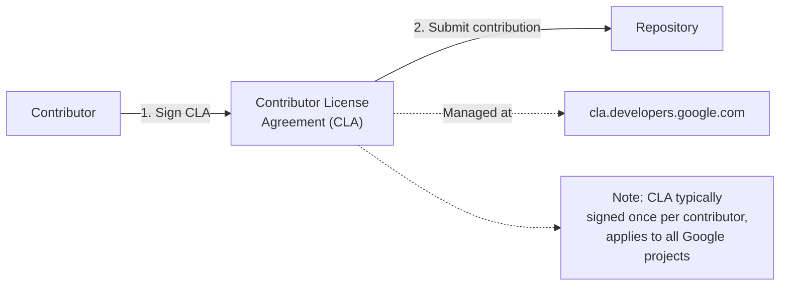
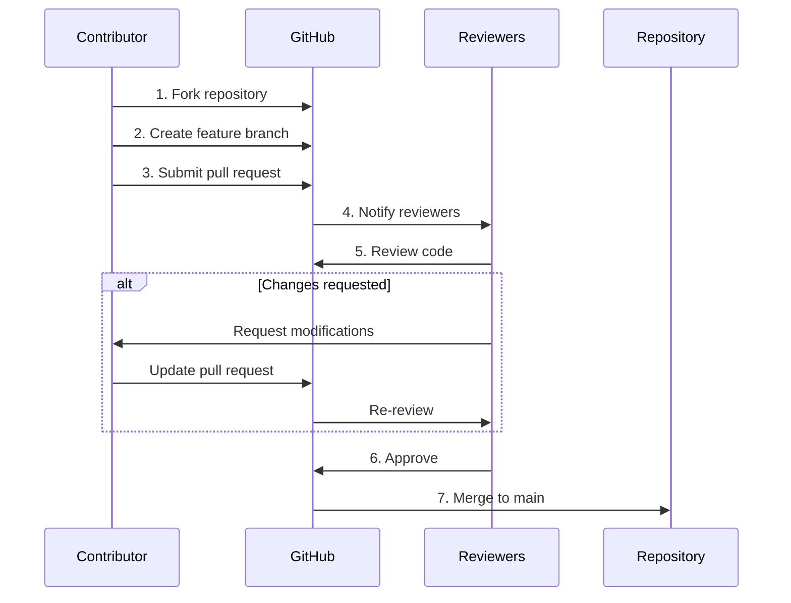
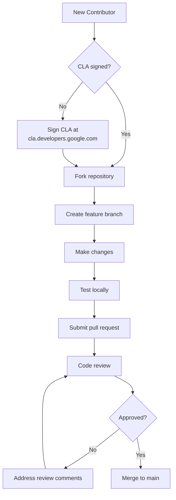

<!-- source: DeepWiki mcp.deepwiki.com · repo google-deepmind/superhuman · page 1.1 Repository Structure and Licensing · fetched 2026-10-26 -->

# Repository Structure and Licensing

<details>
<summary>Relevant source files</summary>

The following files were used as context for generating this wiki page:

- [CONTRIBUTING.md](CONTRIBUTING.md)
- [LICENSE](LICENSE)
- [README.md](README.md)
- [aletheia/Aletheia.pdf](aletheia/Aletheia.pdf)

</details>


This page documents the physical organization of the Superhuman Reasoning repository, its dual-licensing model, and the contribution process. For information about the individual projects hosted in this repository, see [Overview](#1). For details about the team and project evolution, see [Project Timeline and Evolution](#5).

## Purpose and Scope

This documentation covers:
- **Physical repository structure**: Directory layout and content organization
- **Project deployment strategy**: External references vs. internally hosted projects
- **Licensing architecture**: Software components (Apache 2.0) vs. datasets/materials (CC-BY 4.0)
- **Contribution process**: CLA requirements, code reviews, and community guidelines

## Repository Organization

### Physical Directory Structure

The repository follows a flat structure with two primary internal project directories:



**Sources:** [README.md:1-54]()

### External vs. Internal Project Organization

The repository employs a hybrid deployment strategy, distinguishing between externally referenced projects and internally hosted content:



**Sources:** [README.md:7-33]()

| Project Category | Projects | Deployment Strategy | Rationale |
|-----------------|----------|---------------------|-----------|
| **External References** | AlphaGeometry, AlphaGeometry2 | Separate repositories with independent version control | Mature systems with established publication records; maintain independent development cycles |
| **Internal Hosting** | IMO Bench, Aletheia | Directories within this repository | Newer releases (2025); tightly coupled to repository release cycle; primarily data/outputs |

### Project-to-Directory Mapping

The following table maps high-level project names to their physical locations:

| Project | Type | Physical Location | Primary Content |
|---------|------|-------------------|----------------|
| **AlphaGeometry** | External | `github.com/google-deepmind/alphageometry` | Geometry theorem proving code (Nature paper) |
| **AlphaGeometry2** | External | `github.com/google-deepmind/alphageometry2` | IMO-silver medal achievement code |
| **IMO Bench** | Internal | `imobench/` | Three CSV datasets: answerbench.csv, proofbench.csv, gradingbench.csv |
| **Aletheia** | Internal | `aletheia/` | Six research output subdirectories + system paper PDF |

**Sources:** [README.md:6-33]()

### Internal Project Structure Details

#### IMO Bench Directory



**Sources:** [README.md:15-26]()

#### Aletheia Directory

The `aletheia/` directory contains six subdirectories corresponding to distinct research outputs, each with its own LaTeX source, compiled PDF, and supporting materials:



**Sources:** [README.md:28-33]()

## Licensing Model

### Dual-Licensing Architecture

The repository implements a dual-licensing model that separates executable software components from research materials and datasets:



**Sources:** [README.md:35-52](), [LICENSE:1-203]()

### License Application Rules

The following table clarifies which license applies to different content types:

| Content Type | License | Key Terms | File Reference |
|-------------|---------|-----------|----------------|
| **Software** | Apache License 2.0 | Permissive open-source license; allows commercial use, modification, distribution with attribution | [LICENSE:1-203]() |
| **Datasets** | CC-BY 4.0 | Requires attribution; allows redistribution and adaptation | [README.md:44-46]() |
| **Research Outputs** | CC-BY 4.0 | Academic attribution requirements; suitable for research citation | [README.md:44-46]() |
| **Documentation** | CC-BY 4.0 | README files, PDF papers | [README.md:44-46]() |

**Sources:** [README.md:35-52](), [LICENSE:1-203]()

### License Text Locations



**Sources:** [README.md:39-46](), [LICENSE:1-203]()

### Copyright and Disclaimer

All content in the repository is copyrighted by Google LLC (2025) and includes an explicit disclaimer:

> "This is not an official Google product."

The disclaimer appears at [README.md:54]() and clarifies that while the repository is maintained by Google DeepMind employees, it does not represent an official Google product offering.

**License Basis Declaration:**

[README.md:48-52]() specifies:
```
Unless required by applicable law or agreed to in writing, all software and
materials distributed here under the Apache 2.0 or CC-BY licenses are
distributed on an "AS IS" BASIS, WITHOUT WARRANTIES OR CONDITIONS OF ANY KIND,
either express or implied.
```

**Sources:** [README.md:37-54]()

## Contribution Guidelines

### Contributor License Agreement (CLA)

All contributions require a signed Contributor License Agreement:



**Key Points:**
- **Signing location:** `https://cla.developers.google.com/`
- **Frequency:** Generally one-time per contributor (applies across Google projects)
- **Effect:** Contributor retains copyright; Google receives usage/redistribution rights
- **Applicability:** Required for all submissions, including from project members

**Sources:** [CONTRIBUTING.md:3-13]()

### Code Review Process

All submissions undergo mandatory code review via GitHub pull requests:



**Process Details:**
- **Platform:** GitHub pull requests exclusively
- **Scope:** All submissions require review (no exceptions for project members)
- **Documentation:** GitHub Help provides pull request guidance at `https://help.github.com/articles/about-pull-requests/`

**Sources:** [CONTRIBUTING.md:15-20]()

### Community Guidelines

The project adheres to Google's Open Source Community Guidelines:

| Aspect | Guideline | Reference |
|--------|-----------|-----------|
| **Code of Conduct** | Google's Open Source Community Guidelines | [CONTRIBUTING.md:22-25]() |
| **URL** | `https://opensource.google/conduct/` | [CONTRIBUTING.md:25]() |
| **Coverage** | Applies to all interactions (issues, PRs, discussions) | Implicit from guideline scope |

**Sources:** [CONTRIBUTING.md:22-25]()

### Contribution Workflow Summary

The complete contribution process follows this sequence:



**Sources:** [CONTRIBUTING.md:1-25]()

### Key Files Reference

| Purpose | File | Lines | Content |
|---------|------|-------|---------|
| **Main documentation** | README.md | 1-54 | Project overview, structure, licensing |
| **Contribution process** | CONTRIBUTING.md | 1-25 | CLA, reviews, community guidelines |
| **License text** | LICENSE | 1-203 | Full Apache 2.0 license terms |
| **IMO Bench docs** | imobench/README.md | - | Dataset specifications |
| **Aletheia docs** | aletheia/README.md | - | Research output documentation |
| **Aletheia paper** | aletheia/Aletheia.pdf | - | System methodology paper |

**Sources:** [README.md:1-54](), [CONTRIBUTING.md:1-25](), [LICENSE:1-203]()

---

