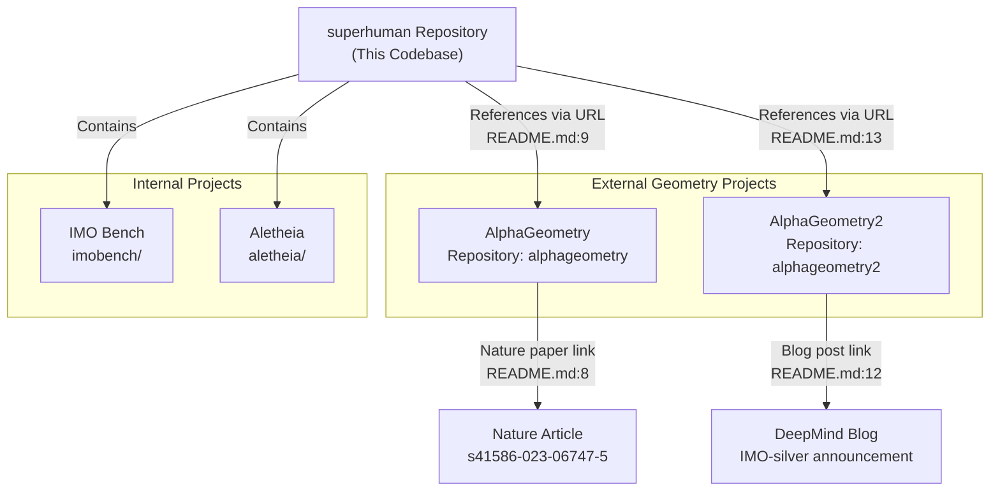
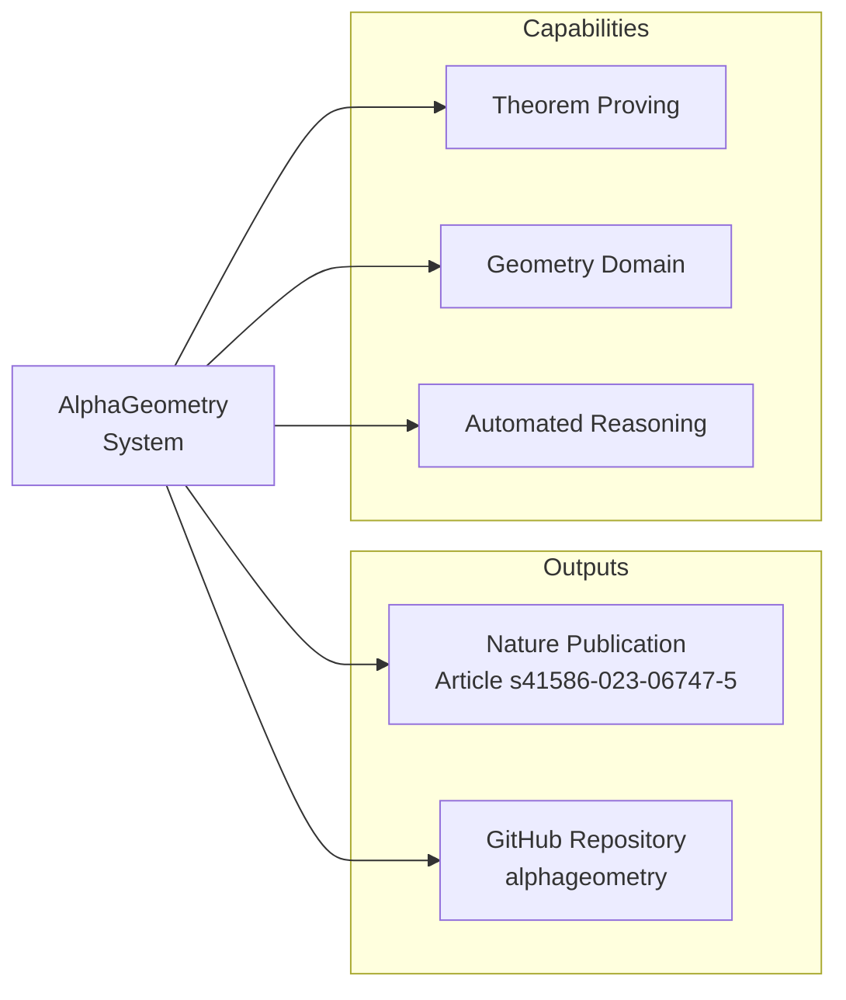
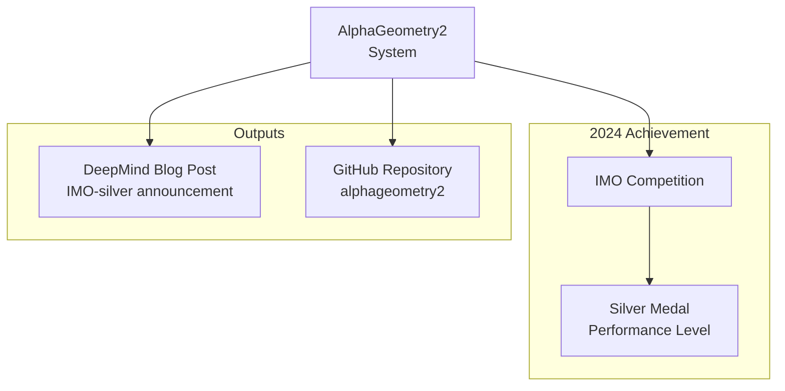
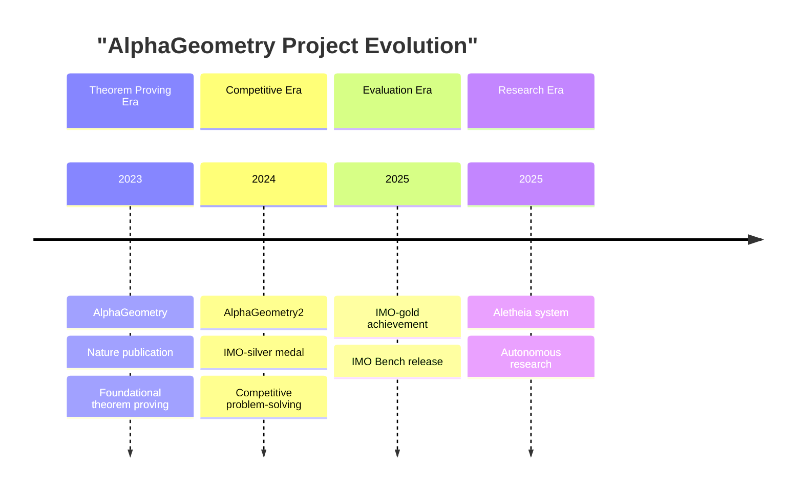
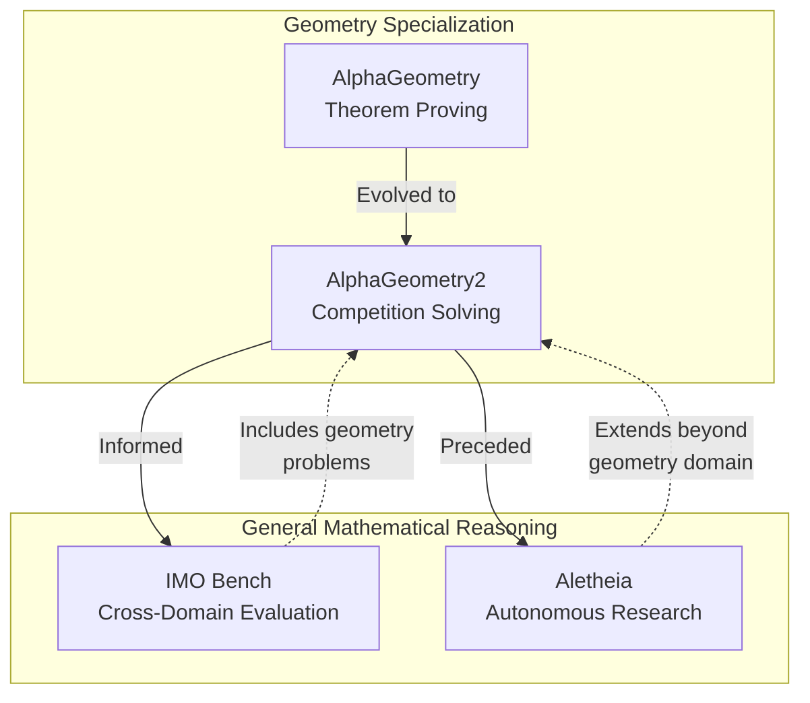
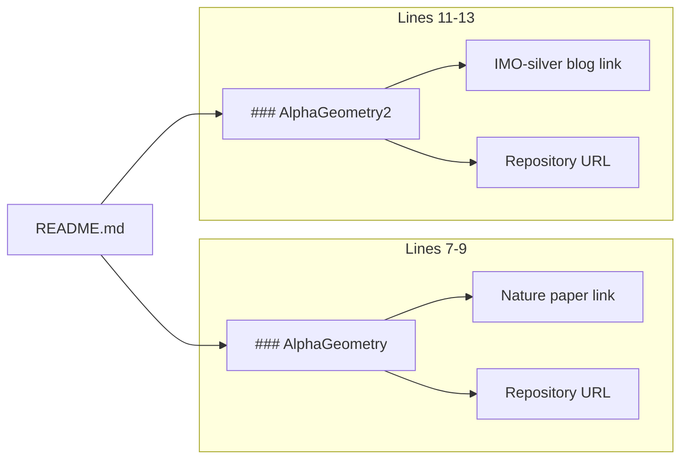
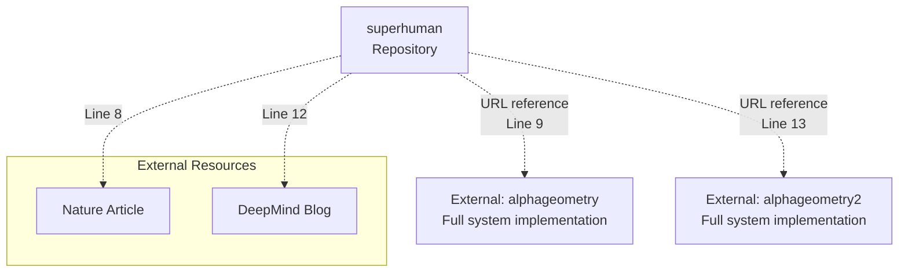
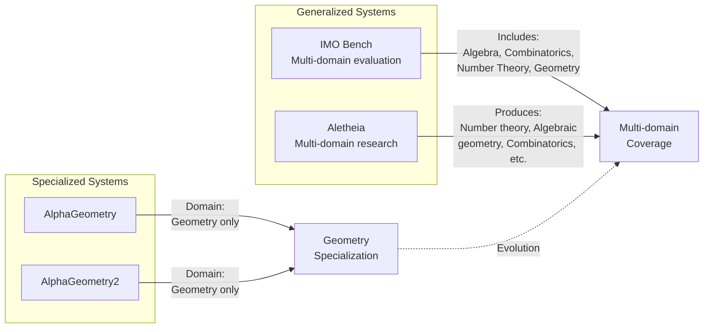
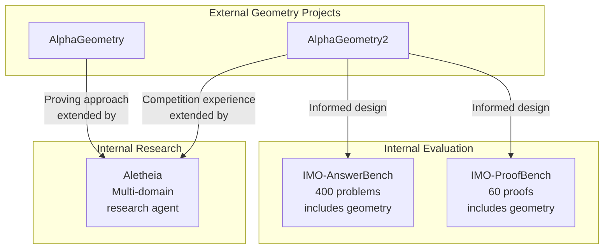

<!-- source: DeepWiki mcp.deepwiki.com · repo google-deepmind/superhuman · page 2 AlphaGeometry Projects · fetched 2026-10-26 -->

# AlphaGeometry Projects

Relevant source files

The following files were used as context for generating this wiki page:

- [README.md](README.md)
- [aletheia/Aletheia.pdf](aletheia/Aletheia.pdf)

## Purpose and Scope

This page documents the AlphaGeometry and AlphaGeometry2 projects, which focus on automated geometry theorem proving. These projects represent the foundational geometry work of the Superhuman Reasoning team and mark the progression from theorem proving (AlphaGeometry) to competitive problem-solving (AlphaGeometry2). Both projects are maintained in external repositories and are referenced from this codebase.

For information about autonomous mathematical research capabilities beyond geometry, see [Aletheia Math Research Agent](#3). For evaluation benchmarks including geometry problems, see [IMO Bench Evaluation Suite](#4). For the complete evolution from these geometry projects to autonomous research, see [Project Timeline and Evolution](#5).

**Sources:** [README.md:1-54]()

## Project Overview

The AlphaGeometry projects consist of two distinct systems developed by the Superhuman Reasoning team:

| Project | Achievement | Publication Date | Repository | Key Milestone |
|---------|-------------|------------------|------------|---------------|
| AlphaGeometry | Nature publication | 2023 | `google-deepmind/alphageometry` | Theorem proving breakthrough |
| AlphaGeometry2 | IMO-silver medal | 2024 | `google-deepmind/alphageometry2` | Competitive performance |

Both projects are hosted in separate GitHub repositories and are referenced from this codebase at [README.md:7-13]().

**Sources:** [README.md:7-13]()

## Repository Structure

**Diagram: Repository reference structure for AlphaGeometry projects**

This diagram shows how the AlphaGeometry projects are referenced from the main repository through URL links in the README, distinguishing them from internally-hosted projects.

**Sources:** [README.md:7-13]()

## AlphaGeometry: Theorem Proving Foundation

### Overview

AlphaGeometry is a geometry theorem proving system that achieved breakthrough results in automated mathematical reasoning. The system was published in Nature and represents the team's first major contribution to automated theorem proving.

### Key Information

- **Publication Venue:** Nature journal
- **Article Reference:** `s41586-023-06747-5`
- **Repository:** `https://github.com/google-deepmind/alphageometry`
- **Referenced At:** [README.md:7-9]()

### Publication Details

The Nature paper demonstrates AlphaGeometry's capability to prove geometry theorems at a level comparable to human mathematicians. The system established the foundational approach that would be extended in AlphaGeometry2.

**Diagram: AlphaGeometry outputs and capabilities**

**Sources:** [README.md:7-9]()

## AlphaGeometry2: Competitive Problem Solving

### Overview

AlphaGeometry2 extends the original AlphaGeometry system to achieve competitive performance at the International Mathematical Olympiad (IMO) level. The system achieved a silver medal standard in 2024, demonstrating significant advancement in problem-solving capabilities.

### Key Information

- **Achievement:** IMO-silver medal (2024)
- **Blog Post:** DeepMind blog announcement
- **Repository:** `https://github.com/google-deepmind/alphageometry2`
- **Referenced At:** [README.md:11-13]()

### Competition Performance

The 2024 IMO-silver medal achievement represents a milestone in AI mathematical problem-solving, demonstrating that the system can compete at an international level in geometry problem-solving.

**Diagram: AlphaGeometry2 achievement and outputs**

**Sources:** [README.md:11-13]()

## Evolution and Relationship

### Progression Path

The AlphaGeometry projects represent the first two stages in the Superhuman Reasoning team's evolution of mathematical AI capabilities:

**Diagram: Timeline showing AlphaGeometry evolution to subsequent systems**

**Sources:** [README.md:1-54]()

### System Relationships

**Diagram: Relationship between AlphaGeometry projects and subsequent systems**

**Sources:** [README.md:1-54]()

### Capabilities Comparison

| Capability | AlphaGeometry | AlphaGeometry2 | Aletheia |
|------------|---------------|----------------|----------|
| Domain | Geometry | Geometry | Multi-domain |
| Mode | Theorem proving | Competition solving | Research generation |
| Validation | Nature peer review | IMO competition | arXiv publication |
| Output | Proofs | Problem solutions | Research papers |
| Autonomy | Targeted | Targeted | Autonomous research |

**Sources:** [README.md:1-54]()

## Code References

### README Structure

The AlphaGeometry projects are documented in the main repository README through dedicated subsections:

- **AlphaGeometry Section:** [README.md:7-9]()
  - Contains Nature paper link
  - Links to `alphageometry` repository

- **AlphaGeometry2 Section:** [README.md:11-13]()
  - Contains IMO-silver achievement blog link
  - Links to `alphageometry2` repository

**Diagram: README.md structure for AlphaGeometry documentation**

**Sources:** [README.md:7-13]()

## External Repository Access

Both AlphaGeometry projects maintain independent repositories:

### AlphaGeometry Repository
- **URL:** `https://github.com/google-deepmind/alphageometry`
- **License:** Subject to repository-specific licensing
- **Content:** Full implementation and documentation

### AlphaGeometry2 Repository
- **URL:** `https://github.com/google-deepmind/alphageometry2`
- **License:** Subject to repository-specific licensing
- **Content:** Full implementation and IMO competition details

**Diagram: External repository and resource references**

**Sources:** [README.md:7-13]()

## Role in Mathematical AI Evolution

The AlphaGeometry projects serve as foundational work that enabled subsequent advances:

### Technical Foundation
- Established geometry theorem proving capabilities
- Developed competitive problem-solving approaches
- Created evaluation methodologies for mathematical AI

### Progression to Advanced Systems
- **To IMO Bench:** Geometry problems form a component of the comprehensive evaluation suite ([README.md:15-26]())
- **To Aletheia:** Foundational proving techniques extended to autonomous research across multiple mathematical domains ([README.md:28-33]())

### Domain Specialization vs. Generalization

**Diagram: Evolution from domain-specialized to multi-domain systems**

**Sources:** [README.md:1-54]()

## Integration with Repository Ecosystem

While AlphaGeometry projects are maintained externally, they integrate conceptually with the internal projects:

### IMO Bench Integration
- IMO-AnswerBench includes geometry problems ([README.md:21]())
- IMO-ProofBench contains geometry proofs ([README.md:23]())
- Evaluation methods build on competition problem-solving experience

### Aletheia Relationship
- Aletheia extends capabilities beyond geometry ([README.md:28-33]())
- Similar iterative approach to problem-solving
- Autonomous research vs. targeted theorem proving

**Diagram: Integration of AlphaGeometry projects with internal systems**

**Sources:** [README.md:1-54]()

## Summary

The AlphaGeometry projects establish the Superhuman Reasoning team's foundation in automated mathematical reasoning:

- **AlphaGeometry:** Breakthrough theorem proving published in Nature
- **AlphaGeometry2:** Competitive problem-solving achieving IMO-silver medal
- **Role:** Foundation for subsequent multi-domain systems (IMO Bench, Aletheia)
- **Status:** Maintained in external repositories, referenced from this codebase

These projects represent the geometry-specialized phase of development that preceded the team's expansion into multi-domain mathematical reasoning and autonomous research generation.

**Sources:** [README.md:1-54]()

---

