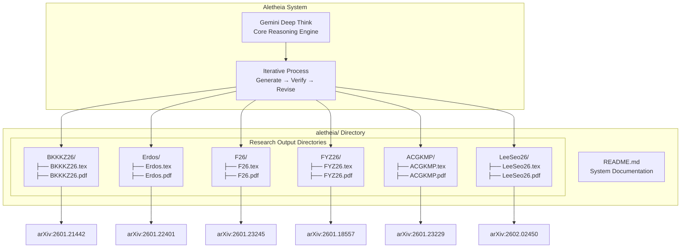
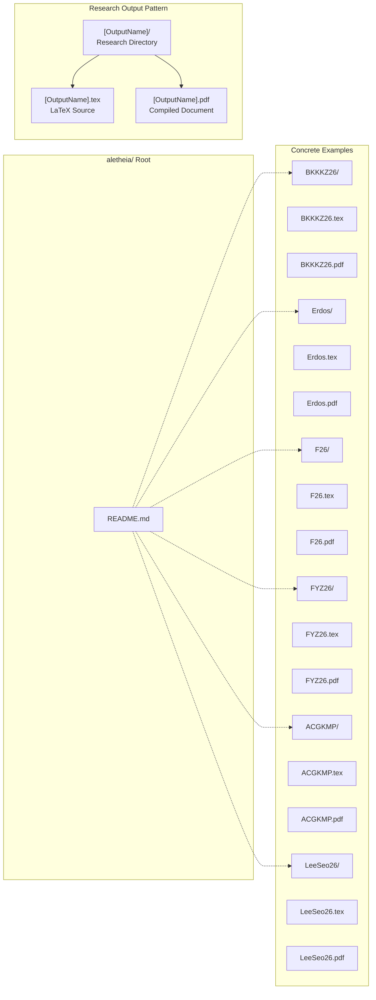
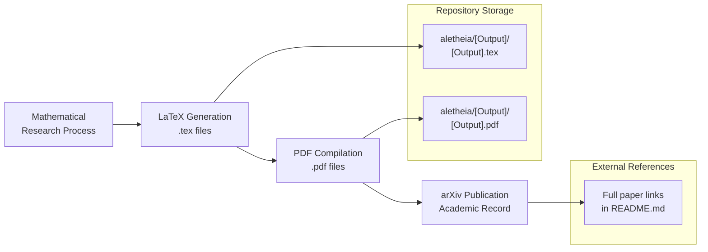
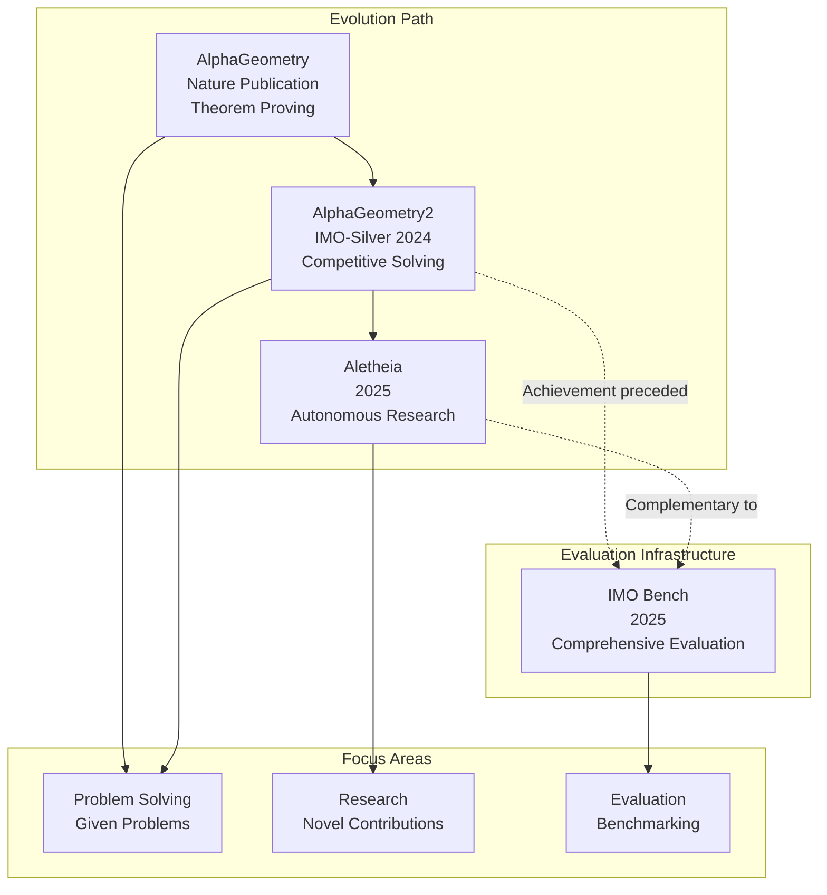

<!-- source: DeepWiki mcp.deepwiki.com · repo google-deepmind/superhuman · page 3 Aletheia Math Research Agent · fetched 2026-10-26 -->

# Aletheia Math Research Agent

Relevant source files

The following files were used as context for generating this wiki page:

- [README.md](README.md)
- [aletheia/Aletheia.pdf](aletheia/Aletheia.pdf)
- [aletheia/README.md](aletheia/README.md)

## Purpose and Scope

This document provides a comprehensive overview of Aletheia, the flagship math research agent system in the Superhuman Reasoning repository. Aletheia is an iterative mathematical research system powered by Gemini Deep Think that can autonomously generate, verify, and revise solutions to research-level mathematical problems.

This page covers Aletheia's architecture, research output structure, and its six published mathematical contributions. For detailed information about specific research outputs and their mathematical content, see subsections [3.2](#3.2) through [3.6](#3.6). For internal system architecture details including the generate-verify-revise loop, see [3.1](#3.1). For evaluation benchmarks, see [4](#4).

**Sources:** [README.md:28-33](), [aletheia/README.md:1-18]()

## System Overview

Aletheia represents a paradigm shift from problem-solving AI to autonomous mathematical research AI. Unlike AlphaGeometry and AlphaGeometry2 (see [2](#2)) which solve given problems, Aletheia conducts original mathematical research, producing results that contribute to academic publications.

The system operates through an iterative process:
1. **Generate** - Produce mathematical solutions and proofs
2. **Verify** - Check correctness and rigor
3. **Revise** - Refine and improve based on verification

This process is powered by Gemini Deep Think, enabling extended reasoning on complex mathematical problems.

**Sources:** [README.md:28-30](), [aletheia/README.md:3-4]()

### System Architecture Diagram

**Sources:** [README.md:28-33](), [aletheia/README.md:1-18]()

## Research Outputs

Aletheia has produced six distinct research outputs spanning multiple mathematical domains. Each output follows a standardized format with LaTeX source (`.tex`), compiled PDF (`.pdf`), and arXiv publication. The outputs are organized in dedicated subdirectories within `aletheia/`.

### Research Output Summary Table

| Directory | Problem Domain | Contribution Type | arXiv ID |
|-----------|---------------|-------------------|----------|
| `BKKKZ26/` | Number Theory | Standalone - Irrationality proof for rapidly converging series | 2601.21442 |
| `Erdos/` | Multi-domain | Standalone - Semi-autonomous study of 14 Erdős problems | 2601.22401 |
| `F26/` | Algebraic Geometry | Standalone - Eigenweight computations for Hirzebruch Principle | 2601.23245 |
| `FYZ26/` | Algebraic Geometry | Standalone - Initial non-trivial eigenweight case | 2601.18557 |
| `ACGKMP/` | Applied Mathematics | Contributory - Dyadic interval bounds for Markov chains | 2601.23229 |
| `LeeSeo26/` | Combinatorics | Contributory - Independence set bounds | 2602.02450 |

**Sources:** [aletheia/README.md:11-17]()

### Attribution Notes

The system includes two important attribution notes regarding non-Aletheia outputs:

1. One output in the `Erdos/` directory is not from Aletheia
2. One output in `LeeSeo26/` is not from Aletheia (included for illustration purposes, as correct solutions were obtained by various models including Aletheia)

These outputs are documented in their respective subsections [3.3](#3.3) and [3.6](#3.6).

**Sources:** [aletheia/README.md:6-9]()

## Directory Structure and File Organization

The `aletheia/` directory follows a consistent organizational pattern for each research output, facilitating reproducibility and academic citation.

Each research output directory contains:
- **`.tex` file** - LaTeX source code containing mathematical proofs, definitions, and exposition
- **`.pdf` file** - Compiled PDF document for direct reading and citation

The `README.md` in `aletheia/` serves as the central index, linking to all outputs with brief descriptions and arXiv references.

**Sources:** [aletheia/README.md:11-17]()

## Research Collaboration Modes

Aletheia operates in two distinct modes, producing different types of mathematical contributions:

### Standalone Research Mode

In this mode, Aletheia produces complete mathematical results that form the core of standalone academic papers. Four outputs operate in this mode:

| Output | Description |
|--------|-------------|
| `BKKKZ26/` | Complete proof of irrationality for rapidly converging series, generalizing Erdős-1051 |
| `Erdos/` | Complete case study addressing 14 open Erdős problems across multiple domains |
| `F26/` | Complete eigenweight computations for the Arithmetic Hirzebruch Proportionality Principle |
| `FYZ26/` | Complete initial case of non-trivial eigenweight computation |

**Sources:** [aletheia/README.md:11-14]()

### Contributory Research Mode

In this mode, Aletheia provides specific mathematical inputs that are incorporated into broader human-led research. Two outputs operate in this mode:

| Output | External Paper | Contribution |
|--------|----------------|--------------|
| `ACGKMP/` | "Strongly polynomial iterations for robust Markov chains" by Asadi et al. | Mathematical proof that specific bounded combinations of numbers are in polynomially many dyadic intervals |
| `LeeSeo26/` | "Lower bounds for multivariate independence polynomials and their generalisations" by Lee and Seo | Generalizations of bounds for independence sets |

**Sources:** [aletheia/README.md:15-17]()

## Integration with Gemini Deep Think

Aletheia is powered by Gemini Deep Think, which provides the core reasoning capabilities for the iterative research process. The integration enables:

- **Extended Reasoning** - Deep Think allows for prolonged contemplation on complex mathematical problems
- **Iterative Refinement** - Multiple passes through generate-verify-revise cycles
- **Multi-domain Expertise** - Ability to work across number theory, algebraic geometry, combinatorics, graph theory, and applied mathematics

The relationship between Aletheia and Gemini Deep Think is described in the main repository README, where Aletheia is characterized as a "math research agent, powered by Gemini Deep Think."

**Sources:** [README.md:29]()

## Publication Pipeline

All Aletheia research outputs follow a standardized publication pipeline:

The pipeline ensures:
1. **Source Preservation** - LaTeX source files are maintained for reproducibility
2. **Readable Distribution** - PDF files enable direct reading without LaTeX toolchains
3. **Academic Citation** - arXiv publication provides permanent, citable records
4. **Centralized Documentation** - All links and descriptions consolidated in `aletheia/README.md`

Each output in `aletheia/README.md` includes three references:
- `[tex]` link to the LaTeX source file
- `[pdf]` link to the compiled PDF document
- `[full paper]` link to the arXiv publication

**Sources:** [aletheia/README.md:11-17]()

## Mathematical Domain Coverage

Aletheia's six research outputs demonstrate breadth across multiple mathematical domains:

| Domain | Outputs | Count |
|--------|---------|-------|
| Number Theory | `BKKKZ26/` (series irrationality) | 1 |
| Algebraic Geometry | `F26/`, `FYZ26/` (eigenweight computations) | 2 |
| Applied Mathematics | `ACGKMP/` (Markov chains) | 1 |
| Combinatorics | `LeeSeo26/` (independence sets) | 1 |
| Multi-domain | `Erdos/` (graph theory, number theory, geometry, combinatorics) | 1 |

This breadth indicates Aletheia functions as a general-purpose mathematical research system rather than a domain-specific tool. The multi-domain coverage is particularly evident in the `Erdos/` output, which addresses 14 problems spanning multiple areas of mathematics.

For detailed analysis of proof techniques employed across these domains, see [3.7](#3.7).

**Sources:** [aletheia/README.md:11-17]()

## Licensing

All Aletheia materials follow the repository's dual licensing model:

- **Software components** (if any): Apache License 2.0
- **Research materials** (LaTeX, PDF files): Creative Commons Attribution 4.0 International License (CC-BY)

The CC-BY license for research materials facilitates academic use while maintaining attribution requirements. Users may freely use, share, and adapt the materials with appropriate citation.

Full license text is available in `aletheia/README.md` lines 19-38.

**Sources:** [aletheia/README.md:19-38]()

## Relationship to Other Systems

Aletheia represents the current frontier of the Superhuman Reasoning project's evolution:

- **AlphaGeometry/AlphaGeometry2** (see [2](#2)) - Focus on solving given problems at competitive levels
- **Aletheia** - Focus on autonomous research and novel mathematical contributions
- **IMO Bench** (see [4](#4)) - Focus on comprehensive evaluation of mathematical reasoning

**Sources:** [README.md:6-33]()

---

