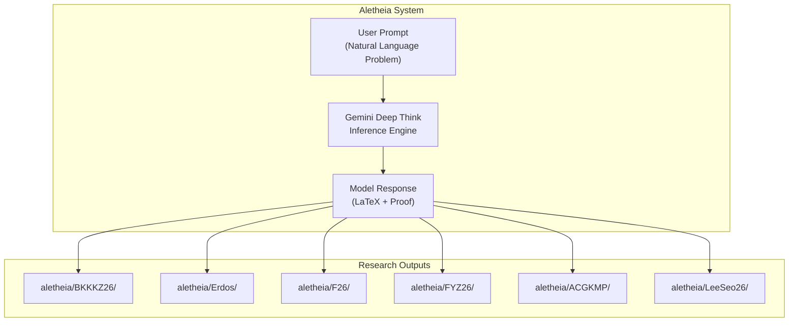
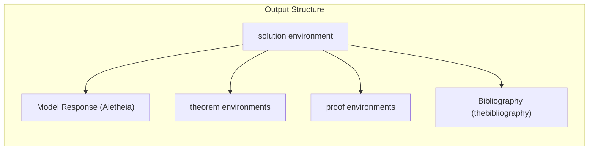
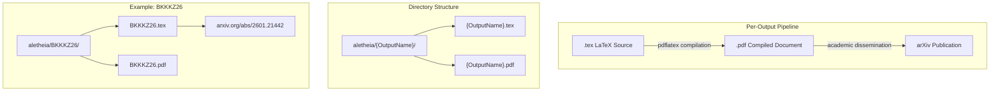
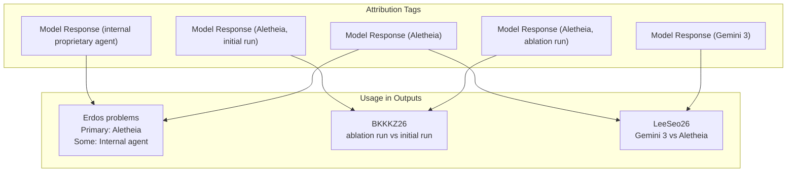
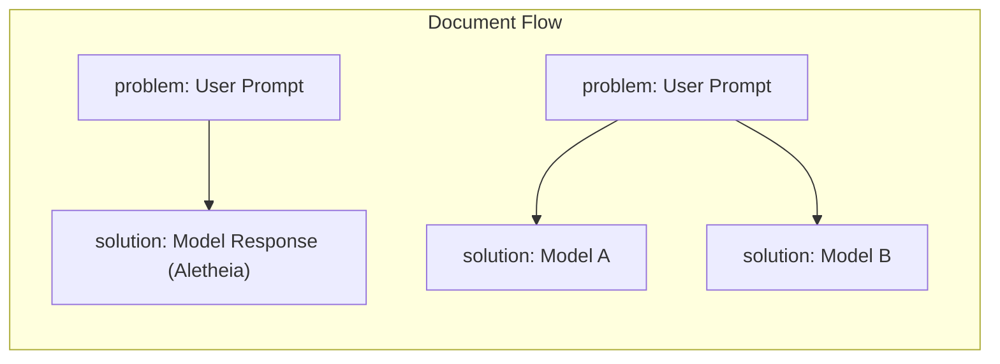
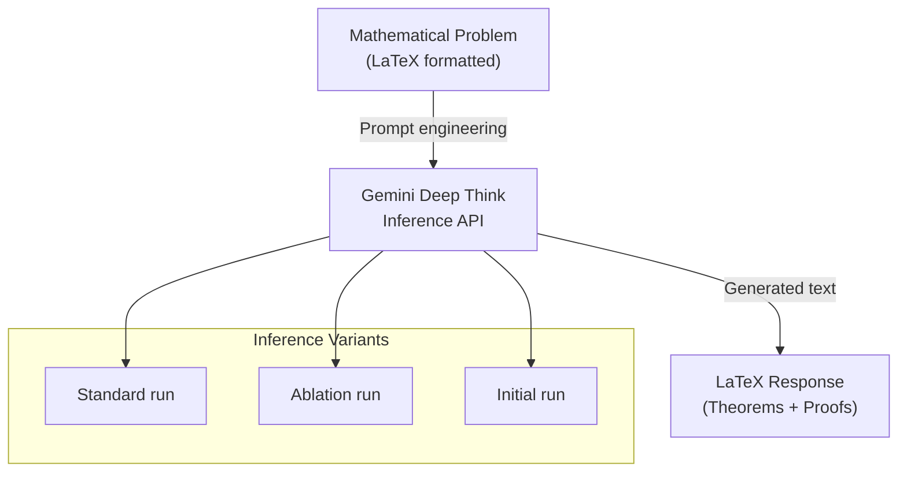
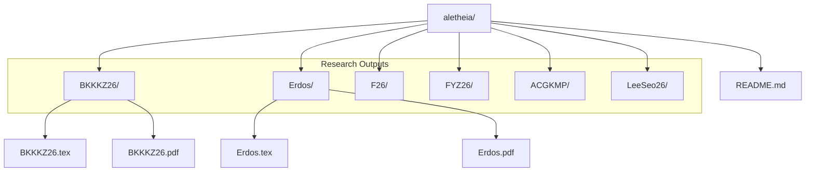

<!-- source: DeepWiki mcp.deepwiki.com · repo google-deepmind/superhuman · page 3.1 Aletheia System Architecture · fetched 2026-10-26 -->

# Aletheia System Architecture

<details>
<summary>Relevant source files</summary>

The following files were used as context for generating this wiki page:

- [aletheia/BKKKZ26/BKKKZ26.pdf](aletheia/BKKKZ26/BKKKZ26.pdf)
- [aletheia/BKKKZ26/BKKKZ26.tex](aletheia/BKKKZ26/BKKKZ26.tex)
- [aletheia/Erdos/Erdos.pdf](aletheia/Erdos/Erdos.pdf)
- [aletheia/Erdos/Erdos.tex](aletheia/Erdos/Erdos.tex)
- [aletheia/README.md](aletheia/README.md)

</details>


## Purpose and Scope

This page documents the internal architecture of Aletheia, an AI-powered mathematical research agent. It covers the system's input/output formatting, the research generation pipeline, and integration points with underlying language models. For information about specific research outputs produced by Aletheia, see [Research Output: BKKKZ26](#3.2), [Research Output: Erdos](#3.3), [Research Output: F26/FYZ26](#3.4), [Research Output: ACGKMP](#3.5), and [Research Output: LeeSeo26](#3.6). For analysis of Aletheia's collaboration modes, see [Collaboration Modes](#3.8).

---

## System Overview

Aletheia operates as a prompt-response system that generates formal mathematical proofs and solutions to research-level problems. The system processes mathematical problems expressed in natural language and produces outputs formatted as LaTeX documents suitable for academic publication.



**Diagram: Aletheia High-Level Architecture**

Sources: [aletheia/README.md:1-18]()

---

## Input Format Structure

Aletheia accepts mathematical problems formatted within a structured prompt template. The input format uses LaTeX-based problem environments for clarity and formal specification.

### Problem Environment Template

```latex
\begin{problem}{Problem Title}
Mathematical problem statement in LaTeX notation
\end{problem}
```

The problem environment is defined using the `tcolorbox` package with specific styling parameters:

| Parameter | Value | Purpose |
|-----------|-------|---------|
| `colback` | `boxback` (RGB 245,245,255) | Background color for readability |
| `colframe` | `boxblue` (RGB 0,0,150) | Border color |
| `breakable` | `true` | Allow page breaks within long problems |
| `enhanced jigsaw` | enabled | Proper frame handling across pages |

Sources: [aletheia/BKKKZ26/BKKKZ26.tex:39-52](), [aletheia/Erdos/Erdos.tex:22-35]()

---

## Output Format Structure

Aletheia generates responses in a standardized LaTeX format that includes mathematical proofs, theorem statements, and supporting lemmas.



**Diagram: Output Document Structure**

### Solution Environment

```latex
\begin{solution}{Model Response (\emph{Aletheia})}
% Theorem statements
% Proofs
% Supporting lemmas
% Bibliography
\end{solution}
```

The solution environment mirrors the problem environment's styling and includes:
- Model attribution in the title
- Formal theorem environments
- Structured proof sections
- Mathematical notation using `amsmath`, `amssymb`, `amsthm` packages

Sources: [aletheia/BKKKZ26/BKKKZ26.tex:54-67](), [aletheia/Erdos/Erdos.tex:71-122]()

---

## Research Output Pipeline

Each research output follows a standardized three-artifact pipeline from source to publication.



**Diagram: Output Artifact Pipeline and Directory Structure**

### Standard Output Components

Each output directory contains:

1. **LaTeX Source** (`.tex`): Complete standalone document with:
   - Document class declaration
   - Package imports
   - Custom theorem environments
   - Problem statement
   - Model response with proofs
   - Bibliography

2. **PDF Document** (`.pdf`): Compiled version for distribution

3. **arXiv Link**: Reference to published paper

Sources: [aletheia/README.md:11-17]()

---

## Model Attribution System

Aletheia uses explicit model attribution tags to identify which AI system generated each solution. This enables tracking of different model variants and ablation studies.



**Diagram: Model Attribution Variants**

### Attribution Format

The solution environment title includes model attribution:

```latex
\begin{solution}{Model Response (\emph{Aletheia})}
% Standard response

\begin{solution}{Model Response (\emph{Aletheia}, ablation run)}
% Ablation study variant

\begin{solution}{Model Response (internal proprietary agent)}
% Alternative model for comparison
```

### Multiple Responses Per Problem

Some outputs contain multiple solution environments for the same problem, each from different models or runs. This enables comparative analysis of proof strategies.

**Example from BKKKZ26:**
- Ablation run response: [aletheia/BKKKZ26/BKKKZ26.tex:94-198]()
- Initial run response: [aletheia/BKKKZ26/BKKKZ26.tex:201-286]()

Sources: [aletheia/README.md:6-9](), [aletheia/Erdos/Erdos.tex:71](), [aletheia/Erdos/Erdos.tex:124](), [aletheia/BKKKZ26/BKKKZ26.tex:94](), [aletheia/BKKKZ26/BKKKZ26.tex:201]()

---

## LaTeX Document Structure

All Aletheia outputs follow a consistent document structure with standardized packages and environments.

### Required Packages

| Package | Purpose |
|---------|---------|
| `amsmath`, `amssymb`, `amsthm` | Mathematical notation and theorem environments |
| `tcolorbox` | Colored boxes for problems and solutions |
| `geometry` | Page layout control |
| `hyperref` | Cross-references and links |
| `mathtools` | Extended mathematical typesetting |

### Custom Environments

```latex
% Theorem-style environments
\newtheorem{theorem}{Theorem}
\newtheorem{proposition}{Proposition}
\newtheorem{lemma}{Lemma}
\newtheorem{claim}{Claim}

% Definition-style environments
\newtheorem{definition}{Definition}
\newtheorem{remark}{Remark}[section]
\newtheorem*{example}{Example}

% Colored box environments
\newtcolorbox{problem}[1]{...}  % Problem statements
\newtcolorbox{solution}[1]{...} % Model responses
```

### Custom Commands

Common mathematical notation shortcuts:

```latex
\newcommand{\Q}{\mathbb{Q}}      % Rational numbers
\newcommand{\N}{\mathbb{N}}      % Natural numbers
\newcommand{\Z}{\mathbb{Z}}      % Integers
\newcommand{\F}{\mathbb{F}}      % Field
\DeclareMathOperator{\...}{...}  % Custom operators
```

Sources: [aletheia/BKKKZ26/BKKKZ26.tex:1-29](), [aletheia/Erdos/Erdos.tex:1-60]()

---

## Problem-Solution Pairing

The fundamental structure of Aletheia outputs is the problem-solution pair, which maintains a clear separation between user input and model output.



**Diagram: Problem-Solution Document Flow**

### Editorial Note

All outputs include a disclaimer about editing:

```latex
\emph{The prompts and responses below have been edited only for
formatting compatibility.}
```

This appears at the document start, indicating that the mathematical content is preserved while formatting may be adjusted for LaTeX compilation.

Sources: [aletheia/BKKKZ26/BKKKZ26.tex:85-86](), [aletheia/Erdos/Erdos.tex:64-65]()

---

## Integration with Gemini Deep Think

While the codebase does not contain implementation details of the Gemini Deep Think integration, the outputs provide evidence of the integration through:

1. **Model Attribution**: Explicit "Gemini Deep Think" references in high-level documentation
2. **Output Quality**: Research-level proofs with formal theorem statements
3. **Multiple Variants**: Ability to run different model configurations (ablation runs, initial runs)



**Diagram: Gemini Deep Think Integration Points**

Sources: High-level diagrams provided in context

---

## Bibliography and Citation Format

Aletheia outputs include formal bibliographies with academic citations.

### Bibliography Structure

```latex
\begin{thebibliography}{9}
\bibitem{key} Author(s), ``Title,'' \textit{Journal/Book},
  vol. X, pp. Y--Z, Year.
\end{thebibliography}
```

### Example Citations

From Erdos output:
- Erdős-Graham reference: [aletheia/Erdos/Erdos.tex:270-273]()
- Lambie-Hanson theorem citation: [aletheia/Erdos/Erdos.tex:83-86]()

From BKKKZ26 output:
- Erdős-Graham combinatorics: [aletheia/BKKKZ26/BKKKZ26.tex:194-197]()

Sources: [aletheia/Erdos/Erdos.tex:269-274](), [aletheia/BKKKZ26/BKKKZ26.tex:194-197]()

---

## Output File Organization



**Diagram: Aletheia Repository Structure**

Each output directory follows the naming convention:
- Directory name matches the paper identifier
- `.tex` and `.pdf` files share the directory name
- README provides links to all outputs and their arXiv publications

Sources: [aletheia/README.md:1-18]()

---

## Quality Markers and Disclaimers

### Accuracy Disclaimers

The Erdos output includes an explicit accuracy warning:

```latex
\emph{The prompts and responses below have been edited only for
formatting compatibility. NOTE THAT MANY CONTAIN MINOR INACCURACIES.}
```

This indicates that outputs are provided for research purposes and may contain mathematical errors requiring verification.

### Non-Aletheia Responses

The README notes that some responses are not from Aletheia:

> "Note that 2 outputs, one in Erdos problems and one in LeeSeo26, are not from Aletheia. The latter is for illustration purposes only (a correct solution was obtained by various models, including Aletheia)."

This transparency allows users to distinguish between Aletheia-generated content and comparative examples from other models.

Sources: [aletheia/README.md:6-9](), [aletheia/Erdos/Erdos.tex:64-65]()

---

## Summary

The Aletheia system architecture is characterized by:

1. **Standardized I/O**: Problem-solution pairs in LaTeX format
2. **Modular Structure**: Each research output in its own directory
3. **Model Attribution**: Explicit tagging of model variants
4. **Publication Pipeline**: LaTeX → PDF → arXiv workflow
5. **Comparative Analysis**: Support for multiple responses per problem
6. **Academic Format**: Formal theorem environments and bibliographies

The architecture prioritizes reproducibility, transparency, and integration with academic publishing workflows.

Sources: [aletheia/README.md:1-39](), [aletheia/BKKKZ26/BKKKZ26.tex:1-400](), [aletheia/Erdos/Erdos.tex:1-800]()

---

