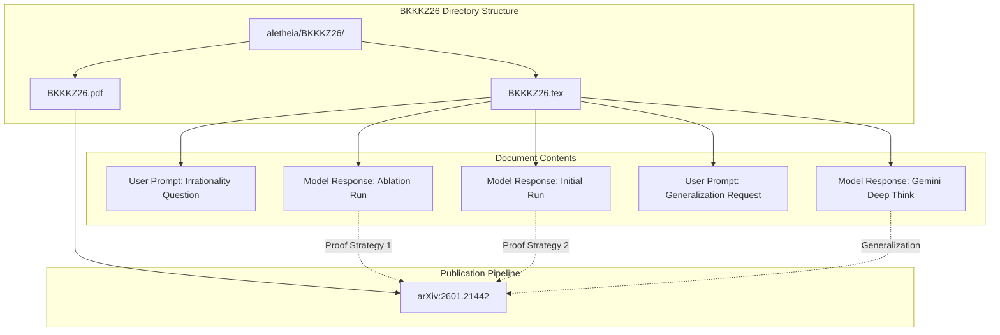
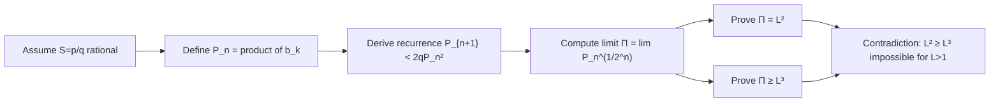
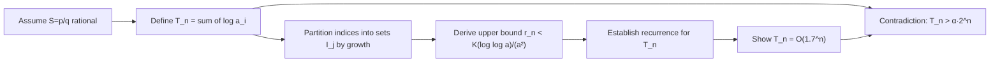
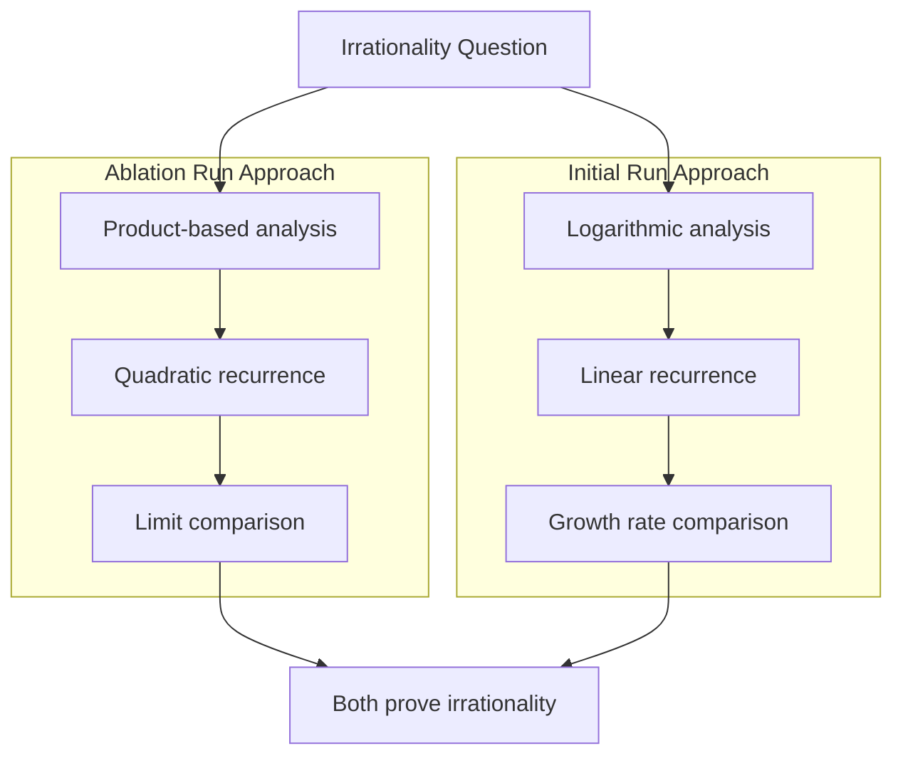
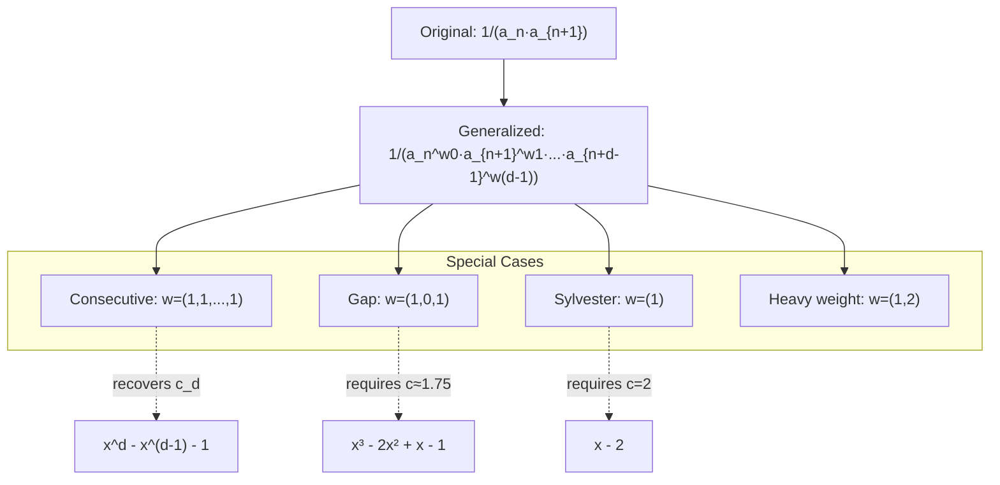
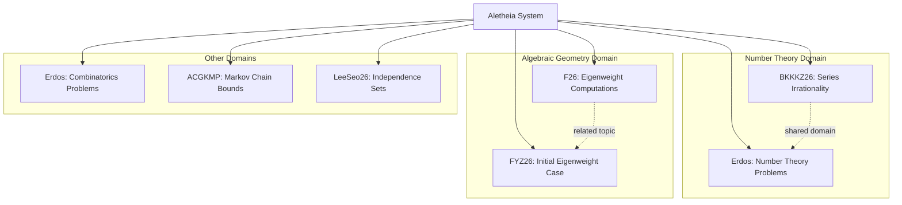

<!-- source: DeepWiki mcp.deepwiki.com · repo google-deepmind/superhuman · page 3.2 Research Output: BKKKZ26 - Irrationality of Rapidly Converging Series · fetched 2026-10-26 -->

# Research Output: BKKKZ26 - Irrationality of Rapidly Converging Series

Relevant source files

The following files were used as context for generating this wiki page:

- [aletheia/BKKKZ26/BKKKZ26.pdf](aletheia/BKKKZ26/BKKKZ26.pdf)
- [aletheia/BKKKZ26/BKKKZ26.tex](aletheia/BKKKZ26/BKKKZ26.tex)
- [aletheia/README.md](aletheia/README.md)

## Purpose and Scope

This page documents the BKKKZ26 research output, which demonstrates Aletheia's capability to produce novel mathematical proofs for number-theoretic problems. The output addresses the irrationality of series with double-exponential growth conditions and provides two distinct proof strategies generated by Aletheia, followed by a generalization created by Gemini Deep Think. For broader information about Aletheia's research capabilities and other outputs, see [Aletheia Math Research Agent](#3). For information about the system architecture that produces these proofs, see [Aletheia System Architecture](#3.1).

**Sources:** [aletheia/README.md:1-18](), [aletheia/BKKKZ26/BKKKZ26.tex:1-89]()

---

## Problem Statement

The research addresses a question about irrationality of series with rapidly converging denominators. The problem asks whether, for a strictly increasing sequence of integers $(a_1, a_2, \ldots)$ satisfying the growth condition:

$$\liminf_{n \to \infty} a_n^{1/2^n} > 1$$

the infinite series:

$$S = \sum_{n=1}^\infty \frac{1}{a_n a_{n+1}}$$

is necessarily irrational.

This problem generalizes classical results by Erdős and Graham on irrationality of series with rapidly growing denominators. The double-exponential growth condition $a_n^{1/2^n} > 1$ implies that $a_n$ grows faster than $c^{2^n}$ for some constant $c > 1$.

**Sources:** [aletheia/BKKKZ26/BKKKZ26.tex:89-91](), [aletheia/BKKKZ26/BKKKZ26.tex:95-101]()

---

## Research Artifact Structure

**Sources:** [aletheia/README.md:11](), [aletheia/BKKKZ26/BKKKZ26.tex:1-416]()

---

## Two Aletheia Proof Strategies

Aletheia generated two distinct proofs for the same problem, demonstrating different proof techniques and mathematical approaches.

### Ablation Run Proof Strategy

The ablation run proof uses a **product-based growth analysis** approach, defining $P_n = \prod_{k=1}^n b_k$ and analyzing the asymptotic behavior of the product sequence.

**Key Steps:**

| Step | Mathematical Technique | Line Reference |
|------|----------------------|----------------|
| 1. Tail Reduction | Shift sequence to ensure $a_n \ge 2$ | [aletheia/BKKKZ26/BKKKZ26.tex:112-122]() |
| 2. Rationality Constraint | Use $qP_n R_n$ is an integer to bound remainder | [aletheia/BKKKZ26/BKKKZ26.tex:125-130]() |
| 3. Recurrence Derivation | Derive $P_{n+1} < 2qP_n^2$ from remainder relation | [aletheia/BKKKZ26/BKKKZ26.tex:132-154]() |
| 4. Limit Analysis | Define $\Pi = \lim_{n\to\infty} P_n^{1/2^n}$ and prove $\Pi = \mathcal{L}^2$ | [aletheia/BKKKZ26/BKKKZ26.tex:156-170]() |
| 5. Contradiction | Show $\Pi \ge \mathcal{L}^3$ contradicts $\Pi = \mathcal{L}^2$ | [aletheia/BKKKZ26/BKKKZ26.tex:172-191]() |

**Sources:** [aletheia/BKKKZ26/BKKKZ26.tex:94-198]()

### Initial Run Proof Strategy

The initial run proof uses a **logarithmic summation analysis** with partition-based remainder estimates.

**Key Steps:**

| Step | Mathematical Technique | Line Reference |
|------|----------------------|----------------|
| 1. Growth Estimates | Establish $T_n = \sum_{i=1}^n \ln a_i > \alpha 2^n$ | [aletheia/BKKKZ26/BKKKZ26.tex:212-221]() |
| 2. Rationality Lower Bound | Show $r_n \ge 1/(qP_{n+1})$ | [aletheia/BKKKZ26/BKKKZ26.tex:225-240]() |
| 3. Partitioned Upper Bound | Partition indices into sets $I_j$ by growth rate | [aletheia/BKKKZ26/BKKKZ26.tex:243-258]() |
| 4. Recurrence with Logs | Derive $(1-\epsilon)u_{n+2} < T_n + \ln q$ | [aletheia/BKKKZ26/BKKKZ26.tex:261-271]() |
| 5. Growth Rate Contradiction | Show $T_n = O(1.7^n)$ contradicts $T_n > \alpha 2^n$ | [aletheia/BKKKZ26/BKKKZ26.tex:274-281]() |

**Sources:** [aletheia/BKKKZ26/BKKKZ26.tex:201-285]()

---

## Proof Strategy Comparison

The two proofs employ fundamentally different mathematical frameworks:

| Aspect | Ablation Run | Initial Run |
|--------|--------------|-------------|
| **Primary Object** | Product $P_n = \prod b_k$ | Logarithmic sum $T_n = \sum \ln a_i$ |
| **Growth Analysis** | Double-exponential limit $\Pi = \lim P_n^{1/2^n}$ | Direct bounds on $T_n$ growth |
| **Remainder Estimate** | Simple telescoping bound | Partition-based $I_j$ sets |
| **Recurrence Type** | Quadratic: $P_{n+1} < 2qP_n^2$ | Linear with log terms |
| **Contradiction Mechanism** | Two incompatible limits for $\Pi$ | Growth rate mismatch |
| **Characteristic Equation Root** | Implicit in limit analysis | Explicit $\rho \approx 1.64$ |

**Sources:** [aletheia/BKKKZ26/BKKKZ26.tex:94-285]()

---

## Gemini Deep Think Generalization

Following the two Aletheia proofs, a second prompt requested a meaningful generalization. Gemini Deep Think provided a generalization to **weighted products with arbitrary exponents**.

### Generalized Theorem

For a tuple of non-negative integers $\mathbf{w} = (w_0, w_1, \ldots, w_{d-1})$ with $w_{d-1} \ge 1$, let $W = \max(w_0, \ldots, w_{d-1})$. Define $c_{\mathbf{w}}$ as the unique real root greater than 1 of:

$$P(x) = (x-1)\sum_{j=0}^{d-1} w_j x^j - W x^{d-1}$$

If a strictly increasing sequence of integers $\{a_n\}$ satisfies $\liminf_{n \to \infty} a_n^{1/b^n} > 1$ for some $b > c_{\mathbf{w}}$, then:

$$S = \sum_{n=1}^\infty \frac{1}{a_n^{w_0} a_{n+1}^{w_1} \cdots a_{n+d-1}^{w_{d-1}}}$$

is irrational.

**Sources:** [aletheia/BKKKZ26/BKKKZ26.tex:290-352]()

### Special Cases and Examples

| Case | Weights $\mathbf{w}$ | Polynomial Root | Mathematical Significance |
|------|---------------------|-----------------|---------------------------|
| Original theorem | $(1, 1, \ldots, 1)$ | $c_d$ solves $x^d - x^{d-1} - 1 = 0$ | Consecutive terms with unit weights |
| Gap case | $(1, 0, 1)$ | $c \approx 1.75$ | Missing middle term requires faster growth |
| Sylvester-type | $(1)$ | $c = 2$ | Classic result for $\sum 1/a_n$ |
| Heavy last weight | $(1, 2)$ | Higher root | Increased LCM cost |

**Sources:** [aletheia/BKKKZ26/BKKKZ26.tex:387-410]()

### Proof Technique: Gap Principle

The generalization uses the **gap principle** to balance tail decay against common denominator growth:

1. **Common Denominator Bound:** The LCM of denominators in partial sums satisfies $Q_n \lesssim P_{n+d-1}^W$ where $W$ is the maximum weight
2. **Tail Estimate:** The remainder satisfies $r_n \approx 1/\prod_{j=0}^{d-1} a_{n+1+j}^{w_j}$
3. **Rationality Constraint:** For rational $S = p/q$, we require $Q_n r_n \gtrsim 1$
4. **Critical Polynomial:** This yields inequality $P(b) \le 0$, and contradiction occurs when $b > c_{\mathbf{w}}$

**Sources:** [aletheia/BKKKZ26/BKKKZ26.tex:356-384]()

---

## Document Structure and Formatting

The LaTeX document follows a standardized Aletheia output format:

### Custom Environments

The document defines custom `tcolorbox` environments:

- **`problem` environment:** Blue-framed boxes for user prompts [aletheia/BKKKZ26/BKKKZ26.tex:38-52]()
- **`solution` environment:** White-background boxes for model responses [aletheia/BKKKZ26/BKKKZ26.tex:54-67]()
- **Breakable boxes:** Both environments use `breakable` flag to allow page splits [aletheia/BKKKZ26/BKKKZ26.tex:46,61]()

### Mathematical Notation

| Command | Definition | Purpose |
|---------|------------|---------|
| `\Q` | `\mathbb{Q}` | Rational numbers |
| `\VV` | `\mathbb{V}` | Variety |
| `\frR` | `\mathfrak{R}` | Fraktur R |
| `\Aletheia` | `\emph{Aletheia}` | Model name formatting |

**Sources:** [aletheia/BKKKZ26/BKKKZ26.tex:1-82]()

---

## Publication and Attribution

The research output follows a standardized publication workflow:

1. **LaTeX Source:** Complete mathematical exposition in `BKKKZ26.tex`
2. **Compiled PDF:** `BKKKZ26.pdf` generated from LaTeX source
3. **arXiv Publication:** Full paper available at [arXiv:2601.21442](https://arxiv.org/abs/2601.21442)
4. **Model Attribution:** Responses explicitly labeled with model names (Aletheia ablation run, Aletheia initial run, Gemini Deep Think)

The document includes an editorial disclaimer: "The prompts and responses below have been edited only for formatting compatibility" [aletheia/BKKKZ26/BKKKZ26.tex:85-86]().

**Sources:** [aletheia/README.md:11](), [aletheia/BKKKZ26/BKKKZ26.tex:85-86]()

---

## Mathematical Significance

### Problem Classification

| Aspect | Classification |
|--------|---------------|
| **Mathematical Domain** | Number Theory |
| **Problem Type** | Irrationality proof |
| **Growth Condition** | Double-exponential ($a_n > c^{2^n}$) |
| **Series Type** | Reciprocal product series |
| **Related Work** | Erdős-1051 problem |

### Key Contributions

1. **Dual Proof Methods:** Demonstrates that Aletheia can discover multiple valid proof strategies for the same problem
2. **Generalization Framework:** Extends beyond consecutive products to arbitrary weighted exponents
3. **Quantitative Bounds:** Provides explicit critical growth rates via polynomial roots
4. **Gap Quantification:** Shows how "missing terms" affect required growth rates (e.g., $c \approx 1.75$ for gap case vs $c \approx 1.46$ for consecutive)

**Sources:** [aletheia/BKKKZ26/BKKKZ26.tex:95-101](), [aletheia/BKKKZ26/BKKKZ26.tex:398-402]()

---

## Relationship to Other Research Outputs

The BKKKZ26 output is one of six major research contributions from Aletheia:

For details on other research outputs, see:
- [Erdos - Semi-Autonomous Study of Open Problems](#3.3)
- [Eigenweight Computations (F26 and FYZ26)](#3.4)
- [ACGKMP - Dyadic Interval Bounds](#3.5)
- [LeeSeo26 - Independence Set Bounds](#3.6)

**Sources:** [aletheia/README.md:11-17]()

---

