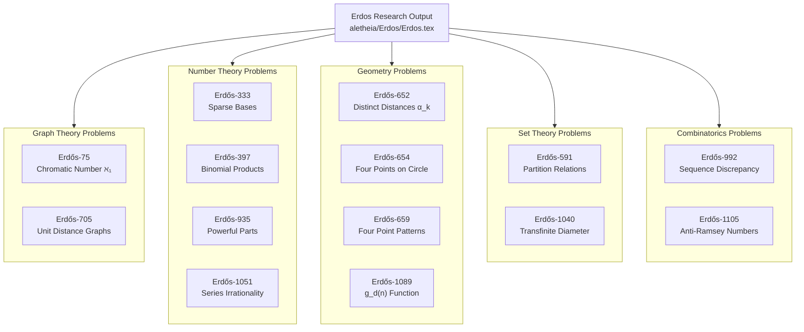
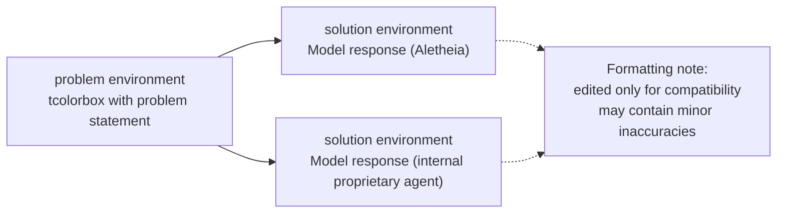
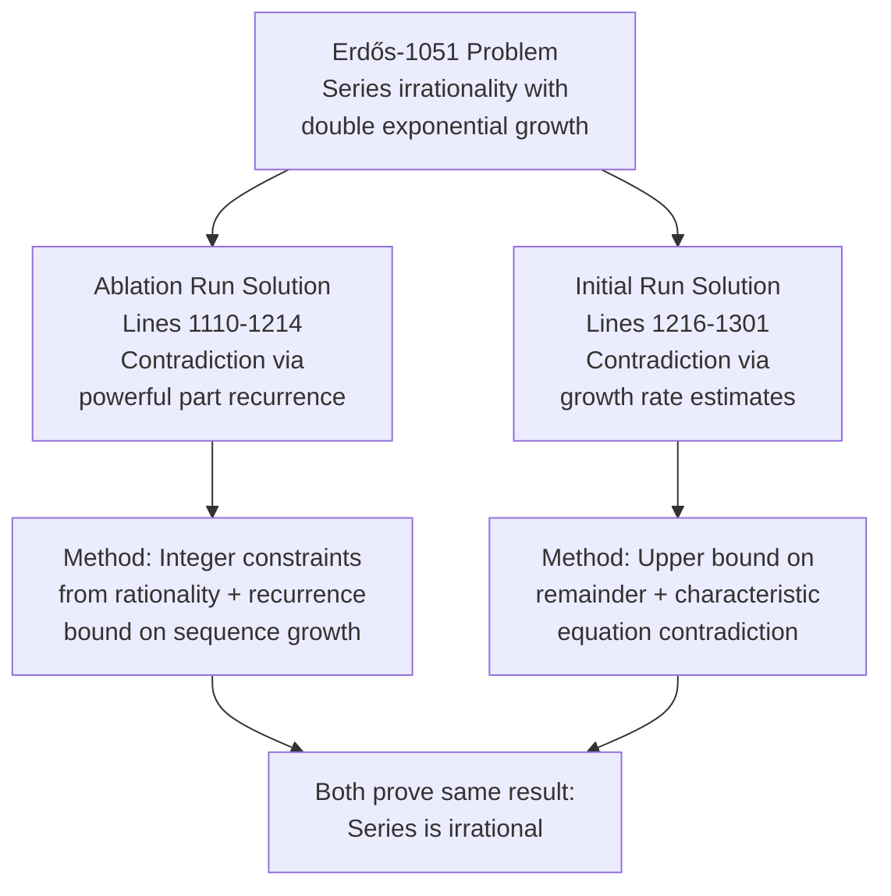
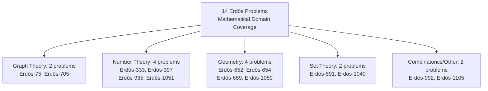
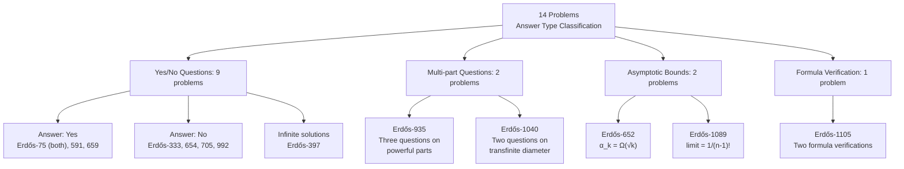
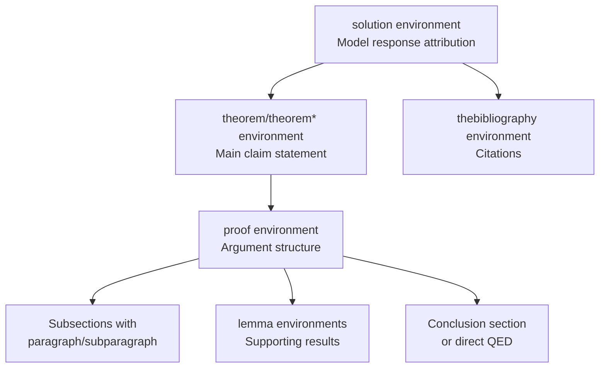
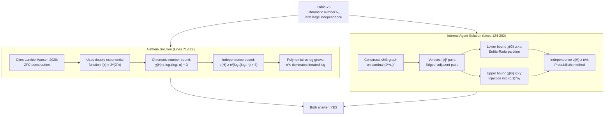
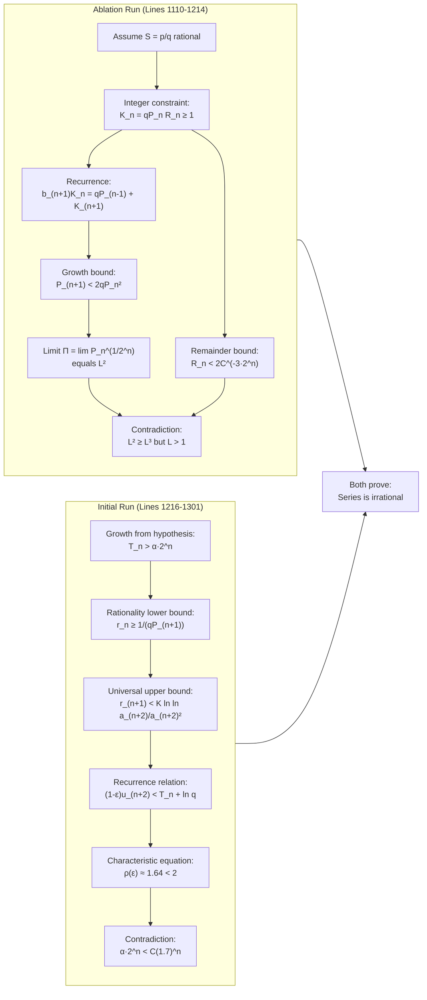
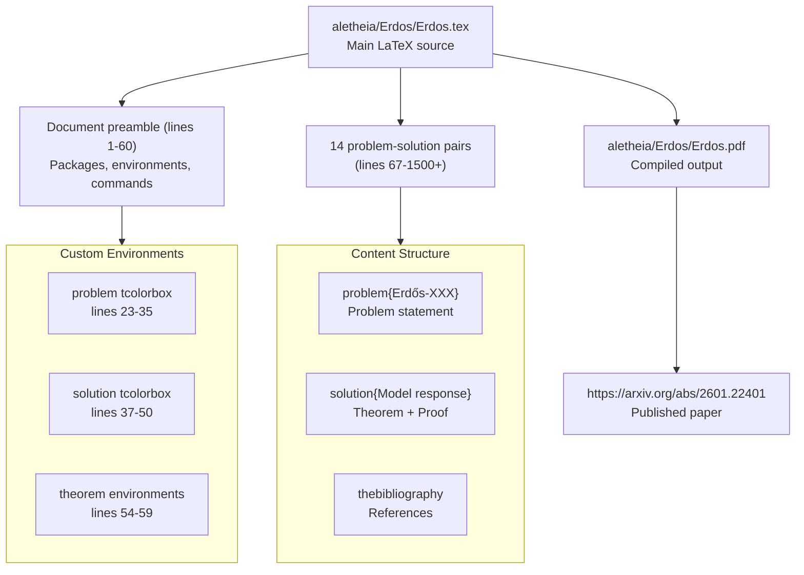

<!-- source: DeepWiki mcp.deepwiki.com · repo google-deepmind/superhuman · page 3.3 Research Output: Erdos - Semi-Autonomous Study of Open Problems · fetched 2026-10-26 -->

# Research Output: Erdos - Semi-Autonomous Study of Open Problems

<details>
<summary>Relevant source files</summary>

The following files were used as context for generating this wiki page:

- [aletheia/Erdos/Erdos.pdf](aletheia/Erdos/Erdos.pdf)
- [aletheia/Erdos/Erdos.tex](aletheia/Erdos/Erdos.tex)
- [aletheia/README.md](aletheia/README.md)

</details>


## Purpose and Scope

This page documents the Erdos research output from Aletheia, which presents a semi-autonomous case study applying large language models to open problems from Paul Erdős's problem collection. The study addresses 14 distinct Erdős problems spanning graph theory, combinatorics, number theory, geometry, and set theory. Most solutions are generated by Aletheia, with one solution contributed by an internal proprietary agent for comparison purposes.

For information about Aletheia's overall system architecture, see [Aletheia System Architecture](#3.1). For other research outputs from Aletheia, see sections [3.2](#3.2) through [3.6](#3.6). For analysis of mathematical domains and proof techniques across all Aletheia outputs, see [Mathematical Domains and Proof Techniques](#3.7).

**Sources:** [aletheia/README.md:12](), [aletheia/Erdos/Erdos.tex:1-67]()

## Overview of Research Output

### Publication Details

The Erdos study is published as a standalone paper with the following artifacts:

| Artifact Type | Location | Format |
|--------------|----------|---------|
| LaTeX Source | `aletheia/Erdos/Erdos.tex` | TeX document with problem/solution environments |
| Compiled PDF | `aletheia/Erdos/Erdos.pdf` | Human-readable format |
| arXiv Paper | https://arxiv.org/abs/2601.22401 | Official publication record |

The document follows a structured format using custom `problem` and `solution` environments defined in [aletheia/Erdos/Erdos.tex:22-50]().

**Sources:** [aletheia/README.md:12](), [aletheia/Erdos/Erdos.tex:22-50]()

### Semi-Autonomous Nature

The study is described as "semi-autonomous" for two key reasons:

1. **Multiple Model Contributions**: While most solutions are from Aletheia, Erdős-75 includes a second solution from an "internal proprietary agent" [aletheia/Erdos/Erdos.tex:124-202](), demonstrating comparative model capabilities.

2. **Human Curation**: As noted in [aletheia/README.md:6-9](), "2 outputs, one in Erdos problems and one in LeeSeo26, are not from Aletheia," indicating human oversight in selecting and organizing solutions.

3. **Editorial Note**: The document explicitly states "The prompts and responses below have been edited only for formatting compatibility. NOTE THAT MANY CONTAIN MINOR INACCURACIES" [aletheia/Erdos/Erdos.tex:64-65](), acknowledging the need for human verification.

**Sources:** [aletheia/README.md:6-9](), [aletheia/Erdos/Erdos.tex:64-65](), [aletheia/Erdos/Erdos.tex:124-202]()

## Problem Catalog

### Complete Problem List

The study addresses 14 distinct Erdős problems, each identified by its number from the Erdős problem collection:



**Sources:** [aletheia/Erdos/Erdos.tex:67-1405]()

### Problem Metadata Table

| Problem ID | Line Range | Domain | Model | Answer Type |
|-----------|------------|---------|-------|-------------|
| Erdős-75 | [67-122]() | Graph Theory | Aletheia | Existence proof (Yes) |
| Erdős-75 (alt) | [124-202]() | Graph Theory | Internal proprietary | Constructive proof (Yes) |
| Erdős-333 | [204-275]() | Additive Combinatorics | Aletheia | Counterexample (No) |
| Erdős-397 | [278-353]() | Number Theory | Aletheia | Infinite family (No) |
| Erdős-591 | [355-410]() | Set Theory | Aletheia | Positive result (Yes) |
| Erdős-652 | [412-465]() | Geometry | Aletheia | Asymptotic bound |
| Erdős-654 | [467-612]() | Geometry | Aletheia | Counterexample (No) |
| Erdős-659 | [614-693]() | Geometry | Aletheia | Existence proof (Yes) |
| Erdős-705 | [695-747]() | Graph Theory | Aletheia | Negative result (No) |
| Erdős-935 | [749-928]() | Number Theory | Aletheia | Three-part answer |
| Erdős-992 | [930-987]() | Ergodic Theory | Aletheia | Negative result (No) |
| Erdős-1040 | [990-1104]() | Complex Analysis | Aletheia | Two-part answer |
| Erdős-1051 (ablation) | [1106-1214]() | Number Theory | Aletheia | Positive result (Yes) |
| Erdős-1051 (initial) | [1216-1301]() | Number Theory | Aletheia | Positive result (Yes) |
| Erdős-1089 | [1304-1404]() | Geometry | Aletheia | Limit calculation |
| Erdős-1105 | [1406-end]() | Combinatorics | Aletheia | Formula verification |

**Sources:** [aletheia/Erdos/Erdos.tex:67-1500]()

## Model Attributions and Solution Structure

### Solution Labeling System

The document uses LaTeX `solution` environments with model attributions in the title parameter:



**Example from Erdős-75** [aletheia/Erdos/Erdos.tex:71-122]():
- Problem environment: `\begin{problem}{Erd\H{o}s-75}`
- Solution environment: `\begin{solution}{Model response (\emph{Aletheia})}`

**Example from Erdős-75 (alternate)** [aletheia/Erdos/Erdos.tex:124-202]():
- Solution environment: `\begin{solution}{Model response (internal proprietary agent)}`

**Sources:** [aletheia/Erdos/Erdos.tex:37-50](), [aletheia/Erdos/Erdos.tex:71-122](), [aletheia/Erdos/Erdos.tex:124-202]()

### Multiple Solutions: Erdős-75

The Erdős-75 problem uniquely features two complete solutions from different models, providing a direct comparison:

| Aspect | Aletheia Solution | Internal Proprietary Agent |
|--------|-------------------|----------------------------|
| Line Range | [71-122]() | [124-202]() |
| Approach | Cites Lambie-Hanson theorem (2020) | Constructs shift graph on $(2^{\aleph_0})^+$ |
| Proof Strategy | Uses double exponential function | Uses probabilistic method |
| Graph Construction | Abstract existence via ZFC | Explicit vertex/edge definition |
| Independence Bound | $\alpha(H) \geq n/\chi(H)$ | $\alpha(H) \geq n/4$ |
| Mathematical Framework | Chromatic number growth rates | Erdős-Rado partition relation |

Both solutions answer "Yes" to the question but use fundamentally different mathematical machinery.

**Sources:** [aletheia/Erdos/Erdos.tex:67-202]()

### Erdős-1051: Ablation Study

Problem Erdős-1051 (series irrationality) includes two distinct Aletheia runs, labeled as "ablation run" and "initial run":



**Key differences**:
- **Ablation run** [aletheia/Erdos/Erdos.tex:1110-1214](): Uses product recurrence $P_{n+1} < 2qP_n^2$ and derives contradiction via $\Pi = \mathcal{L}^2$ vs $\Pi \geq \mathcal{L}^3$
- **Initial run** [aletheia/Erdos/Erdos.tex:1216-1301](): Uses characteristic equation with root $\rho(\epsilon) \approx 1.64 < 2$ to derive contradiction

**Sources:** [aletheia/Erdos/Erdos.tex:1106-1301]()

## Mathematical Domains and Techniques

### Domain Distribution



**Sources:** [aletheia/Erdos/Erdos.tex:67-1500]()

### Proof Techniques Employed

The solutions demonstrate diverse mathematical proof techniques:

| Technique | Problems Using It | Example Location |
|-----------|-------------------|------------------|
| **Existence via Literature** | Erdős-75, Erdős-591, Erdős-705 | [aletheia/Erdos/Erdos.tex:82-86]() |
| **Explicit Construction** | Erdős-397, Erdős-654, Erdős-659 | [aletheia/Erdos/Erdos.tex:293-302]() |
| **Probabilistic Method** | Erdős-75 (alt), Erdős-333 | [aletheia/Erdos/Erdos.tex:179-191]() |
| **Contradiction** | Erdős-333, Erdős-1051 | [aletheia/Erdos/Erdos.tex:1126-1207]() |
| **Asymptotic Analysis** | Erdős-652, Erdős-992, Erdős-1089 | [aletheia/Erdos/Erdos.tex:451-458]() |
| **Algebraic Techniques** | Erdős-397, Erdős-935 | [aletheia/Erdos/Erdos.tex:812-883]() |
| **Geometric Arguments** | Erdős-654, Erdős-659, Erdős-1040 | [aletheia/Erdos/Erdos.tex:493-518]() |
| **Incidence Geometry** | Erdős-652 | [aletheia/Erdos/Erdos.tex:444-450]() |

**Sources:** [aletheia/Erdos/Erdos.tex:67-1500]()

### Advanced Mathematical Frameworks

Several solutions invoke sophisticated mathematical frameworks:

#### Set Theory and Ordinals
- **Erdős-591**: Schipperus characterization of countable partition ordinals, Darby's work on $\omega^{\omega^2}$ [aletheia/Erdos/Erdos.tex:363-403]()
- **Erdős-75 (alt)**: Erdős-Rado partition relation, cardinal arithmetic [aletheia/Erdos/Erdos.tex:148-158]()

#### Number Theory
- **Erdős-935**: Pell equations, fundamental units in $\mathbb{Z}[\sqrt{8}]$, Frobenius maps [aletheia/Erdos/Erdos.tex:812-883]()
- **Erdős-1051**: Double exponential growth, powerful part recurrence relations [aletheia/Erdos/Erdos.tex:1147-1169]()

#### Geometric Graph Theory
- **Erdős-705**: O'Donnell's construction of arbitrary girth 4-chromatic unit distance graphs [aletheia/Erdos/Erdos.tex:713-719]()
- **Erdős-652**: Pach-Sharir incidence bound for circles [aletheia/Erdos/Erdos.tex:446-450]()

#### Complex Analysis
- **Erdős-1040**: Transfinite diameter (logarithmic capacity), Krishnapur-Lundberg-Ramachandran theorem on polynomial lemniscates [aletheia/Erdos/Erdos.tex:1073-1080]()

**Sources:** [aletheia/Erdos/Erdos.tex:363-403](), [aletheia/Erdos/Erdos.tex:812-883](), [aletheia/Erdos/Erdos.tex:713-719](), [aletheia/Erdos/Erdos.tex:446-450](), [aletheia/Erdos/Erdos.tex:1073-1080]()

## Solution Answer Types

### Classification by Answer Structure



**Sources:** [aletheia/Erdos/Erdos.tex:67-1500]()

### Detailed Answer Breakdown

#### Existence Proofs (Answer: Yes)
- **Erdős-75**: Graph with chromatic number $\aleph_1$ and large independent sets exists [aletheia/Erdos/Erdos.tex:72-74]()
- **Erdős-591**: Partition relation $\omega^{\omega^2} \to (\omega^{\omega^2}, 3)^2$ holds [aletheia/Erdos/Erdos.tex:360]()
- **Erdős-659**: Set with 4-point constraint and few distances exists [aletheia/Erdos/Erdos.tex:619-621]()

#### Counterexamples (Answer: No)
- **Erdős-333**: Density zero set exists with no sparse basis [aletheia/Erdos/Erdos.tex:216-221]()
- **Erdős-654**: Not all such point sets have a point with $(1-o(1))n$ distances [aletheia/Erdos/Erdos.tex:471-474]()
- **Erdős-705**: No girth threshold forces 3-colorability for unit distance graphs [aletheia/Erdos/Erdos.tex:703-705]()
- **Erdős-992**: Proposed discrepancy bounds fail for some sequences [aletheia/Erdos/Erdos.tex:935-941]()

#### Infinite Families
- **Erdős-397**: Infinitely many solutions to binomial product equation [aletheia/Erdos/Erdos.tex:285-289]()

#### Multi-part Questions
- **Erdős-935**: Three questions about powerful parts
  - Q1: Upper bound $Q_2(P(n,\ell)) < n^{2+\epsilon}$ for large $n$ — **Yes** [aletheia/Erdos/Erdos.tex:774-796]()
  - Q2: $\limsup Q_2(P(n,\ell))/n^2$ infinite for $\ell \geq 2$ — **Yes** [aletheia/Erdos/Erdos.tex:800-895]()
  - Q3: Limit $Q_2(P(n,\ell))/n^{\ell+1} \to 0$ for $\ell \geq 2$ — **Yes** [aletheia/Erdos/Erdos.tex:901-920]()

- **Erdős-1040**: Two questions about transfinite diameter
  - Q1: Is $\mu(F)$ determined by $d_\infty(F)$ — **No** [aletheia/Erdos/Erdos.tex:1008-1047]()
  - Q2: Does $d_\infty(F) \geq 1$ imply $\mu(F) = 0$ — **Yes** [aletheia/Erdos/Erdos.tex:1051-1092]()

**Sources:** [aletheia/Erdos/Erdos.tex:72-1092]()

## Key Mathematical Results

### Constructive Results

#### Erdős-397: Infinite Family of Binomial Identities
Constructs explicit family showing infinitely many solutions to $\prod \binom{2m_i}{m_i} = \prod \binom{2n_j}{n_j}$ [aletheia/Erdos/Erdos.tex:293-344]():

For $k \geq 3$:
- $A_k = \{k, 2k-2, 8k^2-8k+2\}$
- $B_k = \{k-1, 2k, 8k^2-8k+1\}$

Verification involves central binomial coefficient ratios and algebraic identities.

#### Erdős-654: Point Set Construction
Constructs explicit counterexample using coordinate axes [aletheia/Erdos/Erdos.tex:476-603]():
- Set $P$ on $y$-axis with coordinates $\pm 3^k$
- Set $Q$ on $x$-axis with coordinates $\pm 2^j$
- Every point determines fewer than $\frac{3}{4}n$ distinct distances

#### Erdős-659: Lattice-Based Construction
Uses algebraic number theory [aletheia/Erdos/Erdos.tex:628-690]():
- Embeds points in lattice $\Lambda$ over $\mathbb{Q}(\sqrt{-7})$
- Quadratic form $Q(m,k) = m^2 + mk + 2k^2$
- Bernays theorem on quadratic forms ensures $O(n/\sqrt{\log n})$ distinct distances

**Sources:** [aletheia/Erdos/Erdos.tex:293-344](), [aletheia/Erdos/Erdos.tex:476-603](), [aletheia/Erdos/Erdos.tex:628-690]()

### Asymptotic Bounds

#### Erdős-652: Lower Bound on $\alpha_k$
Proves $\alpha_k = \Omega(\sqrt{k})$ using incidence geometry [aletheia/Erdos/Erdos.tex:420-458]():
- Uses Pach-Sharir bound: $I(P, \mathcal{C}) \leq K_2(n^{2/3}L^{2/3} + n + L)$
- Derives contradiction if $\alpha_k$ grows too slowly
- Final bound: $\alpha_k \geq \left(\frac{1}{2K_2}\right)^{3/2} \sqrt{k}$

#### Erdős-1089: Exact Asymptotic for $g_d(n)$
Determines precise limit [aletheia/Erdos/Erdos.tex:1309-1393]():
$$\lim_{d\to\infty} \frac{g_d(n)}{d^{n-1}} = \frac{1}{(n-1)!}$$
- Uses Bannai-Bannai-Stanton upper bound: $M_d(s) \leq \binom{d+s}{s}$
- Constructs binary vector lower bound: $M_d(s) \geq \binom{d+1}{s}$

**Sources:** [aletheia/Erdos/Erdos.tex:420-458](), [aletheia/Erdos/Erdos.tex:1309-1393]()

### Literature-Based Results

Several solutions establish results by citing existing theorems:

| Problem | Theorem Cited | Citation Location |
|---------|--------------|-------------------|
| Erdős-75 | Lambie-Hanson (2020) | [82-86]() |
| Erdős-591 | Schipperus (2010), Darby (unpublished) | [371-391]() |
| Erdős-705 | O'Donnell (2000) | [713-719]() |
| Erdős-935 | Cilleruelo (2008) | [780-785]() |
| Erdős-992 | Berkes & Philipp (1994) | [952-956]() |
| Erdős-1040 | Krishnapur, Lundberg, Ramachandran (2025) | [1073-1077]() |

**Sources:** [aletheia/Erdos/Erdos.tex:82-86](), [aletheia/Erdos/Erdos.tex:371-391](), [aletheia/Erdos/Erdos.tex:713-719](), [aletheia/Erdos/Erdos.tex:780-785](), [aletheia/Erdos/Erdos.tex:952-956](), [aletheia/Erdos/Erdos.tex:1073-1077]()

## Document Structure and LaTeX Formatting

### Custom Environment Definitions

The document defines specialized LaTeX environments for consistent formatting [aletheia/Erdos/Erdos.tex:16-50]():

```
Custom colors:
- boxblue: RGB(0, 0, 150) - frame color
- boxback: RGB(245, 245, 255) - background color

problem environment (tcolorbox):
- Colored background and frame
- Title parameter for problem ID
- Sharp corners design
- Non-breakable across pages

solution environment (tcolorbox):
- White background
- Same frame color as problem
- Title parameter for model attribution
- Breakable across pages (enhanced jigsaw)
```

**Key differences**:
- `problem` environment is not breakable [aletheia/Erdos/Erdos.tex:23-35]()
- `solution` environment has `breakable` option [aletheia/Erdos/Erdos.tex:44]() to handle long proofs

**Sources:** [aletheia/Erdos/Erdos.tex:16-50]()

### Mathematical Notation

Standard mathematical packages and custom commands [aletheia/Erdos/Erdos.tex:1-14]():

```latex
\newcommand{\N}{\mathbb{N}}
\newcommand{\Nzero}{\mathbb{N} \cup \{0\}}
\newcommand{\Qtwo}{Q_2}
\newcommand{\Z}{\mathbb{Z}}
\newcommand{\F}{\mathbb{F}}
\newcommand{\eps}{\varepsilon}
\DeclareMathOperator{\AR}{AR}
```

**Sources:** [aletheia/Erdos/Erdos.tex:7-14]()

### Theorem Environments

The document uses standard theorem-like environments [aletheia/Erdos/Erdos.tex:54-59]():
- `theorem`, `theorem*`: Main results
- `lemma`: Supporting results
- `definition`: Formal definitions
- `proposition`: Intermediate results
- `remark`: Contextual information

**Sources:** [aletheia/Erdos/Erdos.tex:54-59]()

## Mathematical Content Patterns

### Proof Organization



**Example structure from Erdős-591** [aletheia/Erdos/Erdos.tex:360-409]():
1. Theorem statement (line 360)
2. Proof opening (line 362)
3. Subsection: "1. Representation of the Ordinal" (line 365)
4. Subsection: "2. Characterization of Countable Partition Ordinals" (line 370)
5. Subsection: "3. Verification for β=2" (line 380)
6. Subsection: "4. Historical Confirmation" (line 387)
7. Subsection: "5. Negative Results for Higher Values" (line 397)
8. Conclusion (line 401)
9. Bibliography (line 405)

**Sources:** [aletheia/Erdos/Erdos.tex:360-409]()

### Bibliography Management

Solutions include inline bibliographies using `thebibliography` environment:

| Problem | Number of References | Reference Types |
|---------|---------------------|-----------------|
| Erdős-75 | 0 | Inline citations only |
| Erdős-333 | 2 | Book and journal |
| Erdős-591 | 3 | Journal and handbook |
| Erdős-652 | 1 | Journal |
| Erdős-654 | 2 | Journal |
| Erdős-705 | 4 | Journal and handbook |
| Erdős-935 | 1 | Journal |
| Erdős-992 | 3 | Journal |
| Erdős-1040 | 2 | arXiv and journal |
| Erdős-1051 | 2 | Book and journal |
| Erdős-1089 | 1 | Journal |
| Erdős-1105 | Not shown | Truncated |

**Sources:** [aletheia/Erdos/Erdos.tex:269-1500]()

## Comparative Analysis: Dual Solutions

### Erdős-75: Two Approaches

The problem asks whether a graph with chromatic number $\aleph_1$ exists such that finite subgraphs have large independent sets.



**Key technical differences**:

1. **Graph Source**: Aletheia uses literature (Lambie-Hanson's existence theorem in ZFC), while internal agent explicitly constructs the shift graph on ordinals.

2. **Independence Analysis**: 
   - Aletheia: Derives bound from chromatic growth rate, gets $\alpha(H) \geq n/\chi(H)$ [aletheia/Erdos/Erdos.tex:104-107]()
   - Internal: Uses probabilistic partitioning, gets exact $\alpha(H) \geq n/4$ [aletheia/Erdos/Erdos.tex:176-191]()

3. **Mathematical Frameworks**:
   - Aletheia: Function-theoretic (double exponentials, asymptotic growth)
   - Internal: Set-theoretic (cardinals, partition relations, Erdős-Rado theorem)

**Sources:** [aletheia/Erdos/Erdos.tex:67-202]()

### Erdős-1051: Ablation vs Initial Run

Both runs prove the same result (series irrationality) but use different proof strategies:



**Comparison**:

| Aspect | Ablation Run | Initial Run |
|--------|-------------|-------------|
| **Key Inequality** | $P_{n+1} < 2qP_n^2$ | $(1-\epsilon)u_{n+2} < T_n + \ln q$ |
| **Limit Analysis** | Product limit $\Pi = \mathcal{L}^2$ | Characteristic root $\rho(\epsilon) < 2$ |
| **Contradiction** | $\mathcal{L}^2 \geq \mathcal{L}^3$ contradicts $\mathcal{L} > 1$ | $\alpha 2^n < C(1.7)^n$ contradicts $\alpha > 0$ |
| **Mathematical Style** | Algebraic (products, limits) | Analytical (logarithms, asymptotics) |
| **Proof Length** | ~100 lines | ~85 lines |

**Sources:** [aletheia/Erdos/Erdos.tex:1110-1301]()

## Limitations and Disclaimers

### Accuracy Disclaimer

The document includes an explicit warning [aletheia/Erdos/Erdos.tex:64-65]():

> "The prompts and responses below have been edited only for formatting compatibility. NOTE THAT MANY CONTAIN MINOR INACCURACIES."

This disclaimer indicates:
1. **Formatting Changes**: Solutions have been reformatted for LaTeX compatibility
2. **Accuracy Issues**: Mathematical arguments may contain errors
3. **Human Verification Required**: Results should be independently verified

### Non-Aletheia Content

As noted in [aletheia/README.md:6-9](), not all solutions are from Aletheia:
- One solution in Erdos problems is from an internal proprietary agent
- This is Erdős-75's second solution [aletheia/Erdos/Erdos.tex:124-202]()
- Purpose: Comparative demonstration of different model capabilities

**Sources:** [aletheia/README.md:6-9](), [aletheia/Erdos/Erdos.tex:64-65](), [aletheia/Erdos/Erdos.tex:124-202]()

## File Structure Mapping

### LaTeX to Code Entities



**Sources:** [aletheia/Erdos/Erdos.tex:1-1500](), [aletheia/README.md:12]()

### Problem Indexing Structure

Each problem follows this pattern:
1. `\begin{problem}{Erd\H{o}s-XXX}` with problem statement [lines vary]()
2. `\begin{solution}{Model response (...)}` with model attribution [lines vary]()
3. Optional theorem/lemma environments within solution
4. Proof environment with structured subsections
5. Optional bibliography section
6. `\end{solution}` and `\end{problem}`

**Example mapping for Erdős-935** [aletheia/Erdos/Erdos.tex:749-928]():
- Problem definition: lines 749-750
- Solution header: line 752
- Introduction: lines 762-768
- Theorem 1: lines 774-796
- Theorem 2: lines 800-895
- Theorem 3: lines 901-920
- Bibliography: lines 922-926

**Sources:** [aletheia/Erdos/Erdos.tex:749-928]()

## Integration with Broader Research Outputs

This Erdos study is one of six research outputs from Aletheia. For context on how it relates to other outputs:

- **BKKKZ26** [3.2](#3.2): Focused irrationality proof for specific series (Erdős-1051 generalization)
- **F26/FYZ26** [3.4](#3.4): Eigenweight computations in algebraic geometry (different domain)
- **ACGKMP** [3.5](#3.5): Dyadic interval bounds (contributory mode vs standalone)
- **LeeSeo26** [3.6](#3.6): Independence set bounds (contributory mode vs standalone)

The Erdos output demonstrates:
1. **Breadth over depth**: 14 problems across domains vs deep dive into single problem
2. **Standalone research**: Complete papers rather than contributions to external work
3. **Model comparison**: Includes internal agent solution for benchmarking
4. **Ablation studies**: Multiple runs on same problem (Erdős-1051)

**Sources:** [aletheia/README.md:11-17]()

---

