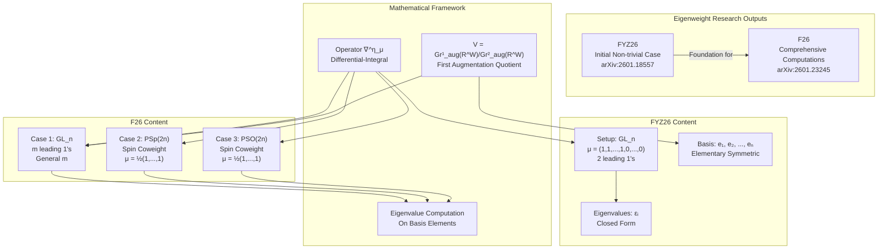
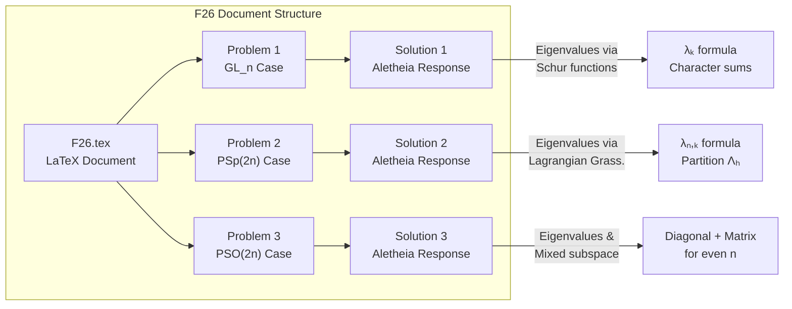
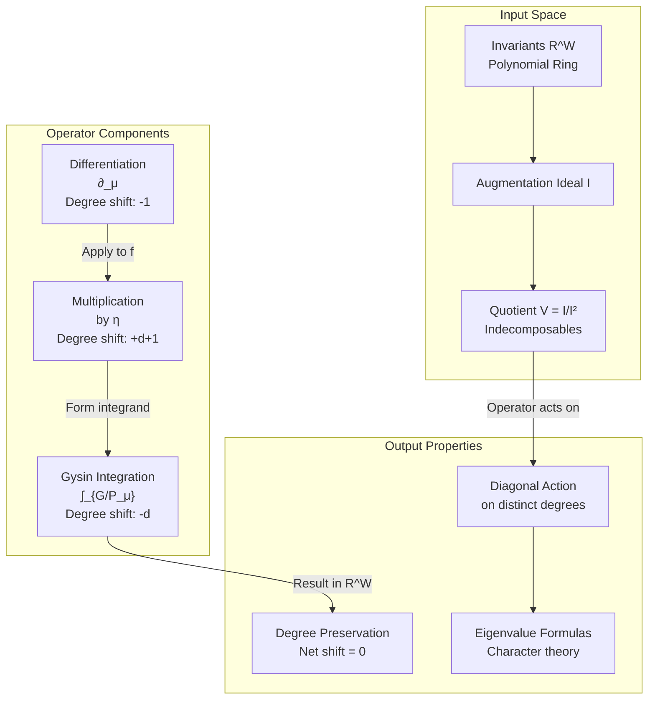

<!-- source: DeepWiki mcp.deepwiki.com · repo google-deepmind/superhuman · page 3.4 Research Output: Eigenweight Computations (F26 and FYZ26) · fetched 2026-10-26 -->

# Research Output: Eigenweight Computations (F26 and FYZ26)

<details>
<summary>Relevant source files</summary>

The following files were used as context for generating this wiki page:

- [aletheia/F26/F26.pdf](aletheia/F26/F26.pdf)
- [aletheia/F26/F26.tex](aletheia/F26/F26.tex)
- [aletheia/FYZ26/FYZ26.pdf](aletheia/FYZ26/FYZ26.pdf)
- [aletheia/FYZ26/FYZ26.tex](aletheia/FYZ26/FYZ26.tex)
- [aletheia/README.md](aletheia/README.md)

</details>


## Purpose and Scope

This page documents two related Aletheia research outputs focused on eigenweight computations for the Arithmetic Hirzebruch Proportionality Principle: **FYZ26** and **F26**. FYZ26 presents an initial non-trivial case of eigenweight computation, while F26 provides comprehensive calculations across multiple reductive group types. Both outputs compute eigenvalues of differential-integral operators acting on cohomology rings of classifying spaces.

For other Aletheia research outputs, see [Research Output: BKKKZ26](#3.2), [Research Output: Erdos](#3.3), [Research Output: ACGKMP](#3.5), and [Research Output: LeeSeo26](#3.6). For Aletheia system architecture, see [Aletheia System Architecture](#3.1).

Sources: [aletheia/README.md:13-14]()

## Research Output Structure

Both outputs follow a consistent prompt-response structure where user prompts define mathematical problems and Aletheia provides solutions.



Sources: [aletheia/README.md:13-14](), [aletheia/F26/F26.tex:1-50](), [aletheia/FYZ26/FYZ26.tex:1-50]()

## FYZ26: Initial Non-trivial Case

FYZ26 establishes the foundational case for eigenweight computations in the GL_n setting with a specific configuration.

### Problem Setup

The FYZ26 problem considers the symmetric group action on polynomial ring `R = Q[x₁,...,xₙ]` with degree 2 variables, where the Weyl group `W = Sₙ` acts by permutations.

**Key Mathematical Objects:**

| Object | Definition | Purpose |
|--------|-----------|---------|
| `R^W` | `Q[e₁, e₂, ..., eₙ]` | Ring of W-invariants, elementary symmetric polynomials |
| `ℜ_λ` | `∏ᵢ₌₃ⁿ (x₁-xᵢ)(x₂-xᵢ)` | Root product for Gysin pushforward |
| `W_λ` | `S₂ × S_{n-2}` | Parabolic subgroup |
| `η` | `(x₁+x₂)^(N+1)` where `N = 2(n-2)` | Numerology factor |
| `∂_λ` | `∂/∂x₁ + ∂/∂x₂` | Differential operator |

Sources: [aletheia/FYZ26/FYZ26.tex:84-101]()

### Operator Definition

The operator `∇^η_λ: R^W → R^W` is defined as:

```
∇^η_λ(f) = ∫ (η ∂_λ f)
```

where the integral is the Gysin pushforward:

```
∫ f = ∑_{w ∈ W/W_λ} w(f/ℜ_λ) ∈ R^W
```

Sources: [aletheia/FYZ26/FYZ26.tex:93-101]()

### Eigenvalue Formula

Acting on the first augmentation quotient `V = Gr¹_aug(R^W)/Gr²_aug(R^W)`, the operator satisfies:

```
∇^η_λ(eᵢ) = εᵢ eᵢ + (polynomial in e₁,...,eᵢ₋₁)
```

**Result:** The eigenvalues are:

```
εᵢ = (1/n)·C(2n-2, n-1) - [C(2n-3, n-i) - 2·C(2n-3, n-i-1) + C(2n-3, n-i-2)]
```

where `C(N,k)` denotes binomial coefficient, with `C(N,k) = 0` if `k < 0` or `k > N`.

Sources: [aletheia/FYZ26/FYZ26.tex:195-200]()

## F26: Comprehensive Eigenweight Computations

F26 extends the eigenweight computation framework to three distinct reductive group types, providing closed-form eigenvalue formulas in each case.



Sources: [aletheia/F26/F26.tex:1-90]()

### Case 1: GL_n with General Minuscule Coweight

**Setup:** Group `G = GL_n` with minuscule coweight `μ = (1,...,1,0,...,0)` having `m` leading 1's where `1 ≤ m < n`.

**Key Parameters:**

| Parameter | Value | Description |
|-----------|-------|-------------|
| `d` | `m(n-m)` | Complex dimension of Grassmannian `G/P_μ` |
| `η` | `(x₁+...+xₘ)^(d+1)` | Numerology factor |
| `∂_μ` | `∑ᵢ₌₁ᵐ ∂/∂xᵢ` | Differential operator |
| Basis | `e₁, e₂, ..., eₙ` | Elementary symmetric polynomials |

**Eigenvalue Formula:**

For degree `k`, the eigenvalue `λₖ` on the power sum basis `pₖ` (related to `eₖ` modulo decomposables) is:

```
λₖ = (-1)^d ∑_{ν ∈ Hooks_k} (-1)^ht(ν) c_{R+ν}
```

where:
- `R = ((n-m)^m)` is the rectangular partition
- `Hooks_k` are hook partitions of `k`
- `ht(ν)` is the height of partition `ν`

**Example Calculation (n=4, m=2):**

| Degree k | Eigenvalue λₖ | Calculation |
|----------|---------------|-------------|
| 1 | 10 | `2 · f^(3,2) = 2(5)` |
| 2 | 4 | `f^(4,2) - f^(3,3) = 9 - 5` |
| 3 | 2 | `χ^(5,2)_(2,1⁴) - χ^(4,3)_(2,1⁴) = 6 - 4` |

Sources: [aletheia/F26/F26.tex:91-221]()

### Case 2: PSp(2n) with Spin Coweight

**Setup:** Group `G = PSp(2n)` (projective symplectic group) with minuscule spin coweight `μ = ½(1,1,...,1)`.

**Key Parameters:**

| Parameter | Value | Description |
|-----------|-------|-------------|
| `d` | `n(n+1)/2` | Complex dimension of Lagrangian Grassmannian |
| `η` | `t^(d+1)` where `t = ½∑xᵢ` | Numerology factor |
| `∂_μ` | `½ ∑ᵢ₌₁ⁿ ∂/∂xᵢ` | Differential operator |
| Basis | `p₁^(2), p₂^(2), ..., pₙ^(2)` | Power sums of squares |

where `pₖ^(2) = ∑ᵢ₌₁ⁿ xᵢ^(2k)`.

**Eigenvalue Formula (Theorem from F26):**

```
λₙ,ₖ = (-1)^d / 2^(d+1) · ∑_{h=0}^{min(k-1,n-1)} (-1)^h χ^Λₕ_ρ
```

where:
- `ρ = (2k-1, 1^(d+1))` is the conjugacy class in `S_{d+2k}`
- `Λₕ` is the partition with components:
  - `(Λₕ)₁ = 2k - 2h + n`
  - `(Λₕ)ᵢ = n - i + 3` for `2 ≤ i ≤ h+1`
  - `(Λₕ)ᵢ = n - i + 1` for `h+2 ≤ i ≤ n`

**Computed Eigenvalues:**

| Rank n | Dimension d | Eigenvalues (λₙ,₁, ..., λₙ,ₙ) |
|--------|-------------|--------------------------------|
| 1 | 1 | -1/4 |
| 2 | 3 | -1/4, -1/4 |
| 3 | 6 | 1/2, 5/16, 1/2 |
| 4 | 10 | 11/4, 19/16, 7/4, 41/16 |
| 5 | 15 | -221/4, -71/4, -49/2, -137/4, -47 |
| 6 | 21 | -81719/16, -1292, -13395/8, -36501/16, -12045/4, -7909/2 |

Sources: [aletheia/F26/F26.tex:223-387]()

### Case 3: PSO(2n) with Spin Coweight

**Setup:** Group `G = PSO(2n)` (projective special orthogonal group, rank `n ≥ 3`) with minuscule spin coweight `μ = ½(1,1,...,1)`.

**Key Parameters:**

| Parameter | Value | Description |
|-----------|-------|-------------|
| `d` | `n(n-1)/2` | Complex dimension of spinor variety |
| `η` | `t^(d+1)` where `t = ½∑xᵢ` | Numerology factor |
| Basis | `p₁^(2), ..., pₙ₋₁^(2), Pf` | Power sums and Pfaffian |

where `Pf = x₁x₂···xₙ` is the Pfaffian (degree `n`).

**Eigenvalue Formula:**

For generic degrees (`2k ≠ n`):

```
λₖ = C₀ · ∑_{h=0}^{k-1} (-1)^h χ^Λₕ(n,k)_ρₖ
```

where `C₀ = (-1)^d · 2^(n-d-2)` and `ρₖ = (2k-1, 1^(d+1))`.

For the Pfaffian (odd `n`):

```
λ_Pf = (C₀/2) · (d+1) · f^Δₙ₋₁
```

where `f^Δ` is the dimension of the irreducible representation indexed by partition `Δₙ₋₁ = (n, n-1, ..., 1)`.

**Mixed Subspace (Even n):**

When `n` is even, degree-`n` elements `p_{n/2}^(2)` and `Pf` span a 2-dimensional invariant subspace. The operator acts via a 2×2 matrix:

```
M = [ λₘ        A_{m,Pf}  ]
    [ A_{Pf,m}  λ_Pf      ]
```

where:
- `A_{Pf,m} = m·C₀·χ^Δₙ_ρₘ` (coefficient of `Pf` in `∇(p_m^(2))`)
- `A_{m,Pf} = (C₀/2m)·∑_{h=0}^{m-1} (-1)^h f^Ξₕ(n,m)` (coefficient of `p_m^(2)` in `∇(Pf)`)

Sources: [aletheia/F26/F26.tex:390-end]()

## Mathematical Operator Structure

The common structure across all cases involves a differential-integral operator acting on cohomology rings.



Sources: [aletheia/F26/F26.tex:113-145](), [aletheia/FYZ26/FYZ26.tex:122-130]()

## Computational Techniques

Both outputs employ sophisticated mathematical techniques for eigenvalue computation.

### Localization Formula

The Gysin pushforward is computed using Atiyah-Bott localization over fixed points:

```
∫_{G/P_μ} g = ∑_{w ∈ W/W_μ} w(g/ℜ_μ)
```

where `ℜ_μ` is the product of negative roots relative to `μ`.

**FYZ26 Implementation:**

```
ℜ_λ = ∏_{i=3}^n (x₁-xᵢ)(x₂-xᵢ)
```

Uses divided differences and the relation to complete homogeneous symmetric functions `hₖ`.

**F26 GL_n Implementation:**

```
ℜ_μ = ∏_{i=m+1}^n ∏_{j=1}^m (xᵢ - xⱼ)
```

Uses Schur function expansion and Murnaghan-Nakayama rule.

Sources: [aletheia/FYZ26/FYZ26.tex:139-166](), [aletheia/F26/F26.tex:146-181]()

### Projection onto Indecomposables

The computation reduces modulo the ideal `I²` to obtain eigenvalues. Key techniques:

1. **Character Map:** Express Schur functions as character sums over cycle types
2. **Murnaghan-Nakayama Rule:** For cycle `(k)`, only hook partitions contribute
3. **Parity Filtering:** For orthogonal/symplectic cases, sum over sign vectors filters by exponent parity

**Example from F26 (PSp case):**

```
sν ≡ (χ^ν_(k) / k) · pₖ  (mod I²)
```

Only single-cycle contributions survive in the quotient.

Sources: [aletheia/F26/F26.tex:189-210](), [aletheia/F26/F26.tex:330-350]()

## Publication Details

Both research outputs are available on arXiv and follow the standardized Aletheia publication format.

| Output | arXiv Link | Content |
|--------|-----------|---------|
| FYZ26 | [2601.18557](https://arxiv.org/abs/2601.18557) | Initial non-trivial eigenweight case for GL_n |
| F26 | [2601.23245](https://arxiv.org/abs/2601.23245) | Comprehensive eigenweight computations across GL_n, PSp(2n), PSO(2n) |

Both papers include:
- LaTeX source: [aletheia/F26/F26.tex](), [aletheia/FYZ26/FYZ26.tex]()
- Compiled PDF: [aletheia/F26/F26.pdf](), [aletheia/FYZ26/FYZ26.pdf]()
- Prompt-response format with user problem statements and Aletheia solutions

Sources: [aletheia/README.md:13-14]()

---

