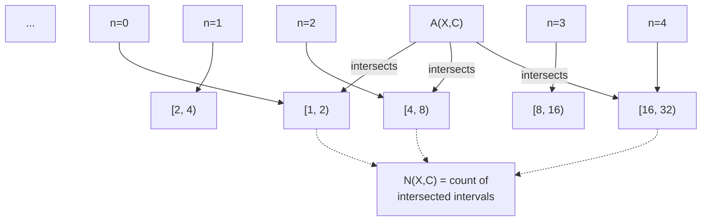
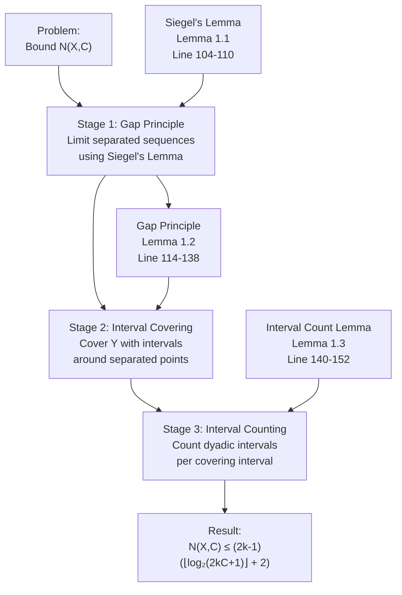
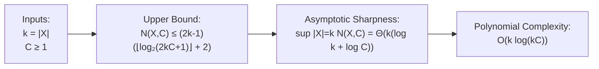
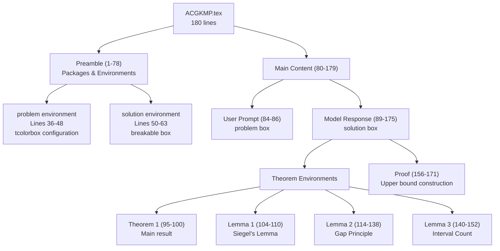
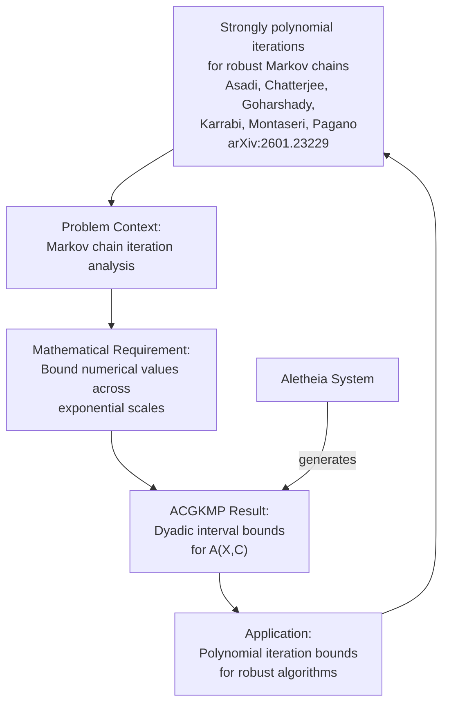
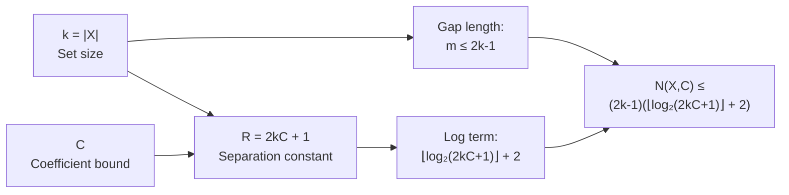

<!-- source: DeepWiki mcp.deepwiki.com · repo google-deepmind/superhuman · page 3.5 Research Output: ACGKMP - Dyadic Interval Bounds for Markov Chains · fetched 2026-10-26 -->

# Research Output: ACGKMP - Dyadic Interval Bounds for Markov Chains

<details>
<summary>Relevant source files</summary>

The following files were used as context for generating this wiki page:

- [aletheia/ACGKMP/ACGKMP.pdf](aletheia/ACGKMP/ACGKMP.pdf)
- [aletheia/ACGKMP/ACGKMP.tex](aletheia/ACGKMP/ACGKMP.tex)
- [aletheia/README.md](aletheia/README.md)

</details>


## Purpose and Scope

This page documents the ACGKMP research output, a mathematical contribution generated by Aletheia that serves as input to the paper "Strongly polynomial iterations for robust Markov chains" by Asadi, Chatterjee, Goharshady, Karrabi, Montaseri, and Pagano (arXiv:2601.23229). The result establishes polynomial upper bounds on the number of dyadic intervals containing integer linear combinations of real numbers with bounded coefficients.

This represents one of Aletheia's **contributory research outputs**, where the system provides a specific mathematical component to a broader human-led research effort, as opposed to producing a complete standalone paper. For information about Aletheia's standalone research mode, see [3.2](#3.2) (BKKKZ26) and [3.3](#3.3) (Erdos). For analysis of both collaboration modes, see [3.8](#3.8).

**Sources:** [aletheia/README.md:15-16](), [aletheia/ACGKMP/ACGKMP.tex:1-180]()

---

## Problem Statement

### Mathematical Setup

Given:
- A positive integer `C` (coefficient bound)
- A finite set `X = {x₁, ..., xₖ}` of real numbers

Define `A(X,C)` as the set of integer linear combinations:

```
A(X,C) = { Σᵢ aᵢxᵢ : aᵢ ∈ ℤ, |aᵢ| ≤ C }
```

**Objective:** Find a polynomial upper bound (in terms of `|X|`) for the number of dyadic intervals of the form `[2ⁿ, 2ⁿ⁺¹)` (for non-negative integers `n`) that intersect elements of `A(X,C)`.

**Sources:** [aletheia/ACGKMP/ACGKMP.tex:84-86](), [aletheia/ACGKMP/ACGKMP.tex:91-93]()

### Motivation from Markov Chain Analysis

The problem arises in the context of analyzing robust Markov chains, where understanding the distribution of specific numerical values across exponentially-scaled ranges is necessary for establishing polynomial iteration bounds. Dyadic intervals provide a natural logarithmic scale for this analysis.

**Sources:** [aletheia/README.md:15-16]()

---

## Mathematical Framework

### Core Definitions

The document [aletheia/ACGKMP/ACGKMP.tex]() establishes the following framework:

| Symbol | Definition | Line Reference |
|--------|------------|----------------|
| `A(X,C)` | Integer linear combinations of X with coefficients bounded by C | [91-92]() |
| `N(X,C)` | Number of dyadic intervals `[2ⁿ, 2ⁿ⁺¹)` intersecting `A(X,C)` | [93]() |
| `Y` | Positive elements: `A(X,C) ∩ [1, ∞)` | [93]() |
| `R` | Separation constant: `2kC + 1` | [115]() |
| `R`-separated | Sequence where `zᵢ₊₁/zᵢ ≥ R` for all i | [112]() |

**Sources:** [aletheia/ACGKMP/ACGKMP.tex:91-93](), [aletheia/ACGKMP/ACGKMP.tex:112-115]()

### Dyadic Interval Structure



The diagram illustrates how `N(X,C)` counts the number of exponentially-scaled intervals that contain at least one element from `A(X,C)`.

**Sources:** [aletheia/ACGKMP/ACGKMP.tex:84-86](), [aletheia/ACGKMP/ACGKMP.tex:93]()

---

## Proof Architecture

### Overview of Proof Strategy

The proof establishes the polynomial bound through a three-stage approach:



**Sources:** [aletheia/ACGKMP/ACGKMP.tex:102-171]()

### Key Technical Components

#### Component 1: Siegel's Lemma

**Theorem** (Line 104-110): For an `M × N` matrix `B` with integer entries bounded by `H`, where `N > M > 0`, there exists a non-zero integer vector `c` such that:
- `Bc = 0`
- `‖c‖∞ ≤ (NH)^(M/(N-M))`

This classical result from Diophantine approximation provides the foundation for establishing linear dependencies among elements of `A(X,C)`.

**Sources:** [aletheia/ACGKMP/ACGKMP.tex:104-110]()

#### Component 2: Gap Principle

**Lemma** (Line 114-138): Any `R`-separated sequence of distinct positive elements in `A(X,C)` has length at most `2k-1`, where `R = 2kC + 1` and `k = |X|`.

**Proof Sketch:**
1. Assume contradiction: a sequence of length `m = 2k` exists
2. Construct coefficient matrix `B` (k × 2k) from the representations of sequence elements
3. Apply Siegel's Lemma to obtain linear relation with bounded coefficients
4. Derive contradiction from the separation property

This result is the core innovation limiting how many "widely separated" elements can exist in `A(X,C)`.

**Sources:** [aletheia/ACGKMP/ACGKMP.tex:114-138]()

#### Component 3: Interval Count Bound

**Lemma** (Line 140-152): For an interval `I = [a,b)` with `1 ≤ a < b`, the number of dyadic intervals intersecting `I` is bounded by:

```
D(I) ≤ ⌊log₂(b/a)⌋ + 2
```

**Sources:** [aletheia/ACGKMP/ACGKMP.tex:140-152]()

---

## Main Result and Bounds

### Theorem Statement



The main theorem (Theorem 1, lines 95-100) provides both an explicit upper bound and establishes that this bound is asymptotically sharp.

**Sources:** [aletheia/ACGKMP/ACGKMP.tex:95-100](), [aletheia/ACGKMP/ACGKMP.tex:173]()

### Proof of Upper Bound

The proof (lines 156-171) constructs a maximal `R`-separated subsequence greedily:

1. Start with `s₁ = min(Y)` where `Y = A(X,C) ∩ [1,∞)`
2. Define `s_{j+1} = min{y ∈ Y : y ≥ R·sⱼ}` iteratively
3. By Gap Principle, sequence length `m ≤ 2k-1`
4. Show `Y` is covered by intervals `[sⱼ, R·sⱼ)` for `j = 1,...,m`
5. Apply interval counting to each covering interval
6. Sum to obtain total bound

**Sources:** [aletheia/ACGKMP/ACGKMP.tex:156-171]()

---

## Document Structure and Code Entities

### LaTeX Document Organization



**Sources:** [aletheia/ACGKMP/ACGKMP.tex:1-180]()

### Key LaTeX Commands and Environments

The document defines custom commands and theorem styles:

| Entity | Type | Line | Purpose |
|--------|------|------|---------|
| `\Aletheia` | Command | 27 | Format Aletheia name |
| `\Q`, `\VV` | Commands | 68-69 | Mathematical symbols |
| `theorem` | Environment | 18 | Main theorems |
| `lemma` | Environment | 19 | Supporting lemmas |
| `claim` | Environment | 20 | Intermediate claims |
| `problem` | tcolorbox | 36-48 | User prompt display |
| `solution` | tcolorbox | 50-63 | Model response display |

**Sources:** [aletheia/ACGKMP/ACGKMP.tex:18-27](), [aletheia/ACGKMP/ACGKMP.tex:36-63](), [aletheia/ACGKMP/ACGKMP.tex:68-73]()

---

## Contribution to External Research

### Integration with Robust Markov Chains Paper



The ACGKMP result provides a critical mathematical component enabling the main paper to establish polynomial complexity bounds for iterative algorithms on robust Markov chains.

**Sources:** [aletheia/README.md:15-16](), [aletheia/ACGKMP/ACGKMP.tex:84-86]()

### Collaboration Model

This output exemplifies Aletheia's **contributory collaboration mode**:

- **Role**: Provide specific mathematical result to broader research
- **Scope**: Focused lemma/theorem within larger theoretical framework
- **Attribution**: Input to multi-author paper
- **Publication**: Embedded in arXiv:2601.23229

Contrast with standalone mode in BKKKZ26 ([3.2](#3.2)) where Aletheia produces the complete paper core.

**Sources:** [aletheia/README.md:15-16]()

---

## Technical Bounds Analysis

### Bound Tightness

The result establishes both upper and lower bounds:

| Bound Type | Expression | Complexity Class |
|------------|------------|------------------|
| Upper bound | `(2k-1)(⌊log₂(2kC+1)⌋ + 2)` | `O(k log(kC))` |
| Asymptotic sharp | `Θ(k(log k + log C))` | Tight |
| Simplified | `O(k log k + k log C)` | Additive factors |

The theorem asserts that `sup_{|X|=k} N(X,C) = Θ(k(log k + log C))`, meaning the upper bound is asymptotically optimal.

**Sources:** [aletheia/ACGKMP/ACGKMP.tex:95-100](), [aletheia/ACGKMP/ACGKMP.tex:173]()

### Dependence on Parameters



The bound exhibits:
- **Linear dependence** on set size `k` (from Gap Principle)
- **Logarithmic dependence** on coefficient bound `C` (from dyadic intervals)
- **Logarithmic dependence** on `k` (nested in log term)

**Sources:** [aletheia/ACGKMP/ACGKMP.tex:95-100](), [aletheia/ACGKMP/ACGKMP.tex:114-171]()

---

## Output Artifacts

### File Structure

```
aletheia/ACGKMP/
├── ACGKMP.tex (180 lines)
└── ACGKMP.pdf (compiled output)
```

Both artifacts follow the standard Aletheia research output pattern documented in [aletheia/README.md:15-16]().

**Sources:** [aletheia/README.md:15-16]()

### Format and Style

The document follows academic mathematical paper conventions:
- **Format**: LaTeX article class with standard theorem environments
- **Structure**: Problem statement → Solution with formal theorems and proofs
- **Presentation**: Boxed environments for user prompt and model response
- **Attribution**: Note indicating prompt/response editing for formatting only

**Sources:** [aletheia/ACGKMP/ACGKMP.tex:1-83]()

---

## Proof Techniques Summary

### Primary Techniques

| Technique | Source | Application in Proof |
|-----------|--------|----------------------|
| Siegel's Lemma | Diophantine geometry | Establish linear dependencies |
| Separation argument | Geometric analysis | Limit sequence length |
| Greedy covering | Algorithmic | Construct interval partition |
| Logarithmic counting | Discrete math | Bound dyadic intervals |

### Key Proof Innovation

The **Gap Principle** (Lemma 2) represents the core innovative step, combining Siegel's Lemma with separation properties to bound the length of widely-spaced sequences in `A(X,C)`. This transforms the continuous problem into a discrete counting problem.

**Sources:** [aletheia/ACGKMP/ACGKMP.tex:114-138]()

---

## Relationship to Other Aletheia Outputs

### Domain Classification

ACGKMP occupies the **applied mathematics** domain within Aletheia's research portfolio:

- **BKKKZ26** ([3.2](#3.2)): Number theory (irrationality proofs)
- **Erdos** ([3.3](#3.3)): Multiple domains (graph theory, number theory, combinatorics)
- **F26/FYZ26** ([3.4](#3.4)): Algebraic geometry (eigenweight computations)
- **ACGKMP** ([3.5](#3.5)): **Applied mathematics (Markov chain analysis)**
- **LeeSeo26** ([3.6](#3.6)): Combinatorics (independence sets)

For comprehensive domain analysis, see [3.7](#3.7).

**Sources:** [aletheia/README.md:11-17]()

### Collaboration Mode Classification

ACGKMP exemplifies **contributory mode** alongside LeeSeo26, as opposed to standalone outputs (BKKKZ26, Erdos, F26, FYZ26). See [3.8](#3.8) for detailed analysis of collaboration modes.

**Sources:** [aletheia/README.md:15-17]()

---

