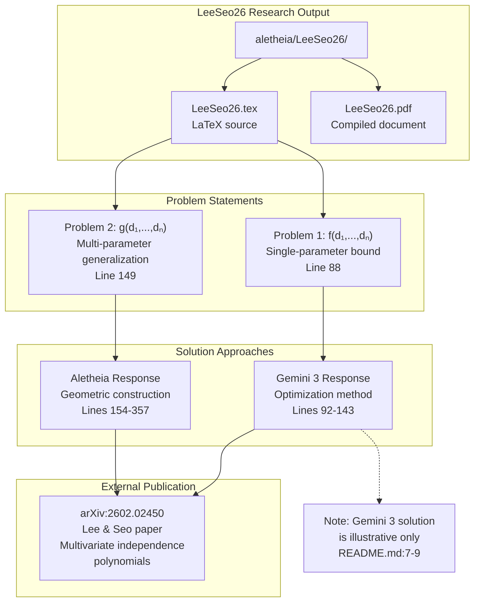
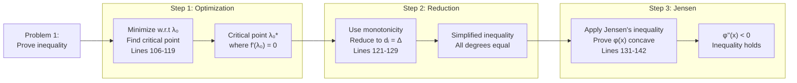
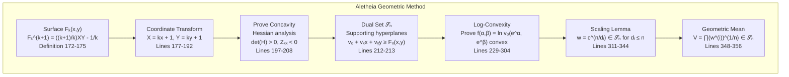
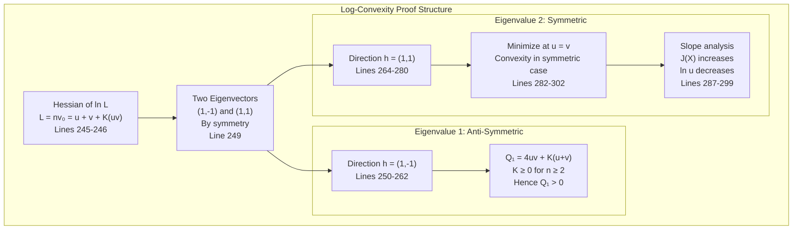
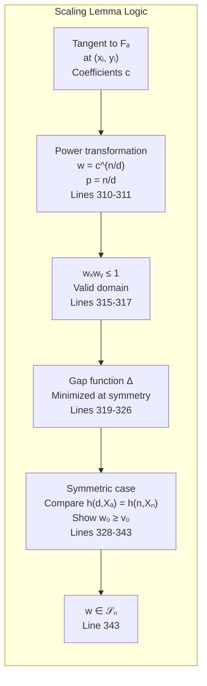
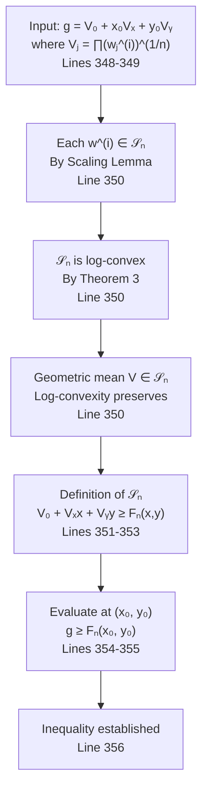
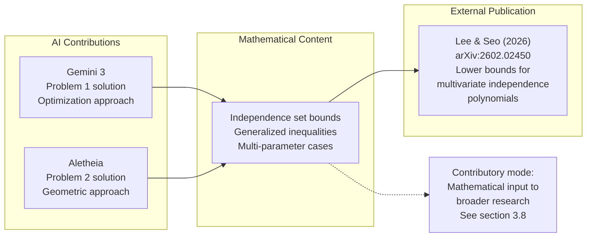
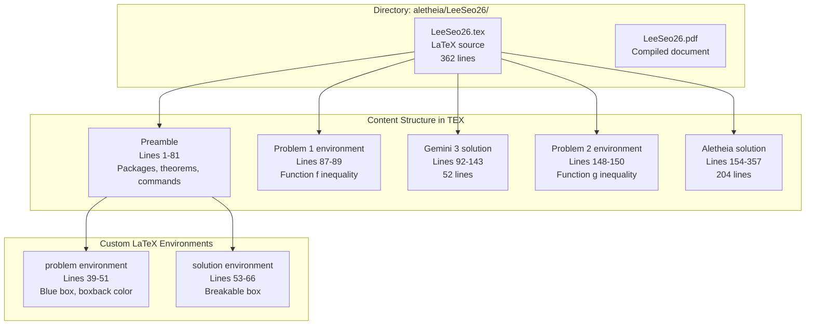

<!-- source: DeepWiki mcp.deepwiki.com · repo google-deepmind/superhuman · page 3.6 Research Output: LeeSeo26 - Independence Set Bounds · fetched 2026-10-26 -->

# Research Output: LeeSeo26 - Independence Set Bounds

<details>
<summary>Relevant source files</summary>

The following files were used as context for generating this wiki page:

- [aletheia/LeeSeo26/LeeSeo26.pdf](aletheia/LeeSeo26/LeeSeo26.pdf)
- [aletheia/LeeSeo26/LeeSeo26.tex](aletheia/LeeSeo26/LeeSeo26.tex)
- [aletheia/README.md](aletheia/README.md)

</details>


## Purpose and Scope

This document describes the **LeeSeo26** research output from the Aletheia system, which provides generalizations of bounds for independence sets in graph theory. This work contributed mathematical inputs to the paper "Lower bounds for multivariate independence polynomials and their generalisations" by Lee and Seo (arXiv:2602.02450). The LeeSeo26 output is unique among Aletheia's research outputs because it demonstrates a **collaborative research mode** where the AI system provides specific mathematical contributions to a broader human-led research paper, rather than producing a standalone complete paper.

For information about Aletheia's architecture and other research outputs, see [Aletheia Math Research Agent](#3). For details on Aletheia's two collaboration modes, see [Collaboration Modes: Standalone vs Contributory Research](#3.8).

**Sources:** [aletheia/README.md:7-17](), [aletheia/LeeSeo26/LeeSeo26.tex:1-86]()

## Overview

The LeeSeo26 directory contains LaTeX source demonstrating two distinct approaches to proving bounds on independence set functions. The output consists of:

1. **Two problem statements**: Nested inequality proofs involving multivariate functions with fractional exponents
2. **Two model responses**: Solutions from different AI systems (Gemini 3 and Aletheia)
3. **Comparative methodologies**: Optimization-based vs geometric construction approaches

Notably, as documented in [aletheia/README.md:7-9](), the first solution is **not** from Aletheia but from Gemini 3, included for illustration purposes to demonstrate different solution strategies.



**Sources:** [aletheia/README.md:17](), [aletheia/LeeSeo26/LeeSeo26.tex:1-362]()

## Problem Specifications

### Problem 1: Single-Parameter Bound

The first problem, presented at [aletheia/LeeSeo26/LeeSeo26.tex:87-89](), defines a function `f` and requires proving a lower bound:

**Function Definition:**
```
f(d₁,d₂,...,dₙ) = [∏ᵢ₌₁ⁿ (dᵢxᵢ + 1)^(1/dᵢ) + x₀] / [∏ᵢ₌₁ⁿ ((dᵢ+1)xᵢ + 1)^(1/(dᵢ+1))]
```

**Inequality to Prove:**
```
f(d₁,d₂,...,dₙ) ≥ ((n+1)x₀ + 1)^(1/(n+1))
```

**Constraints:**
- `d₁, d₂, ..., dₙ ≤ n`
- All `xᵢ` are non-negative (`i = 0, 1, ..., n`)

This problem establishes a fundamental bound involving products of fractional powers, where each term is weighted by its degree parameter `dᵢ`.

**Sources:** [aletheia/LeeSeo26/LeeSeo26.tex:87-89]()

### Problem 2: Multi-Parameter Generalization

The second problem, presented at [aletheia/LeeSeo26/LeeSeo26.tex:148-150](), extends Problem 1 to a bivariate setting with interaction terms:

**Function Definition:**
```
g(d₁,...,dₙ) = numerator / denominator

numerator = ∏ᵢ₌₁ⁿ (dᵢ(xᵢ+yᵢ) + dᵢ(dᵢ-1)xᵢyᵢ + 1)^(1/dᵢ)
          + x₀∏ᵢ₌₁ⁿ (dᵢyᵢ + 1)^(1/dᵢ)
          + y₀∏ᵢ₌₁ⁿ (dᵢxᵢ + 1)^(1/dᵢ)

denominator = ∏ᵢ₌₁ⁿ ((dᵢ+1)(xᵢ+yᵢ) + dᵢ(dᵢ+1)xᵢyᵢ + 1)^(1/(dᵢ+1))
```

**Inequality to Prove:**
```
g(d₁,...,dₙ) ≥ ((n+1)(x₀+y₀) + n(n+1)x₀y₀ + 1)^(1/(n+1))
```

**Constraints:**
- `n > 1`
- `1 ≤ d₁, d₂, ..., dₙ ≤ n`
- All `xᵢ, yᵢ` are non-negative

The generalization introduces bivariate parameters `(xᵢ, yᵢ)` and quadratic interaction terms `xᵢyᵢ`, making the problem significantly more complex.

**Sources:** [aletheia/LeeSeo26/LeeSeo26.tex:148-150]()

## Solution Approaches

### Gemini 3 Approach: Optimization-Based Method

The Gemini 3 solution [aletheia/LeeSeo26/LeeSeo26.tex:92-143]() uses a three-step optimization strategy:



**Key techniques:**
1. **Calculus-based optimization**: Minimizing the expression with respect to `λ₀` to find sufficient conditions [aletheia/LeeSeo26/LeeSeo26.tex:106-119]()
2. **Monotonicity reduction**: Proving that the function `g(d)` is strictly increasing, allowing reduction to the case where all `dᵢ = Δ` [aletheia/LeeSeo26/LeeSeo26.tex:121-129]()
3. **Jensen's inequality**: Showing concavity of the function `φ(x) = ln((Δ+1)e^x - 1)/Δ)` via negative second derivative [aletheia/LeeSeo26/LeeSeo26.tex:131-142]()

**Sources:** [aletheia/LeeSeo26/LeeSeo26.tex:92-143]()

### Aletheia Approach: Geometric Construction

The Aletheia solution [aletheia/LeeSeo26/LeeSeo26.tex:154-357]() employs a sophisticated geometric method based on dual convex sets. This approach is structured into four major sections:

| Section | Lines | Mathematical Concept | Purpose |
|---------|-------|---------------------|---------|
| Surface Geometry | 170-208 | Concavity of `Fₖ(x,y)` | Establish base surface properties |
| Dual Set `𝒮ₙ` | 210-304 | Log-convexity proof | Construct supporting hyperplanes |
| Scaling Lemma | 306-344 | Cross-degree comparison | Show `dᵢ ≤ n` case reduces to `n` |
| Main Proof | 346-357 | Geometric mean argument | Complete the inequality |



**Sources:** [aletheia/LeeSeo26/LeeSeo26.tex:154-357]()

## Mathematical Framework

### Surface Geometry and Concavity

Aletheia begins by defining a parametric family of surfaces `Fₖ` [aletheia/LeeSeo26/LeeSeo26.tex:172-175]():

```
Fₖ(x, y) = ((k+1)(x+y) + k(k+1)xy + 1)^(1/(k+1))
```

The coordinate transformation `X = kx + 1`, `Y = ky + 1` simplifies this to:
```
Fₖ^(k+1) = ((k+1)/k)XY - 1/k
```

**Concavity Proof** [aletheia/LeeSeo26/LeeSeo26.tex:194-208]():

The Hessian matrix computation establishes:
- `Zₓₓ = -Y²/(kZ^(2k+1)) < 0`
- `Zᵧᵧ = -X²/(kZ^(2k+1)) < 0`
- `det(H) = X²Y²/(k²Z^(4k+2)) - (XY-1)²/(k⁴Z^(4k+2)) > 0`

Since the Hessian is negative definite, `Fₖ` is **strictly concave**.

**Sources:** [aletheia/LeeSeo26/LeeSeo26.tex:170-208]()

### Dual Set Construction

The dual set `𝒮ₙ` [aletheia/LeeSeo26/LeeSeo26.tex:212-228]() is defined as:

```
𝒮ₙ = {(v₀, vₓ, vᵧ) ∈ ℝ³₊ | v₀ + vₓx + vᵧy ≥ Fₙ(x,y) for all x,y ≥ 0}
```

This set represents all affine functions that lie above the concave surface `Fₙ`. The boundary consists of tangent hyperplanes at each point `(x, y)` on the surface.

**Tangent Plane Coefficients** [aletheia/LeeSeo26/LeeSeo26.tex:215-227]():

At a point with surface value `Z = Fₙ(x,y)`:
- `vₓ = Y/Z^n`
- `vᵧ = X/Z^n`
- Product: `P = vₓvᵧ = XY/Z^(2n)`

The relationship between `P` and `Z` is governed by:
```
(n+1)PZ^(2n) = nZ^(n+1) + 1
```

The intercept `v₀` is determined by:
```
nv₀ = nZ - 2PZ^n + vₓ + vᵧ
```

**Sources:** [aletheia/LeeSeo26/LeeSeo26.tex:210-228]()

### Log-Convexity Analysis

The core technical achievement is proving that `𝒮ₙ` is **log-convex** [aletheia/LeeSeo26/LeeSeo26.tex:229-304]()—that is, `f(α, β) = ln v₀(e^α, e^β)` is a convex function.



**Anti-Symmetric Eigenvalue** [aletheia/LeeSeo26/LeeSeo26.tex:250-262]():

For direction `h = (1, -1)`:
```
Q₁ = 4uv + K(u+v)
```

Since `K = n(n-1)Z^(n+1) - 2)/((n+1)Z^n) ≥ 0` for `n ≥ 2`, we have `Q₁ > 0`.

**Symmetric Eigenvalue** [aletheia/LeeSeo26/LeeSeo26.tex:264-304]():

For direction `h = (1, 1)`, analysis reduces to the symmetric case `u = v`. The slope function:
```
Slope = d ln v₀ / d ln u = -2X(X-1)/(nAₙ)
```

Define `J(X) = -Slope`. Differentiation shows `J(X)` increases with `X`, while `ln u` decreases with `X`, therefore `Slope` increases with `ln u`, establishing convexity.

**Sources:** [aletheia/LeeSeo26/LeeSeo26.tex:229-304]()

### Scaling Lemma

The Scaling Lemma [aletheia/LeeSeo26/LeeSeo26.tex:308-344]() is crucial for connecting different degree parameters:

**Statement:** For any `1 ≤ d ≤ n`, if `c` is a tangent to `F_d` at `(x, y)`, then `w = c^(n/d) ∈ 𝒮ₙ`.



The proof establishes that scaling tangent coefficients from lower-degree surfaces `F_d` (where `d < n`) produces points that still lie within the dual set `𝒮ₙ`, enabling the main proof to proceed.

**Sources:** [aletheia/LeeSeo26/LeeSeo26.tex:306-344]()

## Main Proof Structure

The final proof [aletheia/LeeSeo26/LeeSeo26.tex:346-356]() combines all components:



**Key Steps:**

1. **Tangent Construction**: For each index `i`, construct the tangent to `F_{dᵢ}` at point `(xᵢ, yᵢ)` with coefficients `c^(i)`
2. **Scaling**: Apply the Scaling Lemma to obtain `w^(i) = (c^(i))^(n/dᵢ) ∈ 𝒮ₙ`
3. **Geometric Mean**: Compute `V = (∏ w^(i))^(1/n)`, which remains in `𝒮ₙ` by log-convexity
4. **Evaluation**: Since `V ∈ 𝒮ₙ`, the inequality `V₀ + Vₓx + Vᵧy ≥ Fₙ(x,y)` holds for all `x, y ≥ 0`
5. **Conclusion**: Evaluating at `(x₀, y₀)` gives the desired bound

**Sources:** [aletheia/LeeSeo26/LeeSeo26.tex:346-356]()

## Integration with External Research

The LeeSeo26 output contributed to the paper "Lower bounds for multivariate independence polynomials and their generalisations" by Lee and Seo [aletheia/README.md:17](), published on arXiv:2602.02450.



This represents an example of **contributory research mode** [aletheia/README.md:15-17](), where Aletheia provides specific mathematical results that are incorporated into a larger research effort led by human mathematicians, rather than producing a standalone complete paper.

**Sources:** [aletheia/README.md:15-17](), [aletheia/LeeSeo26/LeeSeo26.tex:1-4]()

## Output Artifacts and File Structure

The LeeSeo26 output consists of standard research artifacts:



**LaTeX Customizations** [aletheia/LeeSeo26/LeeSeo26.tex:16-66]():

| Element | Definition | Purpose |
|---------|-----------|---------|
| `\Aletheia` | `\emph{Aletheia}` | Formatted system name |
| `problem` environment | `tcolorbox` with blue frame | Problem statement boxes |
| `solution` environment | Breakable `tcolorbox` | Multi-page solutions |
| Custom math operators | `\Gr`, `\aug` | Domain-specific notation |
| Custom commands | `\Q`, `\VV`, `\frR` | Mathematical symbols |

**Editorial Note** [aletheia/LeeSeo26/LeeSeo26.tex:84-85]():

The document includes a disclaimer: "The prompts and responses below have been edited only for formatting compatibility," indicating minimal post-processing of the AI-generated content.

**Sources:** [aletheia/LeeSeo26/LeeSeo26.tex:1-81](), [aletheia/LeeSeo26/LeeSeo26.tex:84-85]()

## Comparison of Solution Methodologies

The two solutions employ fundamentally different mathematical philosophies:

| Aspect | Gemini 3 (Problem 1) | Aletheia (Problem 2) |
|--------|---------------------|---------------------|
| **Primary approach** | Optimization theory | Convex geometry |
| **Key technique** | Jensen's inequality | Dual set construction |
| **Dimensionality** | Reduces to 1D optimization | Works in full multi-dimensional space |
| **Proof structure** | Sequential reduction steps | Unified geometric framework |
| **Length** | 52 lines [aletheia/LeeSeo26/LeeSeo26.tex:92-143]() | 204 lines [aletheia/LeeSeo26/LeeSeo26.tex:154-357]() |
| **Complexity** | Simpler problem (univariate) | Complex problem (bivariate with interactions) |


**Philosophical Differences:**

1. **Gemini 3** takes an **analytic approach**: finding critical points through calculus, then proving properties at those points
2. **Aletheia** takes a **synthetic approach**: constructing a geometric object (the dual set) whose properties guarantee the inequality

The geometric method is more sophisticated and generalizes better to complex multi-parameter settings, though it requires deeper mathematical machinery (Hessian analysis, log-convexity theorems, dual set theory).

**Sources:** [aletheia/LeeSeo26/LeeSeo26.tex:92-143](), [aletheia/LeeSeo26/LeeSeo26.tex:154-357]()

## Significance for AI Mathematical Reasoning

The LeeSeo26 output demonstrates several important capabilities:

1. **Methodology diversity**: Different AI systems naturally arrive at different proof strategies, mirroring human mathematical creativity
2. **Sophistication scaling**: Aletheia's approach uses advanced techniques (log-convexity, dual sets) appropriate for the problem complexity
3. **Collaborative potential**: The output serves as mathematical input to human researchers, not just standalone results
4. **Problem generalization**: Moving from single-parameter (Problem 1) to multi-parameter with interactions (Problem 2) shows genuine advancement

This contributory mode [aletheia/README.md:15-17]() of operation—where AI provides specific mathematical lemmas or bounds that enable broader research—represents a pragmatic model for AI-human collaboration in mathematics, complementing the standalone research mode demonstrated by other Aletheia outputs (see [Research Output: BKKKZ26](#3.2), [Research Output: Erdos](#3.3)).

**Sources:** [aletheia/README.md:15-17](), [aletheia/README.md:7-9]()

---

