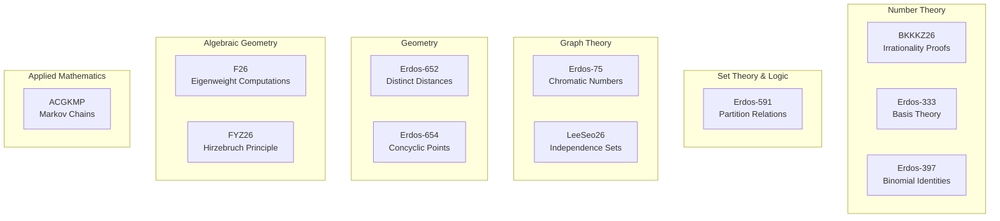
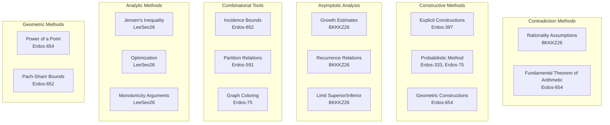
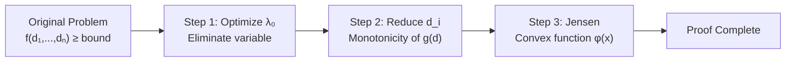

<!-- source: DeepWiki mcp.deepwiki.com · repo google-deepmind/superhuman · page 3.7 Mathematical Domains and Proof Techniques · fetched 2026-10-26 -->

# Mathematical Domains and Proof Techniques

<details>
<summary>Relevant source files</summary>

The following files were used as context for generating this wiki page:

- [aletheia/BKKKZ26/BKKKZ26.pdf](aletheia/BKKKZ26/BKKKZ26.pdf)
- [aletheia/BKKKZ26/BKKKZ26.tex](aletheia/BKKKZ26/BKKKZ26.tex)
- [aletheia/Erdos/Erdos.pdf](aletheia/Erdos/Erdos.pdf)
- [aletheia/Erdos/Erdos.tex](aletheia/Erdos/Erdos.tex)
- [aletheia/LeeSeo26/LeeSeo26.pdf](aletheia/LeeSeo26/LeeSeo26.pdf)
- [aletheia/LeeSeo26/LeeSeo26.tex](aletheia/LeeSeo26/LeeSeo26.tex)
- [aletheia/README.md](aletheia/README.md)

</details>


This page catalogs the mathematical domains covered by Aletheia's research outputs and analyzes the proof techniques employed across different areas of mathematics. For information about specific research outputs, see pages [3.2](#3.2) through [3.6](#3.6). For details on Aletheia's system architecture, see [3.1](#3.1).

## Scope and Coverage

Aletheia demonstrates mathematical reasoning capabilities spanning five distinct domains: number theory, algebraic geometry, combinatorics, graph theory, and applied mathematics. Each research output employs domain-specific proof techniques while sharing common methodological frameworks such as proof by contradiction, growth analysis, and asymptotic estimation.

Sources: [aletheia/README.md:1-18]()

## Mathematical Domain Taxonomy



Sources: [aletheia/README.md:11-17](), [aletheia/Erdos/Erdos.tex:67-610]()

## Number Theory

### Irrationality Theory

The BKKKZ26 research output addresses irrationality of rapidly converging series with double-exponential growth. The problem concerns sequences $(a_n)$ satisfying:
$$\liminf_{n \to \infty} a_n^{1/2^n} > 1$$

**Core Proof Technique**: Gap Principle with remainder analysis.

The proof structure demonstrates:
1. **Growth Estimation**: Establishing $a_n > c^{2^n}$ from the limit inferior condition
2. **Rationality Reduction**: Assuming $S = p/q$ and deriving integer constraints on remainders $R_n$
3. **Recurrence Bounds**: Proving $P_{n+1} < 2q P_n^2$ from the rationality assumption
4. **Contradiction via Limits**: Showing $\Pi = \mathcal{L}^2$ and $\Pi \geq \mathcal{L}^3$ are incompatible

Sources: [aletheia/BKKKZ26/BKKKZ26.tex:94-198]()

### Additive Combinatorics

Problem Erdős-333 concerns bases for sets of density zero. A basis $B$ for $A$ satisfies $A \subseteq B+B = \{b_1 + b_2 : b_1, b_2 \in B\}$.

**Key Construction**: Probabilistic selection with strategic intervals $I_k = \{n : N_k/2 < n \leq N_k\}$ where $N_k = 4^k$.

The proof employs:
- Union bound over family $\mathcal{F}_k$ of small sets
- Probability estimation: $P(\text{fail}) \leq |\mathcal{F}_k| p^{L_k}$ where $L_k = \lfloor \sqrt{N_k} \ln N_k \rfloor$
- Density calculation showing $d(A) = 0$ via $|A \cap [1,x]|/x \sim k/2^k \to 0$

Sources: [aletheia/Erdos/Erdos.tex:204-275]()

### Multiplicative Number Theory

Problem Erdős-397 investigates products of central binomial coefficients: $\prod_i \binom{2m_i}{m_i} = \prod_j \binom{2n_j}{n_j}$.

**Explicit Construction**: For $k \geq 3$, define:
- $A_k = \{k, 2k-2, 8k^2-8k+2\}$
- $B_k = \{k-1, 2k, 8k^2-8k+1\}$

**Verification Strategy**: 
1. Prove disjointness by ordering: $k-1 < k < 2k-2 < 2k < 8k^2-8k+1 < 8k^2-8k+2$
2. Use ratio formula: $\frac{C_x}{C_{x-1}} = \frac{2(2x-1)}{x}$
3. Verify telescoping product equals 1

Sources: [aletheia/Erdos/Erdos.tex:278-353]()

## Set Theory and Infinite Combinatorics

Problem Erdős-591 concerns partition relations on ordinals: $\omega^{\omega^2} \to (\omega^{\omega^2}, 3)^2$.

**Characterization Theorem** (Schipperus, 2010): For countable ordinal $\beta$, the relation $\omega^{\omega^\beta} \to (\omega^{\omega^\beta}, 3)^2$ holds if and only if:
1. $\beta$ is additively indecomposable, OR
2. $\beta = \gamma + \delta$ where $\gamma, \delta$ are indecomposable and $\gamma \geq \delta \geq 1$

**Application**: For $\beta = 2 = 1 + 1$, both summands are indecomposable ($1 = \omega^0$), satisfying condition 2.

Sources: [aletheia/Erdos/Erdos.tex:355-410]()

## Geometric Combinatorics

### Incidence Geometry

Problem Erdős-652 applies the Pach-Sharir incidence bound to prove $\alpha_k = \Omega(\sqrt{k})$ for distinct distances.

**Proof Structure**:
1. Construct circle family $\mathcal{C} = \bigcup_{i=1}^k \{\Gamma(x_i, r) : r \in D_i\}$ with $|\mathcal{C}| < kCn^{1/2}$
2. Count incidences: $I(P_n, \mathcal{C}) \geq (n-k)k$
3. Apply Pach-Sharir bound: $I(P_n, \mathcal{C}) \leq K_2(n^{2/3}L^{2/3} + n + L)$
4. Derive $\alpha_k \geq \left(\frac{1}{2K_2}\right)^{3/2} \sqrt{k}$

Sources: [aletheia/Erdos/Erdos.tex:412-465]()

### Power of a Point Theorem

Problem Erdős-654 uses classical Euclidean geometry to construct counterexamples.

**Construction**: Define point sets on coordinate axes:
- $P = \{(0, \pm 3^k) : k \in K\}$ where $K = \{10, 11, \ldots, m+9\}$
- $Q = \{(\pm 2^j, 0) : j \in K\}$

**Circle Verification**: If four points lie on circle $\mathcal{C}$, Power of a Point at origin requires:
$$|y_1| |y_2| = |x_1| |x_2| \implies 3^{k_1+k_2} = 2^{j_1+j_2}$$

This contradicts the Fundamental Theorem of Arithmetic since exponents are $\geq 20$.

Sources: [aletheia/Erdos/Erdos.tex:467-519]()

## Graph Theory

### Chromatic Number and Independence

Problem Erdős-75 constructs graphs with $\chi(G) = \aleph_1$ where finite subgraphs have slowly growing chromatic numbers.

**Lambie-Hanson Construction**: For double exponential function $f(x) = 2^{2^x}$, there exists graph $G$ such that:
- $\chi(G) = \aleph_1$
- If $\chi(H) = k \geq 3$, then $|V(H)| \geq 2^{2^{k-3}}$

**Independence Analysis**: From $\chi(H) \leq \log_2(\log_2 n) + 3$, derive:
$$\alpha(H) \geq \frac{n}{\chi(H)} \geq \frac{n}{\log_2(\log_2 n) + 3}$$

For any $\epsilon > 0$, the ratio $\frac{n^\epsilon}{\log_2(\log_2 n) + 3} \to \infty$, proving $\alpha(H) > n^{1-\epsilon}$.

Sources: [aletheia/Erdos/Erdos.tex:67-122]()

### Shift Graph Construction

Alternative construction using shift graph on $\kappa = (2^{\aleph_0})^+$:
- Vertices: $V = [\kappa]^2 = \{\{\alpha, \beta\} : \alpha < \beta\}$
- Edges: $\{\alpha, \beta\} \sim \{\beta, \gamma\}$ when middle elements coincide

**Chromatic Lower Bound**: Erdős-Rado partition relation $(2^{\aleph_0})^+ \to (\aleph_1)^2_{\aleph_0}$ implies no countable coloring exists.

**Independence via Probabilistic Method**: Partition ordinals into $A, B$ with probability $1/2$. The set $I = \{\{\alpha, \beta\} : \alpha \in A, \beta \in B\}$ is independent with $\mathbb{E}[|I|] = n/4$.

Sources: [aletheia/Erdos/Erdos.tex:124-202]()

## Algebraic Geometry

### Eigenweight Computations

The F26 and FYZ26 outputs compute eigenweights for the Arithmetic Hirzebruch Proportionality Principle. While the source files are referenced in the README, the detailed mathematical framework involves:

- Operator definitions on cohomology groups
- Eigenweight calculations for specific geometric configurations
- Applications to the Feng-Yun-Zhang framework

The FYZ26 paper specifically addresses the initial non-trivial case, establishing foundational computational methods for subsequent eigenweight determinations in F26.

Sources: [aletheia/README.md:13-14]()

## Applied Mathematics: Markov Chain Analysis

### Dyadic Interval Bounds

The ACGKMP output establishes that specific bounded combinations of numbers lie in polynomially many dyadic intervals, contributing to strongly polynomial iteration bounds for robust Markov chains.

**Mathematical Input**: The proof utilizes:
- Siegel's Lemma for Diophantine approximation
- Gap Principle for bounding approximation quality
- Dyadic interval decomposition techniques

This work provides key mathematical infrastructure for the analysis in Asadi et al.'s paper on robust Markov chains (arXiv:2601.23229).

Sources: [aletheia/README.md:15-16]()

## Combinatorial Optimization

### Independence Polynomial Bounds

The LeeSeo26 output demonstrates contrasting solution approaches between different AI models.

**Gemini 3 Approach**: Optimization-based reduction
1. Minimize with respect to $\lambda_0$ to eliminate one variable
2. Reduce to case $d_i = \Delta$ via monotonicity of $g(d) = \left(\frac{(d+1)u^d-1}{d}\right)^{\frac{1}{d+1}}$
3. Apply Jensen's inequality to convex function $\phi(x) = \ln\left(\frac{(\Delta+1)e^x-1}{\Delta}\right)$

**Aletheia Approach** (cited in README but not shown in provided excerpt): Uses geometric construction methods to establish bounds directly.

The problem concerns proving for $d_i \leq n$ and nonnegative $x_i$:
$$f(d_1,\ldots,d_n) = \frac{\prod_{i=1}^n (d_i x_i +1)^{1/d_i} +x_0}{\prod_{i=1}^n ((d_i+1)x_i+1)^{1/(d_i+1)}} \geq ((n+1)x_0 +1)^{1/(n+1)}$$

Sources: [aletheia/LeeSeo26/LeeSeo26.tex:87-137](), [aletheia/README.md:17]()

## Proof Technique Taxonomy



Sources: [aletheia/BKKKZ26/BKKKZ26.tex:94-198](), [aletheia/Erdos/Erdos.tex:67-610](), [aletheia/LeeSeo26/LeeSeo26.tex:87-137]()

## Proof Technique Details

### Proof by Contradiction

**Standard Structure**:
1. Assume negation of desired conclusion
2. Derive integer/algebraic constraints
3. Establish asymptotic bounds
4. Show constraints are incompatible with bounds

**BKKKZ26 Implementation**:
```
Assume: S = p/q (rational)
Derive: K_n = q P_n R_n ∈ ℤ, K_n ≥ 1
Bound: R_n ≥ 1/(q P_n)  [Lower]
       R_n < 2C^{-3·2^n}  [Upper]
Conclude: Π = L² and Π ≥ L³ contradict L > 1
```

Sources: [aletheia/BKKKZ26/BKKKZ26.tex:109-191]()

### Probabilistic Method

**Erdős-333 Application**:
- Sample space: Random subsets $X \subseteq I_k$ of size $L_k$
- Event: $X \subseteq S+S$ for some $S \in \mathcal{F}_k$
- Union bound: $P(\text{fail}) \leq |\mathcal{F}_k| \cdot p^{L_k}$
- Success condition: $\ln P(\text{fail}) < 0$ for large $k$

**Erdős-75 (Shift Graph)**:
- Random partition: Each ordinal assigned to $A$ or $B$ with probability $1/2$
- Independent set: $I = \{\{\alpha,\beta\} : \alpha \in A, \beta \in B\}$
- Expectation: $\mathbb{E}[|I|] = n/4$ via linearity

Sources: [aletheia/Erdos/Erdos.tex:223-250](), [aletheia/Erdos/Erdos.tex:177-192]()

### Incidence Geometry

**Pach-Sharir Theorem**: For $m$ points and $L$ curves with pairwise intersections $\leq s$:
$$I(P, \mathcal{L}) \leq K_s(m^{2/3}L^{2/3} + m + L)$$

**Erdős-652 Application**:
```
Points: P_n (n vertices)
Curves: C (circles centered at x_i with radii from D_i)
Count: |C| < kCn^{1/2}
Lower bound: I(P_n, C) ≥ (n-k)k
Upper bound: I(P_n, C) ≤ K_2(n^{2/3}(kCn^{1/2})^{2/3} + n + kCn^{1/2})
Simplify: nk - k² ≤ K_2(nk^{2/3}C^{2/3} + n + kCn^{1/2})
Result: α_k = Ω(√k)
```

Sources: [aletheia/Erdos/Erdos.tex:425-459]()

### Growth Estimation Techniques

**Double Exponential Growth**:
From hypothesis $\liminf a_n^{1/2^n} > 1$, select $c$ with $1 < c < L$ such that $a_n > c^{2^n}$ for $n \geq N_0$.

**Product Growth**:
$$P_n = \prod_{i=1}^n a_i \implies \ln P_n = \sum_{i=1}^n \ln a_i > \sum_{i=N_0}^n 2^i \ln c$$

**Normalized Limits**:
$$y_n = \frac{\ln P_n}{2^n} \implies \Pi = \lim_{n \to \infty} P_n^{1/2^n} = e^Y$$

Sources: [aletheia/BKKKZ26/BKKKZ26.tex:112-170]()

### Recurrence Relation Analysis

**Derivation from Remainder Identity**:
$$R_n = \frac{1}{a_{n+1}a_{n+2}} + R_{n+1}$$

Multiplying by $q P_{n+1} = q P_n a_{n+1}$ and using $K_n = q P_n R_n$:
$$a_{n+1} K_n = q P_{n-1} + K_{n+1}$$

**Growth Bound**:
$$a_{n+1} < 2q P_{n-1} a_n = 2q P_n \implies P_{n+1} < 2q P_n^2$$

**Asymptotic Consequence**:
$$\ln P_{n+1} < 2\ln P_n + \ln(2q) \implies y_{n+1} < y_n + 2^{-(n+1)}\ln(2q)$$

Sources: [aletheia/BKKKZ26/BKKKZ26.tex:138-154]()

## Technique-Domain Mapping

| Proof Technique | Number Theory | Graph Theory | Geometry | Set Theory | Applied Math |
|----------------|---------------|--------------|----------|------------|--------------|
| **Contradiction** | BKKKZ26 | - | Erdős-654 | - | - |
| **Probabilistic Method** | Erdős-333 | Erdős-75 | - | - | - |
| **Growth Estimates** | BKKKZ26 | - | - | - | - |
| **Incidence Bounds** | - | - | Erdős-652 | - | - |
| **Partition Relations** | - | - | - | Erdős-591 | - |
| **Explicit Construction** | Erdős-397 | - | Erdős-654 | - | - |
| **Jensen's Inequality** | - | - | - | - | LeeSeo26 |
| **Optimization** | - | - | - | - | LeeSeo26 |
| **Classical Geometry** | - | - | Erdős-654 | - | - |
| **Recurrence Analysis** | BKKKZ26 | - | - | - | - |

Sources: [aletheia/README.md:11-17](), [aletheia/BKKKZ26/BKKKZ26.tex:94-198](), [aletheia/Erdos/Erdos.tex:67-610](), [aletheia/LeeSeo26/LeeSeo26.tex:87-137]()

## Multi-Model Comparison

Different AI models employ distinct proof strategies for the same problem, as illustrated in LeeSeo26.

**Gemini 3 Strategy**:


**Aletheia Strategy** (as described in README):
- Geometric construction approach
- Direct bound establishment
- Alternative path avoiding optimization

This demonstrates that mathematical reasoning can follow multiple valid pathways, with different models preferring different strategic decompositions.

Sources: [aletheia/LeeSeo26/LeeSeo26.tex:92-137](), [aletheia/README.md:17]()

## Generalization Framework

The BKKKZ26 output includes a generalization by Gemini Deep Think that extends the irrationality theorem to arbitrary integer weights.

**Generalized Theorem**: For weight vector $\mathbf{w} = (w_0, w_1, \ldots, w_{d-1})$ with $w_{d-1} \geq 1$, define:
$$c_{\mathbf{w}} = \text{unique root } > 1 \text{ of } (x-1)\sum_{j=0}^{d-1} w_j x^j - W x^{d-1}$$

If $\liminf a_n^{1/b^n} > 1$ for $b > c_{\mathbf{w}}$, then:
$$S = \sum_{n=1}^\infty \frac{1}{a_n^{w_0} a_{n+1}^{w_1} \cdots a_{n+d-1}^{w_{d-1}}} \text{ is irrational}$$

**Key Insight**: Maximum weight $W = \max(w_j)$ determines LCM exponent bound: $Q_n \lesssim P_{n+d-1}^W$.

Sources: [aletheia/BKKKZ26/BKKKZ26.tex:290-376]()

## Cross-Domain Proof Patterns

Several proof patterns appear across multiple domains:

**Pattern 1: Assumption → Constraint → Bound → Contradiction**
- Used in: BKKKZ26 (number theory), Erdős-654 (geometry)
- Structure: Assume property → derive algebraic constraint → establish asymptotic bound → show incompatibility

**Pattern 2: Probabilistic Existence**
- Used in: Erdős-333 (additive combinatorics), Erdős-75 (graph theory)
- Structure: Define probability space → compute failure probability → show failure probability < 1

**Pattern 3: Constructive Verification**
- Used in: Erdős-397 (multiplicative number theory), Erdős-654 (geometry)
- Structure: Propose explicit object → verify properties → check completeness

**Pattern 4: Reduction + Base Case**
- Used in: LeeSeo26 (optimization), Erdős-75 (chromatic numbers)
- Structure: Reduce to simpler case → prove base case → lift to general case

Sources: [aletheia/BKKKZ26/BKKKZ26.tex:109-191](), [aletheia/Erdos/Erdos.tex:67-610](), [aletheia/LeeSeo26/LeeSeo26.tex:92-137]()

---

