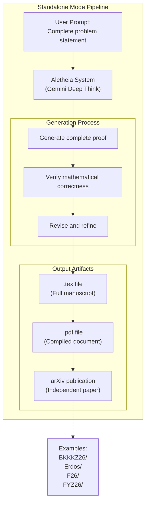
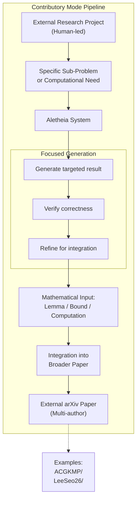
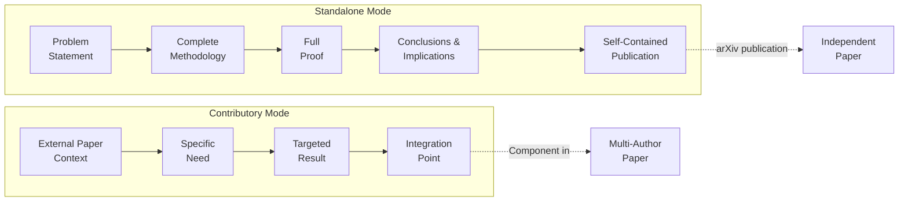
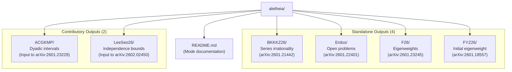
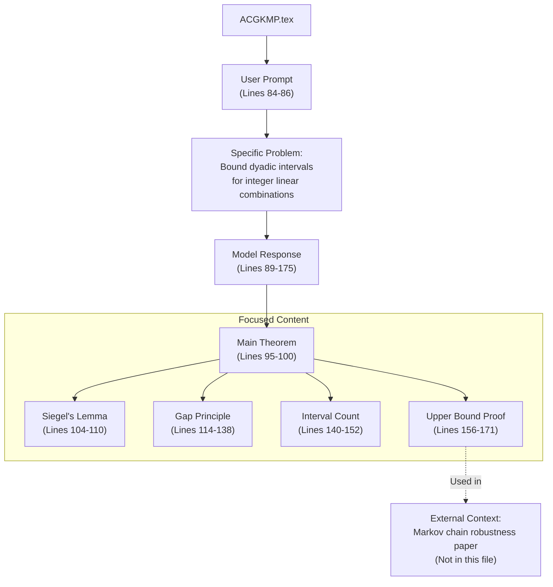
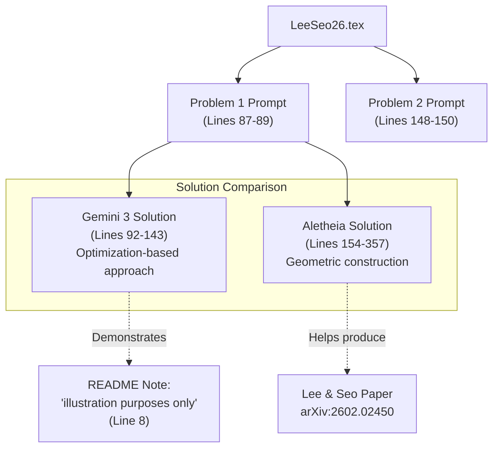

<!-- source: DeepWiki mcp.deepwiki.com · repo google-deepmind/superhuman · page 3.8 Collaboration Modes: Standalone vs Contributory Research · fetched 2026-10-26 -->

# Collaboration Modes: Standalone vs Contributory Research

<details>
<summary>Relevant source files</summary>

The following files were used as context for generating this wiki page:

- [aletheia/ACGKMP/ACGKMP.pdf](aletheia/ACGKMP/ACGKMP.pdf)
- [aletheia/ACGKMP/ACGKMP.tex](aletheia/ACGKMP/ACGKMP.tex)
- [aletheia/LeeSeo26/LeeSeo26.pdf](aletheia/LeeSeo26/LeeSeo26.pdf)
- [aletheia/LeeSeo26/LeeSeo26.tex](aletheia/LeeSeo26/LeeSeo26.tex)
- [aletheia/README.md](aletheia/README.md)

</details>


## Purpose and Scope

This page documents Aletheia's dual operational modes for mathematical research collaboration. Aletheia can function either as an autonomous proof generator producing complete research papers, or as a contributory assistant providing specific mathematical inputs to human-led research projects. For details on specific research outputs, see [3.2](#3.2), [3.3](#3.3), [3.4](#3.4), [3.5](#3.5), and [3.6](#3.6). For mathematical techniques employed across both modes, see [3.7](#3.7).

**Sources:** [aletheia/README.md:1-18]()

---

## Overview: Two Collaboration Patterns

Aletheia operates in two distinct research collaboration modes, differentiated by the scope and independence of the mathematical contribution:

| Mode | Description | Output Artifact | Publication Role | Examples |
|------|-------------|-----------------|------------------|----------|
| **Standalone** | Complete mathematical result forming core of paper | Full proof/computation as independent publication | Primary contribution (Aletheia-authored paper) | BKKKZ26, Erdos, F26, FYZ26 |
| **Contributory** | Specific mathematical input to broader research | Lemma/bound/computation incorporated into external paper | Supporting component in human-led paper | ACGKMP, LeeSeo26 |

The mode distinction is explicitly documented in [aletheia/README.md:6-9](), which notes that certain outputs serve as inputs to external papers rather than standalone works.

**Sources:** [aletheia/README.md:6-18]()

---

## Standalone Research Mode

### Characteristics

In standalone mode, Aletheia generates complete mathematical results that constitute the primary scientific contribution of an independent publication. The system produces:

- **Complete proofs** with full mathematical rigor
- **Self-contained exposition** including problem statement, methodology, and conclusions
- **Independent arXiv papers** where Aletheia is the primary contributor
- **Full LaTeX source** formatted as publication-ready manuscripts

### Architecture: Standalone Research Pipeline



**Sources:** [aletheia/README.md:11-14]()

### Standalone Examples in Repository

The following directories contain complete standalone research outputs:

1. **`aletheia/BKKKZ26/`**: Generalization of Erdős-1051 proving irrationality of rapidly converging series
   - Full paper on arXiv: [2601.21442](https://arxiv.org/abs/2601.21442)
   - Complete proof methodology developed by Aletheia

2. **`aletheia/Erdos/`**: Semi-autonomous case study on open Erdős problems
   - Full paper on arXiv: [2601.22401](https://arxiv.org/abs/2601.22401)
   - Collection of 14 problem solutions across multiple domains

3. **`aletheia/F26/`**: Eigenweight computations for Arithmetic Hirzebruch Proportionality Principle
   - Full paper on arXiv: [2601.23245](https://arxiv.org/abs/2601.23245)
   - Comprehensive computational results

4. **`aletheia/FYZ26/`**: Initial non-trivial eigenweight case
   - Full paper on arXiv: [2601.18557](https://arxiv.org/abs/2601.18557)
   - Foundational computation for eigenweight framework

**Sources:** [aletheia/README.md:11-14]()

### Structural Pattern: Standalone Output

Each standalone output follows a consistent directory structure:

```
aletheia/<ProjectName>/
├── <ProjectName>.tex    # Full LaTeX manuscript
└── <ProjectName>.pdf    # Compiled publication-ready PDF
```

The `.tex` files contain complete mathematical papers with standard sections: introduction, methodology, main results, proofs, and conclusions.

**Sources:** [aletheia/README.md:11-14]()

---

## Contributory Research Mode

### Characteristics

In contributory mode, Aletheia provides specific mathematical inputs that support broader human-led research projects. The system produces:

- **Targeted lemmas or bounds** addressing specific sub-problems
- **Computational results** that feed into larger theoretical frameworks
- **Proof components** incorporated into external papers
- **Collaborative artifacts** where Aletheia's contribution is one part of a multi-author effort

The key distinction: the output is **not self-contained** but rather **integrates into external research**.

### Architecture: Contributory Research Pipeline



**Sources:** [aletheia/README.md:15-17]()

### Contributory Examples in Repository

The following directories contain contributory research inputs:

1. **`aletheia/ACGKMP/`**: Mathematical input to "Strongly polynomial iterations for robust Markov chains"
   - External paper by Asadi, Chatterjee, Goharshady, Karrabi, Montaseri, Pagano
   - arXiv: [2601.23229](https://arxiv.org/abs/2601.23229)
   - Aletheia contribution: Proof that specific bounded combinations lie in polynomially many dyadic intervals
   - Specific result: [aletheia/ACGKMP/ACGKMP.tex:84-86]() defines the problem, [aletheia/ACGKMP/ACGKMP.tex:95-100]() states the theorem

2. **`aletheia/LeeSeo26/`**: Bounds for independence sets in multivariate independence polynomials
   - External paper by Lee and Seo
   - arXiv: [2602.02450](https://arxiv.org/abs/2602.02450)
   - Aletheia contribution: Generalizations of bounds using geometric construction
   - Alternative solution: [aletheia/LeeSeo26/LeeSeo26.tex:92-143]() shows Gemini 3 solution, [aletheia/LeeSeo26/LeeSeo26.tex:154-357]() shows Aletheia solution

**Note on Attribution**: [aletheia/README.md:6-9]() explicitly notes that one output in LeeSeo26 is for illustration purposes, demonstrating collaborative solution approaches where multiple models contribute.

**Sources:** [aletheia/README.md:15-17](), [aletheia/ACGKMP/ACGKMP.tex:1-180](), [aletheia/LeeSeo26/LeeSeo26.tex:1-363]()

### Structural Pattern: Contributory Output

Contributory outputs have the same file structure but different content scope:

```
aletheia/<ProjectName>/
├── <ProjectName>.tex    # Focused result (lemma/bound/computation)
└── <ProjectName>.pdf    # Compiled focused result
```

The `.tex` files contain **targeted mathematical results** rather than complete papers. For example, [aletheia/ACGKMP/ACGKMP.tex:84-175]() presents a single theorem with proof (dyadic interval bounds) rather than a full research paper.

**Sources:** [aletheia/ACGKMP/ACGKMP.tex:1-180]()

---

## Mode Comparison: Structural Differences

### Output Scope Comparison



**Sources:** [aletheia/README.md:11-17]()

### Mode Decision Factors

The choice between standalone and contributory mode depends on:

| Factor | Standalone Mode | Contributory Mode |
|--------|----------------|-------------------|
| **Problem Scope** | Complete mathematical question | Specific sub-problem or computational need |
| **Result Independence** | Self-contained result | Requires external context |
| **Publication Goal** | Independent paper | Component in broader research |
| **Collaboration Model** | Aletheia as primary author | Aletheia as collaborator/tool |
| **Output Completeness** | Full exposition required | Focused result sufficient |

**Sources:** [aletheia/README.md:11-17]()

---

## Technical Implementation: Mode Mapping

### Code Repository Structure by Mode

The repository structure reflects the mode distinction:



**Sources:** [aletheia/README.md:1-18]()

### Content Structure Differences

#### Standalone Example: ACGKMP Structure

The ACGKMP contributory output demonstrates focused scope:



The file contains only the **specific mathematical result** needed for the external paper, without broader context or introduction to the Markov chain problem.

**Sources:** [aletheia/ACGKMP/ACGKMP.tex:84-175]()

#### Contributory Example: LeeSeo26 Multi-Solution Structure

The LeeSeo26 output shows collaborative solution comparison:



This structure demonstrates **alternative solution approaches** where different models contribute different proof techniques to the same problem.

**Sources:** [aletheia/LeeSeo26/LeeSeo26.tex:87-357](), [aletheia/README.md:7-8]()

---

## Attribution and Documentation Patterns

### Standalone Mode Attribution

For standalone outputs, the arXiv papers list Aletheia as the primary contributor:
- **Full papers** with Aletheia-generated content
- **Direct arXiv links** to independent publications
- **Complete mathematical exposition** from problem to conclusion

Example references from README:
- "A generalization of Erdős-1051, proving irrationality..." → [arXiv:2601.21442](https://arxiv.org/abs/2601.21442)
- "Results from a semi-autonomous case study..." → [arXiv:2601.22401](https://arxiv.org/abs/2601.22401)

**Sources:** [aletheia/README.md:11-14]()

### Contributory Mode Attribution

For contributory outputs, the documentation explicitly indicates the relationship to external papers:
- **"A mathematical input to the paper..."** (ACGKMP)
- **"used to help produce the paper..."** (LeeSeo26)
- **External author lists** (multi-author papers)
- **Component role** clearly stated

Example references from README:
- "A mathematical input to the paper 'Strongly polynomial iterations for robust Markov chains' by Asadi–Chatterjee–Goharshady–Karrabi–Montaseri–Pagano"
- "Generalizations of bounds for independence sets, used to help produce the paper 'Lower bounds for multivariate independence polynomials and their generalisations' by Lee and Seo"

**Sources:** [aletheia/README.md:15-17]()

---

## Practical Implications

### When to Use Each Mode

**Choose Standalone Mode when:**
- Problem has clear boundaries and complete solution is feasible
- Result constitutes independent scientific contribution
- Self-contained publication is desired
- Aletheia can provide full exposition and context

**Choose Contributory Mode when:**
- Specific computational or proof need within larger research
- Human expertise required for broader context
- Integration into ongoing research project
- Focused result more valuable than complete paper

### Collaboration Workflow Patterns

```mermaid
graph TB
    subgraph "Standalone Workflow"
        S1["Research question<br/>identified"]
        S2["Aletheia generates<br/>complete solution"]
        S3["Result vetted &<br/>formatted"]
        S4["Published as<br/>independent paper"]
        
        S1 --> S2
        S2 --> S3
        S3 --> S4
    end
    
    subgraph "Contributory Workflow"
        C1["External research<br/>in progress"]
        C2["Sub-problem<br/>identified"]
        C3["Aletheia generates<br/>focused result"]
        C4["Result integrated<br/>into broader paper"]
        C5["Published as<br/>multi-author work"]
        
        C1 --> C2
        C2 --> C3
        C3 --> C4
        C4 --> C5
    end
```



**Sources:** [aletheia/README.md:6-17]()

---

## Summary Statistics

Current repository distribution (as of documentation):

| Metric | Count | Percentage |
|--------|-------|------------|
| **Total research outputs** | 6 | 100% |
| **Standalone mode outputs** | 4 | 67% |
| **Contributory mode outputs** | 2 | 33% |

Standalone outputs: BKKKZ26, Erdos, F26, FYZ26  
Contributory outputs: ACGKMP, LeeSeo26

This 2:1 ratio suggests Aletheia's primary application is in **autonomous proof generation** (standalone mode), with **targeted collaboration** (contributory mode) serving specific integration needs.

**Sources:** [aletheia/README.md:11-17]()

---

