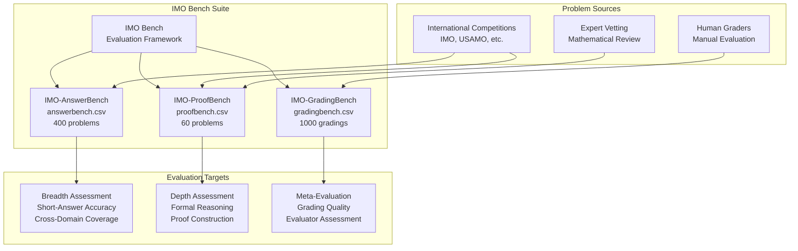
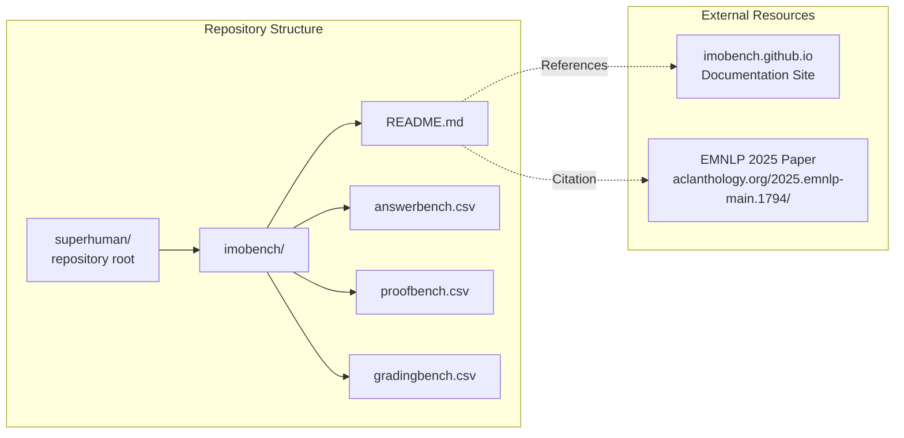
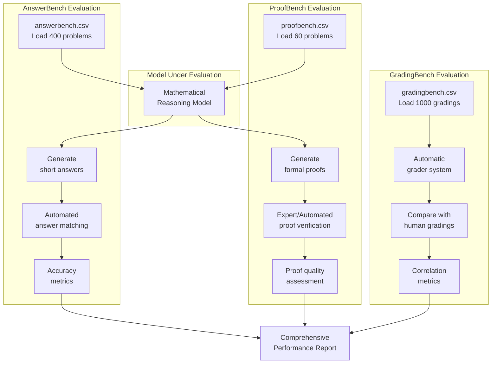
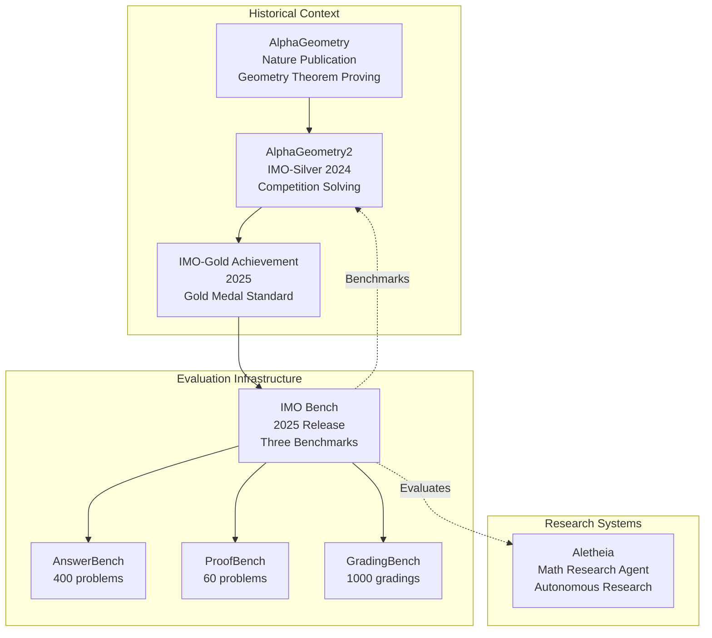

<!-- source: DeepWiki mcp.deepwiki.com · repo google-deepmind/superhuman · page 4 IMO Bench Evaluation Suite · fetched 2026-10-26 -->

# IMO Bench Evaluation Suite

<details>
<summary>Relevant source files</summary>

The following files were used as context for generating this wiki page:

- [README.md](README.md)
- [aletheia/Aletheia.pdf](aletheia/Aletheia.pdf)
- [imobench/README.md](imobench/README.md)

</details>


## Purpose and Scope

This document describes the IMO Bench evaluation suite, a comprehensive benchmarking framework designed to evaluate mathematical reasoning capabilities in AI systems. IMO Bench consists of three distinct benchmarks that assess different aspects of mathematical problem-solving: short-answer problems (AnswerBench), formal proof construction (ProofBench), and evaluation quality (GradingBench). Released in 2025 following Google DeepMind's IMO-gold achievement, this suite provides standardized datasets for measuring progress in automated mathematical reasoning.

For information about the research system that produced novel mathematical results, see [Aletheia Math Research Agent](#3). For details about the earlier geometry theorem proving systems, see [AlphaGeometry Projects](#2).

**Sources:** [README.md:15-26](), [imobench/README.md:1-10]()

---

## Overview and Release Context

IMO Bench was released as part of Google DeepMind's Superhuman Reasoning initiative in 2025, directly following the team's achievement of gold medal standard performance at the International Mathematical Olympiad. The suite addresses the need for robust evaluation of mathematical reasoning systems across three dimensions: solution accuracy, formal proof quality, and evaluation methodology.

The benchmark suite is accompanied by a research paper presented at the 2025 Conference on Empirical Methods in Natural Language Processing (EMNLP), authored by Thang Luong and collaborators from Google DeepMind and academic institutions.

**Sources:** [README.md:15-19](), [imobench/README.md:13-20]()

---

## Three-Component Architecture



**Diagram: IMO Bench Three-Component Architecture**

IMO Bench employs a triangulated evaluation strategy through three independent datasets, each stored as CSV files in the `imobench/` directory:

| Benchmark | File | Size | Purpose |
|-----------|------|------|---------|
| IMO-AnswerBench | `answerbench.csv` | 400 problems | Evaluates accuracy on short-answer problems across mathematical domains |
| IMO-ProofBench | `proofbench.csv` | 60 problems | Assesses formal proof construction and reasoning depth |
| IMO-GradingBench | `gradingbench.csv` | 1000 gradings | Enables meta-evaluation of automatic grading systems |

**Sources:** [README.md:21-26](), [imobench/README.md:6-9]()

---

## IMO-AnswerBench: Breadth Evaluation

IMO-AnswerBench provides 400 challenging short-answer problems designed to test breadth of mathematical reasoning across multiple domains. These problems require precise numerical or algebraic answers rather than full proofs, enabling automated grading while maintaining mathematical rigor.

### Problem Characteristics

The benchmark emphasizes:
- **Challenging difficulty**: Problems selected from competitive mathematics sources
- **Short-answer format**: Solutions are specific numerical values, algebraic expressions, or finite sets
- **Cross-domain coverage**: Problems span algebra, combinatorics, geometry, and number theory
- **Automated evaluation**: Answer format enables objective grading

### Data Format

The dataset is provided in CSV format at `answerbench.csv`, containing problem statements, expected answers, and metadata for categorization and source tracking.

**Sources:** [README.md:21](), [imobench/README.md:7]()

---

## IMO-ProofBench: Depth Evaluation

IMO-ProofBench consists of 60 expert-vetted proof-based problems that evaluate the capability to construct formal mathematical arguments. Unlike AnswerBench's focus on final answers, ProofBench assesses the quality and correctness of reasoning chains.

### Expert Vetting Process

Each problem in ProofBench has undergone expert review to ensure:
- Mathematical correctness and precision
- Appropriate difficulty level for evaluation purposes
- Clear problem statements
- Well-defined proof requirements

### Evaluation Criteria

ProofBench problems assess:
- **Logical structure**: Validity of reasoning steps
- **Completeness**: Coverage of all required cases
- **Formal rigor**: Mathematical precision and notation
- **Clarity**: Comprehensibility of arguments

The dataset is stored in `proofbench.csv` with problem statements and evaluation guidelines.

**Sources:** [README.md:23](), [imobench/README.md:8]()

---

## IMO-GradingBench: Meta-Evaluation

IMO-GradingBench represents a unique contribution to mathematical evaluation: a dataset of 1000 human gradings designed to evaluate the evaluators themselves. This benchmark enables assessment of automatic grading systems' alignment with human expert judgment.

### Dataset Composition

The benchmark contains:
- **Problem-solution pairs**: Mathematical problems with candidate solutions
- **Human gradings**: Expert assessments of solution quality
- **Grading rationale**: Explanation of scoring decisions (where available)

### Meta-Evaluation Use Cases

GradingBench supports:
1. **Evaluator calibration**: Training automatic grading systems to match human judgment
2. **Correlation analysis**: Measuring agreement between automated and human graders
3. **Error analysis**: Identifying systematic biases in grading systems
4. **Benchmark for grading models**: Providing ground truth for evaluator development

The dataset is provided in `gradingbench.csv` with structured grading information.

**Sources:** [README.md:25-26](), [imobench/README.md:9]()

---

## File Organization and Access



**Diagram: IMO Bench File Organization**

### Dataset Access

All three benchmark datasets are directly accessible in the repository:

| Dataset | Path | Format |
|---------|------|--------|
| AnswerBench | `imobench/answerbench.csv` | CSV |
| ProofBench | `imobench/proofbench.csv` | CSV |
| GradingBench | `imobench/gradingbench.csv` | CSV |

### Additional Resources

- **Documentation website**: https://imobench.github.io provides detailed usage information and examples
- **Research paper**: Available at https://aclanthology.org/2025.emnlp-main.1794/
- **Local README**: [imobench/README.md]() contains usage instructions and citation information

**Sources:** [imobench/README.md:3-9]()

---

## Evaluation Workflow



**Diagram: Evaluation Workflow Across Three Benchmarks**

The evaluation workflow varies by benchmark type:

### AnswerBench Workflow
1. Load problems from `answerbench.csv`
2. Submit each problem to the model under evaluation
3. Extract short-answer responses
4. Compare against ground truth using automated matching
5. Calculate accuracy metrics

### ProofBench Workflow
1. Load problems from `proofbench.csv`
2. Generate formal proof attempts
3. Evaluate proof correctness through expert review or automated verification
4. Assess proof quality on multiple dimensions

### GradingBench Workflow
1. Load problem-solution-grading triples from `gradingbench.csv`
2. Apply automatic grading system to problem-solution pairs
3. Compare automated grades with human expert grades
4. Calculate correlation and agreement metrics

**Sources:** [imobench/README.md:6-9]()

---

## Citation and Academic Use

The IMO Bench suite is associated with the research paper "Towards Robust Mathematical Reasoning" presented at EMNLP 2025. The paper is authored by Thang Luong and 21 collaborators from Google DeepMind and academic institutions.

### BibTeX Citation

```bibtex
@inproceedings{luong-etal-2025-towards,
    title = "Towards Robust Mathematical Reasoning",
    author  = {Thang Luong and Dawsen Hwang and Hoang H. Nguyen and 
               Golnaz Ghiasi and Yuri Chervonyi and Insuk Seo and 
               Junsu Kim and Garrett Bingham and Jonathan Lee and 
               Swaroop Mishra and Alex Zhai and Clara Huiyi Hu and 
               Henryk Michalewski and Jimin Kim and Jeonghyun Ahn and 
               Junhwi Bae and Xingyou Song and Trieu H. Trinh and 
               Quoc V. Le and Junehyuk Jung},
    booktitle = "Proceedings of the 2025 Conference on Empirical Methods in Natural Language Processing",
    year = "2025",
    url = "https://aclanthology.org/2025.emnlp-main.1794/",
}
```

**Sources:** [imobench/README.md:13-20]()

---

## Licensing

IMO Bench follows the repository's dual licensing model:

- **Software components**: Licensed under Apache License 2.0
- **Dataset materials**: Licensed under Creative Commons Attribution 4.0 International (CC-BY)

The CSV datasets (`answerbench.csv`, `proofbench.csv`, `gradingbench.csv`) fall under the CC-BY license, requiring attribution when used in research or applications.

**Disclaimer**: IMO Bench is not an official Google product.

**Sources:** [imobench/README.md:23-42]()

---

## Integration with Superhuman Reasoning Ecosystem



**Diagram: IMO Bench in the Superhuman Reasoning Timeline**

IMO Bench serves as the evaluation infrastructure for the Superhuman Reasoning ecosystem, providing standardized benchmarks for systems ranging from competition solvers (AlphaGeometry2) to autonomous research agents (Aletheia). Its release following the 2025 IMO-gold achievement establishes a foundation for measuring progress beyond competition-level problem solving toward general mathematical reasoning capabilities.

The three-pronged approach—testing breadth, depth, and evaluation quality—enables comprehensive assessment of mathematical AI systems across different reasoning dimensions.

**Sources:** [README.md:6-30]()

---

