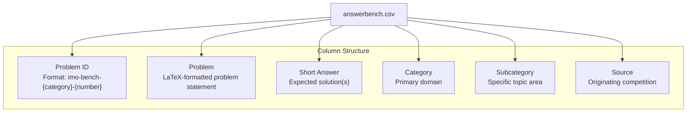
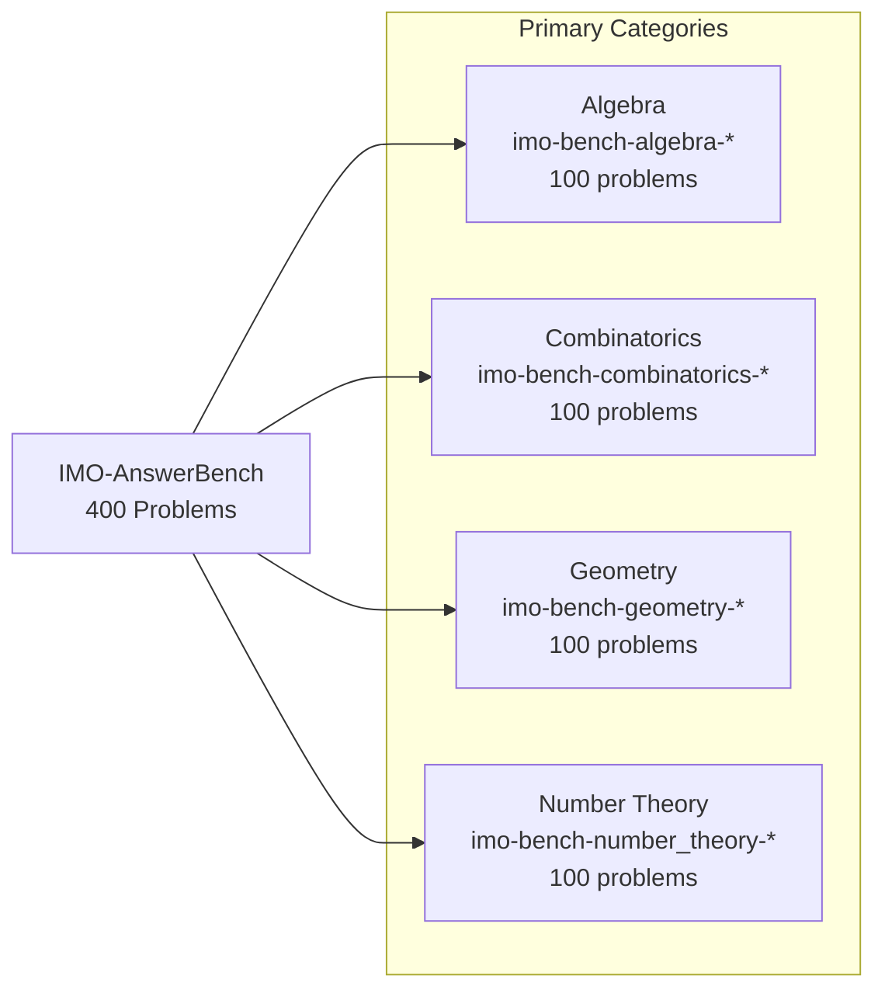
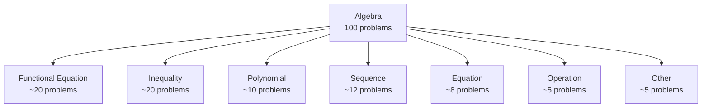
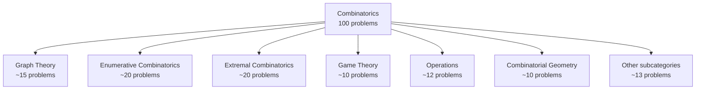
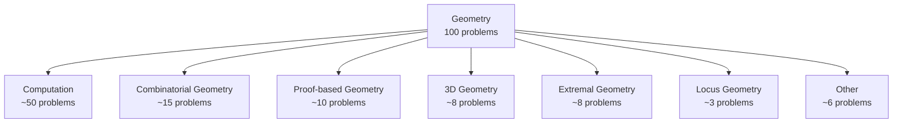
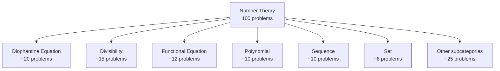
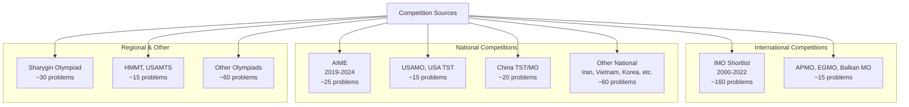
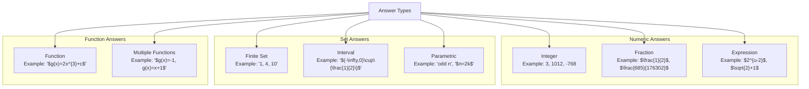
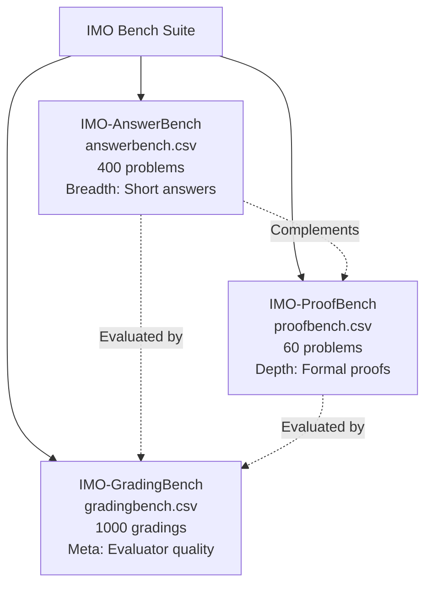

<!-- source: DeepWiki mcp.deepwiki.com · repo google-deepmind/superhuman · page 4.1 IMO-AnswerBench · fetched 2026-10-26 -->

# IMO-AnswerBench

<details>
<summary>Relevant source files</summary>

The following files were used as context for generating this wiki page:

- [imobench/README.md](imobench/README.md)
- [imobench/answerbench.csv](imobench/answerbench.csv)

</details>


IMO-AnswerBench is a dataset of 400 challenging short-answer mathematical problems designed to evaluate the breadth of mathematical reasoning capabilities across algebra, combinatorics, geometry, and number theory. It is part of the IMO Bench evaluation suite released in 2025 following the IMO-gold achievement.

For information about proof-based problem evaluation, see [IMO-ProofBench](#4.2). For meta-evaluation of grading systems, see [IMO-GradingBench](#4.3). For overall benchmark performance analysis, see [Benchmark Performance and Analysis](#4.4).

**Sources:** [imobench/README.md:1-43]()

---

## Dataset Overview

IMO-AnswerBench focuses on breadth assessment through short-answer problems that require producing a specific numerical answer, algebraic expression, or small set of values. Unlike proof-based problems, these are designed to be automatically gradable while still testing deep mathematical understanding.

The dataset is stored as a CSV file with structured metadata enabling:
- Automatic evaluation via answer matching
- Topic-based analysis of model capabilities
- Source attribution to competition origins
- Difficulty stratification by competition tier

**Sources:** [imobench/README.md:7](), [imobench/answerbench.csv:1-1383]()

---

## File Structure and Data Format

### CSV Schema



**Sources:** [imobench/answerbench.csv:1]()

### Field Specifications

| Field | Type | Description | Example |
|-------|------|-------------|---------|
| `Problem ID` | String | Unique identifier with format `imo-bench-{category}-{###}` | `imo-bench-algebra-001` |
| `Problem` | String | LaTeX-formatted problem statement with math expressions | `For a given positive integer $N$...` |
| `Short Answer` | String | Expected answer(s), may include multiple values or expressions | `3`, `$\left\lfloor \log_{2}a\right\rfloor +1$.` |
| `Category` | Enum | One of: Algebra, Combinatorics, Geometry, Number theory | `Algebra` |
| `Subcategory` | String | Specific mathematical topic within category | `Functional Equation` |
| `Source` | String | Originating competition or problem set | `IMO Shortlist 2021` |

**Sources:** [imobench/answerbench.csv:1-1383]()

---

## Problem Categories

The dataset is divided into four major mathematical domains, each identified by a unique prefix in the Problem ID field.



**Sources:** [imobench/answerbench.csv:1-1383]()

### Category Distribution

Each category contains exactly 100 problems, providing balanced coverage across mathematical domains. The problems are numbered sequentially within each category from 001 to 100.

| Category | Problem ID Range | Count | Representative Topics |
|----------|-----------------|-------|----------------------|
| Algebra | `imo-bench-algebra-001` to `-100` | 100 | Functional equations, inequalities, polynomials, sequences |
| Combinatorics | `imo-bench-combinatorics-001` to `-100` | 100 | Graph theory, counting, game theory, tiling |
| Geometry | `imo-bench-geometry-001` to `-100` | 100 | Euclidean geometry, 3D geometry, locus problems |
| Number Theory | `imo-bench-number_theory-001` to `-100` | 100 | Diophantine equations, divisibility, modular arithmetic |

**Sources:** [imobench/answerbench.csv:1-1383]()

---

## Subcategory Taxonomy

Each category is further divided into specialized subcategories representing specific mathematical techniques or problem types.

### Algebra Subcategories



**Key algebra subcategories:**
- **Functional Equation**: Finding functions satisfying given conditions (e.g., [answerbench.csv:3-13](), [answerbench.csv:25-26]())
- **Inequality**: Proving or finding extremal values (e.g., [answerbench.csv:5-6](), [answerbench.csv:9-10]())
- **Polynomial**: Properties and roots of polynomials (e.g., [answerbench.csv:17-18](), [answerbench.csv:35-36]())
- **Sequence**: Recursive sequences and series (e.g., [answerbench.csv:8-9](), [answerbench.csv:16-17]())

**Sources:** [imobench/answerbench.csv:2-183]()

### Combinatorics Subcategories



**Key combinatorics subcategories:**
- **Graph Theory**: Problems on graphs, networks, and connections (e.g., [answerbench.csv:485-486](), [answerbench.csv:504-505]())
- **Enumerative Combinatorics**: Counting arrangements and configurations (e.g., [answerbench.csv:496-497](), [answerbench.csv:517-518]())
- **Extremal Combinatorics**: Finding maximum/minimum configurations (e.g., [answerbench.csv:507-508](), [answerbench.csv:513-514]())
- **Game Theory**: Two-player games and winning strategies (e.g., [answerbench.csv:514-515](), [answerbench.csv:536-537]())
- **Operations**: Sequential operations and transformations (e.g., [answerbench.csv:541-542](), [answerbench.csv:563-564]())

**Sources:** [imobench/answerbench.csv:485-787]()

### Geometry Subcategories



**Key geometry subcategories:**
- **Computation**: Computing lengths, angles, or areas (e.g., [answerbench.csv:812-813](), [answerbench.csv:824-825]())
- **Combinatorial Geometry**: Counting geometric configurations (e.g., [answerbench.csv:815-816](), [answerbench.csv:849-850]())
- **3D Geometry**: Spatial problems with polyhedra or solid figures (e.g., [answerbench.csv:811-812](), [answerbench.csv:855-856]())
- **Proof-based Geometry**: Proving geometric properties (e.g., [answerbench.csv:819-820](), [answerbench.csv:832-833]())
- **Extremal Geometry**: Finding maximum/minimum geometric quantities (e.g., [answerbench.csv:821-822](), [answerbench.csv:963-964]())

**Sources:** [imobench/answerbench.csv:811-1016]()

### Number Theory Subcategories



**Key number theory subcategories:**
- **Diophantine Equation**: Integer solutions to equations (e.g., [answerbench.csv:1033-1034](), [answerbench.csv:1065-1068]())
- **Divisibility**: Problems involving divisors and multiples (e.g., [answerbench.csv:1019-1020](), [answerbench.csv:1041-1045]())
- **Functional Equation**: Functions on integers satisfying properties (e.g., [answerbench.csv:1021-1031](), [answerbench.csv:1061-1062]())
- **Polynomial**: Integer-coefficient polynomials (e.g., [answerbench.csv:1035-1036](), [answerbench.csv:1052-1057]())
- **Sequence**: Number-theoretic sequences (e.g., [answerbench.csv:1059-1060](), [answerbench.csv:1108-1109]())

**Sources:** [imobench/answerbench.csv:1017-1383]()

---

## Competition Sources

Problems are sourced from prestigious mathematical competitions spanning multiple decades and geographic regions.

### Source Distribution



**Sources:** [imobench/answerbench.csv:1-1383]()

### Major Source Competitions

| Source Type | Examples | Problem Count Range | Characteristics |
|-------------|----------|-------------------|-----------------|
| IMO Shortlist | 2000-2022 editions | ~160 | Highest difficulty, international standard |
| AIME | 2019-2024 | ~25 | Upper high school level, US competition |
| National TSTs | China, USA, Vietnam, Iran, Korea | ~50 | Team selection tests, very challenging |
| Regional Olympiads | Sharygin, APMO, Balkan | ~45 | Specialized competitions |
| University Competitions | HMMT, Putnam, USAMTS | ~20 | Advanced undergraduate level |

**Examples of specific sources:**
- **IMO Shortlist 2021**: [answerbench.csv:2-6]() (Algebra problems)
- **AIME 2019-2024**: [answerbench.csv:909-954]() (Geometry problems)
- **China TST**: [answerbench.csv:526-527](), [answerbench.csv:597-598]() (Combinatorics)
- **Iran Geometry Olympiad**: [answerbench.csv:890-907]() (Geometry)
- **Sharygin Olympiad**: [answerbench.csv:811-870]() (Geometry)

**Sources:** [imobench/answerbench.csv:1-1383]()

---

## Answer Format Conventions

Short answers in IMO-AnswerBench follow specific formatting conventions based on the answer type.

### Answer Types



**Sources:** [imobench/answerbench.csv:1-1383]()

### Examples by Category

**Integer answers:**
- Simple: `3` [answerbench.csv:3](), `1012` [answerbench.csv:31]()
- Negative: `-768` [answerbench.csv:87]()
- Large: `1431655765` [answerbench.csv:497]()

**Expression answers:**
- With parameters: `$\left\lfloor \log_{2}a\right\rfloor +1$` [answerbench.csv:5]()
- Involving roots: `$\sqrt{2}+1$` [answerbench.csv:819](), `$\frac{a\sqrt{19}}{2}$` [answerbench.csv:881]()
- In terms of variables: `$2x+y$` [answerbench.csv:863]()

**Set answers (multiple solutions):**
- Finite list: `"$-\frac{2}{3},0,\frac{2}{3}$"` [answerbench.csv:49]()
- Conditional: `"2026, 2030"` [answerbench.csv:74]()
- Parametric form: `"$n=4k+3$"` [answerbench.csv:375]()
- Interval notation: `"$(-\infty,0)\cup\{\frac{1}{2}\}$"` [answerbench.csv:70]()

**Function answers:**
- Single function: `"$Q(x)=-2, Q(x)=2x-2$"` [answerbench.csv:59]()
- Multiple functions: `"$g(x)=2x^{3}+c, g(x)=-2x^{3}+c$"` [answerbench.csv:13]()
- General form: `"$f(x,y)= g(x+y, xy(x-y)^{2})$ for some polynomial $g$"` [answerbench.csv:172]()

**Sources:** [imobench/answerbench.csv:1-1383]()

---

## Problem Difficulty Characteristics

### Difficulty Indicators

The source competition provides a natural difficulty stratification:

| Difficulty Tier | Competition Type | Examples | Characteristics |
|----------------|------------------|----------|-----------------|
| Very Hard | IMO Shortlist (C6, N6, etc.) | [answerbench.csv:2-183]() | Reserved problems, typically unsolved at IMO |
| Hard | National TSTs, IMO Shortlist (A3-A5) | Various TST sources | Team selection difficulty |
| Medium-Hard | USAMO, AIME #15 | [answerbench.csv:909-954]() | Top national level |
| Medium | AIME #10-14, Sharygin | [answerbench.csv:811-870]() | Advanced high school |

### Problem Length and Complexity

**Short statements with complex solutions:**
- [answerbench.csv:3-4](): Simple question about sum of quotients
- [answerbench.csv:70](): Find all f(0) values for polynomial

**Multi-part or conditional problems:**
- [answerbench.csv:26-31](): Problems with indexed sequences
- [answerbench.csv:139-145](): Problems requiring case analysis

**Sources:** [imobench/answerbench.csv:1-1383]()

---

## Dataset Access and Usage

### File Location

The dataset is stored as a single CSV file:
```
imobench/answerbench.csv
```

### Loading the Dataset

The CSV format enables easy loading in common data processing frameworks:

```python
# Example: Loading with pandas
import pandas as pd
df = pd.read_csv('imobench/answerbench.csv')

# Access fields
problem_ids = df['Problem ID']
problems = df['Problem']
answers = df['Short Answer']
categories = df['Category']
subcategories = df['Subcategory']
sources = df['Source']
```

**Sources:** [imobench/answerbench.csv:1]()

### Evaluation Methodology

For automated evaluation, the following considerations apply:

1. **Exact matching**: Most numeric answers can be compared directly
2. **Expression equivalence**: LaTeX expressions may need symbolic comparison
3. **Set answers**: May require parsing multiple values or intervals
4. **Tolerance**: Some numerical answers may need small tolerance for floating-point comparison

**Sources:** [imobench/README.md:1-43]()

---

## Integration with IMO Bench Suite

IMO-AnswerBench is one component of the three-pronged evaluation system:



**Complementary roles:**
- **AnswerBench**: Tests breadth across topics with automatic grading
- **ProofBench**: Tests depth with formal mathematical reasoning
- **GradingBench**: Validates the quality of both human and automated evaluations

**Sources:** [imobench/README.md:7-9]()

---

## Citation and Licensing

### Academic Citation

When using IMO-AnswerBench in research, cite:

```bibtex
@inproceedings{luong-etal-2025-towards,
    title = "Towards Robust Mathematical Reasoning",
    author  = {Thang Luong and Dawsen Hwang and Hoang H. Nguyen and 
               Golnaz Ghiasi and Yuri Chervonyi and Insuk Seo and 
               Junsu Kim and Garrett Bingham and Jonathan Lee and 
               Swaroop Mishra and Alex Zhai and Clara Huiyi Hu and 
               Henryk Michalewski and Jimin Kim and Jeonghyun Ahn and 
               Junhwi Bae and Xingyou Song and Trieu H. Trinh and 
               Quoc V. Le and Junehyuk Jung},
    booktitle = "Proceedings of the 2025 Conference on Empirical Methods 
                 in Natural Language Processing",
    year = "2025",
    url = "https://aclanthology.org/2025.emnlp-main.1794/",
}
```

**Sources:** [imobench/README.md:11-21]()

### License

- **Software components**: Apache License 2.0
- **Dataset materials**: Creative Commons Attribution 4.0 International (CC-BY)

The dual licensing model separates code reusability (Apache 2.0) from academic attribution requirements (CC-BY), facilitating both open-source development and research citation.

**Sources:** [imobench/README.md:23-42]()

---

## External Resources

- **Project website**: https://imobench.github.io
- **Paper**: https://aclanthology.org/2025.emnlp-main.1794/

**Sources:** [imobench/README.md:3](), [imobench/README.md:19]()

---

