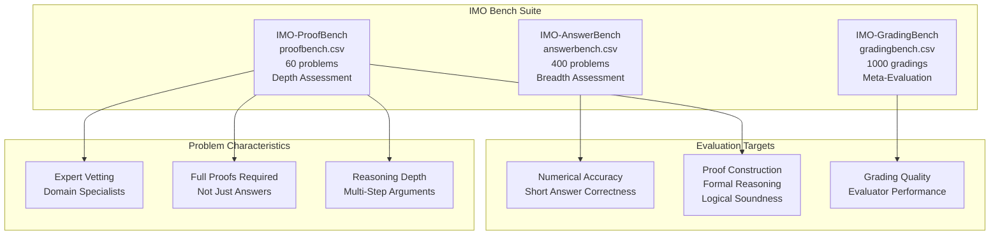
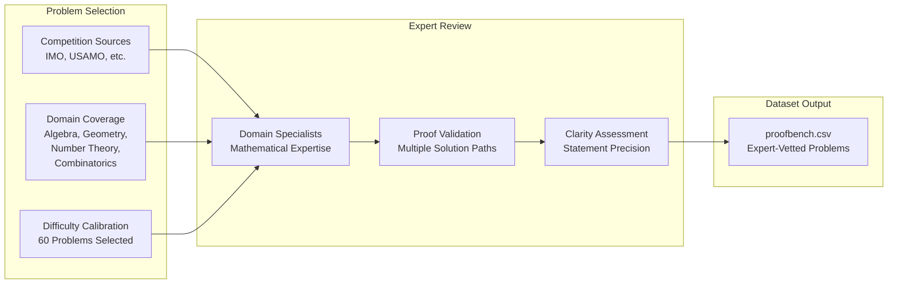
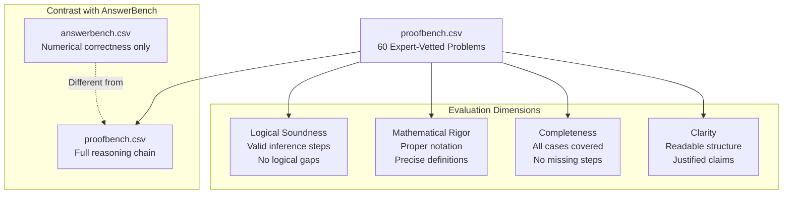
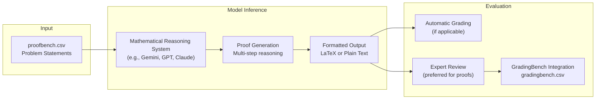
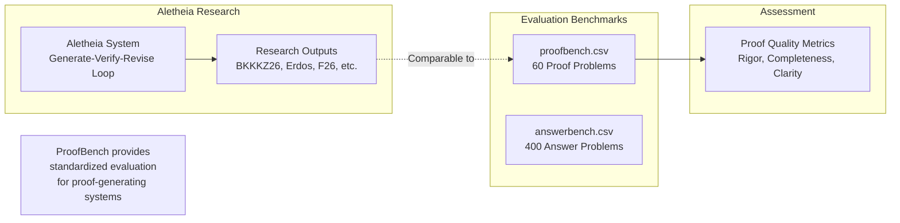

<!-- source: DeepWiki mcp.deepwiki.com · repo google-deepmind/superhuman · page 4.2 IMO-ProofBench · fetched 2026-10-26 -->

# IMO-ProofBench

<details>
<summary>Relevant source files</summary>

The following files were used as context for generating this wiki page:

- [imobench/README.md](imobench/README.md)

</details>


## Purpose and Scope

IMO-ProofBench is a dataset of 60 expert-vetted proof-based problems designed to evaluate formal reasoning and proof construction capabilities in mathematical reasoning systems. It complements IMO-AnswerBench's breadth-focused assessment with depth-focused evaluation that requires complete, rigorous mathematical proofs rather than short numerical answers.

This page documents the structure, purpose, and usage of the ProofBench component of the IMO Bench evaluation suite. For the broader evaluation framework, see [IMO Bench Evaluation Suite](#4). For the other benchmark components, see [IMO-AnswerBench](#4.1) and [IMO-GradingBench](#4.3).

**Sources:** [imobench/README.md:1-43]()

---

## Dataset Overview

IMO-ProofBench consists of 60 carefully curated proof problems that require systems to produce complete mathematical arguments rather than final answers. The dataset serves as a depth assessment tool within the three-pronged IMO Bench evaluation strategy.

### Key Characteristics

| Attribute | Value |
|-----------|-------|
| Problem Count | 60 |
| Problem Type | Proof-based (full mathematical arguments required) |
| Vetting Status | Expert-vetted by mathematical domain specialists |
| Data Format | CSV |
| File Location | `imobench/proofbench.csv` |
| Primary Purpose | Assess formal reasoning and proof construction depth |
| Target Evaluation | LLM mathematical proof capabilities |

The dataset emphasizes quality over quantity, with each problem selected to test specific aspects of mathematical reasoning that cannot be assessed through numerical answers alone.

**Sources:** [imobench/README.md:8]()

---

## Dataset Architecture

### Three-Tier Benchmark Design



**Diagram: IMO-ProofBench Position in Benchmark Architecture**

ProofBench occupies the depth assessment tier, complementing AnswerBench's breadth coverage with intensive evaluation of reasoning quality.

**Sources:** [imobench/README.md:1-43]()

---

## File Format and Access

### Data Location

The ProofBench dataset is stored as a CSV file at the repository root:

```
imobench/
├── README.md
├── answerbench.csv
├── proofbench.csv          # ProofBench dataset
└── gradingbench.csv
```

### CSV Schema

The `proofbench.csv` file contains structured problem data with the following expected schema components:

| Column Category | Purpose |
|----------------|---------|
| Problem Statement | Full mathematical problem description |
| Domain/Category | Mathematical area (algebra, geometry, number theory, combinatorics) |
| Source Information | Competition or origin reference |
| Difficulty Level | Complexity indicator |
| Expected Proof Structure | Guidelines for valid proof approaches |
| Vetting Metadata | Expert review information |

**Note:** The exact column names and structure can be inspected by loading the CSV file directly.

**Sources:** [imobench/README.md:8]()

---

## Expert Vetting Process

### Quality Assurance Pipeline



**Diagram: Expert Vetting Workflow for ProofBench Problems**

The expert vetting process ensures that each problem:
1. **Has unambiguous statements** with clear mathematical definitions
2. **Admits rigorous proofs** using standard mathematical techniques
3. **Represents its domain** appropriately in difficulty and scope
4. **Tests specific reasoning skills** relevant to formal mathematical proof

This vetting distinguishes ProofBench from automatically scraped problem collections, providing higher-quality evaluation targets.

**Sources:** [imobench/README.md:1-43]()

---

## Proof-Based Evaluation Methodology

### Assessment Dimensions

ProofBench evaluates mathematical reasoning systems across multiple dimensions that require full proof construction:



**Diagram: ProofBench Evaluation Dimensions**

### Distinguishing Features

| AnswerBench | ProofBench |
|-------------|------------|
| 400 problems | 60 problems |
| Short answer (number/expression) | Full proof required |
| Tests breadth | Tests depth |
| Binary correctness | Multi-dimensional quality assessment |
| Automated grading possible | Expert grading often required |

**Sources:** [imobench/README.md:1-43]()

---

## Usage Patterns

### Loading the Dataset

The ProofBench dataset can be loaded directly from its CSV file:

```python
# Example usage pattern
import pandas as pd

proofbench = pd.read_csv('imobench/proofbench.csv')
```

### Integration with Evaluation Systems



**Diagram: ProofBench Usage in Evaluation Pipeline**

The typical evaluation workflow involves:
1. **Loading problems** from `proofbench.csv`
2. **Running inference** on mathematical reasoning systems
3. **Collecting proof outputs** in structured format
4. **Grading proofs** using expert reviewers or advanced automatic systems
5. **Cross-referencing with GradingBench** for meta-evaluation studies

**Sources:** [imobench/README.md:7-9]()

---

## Formal Reasoning Assessment

### Proof Construction Requirements

ProofBench problems require systems to demonstrate several key capabilities:

| Capability | Description | Assessment Method |
|------------|-------------|-------------------|
| **Theorem Application** | Correct use of mathematical theorems and lemmas | Expert verification of citations |
| **Logical Inference** | Valid deductive reasoning steps | Step-by-step logical review |
| **Case Analysis** | Exhaustive consideration of problem cases | Completeness checking |
| **Algebraic Manipulation** | Accurate symbolic computations | Computational verification |
| **Geometric Reasoning** | Valid spatial arguments and constructions | Diagram and construction review |
| **Proof Strategy Selection** | Appropriate proof technique for problem | Meta-level reasoning assessment |

### Comparison with Competitive Performance

The ProofBench dataset was released following the 2025 IMO-Gold achievement, indicating that systems capable of medaling at the IMO level should be able to address these proof problems. However, the expert vetting ensures that the problems remain challenging benchmarks for:

- Testing proof completeness beyond answer correctness
- Evaluating explanation quality
- Assessing formal mathematical writing
- Benchmarking reasoning depth

**Sources:** [imobench/README.md:1-43]()

---

## Citation and Attribution

When using IMO-ProofBench in research, cite the following paper:

```bibtex
@inproceedings{luong-etal-2025-towards,
    title = "Towards Robust Mathematical Reasoning",
    author  = {Thang Luong and Dawsen Hwang and Hoang H. Nguyen and 
               Golnaz Ghiasi and Yuri Chervonyi and Insuk Seo and 
               Junsu Kim and Garrett Bingham and Jonathan Lee and 
               Swaroop Mishra and Alex Zhai and Clara Huiyi Hu and 
               Henryk Michalewski and Jimin Kim and Jeonghyun Ahn and 
               Junhwi Bae and Xingyou Song and Trieu H. Trinh and 
               Quoc V. Le and Junehyuk Jung},
    booktitle = "Proceedings of the 2025 Conference on Empirical Methods 
                 in Natural Language Processing",
    year = "2025",
    url = "https://aclanthology.org/2025.emnlp-main.1794/",
}
```

**Sources:** [imobench/README.md:11-21]()

---

## Licensing

The IMO-ProofBench dataset is dual-licensed:

- **Software components** (loading scripts, evaluation tools): Apache License 2.0
- **Dataset materials** (problem statements, metadata): Creative Commons Attribution 4.0 International (CC-BY)

The CC-BY license allows for redistribution and adaptation of the dataset with proper attribution, facilitating research reproducibility and benchmark extensions.

**Sources:** [imobench/README.md:23-42]()

---

## Integration with Aletheia Research Outputs

ProofBench serves as an evaluation tool for systems like Aletheia (see [Aletheia Math Research Agent](#3)), which produces complete mathematical proofs. The proof-based format allows direct assessment of Aletheia's research outputs against standardized benchmarks:



**Diagram: ProofBench as Evaluation Tool for Proof-Generating Systems**

**Sources:** [imobench/README.md:1-43]()

---

## Summary

IMO-ProofBench provides a curated, expert-vetted benchmark for evaluating mathematical proof construction at depth. With 60 carefully selected problems stored in [imobench/proofbench.csv](), it complements the breadth assessment of AnswerBench and enables comprehensive evaluation of formal reasoning capabilities in modern AI systems.

The dataset's expert vetting, proof-based format, and integration with the broader IMO Bench suite make it a critical tool for advancing mathematical reasoning research and assessing systems that aspire to human-level or superhuman mathematical performance.

For performance analysis and results, see [Benchmark Performance and Analysis](#4.4).

**Sources:** [imobench/README.md:1-43]()

---

