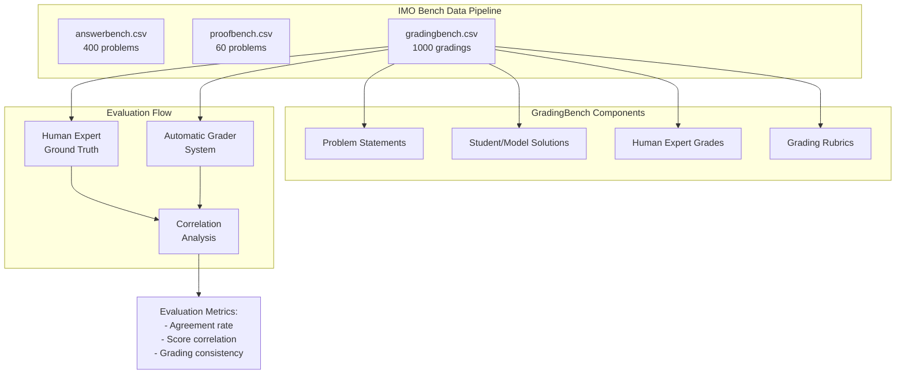
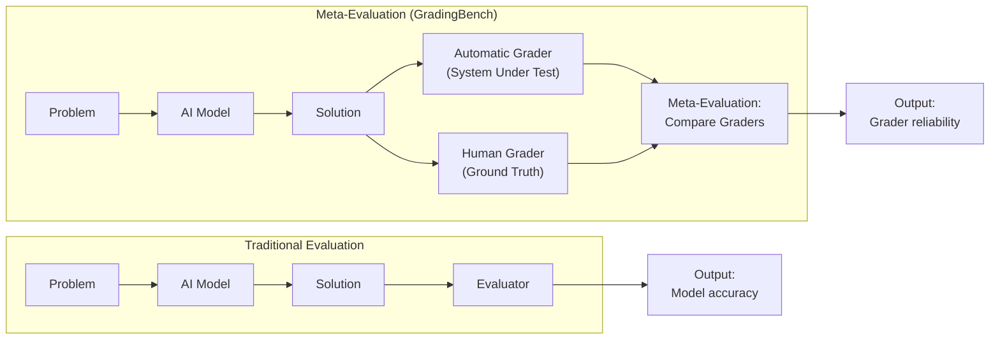
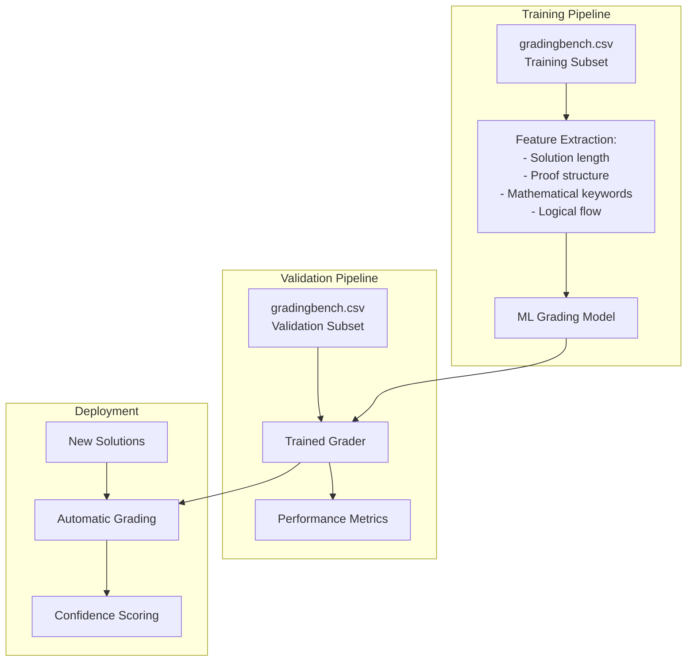
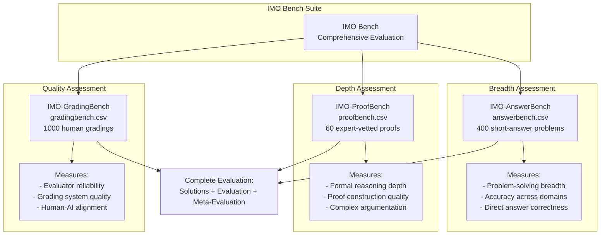

<!-- source: DeepWiki mcp.deepwiki.com · repo google-deepmind/superhuman · page 4.3 IMO-GradingBench · fetched 2026-10-26 -->

# IMO-GradingBench

<details>
<summary>Relevant source files</summary>

The following files were used as context for generating this wiki page:

- [imobench/README.md](imobench/README.md)
- [imobench/gradingbench.csv](imobench/gradingbench.csv)

</details>


## Purpose and Scope

IMO-GradingBench is a meta-evaluation dataset containing 1000 human gradings designed to assess the quality of automatic evaluation systems for mathematical problem solving. Unlike IMO-AnswerBench (see [4.1](#4.1)) which evaluates problem-solving accuracy, or IMO-ProofBench (see [4.2](#4.2)) which evaluates formal reasoning capabilities, IMO-GradingBench focuses on evaluating *the evaluators themselves*. This dataset enables researchers to measure how well automatic grading systems align with human expert judgment when assessing mathematical solutions.

This page documents the dataset structure, its role in meta-evaluation, and its integration within the broader IMO Bench evaluation suite. For overall benchmarking methodology and performance analysis, see [4.4](#4.4). For the historical context of IMO Bench's development following the 2025 IMO-gold achievement, see [5](#5).

**Sources:** [imobench/README.md:1-43]()

---

## Dataset Overview

IMO-GradingBench is distributed as a CSV file containing structured human grading data for mathematical solutions. The dataset serves as ground truth for training and evaluating automatic grading systems.

### Access and Distribution

The dataset is accessible as:
- **File:** `gradingbench.csv`
- **Location:** [imobench/gradingbench.csv]()
- **Reference:** [imobench/README.md:9]()

### Scale and Composition

| Property | Value |
|----------|-------|
| Total Gradings | 1000 |
| Primary Purpose | Meta-evaluation of grading systems |
| Target Domain | Mathematical reasoning |
| Data Type | Human expert evaluations |

**Sources:** [imobench/README.md:9]()

---

## Data Structure and Format



**Diagram: IMO-GradingBench Data Flow and Evaluation Architecture**

The dataset structure enables comparison between automatic grading systems and human expert evaluations, with the human gradings serving as the gold standard.

**Sources:** [imobench/README.md:1-43]()

---

## Meta-Evaluation Purpose

### Advancing Automatic Evaluation Systems

IMO-GradingBench addresses a critical challenge in mathematical AI evaluation: assessing whether automatic graders can reliably substitute for human experts. Traditional benchmarks measure model performance on problems, but IMO-GradingBench measures the performance of the evaluation systems themselves.



**Diagram: Traditional Evaluation vs Meta-Evaluation Workflow**

### Key Research Questions Addressed

IMO-GradingBench enables researchers to answer:

1. **Grading Accuracy:** How often do automatic graders agree with human experts?
2. **Score Correlation:** Do automatic grading scores correlate with human scores?
3. **Consistency:** Are automatic graders consistent across different problem types and difficulty levels?
4. **Bias Detection:** Do automatic graders exhibit systematic biases compared to human judgment?
5. **Scalability:** Can automatic graders maintain quality at scale?

**Sources:** [imobench/README.md:1-43]()

---

## Grading Methodology

### Human Grading Process

The 1000 human gradings in IMO-GradingBench represent expert evaluations following established mathematical competition grading standards. These gradings serve as the gold standard against which automatic systems are measured.

### Grading Dimensions

Mathematical solution grading typically considers multiple dimensions:

| Dimension | Description |
|-----------|-------------|
| Correctness | Logical validity of the solution |
| Completeness | Coverage of all required proof steps |
| Clarity | Quality of mathematical exposition |
| Rigor | Adherence to formal mathematical standards |
| Efficiency | Elegance and directness of approach |

### Multi-Grader Consensus

To ensure reliability, solutions may receive gradings from multiple human experts, enabling:
- Inter-rater reliability analysis
- Consensus score computation
- Disagreement pattern identification

**Sources:** [imobench/README.md:1-43]()

---

## Use Cases

### Training Automatic Graders

IMO-GradingBench provides supervised training data for machine learning-based grading systems:



**Diagram: GradingBench Integration in Automatic Grader Development**

### Benchmark Applications

1. **Autograder Validation:** Researchers developing automatic grading systems can measure their system's alignment with human judgment
2. **Grading System Comparison:** Compare different automatic grading approaches (rule-based, ML-based, LLM-based)
3. **Quality Assurance:** Validate that deployed automatic graders maintain acceptable correlation with human standards
4. **Research Tool:** Study patterns in mathematical solution evaluation and grading difficulty

**Sources:** [imobench/README.md:1-43]()

---

## Integration with IMO Bench Suite

### Three-Pronged Evaluation Strategy

IMO-GradingBench complements the other two benchmarks to provide comprehensive evaluation coverage:



**Diagram: IMO Bench Three-Pronged Evaluation Architecture**

### Complementary Roles

| Benchmark | Evaluation Target | Output Type | Scale |
|-----------|------------------|-------------|-------|
| AnswerBench | AI models | Direct answers | 400 problems |
| ProofBench | AI models | Formal proofs | 60 problems |
| **GradingBench** | **Evaluation systems** | **Grading quality** | **1000 gradings** |

IMO-GradingBench uniquely focuses on the evaluation infrastructure itself, enabling the development of reliable automatic grading systems that can scale the evaluation of the other two benchmarks.

**Sources:** [imobench/README.md:7-9]()

---

## Dataset Access and Citation

### File Access

The complete dataset is available at:
- **Repository path:** [imobench/gradingbench.csv]()
- **Reference documentation:** [imobench/README.md:9]()
- **Website:** https://imobench.github.io

### Academic Citation

When using IMO-GradingBench in research, cite the following publication:

```
@inproceedings{luong-etal-2025-towards,
    title = "Towards Robust Mathematical Reasoning",
    author = {Thang Luong and Dawsen Hwang and Hoang H. Nguyen and 
              Golnaz Ghiasi and Yuri Chervonyi and Insuk Seo and 
              Junsu Kim and Garrett Bingham and Jonathan Lee and 
              Swaroop Mishra and Alex Zhai and Clara Huiyi Hu and 
              Henryk Michalewski and Jimin Kim and Jeonghyun Ahn and 
              Junhwi Bae and Xingyou Song and Trieu H. Trinh and 
              Quoc V. Le and Junehyuk Jung},
    booktitle = "Proceedings of the 2025 Conference on Empirical 
                 Methods in Natural Language Processing",
    year = "2025",
    url = "https://aclanthology.org/2025.emnlp-main.1794/",
}
```

**Sources:** [imobench/README.md:14-20]()

---

## Licensing

IMO-GradingBench follows the dual licensing model of the IMO Bench suite:

| Component | License | Details |
|-----------|---------|---------|
| Dataset (gradingbench.csv) | Creative Commons BY 4.0 | Materials and datasets |
| Supporting software | Apache License 2.0 | Code components |

### License Details

- **CC-BY 4.0:** https://creativecommons.org/licenses/by/4.0/legalcode
- **Apache 2.0:** https://www.apache.org/licenses/LICENSE-2.0

All materials are distributed "AS IS" without warranties. IMO-GradingBench is not an official Google product.

**Sources:** [imobench/README.md:23-42]()

---

## Summary

IMO-GradingBench provides a critical meta-evaluation capability for mathematical AI research. By containing 1000 human expert gradings as ground truth, it enables:

- **Development** of reliable automatic grading systems
- **Validation** of evaluator alignment with human judgment
- **Comparison** of different grading approaches
- **Scaling** of mathematical evaluation infrastructure

Together with IMO-AnswerBench and IMO-ProofBench, it forms a comprehensive evaluation suite that assesses not only mathematical reasoning capabilities but also the quality of the evaluation systems themselves. This meta-evaluation focus distinguishes IMO-GradingBench as a unique contribution to advancing mathematical AI research infrastructure.

**Sources:** [imobench/README.md:1-43]()

---

