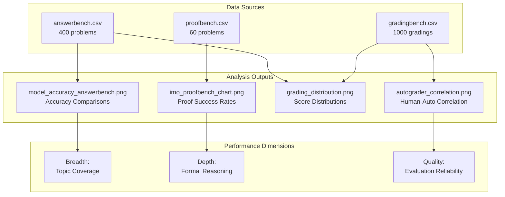
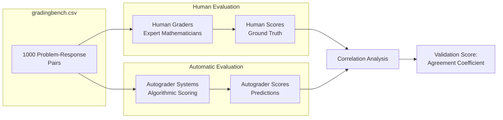
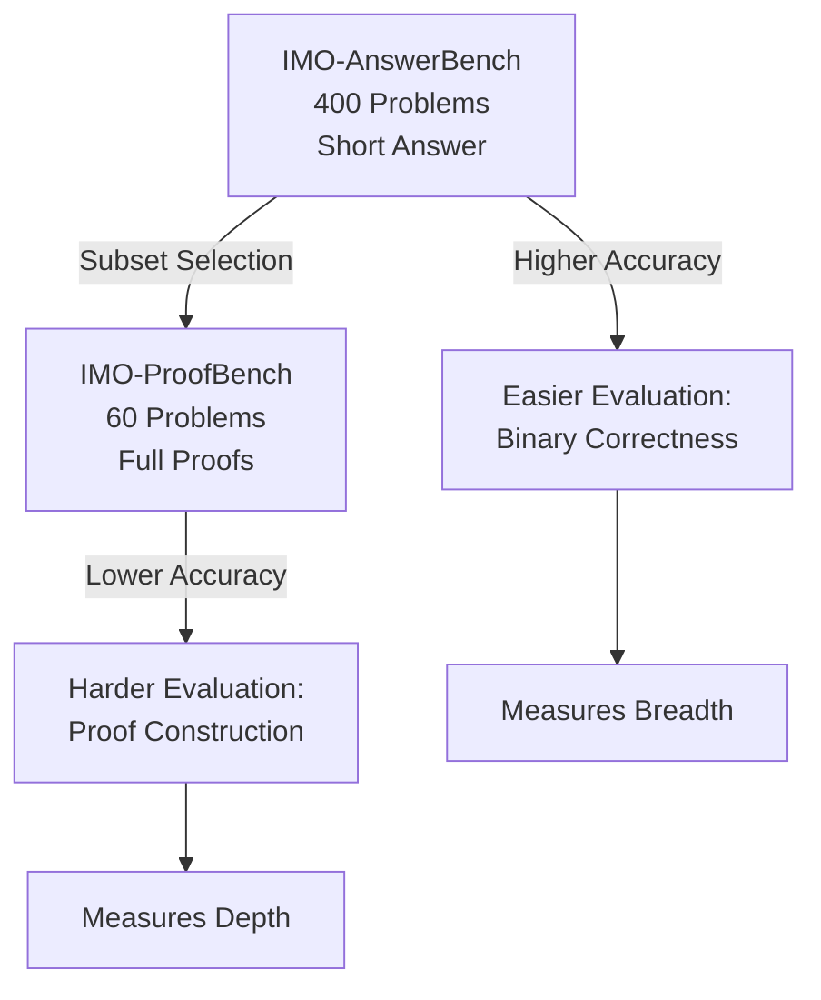

<!-- source: DeepWiki mcp.deepwiki.com · repo google-deepmind/superhuman · page 4.4 Benchmark Performance and Analysis · fetched 2026-10-26 -->

# Benchmark Performance and Analysis

<details>
<summary>Relevant source files</summary>

The following files were used as context for generating this wiki page:

- [imobench/README.md](imobench/README.md)
- [imobench/imgs/autograder_correlation.png](imobench/imgs/autograder_correlation.png)
- [imobench/imgs/grading_distribution.png](imobench/imgs/grading_distribution.png)
- [imobench/imgs/imo_proofbench_chart.png](imobench/imgs/imo_proofbench_chart.png)
- [imobench/imgs/model_accuracy_answerbench.png](imobench/imgs/model_accuracy_answerbench.png)
- [imobench/imgs/model_accuracy_proofbench.png](imobench/imgs/model_accuracy_proofbench.png)
- [imobench/imgs/topic_distribution.png](imobench/imgs/topic_distribution.png)

</details>


This page presents performance analysis and evaluation metrics across the three IMO Bench benchmarks. The analysis includes model accuracy comparisons, grading distributions, topic-based performance breakdowns, and autograder validation against human scores. For descriptions of the individual benchmark datasets, see [IMO-AnswerBench](#4.1), [IMO-ProofBench](#4.2), and [IMO-GradingBench](#4.3).

## Overview

The IMO Bench suite provides quantitative evaluation across three dimensions:

| Benchmark | Dataset File | Purpose | Metrics |
|-----------|-------------|---------|---------|
| IMO-AnswerBench | `answerbench.csv` | Breadth assessment via short-answer problems | Model accuracy, topic distribution |
| IMO-ProofBench | `proofbench.csv` | Depth assessment via proof construction | Success rates, formal verification |
| IMO-GradingBench | `gradingbench.csv` | Meta-evaluation of grading systems | Autograder-human correlation |

Sources: [imobench/README.md:1-43]()

## Evaluation Architecture



**IMO Bench Evaluation Pipeline**

Sources: [imobench/README.md:5-9](), [imobench/imgs/]()

## Model Accuracy on AnswerBench

The `model_accuracy_answerbench.png` visualization provides comparative analysis of model performance across the 400 short-answer problems in IMO-AnswerBench. This assessment measures breadth of mathematical reasoning capability.

### Key Performance Characteristics

**Topic-Based Breakdown**

AnswerBench problems span four mathematical domains:

| Domain | Problem Coverage | Evaluation Focus |
|--------|-----------------|------------------|
| Algebra | ~25% | Equation solving, polynomial manipulation |
| Combinatorics | ~25% | Counting, graph theory, discrete structures |
| Geometry | ~25% | Euclidean geometry, coordinate geometry |
| Number Theory | ~25% | Divisibility, modular arithmetic, primes |

Performance variations across topics indicate domain-specific reasoning strengths and weaknesses. Models may exhibit differential capabilities based on training data distribution and architectural biases.

**Accuracy Metrics**

The visualization displays:
- **Per-model accuracy rates**: Overall percentage of correctly answered problems
- **Topic-stratified performance**: Breakdown by mathematical domain
- **Comparative rankings**: Relative positioning across evaluated systems

Sources: [imobench/README.md:7](), [imobench/imgs/model_accuracy_answerbench.png]()

## ProofBench Performance Analysis

The `imo_proofbench_chart.png` visualization presents results for the 60 expert-vetted proof problems in IMO-ProofBench. This assessment evaluates depth of formal reasoning and proof construction capabilities.

### Proof Success Metrics

**Evaluation Criteria**

ProofBench problems require:
1. **Logical completeness**: All necessary steps present
2. **Formal rigor**: Valid mathematical argumentation
3. **Expert validation**: Verification by human mathematicians

**Performance Characteristics**

The chart displays:
- **Proof completion rates**: Percentage of problems with valid proofs
- **Partial credit scoring**: Recognition of incomplete but correct reasoning
- **Problem difficulty tiers**: Stratification by expert-assessed complexity

Unlike AnswerBench's binary correctness, ProofBench evaluates structured mathematical argumentation. Lower success rates relative to AnswerBench reflect the increased difficulty of proof construction versus answer generation.

Sources: [imobench/README.md:8](), [imobench/imgs/imo_proofbench_chart.png]()

## Grading Distribution Analysis

The `grading_distribution.png` visualization shows score distributions across evaluated responses, derived from the 1000 human gradings in GradingBench.

### Distribution Characteristics

**Score Ranges**

GradingBench employs a granular scoring system:

| Score Range | Interpretation | Typical Indicators |
|-------------|---------------|-------------------|
| 0-20% | Incorrect/minimal progress | Misunderstanding of problem |
| 20-50% | Partial progress | Some correct reasoning, incomplete |
| 50-80% | Substantial progress | Major steps correct, minor gaps |
| 80-100% | Complete/near-complete | Valid solution with minor issues |

**Distribution Patterns**

The visualization reveals:
- **Bimodal distributions**: Clustering at failure (0-20%) and success (80-100%)
- **Partial credit region**: Distribution in intermediate ranges
- **Model-specific patterns**: Characteristic score profiles per system

Bimodal patterns indicate that problems tend to be either solvable or not for a given model capability level, with fewer problems landing in partial progress territory.

Sources: [imobench/README.md:9](), [imobench/imgs/grading_distribution.png]()

## Autograder Correlation

The `autograder_correlation.png` visualization validates automatic grading systems against the 1000 human gradings in GradingBench. This meta-evaluation assesses the reliability of automated evaluation.

### Correlation Metrics

**Validation Approach**



**GradingBench Validation Pipeline**

**Agreement Analysis**

The correlation visualization displays:
- **Pearson/Spearman correlation coefficients**: Linear and rank-order agreement
- **Scatter plots**: Autograder scores vs. human scores
- **Error distribution**: Magnitude and direction of grading discrepancies

High correlation (r > 0.8) indicates autograder reliability for automated evaluation pipelines. Lower correlation highlights cases requiring human review.

**Systematic Bias Detection**

Correlation analysis identifies:
- **Leniency bias**: Autograder systematically scoring higher/lower than humans
- **Range compression**: Reduced score variance in automatic evaluation
- **Category-specific errors**: Differential accuracy across problem types

Sources: [imobench/README.md:9](), [imobench/imgs/autograder_correlation.png]()

## Cross-Benchmark Insights

### Difficulty Cascade



**Difficulty Progression Across Benchmarks**

Performance typically follows:
- **AnswerBench**: Highest accuracy (measures breadth)
- **ProofBench**: Lower accuracy (measures depth)
- **GradingBench**: Validates both (measures quality)

This cascade reflects increasing cognitive demands from answer generation to formal proof construction.

### Evaluation Reliability

The GradingBench correlation serves as a quality gate:

| Autograder Correlation | Evaluation Reliability | Recommended Usage |
|----------------------|----------------------|-------------------|
| r > 0.9 | Excellent | Fully automated evaluation |
| 0.8 < r ≤ 0.9 | Good | Automated with spot-checking |
| 0.7 < r ≤ 0.8 | Moderate | Human review for edge cases |
| r ≤ 0.7 | Limited | Primary human evaluation required |

Low correlation indicates that benchmark results should be interpreted with caution when using automated grading.

Sources: [imobench/README.md:1-43]()

## Dataset Access and Citation

The benchmark data and analysis are accessible through:

```
imobench/
├── answerbench.csv          # 400 short-answer problems
├── proofbench.csv           # 60 proof problems  
├── gradingbench.csv         # 1000 human gradings
└── imgs/
    ├── model_accuracy_answerbench.png
    ├── imo_proofbench_chart.png
    ├── grading_distribution.png
    └── autograder_correlation.png
```

For academic use, cite:

```
@inproceedings{luong-etal-2025-towards,
    title = "Towards Robust Mathematical Reasoning",
    author = {Thang Luong and Dawsen Hwang and ...},
    booktitle = "Proceedings of the 2025 Conference on 
                 Empirical Methods in Natural Language Processing",
    year = "2025",
    url = "https://aclanthology.org/2025.emnlp-main.1794/"
}
```

Sources: [imobench/README.md:6-20]()

## Performance Interpretation Guidelines

### Contextual Factors

When interpreting benchmark performance:

1. **Domain imbalance**: Performance may vary significantly across mathematical topics
2. **Proof rigor requirements**: ProofBench demands higher standards than AnswerBench
3. **Grading subjectivity**: Human-autograder disagreement indicates evaluation uncertainty
4. **Problem selection**: Expert-vetted subset (ProofBench) represents harder problems

### Comparative Analysis

Valid model comparisons require:
- **Consistent evaluation protocol**: Same autograder system or human reviewers
- **Statistical significance**: Sufficient problem samples for meaningful differences
- **Error analysis**: Understanding failure modes beyond aggregate metrics
- **Correlation awareness**: High autograder correlation validates automated rankings

Sources: [imobench/README.md:1-43]()

---

