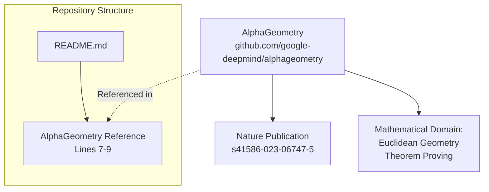
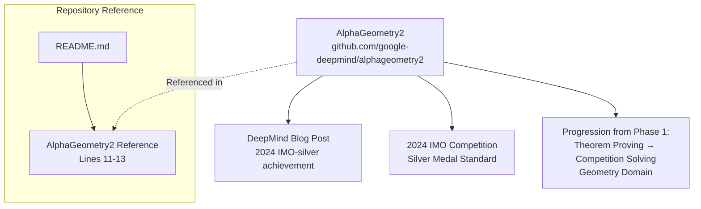
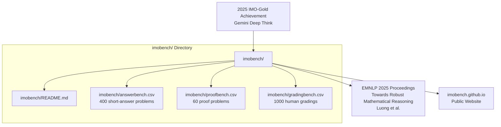
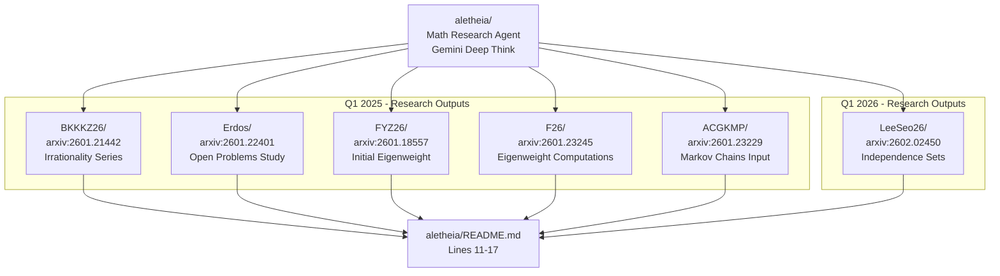
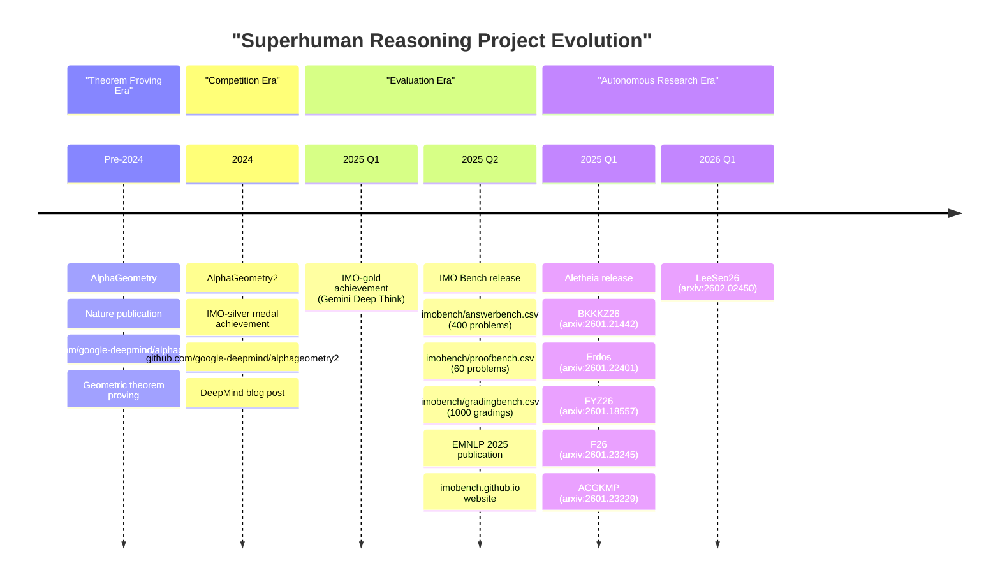
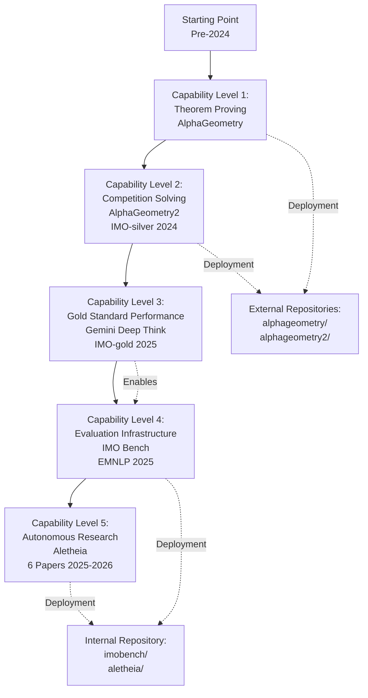
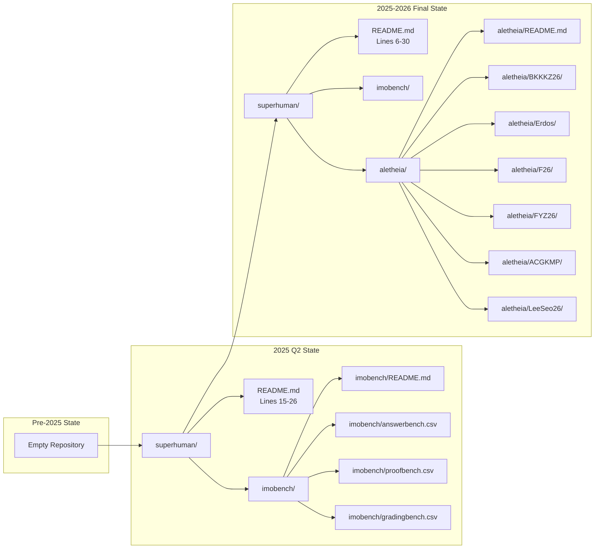
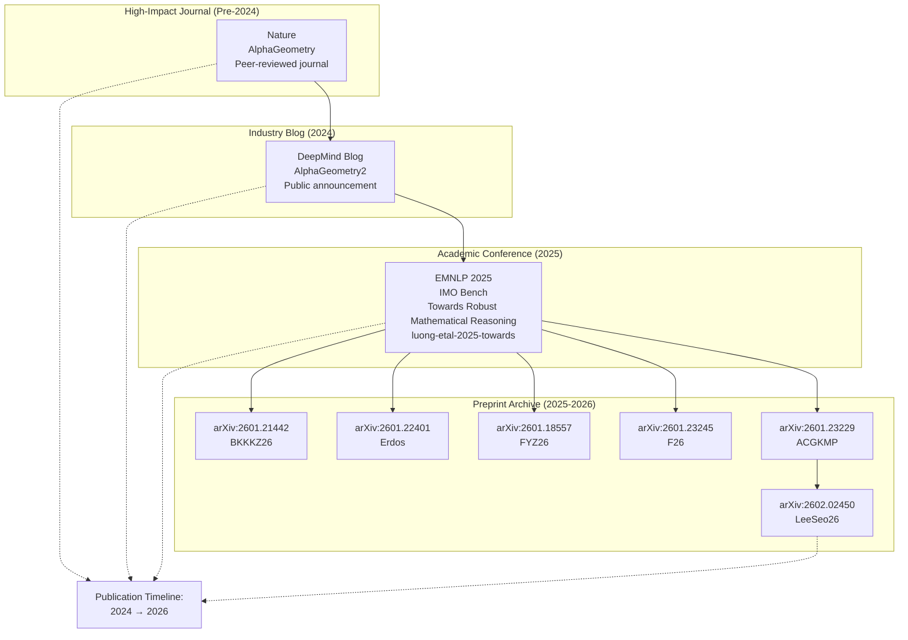
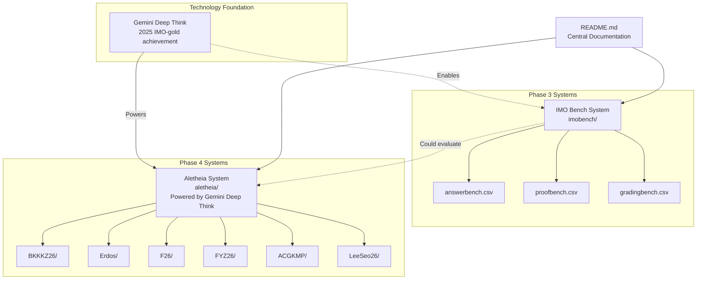

<!-- source: DeepWiki mcp.deepwiki.com · repo google-deepmind/superhuman · page 5 Project Timeline and Evolution · fetched 2026-10-26 -->

# Project Timeline and Evolution

Relevant source files

The following files were used as context for generating this wiki page:

- [README.md](README.md)
- [aletheia/Aletheia.pdf](aletheia/Aletheia.pdf)
- [aletheia/README.md](aletheia/README.md)
- [imobench/README.md](imobench/README.md)

## Purpose and Scope

This document chronicles the development timeline of the Superhuman Reasoning projects, tracing the evolution from geometric theorem proving (AlphaGeometry) through competitive problem solving (AlphaGeometry2) to autonomous mathematical research (Aletheia) and comprehensive evaluation infrastructure (IMO Bench). The focus is on temporal progression, major milestones, and the strategic shifts in capabilities demonstrated by each release.

For detailed information about individual systems, see:
- AlphaGeometry projects: [AlphaGeometry Projects](#2)
- Aletheia system architecture and outputs: [Aletheia Math Research Agent](#3)
- IMO Bench benchmarks: [IMO Bench Evaluation Suite](#4)

---

## Evolutionary Phases Overview

The Superhuman Reasoning repository represents approximately 3-4 years of development across four distinct phases, each marking a significant capability advancement:

| Phase | Primary System | Release Period | Key Achievement | Capability Level |
|-------|---------------|----------------|-----------------|------------------|
| Phase 1 | AlphaGeometry | Pre-2024 | Nature publication | Theorem proving |
| Phase 2 | AlphaGeometry2 | 2024 | IMO-silver medal | Competitive solving |
| Phase 3 | IMO Bench | 2025 | IMO-gold standard | Evaluation infrastructure |
| Phase 4 | Aletheia | 2025-2026 | 6 research papers | Autonomous research |

**Sources:** [README.md:6-30](), [aletheia/README.md:1-17]()

---

## Phase 1: AlphaGeometry - Theorem Proving Era

### Nature Publication and Geometric Reasoning

AlphaGeometry established the foundational capabilities for AI-driven geometric theorem proving. The system was documented in a Nature publication and served as the proof-of-concept for superhuman mathematical reasoning.

**System Location:** External repository at `github.com/google-deepmind/alphageometry`

**Diagram: AlphaGeometry System Position**

### Characteristics

- **Domain:** Euclidean geometry theorem proving
- **Publication Venue:** Nature journal (high-impact peer review)
- **Deployment Model:** Standalone external repository
- **Team Structure:** Superhuman Reasoning team, led by Thang Luong

**Sources:** [README.md:7-9]()

---

## Phase 2: AlphaGeometry2 - Competition Era

### IMO-Silver Achievement (2024)

AlphaGeometry2 demonstrated competitive problem-solving capabilities by achieving IMO-silver medal performance in 2024. This marked a shift from pure theorem proving to solving competition-level problems under time constraints.

**System Location:** External repository at `github.com/google-deepmind/alphageometry2`

**Diagram: Competition Achievement Architecture**

### Key Advancements

- **Competition Performance:** IMO-silver medal standard
- **Time-Constrained Solving:** Unlike open-ended theorem proving, competition problems have strict time limits
- **Evaluation Standard:** Objective competitive benchmark (IMO medal levels)
- **Domain Continuity:** Continued focus on geometric reasoning

**Sources:** [README.md:11-13]()

---

## Phase 3: IMO Bench - Evaluation Infrastructure Era

### IMO-Gold Achievement and Benchmark Release (2025)

Following the 2025 IMO-gold achievement with Gemini Deep Think, the team released IMO Bench as comprehensive evaluation infrastructure. This phase represents a strategic shift toward providing standardized benchmarking tools for the broader AI research community.

**System Location:** Internal directory at `imobench/`

**Diagram: IMO Bench File Structure and Timeline**

### Three-Benchmark Architecture

The IMO Bench suite consists of three distinct CSV-based datasets:

| Benchmark | File | Size | Purpose |
|-----------|------|------|---------|
| IMO-AnswerBench | `answerbench.csv` | 400 problems | Short-answer problems, breadth evaluation |
| IMO-ProofBench | `proofbench.csv` | 60 problems | Expert-vetted proofs, depth evaluation |
| IMO-GradingBench | `gradingbench.csv` | 1000 gradings | Meta-evaluation, grader quality assessment |

### Publication and Release

- **Conference:** Proceedings of the 2025 Conference on Empirical Methods in Natural Language Processing (EMNLP)
- **Citation:** `luong-etal-2025-towards` (see [imobench/README.md:13-21]())
- **Website:** `https://imobench.github.io`
- **Deployment:** First internal repository directory (not external)

**Sources:** [README.md:15-26](), [imobench/README.md:1-21]()

---

## Phase 4: Aletheia - Autonomous Research Era

### Research Agent Release (2025-2026)

Aletheia represents the most significant evolutionary leap: from solving given problems to autonomously producing novel mathematical research. Powered by Gemini Deep Think, Aletheia operates as an iterative research agent with generate-verify-revise capabilities.

**System Location:** Internal directory at `aletheia/`

**Diagram: Aletheia Research Output Timeline**

### Six Research Outputs

Each research output follows a standardized publication pipeline with three artifacts:

1. **BKKKZ26** (January 2025, arXiv:2601.21442)
   - Files: `aletheia/BKKKZ26/BKKKZ26.tex`, `aletheia/BKKKZ26/BKKKZ26.pdf`
   - Topic: Generalization of Erdős-1051, irrationality of rapidly converging series
   - Mode: Standalone research

2. **Erdos** (January 2025, arXiv:2601.22401)
   - Files: `aletheia/Erdos/Erdos.tex`, `aletheia/Erdos/Erdos.pdf`
   - Topic: Semi-autonomous case study on open Erdős problems
   - Mode: Standalone research
   - Note: Contains one output not from Aletheia (see [aletheia/README.md:6-9]())

3. **FYZ26** (January 2025, arXiv:2601.18557)
   - Files: `aletheia/FYZ26/FYZ26.tex`, `aletheia/FYZ26/FYZ26.pdf`
   - Topic: Initial non-trivial eigenweight computation
   - Mode: Standalone research

4. **F26** (January 2025, arXiv:2601.23245)
   - Files: `aletheia/F26/F26.tex`, `aletheia/F26/F26.pdf`
   - Topic: Comprehensive eigenweight computations for Arithmetic Hirzebruch Proportionality Principle
   - Mode: Standalone research

5. **ACGKMP** (January 2025, arXiv:2601.23229)
   - Files: `aletheia/ACGKMP/ACGKMP.tex`, `aletheia/ACGKMP/ACGKMP.pdf`
   - Topic: Mathematical input to "Strongly polynomial iterations for robust Markov chains" by Asadi et al.
   - Mode: Contributory research

6. **LeeSeo26** (February 2026, arXiv:2602.02450)
   - Files: `aletheia/LeeSeo26/LeeSeo26.tex`, `aletheia/LeeSeo26/LeeSeo26.pdf`
   - Topic: Bounds for independence sets, contributed to multivariate independence polynomials paper by Lee and Seo
   - Mode: Contributory research
   - Note: Contains one output for illustration purposes (see [aletheia/README.md:6-9]())

**Sources:** [aletheia/README.md:3-17]()

---

## Complete Timeline Diagram

**Sources:** [README.md:6-30](), [aletheia/README.md:11-17](), [imobench/README.md:1-21]()

---

## Capability Progression Analysis

### Diagram: Evolutionary Capability Ladder

### Quantitative Progression

| Metric | Phase 1 | Phase 2 | Phase 3 | Phase 4 |
|--------|---------|---------|---------|---------|
| **Problems Solved** | Geometry theorems | IMO-silver level | IMO-gold level | N/A (research mode) |
| **Domain Count** | 1 (geometry) | 1 (geometry) | 4 (algebra, combinatorics, geometry, number theory) | 5+ (adds algebraic geometry, graph theory, applied math) |
| **Output Type** | Proofs | Competition solutions | Benchmark datasets (460 problems) | Research papers (6 publications) |
| **Collaboration Mode** | Standalone | Standalone | Community infrastructure | Standalone (4) + Contributory (2) |
| **Repository Location** | External | External | Internal | Internal |
| **Publication Venue** | Nature | Blog post | EMNLP | arXiv (6 papers) |

### Strategic Shifts

1. **From Verification to Generation** (Phase 1→4)
   - Phase 1: Prove known theorems
   - Phase 4: Generate novel mathematical results

2. **From Narrow to Broad** (Domain Expansion)
   - Phase 1-2: Geometry only
   - Phase 3: Four IMO domains
   - Phase 4: Six mathematical domains

3. **From Closed to Open** (Deployment Model)
   - Phase 1-2: External repositories, standalone systems
   - Phase 3-4: Internal repository, community infrastructure

4. **From Performance to Infrastructure** (Mission Evolution)
   - Phase 1-2: Demonstrate capability
   - Phase 3: Enable community evaluation
   - Phase 4: Produce research contributions

**Sources:** [README.md:6-30](), [aletheia/README.md:3-17]()

---

## Repository Structure Evolution

### Diagram: File System Timeline

### Directory-Level Timeline

The internal repository structure evolved as follows:

**Initial State (Pre-2025):**
- Repository likely contained only `README.md` with external project references

**First Internal Addition (2025 Q2):**
- Added `imobench/` directory with three CSV files
- Updated `README.md` to include IMO Bench section (see [README.md:15-26]())

**Research Agent Addition (2025-2026):**
- Added `aletheia/` directory with six research subdirectories
- Each subdirectory contains `.tex` and `.pdf` files
- Updated `README.md` to include Aletheia section (see [README.md:28-33]())
- Updated `aletheia/README.md` with six research output descriptions (see [aletheia/README.md:11-17]())

### File Count Evolution

| Period | Total Directories | Total Files (Estimated) | Research Papers | Benchmark Problems |
|--------|------------------|------------------------|-----------------|-------------------|
| Pre-2025 | 1 | 1-2 | 0 | 0 |
| 2025 Q2 | 2 | ~10 | 0 | 460 |
| 2025-2026 | 8+ | ~30+ | 6 | 460 |

**Sources:** [README.md:1-54](), [aletheia/README.md:1-39](), [imobench/README.md:1-43]()

---

## Publication Strategy Evolution

### Diagram: Publication Venue Timeline

### Publication Venue Analysis

The team's publication strategy evolved to balance different dissemination goals:

**High-Impact Journals (Phase 1)**
- Venue: Nature
- Purpose: Establish scientific credibility
- Timeline: Longer peer review process
- Audience: Broad scientific community

**Industry Communication (Phase 2)**
- Venue: DeepMind blog
- Purpose: Public engagement, transparency
- Timeline: Immediate release
- Audience: General public, tech community

**Academic Conferences (Phase 3)**
- Venue: EMNLP 2025
- Purpose: Community benchmarking standards
- Timeline: Conference submission cycle
- Audience: NLP and AI research community
- Citation format: `luong-etal-2025-towards` (see [imobench/README.md:14-21]())

**Rapid Preprint Dissemination (Phase 4)**
- Venue: arXiv
- Purpose: Rapid dissemination of research results
- Timeline: Immediate publication
- Audience: Mathematics and AI research community
- Frequency: 6 papers in ~2 months (January-February 2025/2026)

**Sources:** [README.md:8-30](), [aletheia/README.md:11-17](), [imobench/README.md:13-21]()

---

## Team and Attribution Evolution

### Lead Attribution

All projects in the repository are attributed to the **Superhuman Reasoning team, led by Thang Luong** at Google DeepMind (see [README.md:3-4]()).

### Multi-Author Collaboration

The IMO Bench publication demonstrates the scale of team collaboration:

**EMNLP 2025 Author List (from [imobench/README.md:14-17]()):
- Thang Luong (lead)
- Dawsen Hwang
- Hoang H. Nguyen
- Golnaz Ghiasi
- Yuri Chervonyi
- Insuk Seo
- Junsu Kim
- Garrett Bingham
- Jonathan Lee
- Swaroop Mishra
- Alex Zhai
- Clara Huiyi Hu
- Henryk Michalewski
- Jimin Kim
- Jeonghyun Ahn
- Junhwi Bae
- Xingyou Song
- Trieu H. Trinh
- Quoc V. Le
- Junehyuk Jung

This 20-author paper indicates substantial team expansion and cross-functional collaboration by Phase 3.

### External Collaboration (Phase 4)

Aletheia's contributory research outputs involve collaboration with external research groups:

**ACGKMP Collaboration:**
- External paper: "Strongly polynomial iterations for robust Markov chains"
- Authors: Asadi, Chatterjee, Goharshady, Karrabi, Montaseri, Pagano
- Aletheia contribution: Mathematical input establishing dyadic interval bounds
- Citation: arXiv:2601.23229

**LeeSeo26 Collaboration:**
- External paper: "Lower bounds for multivariate independence polynomials and their generalisations"
- Authors: Lee and Seo
- Aletheia contribution: Generalizations of bounds for independence sets
- Citation: arXiv:2602.02450

**Sources:** [README.md:3-4](), [aletheia/README.md:15-17](), [imobench/README.md:14-17]()

---

## System Integration Pattern

### Diagram: Cross-System Dependencies

**Sources:** [README.md:28-30]()

---

## Key Milestones Summary

### Chronological Milestone List

1. **Pre-2024:** AlphaGeometry Nature publication - Establishes geometric theorem proving capability
2. **2024:** AlphaGeometry2 IMO-silver achievement - Demonstrates competitive problem-solving
3. **2025 Q1:** IMO-gold achievement with Gemini Deep Think - Reaches gold medal standard
4. **2025 Q2:** IMO Bench release - Provides comprehensive evaluation infrastructure (EMNLP 2025)
5. **2025 Q1:** Aletheia release - Launches autonomous research agent
6. **2025 January:** Four research papers published (BKKKZ26, Erdos, FYZ26, F26)
7. **2025 January:** Two collaborative papers published (ACGKMP)
8. **2026 February:** LeeSeo26 published - Continues research output

### Achievement Metrics

| Metric | Value | Reference |
|--------|-------|-----------|
| Total phases | 4 | Full timeline |
| Total systems | 4 major (AlphaGeometry, AlphaGeometry2, IMO Bench, Aletheia) | [README.md:6-30]() |
| Total research papers (Aletheia) | 6 | [aletheia/README.md:11-17]() |
| Total benchmark problems | 460 (400 + 60) | [README.md:21-23]() |
| Total grading samples | 1000 | [README.md:25-26]() |
| Conference publications | 1 (EMNLP 2025) | [imobench/README.md:13-21]() |
| Journal publications | 1 (Nature) | [README.md:8]() |
| External collaborations | 2 (ACGKMP, LeeSeo26) | [aletheia/README.md:15-17]() |

**Sources:** [README.md:1-54](), [aletheia/README.md:1-39](), [imobench/README.md:1-43]()

---

