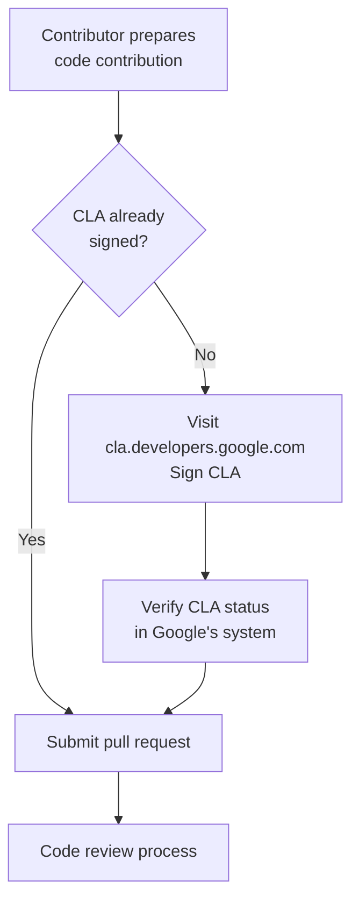
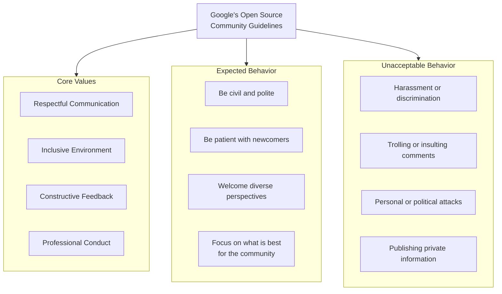
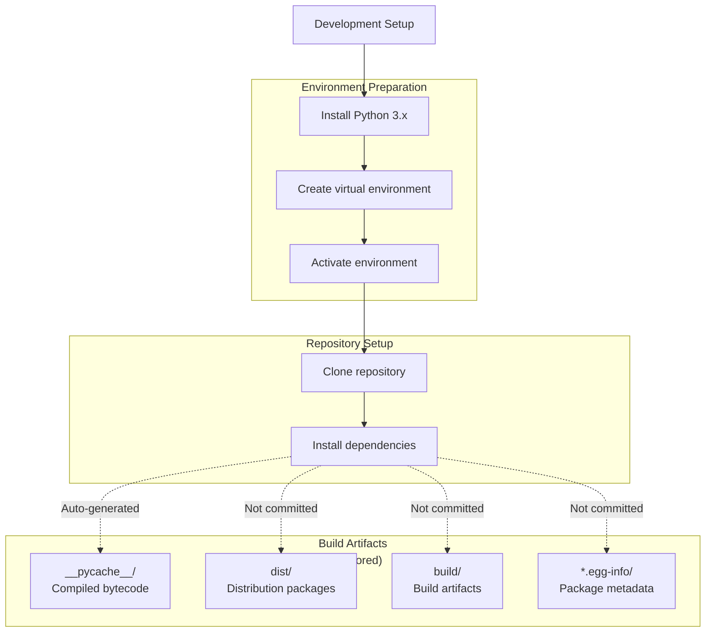
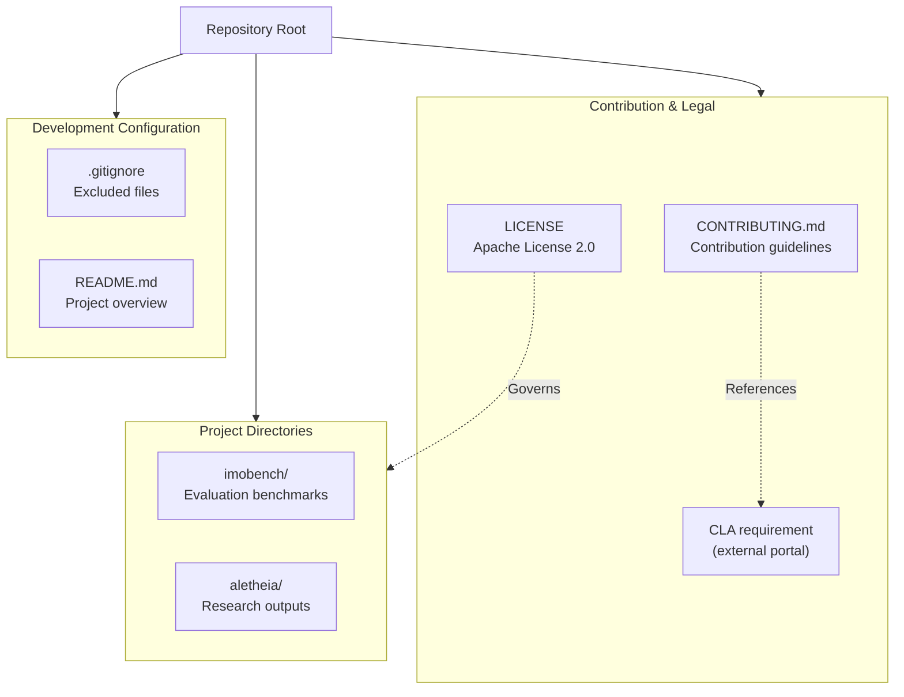
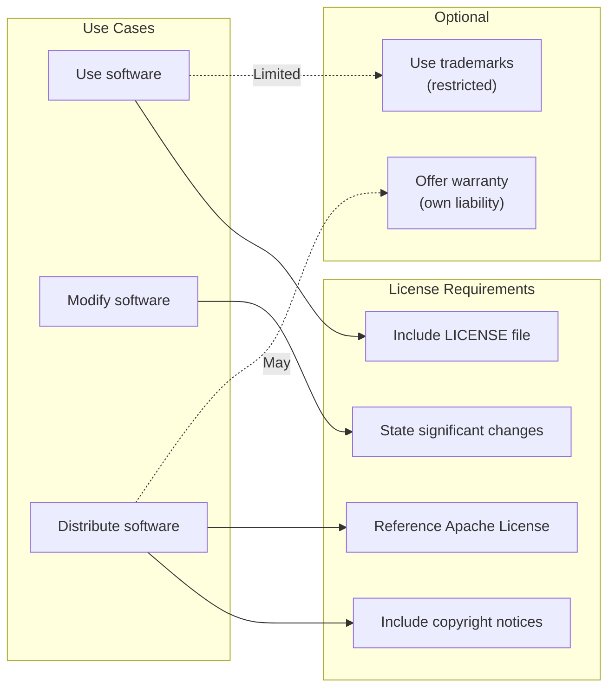
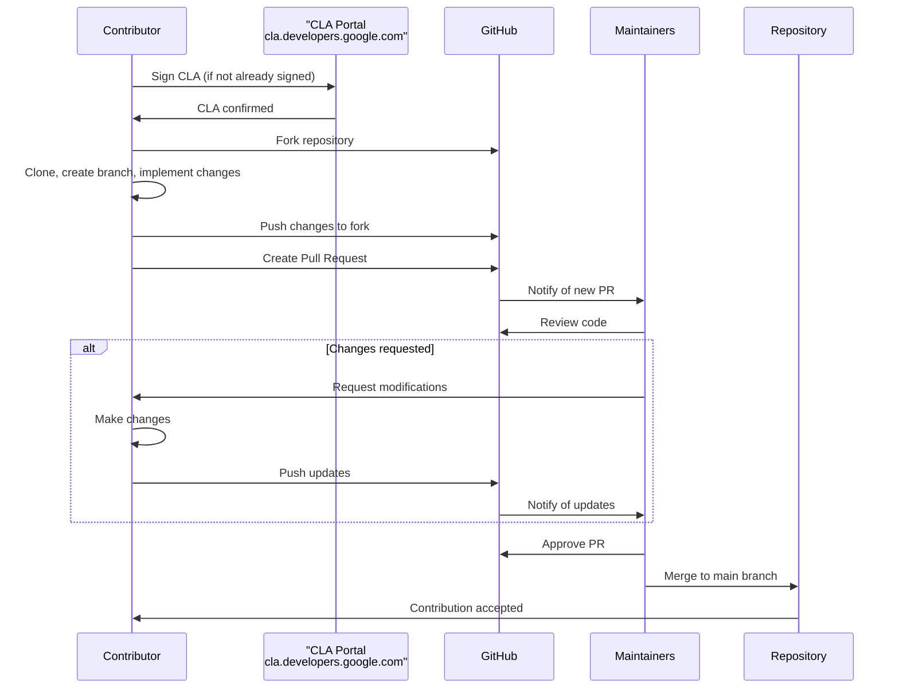

<!-- source: DeepWiki mcp.deepwiki.com · repo google-deepmind/superhuman · page 6 Development and Contribution · fetched 2026-10-26 -->

# Development and Contribution

Relevant source files

The following files were used as context for generating this wiki page:

- [.gitignore](.gitignore)
- [CONTRIBUTING.md](CONTRIBUTING.md)
- [LICENSE](LICENSE)

## Purpose and Scope

This document provides guidance for contributors to the Superhuman Reasoning repository. It covers the legal requirements for contributing (Contributor License Agreement), the code review and pull request workflow, community guidelines, and development environment setup. 

For information about the repository structure and licensing of materials (Apache 2.0 for software, Creative Commons BY 4.0 for datasets), see [Repository Structure and Licensing](#1.1). For information about the evolution of the projects in this repository, see [Project Timeline and Evolution](#5).

---

## Contributor License Agreement (CLA)

### CLA Requirements

All contributions to this project must be accompanied by a Contributor License Agreement (CLA). The CLA ensures that contributors (or their employers) retain copyright to their contributions while granting Google DeepMind permission to use and redistribute the contributions as part of the project.

| Aspect | Details |
|--------|---------|
| **CLA Portal** | https://cla.developers.google.com/ |
| **Frequency** | One-time per contributor (applies across Google projects) |
| **Scope** | Covers all Google open source projects |
| **Copyright** | Contributor retains copyright ownership |
| **Purpose** | Grants redistribution and usage permissions |

### CLA Workflow

**Sources:** [CONTRIBUTING.md:3-13]()

---

## Code Review Process

### Pull Request Workflow

All submissions, including those from project members, require code review. The repository uses GitHub pull requests for all code contributions.

```mermaid
flowchart LR
    subgraph Preparation
        FORK["Fork repository"]
        CLONE["Clone to local"]
        BRANCH["Create feature branch"]
    end
    
    subgraph Development
        CODE["Implement changes"]
        TEST["Test locally"]
        COMMIT["Commit changes"]
    end
    
    subgraph Submission
        PUSH["Push to fork"]
        PR["Create Pull Request"]
        DESCRIBE["Add description"]
    end
    
    subgraph Review
        REVIEW["Code review by maintainers"]
        FEEDBACK["Address feedback"]
        APPROVE["Approval received"]
    end
    
    subgraph Integration
        MERGE["Merge to main branch"]
    end
    
    FORK --> CLONE --> BRANCH
    BRANCH --> CODE
    CODE --> TEST --> COMMIT
    COMMIT --> PUSH --> PR --> DESCRIBE
    DESCRIBE --> REVIEW
    REVIEW --> FEEDBACK
    FEEDBACK -->|"Changes needed"| CODE
    REVIEW --> APPROVE
    APPROVE --> MERGE
```

### Review Requirements

| Requirement | Description |
|-------------|-------------|
| **GitHub PR** | All changes must be submitted via pull request |
| **Maintainer Review** | At least one maintainer must review and approve |
| **CLA Verification** | Automated check ensures CLA is signed |
| **Testing** | Changes should include appropriate tests |
| **Documentation** | Update documentation for user-facing changes |

**Sources:** [CONTRIBUTING.md:15-20]()

---

## Community Guidelines

This project adheres to Google's Open Source Community Guidelines, which establish standards for respectful, constructive participation.

### Core Principles

### Guidelines Reference

- **Full Guidelines**: https://opensource.google/conduct/
- **Enforcement**: Violations may result in removal of contributions or ban from participation
- **Reporting**: Community issues should be reported to project maintainers

**Sources:** [CONTRIBUTING.md:22-25]()

---

## Development Environment Setup

### Python Environment Configuration

The repository is configured for Python development, as evidenced by the `.gitignore` file which specifies Python-specific exclusions.

### Ignored Files and Directories

The `.gitignore` file specifies artifacts that should not be committed to version control:

| Category | Files/Directories | Purpose |
|----------|------------------|---------|
| **Bytecode** | `__pycache__/`, `*.py[cod]`, `*$py.class` | Compiled Python files |
| **Packaging** | `build/`, `dist/`, `*.egg-info/`, `*.egg` | Distribution artifacts |
| **Dependencies** | `lib/`, `lib64/`, `.eggs/` | Installed packages |
| **Development** | `develop-eggs/`, `.installed.cfg` | Development tools |
| **Downloads** | `downloads/`, `eggs/` | Downloaded packages |
| **Wheels** | `wheels/`, `share/python-wheels/` | Python wheel files |

**Sources:** [.gitignore:1-25]()

---

## File Structure for Contributions

### Key Repository Files

### File Purposes

| File | Purpose | Contributor Action |
|------|---------|-------------------|
| `CONTRIBUTING.md` | Guidelines for contributions | Read before contributing |
| `LICENSE` | Apache 2.0 software license | Understand license terms |
| `.gitignore` | Version control exclusions | Do not modify unless necessary |
| `README.md` | Project documentation | Update if adding features |

**Sources:** [CONTRIBUTING.md:1-26](), [LICENSE:1-203](), [.gitignore:1-25]()

---

## Licensing and Copyright

### Apache License 2.0

The software components of this repository are licensed under the Apache License 2.0, which provides:

| Permission | Description |
|------------|-------------|
| **Commercial Use** | Can be used for commercial purposes |
| **Modification** | Can modify the source code |
| **Distribution** | Can distribute original or modified versions |
| **Patent Use** | Grants patent rights from contributors |
| **Private Use** | Can use privately without distribution |

### License Requirements

Contributors and users must comply with these requirements:

### Key License Terms

- **Copyright Retention**: Contributors retain copyright to their contributions [LICENSE:5-7]()
- **Submission Terms**: Contributions are submitted under Apache License 2.0 terms unless explicitly stated otherwise [LICENSE:131-137]()
- **No Warranty**: Software provided "AS IS" without warranties [LICENSE:144-152]()
- **Patent License**: Contributors grant patent license for their contributions [LICENSE:74-88]()
- **Trademark Restrictions**: License does not grant trademark usage rights [LICENSE:139-142]()

**Sources:** [LICENSE:1-203](), [CONTRIBUTING.md:5-7]()

---

## Contribution Workflow Summary

### Step-by-Step Process

### Contribution Checklist

Before submitting a pull request, ensure:

- [ ] CLA is signed at https://cla.developers.google.com/
- [ ] Changes are in a feature branch (not main)
- [ ] Code follows existing style and conventions
- [ ] All tests pass locally
- [ ] New tests added for new functionality
- [ ] Documentation updated for user-facing changes
- [ ] Commit messages are clear and descriptive
- [ ] PR description explains the changes and motivation
- [ ] Google's Open Source Community Guidelines followed

**Sources:** [CONTRIBUTING.md:1-26]()

---

## Special Considerations

### Multi-License Model

The repository employs a dual licensing strategy:

| Content Type | License | Files |
|--------------|---------|-------|
| **Software** | Apache License 2.0 | Code, scripts, tools |
| **Materials** | Creative Commons BY 4.0 | Datasets, benchmarks, research papers |

### External Project References

The repository references external projects (AlphaGeometry, AlphaGeometry2) that are maintained in separate repositories. Contributions to those projects should be directed to their respective repositories:

- **AlphaGeometry**: https://github.com/google-deepmind/alphageometry
- **AlphaGeometry2**: https://github.com/google-deepmind/alphageometry2

### Research Output Contributions

Research outputs in the `aletheia/` directory (BKKKZ26, Erdos, F26, FYZ26, ACGKMP, LeeSeo26) are primarily AI-generated mathematical results. Contributions to these materials should focus on:

- Verification of mathematical correctness
- Documentation improvements
- Additional context or related work
- Error corrections

For information about these research outputs, see [Aletheia Math Research Agent](#3).

**Sources:** [CONTRIBUTING.md:1-26](), [LICENSE:1-203]()

---

## Contact and Support

### Getting Help

For questions or issues related to development and contribution:

1. **GitHub Issues**: For bug reports, feature requests, and technical questions
2. **Pull Request Comments**: For questions about specific contributions
3. **Community Guidelines**: For conduct-related concerns

### Maintainer Review Process

- Pull requests are reviewed by project maintainers from the Google DeepMind Superhuman Reasoning team
- Review times may vary depending on complexity and current workload
- Maintainers may request changes, additional tests, or documentation before approval
- All communication follows Google's Open Source Community Guidelines

**Sources:** [CONTRIBUTING.md:15-25]()