# Page: Overview

# Overview

<details>
<summary>Relevant source files</summary>

The following files were used as context for generating this wiki page:

- [README.md](README.md)
- [aletheia/Aletheia.pdf](aletheia/Aletheia.pdf)
- [aletheia/README.md](aletheia/README.md)
- [imobench/README.md](imobench/README.md)

</details>


This document introduces the **Superhuman Reasoning** repository, a collection of AI systems and datasets for advanced mathematical reasoning developed by Google DeepMind. This page covers the repository's mission, team structure, major project categories, and organizational structure. For detailed licensing information, see [Repository Structure and Licensing](#1.1). For specific project documentation, see [AlphaGeometry Projects](#2), [Aletheia Math Research Agent](#3), and [IMO Bench Evaluation Suite](#4).

**Sources:** [README.md:1-55]()

## Purpose and Mission

The Superhuman Reasoning repository serves as the central hub for mathematical AI research conducted by Google DeepMind's Superhuman Reasoning team, led by Thang Luong. The repository encompasses systems that span from competitive problem-solving (geometry theorem proving at IMO medal level) to autonomous mathematical research (generating novel proofs and results) to comprehensive evaluation infrastructure (benchmarking mathematical reasoning capabilities).

**Sources:** [README.md:1-4]()

## Repository Organization

The repository employs a hybrid organizational structure, distinguishing between externally-hosted mature systems and internally-hosted current projects:

| Category | Projects | Location | Status |
|----------|----------|----------|---------|
| External References | AlphaGeometry, AlphaGeometry2 | Separate repositories | Production systems with independent version control |
| Internal Projects | IMO Bench, Aletheia | `imobench/`, `aletheia/` directories | Active development and research outputs |

### Directory Structure

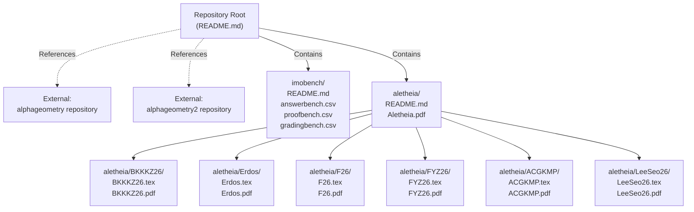

**Sources:** [README.md:1-55](), [aletheia/README.md:1-39](), [imobench/README.md:1-43]()

## Major Project Categories

### AlphaGeometry: Geometry Theorem Proving

AlphaGeometry represents the foundational geometry theorem proving system published in Nature. AlphaGeometry2 extended this work to achieve IMO-silver medal performance in 2024. Both systems are maintained in external repositories.

**Key Achievements:**
- Nature publication for AlphaGeometry
- IMO-silver medal standard for AlphaGeometry2
- Focus: Euclidean geometry theorem proving

**Sources:** [README.md:7-13]()

### Aletheia: Autonomous Mathematical Research Agent

Aletheia is a math research agent powered by Gemini Deep Think that employs an iterative generate-verify-revise approach. It produces research-level mathematical results across multiple domains including number theory, algebraic geometry, combinatorics, and applied mathematics.

**Repository Structure:**
- Main documentation: `aletheia/README.md`
- System paper: `aletheia/Aletheia.pdf`
- Research outputs: Six subdirectories containing LaTeX source, compiled PDFs, and arXiv publications

**Research Outputs:**
- **BKKKZ26**: Irrationality proofs for rapidly converging series
- **Erdos**: Semi-autonomous study of open Erdős problems
- **F26**: Eigenweight computations for Arithmetic Hirzebruch Proportionality Principle
- **FYZ26**: Initial non-trivial eigenweight case
- **ACGKMP**: Mathematical input for robust Markov chains paper
- **LeeSeo26**: Bounds for independence sets

For detailed system architecture, see [Aletheia System Architecture](#3.1). For individual research outputs, see sections [3.2](#3.2) through [3.6](#3.6).

**Sources:** [README.md:28-33](), [aletheia/README.md:1-18]()

### IMO Bench: Comprehensive Evaluation Suite

IMO Bench is a three-pronged benchmarking suite released following the 2025 IMO-gold achievement. It provides comprehensive evaluation across problem-solving breadth, formal reasoning depth, and evaluation system quality.

**Components:**

| Benchmark | File | Size | Purpose |
|-----------|------|------|---------|
| IMO-AnswerBench | `answerbench.csv` | 400 problems | Short-answer problems for breadth assessment |
| IMO-ProofBench | `proofbench.csv` | 60 problems | Expert-vetted proof problems for depth assessment |
| IMO-GradingBench | `gradingbench.csv` | 1000 gradings | Human gradings for meta-evaluation |

**External Resources:**
- Website: https://imobench.github.io
- Publication: 2025 EMNLP conference proceedings

For detailed benchmark documentation, see sections [4.1](#4.1) through [4.3](#4.3).

**Sources:** [README.md:15-26](), [imobench/README.md:1-43]()

## System Architecture: Project Relationships

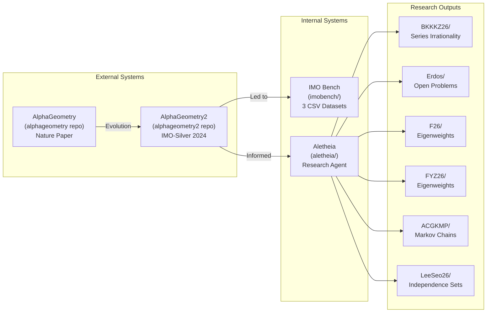

**Sources:** [README.md:1-55](), [aletheia/README.md:1-18]()

## File Organization and Key Entry Points

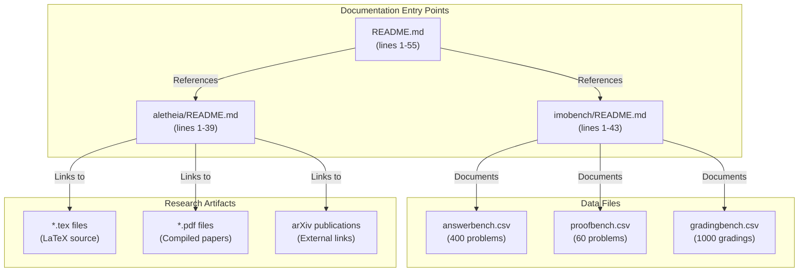

**Sources:** [README.md:1-55](), [imobench/README.md:1-43](), [aletheia/README.md:1-39]()

## Research Output Pipeline

The Aletheia system follows a standardized pipeline for producing mathematical research:

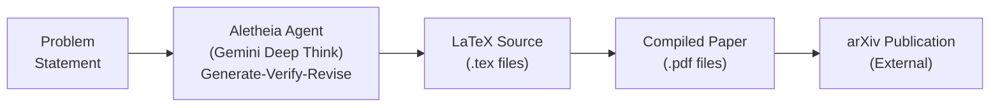

**Pattern Applied Across All Six Research Outputs:**

Each subdirectory in `aletheia/` follows this structure:
- `<ProjectName>/<ProjectName>.tex` - LaTeX source with mathematical proofs
- `<ProjectName>/<ProjectName>.pdf` - Compiled document
- arXiv link in `aletheia/README.md` lines 11-17

**Sources:** [aletheia/README.md:1-18]()

## Team and Leadership

The Superhuman Reasoning team is led by **Thang Luong** at Google DeepMind. The team is responsible for all systems and publications in this repository.

**Publications Attribution:**
- IMO Bench paper (EMNLP 2025): Thang Luong et al., [imobench/README.md:14-20]()
- Aletheia research outputs: Available with arXiv links in [aletheia/README.md:11-17]()

**Sources:** [README.md:1-4](), [imobench/README.md:14-20]()

## Timeline of Achievements

| Year | Achievement | System | Reference |
|------|-------------|--------|-----------|
| 2023 | Nature publication | AlphaGeometry | [README.md:8]() |
| 2024 | IMO-Silver medal | AlphaGeometry2 | [README.md:12]() |
| 2025 | IMO-Gold achievement | Gemini Deep Think | [README.md:18]() |
| 2025 | IMO Bench release | Three-pronged evaluation suite | [README.md:15-26]() |
| 2025 | Aletheia research outputs | Six mathematical publications | [aletheia/README.md:11-17]() |

**Sources:** [README.md:1-55](), [aletheia/README.md:1-39]()

## Navigation to Detailed Documentation

For comprehensive information about specific systems and components:

- **Repository structure and licensing**: See [Repository Structure and Licensing](#1.1)
- **AlphaGeometry systems**: See [AlphaGeometry Projects](#2)
- **Aletheia architecture and outputs**: See [Aletheia Math Research Agent](#3) and subsections [3.1](#3.1) through [3.8](#3.8)
- **IMO Bench benchmarks**: See [IMO Bench Evaluation Suite](#4) and subsections [4.1](#4.1) through [4.4](#4.4)
- **Project evolution**: See [Project Timeline and Evolution](#5)
- **Contributing**: See [Development and Contribution](#6)

**Sources:** [README.md:1-55]()

---

# Page: Repository Structure and Licensing

# Repository Structure and Licensing

<details>
<summary>Relevant source files</summary>

The following files were used as context for generating this wiki page:

- [CONTRIBUTING.md](CONTRIBUTING.md)
- [LICENSE](LICENSE)
- [README.md](README.md)
- [aletheia/Aletheia.pdf](aletheia/Aletheia.pdf)

</details>


This page documents the physical organization of the Superhuman Reasoning repository, its dual-licensing model, and the contribution process. For information about the individual projects hosted in this repository, see [Overview](#1). For details about the team and project evolution, see [Project Timeline and Evolution](#5).

## Purpose and Scope

This documentation covers:
- **Physical repository structure**: Directory layout and content organization
- **Project deployment strategy**: External references vs. internally hosted projects
- **Licensing architecture**: Software components (Apache 2.0) vs. datasets/materials (CC-BY 4.0)
- **Contribution process**: CLA requirements, code reviews, and community guidelines

## Repository Organization

### Physical Directory Structure

The repository follows a flat structure with two primary internal project directories:

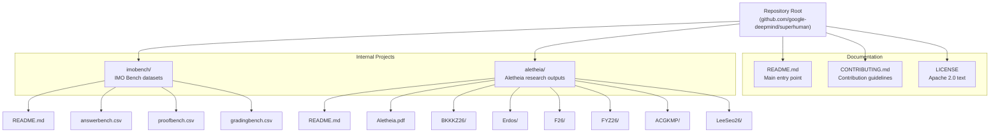

**Sources:** [README.md:1-54]()

### External vs. Internal Project Organization

The repository employs a hybrid deployment strategy, distinguishing between externally referenced projects and internally hosted content:

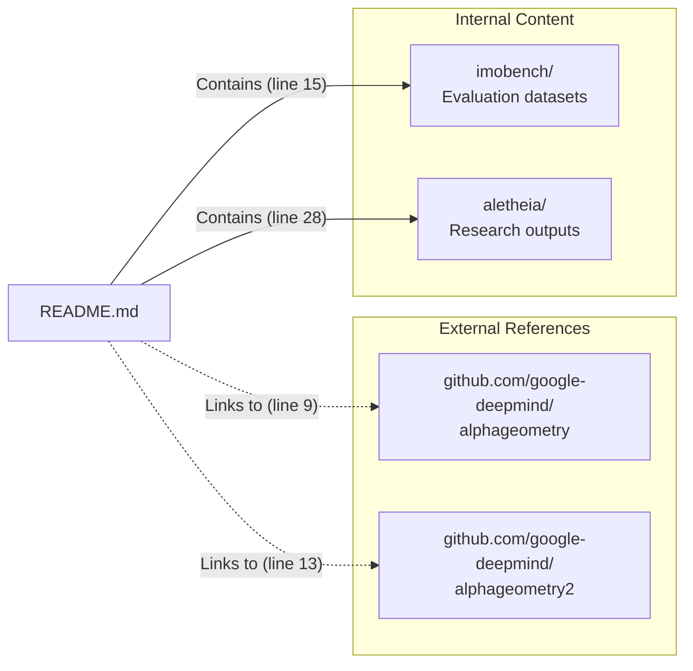

**Sources:** [README.md:7-33]()

| Project Category | Projects | Deployment Strategy | Rationale |
|-----------------|----------|---------------------|-----------|
| **External References** | AlphaGeometry, AlphaGeometry2 | Separate repositories with independent version control | Mature systems with established publication records; maintain independent development cycles |
| **Internal Hosting** | IMO Bench, Aletheia | Directories within this repository | Newer releases (2025); tightly coupled to repository release cycle; primarily data/outputs |

### Project-to-Directory Mapping

The following table maps high-level project names to their physical locations:

| Project | Type | Physical Location | Primary Content |
|---------|------|-------------------|----------------|
| **AlphaGeometry** | External | `github.com/google-deepmind/alphageometry` | Geometry theorem proving code (Nature paper) |
| **AlphaGeometry2** | External | `github.com/google-deepmind/alphageometry2` | IMO-silver medal achievement code |
| **IMO Bench** | Internal | `imobench/` | Three CSV datasets: answerbench.csv, proofbench.csv, gradingbench.csv |
| **Aletheia** | Internal | `aletheia/` | Six research output subdirectories + system paper PDF |

**Sources:** [README.md:6-33]()

### Internal Project Structure Details

#### IMO Bench Directory

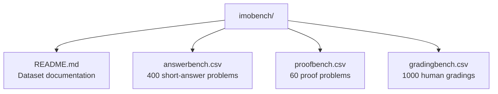

**Sources:** [README.md:15-26]()

#### Aletheia Directory

The `aletheia/` directory contains six subdirectories corresponding to distinct research outputs, each with its own LaTeX source, compiled PDF, and supporting materials:

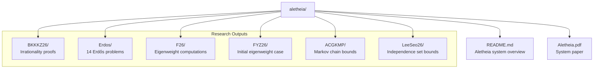

**Sources:** [README.md:28-33]()

## Licensing Model

### Dual-Licensing Architecture

The repository implements a dual-licensing model that separates executable software components from research materials and datasets:

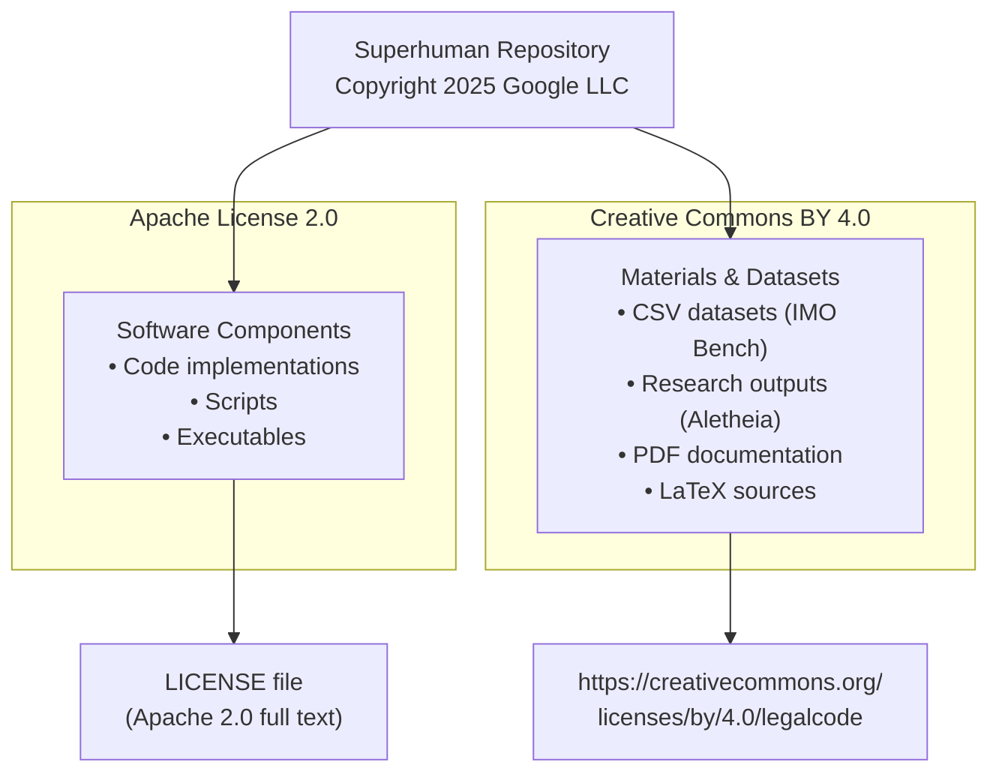

**Sources:** [README.md:35-52](), [LICENSE:1-203]()

### License Application Rules

The following table clarifies which license applies to different content types:

| Content Type | License | Key Terms | File Reference |
|-------------|---------|-----------|----------------|
| **Software** | Apache License 2.0 | Permissive open-source license; allows commercial use, modification, distribution with attribution | [LICENSE:1-203]() |
| **Datasets** | CC-BY 4.0 | Requires attribution; allows redistribution and adaptation | [README.md:44-46]() |
| **Research Outputs** | CC-BY 4.0 | Academic attribution requirements; suitable for research citation | [README.md:44-46]() |
| **Documentation** | CC-BY 4.0 | README files, PDF papers | [README.md:44-46]() |

**Sources:** [README.md:35-52](), [LICENSE:1-203]()

### License Text Locations

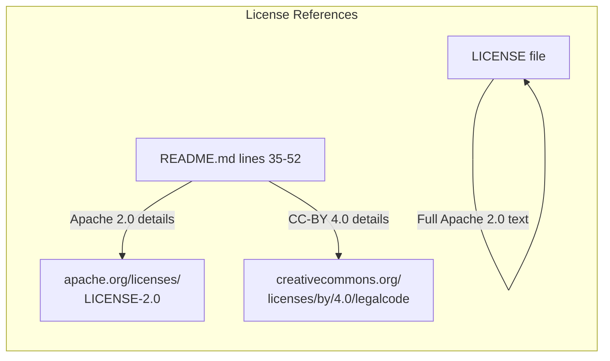

**Sources:** [README.md:39-46](), [LICENSE:1-203]()

### Copyright and Disclaimer

All content in the repository is copyrighted by Google LLC (2025) and includes an explicit disclaimer:

> "This is not an official Google product."

The disclaimer appears at [README.md:54]() and clarifies that while the repository is maintained by Google DeepMind employees, it does not represent an official Google product offering.

**License Basis Declaration:**

[README.md:48-52]() specifies:
```
Unless required by applicable law or agreed to in writing, all software and
materials distributed here under the Apache 2.0 or CC-BY licenses are
distributed on an "AS IS" BASIS, WITHOUT WARRANTIES OR CONDITIONS OF ANY KIND,
either express or implied.
```

**Sources:** [README.md:37-54]()

## Contribution Guidelines

### Contributor License Agreement (CLA)

All contributions require a signed Contributor License Agreement:

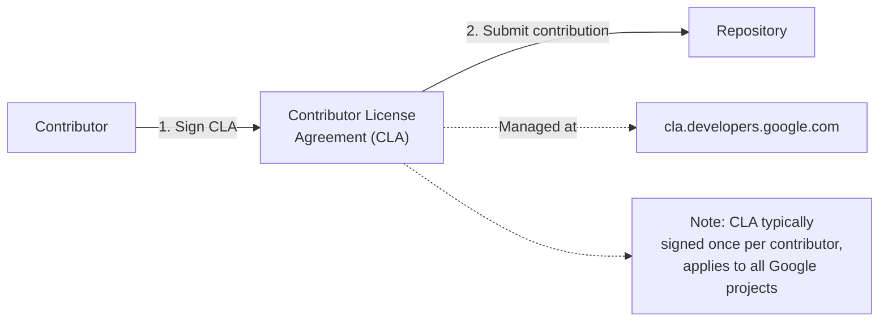

**Key Points:**
- **Signing location:** `https://cla.developers.google.com/`
- **Frequency:** Generally one-time per contributor (applies across Google projects)
- **Effect:** Contributor retains copyright; Google receives usage/redistribution rights
- **Applicability:** Required for all submissions, including from project members

**Sources:** [CONTRIBUTING.md:3-13]()

### Code Review Process

All submissions undergo mandatory code review via GitHub pull requests:

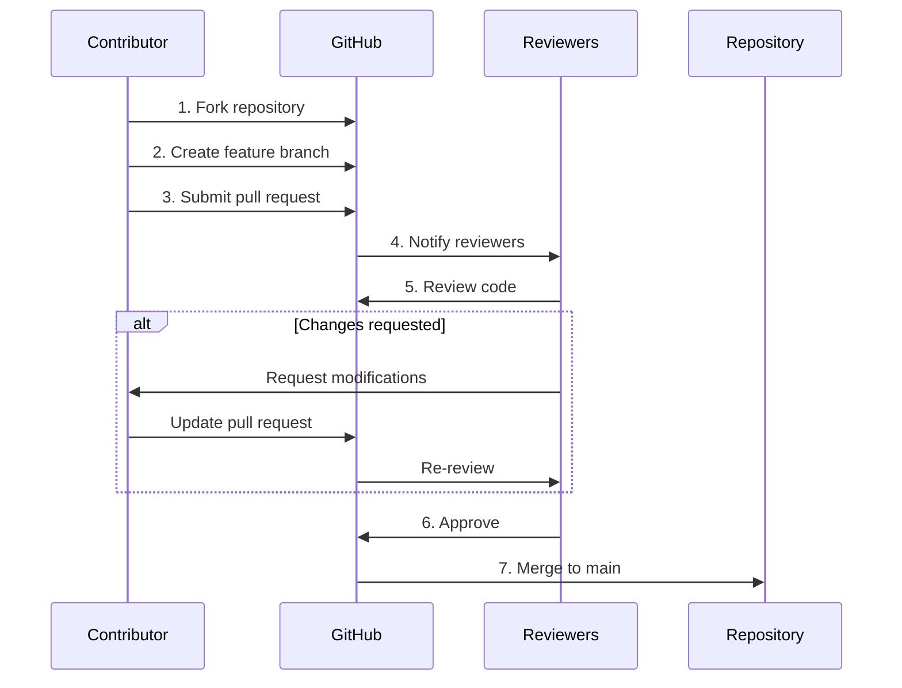

**Process Details:**
- **Platform:** GitHub pull requests exclusively
- **Scope:** All submissions require review (no exceptions for project members)
- **Documentation:** GitHub Help provides pull request guidance at `https://help.github.com/articles/about-pull-requests/`

**Sources:** [CONTRIBUTING.md:15-20]()

### Community Guidelines

The project adheres to Google's Open Source Community Guidelines:

| Aspect | Guideline | Reference |
|--------|-----------|-----------|
| **Code of Conduct** | Google's Open Source Community Guidelines | [CONTRIBUTING.md:22-25]() |
| **URL** | `https://opensource.google/conduct/` | [CONTRIBUTING.md:25]() |
| **Coverage** | Applies to all interactions (issues, PRs, discussions) | Implicit from guideline scope |

**Sources:** [CONTRIBUTING.md:22-25]()

### Contribution Workflow Summary

The complete contribution process follows this sequence:

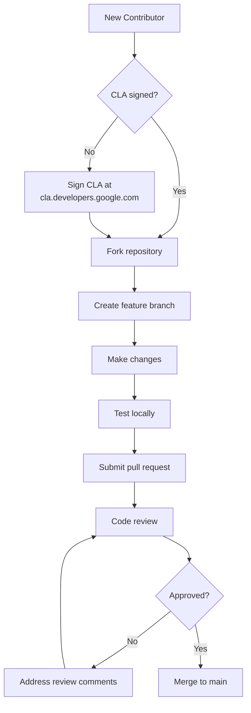

**Sources:** [CONTRIBUTING.md:1-25]()

### Key Files Reference

| Purpose | File | Lines | Content |
|---------|------|-------|---------|
| **Main documentation** | README.md | 1-54 | Project overview, structure, licensing |
| **Contribution process** | CONTRIBUTING.md | 1-25 | CLA, reviews, community guidelines |
| **License text** | LICENSE | 1-203 | Full Apache 2.0 license terms |
| **IMO Bench docs** | imobench/README.md | - | Dataset specifications |
| **Aletheia docs** | aletheia/README.md | - | Research output documentation |
| **Aletheia paper** | aletheia/Aletheia.pdf | - | System methodology paper |

**Sources:** [README.md:1-54](), [CONTRIBUTING.md:1-25](), [LICENSE:1-203]()

---

# Page: AlphaGeometry Projects

# AlphaGeometry Projects

<details>
<summary>Relevant source files</summary>

The following files were used as context for generating this wiki page:

- [README.md](README.md)
- [aletheia/Aletheia.pdf](aletheia/Aletheia.pdf)

</details>


## Purpose and Scope

This page documents the AlphaGeometry and AlphaGeometry2 projects, which focus on automated geometry theorem proving. These projects represent the foundational geometry work of the Superhuman Reasoning team and mark the progression from theorem proving (AlphaGeometry) to competitive problem-solving (AlphaGeometry2). Both projects are maintained in external repositories and are referenced from this codebase.

For information about autonomous mathematical research capabilities beyond geometry, see [Aletheia Math Research Agent](#3). For evaluation benchmarks including geometry problems, see [IMO Bench Evaluation Suite](#4). For the complete evolution from these geometry projects to autonomous research, see [Project Timeline and Evolution](#5).

**Sources:** [README.md:1-54]()

## Project Overview

The AlphaGeometry projects consist of two distinct systems developed by the Superhuman Reasoning team:

| Project | Achievement | Publication Date | Repository | Key Milestone |
|---------|-------------|------------------|------------|---------------|
| AlphaGeometry | Nature publication | 2023 | `google-deepmind/alphageometry` | Theorem proving breakthrough |
| AlphaGeometry2 | IMO-silver medal | 2024 | `google-deepmind/alphageometry2` | Competitive performance |

Both projects are hosted in separate GitHub repositories and are referenced from this codebase at [README.md:7-13]().

**Sources:** [README.md:7-13]()

## Repository Structure

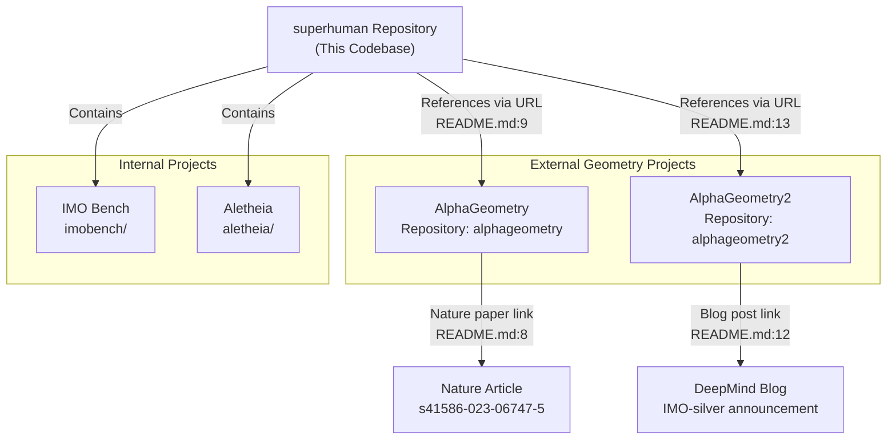

**Diagram: Repository reference structure for AlphaGeometry projects**

This diagram shows how the AlphaGeometry projects are referenced from the main repository through URL links in the README, distinguishing them from internally-hosted projects.

**Sources:** [README.md:7-13]()

## AlphaGeometry: Theorem Proving Foundation

### Overview

AlphaGeometry is a geometry theorem proving system that achieved breakthrough results in automated mathematical reasoning. The system was published in Nature and represents the team's first major contribution to automated theorem proving.

### Key Information

- **Publication Venue:** Nature journal
- **Article Reference:** `s41586-023-06747-5`
- **Repository:** `https://github.com/google-deepmind/alphageometry`
- **Referenced At:** [README.md:7-9]()

### Publication Details

The Nature paper demonstrates AlphaGeometry's capability to prove geometry theorems at a level comparable to human mathematicians. The system established the foundational approach that would be extended in AlphaGeometry2.

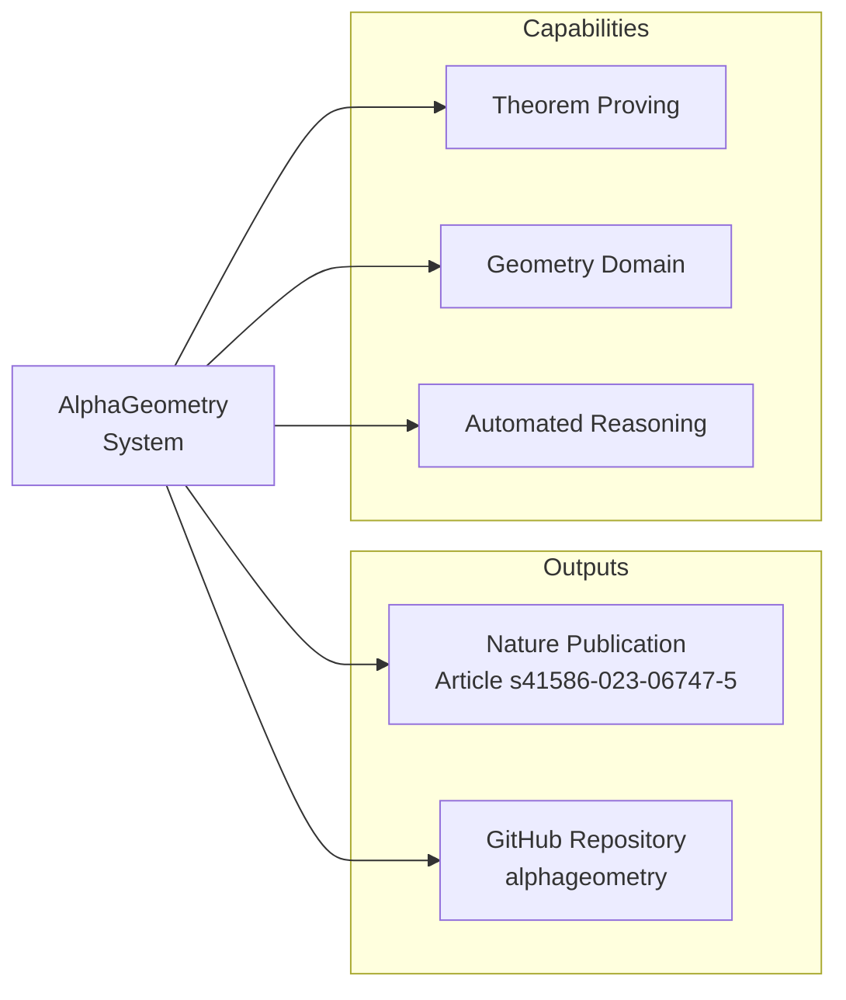

**Diagram: AlphaGeometry outputs and capabilities**

**Sources:** [README.md:7-9]()

## AlphaGeometry2: Competitive Problem Solving

### Overview

AlphaGeometry2 extends the original AlphaGeometry system to achieve competitive performance at the International Mathematical Olympiad (IMO) level. The system achieved a silver medal standard in 2024, demonstrating significant advancement in problem-solving capabilities.

### Key Information

- **Achievement:** IMO-silver medal (2024)
- **Blog Post:** DeepMind blog announcement
- **Repository:** `https://github.com/google-deepmind/alphageometry2`
- **Referenced At:** [README.md:11-13]()

### Competition Performance

The 2024 IMO-silver medal achievement represents a milestone in AI mathematical problem-solving, demonstrating that the system can compete at an international level in geometry problem-solving.

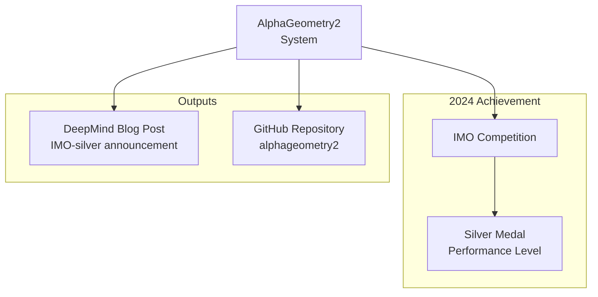

**Diagram: AlphaGeometry2 achievement and outputs**

**Sources:** [README.md:11-13]()

## Evolution and Relationship

### Progression Path

The AlphaGeometry projects represent the first two stages in the Superhuman Reasoning team's evolution of mathematical AI capabilities:

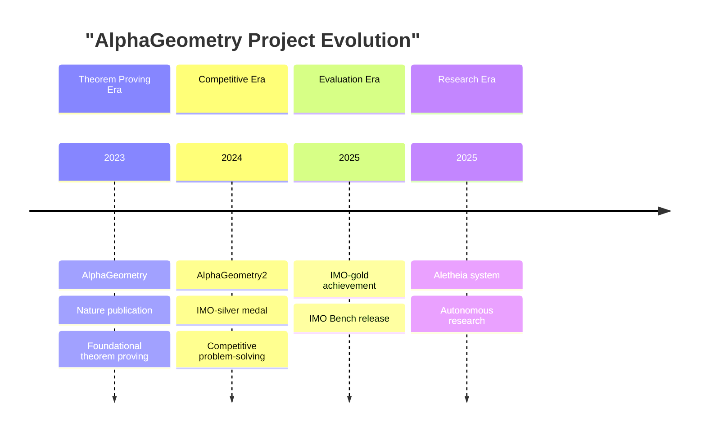

**Diagram: Timeline showing AlphaGeometry evolution to subsequent systems**

**Sources:** [README.md:1-54]()

### System Relationships

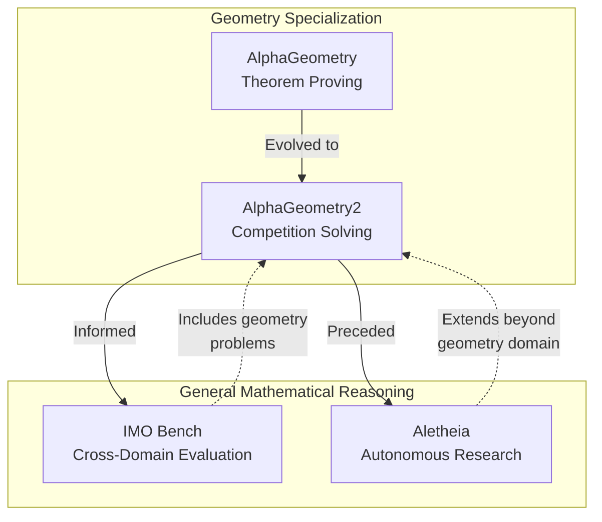

**Diagram: Relationship between AlphaGeometry projects and subsequent systems**

**Sources:** [README.md:1-54]()

### Capabilities Comparison

| Capability | AlphaGeometry | AlphaGeometry2 | Aletheia |
|------------|---------------|----------------|----------|
| Domain | Geometry | Geometry | Multi-domain |
| Mode | Theorem proving | Competition solving | Research generation |
| Validation | Nature peer review | IMO competition | arXiv publication |
| Output | Proofs | Problem solutions | Research papers |
| Autonomy | Targeted | Targeted | Autonomous research |

**Sources:** [README.md:1-54]()

## Code References

### README Structure

The AlphaGeometry projects are documented in the main repository README through dedicated subsections:

- **AlphaGeometry Section:** [README.md:7-9]()
  - Contains Nature paper link
  - Links to `alphageometry` repository

- **AlphaGeometry2 Section:** [README.md:11-13]()
  - Contains IMO-silver achievement blog link
  - Links to `alphageometry2` repository

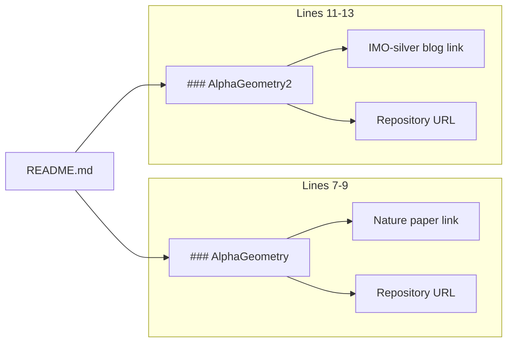

**Diagram: README.md structure for AlphaGeometry documentation**

**Sources:** [README.md:7-13]()

## External Repository Access

Both AlphaGeometry projects maintain independent repositories:

### AlphaGeometry Repository
- **URL:** `https://github.com/google-deepmind/alphageometry`
- **License:** Subject to repository-specific licensing
- **Content:** Full implementation and documentation

### AlphaGeometry2 Repository
- **URL:** `https://github.com/google-deepmind/alphageometry2`
- **License:** Subject to repository-specific licensing
- **Content:** Full implementation and IMO competition details

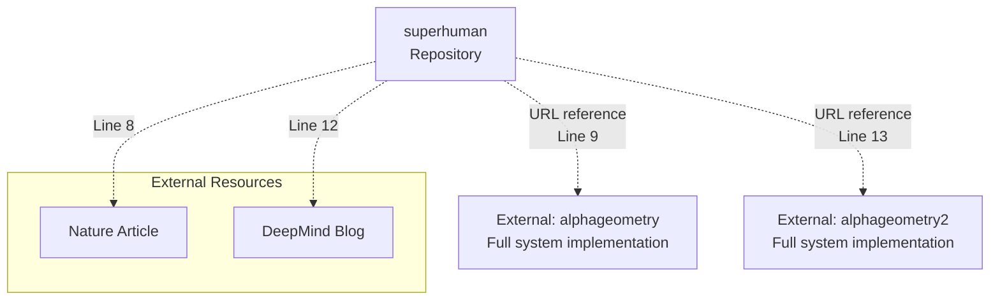

**Diagram: External repository and resource references**

**Sources:** [README.md:7-13]()

## Role in Mathematical AI Evolution

The AlphaGeometry projects serve as foundational work that enabled subsequent advances:

### Technical Foundation
- Established geometry theorem proving capabilities
- Developed competitive problem-solving approaches
- Created evaluation methodologies for mathematical AI

### Progression to Advanced Systems
- **To IMO Bench:** Geometry problems form a component of the comprehensive evaluation suite ([README.md:15-26]())
- **To Aletheia:** Foundational proving techniques extended to autonomous research across multiple mathematical domains ([README.md:28-33]())

### Domain Specialization vs. Generalization

```mermaid
graph LR
    subgraph "Specialized Systems"
        AG["AlphaGeometry"]
        AG2["AlphaGeometry2"]
    end
    
    subgraph "Generalized Systems"
        IMO["IMO Bench<br/>Multi-domain evaluation"]
        ALETHEIA["Aletheia<br/>Multi-domain research"]
    end
    
    AG -->|"Domain:<br/>Geometry only"| GEOM["Geometry<br/>Specialization"]
    AG2 -->|"Domain:<br/>Geometry only"| GEOM
    
    IMO -->|"Includes:<br/>Algebra, Combinatorics,<br/>Number Theory, Geometry"| MULTI["Multi-domain<br/>Coverage"]
    ALETHEIA -->|"Produces:<br/>Number theory, Algebraic<br/>geometry, Combinatorics, etc."| MULTI
    
    GEOM -.->|"Evolution"| MULTI
```

**Diagram: Evolution from domain-specialized to multi-domain systems**

**Sources:** [README.md:1-54]()

## Integration with Repository Ecosystem

While AlphaGeometry projects are maintained externally, they integrate conceptually with the internal projects:

### IMO Bench Integration
- IMO-AnswerBench includes geometry problems ([README.md:21]())
- IMO-ProofBench contains geometry proofs ([README.md:23]())
- Evaluation methods build on competition problem-solving experience

### Aletheia Relationship
- Aletheia extends capabilities beyond geometry ([README.md:28-33]())
- Similar iterative approach to problem-solving
- Autonomous research vs. targeted theorem proving

```mermaid
graph TB
    subgraph "External Geometry Projects"
        AG["AlphaGeometry"]
        AG2["AlphaGeometry2"]
    end
    
    subgraph "Internal Evaluation"
        AB["IMO-AnswerBench<br/>400 problems<br/>includes geometry"]
        PB["IMO-ProofBench<br/>60 proofs<br/>includes geometry"]
    end
    
    subgraph "Internal Research"
        ALETHEIA["Aletheia<br/>Multi-domain<br/>research agent"]
    end
    
    AG2 -->|"Informed design"| AB
    AG2 -->|"Informed design"| PB
    AG -->|"Proving approach<br/>extended by"| ALETHEIA
    AG2 -->|"Competition experience<br/>extended by"| ALETHEIA
```

**Diagram: Integration of AlphaGeometry projects with internal systems**

**Sources:** [README.md:1-54]()

## Summary

The AlphaGeometry projects establish the Superhuman Reasoning team's foundation in automated mathematical reasoning:

- **AlphaGeometry:** Breakthrough theorem proving published in Nature
- **AlphaGeometry2:** Competitive problem-solving achieving IMO-silver medal
- **Role:** Foundation for subsequent multi-domain systems (IMO Bench, Aletheia)
- **Status:** Maintained in external repositories, referenced from this codebase

These projects represent the geometry-specialized phase of development that preceded the team's expansion into multi-domain mathematical reasoning and autonomous research generation.

**Sources:** [README.md:1-54]()

---

# Page: Aletheia Math Research Agent

# Aletheia Math Research Agent

<details>
<summary>Relevant source files</summary>

The following files were used as context for generating this wiki page:

- [README.md](README.md)
- [aletheia/Aletheia.pdf](aletheia/Aletheia.pdf)
- [aletheia/README.md](aletheia/README.md)

</details>


## Purpose and Scope

This document provides a comprehensive overview of Aletheia, the flagship math research agent system in the Superhuman Reasoning repository. Aletheia is an iterative mathematical research system powered by Gemini Deep Think that can autonomously generate, verify, and revise solutions to research-level mathematical problems.

This page covers Aletheia's architecture, research output structure, and its six published mathematical contributions. For detailed information about specific research outputs and their mathematical content, see subsections [3.2](#3.2) through [3.6](#3.6). For internal system architecture details including the generate-verify-revise loop, see [3.1](#3.1). For evaluation benchmarks, see [4](#4).

**Sources:** [README.md:28-33](), [aletheia/README.md:1-18]()

## System Overview

Aletheia represents a paradigm shift from problem-solving AI to autonomous mathematical research AI. Unlike AlphaGeometry and AlphaGeometry2 (see [2](#2)) which solve given problems, Aletheia conducts original mathematical research, producing results that contribute to academic publications.

The system operates through an iterative process:
1. **Generate** - Produce mathematical solutions and proofs
2. **Verify** - Check correctness and rigor
3. **Revise** - Refine and improve based on verification

This process is powered by Gemini Deep Think, enabling extended reasoning on complex mathematical problems.

**Sources:** [README.md:28-30](), [aletheia/README.md:3-4]()

### System Architecture Diagram

```mermaid
graph TB
    subgraph "Aletheia System"
        GEMINI["Gemini Deep Think<br/>Core Reasoning Engine"]
        ITER["Iterative Process<br/>Generate → Verify → Revise"]
        
        GEMINI --> ITER
    end
    
    subgraph "aletheia/ Directory"
        README["README.md<br/>System Documentation"]
        
        subgraph "Research Output Directories"
            BKKKZ["BKKKZ26/<br/>├── BKKKZ26.tex<br/>├── BKKKZ26.pdf"]
            ERDOS["Erdos/<br/>├── Erdos.tex<br/>├── Erdos.pdf"]
            F26["F26/<br/>├── F26.tex<br/>├── F26.pdf"]
            FYZ["FYZ26/<br/>├── FYZ26.tex<br/>├── FYZ26.pdf"]
            ACGKMP["ACGKMP/<br/>├── ACGKMP.tex<br/>├── ACGKMP.pdf"]
            LEESEO["LeeSeo26/<br/>├── LeeSeo26.tex<br/>├── LeeSeo26.pdf"]
        end
    end
    
    ITER --> BKKKZ
    ITER --> ERDOS
    ITER --> F26
    ITER --> FYZ
    ITER --> ACGKMP
    ITER --> LEESEO
    
    BKKKZ --> ARXIV1["arXiv:2601.21442"]
    ERDOS --> ARXIV2["arXiv:2601.22401"]
    F26 --> ARXIV3["arXiv:2601.23245"]
    FYZ --> ARXIV4["arXiv:2601.18557"]
    ACGKMP --> ARXIV5["arXiv:2601.23229"]
    LEESEO --> ARXIV6["arXiv:2602.02450"]
```

**Sources:** [README.md:28-33](), [aletheia/README.md:1-18]()

## Research Outputs

Aletheia has produced six distinct research outputs spanning multiple mathematical domains. Each output follows a standardized format with LaTeX source (`.tex`), compiled PDF (`.pdf`), and arXiv publication. The outputs are organized in dedicated subdirectories within `aletheia/`.

### Research Output Summary Table

| Directory | Problem Domain | Contribution Type | arXiv ID |
|-----------|---------------|-------------------|----------|
| `BKKKZ26/` | Number Theory | Standalone - Irrationality proof for rapidly converging series | 2601.21442 |
| `Erdos/` | Multi-domain | Standalone - Semi-autonomous study of 14 Erdős problems | 2601.22401 |
| `F26/` | Algebraic Geometry | Standalone - Eigenweight computations for Hirzebruch Principle | 2601.23245 |
| `FYZ26/` | Algebraic Geometry | Standalone - Initial non-trivial eigenweight case | 2601.18557 |
| `ACGKMP/` | Applied Mathematics | Contributory - Dyadic interval bounds for Markov chains | 2601.23229 |
| `LeeSeo26/` | Combinatorics | Contributory - Independence set bounds | 2602.02450 |

**Sources:** [aletheia/README.md:11-17]()

### Attribution Notes

The system includes two important attribution notes regarding non-Aletheia outputs:

1. One output in the `Erdos/` directory is not from Aletheia
2. One output in `LeeSeo26/` is not from Aletheia (included for illustration purposes, as correct solutions were obtained by various models including Aletheia)

These outputs are documented in their respective subsections [3.3](#3.3) and [3.6](#3.6).

**Sources:** [aletheia/README.md:6-9]()

## Directory Structure and File Organization

The `aletheia/` directory follows a consistent organizational pattern for each research output, facilitating reproducibility and academic citation.

```mermaid
graph LR
    subgraph "aletheia/ Root"
        ROOT_README["README.md"]
    end
    
    subgraph "Research Output Pattern"
        DIR["[OutputName]/<br/>Research Directory"]
        TEX["[OutputName].tex<br/>LaTeX Source"]
        PDF["[OutputName].pdf<br/>Compiled Document"]
        
        DIR --> TEX
        DIR --> PDF
    end
    
    subgraph "Concrete Examples"
        BKKKZ_DIR["BKKKZ26/"]
        BKKKZ_TEX["BKKKZ26.tex"]
        BKKKZ_PDF["BKKKZ26.pdf"]
        
        ERDOS_DIR["Erdos/"]
        ERDOS_TEX["Erdos.tex"]
        ERDOS_PDF["Erdos.pdf"]
        
        F26_DIR["F26/"]
        F26_TEX["F26.tex"]
        F26_PDF["F26.pdf"]
        
        FYZ_DIR["FYZ26/"]
        FYZ_TEX["FYZ26.tex"]
        FYZ_PDF["FYZ26.pdf"]
        
        ACGKMP_DIR["ACGKMP/"]
        ACGKMP_TEX["ACGKMP.tex"]
        ACGKMP_PDF["ACGKMP.pdf"]
        
        LEESEO_DIR["LeeSeo26/"]
        LEESEO_TEX["LeeSeo26.tex"]
        LEESEO_PDF["LeeSeo26.pdf"]
    end
    
    ROOT_README -.-> BKKKZ_DIR
    ROOT_README -.-> ERDOS_DIR
    ROOT_README -.-> F26_DIR
    ROOT_README -.-> FYZ_DIR
    ROOT_README -.-> ACGKMP_DIR
    ROOT_README -.-> LEESEO_DIR
```

Each research output directory contains:
- **`.tex` file** - LaTeX source code containing mathematical proofs, definitions, and exposition
- **`.pdf` file** - Compiled PDF document for direct reading and citation

The `README.md` in `aletheia/` serves as the central index, linking to all outputs with brief descriptions and arXiv references.

**Sources:** [aletheia/README.md:11-17]()

## Research Collaboration Modes

Aletheia operates in two distinct modes, producing different types of mathematical contributions:

### Standalone Research Mode

In this mode, Aletheia produces complete mathematical results that form the core of standalone academic papers. Four outputs operate in this mode:

| Output | Description |
|--------|-------------|
| `BKKKZ26/` | Complete proof of irrationality for rapidly converging series, generalizing Erdős-1051 |
| `Erdos/` | Complete case study addressing 14 open Erdős problems across multiple domains |
| `F26/` | Complete eigenweight computations for the Arithmetic Hirzebruch Proportionality Principle |
| `FYZ26/` | Complete initial case of non-trivial eigenweight computation |

**Sources:** [aletheia/README.md:11-14]()

### Contributory Research Mode

In this mode, Aletheia provides specific mathematical inputs that are incorporated into broader human-led research. Two outputs operate in this mode:

| Output | External Paper | Contribution |
|--------|----------------|--------------|
| `ACGKMP/` | "Strongly polynomial iterations for robust Markov chains" by Asadi et al. | Mathematical proof that specific bounded combinations of numbers are in polynomially many dyadic intervals |
| `LeeSeo26/` | "Lower bounds for multivariate independence polynomials and their generalisations" by Lee and Seo | Generalizations of bounds for independence sets |

**Sources:** [aletheia/README.md:15-17]()

## Integration with Gemini Deep Think

Aletheia is powered by Gemini Deep Think, which provides the core reasoning capabilities for the iterative research process. The integration enables:

- **Extended Reasoning** - Deep Think allows for prolonged contemplation on complex mathematical problems
- **Iterative Refinement** - Multiple passes through generate-verify-revise cycles
- **Multi-domain Expertise** - Ability to work across number theory, algebraic geometry, combinatorics, graph theory, and applied mathematics

The relationship between Aletheia and Gemini Deep Think is described in the main repository README, where Aletheia is characterized as a "math research agent, powered by Gemini Deep Think."

**Sources:** [README.md:29]()

## Publication Pipeline

All Aletheia research outputs follow a standardized publication pipeline:

```mermaid
graph LR
    RESEARCH["Mathematical<br/>Research Process"] --> TEX_GEN["LaTeX Generation<br/>.tex files"]
    TEX_GEN --> PDF_COMP["PDF Compilation<br/>.pdf files"]
    PDF_COMP --> ARXIV_PUB["arXiv Publication<br/>Academic Record"]
    
    subgraph "Repository Storage"
        TEX_STORE["aletheia/[Output]/<br/>[Output].tex"]
        PDF_STORE["aletheia/[Output]/<br/>[Output].pdf"]
    end
    
    TEX_GEN --> TEX_STORE
    PDF_COMP --> PDF_STORE
    
    subgraph "External References"
        ARXIV_LINK["Full paper links<br/>in README.md"]
    end
    
    ARXIV_PUB --> ARXIV_LINK
```

The pipeline ensures:
1. **Source Preservation** - LaTeX source files are maintained for reproducibility
2. **Readable Distribution** - PDF files enable direct reading without LaTeX toolchains
3. **Academic Citation** - arXiv publication provides permanent, citable records
4. **Centralized Documentation** - All links and descriptions consolidated in `aletheia/README.md`

Each output in `aletheia/README.md` includes three references:
- `[tex]` link to the LaTeX source file
- `[pdf]` link to the compiled PDF document
- `[full paper]` link to the arXiv publication

**Sources:** [aletheia/README.md:11-17]()

## Mathematical Domain Coverage

Aletheia's six research outputs demonstrate breadth across multiple mathematical domains:

| Domain | Outputs | Count |
|--------|---------|-------|
| Number Theory | `BKKKZ26/` (series irrationality) | 1 |
| Algebraic Geometry | `F26/`, `FYZ26/` (eigenweight computations) | 2 |
| Applied Mathematics | `ACGKMP/` (Markov chains) | 1 |
| Combinatorics | `LeeSeo26/` (independence sets) | 1 |
| Multi-domain | `Erdos/` (graph theory, number theory, geometry, combinatorics) | 1 |

This breadth indicates Aletheia functions as a general-purpose mathematical research system rather than a domain-specific tool. The multi-domain coverage is particularly evident in the `Erdos/` output, which addresses 14 problems spanning multiple areas of mathematics.

For detailed analysis of proof techniques employed across these domains, see [3.7](#3.7).

**Sources:** [aletheia/README.md:11-17]()

## Licensing

All Aletheia materials follow the repository's dual licensing model:

- **Software components** (if any): Apache License 2.0
- **Research materials** (LaTeX, PDF files): Creative Commons Attribution 4.0 International License (CC-BY)

The CC-BY license for research materials facilitates academic use while maintaining attribution requirements. Users may freely use, share, and adapt the materials with appropriate citation.

Full license text is available in `aletheia/README.md` lines 19-38.

**Sources:** [aletheia/README.md:19-38]()

## Relationship to Other Systems

Aletheia represents the current frontier of the Superhuman Reasoning project's evolution:

```mermaid
graph TB
    subgraph "Evolution Path"
        AG["AlphaGeometry<br/>Nature Publication<br/>Theorem Proving"]
        AG2["AlphaGeometry2<br/>IMO-Silver 2024<br/>Competitive Solving"]
        ALETHEIA["Aletheia<br/>2025<br/>Autonomous Research"]
    end
    
    AG --> AG2
    AG2 --> ALETHEIA
    
    subgraph "Evaluation Infrastructure"
        IMO["IMO Bench<br/>2025<br/>Comprehensive Evaluation"]
    end
    
    AG2 -.->|"Achievement preceded"| IMO
    ALETHEIA -.->|"Complementary to"| IMO
    
    subgraph "Focus Areas"
        PROB["Problem Solving<br/>Given Problems"]
        RES["Research<br/>Novel Contributions"]
        EVAL["Evaluation<br/>Benchmarking"]
    end
    
    AG --> PROB
    AG2 --> PROB
    ALETHEIA --> RES
    IMO --> EVAL
```

- **AlphaGeometry/AlphaGeometry2** (see [2](#2)) - Focus on solving given problems at competitive levels
- **Aletheia** - Focus on autonomous research and novel mathematical contributions
- **IMO Bench** (see [4](#4)) - Focus on comprehensive evaluation of mathematical reasoning

**Sources:** [README.md:6-33]()

---

# Page: Aletheia System Architecture

# Aletheia System Architecture

<details>
<summary>Relevant source files</summary>

The following files were used as context for generating this wiki page:

- [aletheia/BKKKZ26/BKKKZ26.pdf](aletheia/BKKKZ26/BKKKZ26.pdf)
- [aletheia/BKKKZ26/BKKKZ26.tex](aletheia/BKKKZ26/BKKKZ26.tex)
- [aletheia/Erdos/Erdos.pdf](aletheia/Erdos/Erdos.pdf)
- [aletheia/Erdos/Erdos.tex](aletheia/Erdos/Erdos.tex)
- [aletheia/README.md](aletheia/README.md)

</details>


## Purpose and Scope

This page documents the internal architecture of Aletheia, an AI-powered mathematical research agent. It covers the system's input/output formatting, the research generation pipeline, and integration points with underlying language models. For information about specific research outputs produced by Aletheia, see [Research Output: BKKKZ26](#3.2), [Research Output: Erdos](#3.3), [Research Output: F26/FYZ26](#3.4), [Research Output: ACGKMP](#3.5), and [Research Output: LeeSeo26](#3.6). For analysis of Aletheia's collaboration modes, see [Collaboration Modes](#3.8).

---

## System Overview

Aletheia operates as a prompt-response system that generates formal mathematical proofs and solutions to research-level problems. The system processes mathematical problems expressed in natural language and produces outputs formatted as LaTeX documents suitable for academic publication.

```mermaid
graph TB
    subgraph "Aletheia System"
        Input["User Prompt<br/>(Natural Language Problem)"]
        Process["Gemini Deep Think<br/>Inference Engine"]
        Output["Model Response<br/>(LaTeX + Proof)"]
        
        Input --> Process
        Process --> Output
    end
    
    subgraph "Research Outputs"
        BKKKZ["aletheia/BKKKZ26/"]
        Erdos["aletheia/Erdos/"]
        F26["aletheia/F26/"]
        FYZ["aletheia/FYZ26/"]
        ACGKMP["aletheia/ACGKMP/"]
        LeeSeo["aletheia/LeeSeo26/"]
    end
    
    Output --> BKKKZ
    Output --> Erdos
    Output --> F26
    Output --> FYZ
    Output --> ACGKMP
    Output --> LeeSeo
```

**Diagram: Aletheia High-Level Architecture**

Sources: [aletheia/README.md:1-18]()

---

## Input Format Structure

Aletheia accepts mathematical problems formatted within a structured prompt template. The input format uses LaTeX-based problem environments for clarity and formal specification.

### Problem Environment Template

```latex
\begin{problem}{Problem Title}
Mathematical problem statement in LaTeX notation
\end{problem}
```

The problem environment is defined using the `tcolorbox` package with specific styling parameters:

| Parameter | Value | Purpose |
|-----------|-------|---------|
| `colback` | `boxback` (RGB 245,245,255) | Background color for readability |
| `colframe` | `boxblue` (RGB 0,0,150) | Border color |
| `breakable` | `true` | Allow page breaks within long problems |
| `enhanced jigsaw` | enabled | Proper frame handling across pages |

Sources: [aletheia/BKKKZ26/BKKKZ26.tex:39-52](), [aletheia/Erdos/Erdos.tex:22-35]()

---

## Output Format Structure

Aletheia generates responses in a standardized LaTeX format that includes mathematical proofs, theorem statements, and supporting lemmas.

```mermaid
graph LR
    subgraph "Output Structure"
        Solution["solution environment"]
        Title["Model Response (Aletheia)"]
        Theorem["theorem environments"]
        Proof["proof environments"]
        Refs["Bibliography (thebibliography)"]
        
        Solution --> Title
        Solution --> Theorem
        Solution --> Proof
        Solution --> Refs
    end
```

**Diagram: Output Document Structure**

### Solution Environment

```latex
\begin{solution}{Model Response (\emph{Aletheia})}
% Theorem statements
% Proofs
% Supporting lemmas
% Bibliography
\end{solution}
```

The solution environment mirrors the problem environment's styling and includes:
- Model attribution in the title
- Formal theorem environments
- Structured proof sections
- Mathematical notation using `amsmath`, `amssymb`, `amsthm` packages

Sources: [aletheia/BKKKZ26/BKKKZ26.tex:54-67](), [aletheia/Erdos/Erdos.tex:71-122]()

---

## Research Output Pipeline

Each research output follows a standardized three-artifact pipeline from source to publication.

```mermaid
graph TD
    subgraph "Per-Output Pipeline"
        TexSource[".tex LaTeX Source"]
        PdfCompiled[".pdf Compiled Document"]
        ArxivPub["arXiv Publication"]
        
        TexSource -->|"pdflatex compilation"| PdfCompiled
        PdfCompiled -->|"academic dissemination"| ArxivPub
    end
    
    subgraph "Directory Structure"
        OutputDir["aletheia/{OutputName}/"]
        TexFile["{OutputName}.tex"]
        PdfFile["{OutputName}.pdf"]
        
        OutputDir --> TexFile
        OutputDir --> PdfFile
    end
    
    subgraph "Example: BKKKZ26"
        Dir1["aletheia/BKKKZ26/"]
        Tex1["BKKKZ26.tex"]
        Pdf1["BKKKZ26.pdf"]
        Arxiv1["arxiv.org/abs/2601.21442"]
        
        Dir1 --> Tex1
        Dir1 --> Pdf1
        Tex1 --> Arxiv1
    end
```

**Diagram: Output Artifact Pipeline and Directory Structure**

### Standard Output Components

Each output directory contains:

1. **LaTeX Source** (`.tex`): Complete standalone document with:
   - Document class declaration
   - Package imports
   - Custom theorem environments
   - Problem statement
   - Model response with proofs
   - Bibliography

2. **PDF Document** (`.pdf`): Compiled version for distribution

3. **arXiv Link**: Reference to published paper

Sources: [aletheia/README.md:11-17]()

---

## Model Attribution System

Aletheia uses explicit model attribution tags to identify which AI system generated each solution. This enables tracking of different model variants and ablation studies.

```mermaid
graph TB
    subgraph "Attribution Tags"
        Aletheia1["Model Response (Aletheia)"]
        Aletheia2["Model Response (Aletheia, ablation run)"]
        Aletheia3["Model Response (Aletheia, initial run)"]
        Internal["Model Response (internal proprietary agent)"]
        Gemini["Model Response (Gemini 3)"]
    end
    
    subgraph "Usage in Outputs"
        ErdosMain["Erdos problems<br/>Primary: Aletheia<br/>Some: Internal agent"]
        BKKKZ["BKKKZ26<br/>ablation run vs initial run"]
        LeeSeo["LeeSeo26<br/>Gemini 3 vs Aletheia"]
    end
    
    Aletheia1 --> ErdosMain
    Internal --> ErdosMain
    Aletheia2 --> BKKKZ
    Aletheia3 --> BKKKZ
    Gemini --> LeeSeo
    Aletheia1 --> LeeSeo
```

**Diagram: Model Attribution Variants**

### Attribution Format

The solution environment title includes model attribution:

```latex
\begin{solution}{Model Response (\emph{Aletheia})}
% Standard response

\begin{solution}{Model Response (\emph{Aletheia}, ablation run)}
% Ablation study variant

\begin{solution}{Model Response (internal proprietary agent)}
% Alternative model for comparison
```

### Multiple Responses Per Problem

Some outputs contain multiple solution environments for the same problem, each from different models or runs. This enables comparative analysis of proof strategies.

**Example from BKKKZ26:**
- Ablation run response: [aletheia/BKKKZ26/BKKKZ26.tex:94-198]()
- Initial run response: [aletheia/BKKKZ26/BKKKZ26.tex:201-286]()

Sources: [aletheia/README.md:6-9](), [aletheia/Erdos/Erdos.tex:71](), [aletheia/Erdos/Erdos.tex:124](), [aletheia/BKKKZ26/BKKKZ26.tex:94](), [aletheia/BKKKZ26/BKKKZ26.tex:201]()

---

## LaTeX Document Structure

All Aletheia outputs follow a consistent document structure with standardized packages and environments.

### Required Packages

| Package | Purpose |
|---------|---------|
| `amsmath`, `amssymb`, `amsthm` | Mathematical notation and theorem environments |
| `tcolorbox` | Colored boxes for problems and solutions |
| `geometry` | Page layout control |
| `hyperref` | Cross-references and links |
| `mathtools` | Extended mathematical typesetting |

### Custom Environments

```latex
% Theorem-style environments
\newtheorem{theorem}{Theorem}
\newtheorem{proposition}{Proposition}
\newtheorem{lemma}{Lemma}
\newtheorem{claim}{Claim}

% Definition-style environments
\newtheorem{definition}{Definition}
\newtheorem{remark}{Remark}[section]
\newtheorem*{example}{Example}

% Colored box environments
\newtcolorbox{problem}[1]{...}  % Problem statements
\newtcolorbox{solution}[1]{...} % Model responses
```

### Custom Commands

Common mathematical notation shortcuts:

```latex
\newcommand{\Q}{\mathbb{Q}}      % Rational numbers
\newcommand{\N}{\mathbb{N}}      % Natural numbers
\newcommand{\Z}{\mathbb{Z}}      % Integers
\newcommand{\F}{\mathbb{F}}      % Field
\DeclareMathOperator{\...}{...}  % Custom operators
```

Sources: [aletheia/BKKKZ26/BKKKZ26.tex:1-29](), [aletheia/Erdos/Erdos.tex:1-60]()

---

## Problem-Solution Pairing

The fundamental structure of Aletheia outputs is the problem-solution pair, which maintains a clear separation between user input and model output.

```mermaid
graph LR
    subgraph "Document Flow"
        P1["problem: User Prompt"]
        S1["solution: Model Response (Aletheia)"]
        P2["problem: User Prompt"]
        S2a["solution: Model A"]
        S2b["solution: Model B"]
        
        P1 --> S1
        P2 --> S2a
        P2 --> S2b
    end
```

**Diagram: Problem-Solution Document Flow**

### Editorial Note

All outputs include a disclaimer about editing:

```latex
\emph{The prompts and responses below have been edited only for
formatting compatibility.}
```

This appears at the document start, indicating that the mathematical content is preserved while formatting may be adjusted for LaTeX compilation.

Sources: [aletheia/BKKKZ26/BKKKZ26.tex:85-86](), [aletheia/Erdos/Erdos.tex:64-65]()

---

## Integration with Gemini Deep Think

While the codebase does not contain implementation details of the Gemini Deep Think integration, the outputs provide evidence of the integration through:

1. **Model Attribution**: Explicit "Gemini Deep Think" references in high-level documentation
2. **Output Quality**: Research-level proofs with formal theorem statements
3. **Multiple Variants**: Ability to run different model configurations (ablation runs, initial runs)

```mermaid
graph TD
    Problem["Mathematical Problem<br/>(LaTeX formatted)"]
    GeminiAPI["Gemini Deep Think<br/>Inference API"]
    Response["LaTeX Response<br/>(Theorems + Proofs)"]
    
    Problem -->|"Prompt engineering"| GeminiAPI
    GeminiAPI -->|"Generated text"| Response
    
    subgraph "Inference Variants"
        Standard["Standard run"]
        Ablation["Ablation run"]
        Initial["Initial run"]
    end
    
    GeminiAPI --> Standard
    GeminiAPI --> Ablation
    GeminiAPI --> Initial
```

**Diagram: Gemini Deep Think Integration Points**

Sources: High-level diagrams provided in context

---

## Bibliography and Citation Format

Aletheia outputs include formal bibliographies with academic citations.

### Bibliography Structure

```latex
\begin{thebibliography}{9}
\bibitem{key} Author(s), ``Title,'' \textit{Journal/Book},
  vol. X, pp. Y--Z, Year.
\end{thebibliography}
```

### Example Citations

From Erdos output:
- Erdős-Graham reference: [aletheia/Erdos/Erdos.tex:270-273]()
- Lambie-Hanson theorem citation: [aletheia/Erdos/Erdos.tex:83-86]()

From BKKKZ26 output:
- Erdős-Graham combinatorics: [aletheia/BKKKZ26/BKKKZ26.tex:194-197]()

Sources: [aletheia/Erdos/Erdos.tex:269-274](), [aletheia/BKKKZ26/BKKKZ26.tex:194-197]()

---

## Output File Organization

```mermaid
graph TD
    Root["aletheia/"]
    Readme["README.md"]
    
    Root --> Readme
    
    subgraph "Research Outputs"
        BKKKZ["BKKKZ26/"]
        Erdos["Erdos/"]
        F26["F26/"]
        FYZ["FYZ26/"]
        ACGKMP["ACGKMP/"]
        LeeSeo["LeeSeo26/"]
    end
    
    Root --> BKKKZ
    Root --> Erdos
    Root --> F26
    Root --> FYZ
    Root --> ACGKMP
    Root --> LeeSeo
    
    BKKKZ --> BKTex["BKKKZ26.tex"]
    BKKKZ --> BKPdf["BKKKZ26.pdf"]
    
    Erdos --> ETex["Erdos.tex"]
    Erdos --> EPdf["Erdos.pdf"]
```

**Diagram: Aletheia Repository Structure**

Each output directory follows the naming convention:
- Directory name matches the paper identifier
- `.tex` and `.pdf` files share the directory name
- README provides links to all outputs and their arXiv publications

Sources: [aletheia/README.md:1-18]()

---

## Quality Markers and Disclaimers

### Accuracy Disclaimers

The Erdos output includes an explicit accuracy warning:

```latex
\emph{The prompts and responses below have been edited only for
formatting compatibility. NOTE THAT MANY CONTAIN MINOR INACCURACIES.}
```

This indicates that outputs are provided for research purposes and may contain mathematical errors requiring verification.

### Non-Aletheia Responses

The README notes that some responses are not from Aletheia:

> "Note that 2 outputs, one in Erdos problems and one in LeeSeo26, are not from Aletheia. The latter is for illustration purposes only (a correct solution was obtained by various models, including Aletheia)."

This transparency allows users to distinguish between Aletheia-generated content and comparative examples from other models.

Sources: [aletheia/README.md:6-9](), [aletheia/Erdos/Erdos.tex:64-65]()

---

## Summary

The Aletheia system architecture is characterized by:

1. **Standardized I/O**: Problem-solution pairs in LaTeX format
2. **Modular Structure**: Each research output in its own directory
3. **Model Attribution**: Explicit tagging of model variants
4. **Publication Pipeline**: LaTeX → PDF → arXiv workflow
5. **Comparative Analysis**: Support for multiple responses per problem
6. **Academic Format**: Formal theorem environments and bibliographies

The architecture prioritizes reproducibility, transparency, and integration with academic publishing workflows.

Sources: [aletheia/README.md:1-39](), [aletheia/BKKKZ26/BKKKZ26.tex:1-400](), [aletheia/Erdos/Erdos.tex:1-800]()

---

# Page: Research Output: BKKKZ26 - Irrationality of Rapidly Converging Series

# Research Output: BKKKZ26 - Irrationality of Rapidly Converging Series

<details>
<summary>Relevant source files</summary>

The following files were used as context for generating this wiki page:

- [aletheia/BKKKZ26/BKKKZ26.pdf](aletheia/BKKKZ26/BKKKZ26.pdf)
- [aletheia/BKKKZ26/BKKKZ26.tex](aletheia/BKKKZ26/BKKKZ26.tex)
- [aletheia/README.md](aletheia/README.md)

</details>


## Purpose and Scope

This page documents the BKKKZ26 research output, which demonstrates Aletheia's capability to produce novel mathematical proofs for number-theoretic problems. The output addresses the irrationality of series with double-exponential growth conditions and provides two distinct proof strategies generated by Aletheia, followed by a generalization created by Gemini Deep Think. For broader information about Aletheia's research capabilities and other outputs, see [Aletheia Math Research Agent](#3). For information about the system architecture that produces these proofs, see [Aletheia System Architecture](#3.1).

**Sources:** [aletheia/README.md:1-18](), [aletheia/BKKKZ26/BKKKZ26.tex:1-89]()

---

## Problem Statement

The research addresses a question about irrationality of series with rapidly converging denominators. The problem asks whether, for a strictly increasing sequence of integers $(a_1, a_2, \ldots)$ satisfying the growth condition:

$$\liminf_{n \to \infty} a_n^{1/2^n} > 1$$

the infinite series:

$$S = \sum_{n=1}^\infty \frac{1}{a_n a_{n+1}}$$

is necessarily irrational.

This problem generalizes classical results by Erdős and Graham on irrationality of series with rapidly growing denominators. The double-exponential growth condition $a_n^{1/2^n} > 1$ implies that $a_n$ grows faster than $c^{2^n}$ for some constant $c > 1$.

**Sources:** [aletheia/BKKKZ26/BKKKZ26.tex:89-91](), [aletheia/BKKKZ26/BKKKZ26.tex:95-101]()

---

## Research Artifact Structure

```mermaid
graph TB
    subgraph "BKKKZ26 Directory Structure"
        DIR["aletheia/BKKKZ26/"]
        TEX["BKKKZ26.tex"]
        PDF["BKKKZ26.pdf"]
        
        DIR --> TEX
        DIR --> PDF
    end
    
    subgraph "Document Contents"
        PROMPT1["User Prompt: Irrationality Question"]
        RESP1["Model Response: Ablation Run"]
        RESP2["Model Response: Initial Run"]
        PROMPT2["User Prompt: Generalization Request"]
        RESP3["Model Response: Gemini Deep Think"]
        
        TEX --> PROMPT1
        TEX --> RESP1
        TEX --> RESP2
        TEX --> PROMPT2
        TEX --> RESP3
    end
    
    subgraph "Publication Pipeline"
        ARXIV["arXiv:2601.21442"]
        PDF --> ARXIV
    end
    
    RESP1 -.-> |"Proof Strategy 1"| ARXIV
    RESP2 -.-> |"Proof Strategy 2"| ARXIV
    RESP3 -.-> |"Generalization"| ARXIV
```

**Sources:** [aletheia/README.md:11](), [aletheia/BKKKZ26/BKKKZ26.tex:1-416]()

---

## Two Aletheia Proof Strategies

Aletheia generated two distinct proofs for the same problem, demonstrating different proof techniques and mathematical approaches.

### Ablation Run Proof Strategy

The ablation run proof uses a **product-based growth analysis** approach, defining $P_n = \prod_{k=1}^n b_k$ and analyzing the asymptotic behavior of the product sequence.

**Key Steps:**

| Step | Mathematical Technique | Line Reference |
|------|----------------------|----------------|
| 1. Tail Reduction | Shift sequence to ensure $a_n \ge 2$ | [aletheia/BKKKZ26/BKKKZ26.tex:112-122]() |
| 2. Rationality Constraint | Use $qP_n R_n$ is an integer to bound remainder | [aletheia/BKKKZ26/BKKKZ26.tex:125-130]() |
| 3. Recurrence Derivation | Derive $P_{n+1} < 2qP_n^2$ from remainder relation | [aletheia/BKKKZ26/BKKKZ26.tex:132-154]() |
| 4. Limit Analysis | Define $\Pi = \lim_{n\to\infty} P_n^{1/2^n}$ and prove $\Pi = \mathcal{L}^2$ | [aletheia/BKKKZ26/BKKKZ26.tex:156-170]() |
| 5. Contradiction | Show $\Pi \ge \mathcal{L}^3$ contradicts $\Pi = \mathcal{L}^2$ | [aletheia/BKKKZ26/BKKKZ26.tex:172-191]() |

```mermaid
graph LR
    A["Assume S=p/q rational"]
    B["Define P_n = product of b_k"]
    C["Derive recurrence P_{n+1} < 2qP_n²"]
    D["Compute limit Π = lim P_n^(1/2^n)"]
    E["Prove Π = L²"]
    F["Prove Π ≥ L³"]
    G["Contradiction: L² ≥ L³ impossible for L>1"]
    
    A --> B
    B --> C
    C --> D
    D --> E
    D --> F
    E --> G
    F --> G
```

**Sources:** [aletheia/BKKKZ26/BKKKZ26.tex:94-198]()

### Initial Run Proof Strategy

The initial run proof uses a **logarithmic summation analysis** with partition-based remainder estimates.

**Key Steps:**

| Step | Mathematical Technique | Line Reference |
|------|----------------------|----------------|
| 1. Growth Estimates | Establish $T_n = \sum_{i=1}^n \ln a_i > \alpha 2^n$ | [aletheia/BKKKZ26/BKKKZ26.tex:212-221]() |
| 2. Rationality Lower Bound | Show $r_n \ge 1/(qP_{n+1})$ | [aletheia/BKKKZ26/BKKKZ26.tex:225-240]() |
| 3. Partitioned Upper Bound | Partition indices into sets $I_j$ by growth rate | [aletheia/BKKKZ26/BKKKZ26.tex:243-258]() |
| 4. Recurrence with Logs | Derive $(1-\epsilon)u_{n+2} < T_n + \ln q$ | [aletheia/BKKKZ26/BKKKZ26.tex:261-271]() |
| 5. Growth Rate Contradiction | Show $T_n = O(1.7^n)$ contradicts $T_n > \alpha 2^n$ | [aletheia/BKKKZ26/BKKKZ26.tex:274-281]() |

```mermaid
graph LR
    A["Assume S=p/q rational"]
    B["Define T_n = sum of log a_i"]
    C["Partition indices into sets I_j by growth"]
    D["Derive upper bound r_n < K(log log a)/(a²)"]
    E["Establish recurrence for T_n"]
    F["Show T_n = O(1.7^n)"]
    G["Contradiction: T_n > α·2^n"]
    
    A --> B
    B --> C
    C --> D
    D --> E
    E --> F
    B --> G
    F --> G
```

**Sources:** [aletheia/BKKKZ26/BKKKZ26.tex:201-285]()

---

## Proof Strategy Comparison

The two proofs employ fundamentally different mathematical frameworks:

| Aspect | Ablation Run | Initial Run |
|--------|--------------|-------------|
| **Primary Object** | Product $P_n = \prod b_k$ | Logarithmic sum $T_n = \sum \ln a_i$ |
| **Growth Analysis** | Double-exponential limit $\Pi = \lim P_n^{1/2^n}$ | Direct bounds on $T_n$ growth |
| **Remainder Estimate** | Simple telescoping bound | Partition-based $I_j$ sets |
| **Recurrence Type** | Quadratic: $P_{n+1} < 2qP_n^2$ | Linear with log terms |
| **Contradiction Mechanism** | Two incompatible limits for $\Pi$ | Growth rate mismatch |
| **Characteristic Equation Root** | Implicit in limit analysis | Explicit $\rho \approx 1.64$ |

```mermaid
graph TB
    subgraph "Ablation Run Approach"
        AR1["Product-based analysis"]
        AR2["Quadratic recurrence"]
        AR3["Limit comparison"]
    end
    
    subgraph "Initial Run Approach"
        IR1["Logarithmic analysis"]
        IR2["Linear recurrence"]
        IR3["Growth rate comparison"]
    end
    
    PROBLEM["Irrationality Question"]
    CONCLUSION["Both prove irrationality"]
    
    PROBLEM --> AR1
    PROBLEM --> IR1
    AR1 --> AR2
    AR2 --> AR3
    AR3 --> CONCLUSION
    IR1 --> IR2
    IR2 --> IR3
    IR3 --> CONCLUSION
```

**Sources:** [aletheia/BKKKZ26/BKKKZ26.tex:94-285]()

---

## Gemini Deep Think Generalization

Following the two Aletheia proofs, a second prompt requested a meaningful generalization. Gemini Deep Think provided a generalization to **weighted products with arbitrary exponents**.

### Generalized Theorem

For a tuple of non-negative integers $\mathbf{w} = (w_0, w_1, \ldots, w_{d-1})$ with $w_{d-1} \ge 1$, let $W = \max(w_0, \ldots, w_{d-1})$. Define $c_{\mathbf{w}}$ as the unique real root greater than 1 of:

$$P(x) = (x-1)\sum_{j=0}^{d-1} w_j x^j - W x^{d-1}$$

If a strictly increasing sequence of integers $\{a_n\}$ satisfies $\liminf_{n \to \infty} a_n^{1/b^n} > 1$ for some $b > c_{\mathbf{w}}$, then:

$$S = \sum_{n=1}^\infty \frac{1}{a_n^{w_0} a_{n+1}^{w_1} \cdots a_{n+d-1}^{w_{d-1}}}$$

is irrational.

**Sources:** [aletheia/BKKKZ26/BKKKZ26.tex:290-352]()

### Special Cases and Examples

| Case | Weights $\mathbf{w}$ | Polynomial Root | Mathematical Significance |
|------|---------------------|-----------------|---------------------------|
| Original theorem | $(1, 1, \ldots, 1)$ | $c_d$ solves $x^d - x^{d-1} - 1 = 0$ | Consecutive terms with unit weights |
| Gap case | $(1, 0, 1)$ | $c \approx 1.75$ | Missing middle term requires faster growth |
| Sylvester-type | $(1)$ | $c = 2$ | Classic result for $\sum 1/a_n$ |
| Heavy last weight | $(1, 2)$ | Higher root | Increased LCM cost |

```mermaid
graph TB
    ORIG["Original: 1/(a_n·a_{n+1})"]
    GEN["Generalized: 1/(a_n^w0·a_{n+1}^w1·...·a_{n+d-1}^w(d-1))"]
    
    ORIG --> GEN
    
    subgraph "Special Cases"
        CASE1["Consecutive: w=(1,1,...,1)"]
        CASE2["Gap: w=(1,0,1)"]
        CASE3["Sylvester: w=(1)"]
        CASE4["Heavy weight: w=(1,2)"]
    end
    
    GEN --> CASE1
    GEN --> CASE2
    GEN --> CASE3
    GEN --> CASE4
    
    CASE1 -.-> |"recovers c_d"| POLY1["x^d - x^(d-1) - 1"]
    CASE2 -.-> |"requires c≈1.75"| POLY2["x³ - 2x² + x - 1"]
    CASE3 -.-> |"requires c=2"| POLY3["x - 2"]
```

**Sources:** [aletheia/BKKKZ26/BKKKZ26.tex:387-410]()

### Proof Technique: Gap Principle

The generalization uses the **gap principle** to balance tail decay against common denominator growth:

1. **Common Denominator Bound:** The LCM of denominators in partial sums satisfies $Q_n \lesssim P_{n+d-1}^W$ where $W$ is the maximum weight
2. **Tail Estimate:** The remainder satisfies $r_n \approx 1/\prod_{j=0}^{d-1} a_{n+1+j}^{w_j}$
3. **Rationality Constraint:** For rational $S = p/q$, we require $Q_n r_n \gtrsim 1$
4. **Critical Polynomial:** This yields inequality $P(b) \le 0$, and contradiction occurs when $b > c_{\mathbf{w}}$

**Sources:** [aletheia/BKKKZ26/BKKKZ26.tex:356-384]()

---

## Document Structure and Formatting

The LaTeX document follows a standardized Aletheia output format:

```mermaid
graph TB
    subgraph "LaTeX Document Structure"
        PREAMBLE["Document preamble with custom environments"]
        DISCLAIMER["Editorial disclaimer about formatting"]
        
        subgraph "Problem-Solution Pairs"
            P1["problem environment: User Prompt 1"]
            S1["solution environment: Aletheia ablation"]
            S2["solution environment: Aletheia initial"]
            P2["problem environment: User Prompt 2"]
            S3["solution environment: Gemini Deep Think"]
        end
        
        BIBLIO["Bibliography: Erdős, Badea"]
    end
    
    PREAMBLE --> DISCLAIMER
    DISCLAIMER --> P1
    P1 --> S1
    S1 --> S2
    S2 --> P2
    P2 --> S3
    S3 --> BIBLIO
```

### Custom Environments

The document defines custom `tcolorbox` environments:

- **`problem` environment:** Blue-framed boxes for user prompts [aletheia/BKKKZ26/BKKKZ26.tex:38-52]()
- **`solution` environment:** White-background boxes for model responses [aletheia/BKKKZ26/BKKKZ26.tex:54-67]()
- **Breakable boxes:** Both environments use `breakable` flag to allow page splits [aletheia/BKKKZ26/BKKKZ26.tex:46,61]()

### Mathematical Notation

| Command | Definition | Purpose |
|---------|------------|---------|
| `\Q` | `\mathbb{Q}` | Rational numbers |
| `\VV` | `\mathbb{V}` | Variety |
| `\frR` | `\mathfrak{R}` | Fraktur R |
| `\Aletheia` | `\emph{Aletheia}` | Model name formatting |

**Sources:** [aletheia/BKKKZ26/BKKKZ26.tex:1-82]()

---

## Publication and Attribution

The research output follows a standardized publication workflow:

1. **LaTeX Source:** Complete mathematical exposition in `BKKKZ26.tex`
2. **Compiled PDF:** `BKKKZ26.pdf` generated from LaTeX source
3. **arXiv Publication:** Full paper available at [arXiv:2601.21442](https://arxiv.org/abs/2601.21442)
4. **Model Attribution:** Responses explicitly labeled with model names (Aletheia ablation run, Aletheia initial run, Gemini Deep Think)

The document includes an editorial disclaimer: "The prompts and responses below have been edited only for formatting compatibility" [aletheia/BKKKZ26/BKKKZ26.tex:85-86]().

**Sources:** [aletheia/README.md:11](), [aletheia/BKKKZ26/BKKKZ26.tex:85-86]()

---

## Mathematical Significance

### Problem Classification

| Aspect | Classification |
|--------|---------------|
| **Mathematical Domain** | Number Theory |
| **Problem Type** | Irrationality proof |
| **Growth Condition** | Double-exponential ($a_n > c^{2^n}$) |
| **Series Type** | Reciprocal product series |
| **Related Work** | Erdős-1051 problem |

### Key Contributions

1. **Dual Proof Methods:** Demonstrates that Aletheia can discover multiple valid proof strategies for the same problem
2. **Generalization Framework:** Extends beyond consecutive products to arbitrary weighted exponents
3. **Quantitative Bounds:** Provides explicit critical growth rates via polynomial roots
4. **Gap Quantification:** Shows how "missing terms" affect required growth rates (e.g., $c \approx 1.75$ for gap case vs $c \approx 1.46$ for consecutive)

**Sources:** [aletheia/BKKKZ26/BKKKZ26.tex:95-101](), [aletheia/BKKKZ26/BKKKZ26.tex:398-402]()

---

## Relationship to Other Research Outputs

The BKKKZ26 output is one of six major research contributions from Aletheia:

```mermaid
graph TB
    ALETHEIA["Aletheia System"]
    
    subgraph "Number Theory Domain"
        BKKKZ["BKKKZ26: Series Irrationality"]
        ERDOS_NT["Erdos: Number Theory Problems"]
    end
    
    subgraph "Algebraic Geometry Domain"
        F26["F26: Eigenweight Computations"]
        FYZ["FYZ26: Initial Eigenweight Case"]
    end
    
    subgraph "Other Domains"
        ERDOS_C["Erdos: Combinatorics Problems"]
        ACGKMP["ACGKMP: Markov Chain Bounds"]
        LEESEO["LeeSeo26: Independence Sets"]
    end
    
    ALETHEIA --> BKKKZ
    ALETHEIA --> ERDOS_NT
    ALETHEIA --> F26
    ALETHEIA --> FYZ
    ALETHEIA --> ERDOS_C
    ALETHEIA --> ACGKMP
    ALETHEIA --> LEESEO
    
    BKKKZ -.-> |"shared domain"| ERDOS_NT
    F26 -.-> |"related topic"| FYZ
```

For details on other research outputs, see:
- [Erdos - Semi-Autonomous Study of Open Problems](#3.3)
- [Eigenweight Computations (F26 and FYZ26)](#3.4)
- [ACGKMP - Dyadic Interval Bounds](#3.5)
- [LeeSeo26 - Independence Set Bounds](#3.6)

**Sources:** [aletheia/README.md:11-17]()

---

# Page: Research Output: Erdos - Semi-Autonomous Study of Open Problems

# Research Output: Erdos - Semi-Autonomous Study of Open Problems

<details>
<summary>Relevant source files</summary>

The following files were used as context for generating this wiki page:

- [aletheia/Erdos/Erdos.pdf](aletheia/Erdos/Erdos.pdf)
- [aletheia/Erdos/Erdos.tex](aletheia/Erdos/Erdos.tex)
- [aletheia/README.md](aletheia/README.md)

</details>


## Purpose and Scope

This page documents the Erdos research output from Aletheia, which presents a semi-autonomous case study applying large language models to open problems from Paul Erdős's problem collection. The study addresses 14 distinct Erdős problems spanning graph theory, combinatorics, number theory, geometry, and set theory. Most solutions are generated by Aletheia, with one solution contributed by an internal proprietary agent for comparison purposes.

For information about Aletheia's overall system architecture, see [Aletheia System Architecture](#3.1). For other research outputs from Aletheia, see sections [3.2](#3.2) through [3.6](#3.6). For analysis of mathematical domains and proof techniques across all Aletheia outputs, see [Mathematical Domains and Proof Techniques](#3.7).

**Sources:** [aletheia/README.md:12](), [aletheia/Erdos/Erdos.tex:1-67]()

## Overview of Research Output

### Publication Details

The Erdos study is published as a standalone paper with the following artifacts:

| Artifact Type | Location | Format |
|--------------|----------|---------|
| LaTeX Source | `aletheia/Erdos/Erdos.tex` | TeX document with problem/solution environments |
| Compiled PDF | `aletheia/Erdos/Erdos.pdf` | Human-readable format |
| arXiv Paper | https://arxiv.org/abs/2601.22401 | Official publication record |

The document follows a structured format using custom `problem` and `solution` environments defined in [aletheia/Erdos/Erdos.tex:22-50]().

**Sources:** [aletheia/README.md:12](), [aletheia/Erdos/Erdos.tex:22-50]()

### Semi-Autonomous Nature

The study is described as "semi-autonomous" for two key reasons:

1. **Multiple Model Contributions**: While most solutions are from Aletheia, Erdős-75 includes a second solution from an "internal proprietary agent" [aletheia/Erdos/Erdos.tex:124-202](), demonstrating comparative model capabilities.

2. **Human Curation**: As noted in [aletheia/README.md:6-9](), "2 outputs, one in Erdos problems and one in LeeSeo26, are not from Aletheia," indicating human oversight in selecting and organizing solutions.

3. **Editorial Note**: The document explicitly states "The prompts and responses below have been edited only for formatting compatibility. NOTE THAT MANY CONTAIN MINOR INACCURACIES" [aletheia/Erdos/Erdos.tex:64-65](), acknowledging the need for human verification.

**Sources:** [aletheia/README.md:6-9](), [aletheia/Erdos/Erdos.tex:64-65](), [aletheia/Erdos/Erdos.tex:124-202]()

## Problem Catalog

### Complete Problem List

The study addresses 14 distinct Erdős problems, each identified by its number from the Erdős problem collection:

```mermaid
graph TD
    Study["Erdos Research Output<br/>aletheia/Erdos/Erdos.tex"]
    
    subgraph GraphTheory["Graph Theory Problems"]
        E75["Erdős-75<br/>Chromatic Number ℵ₁"]
        E705["Erdős-705<br/>Unit Distance Graphs"]
    end
    
    subgraph NumberTheory["Number Theory Problems"]
        E333["Erdős-333<br/>Sparse Bases"]
        E397["Erdős-397<br/>Binomial Products"]
        E935["Erdős-935<br/>Powerful Parts"]
        E1051["Erdős-1051<br/>Series Irrationality"]
    end
    
    subgraph Geometry["Geometry Problems"]
        E652["Erdős-652<br/>Distinct Distances α_k"]
        E654["Erdős-654<br/>Four Points on Circle"]
        E659["Erdős-659<br/>Four Point Patterns"]
        E1089["Erdős-1089<br/>g_d(n) Function"]
    end
    
    subgraph SetTheory["Set Theory Problems"]
        E591["Erdős-591<br/>Partition Relations"]
        E1040["Erdős-1040<br/>Transfinite Diameter"]
    end
    
    subgraph Combinatorics["Combinatorics Problems"]
        E992["Erdős-992<br/>Sequence Discrepancy"]
        E1105["Erdős-1105<br/>Anti-Ramsey Numbers"]
    end
    
    Study --> GraphTheory
    Study --> NumberTheory
    Study --> Geometry
    Study --> SetTheory
    Study --> Combinatorics
```

**Sources:** [aletheia/Erdos/Erdos.tex:67-1405]()

### Problem Metadata Table

| Problem ID | Line Range | Domain | Model | Answer Type |
|-----------|------------|---------|-------|-------------|
| Erdős-75 | [67-122]() | Graph Theory | Aletheia | Existence proof (Yes) |
| Erdős-75 (alt) | [124-202]() | Graph Theory | Internal proprietary | Constructive proof (Yes) |
| Erdős-333 | [204-275]() | Additive Combinatorics | Aletheia | Counterexample (No) |
| Erdős-397 | [278-353]() | Number Theory | Aletheia | Infinite family (No) |
| Erdős-591 | [355-410]() | Set Theory | Aletheia | Positive result (Yes) |
| Erdős-652 | [412-465]() | Geometry | Aletheia | Asymptotic bound |
| Erdős-654 | [467-612]() | Geometry | Aletheia | Counterexample (No) |
| Erdős-659 | [614-693]() | Geometry | Aletheia | Existence proof (Yes) |
| Erdős-705 | [695-747]() | Graph Theory | Aletheia | Negative result (No) |
| Erdős-935 | [749-928]() | Number Theory | Aletheia | Three-part answer |
| Erdős-992 | [930-987]() | Ergodic Theory | Aletheia | Negative result (No) |
| Erdős-1040 | [990-1104]() | Complex Analysis | Aletheia | Two-part answer |
| Erdős-1051 (ablation) | [1106-1214]() | Number Theory | Aletheia | Positive result (Yes) |
| Erdős-1051 (initial) | [1216-1301]() | Number Theory | Aletheia | Positive result (Yes) |
| Erdős-1089 | [1304-1404]() | Geometry | Aletheia | Limit calculation |
| Erdős-1105 | [1406-end]() | Combinatorics | Aletheia | Formula verification |

**Sources:** [aletheia/Erdos/Erdos.tex:67-1500]()

## Model Attributions and Solution Structure

### Solution Labeling System

The document uses LaTeX `solution` environments with model attributions in the title parameter:

```mermaid
graph LR
    Problem["problem environment<br/>tcolorbox with problem statement"]
    
    Solution1["solution environment<br/>Model response (Aletheia)"]
    Solution2["solution environment<br/>Model response (internal proprietary agent)"]
    
    Problem --> Solution1
    Problem --> Solution2
    
    Formatting["Formatting note:<br/>edited only for compatibility<br/>may contain minor inaccuracies"]
    
    Solution1 -.-> Formatting
    Solution2 -.-> Formatting
```

**Example from Erdős-75** [aletheia/Erdos/Erdos.tex:71-122]():
- Problem environment: `\begin{problem}{Erd\H{o}s-75}`
- Solution environment: `\begin{solution}{Model response (\emph{Aletheia})}`

**Example from Erdős-75 (alternate)** [aletheia/Erdos/Erdos.tex:124-202]():
- Solution environment: `\begin{solution}{Model response (internal proprietary agent)}`

**Sources:** [aletheia/Erdos/Erdos.tex:37-50](), [aletheia/Erdos/Erdos.tex:71-122](), [aletheia/Erdos/Erdos.tex:124-202]()

### Multiple Solutions: Erdős-75

The Erdős-75 problem uniquely features two complete solutions from different models, providing a direct comparison:

| Aspect | Aletheia Solution | Internal Proprietary Agent |
|--------|-------------------|----------------------------|
| Line Range | [71-122]() | [124-202]() |
| Approach | Cites Lambie-Hanson theorem (2020) | Constructs shift graph on $(2^{\aleph_0})^+$ |
| Proof Strategy | Uses double exponential function | Uses probabilistic method |
| Graph Construction | Abstract existence via ZFC | Explicit vertex/edge definition |
| Independence Bound | $\alpha(H) \geq n/\chi(H)$ | $\alpha(H) \geq n/4$ |
| Mathematical Framework | Chromatic number growth rates | Erdős-Rado partition relation |

Both solutions answer "Yes" to the question but use fundamentally different mathematical machinery.

**Sources:** [aletheia/Erdos/Erdos.tex:67-202]()

### Erdős-1051: Ablation Study

Problem Erdős-1051 (series irrationality) includes two distinct Aletheia runs, labeled as "ablation run" and "initial run":

```mermaid
graph TD
    Problem1051["Erdős-1051 Problem<br/>Series irrationality with<br/>double exponential growth"]
    
    AblationRun["Ablation Run Solution<br/>Lines 1110-1214<br/>Contradiction via<br/>powerful part recurrence"]
    
    InitialRun["Initial Run Solution<br/>Lines 1216-1301<br/>Contradiction via<br/>growth rate estimates"]
    
    Problem1051 --> AblationRun
    Problem1051 --> InitialRun
    
    AblationRun --> Method1["Method: Integer constraints<br/>from rationality + recurrence<br/>bound on sequence growth"]
    
    InitialRun --> Method2["Method: Upper bound on<br/>remainder + characteristic<br/>equation contradiction"]
    
    Both["Both prove same result:<br/>Series is irrational"]
    
    Method1 --> Both
    Method2 --> Both
```

**Key differences**:
- **Ablation run** [aletheia/Erdos/Erdos.tex:1110-1214](): Uses product recurrence $P_{n+1} < 2qP_n^2$ and derives contradiction via $\Pi = \mathcal{L}^2$ vs $\Pi \geq \mathcal{L}^3$
- **Initial run** [aletheia/Erdos/Erdos.tex:1216-1301](): Uses characteristic equation with root $\rho(\epsilon) \approx 1.64 < 2$ to derive contradiction

**Sources:** [aletheia/Erdos/Erdos.tex:1106-1301]()

## Mathematical Domains and Techniques

### Domain Distribution

```mermaid
graph TB
    Domains["14 Erdős Problems<br/>Mathematical Domain Coverage"]
    
    GT["Graph Theory: 2 problems<br/>Erdős-75, Erdős-705"]
    NT["Number Theory: 4 problems<br/>Erdős-333, Erdős-397<br/>Erdős-935, Erdős-1051"]
    Geom["Geometry: 4 problems<br/>Erdős-652, Erdős-654<br/>Erdős-659, Erdős-1089"]
    ST["Set Theory: 2 problems<br/>Erdős-591, Erdős-1040"]
    Comb["Combinatorics/Other: 2 problems<br/>Erdős-992, Erdős-1105"]
    
    Domains --> GT
    Domains --> NT
    Domains --> Geom
    Domains --> ST
    Domains --> Comb
```

**Sources:** [aletheia/Erdos/Erdos.tex:67-1500]()

### Proof Techniques Employed

The solutions demonstrate diverse mathematical proof techniques:

| Technique | Problems Using It | Example Location |
|-----------|-------------------|------------------|
| **Existence via Literature** | Erdős-75, Erdős-591, Erdős-705 | [aletheia/Erdos/Erdos.tex:82-86]() |
| **Explicit Construction** | Erdős-397, Erdős-654, Erdős-659 | [aletheia/Erdos/Erdos.tex:293-302]() |
| **Probabilistic Method** | Erdős-75 (alt), Erdős-333 | [aletheia/Erdos/Erdos.tex:179-191]() |
| **Contradiction** | Erdős-333, Erdős-1051 | [aletheia/Erdos/Erdos.tex:1126-1207]() |
| **Asymptotic Analysis** | Erdős-652, Erdős-992, Erdős-1089 | [aletheia/Erdos/Erdos.tex:451-458]() |
| **Algebraic Techniques** | Erdős-397, Erdős-935 | [aletheia/Erdos/Erdos.tex:812-883]() |
| **Geometric Arguments** | Erdős-654, Erdős-659, Erdős-1040 | [aletheia/Erdos/Erdos.tex:493-518]() |
| **Incidence Geometry** | Erdős-652 | [aletheia/Erdos/Erdos.tex:444-450]() |

**Sources:** [aletheia/Erdos/Erdos.tex:67-1500]()

### Advanced Mathematical Frameworks

Several solutions invoke sophisticated mathematical frameworks:

#### Set Theory and Ordinals
- **Erdős-591**: Schipperus characterization of countable partition ordinals, Darby's work on $\omega^{\omega^2}$ [aletheia/Erdos/Erdos.tex:363-403]()
- **Erdős-75 (alt)**: Erdős-Rado partition relation, cardinal arithmetic [aletheia/Erdos/Erdos.tex:148-158]()

#### Number Theory
- **Erdős-935**: Pell equations, fundamental units in $\mathbb{Z}[\sqrt{8}]$, Frobenius maps [aletheia/Erdos/Erdos.tex:812-883]()
- **Erdős-1051**: Double exponential growth, powerful part recurrence relations [aletheia/Erdos/Erdos.tex:1147-1169]()

#### Geometric Graph Theory
- **Erdős-705**: O'Donnell's construction of arbitrary girth 4-chromatic unit distance graphs [aletheia/Erdos/Erdos.tex:713-719]()
- **Erdős-652**: Pach-Sharir incidence bound for circles [aletheia/Erdos/Erdos.tex:446-450]()

#### Complex Analysis
- **Erdős-1040**: Transfinite diameter (logarithmic capacity), Krishnapur-Lundberg-Ramachandran theorem on polynomial lemniscates [aletheia/Erdos/Erdos.tex:1073-1080]()

**Sources:** [aletheia/Erdos/Erdos.tex:363-403](), [aletheia/Erdos/Erdos.tex:812-883](), [aletheia/Erdos/Erdos.tex:713-719](), [aletheia/Erdos/Erdos.tex:446-450](), [aletheia/Erdos/Erdos.tex:1073-1080]()

## Solution Answer Types

### Classification by Answer Structure

```mermaid
graph TD
    Solutions["14 Problems<br/>Answer Type Classification"]
    
    YesNo["Yes/No Questions: 9 problems"]
    Multi["Multi-part Questions: 2 problems"]
    Bounds["Asymptotic Bounds: 2 problems"]
    Formulas["Formula Verification: 1 problem"]
    
    Solutions --> YesNo
    Solutions --> Multi
    Solutions --> Bounds
    Solutions --> Formulas
    
    YesNo --> Yes["Answer: Yes<br/>Erdős-75 (both), 591, 659"]
    YesNo --> No["Answer: No<br/>Erdős-333, 654, 705, 992"]
    YesNo --> Infinite["Infinite solutions<br/>Erdős-397"]
    
    Multi --> E935["Erdős-935<br/>Three questions on<br/>powerful parts"]
    Multi --> E1040["Erdős-1040<br/>Two questions on<br/>transfinite diameter"]
    
    Bounds --> E652["Erdős-652<br/>α_k = Ω(√k)"]
    Bounds --> E1089["Erdős-1089<br/>limit = 1/(n-1)!"]
    
    Formulas --> E1105["Erdős-1105<br/>Two formula verifications"]
```

**Sources:** [aletheia/Erdos/Erdos.tex:67-1500]()

### Detailed Answer Breakdown

#### Existence Proofs (Answer: Yes)
- **Erdős-75**: Graph with chromatic number $\aleph_1$ and large independent sets exists [aletheia/Erdos/Erdos.tex:72-74]()
- **Erdős-591**: Partition relation $\omega^{\omega^2} \to (\omega^{\omega^2}, 3)^2$ holds [aletheia/Erdos/Erdos.tex:360]()
- **Erdős-659**: Set with 4-point constraint and few distances exists [aletheia/Erdos/Erdos.tex:619-621]()

#### Counterexamples (Answer: No)
- **Erdős-333**: Density zero set exists with no sparse basis [aletheia/Erdos/Erdos.tex:216-221]()
- **Erdős-654**: Not all such point sets have a point with $(1-o(1))n$ distances [aletheia/Erdos/Erdos.tex:471-474]()
- **Erdős-705**: No girth threshold forces 3-colorability for unit distance graphs [aletheia/Erdos/Erdos.tex:703-705]()
- **Erdős-992**: Proposed discrepancy bounds fail for some sequences [aletheia/Erdos/Erdos.tex:935-941]()

#### Infinite Families
- **Erdős-397**: Infinitely many solutions to binomial product equation [aletheia/Erdos/Erdos.tex:285-289]()

#### Multi-part Questions
- **Erdős-935**: Three questions about powerful parts
  - Q1: Upper bound $Q_2(P(n,\ell)) < n^{2+\epsilon}$ for large $n$ — **Yes** [aletheia/Erdos/Erdos.tex:774-796]()
  - Q2: $\limsup Q_2(P(n,\ell))/n^2$ infinite for $\ell \geq 2$ — **Yes** [aletheia/Erdos/Erdos.tex:800-895]()
  - Q3: Limit $Q_2(P(n,\ell))/n^{\ell+1} \to 0$ for $\ell \geq 2$ — **Yes** [aletheia/Erdos/Erdos.tex:901-920]()

- **Erdős-1040**: Two questions about transfinite diameter
  - Q1: Is $\mu(F)$ determined by $d_\infty(F)$ — **No** [aletheia/Erdos/Erdos.tex:1008-1047]()
  - Q2: Does $d_\infty(F) \geq 1$ imply $\mu(F) = 0$ — **Yes** [aletheia/Erdos/Erdos.tex:1051-1092]()

**Sources:** [aletheia/Erdos/Erdos.tex:72-1092]()

## Key Mathematical Results

### Constructive Results

#### Erdős-397: Infinite Family of Binomial Identities
Constructs explicit family showing infinitely many solutions to $\prod \binom{2m_i}{m_i} = \prod \binom{2n_j}{n_j}$ [aletheia/Erdos/Erdos.tex:293-344]():

For $k \geq 3$:
- $A_k = \{k, 2k-2, 8k^2-8k+2\}$
- $B_k = \{k-1, 2k, 8k^2-8k+1\}$

Verification involves central binomial coefficient ratios and algebraic identities.

#### Erdős-654: Point Set Construction
Constructs explicit counterexample using coordinate axes [aletheia/Erdos/Erdos.tex:476-603]():
- Set $P$ on $y$-axis with coordinates $\pm 3^k$
- Set $Q$ on $x$-axis with coordinates $\pm 2^j$
- Every point determines fewer than $\frac{3}{4}n$ distinct distances

#### Erdős-659: Lattice-Based Construction
Uses algebraic number theory [aletheia/Erdos/Erdos.tex:628-690]():
- Embeds points in lattice $\Lambda$ over $\mathbb{Q}(\sqrt{-7})$
- Quadratic form $Q(m,k) = m^2 + mk + 2k^2$
- Bernays theorem on quadratic forms ensures $O(n/\sqrt{\log n})$ distinct distances

**Sources:** [aletheia/Erdos/Erdos.tex:293-344](), [aletheia/Erdos/Erdos.tex:476-603](), [aletheia/Erdos/Erdos.tex:628-690]()

### Asymptotic Bounds

#### Erdős-652: Lower Bound on $\alpha_k$
Proves $\alpha_k = \Omega(\sqrt{k})$ using incidence geometry [aletheia/Erdos/Erdos.tex:420-458]():
- Uses Pach-Sharir bound: $I(P, \mathcal{C}) \leq K_2(n^{2/3}L^{2/3} + n + L)$
- Derives contradiction if $\alpha_k$ grows too slowly
- Final bound: $\alpha_k \geq \left(\frac{1}{2K_2}\right)^{3/2} \sqrt{k}$

#### Erdős-1089: Exact Asymptotic for $g_d(n)$
Determines precise limit [aletheia/Erdos/Erdos.tex:1309-1393]():
$$\lim_{d\to\infty} \frac{g_d(n)}{d^{n-1}} = \frac{1}{(n-1)!}$$
- Uses Bannai-Bannai-Stanton upper bound: $M_d(s) \leq \binom{d+s}{s}$
- Constructs binary vector lower bound: $M_d(s) \geq \binom{d+1}{s}$

**Sources:** [aletheia/Erdos/Erdos.tex:420-458](), [aletheia/Erdos/Erdos.tex:1309-1393]()

### Literature-Based Results

Several solutions establish results by citing existing theorems:

| Problem | Theorem Cited | Citation Location |
|---------|--------------|-------------------|
| Erdős-75 | Lambie-Hanson (2020) | [82-86]() |
| Erdős-591 | Schipperus (2010), Darby (unpublished) | [371-391]() |
| Erdős-705 | O'Donnell (2000) | [713-719]() |
| Erdős-935 | Cilleruelo (2008) | [780-785]() |
| Erdős-992 | Berkes & Philipp (1994) | [952-956]() |
| Erdős-1040 | Krishnapur, Lundberg, Ramachandran (2025) | [1073-1077]() |

**Sources:** [aletheia/Erdos/Erdos.tex:82-86](), [aletheia/Erdos/Erdos.tex:371-391](), [aletheia/Erdos/Erdos.tex:713-719](), [aletheia/Erdos/Erdos.tex:780-785](), [aletheia/Erdos/Erdos.tex:952-956](), [aletheia/Erdos/Erdos.tex:1073-1077]()

## Document Structure and LaTeX Formatting

### Custom Environment Definitions

The document defines specialized LaTeX environments for consistent formatting [aletheia/Erdos/Erdos.tex:16-50]():

```
Custom colors:
- boxblue: RGB(0, 0, 150) - frame color
- boxback: RGB(245, 245, 255) - background color

problem environment (tcolorbox):
- Colored background and frame
- Title parameter for problem ID
- Sharp corners design
- Non-breakable across pages

solution environment (tcolorbox):
- White background
- Same frame color as problem
- Title parameter for model attribution
- Breakable across pages (enhanced jigsaw)
```

**Key differences**:
- `problem` environment is not breakable [aletheia/Erdos/Erdos.tex:23-35]()
- `solution` environment has `breakable` option [aletheia/Erdos/Erdos.tex:44]() to handle long proofs

**Sources:** [aletheia/Erdos/Erdos.tex:16-50]()

### Mathematical Notation

Standard mathematical packages and custom commands [aletheia/Erdos/Erdos.tex:1-14]():

```latex
\newcommand{\N}{\mathbb{N}}
\newcommand{\Nzero}{\mathbb{N} \cup \{0\}}
\newcommand{\Qtwo}{Q_2}
\newcommand{\Z}{\mathbb{Z}}
\newcommand{\F}{\mathbb{F}}
\newcommand{\eps}{\varepsilon}
\DeclareMathOperator{\AR}{AR}
```

**Sources:** [aletheia/Erdos/Erdos.tex:7-14]()

### Theorem Environments

The document uses standard theorem-like environments [aletheia/Erdos/Erdos.tex:54-59]():
- `theorem`, `theorem*`: Main results
- `lemma`: Supporting results
- `definition`: Formal definitions
- `proposition`: Intermediate results
- `remark`: Contextual information

**Sources:** [aletheia/Erdos/Erdos.tex:54-59]()

## Mathematical Content Patterns

### Proof Organization

```mermaid
graph TD
    Solution["solution environment<br/>Model response attribution"]
    
    Theorem["theorem/theorem* environment<br/>Main claim statement"]
    
    Proof["proof environment<br/>Argument structure"]
    
    SubSections["Subsections with<br/>paragraph/subparagraph"]
    
    Lemmas["lemma environments<br/>Supporting results"]
    
    Conclusion["Conclusion section<br/>or direct QED"]
    
    References["thebibliography environment<br/>Citations"]
    
    Solution --> Theorem
    Theorem --> Proof
    Proof --> SubSections
    Proof --> Lemmas
    Proof --> Conclusion
    Solution --> References
```

**Example structure from Erdős-591** [aletheia/Erdos/Erdos.tex:360-409]():
1. Theorem statement (line 360)
2. Proof opening (line 362)
3. Subsection: "1. Representation of the Ordinal" (line 365)
4. Subsection: "2. Characterization of Countable Partition Ordinals" (line 370)
5. Subsection: "3. Verification for β=2" (line 380)
6. Subsection: "4. Historical Confirmation" (line 387)
7. Subsection: "5. Negative Results for Higher Values" (line 397)
8. Conclusion (line 401)
9. Bibliography (line 405)

**Sources:** [aletheia/Erdos/Erdos.tex:360-409]()

### Bibliography Management

Solutions include inline bibliographies using `thebibliography` environment:

| Problem | Number of References | Reference Types |
|---------|---------------------|-----------------|
| Erdős-75 | 0 | Inline citations only |
| Erdős-333 | 2 | Book and journal |
| Erdős-591 | 3 | Journal and handbook |
| Erdős-652 | 1 | Journal |
| Erdős-654 | 2 | Journal |
| Erdős-705 | 4 | Journal and handbook |
| Erdős-935 | 1 | Journal |
| Erdős-992 | 3 | Journal |
| Erdős-1040 | 2 | arXiv and journal |
| Erdős-1051 | 2 | Book and journal |
| Erdős-1089 | 1 | Journal |
| Erdős-1105 | Not shown | Truncated |

**Sources:** [aletheia/Erdos/Erdos.tex:269-1500]()

## Comparative Analysis: Dual Solutions

### Erdős-75: Two Approaches

The problem asks whether a graph with chromatic number $\aleph_1$ exists such that finite subgraphs have large independent sets.

```mermaid
graph TB
    Problem75["Erdős-75<br/>Chromatic number ℵ₁<br/>with large independence"]
    
    subgraph Aletheia["Aletheia Solution (Lines 71-122)"]
        A1["Cites Lambie-Hanson 2020:<br/>ZFC construction"]
        A2["Uses double exponential<br/>function f(x) = 2^(2^x)"]
        A3["Chromatic number bound:<br/>χ(H) ≤ log₂(log₂ n) + 3"]
        A4["Independence bound:<br/>α(H) ≥ n/(log₂(log₂ n) + 3)"]
        A5["Polynomial vs log grows:<br/>n^ε dominates iterated log"]
        
        A1 --> A2
        A2 --> A3
        A3 --> A4
        A4 --> A5
    end
    
    subgraph Internal["Internal Agent Solution (Lines 124-202)"]
        I1["Constructs shift graph<br/>on cardinal (2^ℵ₀)⁺"]
        I2["Vertices: [κ]² pairs<br/>Edges: adjacent pairs"]
        I3["Lower bound χ(G) ≥ ℵ₁:<br/>Erdős-Rado partition"]
        I4["Upper bound χ(G) ≤ ℵ₁:<br/>Injection into {0,1}^ℵ₁"]
        I5["Independence α(H) ≥ n/4:<br/>Probabilistic method"]
        
        I1 --> I2
        I2 --> I3
        I2 --> I4
        I3 --> I5
        I4 --> I5
    end
    
    Problem75 --> Aletheia
    Problem75 --> Internal
    
    Both["Both answer: YES"]
    Aletheia --> Both
    Internal --> Both
```

**Key technical differences**:

1. **Graph Source**: Aletheia uses literature (Lambie-Hanson's existence theorem in ZFC), while internal agent explicitly constructs the shift graph on ordinals.

2. **Independence Analysis**: 
   - Aletheia: Derives bound from chromatic growth rate, gets $\alpha(H) \geq n/\chi(H)$ [aletheia/Erdos/Erdos.tex:104-107]()
   - Internal: Uses probabilistic partitioning, gets exact $\alpha(H) \geq n/4$ [aletheia/Erdos/Erdos.tex:176-191]()

3. **Mathematical Frameworks**:
   - Aletheia: Function-theoretic (double exponentials, asymptotic growth)
   - Internal: Set-theoretic (cardinals, partition relations, Erdős-Rado theorem)

**Sources:** [aletheia/Erdos/Erdos.tex:67-202]()

### Erdős-1051: Ablation vs Initial Run

Both runs prove the same result (series irrationality) but use different proof strategies:

```mermaid
graph LR
    subgraph Ablation["Ablation Run (Lines 1110-1214)"]
        Ab1["Assume S = p/q rational"]
        Ab2["Integer constraint:<br/>K_n = qP_n R_n ≥ 1"]
        Ab3["Recurrence:<br/>b_(n+1)K_n = qP_(n-1) + K_(n+1)"]
        Ab4["Growth bound:<br/>P_(n+1) < 2qP_n²"]
        Ab5["Limit Π = lim P_n^(1/2^n)<br/>equals L²"]
        Ab6["Remainder bound:<br/>R_n < 2C^(-3·2^n)"]
        Ab7["Contradiction:<br/>L² ≥ L³ but L > 1"]
        
        Ab1 --> Ab2
        Ab2 --> Ab3
        Ab3 --> Ab4
        Ab4 --> Ab5
        Ab2 --> Ab6
        Ab5 --> Ab7
        Ab6 --> Ab7
    end
    
    subgraph Initial["Initial Run (Lines 1216-1301)"]
        In1["Growth from hypothesis:<br/>T_n > α·2^n"]
        In2["Rationality lower bound:<br/>r_n ≥ 1/(qP_(n+1))"]
        In3["Universal upper bound:<br/>r_(n+1) < K ln ln a_(n+2)/a_(n+2)²"]
        In4["Recurrence relation:<br/>(1-ε)u_(n+2) < T_n + ln q"]
        In5["Characteristic equation:<br/>ρ(ε) ≈ 1.64 < 2"]
        In6["Contradiction:<br/>α·2^n < C(1.7)^n"]
        
        In1 --> In2
        In2 --> In3
        In3 --> In4
        In4 --> In5
        In5 --> In6
    end
    
    Result["Both prove:<br/>Series is irrational"]
    Ablation --> Result
    Initial --> Result
```

**Comparison**:

| Aspect | Ablation Run | Initial Run |
|--------|-------------|-------------|
| **Key Inequality** | $P_{n+1} < 2qP_n^2$ | $(1-\epsilon)u_{n+2} < T_n + \ln q$ |
| **Limit Analysis** | Product limit $\Pi = \mathcal{L}^2$ | Characteristic root $\rho(\epsilon) < 2$ |
| **Contradiction** | $\mathcal{L}^2 \geq \mathcal{L}^3$ contradicts $\mathcal{L} > 1$ | $\alpha 2^n < C(1.7)^n$ contradicts $\alpha > 0$ |
| **Mathematical Style** | Algebraic (products, limits) | Analytical (logarithms, asymptotics) |
| **Proof Length** | ~100 lines | ~85 lines |

**Sources:** [aletheia/Erdos/Erdos.tex:1110-1301]()

## Limitations and Disclaimers

### Accuracy Disclaimer

The document includes an explicit warning [aletheia/Erdos/Erdos.tex:64-65]():

> "The prompts and responses below have been edited only for formatting compatibility. NOTE THAT MANY CONTAIN MINOR INACCURACIES."

This disclaimer indicates:
1. **Formatting Changes**: Solutions have been reformatted for LaTeX compatibility
2. **Accuracy Issues**: Mathematical arguments may contain errors
3. **Human Verification Required**: Results should be independently verified

### Non-Aletheia Content

As noted in [aletheia/README.md:6-9](), not all solutions are from Aletheia:
- One solution in Erdos problems is from an internal proprietary agent
- This is Erdős-75's second solution [aletheia/Erdos/Erdos.tex:124-202]()
- Purpose: Comparative demonstration of different model capabilities

**Sources:** [aletheia/README.md:6-9](), [aletheia/Erdos/Erdos.tex:64-65](), [aletheia/Erdos/Erdos.tex:124-202]()

## File Structure Mapping

### LaTeX to Code Entities

```mermaid
graph TB
    TexFile["aletheia/Erdos/Erdos.tex<br/>Main LaTeX source"]
    
    Preamble["Document preamble (lines 1-60)<br/>Packages, environments, commands"]
    
    Problems["14 problem-solution pairs<br/>(lines 67-1500+)"]
    
    TexFile --> Preamble
    TexFile --> Problems
    
    subgraph CustomEnv["Custom Environments"]
        ProbEnv["problem tcolorbox<br/>lines 23-35"]
        SolEnv["solution tcolorbox<br/>lines 37-50"]
        ThmEnv["theorem environments<br/>lines 54-59"]
    end
    
    Preamble --> CustomEnv
    
    subgraph ContentBlocks["Content Structure"]
        ProblemBox["problem{Erdős-XXX}<br/>Problem statement"]
        SolutionBox["solution{Model response}<br/>Theorem + Proof"]
        BibBlock["thebibliography<br/>References"]
    end
    
    Problems --> ContentBlocks
    
    PdfFile["aletheia/Erdos/Erdos.pdf<br/>Compiled output"]
    ArxivLink["https://arxiv.org/abs/2601.22401<br/>Published paper"]
    
    TexFile --> PdfFile
    PdfFile --> ArxivLink
```

**Sources:** [aletheia/Erdos/Erdos.tex:1-1500](), [aletheia/README.md:12]()

### Problem Indexing Structure

Each problem follows this pattern:
1. `\begin{problem}{Erd\H{o}s-XXX}` with problem statement [lines vary]()
2. `\begin{solution}{Model response (...)}` with model attribution [lines vary]()
3. Optional theorem/lemma environments within solution
4. Proof environment with structured subsections
5. Optional bibliography section
6. `\end{solution}` and `\end{problem}`

**Example mapping for Erdős-935** [aletheia/Erdos/Erdos.tex:749-928]():
- Problem definition: lines 749-750
- Solution header: line 752
- Introduction: lines 762-768
- Theorem 1: lines 774-796
- Theorem 2: lines 800-895
- Theorem 3: lines 901-920
- Bibliography: lines 922-926

**Sources:** [aletheia/Erdos/Erdos.tex:749-928]()

## Integration with Broader Research Outputs

This Erdos study is one of six research outputs from Aletheia. For context on how it relates to other outputs:

- **BKKKZ26** [3.2](#3.2): Focused irrationality proof for specific series (Erdős-1051 generalization)
- **F26/FYZ26** [3.4](#3.4): Eigenweight computations in algebraic geometry (different domain)
- **ACGKMP** [3.5](#3.5): Dyadic interval bounds (contributory mode vs standalone)
- **LeeSeo26** [3.6](#3.6): Independence set bounds (contributory mode vs standalone)

The Erdos output demonstrates:
1. **Breadth over depth**: 14 problems across domains vs deep dive into single problem
2. **Standalone research**: Complete papers rather than contributions to external work
3. **Model comparison**: Includes internal agent solution for benchmarking
4. **Ablation studies**: Multiple runs on same problem (Erdős-1051)

**Sources:** [aletheia/README.md:11-17]()

---

# Page: Research Output: Eigenweight Computations (F26 and FYZ26)

# Research Output: Eigenweight Computations (F26 and FYZ26)

<details>
<summary>Relevant source files</summary>

The following files were used as context for generating this wiki page:

- [aletheia/F26/F26.pdf](aletheia/F26/F26.pdf)
- [aletheia/F26/F26.tex](aletheia/F26/F26.tex)
- [aletheia/FYZ26/FYZ26.pdf](aletheia/FYZ26/FYZ26.pdf)
- [aletheia/FYZ26/FYZ26.tex](aletheia/FYZ26/FYZ26.tex)
- [aletheia/README.md](aletheia/README.md)

</details>


## Purpose and Scope

This page documents two related Aletheia research outputs focused on eigenweight computations for the Arithmetic Hirzebruch Proportionality Principle: **FYZ26** and **F26**. FYZ26 presents an initial non-trivial case of eigenweight computation, while F26 provides comprehensive calculations across multiple reductive group types. Both outputs compute eigenvalues of differential-integral operators acting on cohomology rings of classifying spaces.

For other Aletheia research outputs, see [Research Output: BKKKZ26](#3.2), [Research Output: Erdos](#3.3), [Research Output: ACGKMP](#3.5), and [Research Output: LeeSeo26](#3.6). For Aletheia system architecture, see [Aletheia System Architecture](#3.1).

Sources: [aletheia/README.md:13-14]()

## Research Output Structure

Both outputs follow a consistent prompt-response structure where user prompts define mathematical problems and Aletheia provides solutions.

```mermaid
graph TB
    subgraph "Eigenweight Research Outputs"
        FYZ26["FYZ26<br/>Initial Non-trivial Case<br/>arXiv:2601.18557"]
        F26["F26<br/>Comprehensive Computations<br/>arXiv:2601.23245"]
    end
    
    subgraph "Mathematical Framework"
        OP["Operator ∇^η_μ<br/>Differential-Integral"]
        SPACE["V = Gr¹_aug(R^W)/Gr²_aug(R^W)<br/>First Augmentation Quotient"]
        EIGEN["Eigenvalue Computation<br/>On Basis Elements"]
    end
    
    subgraph "FYZ26 Content"
        FYZ_SETUP["Setup: GL_n<br/>μ = (1,1,...,1,0,...,0)<br/>2 leading 1's"]
        FYZ_BASIS["Basis: e₁, e₂, ..., eₙ<br/>Elementary Symmetric"]
        FYZ_RESULT["Eigenvalues: εᵢ<br/>Closed Form"]
    end
    
    subgraph "F26 Content"
        F26_GL["Case 1: GL_n<br/>m leading 1's<br/>General m"]
        F26_PSP["Case 2: PSp(2n)<br/>Spin Coweight<br/>μ = ½(1,...,1)"]
        F26_PSO["Case 3: PSO(2n)<br/>Spin Coweight<br/>μ = ½(1,...,1)"]
    end
    
    FYZ26 -->|"Foundation for"| F26
    
    OP --> FYZ_SETUP
    OP --> F26_GL
    OP --> F26_PSP
    OP --> F26_PSO
    
    SPACE --> FYZ_BASIS
    SPACE --> F26_GL
    
    FYZ_SETUP --> FYZ_RESULT
    F26_GL --> EIGEN
    F26_PSP --> EIGEN
    F26_PSO --> EIGEN
```

Sources: [aletheia/README.md:13-14](), [aletheia/F26/F26.tex:1-50](), [aletheia/FYZ26/FYZ26.tex:1-50]()

## FYZ26: Initial Non-trivial Case

FYZ26 establishes the foundational case for eigenweight computations in the GL_n setting with a specific configuration.

### Problem Setup

The FYZ26 problem considers the symmetric group action on polynomial ring `R = Q[x₁,...,xₙ]` with degree 2 variables, where the Weyl group `W = Sₙ` acts by permutations.

**Key Mathematical Objects:**

| Object | Definition | Purpose |
|--------|-----------|---------|
| `R^W` | `Q[e₁, e₂, ..., eₙ]` | Ring of W-invariants, elementary symmetric polynomials |
| `ℜ_λ` | `∏ᵢ₌₃ⁿ (x₁-xᵢ)(x₂-xᵢ)` | Root product for Gysin pushforward |
| `W_λ` | `S₂ × S_{n-2}` | Parabolic subgroup |
| `η` | `(x₁+x₂)^(N+1)` where `N = 2(n-2)` | Numerology factor |
| `∂_λ` | `∂/∂x₁ + ∂/∂x₂` | Differential operator |

Sources: [aletheia/FYZ26/FYZ26.tex:84-101]()

### Operator Definition

The operator `∇^η_λ: R^W → R^W` is defined as:

```
∇^η_λ(f) = ∫ (η ∂_λ f)
```

where the integral is the Gysin pushforward:

```
∫ f = ∑_{w ∈ W/W_λ} w(f/ℜ_λ) ∈ R^W
```

Sources: [aletheia/FYZ26/FYZ26.tex:93-101]()

### Eigenvalue Formula

Acting on the first augmentation quotient `V = Gr¹_aug(R^W)/Gr²_aug(R^W)`, the operator satisfies:

```
∇^η_λ(eᵢ) = εᵢ eᵢ + (polynomial in e₁,...,eᵢ₋₁)
```

**Result:** The eigenvalues are:

```
εᵢ = (1/n)·C(2n-2, n-1) - [C(2n-3, n-i) - 2·C(2n-3, n-i-1) + C(2n-3, n-i-2)]
```

where `C(N,k)` denotes binomial coefficient, with `C(N,k) = 0` if `k < 0` or `k > N`.

Sources: [aletheia/FYZ26/FYZ26.tex:195-200]()

## F26: Comprehensive Eigenweight Computations

F26 extends the eigenweight computation framework to three distinct reductive group types, providing closed-form eigenvalue formulas in each case.

```mermaid
graph LR
    subgraph "F26 Document Structure"
        DOC["F26.tex<br/>LaTeX Document"]
        
        PROB1["Problem 1<br/>GL_n Case"]
        PROB2["Problem 2<br/>PSp(2n) Case"]
        PROB3["Problem 3<br/>PSO(2n) Case"]
        
        SOL1["Solution 1<br/>Aletheia Response"]
        SOL2["Solution 2<br/>Aletheia Response"]
        SOL3["Solution 3<br/>Aletheia Response"]
    end
    
    DOC --> PROB1
    DOC --> PROB2
    DOC --> PROB3
    
    PROB1 --> SOL1
    PROB2 --> SOL2
    PROB3 --> SOL3
    
    SOL1 -->|"Eigenvalues via<br/>Schur functions"| RESULT1["λₖ formula<br/>Character sums"]
    SOL2 -->|"Eigenvalues via<br/>Lagrangian Grass."| RESULT2["λₙ,ₖ formula<br/>Partition Λₕ"]
    SOL3 -->|"Eigenvalues &<br/>Mixed subspace"| RESULT3["Diagonal + Matrix<br/>for even n"]
```

Sources: [aletheia/F26/F26.tex:1-90]()

### Case 1: GL_n with General Minuscule Coweight

**Setup:** Group `G = GL_n` with minuscule coweight `μ = (1,...,1,0,...,0)` having `m` leading 1's where `1 ≤ m < n`.

**Key Parameters:**

| Parameter | Value | Description |
|-----------|-------|-------------|
| `d` | `m(n-m)` | Complex dimension of Grassmannian `G/P_μ` |
| `η` | `(x₁+...+xₘ)^(d+1)` | Numerology factor |
| `∂_μ` | `∑ᵢ₌₁ᵐ ∂/∂xᵢ` | Differential operator |
| Basis | `e₁, e₂, ..., eₙ` | Elementary symmetric polynomials |

**Eigenvalue Formula:**

For degree `k`, the eigenvalue `λₖ` on the power sum basis `pₖ` (related to `eₖ` modulo decomposables) is:

```
λₖ = (-1)^d ∑_{ν ∈ Hooks_k} (-1)^ht(ν) c_{R+ν}
```

where:
- `R = ((n-m)^m)` is the rectangular partition
- `Hooks_k` are hook partitions of `k`
- `ht(ν)` is the height of partition `ν`

**Example Calculation (n=4, m=2):**

| Degree k | Eigenvalue λₖ | Calculation |
|----------|---------------|-------------|
| 1 | 10 | `2 · f^(3,2) = 2(5)` |
| 2 | 4 | `f^(4,2) - f^(3,3) = 9 - 5` |
| 3 | 2 | `χ^(5,2)_(2,1⁴) - χ^(4,3)_(2,1⁴) = 6 - 4` |

Sources: [aletheia/F26/F26.tex:91-221]()

### Case 2: PSp(2n) with Spin Coweight

**Setup:** Group `G = PSp(2n)` (projective symplectic group) with minuscule spin coweight `μ = ½(1,1,...,1)`.

**Key Parameters:**

| Parameter | Value | Description |
|-----------|-------|-------------|
| `d` | `n(n+1)/2` | Complex dimension of Lagrangian Grassmannian |
| `η` | `t^(d+1)` where `t = ½∑xᵢ` | Numerology factor |
| `∂_μ` | `½ ∑ᵢ₌₁ⁿ ∂/∂xᵢ` | Differential operator |
| Basis | `p₁^(2), p₂^(2), ..., pₙ^(2)` | Power sums of squares |

where `pₖ^(2) = ∑ᵢ₌₁ⁿ xᵢ^(2k)`.

**Eigenvalue Formula (Theorem from F26):**

```
λₙ,ₖ = (-1)^d / 2^(d+1) · ∑_{h=0}^{min(k-1,n-1)} (-1)^h χ^Λₕ_ρ
```

where:
- `ρ = (2k-1, 1^(d+1))` is the conjugacy class in `S_{d+2k}`
- `Λₕ` is the partition with components:
  - `(Λₕ)₁ = 2k - 2h + n`
  - `(Λₕ)ᵢ = n - i + 3` for `2 ≤ i ≤ h+1`
  - `(Λₕ)ᵢ = n - i + 1` for `h+2 ≤ i ≤ n`

**Computed Eigenvalues:**

| Rank n | Dimension d | Eigenvalues (λₙ,₁, ..., λₙ,ₙ) |
|--------|-------------|--------------------------------|
| 1 | 1 | -1/4 |
| 2 | 3 | -1/4, -1/4 |
| 3 | 6 | 1/2, 5/16, 1/2 |
| 4 | 10 | 11/4, 19/16, 7/4, 41/16 |
| 5 | 15 | -221/4, -71/4, -49/2, -137/4, -47 |
| 6 | 21 | -81719/16, -1292, -13395/8, -36501/16, -12045/4, -7909/2 |

Sources: [aletheia/F26/F26.tex:223-387]()

### Case 3: PSO(2n) with Spin Coweight

**Setup:** Group `G = PSO(2n)` (projective special orthogonal group, rank `n ≥ 3`) with minuscule spin coweight `μ = ½(1,1,...,1)`.

**Key Parameters:**

| Parameter | Value | Description |
|-----------|-------|-------------|
| `d` | `n(n-1)/2` | Complex dimension of spinor variety |
| `η` | `t^(d+1)` where `t = ½∑xᵢ` | Numerology factor |
| Basis | `p₁^(2), ..., pₙ₋₁^(2), Pf` | Power sums and Pfaffian |

where `Pf = x₁x₂···xₙ` is the Pfaffian (degree `n`).

**Eigenvalue Formula:**

For generic degrees (`2k ≠ n`):

```
λₖ = C₀ · ∑_{h=0}^{k-1} (-1)^h χ^Λₕ(n,k)_ρₖ
```

where `C₀ = (-1)^d · 2^(n-d-2)` and `ρₖ = (2k-1, 1^(d+1))`.

For the Pfaffian (odd `n`):

```
λ_Pf = (C₀/2) · (d+1) · f^Δₙ₋₁
```

where `f^Δ` is the dimension of the irreducible representation indexed by partition `Δₙ₋₁ = (n, n-1, ..., 1)`.

**Mixed Subspace (Even n):**

When `n` is even, degree-`n` elements `p_{n/2}^(2)` and `Pf` span a 2-dimensional invariant subspace. The operator acts via a 2×2 matrix:

```
M = [ λₘ        A_{m,Pf}  ]
    [ A_{Pf,m}  λ_Pf      ]
```

where:
- `A_{Pf,m} = m·C₀·χ^Δₙ_ρₘ` (coefficient of `Pf` in `∇(p_m^(2))`)
- `A_{m,Pf} = (C₀/2m)·∑_{h=0}^{m-1} (-1)^h f^Ξₕ(n,m)` (coefficient of `p_m^(2)` in `∇(Pf)`)

Sources: [aletheia/F26/F26.tex:390-end]()

## Mathematical Operator Structure

The common structure across all cases involves a differential-integral operator acting on cohomology rings.

```mermaid
graph TB
    subgraph "Operator Components"
        DIFF["Differentiation<br/>∂_μ<br/>Degree shift: -1"]
        MULT["Multiplication<br/>by η<br/>Degree shift: +d+1"]
        INT["Gysin Integration<br/>∫_{G/P_μ}<br/>Degree shift: -d"]
    end
    
    subgraph "Input Space"
        INV["Invariants R^W<br/>Polynomial Ring"]
        AUG["Augmentation Ideal I"]
        QUOT["Quotient V = I/I²<br/>Indecomposables"]
    end
    
    subgraph "Output Properties"
        PRES["Degree Preservation<br/>Net shift = 0"]
        DIAG["Diagonal Action<br/>on distinct degrees"]
        EIGEN["Eigenvalue Formulas<br/>Character theory"]
    end
    
    INV --> AUG
    AUG --> QUOT
    
    DIFF -->|"Apply to f"| MULT
    MULT -->|"Form integrand"| INT
    INT -->|"Result in R^W"| PRES
    
    QUOT -->|"Operator acts on"| DIAG
    DIAG --> EIGEN
```

Sources: [aletheia/F26/F26.tex:113-145](), [aletheia/FYZ26/FYZ26.tex:122-130]()

## Computational Techniques

Both outputs employ sophisticated mathematical techniques for eigenvalue computation.

### Localization Formula

The Gysin pushforward is computed using Atiyah-Bott localization over fixed points:

```
∫_{G/P_μ} g = ∑_{w ∈ W/W_μ} w(g/ℜ_μ)
```

where `ℜ_μ` is the product of negative roots relative to `μ`.

**FYZ26 Implementation:**

```
ℜ_λ = ∏_{i=3}^n (x₁-xᵢ)(x₂-xᵢ)
```

Uses divided differences and the relation to complete homogeneous symmetric functions `hₖ`.

**F26 GL_n Implementation:**

```
ℜ_μ = ∏_{i=m+1}^n ∏_{j=1}^m (xᵢ - xⱼ)
```

Uses Schur function expansion and Murnaghan-Nakayama rule.

Sources: [aletheia/FYZ26/FYZ26.tex:139-166](), [aletheia/F26/F26.tex:146-181]()

### Projection onto Indecomposables

The computation reduces modulo the ideal `I²` to obtain eigenvalues. Key techniques:

1. **Character Map:** Express Schur functions as character sums over cycle types
2. **Murnaghan-Nakayama Rule:** For cycle `(k)`, only hook partitions contribute
3. **Parity Filtering:** For orthogonal/symplectic cases, sum over sign vectors filters by exponent parity

**Example from F26 (PSp case):**

```
sν ≡ (χ^ν_(k) / k) · pₖ  (mod I²)
```

Only single-cycle contributions survive in the quotient.

Sources: [aletheia/F26/F26.tex:189-210](), [aletheia/F26/F26.tex:330-350]()

## Publication Details

Both research outputs are available on arXiv and follow the standardized Aletheia publication format.

| Output | arXiv Link | Content |
|--------|-----------|---------|
| FYZ26 | [2601.18557](https://arxiv.org/abs/2601.18557) | Initial non-trivial eigenweight case for GL_n |
| F26 | [2601.23245](https://arxiv.org/abs/2601.23245) | Comprehensive eigenweight computations across GL_n, PSp(2n), PSO(2n) |

Both papers include:
- LaTeX source: [aletheia/F26/F26.tex](), [aletheia/FYZ26/FYZ26.tex]()
- Compiled PDF: [aletheia/F26/F26.pdf](), [aletheia/FYZ26/FYZ26.pdf]()
- Prompt-response format with user problem statements and Aletheia solutions

Sources: [aletheia/README.md:13-14]()

---

# Page: Research Output: ACGKMP - Dyadic Interval Bounds for Markov Chains

# Research Output: ACGKMP - Dyadic Interval Bounds for Markov Chains

<details>
<summary>Relevant source files</summary>

The following files were used as context for generating this wiki page:

- [aletheia/ACGKMP/ACGKMP.pdf](aletheia/ACGKMP/ACGKMP.pdf)
- [aletheia/ACGKMP/ACGKMP.tex](aletheia/ACGKMP/ACGKMP.tex)
- [aletheia/README.md](aletheia/README.md)

</details>


## Purpose and Scope

This page documents the ACGKMP research output, a mathematical contribution generated by Aletheia that serves as input to the paper "Strongly polynomial iterations for robust Markov chains" by Asadi, Chatterjee, Goharshady, Karrabi, Montaseri, and Pagano (arXiv:2601.23229). The result establishes polynomial upper bounds on the number of dyadic intervals containing integer linear combinations of real numbers with bounded coefficients.

This represents one of Aletheia's **contributory research outputs**, where the system provides a specific mathematical component to a broader human-led research effort, as opposed to producing a complete standalone paper. For information about Aletheia's standalone research mode, see [3.2](#3.2) (BKKKZ26) and [3.3](#3.3) (Erdos). For analysis of both collaboration modes, see [3.8](#3.8).

**Sources:** [aletheia/README.md:15-16](), [aletheia/ACGKMP/ACGKMP.tex:1-180]()

---

## Problem Statement

### Mathematical Setup

Given:
- A positive integer `C` (coefficient bound)
- A finite set `X = {x₁, ..., xₖ}` of real numbers

Define `A(X,C)` as the set of integer linear combinations:

```
A(X,C) = { Σᵢ aᵢxᵢ : aᵢ ∈ ℤ, |aᵢ| ≤ C }
```

**Objective:** Find a polynomial upper bound (in terms of `|X|`) for the number of dyadic intervals of the form `[2ⁿ, 2ⁿ⁺¹)` (for non-negative integers `n`) that intersect elements of `A(X,C)`.

**Sources:** [aletheia/ACGKMP/ACGKMP.tex:84-86](), [aletheia/ACGKMP/ACGKMP.tex:91-93]()

### Motivation from Markov Chain Analysis

The problem arises in the context of analyzing robust Markov chains, where understanding the distribution of specific numerical values across exponentially-scaled ranges is necessary for establishing polynomial iteration bounds. Dyadic intervals provide a natural logarithmic scale for this analysis.

**Sources:** [aletheia/README.md:15-16]()

---

## Mathematical Framework

### Core Definitions

The document [aletheia/ACGKMP/ACGKMP.tex]() establishes the following framework:

| Symbol | Definition | Line Reference |
|--------|------------|----------------|
| `A(X,C)` | Integer linear combinations of X with coefficients bounded by C | [91-92]() |
| `N(X,C)` | Number of dyadic intervals `[2ⁿ, 2ⁿ⁺¹)` intersecting `A(X,C)` | [93]() |
| `Y` | Positive elements: `A(X,C) ∩ [1, ∞)` | [93]() |
| `R` | Separation constant: `2kC + 1` | [115]() |
| `R`-separated | Sequence where `zᵢ₊₁/zᵢ ≥ R` for all i | [112]() |

**Sources:** [aletheia/ACGKMP/ACGKMP.tex:91-93](), [aletheia/ACGKMP/ACGKMP.tex:112-115]()

### Dyadic Interval Structure

```mermaid
graph TD
    I0["[1, 2)"]
    I1["[2, 4)"]
    I2["[4, 8)"]
    I3["[8, 16)"]
    I4["[16, 32)"]
    I5["..."]
    
    L0["n=0"]
    L1["n=1"]
    L2["n=2"]
    L3["n=3"]
    L4["n=4"]
    
    L0 --> I0
    L1 --> I1
    L2 --> I2
    L3 --> I3
    L4 --> I4
    
    AXC["A(X,C)"] --> |"intersects"| I0
    AXC --> |"intersects"| I2
    AXC --> |"intersects"| I4
    
    COUNT["N(X,C) = count of<br/>intersected intervals"]
    
    I0 -.-> COUNT
    I2 -.-> COUNT
    I4 -.-> COUNT
```

The diagram illustrates how `N(X,C)` counts the number of exponentially-scaled intervals that contain at least one element from `A(X,C)`.

**Sources:** [aletheia/ACGKMP/ACGKMP.tex:84-86](), [aletheia/ACGKMP/ACGKMP.tex:93]()

---

## Proof Architecture

### Overview of Proof Strategy

The proof establishes the polynomial bound through a three-stage approach:

```mermaid
graph TB
    Problem["Problem:<br/>Bound N(X,C)"]
    
    Stage1["Stage 1: Gap Principle<br/>Limit separated sequences<br/>using Siegel's Lemma"]
    Stage2["Stage 2: Interval Covering<br/>Cover Y with intervals<br/>around separated points"]
    Stage3["Stage 3: Interval Counting<br/>Count dyadic intervals<br/>per covering interval"]
    
    Problem --> Stage1
    Stage1 --> Stage2
    Stage2 --> Stage3
    Stage3 --> Result["Result:<br/>N(X,C) ≤ (2k-1)(⌊log₂(2kC+1)⌋ + 2)"]
    
    Siegel["Siegel's Lemma<br/>Lemma 1.1<br/>Line 104-110"]
    Gap["Gap Principle<br/>Lemma 1.2<br/>Line 114-138"]
    IntCount["Interval Count Lemma<br/>Lemma 1.3<br/>Line 140-152"]
    
    Siegel --> Stage1
    Stage1 --> Gap
    Gap --> Stage2
    IntCount --> Stage3
```

**Sources:** [aletheia/ACGKMP/ACGKMP.tex:102-171]()

### Key Technical Components

#### Component 1: Siegel's Lemma

**Theorem** (Line 104-110): For an `M × N` matrix `B` with integer entries bounded by `H`, where `N > M > 0`, there exists a non-zero integer vector `c` such that:
- `Bc = 0`
- `‖c‖∞ ≤ (NH)^(M/(N-M))`

This classical result from Diophantine approximation provides the foundation for establishing linear dependencies among elements of `A(X,C)`.

**Sources:** [aletheia/ACGKMP/ACGKMP.tex:104-110]()

#### Component 2: Gap Principle

**Lemma** (Line 114-138): Any `R`-separated sequence of distinct positive elements in `A(X,C)` has length at most `2k-1`, where `R = 2kC + 1` and `k = |X|`.

**Proof Sketch:**
1. Assume contradiction: a sequence of length `m = 2k` exists
2. Construct coefficient matrix `B` (k × 2k) from the representations of sequence elements
3. Apply Siegel's Lemma to obtain linear relation with bounded coefficients
4. Derive contradiction from the separation property

This result is the core innovation limiting how many "widely separated" elements can exist in `A(X,C)`.

**Sources:** [aletheia/ACGKMP/ACGKMP.tex:114-138]()

#### Component 3: Interval Count Bound

**Lemma** (Line 140-152): For an interval `I = [a,b)` with `1 ≤ a < b`, the number of dyadic intervals intersecting `I` is bounded by:

```
D(I) ≤ ⌊log₂(b/a)⌋ + 2
```

**Sources:** [aletheia/ACGKMP/ACGKMP.tex:140-152]()

---

## Main Result and Bounds

### Theorem Statement

```mermaid
graph LR
    Inputs["Inputs:<br/>k = |X|<br/>C ≥ 1"]
    
    UpperBound["Upper Bound:<br/>N(X,C) ≤ (2k-1)(⌊log₂(2kC+1)⌋ + 2)"]
    
    AsympSharp["Asymptotic Sharpness:<br/>sup |X|=k N(X,C) = Θ(k(log k + log C))"]
    
    Inputs --> UpperBound
    UpperBound --> AsympSharp
    
    Complexity["Polynomial Complexity:<br/>O(k log(kC))"]
    
    AsympSharp --> Complexity
```

The main theorem (Theorem 1, lines 95-100) provides both an explicit upper bound and establishes that this bound is asymptotically sharp.

**Sources:** [aletheia/ACGKMP/ACGKMP.tex:95-100](), [aletheia/ACGKMP/ACGKMP.tex:173]()

### Proof of Upper Bound

The proof (lines 156-171) constructs a maximal `R`-separated subsequence greedily:

1. Start with `s₁ = min(Y)` where `Y = A(X,C) ∩ [1,∞)`
2. Define `s_{j+1} = min{y ∈ Y : y ≥ R·sⱼ}` iteratively
3. By Gap Principle, sequence length `m ≤ 2k-1`
4. Show `Y` is covered by intervals `[sⱼ, R·sⱼ)` for `j = 1,...,m`
5. Apply interval counting to each covering interval
6. Sum to obtain total bound

**Sources:** [aletheia/ACGKMP/ACGKMP.tex:156-171]()

---

## Document Structure and Code Entities

### LaTeX Document Organization

```mermaid
graph TB
    Doc["ACGKMP.tex<br/>180 lines"]
    
    Preamble["Preamble (1-78)<br/>Packages & Environments"]
    
    ProblemBox["problem environment<br/>Lines 36-48<br/>tcolorbox configuration"]
    SolutionBox["solution environment<br/>Lines 50-63<br/>breakable box"]
    
    Content["Main Content (80-179)"]
    
    UserPrompt["User Prompt (84-86)<br/>problem box"]
    ModelResponse["Model Response (89-175)<br/>solution box"]
    
    Theorems["Theorem Environments"]
    MainThm["Theorem 1 (95-100)<br/>Main result"]
    SiegelLem["Lemma 1 (104-110)<br/>Siegel's Lemma"]
    GapLem["Lemma 2 (114-138)<br/>Gap Principle"]
    IntLem["Lemma 3 (140-152)<br/>Interval Count"]
    
    Proof["Proof (156-171)<br/>Upper bound construction"]
    
    Doc --> Preamble
    Doc --> Content
    
    Preamble --> ProblemBox
    Preamble --> SolutionBox
    
    Content --> UserPrompt
    Content --> ModelResponse
    
    ModelResponse --> Theorems
    Theorems --> MainThm
    Theorems --> SiegelLem
    Theorems --> GapLem
    Theorems --> IntLem
    
    ModelResponse --> Proof
```

**Sources:** [aletheia/ACGKMP/ACGKMP.tex:1-180]()

### Key LaTeX Commands and Environments

The document defines custom commands and theorem styles:

| Entity | Type | Line | Purpose |
|--------|------|------|---------|
| `\Aletheia` | Command | 27 | Format Aletheia name |
| `\Q`, `\VV` | Commands | 68-69 | Mathematical symbols |
| `theorem` | Environment | 18 | Main theorems |
| `lemma` | Environment | 19 | Supporting lemmas |
| `claim` | Environment | 20 | Intermediate claims |
| `problem` | tcolorbox | 36-48 | User prompt display |
| `solution` | tcolorbox | 50-63 | Model response display |

**Sources:** [aletheia/ACGKMP/ACGKMP.tex:18-27](), [aletheia/ACGKMP/ACGKMP.tex:36-63](), [aletheia/ACGKMP/ACGKMP.tex:68-73]()

---

## Contribution to External Research

### Integration with Robust Markov Chains Paper

```mermaid
graph TB
    Paper["Strongly polynomial iterations<br/>for robust Markov chains<br/>Asadi, Chatterjee, Goharshady,<br/>Karrabi, Montaseri, Pagano<br/>arXiv:2601.23229"]
    
    Context["Problem Context:<br/>Markov chain iteration analysis"]
    
    Requirement["Mathematical Requirement:<br/>Bound numerical values across<br/>exponential scales"]
    
    ACGKMP["ACGKMP Result:<br/>Dyadic interval bounds<br/>for A(X,C)"]
    
    Application["Application:<br/>Polynomial iteration bounds<br/>for robust algorithms"]
    
    Paper --> Context
    Context --> Requirement
    Requirement --> ACGKMP
    ACGKMP --> Application
    Application --> Paper
    
    Aletheia["Aletheia System"]
    Aletheia --> |"generates"| ACGKMP
```

The ACGKMP result provides a critical mathematical component enabling the main paper to establish polynomial complexity bounds for iterative algorithms on robust Markov chains.

**Sources:** [aletheia/README.md:15-16](), [aletheia/ACGKMP/ACGKMP.tex:84-86]()

### Collaboration Model

This output exemplifies Aletheia's **contributory collaboration mode**:

- **Role**: Provide specific mathematical result to broader research
- **Scope**: Focused lemma/theorem within larger theoretical framework
- **Attribution**: Input to multi-author paper
- **Publication**: Embedded in arXiv:2601.23229

Contrast with standalone mode in BKKKZ26 ([3.2](#3.2)) where Aletheia produces the complete paper core.

**Sources:** [aletheia/README.md:15-16]()

---

## Technical Bounds Analysis

### Bound Tightness

The result establishes both upper and lower bounds:

| Bound Type | Expression | Complexity Class |
|------------|------------|------------------|
| Upper bound | `(2k-1)(⌊log₂(2kC+1)⌋ + 2)` | `O(k log(kC))` |
| Asymptotic sharp | `Θ(k(log k + log C))` | Tight |
| Simplified | `O(k log k + k log C)` | Additive factors |

The theorem asserts that `sup_{|X|=k} N(X,C) = Θ(k(log k + log C))`, meaning the upper bound is asymptotically optimal.

**Sources:** [aletheia/ACGKMP/ACGKMP.tex:95-100](), [aletheia/ACGKMP/ACGKMP.tex:173]()

### Dependence on Parameters

```mermaid
graph LR
    k["k = |X|<br/>Set size"]
    C["C<br/>Coefficient bound"]
    
    R["R = 2kC + 1<br/>Separation constant"]
    
    GapBound["Gap length:<br/>m ≤ 2k-1"]
    
    LogTerm["Log term:<br/>⌊log₂(2kC+1)⌋ + 2"]
    
    Final["N(X,C) ≤<br/>(2k-1)(⌊log₂(2kC+1)⌋ + 2)"]
    
    k --> R
    C --> R
    
    k --> GapBound
    R --> LogTerm
    
    GapBound --> Final
    LogTerm --> Final
```

The bound exhibits:
- **Linear dependence** on set size `k` (from Gap Principle)
- **Logarithmic dependence** on coefficient bound `C` (from dyadic intervals)
- **Logarithmic dependence** on `k` (nested in log term)

**Sources:** [aletheia/ACGKMP/ACGKMP.tex:95-100](), [aletheia/ACGKMP/ACGKMP.tex:114-171]()

---

## Output Artifacts

### File Structure

```
aletheia/ACGKMP/
├── ACGKMP.tex (180 lines)
└── ACGKMP.pdf (compiled output)
```

Both artifacts follow the standard Aletheia research output pattern documented in [aletheia/README.md:15-16]().

**Sources:** [aletheia/README.md:15-16]()

### Format and Style

The document follows academic mathematical paper conventions:
- **Format**: LaTeX article class with standard theorem environments
- **Structure**: Problem statement → Solution with formal theorems and proofs
- **Presentation**: Boxed environments for user prompt and model response
- **Attribution**: Note indicating prompt/response editing for formatting only

**Sources:** [aletheia/ACGKMP/ACGKMP.tex:1-83]()

---

## Proof Techniques Summary

### Primary Techniques

| Technique | Source | Application in Proof |
|-----------|--------|----------------------|
| Siegel's Lemma | Diophantine geometry | Establish linear dependencies |
| Separation argument | Geometric analysis | Limit sequence length |
| Greedy covering | Algorithmic | Construct interval partition |
| Logarithmic counting | Discrete math | Bound dyadic intervals |

### Key Proof Innovation

The **Gap Principle** (Lemma 2) represents the core innovative step, combining Siegel's Lemma with separation properties to bound the length of widely-spaced sequences in `A(X,C)`. This transforms the continuous problem into a discrete counting problem.

**Sources:** [aletheia/ACGKMP/ACGKMP.tex:114-138]()

---

## Relationship to Other Aletheia Outputs

### Domain Classification

ACGKMP occupies the **applied mathematics** domain within Aletheia's research portfolio:

- **BKKKZ26** ([3.2](#3.2)): Number theory (irrationality proofs)
- **Erdos** ([3.3](#3.3)): Multiple domains (graph theory, number theory, combinatorics)
- **F26/FYZ26** ([3.4](#3.4)): Algebraic geometry (eigenweight computations)
- **ACGKMP** ([3.5](#3.5)): **Applied mathematics (Markov chain analysis)**
- **LeeSeo26** ([3.6](#3.6)): Combinatorics (independence sets)

For comprehensive domain analysis, see [3.7](#3.7).

**Sources:** [aletheia/README.md:11-17]()

### Collaboration Mode Classification

ACGKMP exemplifies **contributory mode** alongside LeeSeo26, as opposed to standalone outputs (BKKKZ26, Erdos, F26, FYZ26). See [3.8](#3.8) for detailed analysis of collaboration modes.

**Sources:** [aletheia/README.md:15-17]()

---

# Page: Research Output: LeeSeo26 - Independence Set Bounds

# Research Output: LeeSeo26 - Independence Set Bounds

<details>
<summary>Relevant source files</summary>

The following files were used as context for generating this wiki page:

- [aletheia/LeeSeo26/LeeSeo26.pdf](aletheia/LeeSeo26/LeeSeo26.pdf)
- [aletheia/LeeSeo26/LeeSeo26.tex](aletheia/LeeSeo26/LeeSeo26.tex)
- [aletheia/README.md](aletheia/README.md)

</details>


## Purpose and Scope

This document describes the **LeeSeo26** research output from the Aletheia system, which provides generalizations of bounds for independence sets in graph theory. This work contributed mathematical inputs to the paper "Lower bounds for multivariate independence polynomials and their generalisations" by Lee and Seo (arXiv:2602.02450). The LeeSeo26 output is unique among Aletheia's research outputs because it demonstrates a **collaborative research mode** where the AI system provides specific mathematical contributions to a broader human-led research paper, rather than producing a standalone complete paper.

For information about Aletheia's architecture and other research outputs, see [Aletheia Math Research Agent](#3). For details on Aletheia's two collaboration modes, see [Collaboration Modes: Standalone vs Contributory Research](#3.8).

**Sources:** [aletheia/README.md:7-17](), [aletheia/LeeSeo26/LeeSeo26.tex:1-86]()

## Overview

The LeeSeo26 directory contains LaTeX source demonstrating two distinct approaches to proving bounds on independence set functions. The output consists of:

1. **Two problem statements**: Nested inequality proofs involving multivariate functions with fractional exponents
2. **Two model responses**: Solutions from different AI systems (Gemini 3 and Aletheia)
3. **Comparative methodologies**: Optimization-based vs geometric construction approaches

Notably, as documented in [aletheia/README.md:7-9](), the first solution is **not** from Aletheia but from Gemini 3, included for illustration purposes to demonstrate different solution strategies.

```mermaid
graph TB
    subgraph "LeeSeo26 Research Output"
        DIR["aletheia/LeeSeo26/"]
        TEX["LeeSeo26.tex<br/>LaTeX source"]
        PDF["LeeSeo26.pdf<br/>Compiled document"]
        
        DIR --> TEX
        DIR --> PDF
    end
    
    subgraph "Problem Statements"
        P1["Problem 1: f(d₁,...,dₙ)<br/>Single-parameter bound<br/>Line 88"]
        P2["Problem 2: g(d₁,...,dₙ)<br/>Multi-parameter generalization<br/>Line 149"]
    end
    
    subgraph "Solution Approaches"
        G3["Gemini 3 Response<br/>Optimization method<br/>Lines 92-143"]
        ALE["Aletheia Response<br/>Geometric construction<br/>Lines 154-357"]
    end
    
    subgraph "External Publication"
        ARXIV["arXiv:2602.02450<br/>Lee & Seo paper<br/>Multivariate independence<br/>polynomials"]
    end
    
    TEX --> P1
    TEX --> P2
    P1 --> G3
    P2 --> ALE
    
    G3 --> ARXIV
    ALE --> ARXIV
    
    NOTE["Note: Gemini 3 solution<br/>is illustrative only<br/>README.md:7-9"]
    G3 -.-> NOTE
```

**Sources:** [aletheia/README.md:17](), [aletheia/LeeSeo26/LeeSeo26.tex:1-362]()

## Problem Specifications

### Problem 1: Single-Parameter Bound

The first problem, presented at [aletheia/LeeSeo26/LeeSeo26.tex:87-89](), defines a function `f` and requires proving a lower bound:

**Function Definition:**
```
f(d₁,d₂,...,dₙ) = [∏ᵢ₌₁ⁿ (dᵢxᵢ + 1)^(1/dᵢ) + x₀] / [∏ᵢ₌₁ⁿ ((dᵢ+1)xᵢ + 1)^(1/(dᵢ+1))]
```

**Inequality to Prove:**
```
f(d₁,d₂,...,dₙ) ≥ ((n+1)x₀ + 1)^(1/(n+1))
```

**Constraints:**
- `d₁, d₂, ..., dₙ ≤ n`
- All `xᵢ` are non-negative (`i = 0, 1, ..., n`)

This problem establishes a fundamental bound involving products of fractional powers, where each term is weighted by its degree parameter `dᵢ`.

**Sources:** [aletheia/LeeSeo26/LeeSeo26.tex:87-89]()

### Problem 2: Multi-Parameter Generalization

The second problem, presented at [aletheia/LeeSeo26/LeeSeo26.tex:148-150](), extends Problem 1 to a bivariate setting with interaction terms:

**Function Definition:**
```
g(d₁,...,dₙ) = numerator / denominator

numerator = ∏ᵢ₌₁ⁿ (dᵢ(xᵢ+yᵢ) + dᵢ(dᵢ-1)xᵢyᵢ + 1)^(1/dᵢ)
          + x₀∏ᵢ₌₁ⁿ (dᵢyᵢ + 1)^(1/dᵢ)
          + y₀∏ᵢ₌₁ⁿ (dᵢxᵢ + 1)^(1/dᵢ)

denominator = ∏ᵢ₌₁ⁿ ((dᵢ+1)(xᵢ+yᵢ) + dᵢ(dᵢ+1)xᵢyᵢ + 1)^(1/(dᵢ+1))
```

**Inequality to Prove:**
```
g(d₁,...,dₙ) ≥ ((n+1)(x₀+y₀) + n(n+1)x₀y₀ + 1)^(1/(n+1))
```

**Constraints:**
- `n > 1`
- `1 ≤ d₁, d₂, ..., dₙ ≤ n`
- All `xᵢ, yᵢ` are non-negative

The generalization introduces bivariate parameters `(xᵢ, yᵢ)` and quadratic interaction terms `xᵢyᵢ`, making the problem significantly more complex.

**Sources:** [aletheia/LeeSeo26/LeeSeo26.tex:148-150]()

## Solution Approaches

### Gemini 3 Approach: Optimization-Based Method

The Gemini 3 solution [aletheia/LeeSeo26/LeeSeo26.tex:92-143]() uses a three-step optimization strategy:

```mermaid
graph LR
    START["Problem 1:<br/>Prove inequality"]
    
    subgraph "Step 1: Optimization"
        OPT["Minimize w.r.t λ₀<br/>Find critical point<br/>Lines 106-119"]
        CRIT["Critical point λ₀*<br/>where f'(λ₀) = 0"]
    end
    
    subgraph "Step 2: Reduction"
        RED["Use monotonicity<br/>Reduce to dᵢ = Δ<br/>Lines 121-129"]
        SIMP["Simplified inequality<br/>All degrees equal"]
    end
    
    subgraph "Step 3: Jensen"
        JENS["Apply Jensen's inequality<br/>Prove φ(x) concave<br/>Lines 131-142"]
        PROOF["φ''(x) < 0<br/>Inequality holds"]
    end
    
    START --> OPT
    OPT --> CRIT
    CRIT --> RED
    RED --> SIMP
    SIMP --> JENS
    JENS --> PROOF
```

**Key techniques:**
1. **Calculus-based optimization**: Minimizing the expression with respect to `λ₀` to find sufficient conditions [aletheia/LeeSeo26/LeeSeo26.tex:106-119]()
2. **Monotonicity reduction**: Proving that the function `g(d)` is strictly increasing, allowing reduction to the case where all `dᵢ = Δ` [aletheia/LeeSeo26/LeeSeo26.tex:121-129]()
3. **Jensen's inequality**: Showing concavity of the function `φ(x) = ln((Δ+1)e^x - 1)/Δ)` via negative second derivative [aletheia/LeeSeo26/LeeSeo26.tex:131-142]()

**Sources:** [aletheia/LeeSeo26/LeeSeo26.tex:92-143]()

### Aletheia Approach: Geometric Construction

The Aletheia solution [aletheia/LeeSeo26/LeeSeo26.tex:154-357]() employs a sophisticated geometric method based on dual convex sets. This approach is structured into four major sections:

| Section | Lines | Mathematical Concept | Purpose |
|---------|-------|---------------------|---------|
| Surface Geometry | 170-208 | Concavity of `Fₖ(x,y)` | Establish base surface properties |
| Dual Set `𝒮ₙ` | 210-304 | Log-convexity proof | Construct supporting hyperplanes |
| Scaling Lemma | 306-344 | Cross-degree comparison | Show `dᵢ ≤ n` case reduces to `n` |
| Main Proof | 346-357 | Geometric mean argument | Complete the inequality |

```mermaid
graph TB
    subgraph "Aletheia Geometric Method"
        COORD["Coordinate Transform<br/>X = kx + 1, Y = ky + 1<br/>Lines 177-192"]
        
        SURF["Surface Fₖ(x,y)<br/>Fₖ^(k+1) = ((k+1)/k)XY - 1/k<br/>Definition 172-175"]
        
        CONC["Prove Concavity<br/>Hessian analysis<br/>det(H) > 0, Zₓₓ < 0<br/>Lines 197-208"]
        
        DUAL["Dual Set 𝒮ₙ<br/>Supporting hyperplanes<br/>v₀ + vₓx + vᵧy ≥ Fₙ(x,y)<br/>Lines 212-213"]
        
        LOG["Log-Convexity<br/>Prove f(α,β) = ln v₀(e^α, e^β) convex<br/>Lines 229-304"]
        
        SCALE["Scaling Lemma<br/>w = c^(n/dᵢ) ∈ 𝒮ₙ for dᵢ ≤ n<br/>Lines 311-344"]
        
        GEOM["Geometric Mean<br/>V = ∏(w^(i))^(1/n) ∈ 𝒮ₙ<br/>Lines 348-356"]
    end
    
    SURF --> COORD
    COORD --> CONC
    CONC --> DUAL
    DUAL --> LOG
    LOG --> SCALE
    SCALE --> GEOM
```

**Sources:** [aletheia/LeeSeo26/LeeSeo26.tex:154-357]()

## Mathematical Framework

### Surface Geometry and Concavity

Aletheia begins by defining a parametric family of surfaces `Fₖ` [aletheia/LeeSeo26/LeeSeo26.tex:172-175]():

```
Fₖ(x, y) = ((k+1)(x+y) + k(k+1)xy + 1)^(1/(k+1))
```

The coordinate transformation `X = kx + 1`, `Y = ky + 1` simplifies this to:
```
Fₖ^(k+1) = ((k+1)/k)XY - 1/k
```

**Concavity Proof** [aletheia/LeeSeo26/LeeSeo26.tex:194-208]():

The Hessian matrix computation establishes:
- `Zₓₓ = -Y²/(kZ^(2k+1)) < 0`
- `Zᵧᵧ = -X²/(kZ^(2k+1)) < 0`
- `det(H) = X²Y²/(k²Z^(4k+2)) - (XY-1)²/(k⁴Z^(4k+2)) > 0`

Since the Hessian is negative definite, `Fₖ` is **strictly concave**.

**Sources:** [aletheia/LeeSeo26/LeeSeo26.tex:170-208]()

### Dual Set Construction

The dual set `𝒮ₙ` [aletheia/LeeSeo26/LeeSeo26.tex:212-228]() is defined as:

```
𝒮ₙ = {(v₀, vₓ, vᵧ) ∈ ℝ³₊ | v₀ + vₓx + vᵧy ≥ Fₙ(x,y) for all x,y ≥ 0}
```

This set represents all affine functions that lie above the concave surface `Fₙ`. The boundary consists of tangent hyperplanes at each point `(x, y)` on the surface.

**Tangent Plane Coefficients** [aletheia/LeeSeo26/LeeSeo26.tex:215-227]():

At a point with surface value `Z = Fₙ(x,y)`:
- `vₓ = Y/Z^n`
- `vᵧ = X/Z^n`
- Product: `P = vₓvᵧ = XY/Z^(2n)`

The relationship between `P` and `Z` is governed by:
```
(n+1)PZ^(2n) = nZ^(n+1) + 1
```

The intercept `v₀` is determined by:
```
nv₀ = nZ - 2PZ^n + vₓ + vᵧ
```

**Sources:** [aletheia/LeeSeo26/LeeSeo26.tex:210-228]()

### Log-Convexity Analysis

The core technical achievement is proving that `𝒮ₙ` is **log-convex** [aletheia/LeeSeo26/LeeSeo26.tex:229-304]()—that is, `f(α, β) = ln v₀(e^α, e^β)` is a convex function.

```mermaid
graph TB
    subgraph "Log-Convexity Proof Structure"
        HESS["Hessian of ln L<br/>L = nv₀ = u + v + K(uv)<br/>Lines 245-246"]
        
        EIG["Two Eigenvectors<br/>(1,-1) and (1,1)<br/>By symmetry<br/>Line 249"]
        
        subgraph "Eigenvalue 1: Anti-Symmetric"
            A1["Direction h = (1,-1)<br/>Lines 250-262"]
            Q1["Q₁ = 4uv + K(u+v)<br/>K ≥ 0 for n ≥ 2<br/>Hence Q₁ > 0"]
        end
        
        subgraph "Eigenvalue 2: Symmetric"
            A2["Direction h = (1,1)<br/>Lines 264-280"]
            Q2["Minimize at u = v<br/>Convexity in symmetric case<br/>Lines 282-302"]
            SLOPE["Slope analysis<br/>J(X) increases<br/>ln u decreases<br/>Lines 287-299"]
        end
    end
    
    HESS --> EIG
    EIG --> A1
    EIG --> A2
    A1 --> Q1
    A2 --> Q2
    Q2 --> SLOPE
```

**Anti-Symmetric Eigenvalue** [aletheia/LeeSeo26/LeeSeo26.tex:250-262]():

For direction `h = (1, -1)`:
```
Q₁ = 4uv + K(u+v)
```

Since `K = n(n-1)Z^(n+1) - 2)/((n+1)Z^n) ≥ 0` for `n ≥ 2`, we have `Q₁ > 0`.

**Symmetric Eigenvalue** [aletheia/LeeSeo26/LeeSeo26.tex:264-304]():

For direction `h = (1, 1)`, analysis reduces to the symmetric case `u = v`. The slope function:
```
Slope = d ln v₀ / d ln u = -2X(X-1)/(nAₙ)
```

Define `J(X) = -Slope`. Differentiation shows `J(X)` increases with `X`, while `ln u` decreases with `X`, therefore `Slope` increases with `ln u`, establishing convexity.

**Sources:** [aletheia/LeeSeo26/LeeSeo26.tex:229-304]()

### Scaling Lemma

The Scaling Lemma [aletheia/LeeSeo26/LeeSeo26.tex:308-344]() is crucial for connecting different degree parameters:

**Statement:** For any `1 ≤ d ≤ n`, if `c` is a tangent to `F_d` at `(x, y)`, then `w = c^(n/d) ∈ 𝒮ₙ`.

```mermaid
graph LR
    subgraph "Scaling Lemma Logic"
        TANG["Tangent to Fₐ<br/>at (xᵢ, yᵢ)<br/>Coefficients c"]
        
        POW["Power transformation<br/>w = c^(n/d)<br/>p = n/d<br/>Lines 310-311"]
        
        VALID["wₓwᵧ ≤ 1<br/>Valid domain<br/>Lines 315-317"]
        
        GAP["Gap function Δ<br/>Minimized at symmetry<br/>Lines 319-326"]
        
        SYM["Symmetric case<br/>Compare h(d,Xₐ) = h(n,Xₙ)<br/>Show w₀ ≥ v₀<br/>Lines 328-343"]
        
        RESULT["w ∈ 𝒮ₙ<br/>Line 343"]
    end
    
    TANG --> POW
    POW --> VALID
    VALID --> GAP
    GAP --> SYM
    SYM --> RESULT
```

The proof establishes that scaling tangent coefficients from lower-degree surfaces `F_d` (where `d < n`) produces points that still lie within the dual set `𝒮ₙ`, enabling the main proof to proceed.

**Sources:** [aletheia/LeeSeo26/LeeSeo26.tex:306-344]()

## Main Proof Structure

The final proof [aletheia/LeeSeo26/LeeSeo26.tex:346-356]() combines all components:

```mermaid
graph TD
    INPUT["Input: g = V₀ + x₀Vₓ + y₀Vᵧ<br/>where Vⱼ = ∏(wⱼ^(i))^(1/n)<br/>Lines 348-349"]
    
    SCALE["Each w^(i) ∈ 𝒮ₙ<br/>By Scaling Lemma<br/>Line 350"]
    
    LOGCONV["𝒮ₙ is log-convex<br/>By Theorem 3<br/>Line 350"]
    
    GEOM["Geometric mean V ∈ 𝒮ₙ<br/>Log-convexity preserves<br/>Line 350"]
    
    DEF["Definition of 𝒮ₙ<br/>V₀ + Vₓx + Vᵧy ≥ Fₙ(x,y)<br/>Lines 351-353"]
    
    EVAL["Evaluate at (x₀, y₀)<br/>g ≥ Fₙ(x₀, y₀)<br/>Lines 354-355"]
    
    QED["Inequality established<br/>Line 356"]
    
    INPUT --> SCALE
    SCALE --> LOGCONV
    LOGCONV --> GEOM
    GEOM --> DEF
    DEF --> EVAL
    EVAL --> QED
```

**Key Steps:**

1. **Tangent Construction**: For each index `i`, construct the tangent to `F_{dᵢ}` at point `(xᵢ, yᵢ)` with coefficients `c^(i)`
2. **Scaling**: Apply the Scaling Lemma to obtain `w^(i) = (c^(i))^(n/dᵢ) ∈ 𝒮ₙ`
3. **Geometric Mean**: Compute `V = (∏ w^(i))^(1/n)`, which remains in `𝒮ₙ` by log-convexity
4. **Evaluation**: Since `V ∈ 𝒮ₙ`, the inequality `V₀ + Vₓx + Vᵧy ≥ Fₙ(x,y)` holds for all `x, y ≥ 0`
5. **Conclusion**: Evaluating at `(x₀, y₀)` gives the desired bound

**Sources:** [aletheia/LeeSeo26/LeeSeo26.tex:346-356]()

## Integration with External Research

The LeeSeo26 output contributed to the paper "Lower bounds for multivariate independence polynomials and their generalisations" by Lee and Seo [aletheia/README.md:17](), published on arXiv:2602.02450.

```mermaid
graph LR
    subgraph "AI Contributions"
        G3["Gemini 3<br/>Problem 1 solution<br/>Optimization approach"]
        ALE["Aletheia<br/>Problem 2 solution<br/>Geometric approach"]
    end
    
    subgraph "Mathematical Content"
        BOUNDS["Independence set bounds<br/>Generalized inequalities<br/>Multi-parameter cases"]
    end
    
    subgraph "External Publication"
        PAPER["Lee & Seo (2026)<br/>arXiv:2602.02450<br/>Lower bounds for<br/>multivariate independence<br/>polynomials"]
    end
    
    G3 --> BOUNDS
    ALE --> BOUNDS
    BOUNDS --> PAPER
    
    NOTE["Contributory mode:<br/>Mathematical input to<br/>broader research<br/>See section 3.8"]
    
    BOUNDS -.-> NOTE
```

This represents an example of **contributory research mode** [aletheia/README.md:15-17](), where Aletheia provides specific mathematical results that are incorporated into a larger research effort led by human mathematicians, rather than producing a standalone complete paper.

**Sources:** [aletheia/README.md:15-17](), [aletheia/LeeSeo26/LeeSeo26.tex:1-4]()

## Output Artifacts and File Structure

The LeeSeo26 output consists of standard research artifacts:

```mermaid
graph TB
    subgraph "Directory: aletheia/LeeSeo26/"
        TEX["LeeSeo26.tex<br/>LaTeX source<br/>362 lines"]
        PDF["LeeSeo26.pdf<br/>Compiled document"]
    end
    
    subgraph "Content Structure in TEX"
        PREAMBLE["Preamble<br/>Lines 1-81<br/>Packages, theorems, commands"]
        
        P1_PROB["Problem 1 environment<br/>Lines 87-89<br/>Function f inequality"]
        P1_SOL["Gemini 3 solution<br/>Lines 92-143<br/>52 lines"]
        
        P2_PROB["Problem 2 environment<br/>Lines 148-150<br/>Function g inequality"]
        P2_SOL["Aletheia solution<br/>Lines 154-357<br/>204 lines"]
    end
    
    subgraph "Custom LaTeX Environments"
        PROB_ENV["problem environment<br/>Lines 39-51<br/>Blue box, boxback color"]
        SOL_ENV["solution environment<br/>Lines 53-66<br/>Breakable box"]
    end
    
    TEX --> PREAMBLE
    TEX --> P1_PROB
    TEX --> P1_SOL
    TEX --> P2_PROB
    TEX --> P2_SOL
    
    PREAMBLE --> PROB_ENV
    PREAMBLE --> SOL_ENV
```

**LaTeX Customizations** [aletheia/LeeSeo26/LeeSeo26.tex:16-66]():

| Element | Definition | Purpose |
|---------|-----------|---------|
| `\Aletheia` | `\emph{Aletheia}` | Formatted system name |
| `problem` environment | `tcolorbox` with blue frame | Problem statement boxes |
| `solution` environment | Breakable `tcolorbox` | Multi-page solutions |
| Custom math operators | `\Gr`, `\aug` | Domain-specific notation |
| Custom commands | `\Q`, `\VV`, `\frR` | Mathematical symbols |

**Editorial Note** [aletheia/LeeSeo26/LeeSeo26.tex:84-85]():

The document includes a disclaimer: "The prompts and responses below have been edited only for formatting compatibility," indicating minimal post-processing of the AI-generated content.

**Sources:** [aletheia/LeeSeo26/LeeSeo26.tex:1-81](), [aletheia/LeeSeo26/LeeSeo26.tex:84-85]()

## Comparison of Solution Methodologies

The two solutions employ fundamentally different mathematical philosophies:

| Aspect | Gemini 3 (Problem 1) | Aletheia (Problem 2) |
|--------|---------------------|---------------------|
| **Primary approach** | Optimization theory | Convex geometry |
| **Key technique** | Jensen's inequality | Dual set construction |
| **Dimensionality** | Reduces to 1D optimization | Works in full multi-dimensional space |
| **Proof structure** | Sequential reduction steps | Unified geometric framework |
| **Length** | 52 lines [aletheia/LeeSeo26/LeeSeo26.tex:92-143]() | 204 lines [aletheia/LeeSeo26/LeeSeo26.tex:154-357]() |
| **Complexity** | Simpler problem (univariate) | Complex problem (bivariate with interactions) |

```mermaid
graph TB
    subgraph "Gemini 3: Optimization Path"
        G_START["Multivariate inequality"]
        G_OPT["Minimize over λ₀"]
        G_RED["Reduce degrees to Δ"]
        G_JENS["Apply Jensen"]
        G_END["Prove concavity φ''(x) < 0"]
        
        G_START --> G_OPT --> G_RED --> G_JENS --> G_END
    end
    
    subgraph "Aletheia: Geometric Path"
        A_START["Multivariate inequality"]
        A_SURF["Define surface Fₙ"]
        A_CONC["Prove concavity"]
        A_DUAL["Construct dual set 𝒮ₙ"]
        A_LOG["Prove log-convexity"]
        A_SCALE["Scaling lemma"]
        A_GEOM["Geometric mean"]
        A_END["Evaluate at point"]
        
        A_START --> A_SURF --> A_CONC --> A_DUAL --> A_LOG --> A_SCALE --> A_GEOM --> A_END
    end
```

**Philosophical Differences:**

1. **Gemini 3** takes an **analytic approach**: finding critical points through calculus, then proving properties at those points
2. **Aletheia** takes a **synthetic approach**: constructing a geometric object (the dual set) whose properties guarantee the inequality

The geometric method is more sophisticated and generalizes better to complex multi-parameter settings, though it requires deeper mathematical machinery (Hessian analysis, log-convexity theorems, dual set theory).

**Sources:** [aletheia/LeeSeo26/LeeSeo26.tex:92-143](), [aletheia/LeeSeo26/LeeSeo26.tex:154-357]()

## Significance for AI Mathematical Reasoning

The LeeSeo26 output demonstrates several important capabilities:

1. **Methodology diversity**: Different AI systems naturally arrive at different proof strategies, mirroring human mathematical creativity
2. **Sophistication scaling**: Aletheia's approach uses advanced techniques (log-convexity, dual sets) appropriate for the problem complexity
3. **Collaborative potential**: The output serves as mathematical input to human researchers, not just standalone results
4. **Problem generalization**: Moving from single-parameter (Problem 1) to multi-parameter with interactions (Problem 2) shows genuine advancement

This contributory mode [aletheia/README.md:15-17]() of operation—where AI provides specific mathematical lemmas or bounds that enable broader research—represents a pragmatic model for AI-human collaboration in mathematics, complementing the standalone research mode demonstrated by other Aletheia outputs (see [Research Output: BKKKZ26](#3.2), [Research Output: Erdos](#3.3)).

**Sources:** [aletheia/README.md:15-17](), [aletheia/README.md:7-9]()

---

# Page: Mathematical Domains and Proof Techniques

# Mathematical Domains and Proof Techniques

<details>
<summary>Relevant source files</summary>

The following files were used as context for generating this wiki page:

- [aletheia/BKKKZ26/BKKKZ26.pdf](aletheia/BKKKZ26/BKKKZ26.pdf)
- [aletheia/BKKKZ26/BKKKZ26.tex](aletheia/BKKKZ26/BKKKZ26.tex)
- [aletheia/Erdos/Erdos.pdf](aletheia/Erdos/Erdos.pdf)
- [aletheia/Erdos/Erdos.tex](aletheia/Erdos/Erdos.tex)
- [aletheia/LeeSeo26/LeeSeo26.pdf](aletheia/LeeSeo26/LeeSeo26.pdf)
- [aletheia/LeeSeo26/LeeSeo26.tex](aletheia/LeeSeo26/LeeSeo26.tex)
- [aletheia/README.md](aletheia/README.md)

</details>


This page catalogs the mathematical domains covered by Aletheia's research outputs and analyzes the proof techniques employed across different areas of mathematics. For information about specific research outputs, see pages [3.2](#3.2) through [3.6](#3.6). For details on Aletheia's system architecture, see [3.1](#3.1).

## Scope and Coverage

Aletheia demonstrates mathematical reasoning capabilities spanning five distinct domains: number theory, algebraic geometry, combinatorics, graph theory, and applied mathematics. Each research output employs domain-specific proof techniques while sharing common methodological frameworks such as proof by contradiction, growth analysis, and asymptotic estimation.

Sources: [aletheia/README.md:1-18]()

## Mathematical Domain Taxonomy

```mermaid
graph TB
    subgraph "Number Theory"
        NT1["BKKKZ26<br/>Irrationality Proofs"]
        NT2["Erdos-333<br/>Basis Theory"]
        NT3["Erdos-397<br/>Binomial Identities"]
    end
    
    subgraph "Set Theory & Logic"
        ST1["Erdos-591<br/>Partition Relations"]
    end
    
    subgraph "Graph Theory"
        GT1["Erdos-75<br/>Chromatic Numbers"]
        GT2["LeeSeo26<br/>Independence Sets"]
    end
    
    subgraph "Geometry"
        GE1["Erdos-652<br/>Distinct Distances"]
        GE2["Erdos-654<br/>Concyclic Points"]
    end
    
    subgraph "Algebraic Geometry"
        AG1["F26<br/>Eigenweight Computations"]
        AG2["FYZ26<br/>Hirzebruch Principle"]
    end
    
    subgraph "Applied Mathematics"
        AM1["ACGKMP<br/>Markov Chains"]
    end
```

Sources: [aletheia/README.md:11-17](), [aletheia/Erdos/Erdos.tex:67-610]()

## Number Theory

### Irrationality Theory

The BKKKZ26 research output addresses irrationality of rapidly converging series with double-exponential growth. The problem concerns sequences $(a_n)$ satisfying:
$$\liminf_{n \to \infty} a_n^{1/2^n} > 1$$

**Core Proof Technique**: Gap Principle with remainder analysis.

The proof structure demonstrates:
1. **Growth Estimation**: Establishing $a_n > c^{2^n}$ from the limit inferior condition
2. **Rationality Reduction**: Assuming $S = p/q$ and deriving integer constraints on remainders $R_n$
3. **Recurrence Bounds**: Proving $P_{n+1} < 2q P_n^2$ from the rationality assumption
4. **Contradiction via Limits**: Showing $\Pi = \mathcal{L}^2$ and $\Pi \geq \mathcal{L}^3$ are incompatible

Sources: [aletheia/BKKKZ26/BKKKZ26.tex:94-198]()

### Additive Combinatorics

Problem Erdős-333 concerns bases for sets of density zero. A basis $B$ for $A$ satisfies $A \subseteq B+B = \{b_1 + b_2 : b_1, b_2 \in B\}$.

**Key Construction**: Probabilistic selection with strategic intervals $I_k = \{n : N_k/2 < n \leq N_k\}$ where $N_k = 4^k$.

The proof employs:
- Union bound over family $\mathcal{F}_k$ of small sets
- Probability estimation: $P(\text{fail}) \leq |\mathcal{F}_k| p^{L_k}$ where $L_k = \lfloor \sqrt{N_k} \ln N_k \rfloor$
- Density calculation showing $d(A) = 0$ via $|A \cap [1,x]|/x \sim k/2^k \to 0$

Sources: [aletheia/Erdos/Erdos.tex:204-275]()

### Multiplicative Number Theory

Problem Erdős-397 investigates products of central binomial coefficients: $\prod_i \binom{2m_i}{m_i} = \prod_j \binom{2n_j}{n_j}$.

**Explicit Construction**: For $k \geq 3$, define:
- $A_k = \{k, 2k-2, 8k^2-8k+2\}$
- $B_k = \{k-1, 2k, 8k^2-8k+1\}$

**Verification Strategy**: 
1. Prove disjointness by ordering: $k-1 < k < 2k-2 < 2k < 8k^2-8k+1 < 8k^2-8k+2$
2. Use ratio formula: $\frac{C_x}{C_{x-1}} = \frac{2(2x-1)}{x}$
3. Verify telescoping product equals 1

Sources: [aletheia/Erdos/Erdos.tex:278-353]()

## Set Theory and Infinite Combinatorics

Problem Erdős-591 concerns partition relations on ordinals: $\omega^{\omega^2} \to (\omega^{\omega^2}, 3)^2$.

**Characterization Theorem** (Schipperus, 2010): For countable ordinal $\beta$, the relation $\omega^{\omega^\beta} \to (\omega^{\omega^\beta}, 3)^2$ holds if and only if:
1. $\beta$ is additively indecomposable, OR
2. $\beta = \gamma + \delta$ where $\gamma, \delta$ are indecomposable and $\gamma \geq \delta \geq 1$

**Application**: For $\beta = 2 = 1 + 1$, both summands are indecomposable ($1 = \omega^0$), satisfying condition 2.

Sources: [aletheia/Erdos/Erdos.tex:355-410]()

## Geometric Combinatorics

### Incidence Geometry

Problem Erdős-652 applies the Pach-Sharir incidence bound to prove $\alpha_k = \Omega(\sqrt{k})$ for distinct distances.

**Proof Structure**:
1. Construct circle family $\mathcal{C} = \bigcup_{i=1}^k \{\Gamma(x_i, r) : r \in D_i\}$ with $|\mathcal{C}| < kCn^{1/2}$
2. Count incidences: $I(P_n, \mathcal{C}) \geq (n-k)k$
3. Apply Pach-Sharir bound: $I(P_n, \mathcal{C}) \leq K_2(n^{2/3}L^{2/3} + n + L)$
4. Derive $\alpha_k \geq \left(\frac{1}{2K_2}\right)^{3/2} \sqrt{k}$

Sources: [aletheia/Erdos/Erdos.tex:412-465]()

### Power of a Point Theorem

Problem Erdős-654 uses classical Euclidean geometry to construct counterexamples.

**Construction**: Define point sets on coordinate axes:
- $P = \{(0, \pm 3^k) : k \in K\}$ where $K = \{10, 11, \ldots, m+9\}$
- $Q = \{(\pm 2^j, 0) : j \in K\}$

**Circle Verification**: If four points lie on circle $\mathcal{C}$, Power of a Point at origin requires:
$$|y_1| |y_2| = |x_1| |x_2| \implies 3^{k_1+k_2} = 2^{j_1+j_2}$$

This contradicts the Fundamental Theorem of Arithmetic since exponents are $\geq 20$.

Sources: [aletheia/Erdos/Erdos.tex:467-519]()

## Graph Theory

### Chromatic Number and Independence

Problem Erdős-75 constructs graphs with $\chi(G) = \aleph_1$ where finite subgraphs have slowly growing chromatic numbers.

**Lambie-Hanson Construction**: For double exponential function $f(x) = 2^{2^x}$, there exists graph $G$ such that:
- $\chi(G) = \aleph_1$
- If $\chi(H) = k \geq 3$, then $|V(H)| \geq 2^{2^{k-3}}$

**Independence Analysis**: From $\chi(H) \leq \log_2(\log_2 n) + 3$, derive:
$$\alpha(H) \geq \frac{n}{\chi(H)} \geq \frac{n}{\log_2(\log_2 n) + 3}$$

For any $\epsilon > 0$, the ratio $\frac{n^\epsilon}{\log_2(\log_2 n) + 3} \to \infty$, proving $\alpha(H) > n^{1-\epsilon}$.

Sources: [aletheia/Erdos/Erdos.tex:67-122]()

### Shift Graph Construction

Alternative construction using shift graph on $\kappa = (2^{\aleph_0})^+$:
- Vertices: $V = [\kappa]^2 = \{\{\alpha, \beta\} : \alpha < \beta\}$
- Edges: $\{\alpha, \beta\} \sim \{\beta, \gamma\}$ when middle elements coincide

**Chromatic Lower Bound**: Erdős-Rado partition relation $(2^{\aleph_0})^+ \to (\aleph_1)^2_{\aleph_0}$ implies no countable coloring exists.

**Independence via Probabilistic Method**: Partition ordinals into $A, B$ with probability $1/2$. The set $I = \{\{\alpha, \beta\} : \alpha \in A, \beta \in B\}$ is independent with $\mathbb{E}[|I|] = n/4$.

Sources: [aletheia/Erdos/Erdos.tex:124-202]()

## Algebraic Geometry

### Eigenweight Computations

The F26 and FYZ26 outputs compute eigenweights for the Arithmetic Hirzebruch Proportionality Principle. While the source files are referenced in the README, the detailed mathematical framework involves:

- Operator definitions on cohomology groups
- Eigenweight calculations for specific geometric configurations
- Applications to the Feng-Yun-Zhang framework

The FYZ26 paper specifically addresses the initial non-trivial case, establishing foundational computational methods for subsequent eigenweight determinations in F26.

Sources: [aletheia/README.md:13-14]()

## Applied Mathematics: Markov Chain Analysis

### Dyadic Interval Bounds

The ACGKMP output establishes that specific bounded combinations of numbers lie in polynomially many dyadic intervals, contributing to strongly polynomial iteration bounds for robust Markov chains.

**Mathematical Input**: The proof utilizes:
- Siegel's Lemma for Diophantine approximation
- Gap Principle for bounding approximation quality
- Dyadic interval decomposition techniques

This work provides key mathematical infrastructure for the analysis in Asadi et al.'s paper on robust Markov chains (arXiv:2601.23229).

Sources: [aletheia/README.md:15-16]()

## Combinatorial Optimization

### Independence Polynomial Bounds

The LeeSeo26 output demonstrates contrasting solution approaches between different AI models.

**Gemini 3 Approach**: Optimization-based reduction
1. Minimize with respect to $\lambda_0$ to eliminate one variable
2. Reduce to case $d_i = \Delta$ via monotonicity of $g(d) = \left(\frac{(d+1)u^d-1}{d}\right)^{\frac{1}{d+1}}$
3. Apply Jensen's inequality to convex function $\phi(x) = \ln\left(\frac{(\Delta+1)e^x-1}{\Delta}\right)$

**Aletheia Approach** (cited in README but not shown in provided excerpt): Uses geometric construction methods to establish bounds directly.

The problem concerns proving for $d_i \leq n$ and nonnegative $x_i$:
$$f(d_1,\ldots,d_n) = \frac{\prod_{i=1}^n (d_i x_i +1)^{1/d_i} +x_0}{\prod_{i=1}^n ((d_i+1)x_i+1)^{1/(d_i+1)}} \geq ((n+1)x_0 +1)^{1/(n+1)}$$

Sources: [aletheia/LeeSeo26/LeeSeo26.tex:87-137](), [aletheia/README.md:17]()

## Proof Technique Taxonomy

```mermaid
graph TB
    subgraph "Contradiction Methods"
        C1["Rationality Assumptions<br/>BKKKZ26"]
        C2["Fundamental Theorem of Arithmetic<br/>Erdos-654"]
    end
    
    subgraph "Constructive Methods"
        CO1["Explicit Constructions<br/>Erdos-397"]
        CO2["Probabilistic Method<br/>Erdos-333, Erdos-75"]
        CO3["Geometric Constructions<br/>Erdos-654"]
    end
    
    subgraph "Asymptotic Analysis"
        AS1["Growth Estimates<br/>BKKKZ26"]
        AS2["Recurrence Relations<br/>BKKKZ26"]
        AS3["Limit Superior/Inferior<br/>BKKKZ26"]
    end
    
    subgraph "Combinatorial Tools"
        CB1["Incidence Bounds<br/>Erdos-652"]
        CB2["Partition Relations<br/>Erdos-591"]
        CB3["Graph Coloring<br/>Erdos-75"]
    end
    
    subgraph "Analytic Methods"
        AN1["Jensen's Inequality<br/>LeeSeo26"]
        AN2["Optimization<br/>LeeSeo26"]
        AN3["Monotonicity Arguments<br/>LeeSeo26"]
    end
    
    subgraph "Geometric Methods"
        GE1["Power of a Point<br/>Erdos-654"]
        GE2["Pach-Sharir Bounds<br/>Erdos-652"]
    end
```

Sources: [aletheia/BKKKZ26/BKKKZ26.tex:94-198](), [aletheia/Erdos/Erdos.tex:67-610](), [aletheia/LeeSeo26/LeeSeo26.tex:87-137]()

## Proof Technique Details

### Proof by Contradiction

**Standard Structure**:
1. Assume negation of desired conclusion
2. Derive integer/algebraic constraints
3. Establish asymptotic bounds
4. Show constraints are incompatible with bounds

**BKKKZ26 Implementation**:
```
Assume: S = p/q (rational)
Derive: K_n = q P_n R_n ∈ ℤ, K_n ≥ 1
Bound: R_n ≥ 1/(q P_n)  [Lower]
       R_n < 2C^{-3·2^n}  [Upper]
Conclude: Π = L² and Π ≥ L³ contradict L > 1
```

Sources: [aletheia/BKKKZ26/BKKKZ26.tex:109-191]()

### Probabilistic Method

**Erdős-333 Application**:
- Sample space: Random subsets $X \subseteq I_k$ of size $L_k$
- Event: $X \subseteq S+S$ for some $S \in \mathcal{F}_k$
- Union bound: $P(\text{fail}) \leq |\mathcal{F}_k| \cdot p^{L_k}$
- Success condition: $\ln P(\text{fail}) < 0$ for large $k$

**Erdős-75 (Shift Graph)**:
- Random partition: Each ordinal assigned to $A$ or $B$ with probability $1/2$
- Independent set: $I = \{\{\alpha,\beta\} : \alpha \in A, \beta \in B\}$
- Expectation: $\mathbb{E}[|I|] = n/4$ via linearity

Sources: [aletheia/Erdos/Erdos.tex:223-250](), [aletheia/Erdos/Erdos.tex:177-192]()

### Incidence Geometry

**Pach-Sharir Theorem**: For $m$ points and $L$ curves with pairwise intersections $\leq s$:
$$I(P, \mathcal{L}) \leq K_s(m^{2/3}L^{2/3} + m + L)$$

**Erdős-652 Application**:
```
Points: P_n (n vertices)
Curves: C (circles centered at x_i with radii from D_i)
Count: |C| < kCn^{1/2}
Lower bound: I(P_n, C) ≥ (n-k)k
Upper bound: I(P_n, C) ≤ K_2(n^{2/3}(kCn^{1/2})^{2/3} + n + kCn^{1/2})
Simplify: nk - k² ≤ K_2(nk^{2/3}C^{2/3} + n + kCn^{1/2})
Result: α_k = Ω(√k)
```

Sources: [aletheia/Erdos/Erdos.tex:425-459]()

### Growth Estimation Techniques

**Double Exponential Growth**:
From hypothesis $\liminf a_n^{1/2^n} > 1$, select $c$ with $1 < c < L$ such that $a_n > c^{2^n}$ for $n \geq N_0$.

**Product Growth**:
$$P_n = \prod_{i=1}^n a_i \implies \ln P_n = \sum_{i=1}^n \ln a_i > \sum_{i=N_0}^n 2^i \ln c$$

**Normalized Limits**:
$$y_n = \frac{\ln P_n}{2^n} \implies \Pi = \lim_{n \to \infty} P_n^{1/2^n} = e^Y$$

Sources: [aletheia/BKKKZ26/BKKKZ26.tex:112-170]()

### Recurrence Relation Analysis

**Derivation from Remainder Identity**:
$$R_n = \frac{1}{a_{n+1}a_{n+2}} + R_{n+1}$$

Multiplying by $q P_{n+1} = q P_n a_{n+1}$ and using $K_n = q P_n R_n$:
$$a_{n+1} K_n = q P_{n-1} + K_{n+1}$$

**Growth Bound**:
$$a_{n+1} < 2q P_{n-1} a_n = 2q P_n \implies P_{n+1} < 2q P_n^2$$

**Asymptotic Consequence**:
$$\ln P_{n+1} < 2\ln P_n + \ln(2q) \implies y_{n+1} < y_n + 2^{-(n+1)}\ln(2q)$$

Sources: [aletheia/BKKKZ26/BKKKZ26.tex:138-154]()

## Technique-Domain Mapping

| Proof Technique | Number Theory | Graph Theory | Geometry | Set Theory | Applied Math |
|----------------|---------------|--------------|----------|------------|--------------|
| **Contradiction** | BKKKZ26 | - | Erdős-654 | - | - |
| **Probabilistic Method** | Erdős-333 | Erdős-75 | - | - | - |
| **Growth Estimates** | BKKKZ26 | - | - | - | - |
| **Incidence Bounds** | - | - | Erdős-652 | - | - |
| **Partition Relations** | - | - | - | Erdős-591 | - |
| **Explicit Construction** | Erdős-397 | - | Erdős-654 | - | - |
| **Jensen's Inequality** | - | - | - | - | LeeSeo26 |
| **Optimization** | - | - | - | - | LeeSeo26 |
| **Classical Geometry** | - | - | Erdős-654 | - | - |
| **Recurrence Analysis** | BKKKZ26 | - | - | - | - |

Sources: [aletheia/README.md:11-17](), [aletheia/BKKKZ26/BKKKZ26.tex:94-198](), [aletheia/Erdos/Erdos.tex:67-610](), [aletheia/LeeSeo26/LeeSeo26.tex:87-137]()

## Multi-Model Comparison

Different AI models employ distinct proof strategies for the same problem, as illustrated in LeeSeo26.

**Gemini 3 Strategy**:
```mermaid
graph LR
    A["Original Problem<br/>f(d₁,...,dₙ) ≥ bound"] --> B["Step 1: Optimize λ₀<br/>Eliminate variable"]
    B --> C["Step 2: Reduce d_i<br/>Monotonicity of g(d)"]
    C --> D["Step 3: Jensen<br/>Convex function φ(x)"]
    D --> E["Proof Complete"]
```

**Aletheia Strategy** (as described in README):
- Geometric construction approach
- Direct bound establishment
- Alternative path avoiding optimization

This demonstrates that mathematical reasoning can follow multiple valid pathways, with different models preferring different strategic decompositions.

Sources: [aletheia/LeeSeo26/LeeSeo26.tex:92-137](), [aletheia/README.md:17]()

## Generalization Framework

The BKKKZ26 output includes a generalization by Gemini Deep Think that extends the irrationality theorem to arbitrary integer weights.

**Generalized Theorem**: For weight vector $\mathbf{w} = (w_0, w_1, \ldots, w_{d-1})$ with $w_{d-1} \geq 1$, define:
$$c_{\mathbf{w}} = \text{unique root } > 1 \text{ of } (x-1)\sum_{j=0}^{d-1} w_j x^j - W x^{d-1}$$

If $\liminf a_n^{1/b^n} > 1$ for $b > c_{\mathbf{w}}$, then:
$$S = \sum_{n=1}^\infty \frac{1}{a_n^{w_0} a_{n+1}^{w_1} \cdots a_{n+d-1}^{w_{d-1}}} \text{ is irrational}$$

**Key Insight**: Maximum weight $W = \max(w_j)$ determines LCM exponent bound: $Q_n \lesssim P_{n+d-1}^W$.

Sources: [aletheia/BKKKZ26/BKKKZ26.tex:290-376]()

## Cross-Domain Proof Patterns

Several proof patterns appear across multiple domains:

**Pattern 1: Assumption → Constraint → Bound → Contradiction**
- Used in: BKKKZ26 (number theory), Erdős-654 (geometry)
- Structure: Assume property → derive algebraic constraint → establish asymptotic bound → show incompatibility

**Pattern 2: Probabilistic Existence**
- Used in: Erdős-333 (additive combinatorics), Erdős-75 (graph theory)
- Structure: Define probability space → compute failure probability → show failure probability < 1

**Pattern 3: Constructive Verification**
- Used in: Erdős-397 (multiplicative number theory), Erdős-654 (geometry)
- Structure: Propose explicit object → verify properties → check completeness

**Pattern 4: Reduction + Base Case**
- Used in: LeeSeo26 (optimization), Erdős-75 (chromatic numbers)
- Structure: Reduce to simpler case → prove base case → lift to general case

Sources: [aletheia/BKKKZ26/BKKKZ26.tex:109-191](), [aletheia/Erdos/Erdos.tex:67-610](), [aletheia/LeeSeo26/LeeSeo26.tex:92-137]()

---

# Page: Collaboration Modes: Standalone vs Contributory Research

# Collaboration Modes: Standalone vs Contributory Research

<details>
<summary>Relevant source files</summary>

The following files were used as context for generating this wiki page:

- [aletheia/ACGKMP/ACGKMP.pdf](aletheia/ACGKMP/ACGKMP.pdf)
- [aletheia/ACGKMP/ACGKMP.tex](aletheia/ACGKMP/ACGKMP.tex)
- [aletheia/LeeSeo26/LeeSeo26.pdf](aletheia/LeeSeo26/LeeSeo26.pdf)
- [aletheia/LeeSeo26/LeeSeo26.tex](aletheia/LeeSeo26/LeeSeo26.tex)
- [aletheia/README.md](aletheia/README.md)

</details>


## Purpose and Scope

This page documents Aletheia's dual operational modes for mathematical research collaboration. Aletheia can function either as an autonomous proof generator producing complete research papers, or as a contributory assistant providing specific mathematical inputs to human-led research projects. For details on specific research outputs, see [3.2](#3.2), [3.3](#3.3), [3.4](#3.4), [3.5](#3.5), and [3.6](#3.6). For mathematical techniques employed across both modes, see [3.7](#3.7).

**Sources:** [aletheia/README.md:1-18]()

---

## Overview: Two Collaboration Patterns

Aletheia operates in two distinct research collaboration modes, differentiated by the scope and independence of the mathematical contribution:

| Mode | Description | Output Artifact | Publication Role | Examples |
|------|-------------|-----------------|------------------|----------|
| **Standalone** | Complete mathematical result forming core of paper | Full proof/computation as independent publication | Primary contribution (Aletheia-authored paper) | BKKKZ26, Erdos, F26, FYZ26 |
| **Contributory** | Specific mathematical input to broader research | Lemma/bound/computation incorporated into external paper | Supporting component in human-led paper | ACGKMP, LeeSeo26 |

The mode distinction is explicitly documented in [aletheia/README.md:6-9](), which notes that certain outputs serve as inputs to external papers rather than standalone works.

**Sources:** [aletheia/README.md:6-18]()

---

## Standalone Research Mode

### Characteristics

In standalone mode, Aletheia generates complete mathematical results that constitute the primary scientific contribution of an independent publication. The system produces:

- **Complete proofs** with full mathematical rigor
- **Self-contained exposition** including problem statement, methodology, and conclusions
- **Independent arXiv papers** where Aletheia is the primary contributor
- **Full LaTeX source** formatted as publication-ready manuscripts

### Architecture: Standalone Research Pipeline

```mermaid
graph TB
    subgraph "Standalone Mode Pipeline"
        INPUT["User Prompt:<br/>Complete problem statement"]
        
        ALETHEIA["Aletheia System<br/>(Gemini Deep Think)"]
        
        subgraph "Generation Process"
            GEN["Generate complete proof"]
            VERIFY["Verify mathematical correctness"]
            REVISE["Revise and refine"]
        end
        
        subgraph "Output Artifacts"
            TEX[".tex file<br/>(Full manuscript)"]
            PDF[".pdf file<br/>(Compiled document)"]
            ARXIV["arXiv publication<br/>(Independent paper)"]
        end
    end
    
    INPUT --> ALETHEIA
    ALETHEIA --> GEN
    GEN --> VERIFY
    VERIFY --> REVISE
    REVISE --> TEX
    TEX --> PDF
    PDF --> ARXIV
    
    EXAMPLES["Examples:<br/>BKKKZ26/<br/>Erdos/<br/>F26/<br/>FYZ26/"]
    
    ARXIV -.-> EXAMPLES
```

**Sources:** [aletheia/README.md:11-14]()

### Standalone Examples in Repository

The following directories contain complete standalone research outputs:

1. **`aletheia/BKKKZ26/`**: Generalization of Erdős-1051 proving irrationality of rapidly converging series
   - Full paper on arXiv: [2601.21442](https://arxiv.org/abs/2601.21442)
   - Complete proof methodology developed by Aletheia

2. **`aletheia/Erdos/`**: Semi-autonomous case study on open Erdős problems
   - Full paper on arXiv: [2601.22401](https://arxiv.org/abs/2601.22401)
   - Collection of 14 problem solutions across multiple domains

3. **`aletheia/F26/`**: Eigenweight computations for Arithmetic Hirzebruch Proportionality Principle
   - Full paper on arXiv: [2601.23245](https://arxiv.org/abs/2601.23245)
   - Comprehensive computational results

4. **`aletheia/FYZ26/`**: Initial non-trivial eigenweight case
   - Full paper on arXiv: [2601.18557](https://arxiv.org/abs/2601.18557)
   - Foundational computation for eigenweight framework

**Sources:** [aletheia/README.md:11-14]()

### Structural Pattern: Standalone Output

Each standalone output follows a consistent directory structure:

```
aletheia/<ProjectName>/
├── <ProjectName>.tex    # Full LaTeX manuscript
└── <ProjectName>.pdf    # Compiled publication-ready PDF
```

The `.tex` files contain complete mathematical papers with standard sections: introduction, methodology, main results, proofs, and conclusions.

**Sources:** [aletheia/README.md:11-14]()

---

## Contributory Research Mode

### Characteristics

In contributory mode, Aletheia provides specific mathematical inputs that support broader human-led research projects. The system produces:

- **Targeted lemmas or bounds** addressing specific sub-problems
- **Computational results** that feed into larger theoretical frameworks
- **Proof components** incorporated into external papers
- **Collaborative artifacts** where Aletheia's contribution is one part of a multi-author effort

The key distinction: the output is **not self-contained** but rather **integrates into external research**.

### Architecture: Contributory Research Pipeline

```mermaid
graph TB
    subgraph "Contributory Mode Pipeline"
        EXTERNAL["External Research Project<br/>(Human-led)"]
        
        SUBPROBLEM["Specific Sub-Problem<br/>or Computational Need"]
        
        ALETHEIA["Aletheia System"]
        
        subgraph "Focused Generation"
            TARGET["Generate targeted result"]
            VERIFY["Verify correctness"]
            REFINE["Refine for integration"]
        end
        
        OUTPUT["Mathematical Input:<br/>Lemma / Bound / Computation"]
        
        INTEGRATION["Integration into<br/>Broader Paper"]
        
        PUBLICATION["External arXiv Paper<br/>(Multi-author)"]
    end
    
    EXTERNAL --> SUBPROBLEM
    SUBPROBLEM --> ALETHEIA
    ALETHEIA --> TARGET
    TARGET --> VERIFY
    VERIFY --> REFINE
    REFINE --> OUTPUT
    OUTPUT --> INTEGRATION
    INTEGRATION --> PUBLICATION
    
    EXAMPLES["Examples:<br/>ACGKMP/<br/>LeeSeo26/"]
    
    PUBLICATION -.-> EXAMPLES
```

**Sources:** [aletheia/README.md:15-17]()

### Contributory Examples in Repository

The following directories contain contributory research inputs:

1. **`aletheia/ACGKMP/`**: Mathematical input to "Strongly polynomial iterations for robust Markov chains"
   - External paper by Asadi, Chatterjee, Goharshady, Karrabi, Montaseri, Pagano
   - arXiv: [2601.23229](https://arxiv.org/abs/2601.23229)
   - Aletheia contribution: Proof that specific bounded combinations lie in polynomially many dyadic intervals
   - Specific result: [aletheia/ACGKMP/ACGKMP.tex:84-86]() defines the problem, [aletheia/ACGKMP/ACGKMP.tex:95-100]() states the theorem

2. **`aletheia/LeeSeo26/`**: Bounds for independence sets in multivariate independence polynomials
   - External paper by Lee and Seo
   - arXiv: [2602.02450](https://arxiv.org/abs/2602.02450)
   - Aletheia contribution: Generalizations of bounds using geometric construction
   - Alternative solution: [aletheia/LeeSeo26/LeeSeo26.tex:92-143]() shows Gemini 3 solution, [aletheia/LeeSeo26/LeeSeo26.tex:154-357]() shows Aletheia solution

**Note on Attribution**: [aletheia/README.md:6-9]() explicitly notes that one output in LeeSeo26 is for illustration purposes, demonstrating collaborative solution approaches where multiple models contribute.

**Sources:** [aletheia/README.md:15-17](), [aletheia/ACGKMP/ACGKMP.tex:1-180](), [aletheia/LeeSeo26/LeeSeo26.tex:1-363]()

### Structural Pattern: Contributory Output

Contributory outputs have the same file structure but different content scope:

```
aletheia/<ProjectName>/
├── <ProjectName>.tex    # Focused result (lemma/bound/computation)
└── <ProjectName>.pdf    # Compiled focused result
```

The `.tex` files contain **targeted mathematical results** rather than complete papers. For example, [aletheia/ACGKMP/ACGKMP.tex:84-175]() presents a single theorem with proof (dyadic interval bounds) rather than a full research paper.

**Sources:** [aletheia/ACGKMP/ACGKMP.tex:1-180]()

---

## Mode Comparison: Structural Differences

### Output Scope Comparison

```mermaid
graph LR
    subgraph "Standalone Mode"
        PROB1["Problem<br/>Statement"]
        METH1["Complete<br/>Methodology"]
        PROOF1["Full<br/>Proof"]
        CONC1["Conclusions &<br/>Implications"]
        PAPER1["Self-Contained<br/>Publication"]
        
        PROB1 --> METH1
        METH1 --> PROOF1
        PROOF1 --> CONC1
        CONC1 --> PAPER1
    end
    
    subgraph "Contributory Mode"
        CONTEXT["External Paper<br/>Context"]
        NEED["Specific<br/>Need"]
        RESULT["Targeted<br/>Result"]
        INTEG["Integration<br/>Point"]
        
        CONTEXT --> NEED
        NEED --> RESULT
        RESULT --> INTEG
    end
    
    PAPER1 -.->|"arXiv publication"| ARXIV1["Independent<br/>Paper"]
    INTEG -.->|"Component in"| ARXIV2["Multi-Author<br/>Paper"]
```

**Sources:** [aletheia/README.md:11-17]()

### Mode Decision Factors

The choice between standalone and contributory mode depends on:

| Factor | Standalone Mode | Contributory Mode |
|--------|----------------|-------------------|
| **Problem Scope** | Complete mathematical question | Specific sub-problem or computational need |
| **Result Independence** | Self-contained result | Requires external context |
| **Publication Goal** | Independent paper | Component in broader research |
| **Collaboration Model** | Aletheia as primary author | Aletheia as collaborator/tool |
| **Output Completeness** | Full exposition required | Focused result sufficient |

**Sources:** [aletheia/README.md:11-17]()

---

## Technical Implementation: Mode Mapping

### Code Repository Structure by Mode

The repository structure reflects the mode distinction:

```mermaid
graph TB
    ROOT["aletheia/"]
    
    subgraph "Standalone Outputs (4)"
        BKKKZ["BKKKZ26/<br/>Series irrationality<br/>(arXiv:2601.21442)"]
        ERDOS["Erdos/<br/>Open problems<br/>(arXiv:2601.22401)"]
        F26["F26/<br/>Eigenweights<br/>(arXiv:2601.23245)"]
        FYZ["FYZ26/<br/>Initial eigenweight<br/>(arXiv:2601.18557)"]
    end
    
    subgraph "Contributory Outputs (2)"
        ACGKMP["ACGKMP/<br/>Dyadic intervals<br/>(Input to arXiv:2601.23229)"]
        LEESEO["LeeSeo26/<br/>Independence bounds<br/>(Input to arXiv:2602.02450)"]
    end
    
    ROOT --> BKKKZ
    ROOT --> ERDOS
    ROOT --> F26
    ROOT --> FYZ
    ROOT --> ACGKMP
    ROOT --> LEESEO
    
    README["README.md<br/>(Mode documentation)"]
    ROOT --> README
```

**Sources:** [aletheia/README.md:1-18]()

### Content Structure Differences

#### Standalone Example: ACGKMP Structure

The ACGKMP contributory output demonstrates focused scope:

```mermaid
graph TB
    DOC["ACGKMP.tex"]
    
    PROMPT["User Prompt<br/>(Lines 84-86)"]
    PROBLEM["Specific Problem:<br/>Bound dyadic intervals<br/>for integer linear combinations"]
    
    RESPONSE["Model Response<br/>(Lines 89-175)"]
    
    subgraph "Focused Content"
        THEOREM["Main Theorem<br/>(Lines 95-100)"]
        LEMMA1["Siegel's Lemma<br/>(Lines 104-110)"]
        LEMMA2["Gap Principle<br/>(Lines 114-138)"]
        LEMMA3["Interval Count<br/>(Lines 140-152)"]
        PROOF["Upper Bound Proof<br/>(Lines 156-171)"]
    end
    
    DOC --> PROMPT
    PROMPT --> PROBLEM
    PROBLEM --> RESPONSE
    RESPONSE --> THEOREM
    THEOREM --> LEMMA1
    THEOREM --> LEMMA2
    THEOREM --> LEMMA3
    THEOREM --> PROOF
    
    CONTEXT["External Context:<br/>Markov chain robustness paper<br/>(Not in this file)"]
    PROOF -.->|"Used in"| CONTEXT
```

The file contains only the **specific mathematical result** needed for the external paper, without broader context or introduction to the Markov chain problem.

**Sources:** [aletheia/ACGKMP/ACGKMP.tex:84-175]()

#### Contributory Example: LeeSeo26 Multi-Solution Structure

The LeeSeo26 output shows collaborative solution comparison:

```mermaid
graph TB
    DOC["LeeSeo26.tex"]
    
    PROMPT1["Problem 1 Prompt<br/>(Lines 87-89)"]
    
    subgraph "Solution Comparison"
        SOL1A["Gemini 3 Solution<br/>(Lines 92-143)<br/>Optimization-based approach"]
        SOL1B["Aletheia Solution<br/>(Lines 154-357)<br/>Geometric construction"]
    end
    
    PROMPT2["Problem 2 Prompt<br/>(Lines 148-150)"]
    
    DOC --> PROMPT1
    PROMPT1 --> SOL1A
    PROMPT1 --> SOL1B
    DOC --> PROMPT2
    
    NOTE["README Note:<br/>'illustration purposes only'<br/>(Line 8)"]
    SOL1A -.->|"Demonstrates"| NOTE
    
    EXTERNAL["Lee & Seo Paper<br/>arXiv:2602.02450"]
    SOL1B -.->|"Helps produce"| EXTERNAL
```

This structure demonstrates **alternative solution approaches** where different models contribute different proof techniques to the same problem.

**Sources:** [aletheia/LeeSeo26/LeeSeo26.tex:87-357](), [aletheia/README.md:7-8]()

---

## Attribution and Documentation Patterns

### Standalone Mode Attribution

For standalone outputs, the arXiv papers list Aletheia as the primary contributor:
- **Full papers** with Aletheia-generated content
- **Direct arXiv links** to independent publications
- **Complete mathematical exposition** from problem to conclusion

Example references from README:
- "A generalization of Erdős-1051, proving irrationality..." → [arXiv:2601.21442](https://arxiv.org/abs/2601.21442)
- "Results from a semi-autonomous case study..." → [arXiv:2601.22401](https://arxiv.org/abs/2601.22401)

**Sources:** [aletheia/README.md:11-14]()

### Contributory Mode Attribution

For contributory outputs, the documentation explicitly indicates the relationship to external papers:
- **"A mathematical input to the paper..."** (ACGKMP)
- **"used to help produce the paper..."** (LeeSeo26)
- **External author lists** (multi-author papers)
- **Component role** clearly stated

Example references from README:
- "A mathematical input to the paper 'Strongly polynomial iterations for robust Markov chains' by Asadi–Chatterjee–Goharshady–Karrabi–Montaseri–Pagano"
- "Generalizations of bounds for independence sets, used to help produce the paper 'Lower bounds for multivariate independence polynomials and their generalisations' by Lee and Seo"

**Sources:** [aletheia/README.md:15-17]()

---

## Practical Implications

### When to Use Each Mode

**Choose Standalone Mode when:**
- Problem has clear boundaries and complete solution is feasible
- Result constitutes independent scientific contribution
- Self-contained publication is desired
- Aletheia can provide full exposition and context

**Choose Contributory Mode when:**
- Specific computational or proof need within larger research
- Human expertise required for broader context
- Integration into ongoing research project
- Focused result more valuable than complete paper

### Collaboration Workflow Patterns

```mermaid
graph TB
    subgraph "Standalone Workflow"
        S1["Research question<br/>identified"]
        S2["Aletheia generates<br/>complete solution"]
        S3["Result vetted &<br/>formatted"]
        S4["Published as<br/>independent paper"]
        
        S1 --> S2
        S2 --> S3
        S3 --> S4
    end
    
    subgraph "Contributory Workflow"
        C1["External research<br/>in progress"]
        C2["Sub-problem<br/>identified"]
        C3["Aletheia generates<br/>focused result"]
        C4["Result integrated<br/>into broader paper"]
        C5["Published as<br/>multi-author work"]
        
        C1 --> C2
        C2 --> C3
        C3 --> C4
        C4 --> C5
    end
```

**Sources:** [aletheia/README.md:6-17]()

---

## Summary Statistics

Current repository distribution (as of documentation):

| Metric | Count | Percentage |
|--------|-------|------------|
| **Total research outputs** | 6 | 100% |
| **Standalone mode outputs** | 4 | 67% |
| **Contributory mode outputs** | 2 | 33% |

Standalone outputs: BKKKZ26, Erdos, F26, FYZ26  
Contributory outputs: ACGKMP, LeeSeo26

This 2:1 ratio suggests Aletheia's primary application is in **autonomous proof generation** (standalone mode), with **targeted collaboration** (contributory mode) serving specific integration needs.

**Sources:** [aletheia/README.md:11-17]()

---

# Page: IMO Bench Evaluation Suite

# IMO Bench Evaluation Suite

<details>
<summary>Relevant source files</summary>

The following files were used as context for generating this wiki page:

- [README.md](README.md)
- [aletheia/Aletheia.pdf](aletheia/Aletheia.pdf)
- [imobench/README.md](imobench/README.md)

</details>


## Purpose and Scope

This document describes the IMO Bench evaluation suite, a comprehensive benchmarking framework designed to evaluate mathematical reasoning capabilities in AI systems. IMO Bench consists of three distinct benchmarks that assess different aspects of mathematical problem-solving: short-answer problems (AnswerBench), formal proof construction (ProofBench), and evaluation quality (GradingBench). Released in 2025 following Google DeepMind's IMO-gold achievement, this suite provides standardized datasets for measuring progress in automated mathematical reasoning.

For information about the research system that produced novel mathematical results, see [Aletheia Math Research Agent](#3). For details about the earlier geometry theorem proving systems, see [AlphaGeometry Projects](#2).

**Sources:** [README.md:15-26](), [imobench/README.md:1-10]()

---

## Overview and Release Context

IMO Bench was released as part of Google DeepMind's Superhuman Reasoning initiative in 2025, directly following the team's achievement of gold medal standard performance at the International Mathematical Olympiad. The suite addresses the need for robust evaluation of mathematical reasoning systems across three dimensions: solution accuracy, formal proof quality, and evaluation methodology.

The benchmark suite is accompanied by a research paper presented at the 2025 Conference on Empirical Methods in Natural Language Processing (EMNLP), authored by Thang Luong and collaborators from Google DeepMind and academic institutions.

**Sources:** [README.md:15-19](), [imobench/README.md:13-20]()

---

## Three-Component Architecture

```mermaid
graph TB
    subgraph "IMO Bench Suite"
        IMOBENCH["IMO Bench<br/>Evaluation Framework"]
        
        AB["IMO-AnswerBench<br/>answerbench.csv<br/>400 problems"]
        PB["IMO-ProofBench<br/>proofbench.csv<br/>60 problems"]
        GB["IMO-GradingBench<br/>gradingbench.csv<br/>1000 gradings"]
        
        IMOBENCH --> AB
        IMOBENCH --> PB
        IMOBENCH --> GB
    end
    
    subgraph "Evaluation Targets"
        AB --> BREADTH["Breadth Assessment<br/>Short-Answer Accuracy<br/>Cross-Domain Coverage"]
        PB --> DEPTH["Depth Assessment<br/>Formal Reasoning<br/>Proof Construction"]
        GB --> META["Meta-Evaluation<br/>Grading Quality<br/>Evaluator Assessment"]
    end
    
    subgraph "Problem Sources"
        COMP["International Competitions<br/>IMO, USAMO, etc."]
        EXPERT["Expert Vetting<br/>Mathematical Review"]
        HUMAN["Human Graders<br/>Manual Evaluation"]
        
        COMP --> AB
        COMP --> PB
        EXPERT --> PB
        HUMAN --> GB
    end
```

**Diagram: IMO Bench Three-Component Architecture**

IMO Bench employs a triangulated evaluation strategy through three independent datasets, each stored as CSV files in the `imobench/` directory:

| Benchmark | File | Size | Purpose |
|-----------|------|------|---------|
| IMO-AnswerBench | `answerbench.csv` | 400 problems | Evaluates accuracy on short-answer problems across mathematical domains |
| IMO-ProofBench | `proofbench.csv` | 60 problems | Assesses formal proof construction and reasoning depth |
| IMO-GradingBench | `gradingbench.csv` | 1000 gradings | Enables meta-evaluation of automatic grading systems |

**Sources:** [README.md:21-26](), [imobench/README.md:6-9]()

---

## IMO-AnswerBench: Breadth Evaluation

IMO-AnswerBench provides 400 challenging short-answer problems designed to test breadth of mathematical reasoning across multiple domains. These problems require precise numerical or algebraic answers rather than full proofs, enabling automated grading while maintaining mathematical rigor.

### Problem Characteristics

The benchmark emphasizes:
- **Challenging difficulty**: Problems selected from competitive mathematics sources
- **Short-answer format**: Solutions are specific numerical values, algebraic expressions, or finite sets
- **Cross-domain coverage**: Problems span algebra, combinatorics, geometry, and number theory
- **Automated evaluation**: Answer format enables objective grading

### Data Format

The dataset is provided in CSV format at `answerbench.csv`, containing problem statements, expected answers, and metadata for categorization and source tracking.

**Sources:** [README.md:21](), [imobench/README.md:7]()

---

## IMO-ProofBench: Depth Evaluation

IMO-ProofBench consists of 60 expert-vetted proof-based problems that evaluate the capability to construct formal mathematical arguments. Unlike AnswerBench's focus on final answers, ProofBench assesses the quality and correctness of reasoning chains.

### Expert Vetting Process

Each problem in ProofBench has undergone expert review to ensure:
- Mathematical correctness and precision
- Appropriate difficulty level for evaluation purposes
- Clear problem statements
- Well-defined proof requirements

### Evaluation Criteria

ProofBench problems assess:
- **Logical structure**: Validity of reasoning steps
- **Completeness**: Coverage of all required cases
- **Formal rigor**: Mathematical precision and notation
- **Clarity**: Comprehensibility of arguments

The dataset is stored in `proofbench.csv` with problem statements and evaluation guidelines.

**Sources:** [README.md:23](), [imobench/README.md:8]()

---

## IMO-GradingBench: Meta-Evaluation

IMO-GradingBench represents a unique contribution to mathematical evaluation: a dataset of 1000 human gradings designed to evaluate the evaluators themselves. This benchmark enables assessment of automatic grading systems' alignment with human expert judgment.

### Dataset Composition

The benchmark contains:
- **Problem-solution pairs**: Mathematical problems with candidate solutions
- **Human gradings**: Expert assessments of solution quality
- **Grading rationale**: Explanation of scoring decisions (where available)

### Meta-Evaluation Use Cases

GradingBench supports:
1. **Evaluator calibration**: Training automatic grading systems to match human judgment
2. **Correlation analysis**: Measuring agreement between automated and human graders
3. **Error analysis**: Identifying systematic biases in grading systems
4. **Benchmark for grading models**: Providing ground truth for evaluator development

The dataset is provided in `gradingbench.csv` with structured grading information.

**Sources:** [README.md:25-26](), [imobench/README.md:9]()

---

## File Organization and Access

```mermaid
graph LR
    subgraph "Repository Structure"
        ROOT["superhuman/<br/>repository root"]
        IMOBENCH_DIR["imobench/"]
        README_IMO["README.md"]
        
        AB_FILE["answerbench.csv"]
        PB_FILE["proofbench.csv"]
        GB_FILE["gradingbench.csv"]
        
        ROOT --> IMOBENCH_DIR
        IMOBENCH_DIR --> README_IMO
        IMOBENCH_DIR --> AB_FILE
        IMOBENCH_DIR --> PB_FILE
        IMOBENCH_DIR --> GB_FILE
    end
    
    subgraph "External Resources"
        WEBSITE["imobench.github.io<br/>Documentation Site"]
        PAPER["EMNLP 2025 Paper<br/>aclanthology.org/2025.emnlp-main.1794/"]
    end
    
    README_IMO -.->|"References"| WEBSITE
    README_IMO -.->|"Citation"| PAPER
```

**Diagram: IMO Bench File Organization**

### Dataset Access

All three benchmark datasets are directly accessible in the repository:

| Dataset | Path | Format |
|---------|------|--------|
| AnswerBench | `imobench/answerbench.csv` | CSV |
| ProofBench | `imobench/proofbench.csv` | CSV |
| GradingBench | `imobench/gradingbench.csv` | CSV |

### Additional Resources

- **Documentation website**: https://imobench.github.io provides detailed usage information and examples
- **Research paper**: Available at https://aclanthology.org/2025.emnlp-main.1794/
- **Local README**: [imobench/README.md]() contains usage instructions and citation information

**Sources:** [imobench/README.md:3-9]()

---

## Evaluation Workflow

```mermaid
graph TB
    subgraph "Model Under Evaluation"
        MODEL["Mathematical<br/>Reasoning Model"]
    end
    
    subgraph "AnswerBench Evaluation"
        AB_PROBLEMS["answerbench.csv<br/>Load 400 problems"]
        AB_SOLVE["Generate<br/>short answers"]
        AB_GRADE["Automated<br/>answer matching"]
        AB_RESULTS["Accuracy<br/>metrics"]
        
        AB_PROBLEMS --> MODEL
        MODEL --> AB_SOLVE
        AB_SOLVE --> AB_GRADE
        AB_GRADE --> AB_RESULTS
    end
    
    subgraph "ProofBench Evaluation"
        PB_PROBLEMS["proofbench.csv<br/>Load 60 problems"]
        PB_SOLVE["Generate<br/>formal proofs"]
        PB_GRADE["Expert/Automated<br/>proof verification"]
        PB_RESULTS["Proof quality<br/>assessment"]
        
        PB_PROBLEMS --> MODEL
        MODEL --> PB_SOLVE
        PB_SOLVE --> PB_GRADE
        PB_GRADE --> PB_RESULTS
    end
    
    subgraph "GradingBench Evaluation"
        GB_DATA["gradingbench.csv<br/>Load 1000 gradings"]
        GB_AUTO["Automatic<br/>grader system"]
        GB_COMPARE["Compare with<br/>human gradings"]
        GB_CORRELATION["Correlation<br/>metrics"]
        
        GB_DATA --> GB_AUTO
        GB_AUTO --> GB_COMPARE
        GB_COMPARE --> GB_CORRELATION
    end
    
    AB_RESULTS --> AGGREGATE["Comprehensive<br/>Performance Report"]
    PB_RESULTS --> AGGREGATE
    GB_CORRELATION --> AGGREGATE
```

**Diagram: Evaluation Workflow Across Three Benchmarks**

The evaluation workflow varies by benchmark type:

### AnswerBench Workflow
1. Load problems from `answerbench.csv`
2. Submit each problem to the model under evaluation
3. Extract short-answer responses
4. Compare against ground truth using automated matching
5. Calculate accuracy metrics

### ProofBench Workflow
1. Load problems from `proofbench.csv`
2. Generate formal proof attempts
3. Evaluate proof correctness through expert review or automated verification
4. Assess proof quality on multiple dimensions

### GradingBench Workflow
1. Load problem-solution-grading triples from `gradingbench.csv`
2. Apply automatic grading system to problem-solution pairs
3. Compare automated grades with human expert grades
4. Calculate correlation and agreement metrics

**Sources:** [imobench/README.md:6-9]()

---

## Citation and Academic Use

The IMO Bench suite is associated with the research paper "Towards Robust Mathematical Reasoning" presented at EMNLP 2025. The paper is authored by Thang Luong and 21 collaborators from Google DeepMind and academic institutions.

### BibTeX Citation

```bibtex
@inproceedings{luong-etal-2025-towards,
    title = "Towards Robust Mathematical Reasoning",
    author  = {Thang Luong and Dawsen Hwang and Hoang H. Nguyen and 
               Golnaz Ghiasi and Yuri Chervonyi and Insuk Seo and 
               Junsu Kim and Garrett Bingham and Jonathan Lee and 
               Swaroop Mishra and Alex Zhai and Clara Huiyi Hu and 
               Henryk Michalewski and Jimin Kim and Jeonghyun Ahn and 
               Junhwi Bae and Xingyou Song and Trieu H. Trinh and 
               Quoc V. Le and Junehyuk Jung},
    booktitle = "Proceedings of the 2025 Conference on Empirical Methods in Natural Language Processing",
    year = "2025",
    url = "https://aclanthology.org/2025.emnlp-main.1794/",
}
```

**Sources:** [imobench/README.md:13-20]()

---

## Licensing

IMO Bench follows the repository's dual licensing model:

- **Software components**: Licensed under Apache License 2.0
- **Dataset materials**: Licensed under Creative Commons Attribution 4.0 International (CC-BY)

The CSV datasets (`answerbench.csv`, `proofbench.csv`, `gradingbench.csv`) fall under the CC-BY license, requiring attribution when used in research or applications.

**Disclaimer**: IMO Bench is not an official Google product.

**Sources:** [imobench/README.md:23-42]()

---

## Integration with Superhuman Reasoning Ecosystem

```mermaid
graph TB
    subgraph "Historical Context"
        AG["AlphaGeometry<br/>Nature Publication<br/>Geometry Theorem Proving"]
        AG2["AlphaGeometry2<br/>IMO-Silver 2024<br/>Competition Solving"]
        GOLD["IMO-Gold Achievement<br/>2025<br/>Gold Medal Standard"]
    end
    
    subgraph "Evaluation Infrastructure"
        IMOBENCH["IMO Bench<br/>2025 Release<br/>Three Benchmarks"]
        AB["AnswerBench<br/>400 problems"]
        PB["ProofBench<br/>60 problems"]
        GB["GradingBench<br/>1000 gradings"]
        
        IMOBENCH --> AB
        IMOBENCH --> PB
        IMOBENCH --> GB
    end
    
    subgraph "Research Systems"
        ALETHEIA["Aletheia<br/>Math Research Agent<br/>Autonomous Research"]
    end
    
    AG --> AG2
    AG2 --> GOLD
    GOLD --> IMOBENCH
    
    IMOBENCH -.->|"Evaluates"| ALETHEIA
    IMOBENCH -.->|"Benchmarks"| AG2
```

**Diagram: IMO Bench in the Superhuman Reasoning Timeline**

IMO Bench serves as the evaluation infrastructure for the Superhuman Reasoning ecosystem, providing standardized benchmarks for systems ranging from competition solvers (AlphaGeometry2) to autonomous research agents (Aletheia). Its release following the 2025 IMO-gold achievement establishes a foundation for measuring progress beyond competition-level problem solving toward general mathematical reasoning capabilities.

The three-pronged approach—testing breadth, depth, and evaluation quality—enables comprehensive assessment of mathematical AI systems across different reasoning dimensions.

**Sources:** [README.md:6-30]()

---

# Page: IMO-AnswerBench

# IMO-AnswerBench

<details>
<summary>Relevant source files</summary>

The following files were used as context for generating this wiki page:

- [imobench/README.md](imobench/README.md)
- [imobench/answerbench.csv](imobench/answerbench.csv)

</details>


IMO-AnswerBench is a dataset of 400 challenging short-answer mathematical problems designed to evaluate the breadth of mathematical reasoning capabilities across algebra, combinatorics, geometry, and number theory. It is part of the IMO Bench evaluation suite released in 2025 following the IMO-gold achievement.

For information about proof-based problem evaluation, see [IMO-ProofBench](#4.2). For meta-evaluation of grading systems, see [IMO-GradingBench](#4.3). For overall benchmark performance analysis, see [Benchmark Performance and Analysis](#4.4).

**Sources:** [imobench/README.md:1-43]()

---

## Dataset Overview

IMO-AnswerBench focuses on breadth assessment through short-answer problems that require producing a specific numerical answer, algebraic expression, or small set of values. Unlike proof-based problems, these are designed to be automatically gradable while still testing deep mathematical understanding.

The dataset is stored as a CSV file with structured metadata enabling:
- Automatic evaluation via answer matching
- Topic-based analysis of model capabilities
- Source attribution to competition origins
- Difficulty stratification by competition tier

**Sources:** [imobench/README.md:7](), [imobench/answerbench.csv:1-1383]()

---

## File Structure and Data Format

### CSV Schema

```mermaid
graph TB
    CSV["answerbench.csv"]
    
    subgraph "Column Structure"
        PID["Problem ID<br/>Format: imo-bench-{category}-{number}"]
        PROB["Problem<br/>LaTeX-formatted problem statement"]
        ANS["Short Answer<br/>Expected solution(s)"]
        CAT["Category<br/>Primary domain"]
        SUB["Subcategory<br/>Specific topic area"]
        SRC["Source<br/>Originating competition"]
    end
    
    CSV --> PID
    CSV --> PROB
    CSV --> ANS
    CSV --> CAT
    CSV --> SUB
    CSV --> SRC
```

**Sources:** [imobench/answerbench.csv:1]()

### Field Specifications

| Field | Type | Description | Example |
|-------|------|-------------|---------|
| `Problem ID` | String | Unique identifier with format `imo-bench-{category}-{###}` | `imo-bench-algebra-001` |
| `Problem` | String | LaTeX-formatted problem statement with math expressions | `For a given positive integer $N$...` |
| `Short Answer` | String | Expected answer(s), may include multiple values or expressions | `3`, `$\left\lfloor \log_{2}a\right\rfloor +1$.` |
| `Category` | Enum | One of: Algebra, Combinatorics, Geometry, Number theory | `Algebra` |
| `Subcategory` | String | Specific mathematical topic within category | `Functional Equation` |
| `Source` | String | Originating competition or problem set | `IMO Shortlist 2021` |

**Sources:** [imobench/answerbench.csv:1-1383]()

---

## Problem Categories

The dataset is divided into four major mathematical domains, each identified by a unique prefix in the Problem ID field.

```mermaid
graph LR
    AB["IMO-AnswerBench<br/>400 Problems"]
    
    subgraph "Primary Categories"
        ALG["Algebra<br/>imo-bench-algebra-*<br/>100 problems"]
        COMB["Combinatorics<br/>imo-bench-combinatorics-*<br/>100 problems"]
        GEOM["Geometry<br/>imo-bench-geometry-*<br/>100 problems"]
        NT["Number Theory<br/>imo-bench-number_theory-*<br/>100 problems"]
    end
    
    AB --> ALG
    AB --> COMB
    AB --> GEOM
    AB --> NT
```

**Sources:** [imobench/answerbench.csv:1-1383]()

### Category Distribution

Each category contains exactly 100 problems, providing balanced coverage across mathematical domains. The problems are numbered sequentially within each category from 001 to 100.

| Category | Problem ID Range | Count | Representative Topics |
|----------|-----------------|-------|----------------------|
| Algebra | `imo-bench-algebra-001` to `-100` | 100 | Functional equations, inequalities, polynomials, sequences |
| Combinatorics | `imo-bench-combinatorics-001` to `-100` | 100 | Graph theory, counting, game theory, tiling |
| Geometry | `imo-bench-geometry-001` to `-100` | 100 | Euclidean geometry, 3D geometry, locus problems |
| Number Theory | `imo-bench-number_theory-001` to `-100` | 100 | Diophantine equations, divisibility, modular arithmetic |

**Sources:** [imobench/answerbench.csv:1-1383]()

---

## Subcategory Taxonomy

Each category is further divided into specialized subcategories representing specific mathematical techniques or problem types.

### Algebra Subcategories

```mermaid
graph TD
    ALG["Algebra<br/>100 problems"]
    
    FE["Functional Equation<br/>~20 problems"]
    INEQ["Inequality<br/>~20 problems"]
    POLY["Polynomial<br/>~10 problems"]
    SEQ["Sequence<br/>~12 problems"]
    EQ["Equation<br/>~8 problems"]
    OP["Operation<br/>~5 problems"]
    OTHER["Other<br/>~5 problems"]
    
    ALG --> FE
    ALG --> INEQ
    ALG --> POLY
    ALG --> SEQ
    ALG --> EQ
    ALG --> OP
    ALG --> OTHER
```

**Key algebra subcategories:**
- **Functional Equation**: Finding functions satisfying given conditions (e.g., [answerbench.csv:3-13](), [answerbench.csv:25-26]())
- **Inequality**: Proving or finding extremal values (e.g., [answerbench.csv:5-6](), [answerbench.csv:9-10]())
- **Polynomial**: Properties and roots of polynomials (e.g., [answerbench.csv:17-18](), [answerbench.csv:35-36]())
- **Sequence**: Recursive sequences and series (e.g., [answerbench.csv:8-9](), [answerbench.csv:16-17]())

**Sources:** [imobench/answerbench.csv:2-183]()

### Combinatorics Subcategories

```mermaid
graph TD
    COMB["Combinatorics<br/>100 problems"]
    
    GT["Graph Theory<br/>~15 problems"]
    ENUM["Enumerative Combinatorics<br/>~20 problems"]
    EXT["Extremal Combinatorics<br/>~20 problems"]
    GAME["Game Theory<br/>~10 problems"]
    OPS["Operations<br/>~12 problems"]
    GEOM_C["Combinatorial Geometry<br/>~10 problems"]
    OTHER_C["Other subcategories<br/>~13 problems"]
    
    COMB --> GT
    COMB --> ENUM
    COMB --> EXT
    COMB --> GAME
    COMB --> OPS
    COMB --> GEOM_C
    COMB --> OTHER_C
```

**Key combinatorics subcategories:**
- **Graph Theory**: Problems on graphs, networks, and connections (e.g., [answerbench.csv:485-486](), [answerbench.csv:504-505]())
- **Enumerative Combinatorics**: Counting arrangements and configurations (e.g., [answerbench.csv:496-497](), [answerbench.csv:517-518]())
- **Extremal Combinatorics**: Finding maximum/minimum configurations (e.g., [answerbench.csv:507-508](), [answerbench.csv:513-514]())
- **Game Theory**: Two-player games and winning strategies (e.g., [answerbench.csv:514-515](), [answerbench.csv:536-537]())
- **Operations**: Sequential operations and transformations (e.g., [answerbench.csv:541-542](), [answerbench.csv:563-564]())

**Sources:** [imobench/answerbench.csv:485-787]()

### Geometry Subcategories

```mermaid
graph TD
    GEOM["Geometry<br/>100 problems"]
    
    COMP["Computation<br/>~50 problems"]
    CGEOM["Combinatorial Geometry<br/>~15 problems"]
    PROOF["Proof-based Geometry<br/>~10 problems"]
    D3["3D Geometry<br/>~8 problems"]
    EXT_G["Extremal Geometry<br/>~8 problems"]
    LOC["Locus Geometry<br/>~3 problems"]
    OTHER_G["Other<br/>~6 problems"]
    
    GEOM --> COMP
    GEOM --> CGEOM
    GEOM --> PROOF
    GEOM --> D3
    GEOM --> EXT_G
    GEOM --> LOC
    GEOM --> OTHER_G
```

**Key geometry subcategories:**
- **Computation**: Computing lengths, angles, or areas (e.g., [answerbench.csv:812-813](), [answerbench.csv:824-825]())
- **Combinatorial Geometry**: Counting geometric configurations (e.g., [answerbench.csv:815-816](), [answerbench.csv:849-850]())
- **3D Geometry**: Spatial problems with polyhedra or solid figures (e.g., [answerbench.csv:811-812](), [answerbench.csv:855-856]())
- **Proof-based Geometry**: Proving geometric properties (e.g., [answerbench.csv:819-820](), [answerbench.csv:832-833]())
- **Extremal Geometry**: Finding maximum/minimum geometric quantities (e.g., [answerbench.csv:821-822](), [answerbench.csv:963-964]())

**Sources:** [imobench/answerbench.csv:811-1016]()

### Number Theory Subcategories

```mermaid
graph TD
    NT["Number Theory<br/>100 problems"]
    
    DIOPH["Diophantine Equation<br/>~20 problems"]
    DIV["Divisibility<br/>~15 problems"]
    FUNC["Functional Equation<br/>~12 problems"]
    POLY_N["Polynomial<br/>~10 problems"]
    SEQ_N["Sequence<br/>~10 problems"]
    SET["Set<br/>~8 problems"]
    OTHER_N["Other subcategories<br/>~25 problems"]
    
    NT --> DIOPH
    NT --> DIV
    NT --> FUNC
    NT --> POLY_N
    NT --> SEQ_N
    NT --> SET
    NT --> OTHER_N
```

**Key number theory subcategories:**
- **Diophantine Equation**: Integer solutions to equations (e.g., [answerbench.csv:1033-1034](), [answerbench.csv:1065-1068]())
- **Divisibility**: Problems involving divisors and multiples (e.g., [answerbench.csv:1019-1020](), [answerbench.csv:1041-1045]())
- **Functional Equation**: Functions on integers satisfying properties (e.g., [answerbench.csv:1021-1031](), [answerbench.csv:1061-1062]())
- **Polynomial**: Integer-coefficient polynomials (e.g., [answerbench.csv:1035-1036](), [answerbench.csv:1052-1057]())
- **Sequence**: Number-theoretic sequences (e.g., [answerbench.csv:1059-1060](), [answerbench.csv:1108-1109]())

**Sources:** [imobench/answerbench.csv:1017-1383]()

---

## Competition Sources

Problems are sourced from prestigious mathematical competitions spanning multiple decades and geographic regions.

### Source Distribution

```mermaid
graph TB
    SOURCES["Competition Sources"]
    
    subgraph "International Competitions"
        IMO["IMO Shortlist<br/>2000-2022<br/>~160 problems"]
        APMO["APMO, EGMO, Balkan MO<br/>~15 problems"]
    end
    
    subgraph "National Competitions"
        AIME["AIME<br/>2019-2024<br/>~25 problems"]
        USAMO["USAMO, USA TST<br/>~15 problems"]
        CHINA["China TST/MO<br/>~20 problems"]
        OTHER_NAT["Other National<br/>Iran, Vietnam, Korea, etc.<br/>~60 problems"]
    end
    
    subgraph "Regional & Other"
        SHAR["Sharygin Olympiad<br/>~30 problems"]
        HMMT["HMMT, USAMTS<br/>~15 problems"]
        OTHER_REG["Other Olympiads<br/>~60 problems"]
    end
    
    SOURCES --> IMO
    SOURCES --> APMO
    SOURCES --> AIME
    SOURCES --> USAMO
    SOURCES --> CHINA
    SOURCES --> OTHER_NAT
    SOURCES --> SHAR
    SOURCES --> HMMT
    SOURCES --> OTHER_REG
```

**Sources:** [imobench/answerbench.csv:1-1383]()

### Major Source Competitions

| Source Type | Examples | Problem Count Range | Characteristics |
|-------------|----------|-------------------|-----------------|
| IMO Shortlist | 2000-2022 editions | ~160 | Highest difficulty, international standard |
| AIME | 2019-2024 | ~25 | Upper high school level, US competition |
| National TSTs | China, USA, Vietnam, Iran, Korea | ~50 | Team selection tests, very challenging |
| Regional Olympiads | Sharygin, APMO, Balkan | ~45 | Specialized competitions |
| University Competitions | HMMT, Putnam, USAMTS | ~20 | Advanced undergraduate level |

**Examples of specific sources:**
- **IMO Shortlist 2021**: [answerbench.csv:2-6]() (Algebra problems)
- **AIME 2019-2024**: [answerbench.csv:909-954]() (Geometry problems)
- **China TST**: [answerbench.csv:526-527](), [answerbench.csv:597-598]() (Combinatorics)
- **Iran Geometry Olympiad**: [answerbench.csv:890-907]() (Geometry)
- **Sharygin Olympiad**: [answerbench.csv:811-870]() (Geometry)

**Sources:** [imobench/answerbench.csv:1-1383]()

---

## Answer Format Conventions

Short answers in IMO-AnswerBench follow specific formatting conventions based on the answer type.

### Answer Types

```mermaid
graph TD
    ANS["Answer Types"]
    
    subgraph "Numeric Answers"
        INT["Integer<br/>Example: 3, 1012, -768"]
        FRAC["Fraction<br/>Example: $\frac{1}{2}$, $\frac{685}{176302}$"]
        EXPR["Expression<br/>Example: $2^{u-2}$, $\sqrt{2}+1$"]
    end
    
    subgraph "Set Answers"
        FINITE["Finite Set<br/>Example: '1, 4, 10'"]
        INTERVAL["Interval<br/>Example: '$(-\infty,0)\cup\{\frac{1}{2}\}$'"]
        FORMULA["Parametric<br/>Example: 'odd n', '$n=2k$'"]
    end
    
    subgraph "Function Answers"
        FUNC["Function<br/>Example: '$g(x)=2x^{3}+c$'"]
        MULTI["Multiple Functions<br/>Example: '$g(x)=-1, g(x)=x+1$'"]
    end
    
    ANS --> INT
    ANS --> FRAC
    ANS --> EXPR
    ANS --> FINITE
    ANS --> INTERVAL
    ANS --> FORMULA
    ANS --> FUNC
    ANS --> MULTI
```

**Sources:** [imobench/answerbench.csv:1-1383]()

### Examples by Category

**Integer answers:**
- Simple: `3` [answerbench.csv:3](), `1012` [answerbench.csv:31]()
- Negative: `-768` [answerbench.csv:87]()
- Large: `1431655765` [answerbench.csv:497]()

**Expression answers:**
- With parameters: `$\left\lfloor \log_{2}a\right\rfloor +1$` [answerbench.csv:5]()
- Involving roots: `$\sqrt{2}+1$` [answerbench.csv:819](), `$\frac{a\sqrt{19}}{2}$` [answerbench.csv:881]()
- In terms of variables: `$2x+y$` [answerbench.csv:863]()

**Set answers (multiple solutions):**
- Finite list: `"$-\frac{2}{3},0,\frac{2}{3}$"` [answerbench.csv:49]()
- Conditional: `"2026, 2030"` [answerbench.csv:74]()
- Parametric form: `"$n=4k+3$"` [answerbench.csv:375]()
- Interval notation: `"$(-\infty,0)\cup\{\frac{1}{2}\}$"` [answerbench.csv:70]()

**Function answers:**
- Single function: `"$Q(x)=-2, Q(x)=2x-2$"` [answerbench.csv:59]()
- Multiple functions: `"$g(x)=2x^{3}+c, g(x)=-2x^{3}+c$"` [answerbench.csv:13]()
- General form: `"$f(x,y)= g(x+y, xy(x-y)^{2})$ for some polynomial $g$"` [answerbench.csv:172]()

**Sources:** [imobench/answerbench.csv:1-1383]()

---

## Problem Difficulty Characteristics

### Difficulty Indicators

The source competition provides a natural difficulty stratification:

| Difficulty Tier | Competition Type | Examples | Characteristics |
|----------------|------------------|----------|-----------------|
| Very Hard | IMO Shortlist (C6, N6, etc.) | [answerbench.csv:2-183]() | Reserved problems, typically unsolved at IMO |
| Hard | National TSTs, IMO Shortlist (A3-A5) | Various TST sources | Team selection difficulty |
| Medium-Hard | USAMO, AIME #15 | [answerbench.csv:909-954]() | Top national level |
| Medium | AIME #10-14, Sharygin | [answerbench.csv:811-870]() | Advanced high school |

### Problem Length and Complexity

**Short statements with complex solutions:**
- [answerbench.csv:3-4](): Simple question about sum of quotients
- [answerbench.csv:70](): Find all f(0) values for polynomial

**Multi-part or conditional problems:**
- [answerbench.csv:26-31](): Problems with indexed sequences
- [answerbench.csv:139-145](): Problems requiring case analysis

**Sources:** [imobench/answerbench.csv:1-1383]()

---

## Dataset Access and Usage

### File Location

The dataset is stored as a single CSV file:
```
imobench/answerbench.csv
```

### Loading the Dataset

The CSV format enables easy loading in common data processing frameworks:

```python
# Example: Loading with pandas
import pandas as pd
df = pd.read_csv('imobench/answerbench.csv')

# Access fields
problem_ids = df['Problem ID']
problems = df['Problem']
answers = df['Short Answer']
categories = df['Category']
subcategories = df['Subcategory']
sources = df['Source']
```

**Sources:** [imobench/answerbench.csv:1]()

### Evaluation Methodology

For automated evaluation, the following considerations apply:

1. **Exact matching**: Most numeric answers can be compared directly
2. **Expression equivalence**: LaTeX expressions may need symbolic comparison
3. **Set answers**: May require parsing multiple values or intervals
4. **Tolerance**: Some numerical answers may need small tolerance for floating-point comparison

**Sources:** [imobench/README.md:1-43]()

---

## Integration with IMO Bench Suite

IMO-AnswerBench is one component of the three-pronged evaluation system:

```mermaid
graph TB
    SUITE["IMO Bench Suite"]
    
    AB["IMO-AnswerBench<br/>answerbench.csv<br/>400 problems<br/>Breadth: Short answers"]
    PB["IMO-ProofBench<br/>proofbench.csv<br/>60 problems<br/>Depth: Formal proofs"]
    GB["IMO-GradingBench<br/>gradingbench.csv<br/>1000 gradings<br/>Meta: Evaluator quality"]
    
    SUITE --> AB
    SUITE --> PB
    SUITE --> GB
    
    AB -.->|"Complements"| PB
    AB -.->|"Evaluated by"| GB
    PB -.->|"Evaluated by"| GB
```

**Complementary roles:**
- **AnswerBench**: Tests breadth across topics with automatic grading
- **ProofBench**: Tests depth with formal mathematical reasoning
- **GradingBench**: Validates the quality of both human and automated evaluations

**Sources:** [imobench/README.md:7-9]()

---

## Citation and Licensing

### Academic Citation

When using IMO-AnswerBench in research, cite:

```bibtex
@inproceedings{luong-etal-2025-towards,
    title = "Towards Robust Mathematical Reasoning",
    author  = {Thang Luong and Dawsen Hwang and Hoang H. Nguyen and 
               Golnaz Ghiasi and Yuri Chervonyi and Insuk Seo and 
               Junsu Kim and Garrett Bingham and Jonathan Lee and 
               Swaroop Mishra and Alex Zhai and Clara Huiyi Hu and 
               Henryk Michalewski and Jimin Kim and Jeonghyun Ahn and 
               Junhwi Bae and Xingyou Song and Trieu H. Trinh and 
               Quoc V. Le and Junehyuk Jung},
    booktitle = "Proceedings of the 2025 Conference on Empirical Methods 
                 in Natural Language Processing",
    year = "2025",
    url = "https://aclanthology.org/2025.emnlp-main.1794/",
}
```

**Sources:** [imobench/README.md:11-21]()

### License

- **Software components**: Apache License 2.0
- **Dataset materials**: Creative Commons Attribution 4.0 International (CC-BY)

The dual licensing model separates code reusability (Apache 2.0) from academic attribution requirements (CC-BY), facilitating both open-source development and research citation.

**Sources:** [imobench/README.md:23-42]()

---

## External Resources

- **Project website**: https://imobench.github.io
- **Paper**: https://aclanthology.org/2025.emnlp-main.1794/

**Sources:** [imobench/README.md:3](), [imobench/README.md:19]()

---

# Page: IMO-ProofBench

# IMO-ProofBench

<details>
<summary>Relevant source files</summary>

The following files were used as context for generating this wiki page:

- [imobench/README.md](imobench/README.md)

</details>


## Purpose and Scope

IMO-ProofBench is a dataset of 60 expert-vetted proof-based problems designed to evaluate formal reasoning and proof construction capabilities in mathematical reasoning systems. It complements IMO-AnswerBench's breadth-focused assessment with depth-focused evaluation that requires complete, rigorous mathematical proofs rather than short numerical answers.

This page documents the structure, purpose, and usage of the ProofBench component of the IMO Bench evaluation suite. For the broader evaluation framework, see [IMO Bench Evaluation Suite](#4). For the other benchmark components, see [IMO-AnswerBench](#4.1) and [IMO-GradingBench](#4.3).

**Sources:** [imobench/README.md:1-43]()

---

## Dataset Overview

IMO-ProofBench consists of 60 carefully curated proof problems that require systems to produce complete mathematical arguments rather than final answers. The dataset serves as a depth assessment tool within the three-pronged IMO Bench evaluation strategy.

### Key Characteristics

| Attribute | Value |
|-----------|-------|
| Problem Count | 60 |
| Problem Type | Proof-based (full mathematical arguments required) |
| Vetting Status | Expert-vetted by mathematical domain specialists |
| Data Format | CSV |
| File Location | `imobench/proofbench.csv` |
| Primary Purpose | Assess formal reasoning and proof construction depth |
| Target Evaluation | LLM mathematical proof capabilities |

The dataset emphasizes quality over quantity, with each problem selected to test specific aspects of mathematical reasoning that cannot be assessed through numerical answers alone.

**Sources:** [imobench/README.md:8]()

---

## Dataset Architecture

### Three-Tier Benchmark Design

```mermaid
graph TB
    subgraph "IMO Bench Suite"
        AB["IMO-AnswerBench<br/>answerbench.csv<br/>400 problems<br/>Breadth Assessment"]
        PB["IMO-ProofBench<br/>proofbench.csv<br/>60 problems<br/>Depth Assessment"]
        GB["IMO-GradingBench<br/>gradingbench.csv<br/>1000 gradings<br/>Meta-Evaluation"]
    end
    
    subgraph "Evaluation Targets"
        AB --> T1["Numerical Accuracy<br/>Short Answer Correctness"]
        PB --> T2["Proof Construction<br/>Formal Reasoning<br/>Logical Soundness"]
        GB --> T3["Grading Quality<br/>Evaluator Performance"]
    end
    
    subgraph "Problem Characteristics"
        PB --> C1["Expert Vetting<br/>Domain Specialists"]
        PB --> C2["Full Proofs Required<br/>Not Just Answers"]
        PB --> C3["Reasoning Depth<br/>Multi-Step Arguments"]
    end
```

**Diagram: IMO-ProofBench Position in Benchmark Architecture**

ProofBench occupies the depth assessment tier, complementing AnswerBench's breadth coverage with intensive evaluation of reasoning quality.

**Sources:** [imobench/README.md:1-43]()

---

## File Format and Access

### Data Location

The ProofBench dataset is stored as a CSV file at the repository root:

```
imobench/
├── README.md
├── answerbench.csv
├── proofbench.csv          # ProofBench dataset
└── gradingbench.csv
```

### CSV Schema

The `proofbench.csv` file contains structured problem data with the following expected schema components:

| Column Category | Purpose |
|----------------|---------|
| Problem Statement | Full mathematical problem description |
| Domain/Category | Mathematical area (algebra, geometry, number theory, combinatorics) |
| Source Information | Competition or origin reference |
| Difficulty Level | Complexity indicator |
| Expected Proof Structure | Guidelines for valid proof approaches |
| Vetting Metadata | Expert review information |

**Note:** The exact column names and structure can be inspected by loading the CSV file directly.

**Sources:** [imobench/README.md:8]()

---

## Expert Vetting Process

### Quality Assurance Pipeline

```mermaid
graph LR
    subgraph "Problem Selection"
        S1["Competition Sources<br/>IMO, USAMO, etc."]
        S2["Domain Coverage<br/>Algebra, Geometry,<br/>Number Theory,<br/>Combinatorics"]
        S3["Difficulty Calibration<br/>60 Problems Selected"]
    end
    
    subgraph "Expert Review"
        E1["Domain Specialists<br/>Mathematical Expertise"]
        E2["Proof Validation<br/>Multiple Solution Paths"]
        E3["Clarity Assessment<br/>Statement Precision"]
    end
    
    subgraph "Dataset Output"
        D1["proofbench.csv<br/>Expert-Vetted Problems"]
    end
    
    S1 & S2 & S3 --> E1
    E1 --> E2
    E2 --> E3
    E3 --> D1
```

**Diagram: Expert Vetting Workflow for ProofBench Problems**

The expert vetting process ensures that each problem:
1. **Has unambiguous statements** with clear mathematical definitions
2. **Admits rigorous proofs** using standard mathematical techniques
3. **Represents its domain** appropriately in difficulty and scope
4. **Tests specific reasoning skills** relevant to formal mathematical proof

This vetting distinguishes ProofBench from automatically scraped problem collections, providing higher-quality evaluation targets.

**Sources:** [imobench/README.md:1-43]()

---

## Proof-Based Evaluation Methodology

### Assessment Dimensions

ProofBench evaluates mathematical reasoning systems across multiple dimensions that require full proof construction:

```mermaid
graph TD
    PB["proofbench.csv<br/>60 Expert-Vetted Problems"]
    
    subgraph "Evaluation Dimensions"
        D1["Logical Soundness<br/>Valid inference steps<br/>No logical gaps"]
        D2["Mathematical Rigor<br/>Proper notation<br/>Precise definitions"]
        D3["Completeness<br/>All cases covered<br/>No missing steps"]
        D4["Clarity<br/>Readable structure<br/>Justified claims"]
    end
    
    subgraph "Contrast with AnswerBench"
        AB_EVAL["answerbench.csv<br/>Numerical correctness only"]
        PB_EVAL["proofbench.csv<br/>Full reasoning chain"]
    end
    
    PB --> D1 & D2 & D3 & D4
    PB --> PB_EVAL
    AB_EVAL -.->|"Different from"| PB_EVAL
```

**Diagram: ProofBench Evaluation Dimensions**

### Distinguishing Features

| AnswerBench | ProofBench |
|-------------|------------|
| 400 problems | 60 problems |
| Short answer (number/expression) | Full proof required |
| Tests breadth | Tests depth |
| Binary correctness | Multi-dimensional quality assessment |
| Automated grading possible | Expert grading often required |

**Sources:** [imobench/README.md:1-43]()

---

## Usage Patterns

### Loading the Dataset

The ProofBench dataset can be loaded directly from its CSV file:

```python
# Example usage pattern
import pandas as pd

proofbench = pd.read_csv('imobench/proofbench.csv')
```

### Integration with Evaluation Systems

```mermaid
graph LR
    subgraph "Input"
        CSV["proofbench.csv<br/>Problem Statements"]
    end
    
    subgraph "Model Inference"
        M1["Mathematical Reasoning System<br/>(e.g., Gemini, GPT, Claude)"]
        M2["Proof Generation<br/>Multi-step reasoning"]
        M3["Formatted Output<br/>LaTeX or Plain Text"]
    end
    
    subgraph "Evaluation"
        E1["Automatic Grading<br/>(if applicable)"]
        E2["Expert Review<br/>(preferred for proofs)"]
        E3["GradingBench Integration<br/>gradingbench.csv"]
    end
    
    CSV --> M1
    M1 --> M2
    M2 --> M3
    M3 --> E1 & E2
    E2 --> E3
```

**Diagram: ProofBench Usage in Evaluation Pipeline**

The typical evaluation workflow involves:
1. **Loading problems** from `proofbench.csv`
2. **Running inference** on mathematical reasoning systems
3. **Collecting proof outputs** in structured format
4. **Grading proofs** using expert reviewers or advanced automatic systems
5. **Cross-referencing with GradingBench** for meta-evaluation studies

**Sources:** [imobench/README.md:7-9]()

---

## Formal Reasoning Assessment

### Proof Construction Requirements

ProofBench problems require systems to demonstrate several key capabilities:

| Capability | Description | Assessment Method |
|------------|-------------|-------------------|
| **Theorem Application** | Correct use of mathematical theorems and lemmas | Expert verification of citations |
| **Logical Inference** | Valid deductive reasoning steps | Step-by-step logical review |
| **Case Analysis** | Exhaustive consideration of problem cases | Completeness checking |
| **Algebraic Manipulation** | Accurate symbolic computations | Computational verification |
| **Geometric Reasoning** | Valid spatial arguments and constructions | Diagram and construction review |
| **Proof Strategy Selection** | Appropriate proof technique for problem | Meta-level reasoning assessment |

### Comparison with Competitive Performance

The ProofBench dataset was released following the 2025 IMO-Gold achievement, indicating that systems capable of medaling at the IMO level should be able to address these proof problems. However, the expert vetting ensures that the problems remain challenging benchmarks for:

- Testing proof completeness beyond answer correctness
- Evaluating explanation quality
- Assessing formal mathematical writing
- Benchmarking reasoning depth

**Sources:** [imobench/README.md:1-43]()

---

## Citation and Attribution

When using IMO-ProofBench in research, cite the following paper:

```bibtex
@inproceedings{luong-etal-2025-towards,
    title = "Towards Robust Mathematical Reasoning",
    author  = {Thang Luong and Dawsen Hwang and Hoang H. Nguyen and 
               Golnaz Ghiasi and Yuri Chervonyi and Insuk Seo and 
               Junsu Kim and Garrett Bingham and Jonathan Lee and 
               Swaroop Mishra and Alex Zhai and Clara Huiyi Hu and 
               Henryk Michalewski and Jimin Kim and Jeonghyun Ahn and 
               Junhwi Bae and Xingyou Song and Trieu H. Trinh and 
               Quoc V. Le and Junehyuk Jung},
    booktitle = "Proceedings of the 2025 Conference on Empirical Methods 
                 in Natural Language Processing",
    year = "2025",
    url = "https://aclanthology.org/2025.emnlp-main.1794/",
}
```

**Sources:** [imobench/README.md:11-21]()

---

## Licensing

The IMO-ProofBench dataset is dual-licensed:

- **Software components** (loading scripts, evaluation tools): Apache License 2.0
- **Dataset materials** (problem statements, metadata): Creative Commons Attribution 4.0 International (CC-BY)

The CC-BY license allows for redistribution and adaptation of the dataset with proper attribution, facilitating research reproducibility and benchmark extensions.

**Sources:** [imobench/README.md:23-42]()

---

## Integration with Aletheia Research Outputs

ProofBench serves as an evaluation tool for systems like Aletheia (see [Aletheia Math Research Agent](#3)), which produces complete mathematical proofs. The proof-based format allows direct assessment of Aletheia's research outputs against standardized benchmarks:

```mermaid
graph LR
    subgraph "Aletheia Research"
        A1["Aletheia System<br/>Generate-Verify-Revise Loop"]
        A2["Research Outputs<br/>BKKKZ26, Erdos, F26, etc."]
    end
    
    subgraph "Evaluation Benchmarks"
        PB["proofbench.csv<br/>60 Proof Problems"]
        AB["answerbench.csv<br/>400 Answer Problems"]
    end
    
    subgraph "Assessment"
        E["Proof Quality Metrics<br/>Rigor, Completeness, Clarity"]
    end
    
    A1 --> A2
    A2 -.->|"Comparable to"| PB
    PB --> E
    
    note1["ProofBench provides<br/>standardized evaluation<br/>for proof-generating systems"]
```

**Diagram: ProofBench as Evaluation Tool for Proof-Generating Systems**

**Sources:** [imobench/README.md:1-43]()

---

## Summary

IMO-ProofBench provides a curated, expert-vetted benchmark for evaluating mathematical proof construction at depth. With 60 carefully selected problems stored in [imobench/proofbench.csv](), it complements the breadth assessment of AnswerBench and enables comprehensive evaluation of formal reasoning capabilities in modern AI systems.

The dataset's expert vetting, proof-based format, and integration with the broader IMO Bench suite make it a critical tool for advancing mathematical reasoning research and assessing systems that aspire to human-level or superhuman mathematical performance.

For performance analysis and results, see [Benchmark Performance and Analysis](#4.4).

**Sources:** [imobench/README.md:1-43]()

---

# Page: IMO-GradingBench

# IMO-GradingBench

<details>
<summary>Relevant source files</summary>

The following files were used as context for generating this wiki page:

- [imobench/README.md](imobench/README.md)
- [imobench/gradingbench.csv](imobench/gradingbench.csv)

</details>


## Purpose and Scope

IMO-GradingBench is a meta-evaluation dataset containing 1000 human gradings designed to assess the quality of automatic evaluation systems for mathematical problem solving. Unlike IMO-AnswerBench (see [4.1](#4.1)) which evaluates problem-solving accuracy, or IMO-ProofBench (see [4.2](#4.2)) which evaluates formal reasoning capabilities, IMO-GradingBench focuses on evaluating *the evaluators themselves*. This dataset enables researchers to measure how well automatic grading systems align with human expert judgment when assessing mathematical solutions.

This page documents the dataset structure, its role in meta-evaluation, and its integration within the broader IMO Bench evaluation suite. For overall benchmarking methodology and performance analysis, see [4.4](#4.4). For the historical context of IMO Bench's development following the 2025 IMO-gold achievement, see [5](#5).

**Sources:** [imobench/README.md:1-43]()

---

## Dataset Overview

IMO-GradingBench is distributed as a CSV file containing structured human grading data for mathematical solutions. The dataset serves as ground truth for training and evaluating automatic grading systems.

### Access and Distribution

The dataset is accessible as:
- **File:** `gradingbench.csv`
- **Location:** [imobench/gradingbench.csv]()
- **Reference:** [imobench/README.md:9]()

### Scale and Composition

| Property | Value |
|----------|-------|
| Total Gradings | 1000 |
| Primary Purpose | Meta-evaluation of grading systems |
| Target Domain | Mathematical reasoning |
| Data Type | Human expert evaluations |

**Sources:** [imobench/README.md:9]()

---

## Data Structure and Format

```mermaid
graph TB
    subgraph "IMO Bench Data Pipeline"
        AB["answerbench.csv<br/>400 problems"]
        PB["proofbench.csv<br/>60 problems"]
        GB["gradingbench.csv<br/>1000 gradings"]
    end
    
    subgraph "GradingBench Components"
        PROBLEMS["Problem Statements"]
        SOLUTIONS["Student/Model Solutions"]
        GRADINGS["Human Expert Grades"]
        RUBRICS["Grading Rubrics"]
    end
    
    GB --> PROBLEMS
    GB --> SOLUTIONS
    GB --> GRADINGS
    GB --> RUBRICS
    
    subgraph "Evaluation Flow"
        AUTO["Automatic Grader<br/>System"]
        HUMAN["Human Expert<br/>Ground Truth"]
        COMPARE["Correlation<br/>Analysis"]
    end
    
    GB --> HUMAN
    GB --> AUTO
    HUMAN --> COMPARE
    AUTO --> COMPARE
    
    COMPARE --> METRICS["Evaluation Metrics:<br/>- Agreement rate<br/>- Score correlation<br/>- Grading consistency"]
```

**Diagram: IMO-GradingBench Data Flow and Evaluation Architecture**

The dataset structure enables comparison between automatic grading systems and human expert evaluations, with the human gradings serving as the gold standard.

**Sources:** [imobench/README.md:1-43]()

---

## Meta-Evaluation Purpose

### Advancing Automatic Evaluation Systems

IMO-GradingBench addresses a critical challenge in mathematical AI evaluation: assessing whether automatic graders can reliably substitute for human experts. Traditional benchmarks measure model performance on problems, but IMO-GradingBench measures the performance of the evaluation systems themselves.

```mermaid
graph LR
    subgraph "Traditional Evaluation"
        MODEL1["AI Model"]
        PROBLEM1["Problem"]
        SOLUTION1["Solution"]
        GRADER1["Evaluator"]
        
        MODEL1 --> SOLUTION1
        PROBLEM1 --> MODEL1
        SOLUTION1 --> GRADER1
    end
    
    subgraph "Meta-Evaluation (GradingBench)"
        MODEL2["AI Model"]
        PROBLEM2["Problem"]
        SOLUTION2["Solution"]
        AUTO_GRADER["Automatic Grader<br/>(System Under Test)"]
        HUMAN_GRADER["Human Grader<br/>(Ground Truth)"]
        META_EVAL["Meta-Evaluation:<br/>Compare Graders"]
        
        MODEL2 --> SOLUTION2
        PROBLEM2 --> MODEL2
        SOLUTION2 --> AUTO_GRADER
        SOLUTION2 --> HUMAN_GRADER
        AUTO_GRADER --> META_EVAL
        HUMAN_GRADER --> META_EVAL
    end
    
    TRADITIONAL_OUTPUT["Output:<br/>Model accuracy"]
    META_OUTPUT["Output:<br/>Grader reliability"]
    
    GRADER1 --> TRADITIONAL_OUTPUT
    META_EVAL --> META_OUTPUT
```

**Diagram: Traditional Evaluation vs Meta-Evaluation Workflow**

### Key Research Questions Addressed

IMO-GradingBench enables researchers to answer:

1. **Grading Accuracy:** How often do automatic graders agree with human experts?
2. **Score Correlation:** Do automatic grading scores correlate with human scores?
3. **Consistency:** Are automatic graders consistent across different problem types and difficulty levels?
4. **Bias Detection:** Do automatic graders exhibit systematic biases compared to human judgment?
5. **Scalability:** Can automatic graders maintain quality at scale?

**Sources:** [imobench/README.md:1-43]()

---

## Grading Methodology

### Human Grading Process

The 1000 human gradings in IMO-GradingBench represent expert evaluations following established mathematical competition grading standards. These gradings serve as the gold standard against which automatic systems are measured.

### Grading Dimensions

Mathematical solution grading typically considers multiple dimensions:

| Dimension | Description |
|-----------|-------------|
| Correctness | Logical validity of the solution |
| Completeness | Coverage of all required proof steps |
| Clarity | Quality of mathematical exposition |
| Rigor | Adherence to formal mathematical standards |
| Efficiency | Elegance and directness of approach |

### Multi-Grader Consensus

To ensure reliability, solutions may receive gradings from multiple human experts, enabling:
- Inter-rater reliability analysis
- Consensus score computation
- Disagreement pattern identification

**Sources:** [imobench/README.md:1-43]()

---

## Use Cases

### Training Automatic Graders

IMO-GradingBench provides supervised training data for machine learning-based grading systems:

```mermaid
graph TD
    subgraph "Training Pipeline"
        GB_TRAIN["gradingbench.csv<br/>Training Subset"]
        FEATURES["Feature Extraction:<br/>- Solution length<br/>- Proof structure<br/>- Mathematical keywords<br/>- Logical flow"]
        ML_MODEL["ML Grading Model"]
        
        GB_TRAIN --> FEATURES
        FEATURES --> ML_MODEL
    end
    
    subgraph "Validation Pipeline"
        GB_VAL["gradingbench.csv<br/>Validation Subset"]
        TRAINED["Trained Grader"]
        METRICS["Performance Metrics"]
        
        GB_VAL --> TRAINED
        ML_MODEL --> TRAINED
        TRAINED --> METRICS
    end
    
    subgraph "Deployment"
        NEW_SOLUTIONS["New Solutions"]
        AUTO_GRADE["Automatic Grading"]
        CONFIDENCE["Confidence Scoring"]
        
        TRAINED --> AUTO_GRADE
        NEW_SOLUTIONS --> AUTO_GRADE
        AUTO_GRADE --> CONFIDENCE
    end
```

**Diagram: GradingBench Integration in Automatic Grader Development**

### Benchmark Applications

1. **Autograder Validation:** Researchers developing automatic grading systems can measure their system's alignment with human judgment
2. **Grading System Comparison:** Compare different automatic grading approaches (rule-based, ML-based, LLM-based)
3. **Quality Assurance:** Validate that deployed automatic graders maintain acceptable correlation with human standards
4. **Research Tool:** Study patterns in mathematical solution evaluation and grading difficulty

**Sources:** [imobench/README.md:1-43]()

---

## Integration with IMO Bench Suite

### Three-Pronged Evaluation Strategy

IMO-GradingBench complements the other two benchmarks to provide comprehensive evaluation coverage:

```mermaid
graph TB
    subgraph "IMO Bench Suite"
        SUITE["IMO Bench<br/>Comprehensive Evaluation"]
    end
    
    subgraph "Breadth Assessment"
        AB["IMO-AnswerBench<br/>answerbench.csv<br/>400 short-answer problems"]
        AB_PURPOSE["Measures:<br/>- Problem-solving breadth<br/>- Accuracy across domains<br/>- Direct answer correctness"]
        AB --> AB_PURPOSE
    end
    
    subgraph "Depth Assessment"
        PB["IMO-ProofBench<br/>proofbench.csv<br/>60 expert-vetted proofs"]
        PB_PURPOSE["Measures:<br/>- Formal reasoning depth<br/>- Proof construction quality<br/>- Complex argumentation"]
        PB --> PB_PURPOSE
    end
    
    subgraph "Quality Assessment"
        GB["IMO-GradingBench<br/>gradingbench.csv<br/>1000 human gradings"]
        GB_PURPOSE["Measures:<br/>- Evaluator reliability<br/>- Grading system quality<br/>- Human-AI alignment"]
        GB --> GB_PURPOSE
    end
    
    SUITE --> AB
    SUITE --> PB
    SUITE --> GB
    
    COMPLETE["Complete Evaluation:<br/>Solutions + Evaluation + Meta-Evaluation"]
    
    AB --> COMPLETE
    PB --> COMPLETE
    GB --> COMPLETE
```

**Diagram: IMO Bench Three-Pronged Evaluation Architecture**

### Complementary Roles

| Benchmark | Evaluation Target | Output Type | Scale |
|-----------|------------------|-------------|-------|
| AnswerBench | AI models | Direct answers | 400 problems |
| ProofBench | AI models | Formal proofs | 60 problems |
| **GradingBench** | **Evaluation systems** | **Grading quality** | **1000 gradings** |

IMO-GradingBench uniquely focuses on the evaluation infrastructure itself, enabling the development of reliable automatic grading systems that can scale the evaluation of the other two benchmarks.

**Sources:** [imobench/README.md:7-9]()

---

## Dataset Access and Citation

### File Access

The complete dataset is available at:
- **Repository path:** [imobench/gradingbench.csv]()
- **Reference documentation:** [imobench/README.md:9]()
- **Website:** https://imobench.github.io

### Academic Citation

When using IMO-GradingBench in research, cite the following publication:

```
@inproceedings{luong-etal-2025-towards,
    title = "Towards Robust Mathematical Reasoning",
    author = {Thang Luong and Dawsen Hwang and Hoang H. Nguyen and 
              Golnaz Ghiasi and Yuri Chervonyi and Insuk Seo and 
              Junsu Kim and Garrett Bingham and Jonathan Lee and 
              Swaroop Mishra and Alex Zhai and Clara Huiyi Hu and 
              Henryk Michalewski and Jimin Kim and Jeonghyun Ahn and 
              Junhwi Bae and Xingyou Song and Trieu H. Trinh and 
              Quoc V. Le and Junehyuk Jung},
    booktitle = "Proceedings of the 2025 Conference on Empirical 
                 Methods in Natural Language Processing",
    year = "2025",
    url = "https://aclanthology.org/2025.emnlp-main.1794/",
}
```

**Sources:** [imobench/README.md:14-20]()

---

## Licensing

IMO-GradingBench follows the dual licensing model of the IMO Bench suite:

| Component | License | Details |
|-----------|---------|---------|
| Dataset (gradingbench.csv) | Creative Commons BY 4.0 | Materials and datasets |
| Supporting software | Apache License 2.0 | Code components |

### License Details

- **CC-BY 4.0:** https://creativecommons.org/licenses/by/4.0/legalcode
- **Apache 2.0:** https://www.apache.org/licenses/LICENSE-2.0

All materials are distributed "AS IS" without warranties. IMO-GradingBench is not an official Google product.

**Sources:** [imobench/README.md:23-42]()

---

## Summary

IMO-GradingBench provides a critical meta-evaluation capability for mathematical AI research. By containing 1000 human expert gradings as ground truth, it enables:

- **Development** of reliable automatic grading systems
- **Validation** of evaluator alignment with human judgment
- **Comparison** of different grading approaches
- **Scaling** of mathematical evaluation infrastructure

Together with IMO-AnswerBench and IMO-ProofBench, it forms a comprehensive evaluation suite that assesses not only mathematical reasoning capabilities but also the quality of the evaluation systems themselves. This meta-evaluation focus distinguishes IMO-GradingBench as a unique contribution to advancing mathematical AI research infrastructure.

**Sources:** [imobench/README.md:1-43]()

---

# Page: Benchmark Performance and Analysis

# Benchmark Performance and Analysis

<details>
<summary>Relevant source files</summary>

The following files were used as context for generating this wiki page:

- [imobench/README.md](imobench/README.md)
- [imobench/imgs/autograder_correlation.png](imobench/imgs/autograder_correlation.png)
- [imobench/imgs/grading_distribution.png](imobench/imgs/grading_distribution.png)
- [imobench/imgs/imo_proofbench_chart.png](imobench/imgs/imo_proofbench_chart.png)
- [imobench/imgs/model_accuracy_answerbench.png](imobench/imgs/model_accuracy_answerbench.png)
- [imobench/imgs/model_accuracy_proofbench.png](imobench/imgs/model_accuracy_proofbench.png)
- [imobench/imgs/topic_distribution.png](imobench/imgs/topic_distribution.png)

</details>


This page presents performance analysis and evaluation metrics across the three IMO Bench benchmarks. The analysis includes model accuracy comparisons, grading distributions, topic-based performance breakdowns, and autograder validation against human scores. For descriptions of the individual benchmark datasets, see [IMO-AnswerBench](#4.1), [IMO-ProofBench](#4.2), and [IMO-GradingBench](#4.3).

## Overview

The IMO Bench suite provides quantitative evaluation across three dimensions:

| Benchmark | Dataset File | Purpose | Metrics |
|-----------|-------------|---------|---------|
| IMO-AnswerBench | `answerbench.csv` | Breadth assessment via short-answer problems | Model accuracy, topic distribution |
| IMO-ProofBench | `proofbench.csv` | Depth assessment via proof construction | Success rates, formal verification |
| IMO-GradingBench | `gradingbench.csv` | Meta-evaluation of grading systems | Autograder-human correlation |

Sources: [imobench/README.md:1-43]()

## Evaluation Architecture

```mermaid
graph TB
    subgraph "Data Sources"
        AB["answerbench.csv<br/>400 problems"]
        PB["proofbench.csv<br/>60 problems"]
        GB["gradingbench.csv<br/>1000 gradings"]
    end
    
    subgraph "Analysis Outputs"
        MA["model_accuracy_answerbench.png<br/>Accuracy Comparisons"]
        PP["imo_proofbench_chart.png<br/>Proof Success Rates"]
        GD["grading_distribution.png<br/>Score Distributions"]
        AC["autograder_correlation.png<br/>Human-Auto Correlation"]
    end
    
    AB --> MA
    AB --> GD
    PB --> PP
    GB --> AC
    GB --> GD
    
    subgraph "Performance Dimensions"
        MA --> Breadth["Breadth:<br/>Topic Coverage"]
        PP --> Depth["Depth:<br/>Formal Reasoning"]
        AC --> Quality["Quality:<br/>Evaluation Reliability"]
    end
```

**IMO Bench Evaluation Pipeline**

Sources: [imobench/README.md:5-9](), [imobench/imgs/]()

## Model Accuracy on AnswerBench

The `model_accuracy_answerbench.png` visualization provides comparative analysis of model performance across the 400 short-answer problems in IMO-AnswerBench. This assessment measures breadth of mathematical reasoning capability.

### Key Performance Characteristics

**Topic-Based Breakdown**

AnswerBench problems span four mathematical domains:

| Domain | Problem Coverage | Evaluation Focus |
|--------|-----------------|------------------|
| Algebra | ~25% | Equation solving, polynomial manipulation |
| Combinatorics | ~25% | Counting, graph theory, discrete structures |
| Geometry | ~25% | Euclidean geometry, coordinate geometry |
| Number Theory | ~25% | Divisibility, modular arithmetic, primes |

Performance variations across topics indicate domain-specific reasoning strengths and weaknesses. Models may exhibit differential capabilities based on training data distribution and architectural biases.

**Accuracy Metrics**

The visualization displays:
- **Per-model accuracy rates**: Overall percentage of correctly answered problems
- **Topic-stratified performance**: Breakdown by mathematical domain
- **Comparative rankings**: Relative positioning across evaluated systems

Sources: [imobench/README.md:7](), [imobench/imgs/model_accuracy_answerbench.png]()

## ProofBench Performance Analysis

The `imo_proofbench_chart.png` visualization presents results for the 60 expert-vetted proof problems in IMO-ProofBench. This assessment evaluates depth of formal reasoning and proof construction capabilities.

### Proof Success Metrics

**Evaluation Criteria**

ProofBench problems require:
1. **Logical completeness**: All necessary steps present
2. **Formal rigor**: Valid mathematical argumentation
3. **Expert validation**: Verification by human mathematicians

**Performance Characteristics**

The chart displays:
- **Proof completion rates**: Percentage of problems with valid proofs
- **Partial credit scoring**: Recognition of incomplete but correct reasoning
- **Problem difficulty tiers**: Stratification by expert-assessed complexity

Unlike AnswerBench's binary correctness, ProofBench evaluates structured mathematical argumentation. Lower success rates relative to AnswerBench reflect the increased difficulty of proof construction versus answer generation.

Sources: [imobench/README.md:8](), [imobench/imgs/imo_proofbench_chart.png]()

## Grading Distribution Analysis

The `grading_distribution.png` visualization shows score distributions across evaluated responses, derived from the 1000 human gradings in GradingBench.

### Distribution Characteristics

**Score Ranges**

GradingBench employs a granular scoring system:

| Score Range | Interpretation | Typical Indicators |
|-------------|---------------|-------------------|
| 0-20% | Incorrect/minimal progress | Misunderstanding of problem |
| 20-50% | Partial progress | Some correct reasoning, incomplete |
| 50-80% | Substantial progress | Major steps correct, minor gaps |
| 80-100% | Complete/near-complete | Valid solution with minor issues |

**Distribution Patterns**

The visualization reveals:
- **Bimodal distributions**: Clustering at failure (0-20%) and success (80-100%)
- **Partial credit region**: Distribution in intermediate ranges
- **Model-specific patterns**: Characteristic score profiles per system

Bimodal patterns indicate that problems tend to be either solvable or not for a given model capability level, with fewer problems landing in partial progress territory.

Sources: [imobench/README.md:9](), [imobench/imgs/grading_distribution.png]()

## Autograder Correlation

The `autograder_correlation.png` visualization validates automatic grading systems against the 1000 human gradings in GradingBench. This meta-evaluation assesses the reliability of automated evaluation.

### Correlation Metrics

**Validation Approach**

```mermaid
graph LR
    subgraph "Human Evaluation"
        HG["Human Graders<br/>Expert Mathematicians"]
        HS["Human Scores<br/>Ground Truth"]
    end
    
    subgraph "Automatic Evaluation"
        AG["Autograder Systems<br/>Algorithmic Scoring"]
        AS["Autograder Scores<br/>Predictions"]
    end
    
    subgraph "gradingbench.csv"
        R["1000 Problem-Response<br/>Pairs"]
    end
    
    R --> HG
    R --> AG
    HG --> HS
    AG --> AS
    HS --> Corr["Correlation Analysis"]
    AS --> Corr
    Corr --> Val["Validation Score:<br/>Agreement Coefficient"]
```

**GradingBench Validation Pipeline**

**Agreement Analysis**

The correlation visualization displays:
- **Pearson/Spearman correlation coefficients**: Linear and rank-order agreement
- **Scatter plots**: Autograder scores vs. human scores
- **Error distribution**: Magnitude and direction of grading discrepancies

High correlation (r > 0.8) indicates autograder reliability for automated evaluation pipelines. Lower correlation highlights cases requiring human review.

**Systematic Bias Detection**

Correlation analysis identifies:
- **Leniency bias**: Autograder systematically scoring higher/lower than humans
- **Range compression**: Reduced score variance in automatic evaluation
- **Category-specific errors**: Differential accuracy across problem types

Sources: [imobench/README.md:9](), [imobench/imgs/autograder_correlation.png]()

## Cross-Benchmark Insights

### Difficulty Cascade

```mermaid
graph TD
    AB["IMO-AnswerBench<br/>400 Problems<br/>Short Answer"]
    PB["IMO-ProofBench<br/>60 Problems<br/>Full Proofs"]
    
    AB -->|"Subset Selection"| PB
    AB -->|"Higher Accuracy"| EasyEval["Easier Evaluation:<br/>Binary Correctness"]
    PB -->|"Lower Accuracy"| HardEval["Harder Evaluation:<br/>Proof Construction"]
    
    EasyEval --> Breadth["Measures Breadth"]
    HardEval --> Depth["Measures Depth"]
```

**Difficulty Progression Across Benchmarks**

Performance typically follows:
- **AnswerBench**: Highest accuracy (measures breadth)
- **ProofBench**: Lower accuracy (measures depth)
- **GradingBench**: Validates both (measures quality)

This cascade reflects increasing cognitive demands from answer generation to formal proof construction.

### Evaluation Reliability

The GradingBench correlation serves as a quality gate:

| Autograder Correlation | Evaluation Reliability | Recommended Usage |
|----------------------|----------------------|-------------------|
| r > 0.9 | Excellent | Fully automated evaluation |
| 0.8 < r ≤ 0.9 | Good | Automated with spot-checking |
| 0.7 < r ≤ 0.8 | Moderate | Human review for edge cases |
| r ≤ 0.7 | Limited | Primary human evaluation required |

Low correlation indicates that benchmark results should be interpreted with caution when using automated grading.

Sources: [imobench/README.md:1-43]()

## Dataset Access and Citation

The benchmark data and analysis are accessible through:

```
imobench/
├── answerbench.csv          # 400 short-answer problems
├── proofbench.csv           # 60 proof problems  
├── gradingbench.csv         # 1000 human gradings
└── imgs/
    ├── model_accuracy_answerbench.png
    ├── imo_proofbench_chart.png
    ├── grading_distribution.png
    └── autograder_correlation.png
```

For academic use, cite:

```
@inproceedings{luong-etal-2025-towards,
    title = "Towards Robust Mathematical Reasoning",
    author = {Thang Luong and Dawsen Hwang and ...},
    booktitle = "Proceedings of the 2025 Conference on 
                 Empirical Methods in Natural Language Processing",
    year = "2025",
    url = "https://aclanthology.org/2025.emnlp-main.1794/"
}
```

Sources: [imobench/README.md:6-20]()

## Performance Interpretation Guidelines

### Contextual Factors

When interpreting benchmark performance:

1. **Domain imbalance**: Performance may vary significantly across mathematical topics
2. **Proof rigor requirements**: ProofBench demands higher standards than AnswerBench
3. **Grading subjectivity**: Human-autograder disagreement indicates evaluation uncertainty
4. **Problem selection**: Expert-vetted subset (ProofBench) represents harder problems

### Comparative Analysis

Valid model comparisons require:
- **Consistent evaluation protocol**: Same autograder system or human reviewers
- **Statistical significance**: Sufficient problem samples for meaningful differences
- **Error analysis**: Understanding failure modes beyond aggregate metrics
- **Correlation awareness**: High autograder correlation validates automated rankings

Sources: [imobench/README.md:1-43]()

---

# Page: Project Timeline and Evolution

# Project Timeline and Evolution

<details>
<summary>Relevant source files</summary>

The following files were used as context for generating this wiki page:

- [README.md](README.md)
- [aletheia/Aletheia.pdf](aletheia/Aletheia.pdf)
- [aletheia/README.md](aletheia/README.md)
- [imobench/README.md](imobench/README.md)

</details>


## Purpose and Scope

This document chronicles the development timeline of the Superhuman Reasoning projects, tracing the evolution from geometric theorem proving (AlphaGeometry) through competitive problem solving (AlphaGeometry2) to autonomous mathematical research (Aletheia) and comprehensive evaluation infrastructure (IMO Bench). The focus is on temporal progression, major milestones, and the strategic shifts in capabilities demonstrated by each release.

For detailed information about individual systems, see:
- AlphaGeometry projects: [AlphaGeometry Projects](#2)
- Aletheia system architecture and outputs: [Aletheia Math Research Agent](#3)
- IMO Bench benchmarks: [IMO Bench Evaluation Suite](#4)

---

## Evolutionary Phases Overview

The Superhuman Reasoning repository represents approximately 3-4 years of development across four distinct phases, each marking a significant capability advancement:

| Phase | Primary System | Release Period | Key Achievement | Capability Level |
|-------|---------------|----------------|-----------------|------------------|
| Phase 1 | AlphaGeometry | Pre-2024 | Nature publication | Theorem proving |
| Phase 2 | AlphaGeometry2 | 2024 | IMO-silver medal | Competitive solving |
| Phase 3 | IMO Bench | 2025 | IMO-gold standard | Evaluation infrastructure |
| Phase 4 | Aletheia | 2025-2026 | 6 research papers | Autonomous research |

**Sources:** [README.md:6-30](), [aletheia/README.md:1-17]()

---

## Phase 1: AlphaGeometry - Theorem Proving Era

### Nature Publication and Geometric Reasoning

AlphaGeometry established the foundational capabilities for AI-driven geometric theorem proving. The system was documented in a Nature publication and served as the proof-of-concept for superhuman mathematical reasoning.

**System Location:** External repository at `github.com/google-deepmind/alphageometry`

**Diagram: AlphaGeometry System Position**

```mermaid
graph TB
    AG["AlphaGeometry<br/>github.com/google-deepmind/alphageometry"]
    NATURE["Nature Publication<br/>s41586-023-06747-5"]
    
    AG --> NATURE
    
    subgraph "Repository Structure"
        README["README.md"]
        AG_LINK["AlphaGeometry Reference<br/>Lines 7-9"]
    end
    
    AG -.->|"Referenced in"| AG_LINK
    README --> AG_LINK
    
    DOMAIN["Mathematical Domain:<br/>Euclidean Geometry<br/>Theorem Proving"]
    
    AG --> DOMAIN
```

### Characteristics

- **Domain:** Euclidean geometry theorem proving
- **Publication Venue:** Nature journal (high-impact peer review)
- **Deployment Model:** Standalone external repository
- **Team Structure:** Superhuman Reasoning team, led by Thang Luong

**Sources:** [README.md:7-9]()

---

## Phase 2: AlphaGeometry2 - Competition Era

### IMO-Silver Achievement (2024)

AlphaGeometry2 demonstrated competitive problem-solving capabilities by achieving IMO-silver medal performance in 2024. This marked a shift from pure theorem proving to solving competition-level problems under time constraints.

**System Location:** External repository at `github.com/google-deepmind/alphageometry2`

**Diagram: Competition Achievement Architecture**

```mermaid
graph TB
    AG2["AlphaGeometry2<br/>github.com/google-deepmind/alphageometry2"]
    
    BLOG["DeepMind Blog Post<br/>2024 IMO-silver achievement"]
    
    AG2 --> BLOG
    
    subgraph "Repository Reference"
        README2["README.md"]
        AG2_LINK["AlphaGeometry2 Reference<br/>Lines 11-13"]
    end
    
    AG2 -.->|"Referenced in"| AG2_LINK
    README2 --> AG2_LINK
    
    IMO2024["2024 IMO Competition<br/>Silver Medal Standard"]
    
    AG2 --> IMO2024
    
    PROGRESSION["Progression from Phase 1:<br/>Theorem Proving → Competition Solving<br/>Geometry Domain"]
    
    AG2 --> PROGRESSION
```

### Key Advancements

- **Competition Performance:** IMO-silver medal standard
- **Time-Constrained Solving:** Unlike open-ended theorem proving, competition problems have strict time limits
- **Evaluation Standard:** Objective competitive benchmark (IMO medal levels)
- **Domain Continuity:** Continued focus on geometric reasoning

**Sources:** [README.md:11-13]()

---

## Phase 3: IMO Bench - Evaluation Infrastructure Era

### IMO-Gold Achievement and Benchmark Release (2025)

Following the 2025 IMO-gold achievement with Gemini Deep Think, the team released IMO Bench as comprehensive evaluation infrastructure. This phase represents a strategic shift toward providing standardized benchmarking tools for the broader AI research community.

**System Location:** Internal directory at `imobench/`

**Diagram: IMO Bench File Structure and Timeline**

```mermaid
graph TB
    GOLD["2025 IMO-Gold Achievement<br/>Gemini Deep Think"]
    
    GOLD --> IMOBENCH
    
    subgraph "imobench/ Directory"
        IMOBENCH["imobench/"]
        README_IMO["imobench/README.md"]
        AB["imobench/answerbench.csv<br/>400 short-answer problems"]
        PB["imobench/proofbench.csv<br/>60 proof problems"]
        GB["imobench/gradingbench.csv<br/>1000 human gradings"]
        
        IMOBENCH --> README_IMO
        IMOBENCH --> AB
        IMOBENCH --> PB
        IMOBENCH --> GB
    end
    
    PUBLICATION["EMNLP 2025 Proceedings<br/>Towards Robust Mathematical Reasoning<br/>Luong et al."]
    
    IMOBENCH --> PUBLICATION
    
    WEBSITE["imobench.github.io<br/>Public Website"]
    
    IMOBENCH --> WEBSITE
```

### Three-Benchmark Architecture

The IMO Bench suite consists of three distinct CSV-based datasets:

| Benchmark | File | Size | Purpose |
|-----------|------|------|---------|
| IMO-AnswerBench | `answerbench.csv` | 400 problems | Short-answer problems, breadth evaluation |
| IMO-ProofBench | `proofbench.csv` | 60 problems | Expert-vetted proofs, depth evaluation |
| IMO-GradingBench | `gradingbench.csv` | 1000 gradings | Meta-evaluation, grader quality assessment |

### Publication and Release

- **Conference:** Proceedings of the 2025 Conference on Empirical Methods in Natural Language Processing (EMNLP)
- **Citation:** `luong-etal-2025-towards` (see [imobench/README.md:13-21]())
- **Website:** `https://imobench.github.io`
- **Deployment:** First internal repository directory (not external)

**Sources:** [README.md:15-26](), [imobench/README.md:1-21]()

---

## Phase 4: Aletheia - Autonomous Research Era

### Research Agent Release (2025-2026)

Aletheia represents the most significant evolutionary leap: from solving given problems to autonomously producing novel mathematical research. Powered by Gemini Deep Think, Aletheia operates as an iterative research agent with generate-verify-revise capabilities.

**System Location:** Internal directory at `aletheia/`

**Diagram: Aletheia Research Output Timeline**

```mermaid
graph TB
    ALETHEIA["aletheia/<br/>Math Research Agent<br/>Gemini Deep Think"]
    
    subgraph "Q1 2025 - Research Outputs"
        BKKKZ["BKKKZ26/<br/>arxiv:2601.21442<br/>Irrationality Series"]
        ERDOS["Erdos/<br/>arxiv:2601.22401<br/>Open Problems Study"]
        FYZ["FYZ26/<br/>arxiv:2601.18557<br/>Initial Eigenweight"]
        F26["F26/<br/>arxiv:2601.23245<br/>Eigenweight Computations"]
        ACGKMP["ACGKMP/<br/>arxiv:2601.23229<br/>Markov Chains Input"]
    end
    
    subgraph "Q1 2026 - Research Outputs"
        LEESEO["LeeSeo26/<br/>arxiv:2602.02450<br/>Independence Sets"]
    end
    
    ALETHEIA --> BKKKZ
    ALETHEIA --> ERDOS
    ALETHEIA --> FYZ
    ALETHEIA --> F26
    ALETHEIA --> ACGKMP
    ALETHEIA --> LEESEO
    
    README_A["aletheia/README.md<br/>Lines 11-17"]
    
    BKKKZ --> README_A
    ERDOS --> README_A
    FYZ --> README_A
    F26 --> README_A
    ACGKMP --> README_A
    LEESEO --> README_A
```

### Six Research Outputs

Each research output follows a standardized publication pipeline with three artifacts:

1. **BKKKZ26** (January 2025, arXiv:2601.21442)
   - Files: `aletheia/BKKKZ26/BKKKZ26.tex`, `aletheia/BKKKZ26/BKKKZ26.pdf`
   - Topic: Generalization of Erdős-1051, irrationality of rapidly converging series
   - Mode: Standalone research

2. **Erdos** (January 2025, arXiv:2601.22401)
   - Files: `aletheia/Erdos/Erdos.tex`, `aletheia/Erdos/Erdos.pdf`
   - Topic: Semi-autonomous case study on open Erdős problems
   - Mode: Standalone research
   - Note: Contains one output not from Aletheia (see [aletheia/README.md:6-9]())

3. **FYZ26** (January 2025, arXiv:2601.18557)
   - Files: `aletheia/FYZ26/FYZ26.tex`, `aletheia/FYZ26/FYZ26.pdf`
   - Topic: Initial non-trivial eigenweight computation
   - Mode: Standalone research

4. **F26** (January 2025, arXiv:2601.23245)
   - Files: `aletheia/F26/F26.tex`, `aletheia/F26/F26.pdf`
   - Topic: Comprehensive eigenweight computations for Arithmetic Hirzebruch Proportionality Principle
   - Mode: Standalone research

5. **ACGKMP** (January 2025, arXiv:2601.23229)
   - Files: `aletheia/ACGKMP/ACGKMP.tex`, `aletheia/ACGKMP/ACGKMP.pdf`
   - Topic: Mathematical input to "Strongly polynomial iterations for robust Markov chains" by Asadi et al.
   - Mode: Contributory research

6. **LeeSeo26** (February 2026, arXiv:2602.02450)
   - Files: `aletheia/LeeSeo26/LeeSeo26.tex`, `aletheia/LeeSeo26/LeeSeo26.pdf`
   - Topic: Bounds for independence sets, contributed to multivariate independence polynomials paper by Lee and Seo
   - Mode: Contributory research
   - Note: Contains one output for illustration purposes (see [aletheia/README.md:6-9]())

**Sources:** [aletheia/README.md:3-17]()

---

## Complete Timeline Diagram

```mermaid
timeline
    title "Superhuman Reasoning Project Evolution"
    
    section "Theorem Proving Era"
        Pre-2024 : AlphaGeometry
                 : Nature publication
                 : github.com/google-deepmind/alphageometry
                 : Geometric theorem proving
                 
    section "Competition Era"
        2024 : AlphaGeometry2
             : IMO-silver medal achievement
             : github.com/google-deepmind/alphageometry2
             : DeepMind blog post
             
    section "Evaluation Era"
        2025 Q1 : IMO-gold achievement (Gemini Deep Think)
        2025 Q2 : IMO Bench release
                : imobench/answerbench.csv (400 problems)
                : imobench/proofbench.csv (60 problems)
                : imobench/gradingbench.csv (1000 gradings)
                : EMNLP 2025 publication
                : imobench.github.io website
                
    section "Autonomous Research Era"
        2025 Q1 : Aletheia release
                : BKKKZ26 (arxiv:2601.21442)
                : Erdos (arxiv:2601.22401)
                : FYZ26 (arxiv:2601.18557)
                : F26 (arxiv:2601.23245)
                : ACGKMP (arxiv:2601.23229)
        2026 Q1 : LeeSeo26 (arxiv:2602.02450)
```

**Sources:** [README.md:6-30](), [aletheia/README.md:11-17](), [imobench/README.md:1-21]()

---

## Capability Progression Analysis

### Diagram: Evolutionary Capability Ladder

```mermaid
graph TB
    START["Starting Point<br/>Pre-2024"]
    
    CAP1["Capability Level 1:<br/>Theorem Proving<br/>AlphaGeometry"]
    CAP2["Capability Level 2:<br/>Competition Solving<br/>AlphaGeometry2<br/>IMO-silver 2024"]
    CAP3["Capability Level 3:<br/>Gold Standard Performance<br/>Gemini Deep Think<br/>IMO-gold 2025"]
    CAP4["Capability Level 4:<br/>Evaluation Infrastructure<br/>IMO Bench<br/>EMNLP 2025"]
    CAP5["Capability Level 5:<br/>Autonomous Research<br/>Aletheia<br/>6 Papers 2025-2026"]
    
    START --> CAP1
    CAP1 --> CAP2
    CAP2 --> CAP3
    CAP3 --> CAP4
    CAP4 --> CAP5
    
    EXTERNAL["External Repositories:<br/>alphageometry/<br/>alphageometry2/"]
    INTERNAL["Internal Repository:<br/>imobench/<br/>aletheia/"]
    
    CAP1 -.->|"Deployment"| EXTERNAL
    CAP2 -.->|"Deployment"| EXTERNAL
    CAP3 -.->|"Enables"| CAP4
    CAP4 -.->|"Deployment"| INTERNAL
    CAP5 -.->|"Deployment"| INTERNAL
```

### Quantitative Progression

| Metric | Phase 1 | Phase 2 | Phase 3 | Phase 4 |
|--------|---------|---------|---------|---------|
| **Problems Solved** | Geometry theorems | IMO-silver level | IMO-gold level | N/A (research mode) |
| **Domain Count** | 1 (geometry) | 1 (geometry) | 4 (algebra, combinatorics, geometry, number theory) | 5+ (adds algebraic geometry, graph theory, applied math) |
| **Output Type** | Proofs | Competition solutions | Benchmark datasets (460 problems) | Research papers (6 publications) |
| **Collaboration Mode** | Standalone | Standalone | Community infrastructure | Standalone (4) + Contributory (2) |
| **Repository Location** | External | External | Internal | Internal |
| **Publication Venue** | Nature | Blog post | EMNLP | arXiv (6 papers) |

### Strategic Shifts

1. **From Verification to Generation** (Phase 1→4)
   - Phase 1: Prove known theorems
   - Phase 4: Generate novel mathematical results

2. **From Narrow to Broad** (Domain Expansion)
   - Phase 1-2: Geometry only
   - Phase 3: Four IMO domains
   - Phase 4: Six mathematical domains

3. **From Closed to Open** (Deployment Model)
   - Phase 1-2: External repositories, standalone systems
   - Phase 3-4: Internal repository, community infrastructure

4. **From Performance to Infrastructure** (Mission Evolution)
   - Phase 1-2: Demonstrate capability
   - Phase 3: Enable community evaluation
   - Phase 4: Produce research contributions

**Sources:** [README.md:6-30](), [aletheia/README.md:3-17]()

---

## Repository Structure Evolution

### Diagram: File System Timeline

```mermaid
graph LR
    subgraph "Pre-2025 State"
        EMPTY["Empty Repository"]
    end
    
    subgraph "2025 Q2 State"
        ROOT1["superhuman/"]
        README1["README.md<br/>Lines 15-26"]
        IMO_DIR["imobench/"]
        IMO_README["imobench/README.md"]
        IMO_AB["imobench/answerbench.csv"]
        IMO_PB["imobench/proofbench.csv"]
        IMO_GB["imobench/gradingbench.csv"]
        
        ROOT1 --> README1
        ROOT1 --> IMO_DIR
        IMO_DIR --> IMO_README
        IMO_DIR --> IMO_AB
        IMO_DIR --> IMO_PB
        IMO_DIR --> IMO_GB
    end
    
    subgraph "2025-2026 Final State"
        ROOT2["superhuman/"]
        README2["README.md<br/>Lines 6-30"]
        IMO_DIR2["imobench/"]
        ALETHEIA_DIR["aletheia/"]
        ALETHEIA_README["aletheia/README.md"]
        BKKKZ_DIR["aletheia/BKKKZ26/"]
        ERDOS_DIR["aletheia/Erdos/"]
        F26_DIR["aletheia/F26/"]
        FYZ_DIR["aletheia/FYZ26/"]
        ACGKMP_DIR["aletheia/ACGKMP/"]
        LEESEO_DIR["aletheia/LeeSeo26/"]
        
        ROOT2 --> README2
        ROOT2 --> IMO_DIR2
        ROOT2 --> ALETHEIA_DIR
        ALETHEIA_DIR --> ALETHEIA_README
        ALETHEIA_DIR --> BKKKZ_DIR
        ALETHEIA_DIR --> ERDOS_DIR
        ALETHEIA_DIR --> F26_DIR
        ALETHEIA_DIR --> FYZ_DIR
        ALETHEIA_DIR --> ACGKMP_DIR
        ALETHEIA_DIR --> LEESEO_DIR
    end
    
    EMPTY --> ROOT1
    ROOT1 --> ROOT2
```

### Directory-Level Timeline

The internal repository structure evolved as follows:

**Initial State (Pre-2025):**
- Repository likely contained only `README.md` with external project references

**First Internal Addition (2025 Q2):**
- Added `imobench/` directory with three CSV files
- Updated `README.md` to include IMO Bench section (see [README.md:15-26]())

**Research Agent Addition (2025-2026):**
- Added `aletheia/` directory with six research subdirectories
- Each subdirectory contains `.tex` and `.pdf` files
- Updated `README.md` to include Aletheia section (see [README.md:28-33]())
- Updated `aletheia/README.md` with six research output descriptions (see [aletheia/README.md:11-17]())

### File Count Evolution

| Period | Total Directories | Total Files (Estimated) | Research Papers | Benchmark Problems |
|--------|------------------|------------------------|-----------------|-------------------|
| Pre-2025 | 1 | 1-2 | 0 | 0 |
| 2025 Q2 | 2 | ~10 | 0 | 460 |
| 2025-2026 | 8+ | ~30+ | 6 | 460 |

**Sources:** [README.md:1-54](), [aletheia/README.md:1-39](), [imobench/README.md:1-43]()

---

## Publication Strategy Evolution

### Diagram: Publication Venue Timeline

```mermaid
graph TB
    subgraph "High-Impact Journal (Pre-2024)"
        NATURE["Nature<br/>AlphaGeometry<br/>Peer-reviewed journal"]
    end
    
    subgraph "Industry Blog (2024)"
        BLOG["DeepMind Blog<br/>AlphaGeometry2<br/>Public announcement"]
    end
    
    subgraph "Academic Conference (2025)"
        EMNLP["EMNLP 2025<br/>IMO Bench<br/>Towards Robust Mathematical Reasoning<br/>luong-etal-2025-towards"]
    end
    
    subgraph "Preprint Archive (2025-2026)"
        ARXIV1["arXiv:2601.21442<br/>BKKKZ26"]
        ARXIV2["arXiv:2601.22401<br/>Erdos"]
        ARXIV3["arXiv:2601.18557<br/>FYZ26"]
        ARXIV4["arXiv:2601.23245<br/>F26"]
        ARXIV5["arXiv:2601.23229<br/>ACGKMP"]
        ARXIV6["arXiv:2602.02450<br/>LeeSeo26"]
    end
    
    TIMELINE["Publication Timeline:<br/>2024 → 2026"]
    
    NATURE --> BLOG
    BLOG --> EMNLP
    EMNLP --> ARXIV1
    EMNLP --> ARXIV2
    EMNLP --> ARXIV3
    EMNLP --> ARXIV4
    EMNLP --> ARXIV5
    ARXIV5 --> ARXIV6
    
    NATURE -.-> TIMELINE
    BLOG -.-> TIMELINE
    EMNLP -.-> TIMELINE
    ARXIV6 -.-> TIMELINE
```

### Publication Venue Analysis

The team's publication strategy evolved to balance different dissemination goals:

**High-Impact Journals (Phase 1)**
- Venue: Nature
- Purpose: Establish scientific credibility
- Timeline: Longer peer review process
- Audience: Broad scientific community

**Industry Communication (Phase 2)**
- Venue: DeepMind blog
- Purpose: Public engagement, transparency
- Timeline: Immediate release
- Audience: General public, tech community

**Academic Conferences (Phase 3)**
- Venue: EMNLP 2025
- Purpose: Community benchmarking standards
- Timeline: Conference submission cycle
- Audience: NLP and AI research community
- Citation format: `luong-etal-2025-towards` (see [imobench/README.md:14-21]())

**Rapid Preprint Dissemination (Phase 4)**
- Venue: arXiv
- Purpose: Rapid dissemination of research results
- Timeline: Immediate publication
- Audience: Mathematics and AI research community
- Frequency: 6 papers in ~2 months (January-February 2025/2026)

**Sources:** [README.md:8-30](), [aletheia/README.md:11-17](), [imobench/README.md:13-21]()

---

## Team and Attribution Evolution

### Lead Attribution

All projects in the repository are attributed to the **Superhuman Reasoning team, led by Thang Luong** at Google DeepMind (see [README.md:3-4]()).

### Multi-Author Collaboration

The IMO Bench publication demonstrates the scale of team collaboration:

**EMNLP 2025 Author List (from [imobench/README.md:14-17]()):
- Thang Luong (lead)
- Dawsen Hwang
- Hoang H. Nguyen
- Golnaz Ghiasi
- Yuri Chervonyi
- Insuk Seo
- Junsu Kim
- Garrett Bingham
- Jonathan Lee
- Swaroop Mishra
- Alex Zhai
- Clara Huiyi Hu
- Henryk Michalewski
- Jimin Kim
- Jeonghyun Ahn
- Junhwi Bae
- Xingyou Song
- Trieu H. Trinh
- Quoc V. Le
- Junehyuk Jung

This 20-author paper indicates substantial team expansion and cross-functional collaboration by Phase 3.

### External Collaboration (Phase 4)

Aletheia's contributory research outputs involve collaboration with external research groups:

**ACGKMP Collaboration:**
- External paper: "Strongly polynomial iterations for robust Markov chains"
- Authors: Asadi, Chatterjee, Goharshady, Karrabi, Montaseri, Pagano
- Aletheia contribution: Mathematical input establishing dyadic interval bounds
- Citation: arXiv:2601.23229

**LeeSeo26 Collaboration:**
- External paper: "Lower bounds for multivariate independence polynomials and their generalisations"
- Authors: Lee and Seo
- Aletheia contribution: Generalizations of bounds for independence sets
- Citation: arXiv:2602.02450

**Sources:** [README.md:3-4](), [aletheia/README.md:15-17](), [imobench/README.md:14-17]()

---

## System Integration Pattern

### Diagram: Cross-System Dependencies

```mermaid
graph TB
    subgraph "Technology Foundation"
        GEMINI["Gemini Deep Think<br/>2025 IMO-gold achievement"]
    end
    
    subgraph "Phase 3 Systems"
        IMOBENCH_SYS["IMO Bench System<br/>imobench/"]
        AB_DATA["answerbench.csv"]
        PB_DATA["proofbench.csv"]
        GB_DATA["gradingbench.csv"]
        
        IMOBENCH_SYS --> AB_DATA
        IMOBENCH_SYS --> PB_DATA
        IMOBENCH_SYS --> GB_DATA
    end
    
    subgraph "Phase 4 Systems"
        ALETHEIA_SYS["Aletheia System<br/>aletheia/<br/>Powered by Gemini Deep Think"]
        BKKKZ_OUT["BKKKZ26/"]
        ERDOS_OUT["Erdos/"]
        F26_OUT["F26/"]
        FYZ_OUT["FYZ26/"]
        ACGKMP_OUT["ACGKMP/"]
        LEESEO_OUT["LeeSeo26/"]
        
        ALETHEIA_SYS --> BKKKZ_OUT
        ALETHEIA_SYS --> ERDOS_OUT
        ALETHEIA_SYS --> F26_OUT
        ALETHEIA_SYS --> FYZ_OUT
        ALETHEIA_SYS --> ACGKMP_OUT
        ALETHEIA_SYS --> LEESEO_OUT
    end
    
    GEMINI -.->|"Enables"| IMOBENCH_SYS
    GEMINI -->|"Powers"| ALETHEIA_SYS
    
    IMOBENCH_SYS -.->|"Could evaluate"| ALETHEIA_SYS
    
    README_ROOT["README.md<br/>Central Documentation"]
    
    README_ROOT --> IMOBENCH_SYS
    README_ROOT --> ALETHEIA_SYS
```

**Sources:** [README.md:28-30]()

---

## Key Milestones Summary

### Chronological Milestone List

1. **Pre-2024:** AlphaGeometry Nature publication - Establishes geometric theorem proving capability
2. **2024:** AlphaGeometry2 IMO-silver achievement - Demonstrates competitive problem-solving
3. **2025 Q1:** IMO-gold achievement with Gemini Deep Think - Reaches gold medal standard
4. **2025 Q2:** IMO Bench release - Provides comprehensive evaluation infrastructure (EMNLP 2025)
5. **2025 Q1:** Aletheia release - Launches autonomous research agent
6. **2025 January:** Four research papers published (BKKKZ26, Erdos, FYZ26, F26)
7. **2025 January:** Two collaborative papers published (ACGKMP)
8. **2026 February:** LeeSeo26 published - Continues research output

### Achievement Metrics

| Metric | Value | Reference |
|--------|-------|-----------|
| Total phases | 4 | Full timeline |
| Total systems | 4 major (AlphaGeometry, AlphaGeometry2, IMO Bench, Aletheia) | [README.md:6-30]() |
| Total research papers (Aletheia) | 6 | [aletheia/README.md:11-17]() |
| Total benchmark problems | 460 (400 + 60) | [README.md:21-23]() |
| Total grading samples | 1000 | [README.md:25-26]() |
| Conference publications | 1 (EMNLP 2025) | [imobench/README.md:13-21]() |
| Journal publications | 1 (Nature) | [README.md:8]() |
| External collaborations | 2 (ACGKMP, LeeSeo26) | [aletheia/README.md:15-17]() |

**Sources:** [README.md:1-54](), [aletheia/README.md:1-39](), [imobench/README.md:1-43]()

---

# Page: Development and Contribution

# Development and Contribution

<details>
<summary>Relevant source files</summary>

The following files were used as context for generating this wiki page:

- [.gitignore](.gitignore)
- [CONTRIBUTING.md](CONTRIBUTING.md)
- [LICENSE](LICENSE)

</details>


## Purpose and Scope

This document provides guidance for contributors to the Superhuman Reasoning repository. It covers the legal requirements for contributing (Contributor License Agreement), the code review and pull request workflow, community guidelines, and development environment setup. 

For information about the repository structure and licensing of materials (Apache 2.0 for software, Creative Commons BY 4.0 for datasets), see [Repository Structure and Licensing](#1.1). For information about the evolution of the projects in this repository, see [Project Timeline and Evolution](#5).

---

## Contributor License Agreement (CLA)

### CLA Requirements

All contributions to this project must be accompanied by a Contributor License Agreement (CLA). The CLA ensures that contributors (or their employers) retain copyright to their contributions while granting Google DeepMind permission to use and redistribute the contributions as part of the project.

| Aspect | Details |
|--------|---------|
| **CLA Portal** | https://cla.developers.google.com/ |
| **Frequency** | One-time per contributor (applies across Google projects) |
| **Scope** | Covers all Google open source projects |
| **Copyright** | Contributor retains copyright ownership |
| **Purpose** | Grants redistribution and usage permissions |

### CLA Workflow

```mermaid
flowchart TD
    START["Contributor prepares<br/>code contribution"]
    
    CHECK{"CLA already<br/>signed?"}
    
    PORTAL["Visit cla.developers.google.com<br/>Sign CLA"]
    
    VERIFY["Verify CLA status<br/>in Google's system"]
    
    PROCEED["Submit pull request"]
    
    REVIEW["Code review process"]
    
    START --> CHECK
    CHECK -->|"No"| PORTAL
    CHECK -->|"Yes"| PROCEED
    PORTAL --> VERIFY
    VERIFY --> PROCEED
    PROCEED --> REVIEW
```

**Sources:** [CONTRIBUTING.md:3-13]()

---

## Code Review Process

### Pull Request Workflow

All submissions, including those from project members, require code review. The repository uses GitHub pull requests for all code contributions.

```mermaid
flowchart LR
    subgraph Preparation
        FORK["Fork repository"]
        CLONE["Clone to local"]
        BRANCH["Create feature branch"]
    end
    
    subgraph Development
        CODE["Implement changes"]
        TEST["Test locally"]
        COMMIT["Commit changes"]
    end
    
    subgraph Submission
        PUSH["Push to fork"]
        PR["Create Pull Request"]
        DESCRIBE["Add description"]
    end
    
    subgraph Review
        REVIEW["Code review by maintainers"]
        FEEDBACK["Address feedback"]
        APPROVE["Approval received"]
    end
    
    subgraph Integration
        MERGE["Merge to main branch"]
    end
    
    FORK --> CLONE --> BRANCH
    BRANCH --> CODE
    CODE --> TEST --> COMMIT
    COMMIT --> PUSH --> PR --> DESCRIBE
    DESCRIBE --> REVIEW
    REVIEW --> FEEDBACK
    FEEDBACK -->|"Changes needed"| CODE
    REVIEW --> APPROVE
    APPROVE --> MERGE
```

### Review Requirements

| Requirement | Description |
|-------------|-------------|
| **GitHub PR** | All changes must be submitted via pull request |
| **Maintainer Review** | At least one maintainer must review and approve |
| **CLA Verification** | Automated check ensures CLA is signed |
| **Testing** | Changes should include appropriate tests |
| **Documentation** | Update documentation for user-facing changes |

**Sources:** [CONTRIBUTING.md:15-20]()

---

## Community Guidelines

This project adheres to Google's Open Source Community Guidelines, which establish standards for respectful, constructive participation.

### Core Principles

```mermaid
flowchart TB
    GUIDELINES["Google's Open Source<br/>Community Guidelines"]
    
    subgraph Core_Values["Core Values"]
        RESPECT["Respectful Communication"]
        INCLUSIVE["Inclusive Environment"]
        CONSTRUCTIVE["Constructive Feedback"]
        PROFESSIONAL["Professional Conduct"]
    end
    
    subgraph Expected_Behavior["Expected Behavior"]
        CIVIL["Be civil and polite"]
        PATIENT["Be patient with newcomers"]
        WELCOME["Welcome diverse perspectives"]
        FOCUS["Focus on what is best<br/>for the community"]
    end
    
    subgraph Unacceptable["Unacceptable Behavior"]
        HARASS["Harassment or discrimination"]
        TROLL["Trolling or insulting comments"]
        ATTACK["Personal or political attacks"]
        PRIVATE["Publishing private information"]
    end
    
    GUIDELINES --> Core_Values
    GUIDELINES --> Expected_Behavior
    GUIDELINES --> Unacceptable
```

### Guidelines Reference

- **Full Guidelines**: https://opensource.google/conduct/
- **Enforcement**: Violations may result in removal of contributions or ban from participation
- **Reporting**: Community issues should be reported to project maintainers

**Sources:** [CONTRIBUTING.md:22-25]()

---

## Development Environment Setup

### Python Environment Configuration

The repository is configured for Python development, as evidenced by the `.gitignore` file which specifies Python-specific exclusions.

```mermaid
flowchart TD
    START["Development Setup"]
    
    subgraph Environment["Environment Preparation"]
        PYTHON["Install Python 3.x"]
        VENV["Create virtual environment"]
        ACTIVATE["Activate environment"]
    end
    
    subgraph Repository["Repository Setup"]
        CLONE["Clone repository"]
        DEPS["Install dependencies"]
    end
    
    subgraph Artifacts["Build Artifacts<br/>(Git-ignored)"]
        PYCACHE["__pycache__/<br/>Compiled bytecode"]
        DIST["dist/<br/>Distribution packages"]
        BUILD["build/<br/>Build artifacts"]
        EGGS["*.egg-info/<br/>Package metadata"]
    end
    
    START --> PYTHON
    PYTHON --> VENV
    VENV --> ACTIVATE
    ACTIVATE --> CLONE
    CLONE --> DEPS
    
    DEPS -.->|"Auto-generated"| PYCACHE
    DEPS -.->|"Not committed"| DIST
    DEPS -.->|"Not committed"| BUILD
    DEPS -.->|"Not committed"| EGGS
```

### Ignored Files and Directories

The `.gitignore` file specifies artifacts that should not be committed to version control:

| Category | Files/Directories | Purpose |
|----------|------------------|---------|
| **Bytecode** | `__pycache__/`, `*.py[cod]`, `*$py.class` | Compiled Python files |
| **Packaging** | `build/`, `dist/`, `*.egg-info/`, `*.egg` | Distribution artifacts |
| **Dependencies** | `lib/`, `lib64/`, `.eggs/` | Installed packages |
| **Development** | `develop-eggs/`, `.installed.cfg` | Development tools |
| **Downloads** | `downloads/`, `eggs/` | Downloaded packages |
| **Wheels** | `wheels/`, `share/python-wheels/` | Python wheel files |

**Sources:** [.gitignore:1-25]()

---

## File Structure for Contributions

### Key Repository Files

```mermaid
flowchart TB
    ROOT["Repository Root"]
    
    subgraph Contribution_Files["Contribution & Legal"]
        CONTRIB["CONTRIBUTING.md<br/>Contribution guidelines"]
        LICENSE["LICENSE<br/>Apache License 2.0"]
        CLA["CLA requirement<br/>(external portal)"]
    end
    
    subgraph Development_Config["Development Configuration"]
        GITIGNORE[".gitignore<br/>Excluded files"]
        README["README.md<br/>Project overview"]
    end
    
    subgraph Project_Directories["Project Directories"]
        IMO["imobench/<br/>Evaluation benchmarks"]
        ALETHEIA["aletheia/<br/>Research outputs"]
    end
    
    ROOT --> Contribution_Files
    ROOT --> Development_Config
    ROOT --> Project_Directories
    
    CONTRIB -.->|"References"| CLA
    LICENSE -.->|"Governs"| Project_Directories
```

### File Purposes

| File | Purpose | Contributor Action |
|------|---------|-------------------|
| `CONTRIBUTING.md` | Guidelines for contributions | Read before contributing |
| `LICENSE` | Apache 2.0 software license | Understand license terms |
| `.gitignore` | Version control exclusions | Do not modify unless necessary |
| `README.md` | Project documentation | Update if adding features |

**Sources:** [CONTRIBUTING.md:1-26](), [LICENSE:1-203](), [.gitignore:1-25]()

---

## Licensing and Copyright

### Apache License 2.0

The software components of this repository are licensed under the Apache License 2.0, which provides:

| Permission | Description |
|------------|-------------|
| **Commercial Use** | Can be used for commercial purposes |
| **Modification** | Can modify the source code |
| **Distribution** | Can distribute original or modified versions |
| **Patent Use** | Grants patent rights from contributors |
| **Private Use** | Can use privately without distribution |

### License Requirements

Contributors and users must comply with these requirements:

```mermaid
flowchart LR
    subgraph Use_Cases["Use Cases"]
        USE["Use software"]
        MODIFY["Modify software"]
        DISTRIBUTE["Distribute software"]
    end
    
    subgraph Requirements["License Requirements"]
        NOTICE_INC["Include LICENSE file"]
        NOTICE_STATE["State significant changes"]
        NOTICE_COPY["Include copyright notices"]
        NOTICE_APACHE["Reference Apache License"]
    end
    
    subgraph Optional["Optional"]
        WARRANTY["Offer warranty<br/>(own liability)"]
        TRADEMARK["Use trademarks<br/>(restricted)"]
    end
    
    USE --> NOTICE_INC
    MODIFY --> NOTICE_STATE
    DISTRIBUTE --> NOTICE_COPY
    DISTRIBUTE --> NOTICE_APACHE
    
    DISTRIBUTE -.->|"May"| WARRANTY
    USE -.->|"Limited"| TRADEMARK
```

### Key License Terms

- **Copyright Retention**: Contributors retain copyright to their contributions [LICENSE:5-7]()
- **Submission Terms**: Contributions are submitted under Apache License 2.0 terms unless explicitly stated otherwise [LICENSE:131-137]()
- **No Warranty**: Software provided "AS IS" without warranties [LICENSE:144-152]()
- **Patent License**: Contributors grant patent license for their contributions [LICENSE:74-88]()
- **Trademark Restrictions**: License does not grant trademark usage rights [LICENSE:139-142]()

**Sources:** [LICENSE:1-203](), [CONTRIBUTING.md:5-7]()

---

## Contribution Workflow Summary

### Step-by-Step Process

```mermaid
sequenceDiagram
    participant Contributor
    participant CLA_Portal as "CLA Portal<br/>cla.developers.google.com"
    participant GitHub
    participant Maintainers
    participant Repository
    
    Contributor->>CLA_Portal: Sign CLA (if not already signed)
    CLA_Portal->>Contributor: CLA confirmed
    
    Contributor->>GitHub: Fork repository
    Contributor->>Contributor: Clone, create branch, implement changes
    Contributor->>GitHub: Push changes to fork
    Contributor->>GitHub: Create Pull Request
    
    GitHub->>Maintainers: Notify of new PR
    Maintainers->>GitHub: Review code
    
    alt Changes requested
        Maintainers->>Contributor: Request modifications
        Contributor->>Contributor: Make changes
        Contributor->>GitHub: Push updates
        GitHub->>Maintainers: Notify of updates
    end
    
    Maintainers->>GitHub: Approve PR
    Maintainers->>Repository: Merge to main branch
    Repository->>Contributor: Contribution accepted
```

### Contribution Checklist

Before submitting a pull request, ensure:

- [ ] CLA is signed at https://cla.developers.google.com/
- [ ] Changes are in a feature branch (not main)
- [ ] Code follows existing style and conventions
- [ ] All tests pass locally
- [ ] New tests added for new functionality
- [ ] Documentation updated for user-facing changes
- [ ] Commit messages are clear and descriptive
- [ ] PR description explains the changes and motivation
- [ ] Google's Open Source Community Guidelines followed

**Sources:** [CONTRIBUTING.md:1-26]()

---

## Special Considerations

### Multi-License Model

The repository employs a dual licensing strategy:

| Content Type | License | Files |
|--------------|---------|-------|
| **Software** | Apache License 2.0 | Code, scripts, tools |
| **Materials** | Creative Commons BY 4.0 | Datasets, benchmarks, research papers |

### External Project References

The repository references external projects (AlphaGeometry, AlphaGeometry2) that are maintained in separate repositories. Contributions to those projects should be directed to their respective repositories:

- **AlphaGeometry**: https://github.com/google-deepmind/alphageometry
- **AlphaGeometry2**: https://github.com/google-deepmind/alphageometry2

### Research Output Contributions

Research outputs in the `aletheia/` directory (BKKKZ26, Erdos, F26, FYZ26, ACGKMP, LeeSeo26) are primarily AI-generated mathematical results. Contributions to these materials should focus on:

- Verification of mathematical correctness
- Documentation improvements
- Additional context or related work
- Error corrections

For information about these research outputs, see [Aletheia Math Research Agent](#3).

**Sources:** [CONTRIBUTING.md:1-26](), [LICENSE:1-203]()

---

## Contact and Support

### Getting Help

For questions or issues related to development and contribution:

1. **GitHub Issues**: For bug reports, feature requests, and technical questions
2. **Pull Request Comments**: For questions about specific contributions
3. **Community Guidelines**: For conduct-related concerns

### Maintainer Review Process

- Pull requests are reviewed by project maintainers from the Google DeepMind Superhuman Reasoning team
- Review times may vary depending on complexity and current workload
- Maintainers may request changes, additional tests, or documentation before approval
- All communication follows Google's Open Source Community Guidelines

**Sources:** [CONTRIBUTING.md:15-25]()