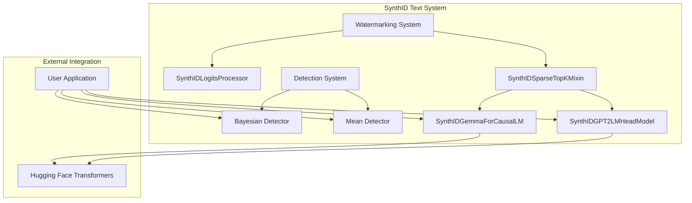
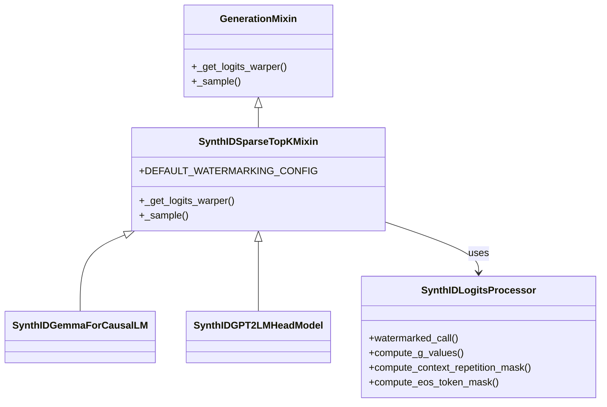
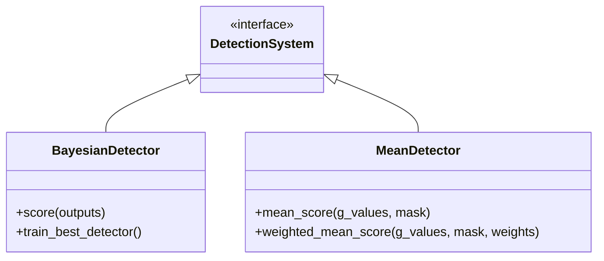
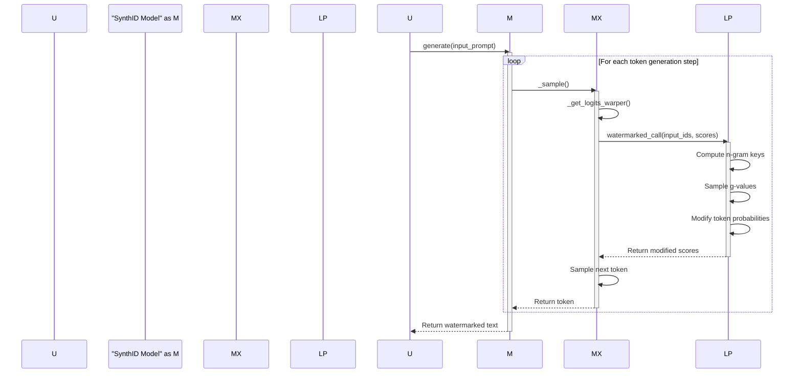
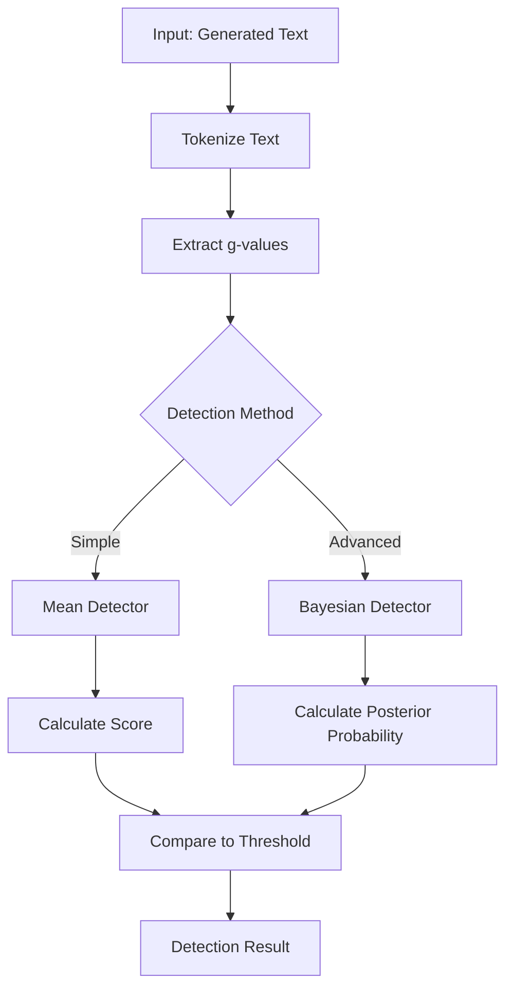

<!-- source: DeepWiki mcp.deepwiki.com · repo google-deepmind/synthid-text · page 1 Overview · fetched 2026-10-26 -->

# Overview

Relevant source files

The following files were used as context for generating this wiki page:

- [README.md](README.md)
- [pyproject.toml](pyproject.toml)

## Purpose and Scope

SynthID Text is a reference implementation for watermarking and detecting text generated by large language models (LLMs). It provides tools to embed subtle statistical patterns into AI-generated text that can later be detected, while maintaining the quality and coherence of the text. This overview introduces the core concepts, components, and architecture of the SynthID Text system.

This document covers the high-level structure and functionality of the SynthID Text repository. For detailed information about the system architecture, see [System Architecture](#2), for integration guidance see [Integration Guide](#3), and for API documentation see [API Reference](#4).

Sources: [README.md:1-8](), [pyproject.toml:11-12]()

## Key Capabilities

SynthID Text provides two primary capabilities:

1. **Watermarking**: Embeds invisible statistical patterns in text during the generation process
2. **Detection**: Analyzes text to determine whether it contains a watermark

The system is designed to work with popular language models, including Gemma and GPT-2, through integration with the Hugging Face Transformers library.

Sources: [README.md:3-8](), [README.md:15-23]()

## System Overview

SynthID Text consists of two subsystems that work together: the watermarking system for embedding patterns in generated text, and the detection system for analyzing text to determine if it contains a watermark.

Sources: [README.md:15-23]()

## Watermarking System

The watermarking system modifies the text generation process by subtly altering token probabilities during sampling. This is done through:

1. A `SynthIDSparseTopKMixin` class that extends Hugging Face model classes
2. A `SynthIDLogitsProcessor` that handles the watermarking logic

Watermarking uses n-gram tokens to compute keys and modify token selection probabilities in a way that maintains text quality while embedding a detectable pattern.

The diagram shows how the SynthID components extend the Hugging Face Transformers library to enable watermarking. The mixin approach allows watermarking to be added without modifying the original model code.

Sources: [README.md:15-19](), [README.md:92-124]()

## Detection System

The detection system analyzes text to determine if it contains a watermark. SynthID Text provides two detection methods:

1. **Mean Detector**: A simple, training-free approach that calculates mean scores of extracted watermark features
2. **Bayesian Detector**: A more sophisticated approach that requires training but offers better performance

The detection process extracts "g-values" from text, which represent evidence of watermarking, and then applies statistical analysis to determine whether the text contains a watermark.

Sources: [README.md:20-27](), [README.md:175-185]()

## Watermarking Process Flow

The following diagram illustrates how text generation with watermarking works:

During text generation, the watermarking components modify the token selection process to subtly influence which tokens are selected, creating a statistical pattern that can later be detected.

Sources: [README.md:92-124](), [README.md:125-172]()

## Detection Process Flow

The following diagram shows how watermark detection works:

Detection involves extracting g-values from the text and analyzing them using either the Mean Detector or Bayesian Detector to determine if the text contains a watermark.

Sources: [README.md:175-255]()

## Watermarking Configuration

Watermarking is controlled by a configuration that specifies parameters such as n-gram length and keys. The default configuration is defined in `SynthIDSparseTopKMixin.DEFAULT_WATERMARKING_CONFIG`.

Key configuration parameters include:
- `ngram_len`: Length of n-grams used for key computation
- `keys`: Sequence of integers used to generate watermarks
- `sampling_table_size`: Size of the table used for sampling
- `context_history_size`: Size of the context history window

Sources: [README.md:92-124]()

## Limitations and Intended Use

SynthID Text is provided as a reference implementation for research purposes and is not intended for production use. The implementation uses a static watermarking configuration and does not provide cryptographic security guarantees.

For production use, it is recommended to use the official SynthID Text implementation in Hugging Face Transformers.

Sources: [README.md:38-49]()

## Conclusion

SynthID Text provides a framework for watermarking and detecting AI-generated text through integration with Hugging Face Transformers models. The system uses a mixin pattern to add watermarking capabilities during text generation and offers multiple methods for detecting watermarks in text.

For more details on:
- The system architecture, see [System Architecture](#2)
- Integrating with your application, see [Integration Guide](#3)
- API documentation, see [API Reference](#4)
- Human evaluation of watermarked text, see [Human Evaluation](#5)

Sources: [README.md:1-338]()

---

