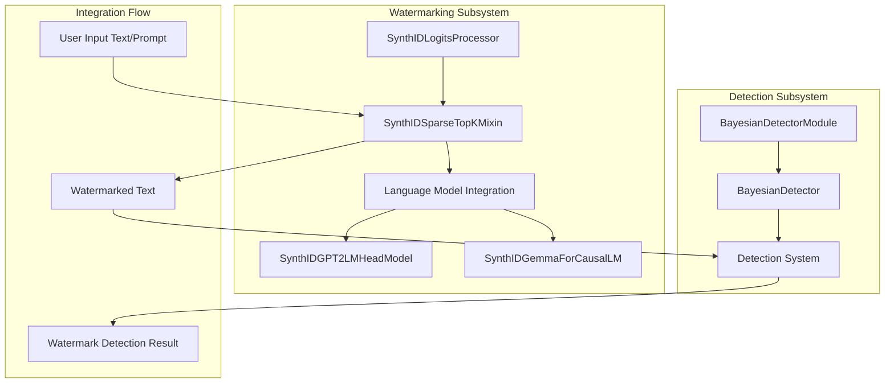
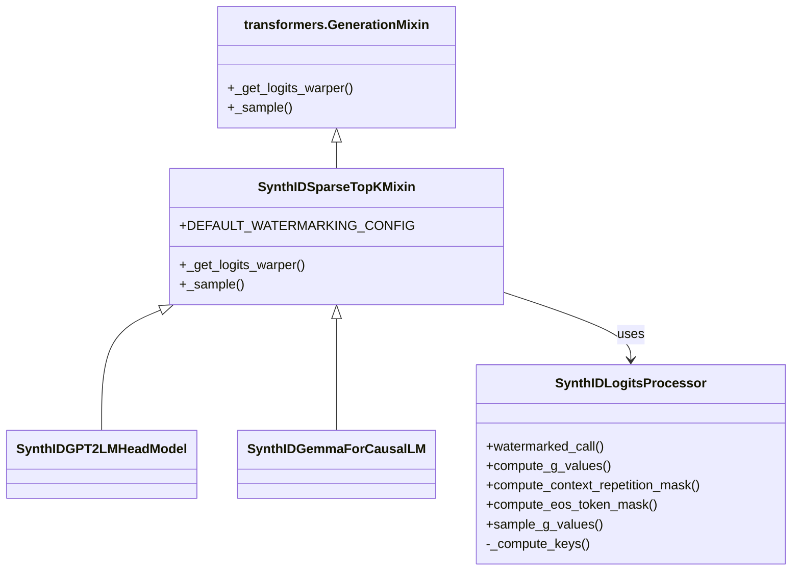
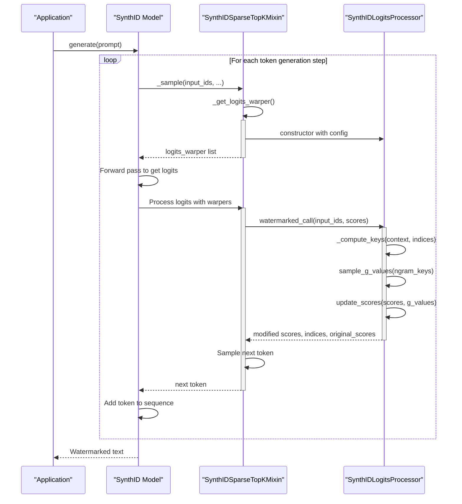
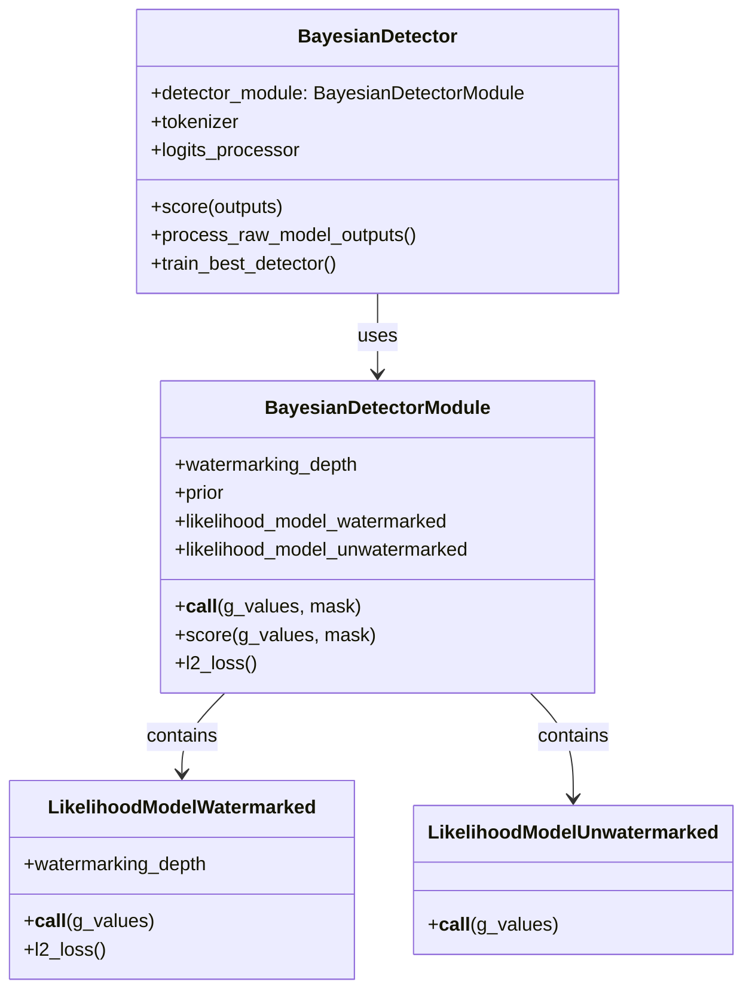
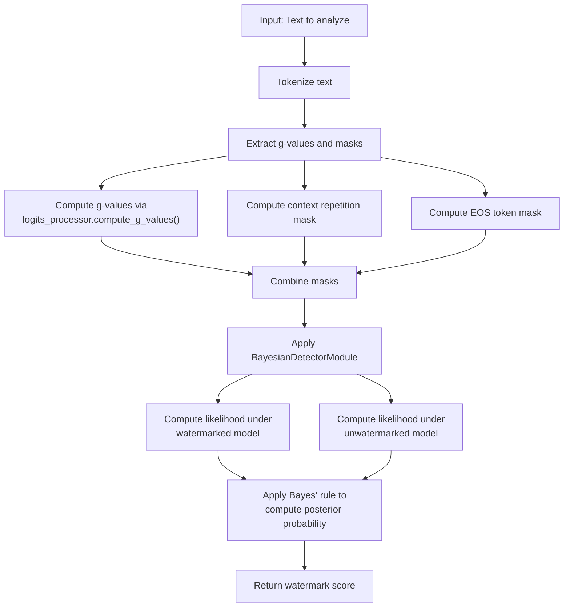
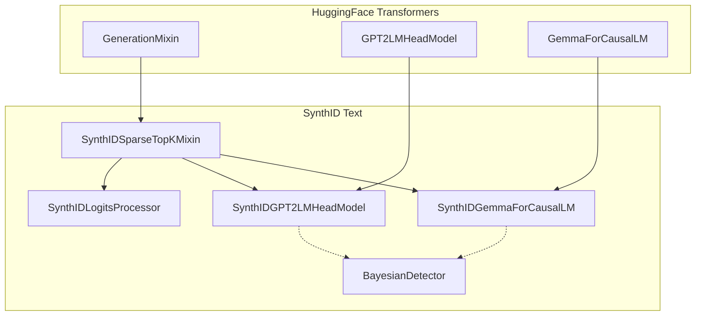
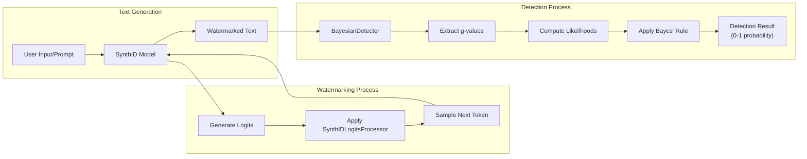

<!-- source: DeepWiki mcp.deepwiki.com · repo google-deepmind/synthid-text · page 2 System Architecture · fetched 2026-10-26 -->

# System Architecture

Relevant source files

The following files were used as context for generating this wiki page:

- [src/synthid_text/detector_bayesian.py](src/synthid_text/detector_bayesian.py)
- [src/synthid_text/logits_processing.py](src/synthid_text/logits_processing.py)
- [src/synthid_text/synthid_mixin.py](src/synthid_text/synthid_mixin.py)

This document provides a comprehensive overview of the SynthID Text system architecture, detailing how the watermarking and detection components interact to enable AI-generated text identification. For specific integration instructions, see [Integration Guide](#3).

## Core Architecture Overview

SynthID Text consists of two primary subsystems:

1. **Watermarking System**: Embeds watermarks into text during generation
2. **Detection System**: Analyzes text to determine if it contains a watermark

These systems work together to provide a complete solution for watermarking and detecting AI-generated text:

Sources: [src/synthid_text/synthid_mixin.py:16-408](), [src/synthid_text/detector_bayesian.py:16-1068](), [src/synthid_text/logits_processing.py:16-542]()

## Watermarking Architecture

The watermarking system modifies the token generation process of language models to subtly embed watermarks by biasing the token selection process.

### Watermarking Components

Sources: [src/synthid_text/synthid_mixin.py:73-408](), [src/synthid_text/logits_processing.py:126-542]()

### Key Watermarking Components:

1. **SynthIDSparseTopKMixin**: A mixin class that extends Hugging Face's `GenerationMixin` to add watermarking capabilities. It:
   - Overrides `_get_logits_warper()` to inject the watermarking logic
   - Overrides `_sample()` to modify the token selection process
   - Provides a default watermarking configuration

2. **SynthIDLogitsProcessor**: The core processor that implements the watermarking logic:
   - Computes g-values based on n-gram context
   - Updates token probability scores based on these g-values
   - Maintains state across generation steps
   - Handles watermark embedding through the `watermarked_call()` method

3. **Model Integration Classes**:
   - `SynthIDGPT2LMHeadModel`: GPT-2 model with watermarking capability
   - `SynthIDGemmaForCausalLM`: Gemma model with watermarking capability

Sources: [src/synthid_text/synthid_mixin.py:73-408](), [src/synthid_text/logits_processing.py:126-542]()

### Watermarking Process

The watermarking process modifies token probabilities during generation:

Sources: [src/synthid_text/synthid_mixin.py:132-396](), [src/synthid_text/logits_processing.py:235-337]()

### Default Watermarking Configuration

The system has the following default configuration parameters:

| Parameter | Value | Description |
|-----------|-------|-------------|
| ngram_len | 5 | Length of n-grams used for context (H=4 in paper) |
| keys | [654, 400, ...] | Keys for the watermarking hash function |
| sampling_table_size | 2^16 | Size of sampling table for g-values |
| sampling_table_seed | 0 | Seed for random sampling table |
| context_history_size | 1024 | Size of context history buffer |

Sources: [src/synthid_text/synthid_mixin.py:28-70]()

## Detection Architecture

The detection system analyzes text to determine if it contains watermarks embedded by the watermarking system.

### Detection Components

Sources: [src/synthid_text/detector_bayesian.py:704-1068](), [src/synthid_text/detector_bayesian.py:385-452]()

### Key Detection Components:

1. **BayesianDetector**: The main detector class that:
   - Scores text for the likelihood of being watermarked
   - Processes raw model outputs for detector training
   - Provides methods for training the best detector

2. **BayesianDetectorModule**: Core implementation that:
   - Computes the posterior probability of text being watermarked
   - Uses likelihood models for both watermarked and unwatermarked text
   - Applies Bayes' rule to compute final scores

3. **Likelihood Models**:
   - `LikelihoodModelWatermarked`: Models p(g_values|watermarked)
   - `LikelihoodModelUnwatermarked`: Models p(g_values|unwatermarked)

Sources: [src/synthid_text/detector_bayesian.py:385-452](), [src/synthid_text/detector_bayesian.py:209-336]()

### Detection Process

Sources: [src/synthid_text/detector_bayesian.py:724-758](), [src/synthid_text/logits_processing.py:451-542]()

## System Integration

SynthID Text integrates with existing language model frameworks, primarily Hugging Face Transformers:

Sources: [src/synthid_text/synthid_mixin.py:399-408](), [src/synthid_text/detector_bayesian.py:704-723]()

## Data Flow Between Components

The following diagram shows the data flow within the SynthID Text system:

Sources: [src/synthid_text/synthid_mixin.py:132-396](), [src/synthid_text/detector_bayesian.py:724-758]()

## Key Implementation Details

### Watermarking Mechanism

The watermarking mechanism relies on several key techniques:

1. **Context-Based Hashing**: Uses n-grams from previous tokens to influence future token selection
2. **G-Value Computation**: Computes binary g-values based on hashing with predefined keys
3. **Probability Redistribution**: Modifies token probabilities based on g-values
4. **Sparse Top-K Approach**: Works only with the top-k token candidates for efficiency

The `SynthIDLogitsProcessor.watermarked_call()` method implements this process by:
1. Applying temperature and top-k filtering
2. Computing keys from context and candidate tokens
3. Sampling g-values for each candidate token
4. Updating token scores based on g-values
5. Checking for context repetition

Sources: [src/synthid_text/logits_processing.py:235-337](), [src/synthid_text/synthid_mixin.py:88-130]()

### Detection Implementation

The detection process follows these key steps:

1. **G-Value Extraction**: Extracts g-values from the text using the same algorithm used for watermarking
2. **Mask Computation**: Computes masks to filter out tokens that should not be considered
3. **Likelihood Calculation**: Calculates likelihood under both watermarked and unwatermarked models
4. **Posterior Computation**: Applies Bayes' rule to compute the posterior probability of the text being watermarked

The `BayesianDetector.score()` method:
1. Computes masks (EOS token mask, context repetition mask)
2. Extracts g-values from the text
3. Passes these to the `BayesianDetectorModule` for scoring

Sources: [src/synthid_text/detector_bayesian.py:724-758](), [src/synthid_text/detector_bayesian.py:420-442]()

## Conclusion

The SynthID Text architecture provides a comprehensive solution for watermarking and detecting AI-generated text through:

1. A flexible mixin-based approach that can be applied to different language models
2. A stateful watermarking process that modifies token probabilities during generation
3. A Bayesian detection system that can be trained on watermarked and unwatermarked samples
4. Integration with popular frameworks like Hugging Face Transformers

For details on how to use the system, see the [Integration Guide](#3), and for API reference information, see the [API Reference](#4).

---

