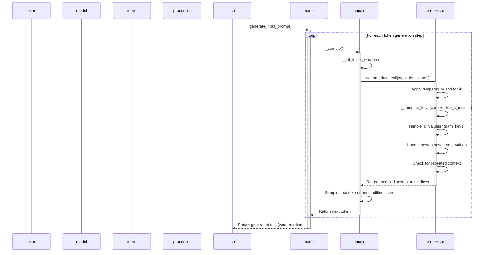
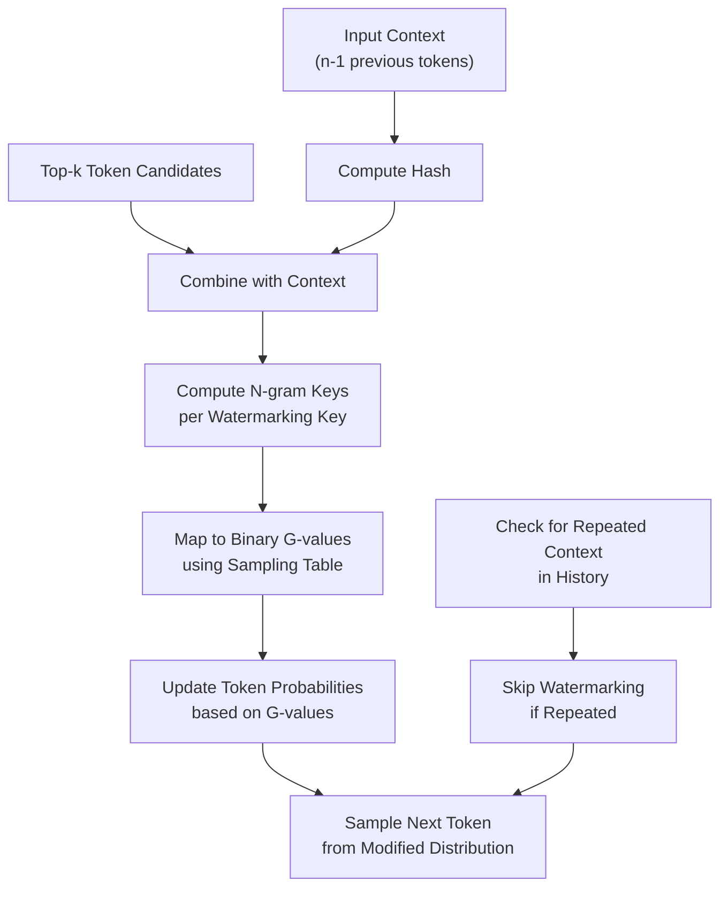

<!-- source: DeepWiki mcp.deepwiki.com · repo google-deepmind/synthid-text · page 2.1 Watermarking System · fetched 2026-10-26 -->

# Watermarking System

<details>
<summary>Relevant source files</summary>

The following files were used as context for generating this wiki page:

- [src/synthid_text/logits_processing.py](src/synthid_text/logits_processing.py)
- [src/synthid_text/synthid_mixin.py](src/synthid_text/synthid_mixin.py)
- [src/synthid_text/synthid_mixin_test.py](src/synthid_text/synthid_mixin_test.py)

</details>


## Purpose and Scope

This document describes the watermarking system in SynthID Text, which embeds detectable patterns into text generated by language models. The watermarking process subtly modifies token probabilities during text generation, creating statistical patterns that can be detected while maintaining text quality. For information about detecting watermarks in generated text, see [Detection System](#2.2).

Sources: [src/synthid_text/synthid_mixin.py:15-18](), [src/synthid_text/logits_processing.py:15-17]()

## Architecture Overview

The watermarking system integrates with Hugging Face Transformers models using a mixin pattern that overrides key generation methods without modifying the original model code.

### Watermarking System Architecture

```mermaid
classDiagram
    class "transformers.GenerationMixin" {
        +_get_logits_warper()
        +_sample()
    }
    
    class "SynthIDSparseTopKMixin" {
        +_get_logits_warper()
        +_sample()
        +_construct_warper_list()
        +DEFAULT_WATERMARKING_CONFIG
    }
    
    class "SynthIDLogitsProcessor" {
        +watermarked_call()
        +compute_g_values()
        +sample_g_values()
        -_compute_keys()
    }
    
    class "SynthIDGemmaForCausalLM" {
    }
    
    class "SynthIDGPT2LMHeadModel" {
    }
    
    "transformers.GenerationMixin" <|-- "SynthIDSparseTopKMixin"
    "SynthIDSparseTopKMixin" <|-- "SynthIDGemmaForCausalLM"
    "SynthIDSparseTopKMixin" <|-- "SynthIDGPT2LMHeadModel"
    "SynthIDSparseTopKMixin" --> "SynthIDLogitsProcessor" : uses
```

Sources: [src/synthid_text/synthid_mixin.py:73-86](), [src/synthid_text/logits_processing.py:126-136]()

## Key Components

### SynthIDSparseTopKMixin

The `SynthIDSparseTopKMixin` class extends Hugging Face's `GenerationMixin` to integrate watermarking capabilities:

- Overrides `_get_logits_warper()` to create a warper list containing the watermarking processor
- Overrides `_sample()` to apply watermarking during the token generation process
- Works with a sparse top-k implementation for efficiency
- Contains default watermarking configuration parameters

Sources: [src/synthid_text/synthid_mixin.py:73-96]()

### SynthIDLogitsProcessor

The `SynthIDLogitsProcessor` class implements the core watermarking functionality:

- Modifies token probabilities based on hash values derived from n-gram context
- Uses a pre-computed sampling table to map hashed n-gram keys to binary g-values
- Tracks context history to avoid watermarking repeated contexts
- Provides methods for computing g-values, context repetition masks, and EOS token masks

Sources: [src/synthid_text/logits_processing.py:126-214]()

### Default Configuration Parameters

The system uses a default configuration with the following key parameters:

| Parameter | Value | Description |
|-----------|-------|-------------|
| ngram_len | 5 | Length of n-grams used (context window size + 1) |
| keys | [654, 400, 836, ...] | 31 integer keys used for watermarking |
| sampling_table_size | 2^16 | Size of the pre-computed sampling table |
| sampling_table_seed | 0 | Random seed for generating the sampling table |
| context_history_size | 1024 | Size of the tensor tracking seen contexts |

Sources: [src/synthid_text/synthid_mixin.py:28-70]()

## Watermarking Process Flow

### Generation Process with Watermarking



Sources: [src/synthid_text/synthid_mixin.py:132-396](), [src/synthid_text/logits_processing.py:234-337]()

## Watermarking Algorithm

### N-gram Hashing and G-value Computation



Sources: [src/synthid_text/logits_processing.py:338-442](), [src/synthid_text/logits_processing.py:26-54]()

The watermarking algorithm operates as follows:

1. For each token generation step, the system extracts the current context (previous n-1 tokens)
2. The top-k token candidates are selected based on their logit scores
3. For each candidate token, the system:
   - Computes a hash of the n-gram formed by the context plus the candidate token
   - For each watermarking key, computes a new hash to derive the final n-gram key
   - Maps each n-gram key to a binary g-value (0 or 1) using the pre-computed sampling table
4. Token probabilities are updated based on their g-values
5. The system checks if the current context was previously seen, and if so, skips watermarking
6. A token is sampled from the modified probability distribution

Sources: [src/synthid_text/logits_processing.py:234-337]()

### Token Probability Modification

The `update_scores` function modifies token probabilities based on the g-values:

```
For each depth in the g-values:
1. Calculate the current g-mass (weighted sum of g-values)
2. Update probabilities: p_new = p_old * (1 + g_value - g_mass)
3. Convert back to log probabilities
```

This approach subtly biases the selection toward tokens with g-value=1, creating a statistical pattern that can be detected.

Sources: [src/synthid_text/logits_processing.py:26-54]()

## Model Integration

The watermarking system integrates with Hugging Face models using concrete implementations:

- `SynthIDGPT2LMHeadModel`: Adds watermarking to GPT-2 models
- `SynthIDGemmaForCausalLM`: Adds watermarking to Gemma models

Both classes inherit from `SynthIDSparseTopKMixin` and their respective base model classes, allowing them to add watermarking while maintaining all original functionality.

Sources: [src/synthid_text/synthid_mixin.py:399-407]()

## Technical Implementation Details

### SynthIDState

The `SynthIDState` class maintains state during the watermarking process:

- Tracks the current context (last n-1 tokens)
- Maintains a history of previously seen contexts
- Counts the number of calls to enable skipping initial tokens if needed

Sources: [src/synthid_text/logits_processing.py:95-123]()

### Efficiency Considerations

The system implements several optimizations:

1. **Sparse Top-K Processing**: Only watermarks the top-k token candidates instead of the entire vocabulary
2. **Context Repetition Handling**: Avoids redundant watermarking of repeated contexts
3. **Pre-computed Sampling Table**: Uses a fixed-size table for efficient g-value lookup

Sources: [src/synthid_text/synthid_mixin.py:88-102](), [src/synthid_text/logits_processing.py:216-223]()

## Relationship to Detection

The watermarking system is designed to work in tandem with the detection system. The statistical patterns embedded by the watermarking process can be extracted and analyzed by the detectors to determine if text was generated with watermarking enabled. For details on how detection works, see the [Detection System](#2.2) page.

Sources: [src/synthid_text/logits_processing.py:338-467]()

---

