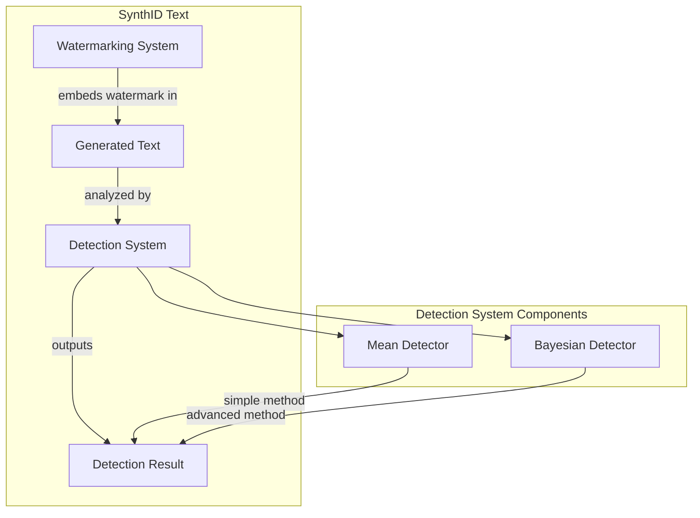
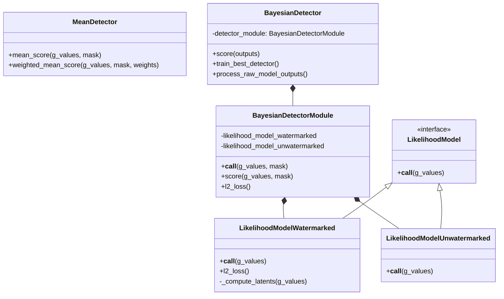
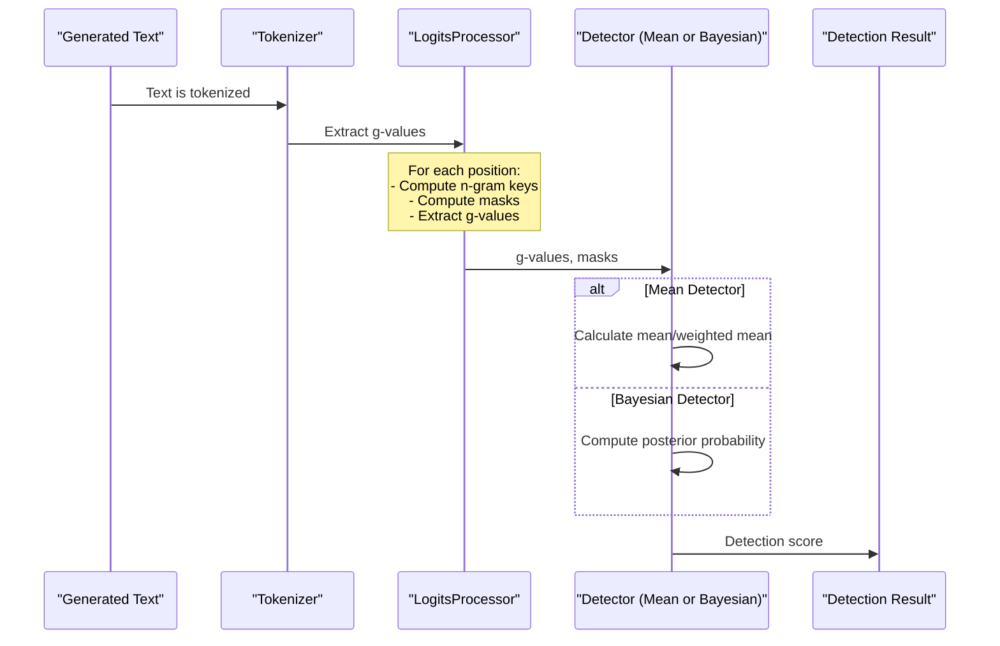
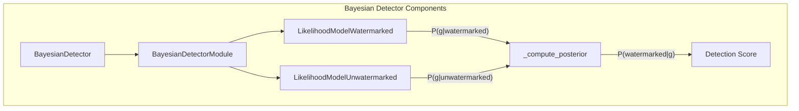
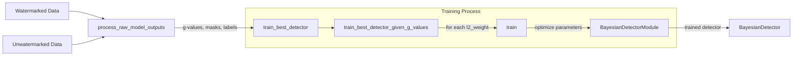
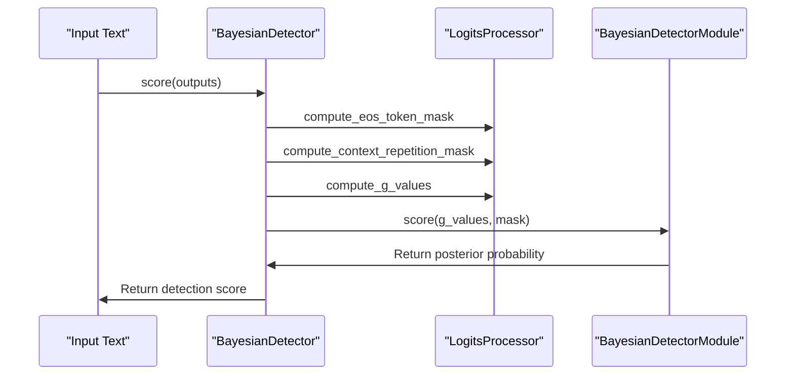

<!-- source: DeepWiki mcp.deepwiki.com · repo google-deepmind/synthid-text · page 2.2 Detection System · fetched 2026-10-26 -->

# Detection System

<details>
<summary>Relevant source files</summary>

The following files were used as context for generating this wiki page:

- [src/synthid_text/detector_bayesian.py](src/synthid_text/detector_bayesian.py)
- [src/synthid_text/detector_mean.py](src/synthid_text/detector_mean.py)
- [src/synthid_text/g_value_expectations.py](src/synthid_text/g_value_expectations.py)

</details>


The Detection System in SynthID Text is responsible for analyzing text to determine whether it has been watermarked using the system's watermarking methods. This page documents the detection approaches, their implementation, and how to use them. For information about the watermarking system itself, see [Watermarking System](#2.1).

## Overview

The SynthID Text Detection System offers two detection methods:

1. **Mean Detector** - A simple, training-free approach that calculates the average of g-values to detect watermarks
2. **Bayesian Detector** - A more sophisticated approach that uses Bayesian inference and requires training on watermarked and unwatermarked text

Both methods analyze the statistical patterns in the g-values embedded during the watermarking process to determine whether a given text was watermarked.

Sources: [src/synthid_text/detector_mean.py:16-17](), [src/synthid_text/detector_bayesian.py:16-17]()

## Detection System Architecture

The Detection System fits into the broader SynthID Text framework as shown below:



The Detection System operates on g-values, which are statistical features extracted from the tokenized text. These g-values carry the watermark signal that was embedded during text generation.

### Detection Components



Sources: [src/synthid_text/detector_mean.py:22-77](), [src/synthid_text/detector_bayesian.py:704-1068](), [src/synthid_text/detector_bayesian.py:385-451](), [src/synthid_text/detector_bayesian.py:209-337]()

### Detection Process Flow



Sources: [src/synthid_text/detector_bayesian.py:724-758](), [src/synthid_text/detector_mean.py:22-77]()

## Mean Detector

The Mean Detector provides a simple, training-free method for watermark detection. It's based on the principle that watermarked text will have g-values with a mean significantly higher than 0.5 (the expected mean for unwatermarked text).

### Implementation

The Mean Detector offers two scoring functions:

1. **Mean Score** - Simple average of g-values:
   ```python
   def mean_score(g_values, mask):
       # ...returns the mean of masked g-values
   ```

2. **Weighted Mean Score** - Applies weights to g-values before averaging:
   ```python
   def weighted_mean_score(g_values, mask, weights=None):
       # ...returns weighted mean of masked g-values
   ```

Both functions take g-values (shape `[batch_size, seq_len, watermarking_depth]`) and a mask (shape `[batch_size, seq_len]`) as input and return scores of shape `[batch_size]`.

Sources: [src/synthid_text/detector_mean.py:22-77]()

### Expected G-Values

For watermarked text using a tournament tree with 2 leaves (the default configuration), the expected mean g-value can be calculated as:

```
expected_mean = 0.5 + 0.25 * (1 - (1 / vocab_size))
```

For unwatermarked text, the expected mean g-value is always 0.5.

Sources: [src/synthid_text/g_value_expectations.py:19-49]()

## Bayesian Detector

The Bayesian Detector is a more sophisticated approach that uses Bayesian inference to calculate the posterior probability that a text is watermarked given its g-values. It requires training on watermarked and unwatermarked examples to learn the parameters of the likelihood models.

### Architecture



The Bayesian Detector has three main components:
1. **BayesianDetector** - The main class that handles detection
2. **BayesianDetectorModule** - A Flax module that implements the Bayesian classifier
3. **Likelihood Models** - Models that compute the likelihood of g-values under watermarked and unwatermarked hypotheses

Sources: [src/synthid_text/detector_bayesian.py:385-451](), [src/synthid_text/detector_bayesian.py:704-758](), [src/synthid_text/detector_bayesian.py:209-337]()

### Training Process

The Bayesian Detector requires training to learn the parameters of the likelihood models. The training process is shown below:



The training process consists of the following steps:
1. **Data Processing** - Raw model outputs are processed to extract g-values and masks
2. **Training** - The detector module is trained with different L2 regularization weights
3. **Selection** - The best detector (with the lowest validation loss) is selected

Sources: [src/synthid_text/detector_bayesian.py:940-1068](), [src/synthid_text/detector_bayesian.py:513-701]()

### Scoring Process

Once trained, the Bayesian Detector can be used to score text as follows:



The score returned is the posterior probability that the text is watermarked, given its g-values.

Sources: [src/synthid_text/detector_bayesian.py:724-758]()

## Usage Guide

### Using the Mean Detector

The Mean Detector functions are simple to use and don't require training:

```python
# Example usage
from synthid_text.detector_mean import mean_score, weighted_mean_score

# Calculate mean score
score = mean_score(g_values, mask)

# Calculate weighted mean score
weighted_score = weighted_mean_score(g_values, mask, weights=None)
```

Sources: [src/synthid_text/detector_mean.py:22-77]()

### Training and Using the Bayesian Detector

Training a Bayesian Detector requires watermarked and unwatermarked examples:

```python
# Example training
detector, min_val_loss = BayesianDetector.train_best_detector(
    tokenized_wm_outputs=watermarked_outputs,
    tokenized_uwm_outputs=unwatermarked_outputs,
    logits_processor=logits_processor,
    tokenizer=tokenizer,
    torch_device=device
)

# Using the trained detector
scores = detector.score(outputs)
```

The Bayesian Detector also provides more detailed methods to customize the training process:

| Method | Purpose |
|--------|---------|
| `train_best_detector` | End-to-end training from raw outputs |
| `process_raw_model_outputs` | Process outputs into g-values and masks |
| `train_best_detector_given_g_values` | Train detector from processed g-values |

Sources: [src/synthid_text/detector_bayesian.py:940-1068](), [src/synthid_text/detector_bayesian.py:761-938]()

## Performance Considerations

The choice between Mean Detector and Bayesian Detector involves trade-offs:

| Detector | Advantages | Disadvantages |
|----------|------------|---------------|
| Mean Detector | - No training required<br>- Simple implementation<br>- Fast inference | - Less accurate<br>- Higher false positive/negative rates |
| Bayesian Detector | - More accurate detection<br>- Better handling of edge cases<br>- Provides posterior probabilities | - Requires training<br>- More complex implementation<br>- More resource-intensive |

The Bayesian Detector is recommended for applications requiring high accuracy, while the Mean Detector is suitable for quick testing or resource-constrained environments.

Sources: [src/synthid_text/detector_bayesian.py:383-451](), [src/synthid_text/detector_mean.py:22-77]()

---

