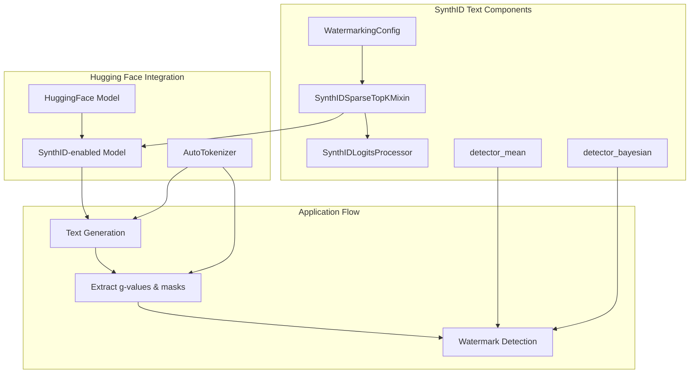
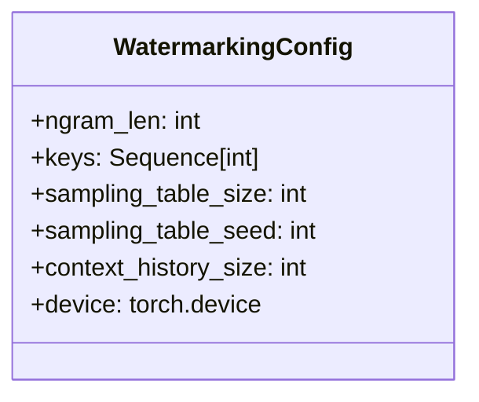
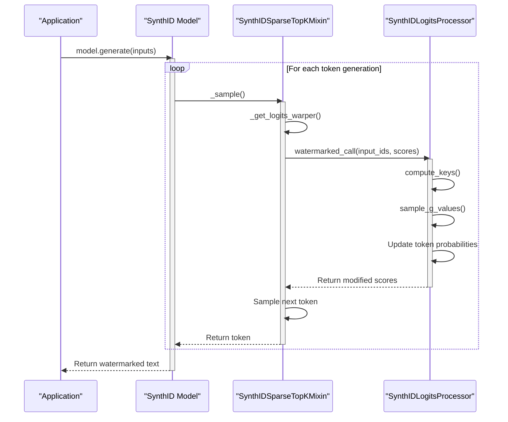
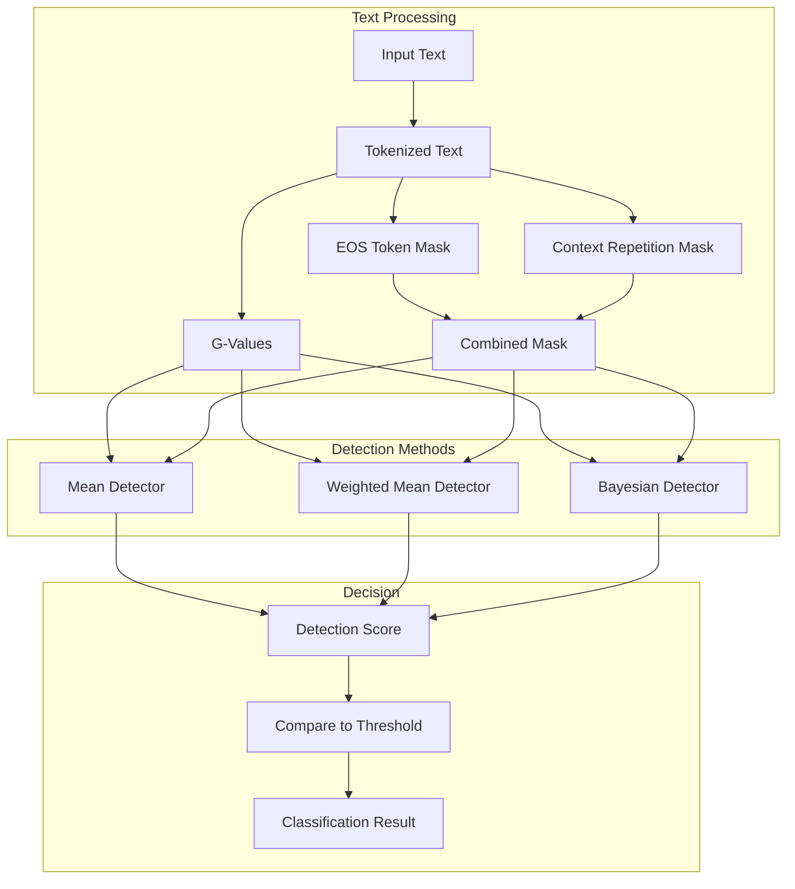
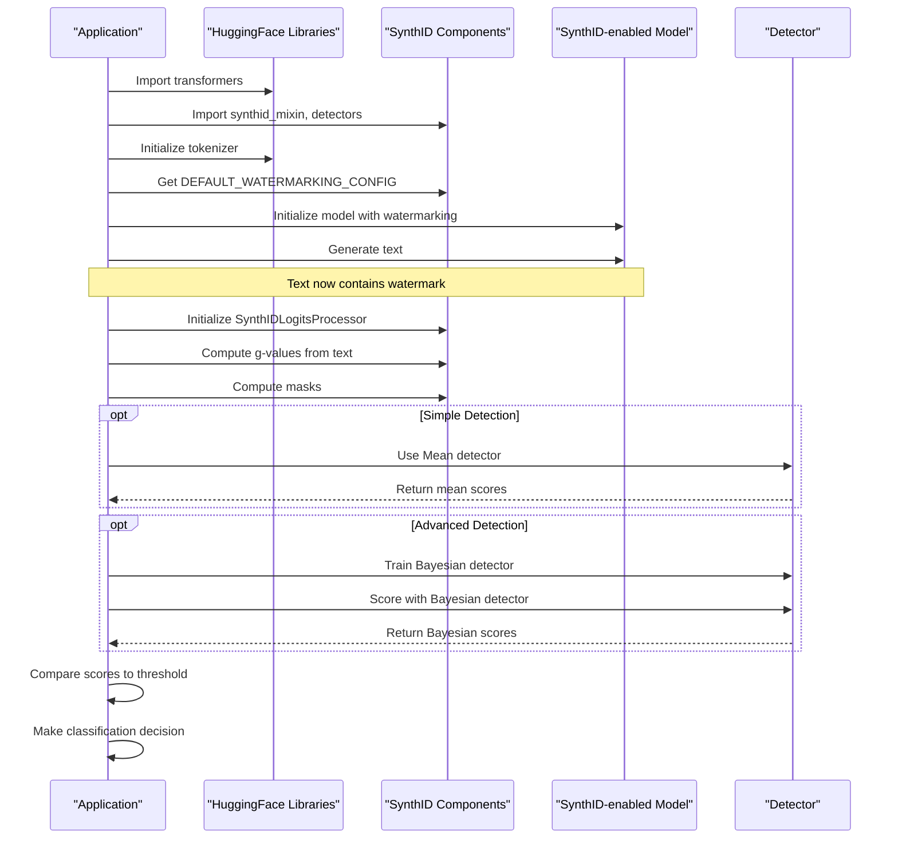

<!-- source: DeepWiki mcp.deepwiki.com · repo google-deepmind/synthid-text · page 3 Integration Guide · fetched 2026-10-26 -->

# Integration Guide

<details>
<summary>Relevant source files</summary>

The following files were used as context for generating this wiki page:

- [README.md](README.md)
- [notebooks/synthid_text_huggingface_integration.ipynb](notebooks/synthid_text_huggingface_integration.ipynb)

</details>


This guide provides practical instructions for integrating SynthID Text watermarking and detection capabilities with language models. The focus is on integration with Hugging Face Transformers models, demonstrating how to apply watermarks during text generation and detect watermarks in generated text.

For a high-level overview of SynthID Text, see [Overview](#1). For details about the system architecture, see [System Architecture](#2). For specific details about Hugging Face integration, see [Hugging Face Integration](#3.1).

## Installation Options

Before integrating SynthID Text, you need to install the library using one of the following methods:

### PyPI Installation

```
pip install synthid-text
```

### Source Installation

```
# Clone the repository
git clone https://github.com/google-deepmind/synthid-text.git
cd synthid-text

# For local notebook use
pip install '.[notebook-local]'

# For running tests
pip install '.[test]'
```

Sources: [README.md:10-87]()

## Integration Architecture

SynthID Text integration revolves around two main components:

1. **Watermarking**: Adding a statistical watermark to LLM-generated text using a mixin class
2. **Detection**: Identifying watermarked text using either a Mean detector or Bayesian detector

The following diagram illustrates how these components interconnect during integration:



Title: SynthID Text Integration Architecture

Sources: [README.md:15-27](), [notebooks/synthid_text_huggingface_integration.ipynb:57-77]()

## Watermarking Integration

### Watermarking Configuration

SynthID Text uses a configuration object to define watermarking parameters. The most critical parameter is `keys`, which creates a unique watermark signature.



Title: SynthID Text Watermarking Configuration Structure

In the reference implementation, a default static configuration is provided through `DEFAULT_WATERMARKING_CONFIG`:

```python
# Example configuration - actual values may differ
{
    "ngram_len": 3,
    "keys": [5702, 12702, 10473, 15123, 16711, 3087, 5, 3919, 19427, 11373],
    "sampling_table_size": 120000,
    "sampling_table_seed": 42,
    "context_history_size": 32,
    "device": torch.device("cpu")
}
```

**Note**: For production use, consider using unique keys for creating distinct watermarks.

Sources: [README.md:93-118](), [notebooks/synthid_text_huggingface_integration.ipynb:144-156]()

### Watermark-Enabled Models

SynthID Text extends Hugging Face models using a mixin pattern. Currently, it supports:

- `SynthIDGemmaForCausalLM` (for Gemma models)
- `SynthIDGPT2LMHeadModel` (for GPT-2 models)

Here's how to initialize a watermark-enabled model:

```python
from synthid_text import synthid_mixin
import transformers
import torch

# Choose device
DEVICE = torch.device('cuda:0') if torch.cuda.is_available() else torch.device('cpu')

# Initialize tokenizer
MODEL_NAME = 'google/gemma-2b-it'  # or 'gpt2', 'google/gemma-7b-it'
tokenizer = transformers.AutoTokenizer.from_pretrained(MODEL_NAME)

# Initialize SynthID-enabled model
model = synthid_mixin.SynthIDGemmaForCausalLM.from_pretrained(
    MODEL_NAME,
    device_map='auto',
    torch_dtype=torch.bfloat16,
)

# Generate watermarked text using standard HF API
inputs = tokenizer(
    ["I enjoy walking with my cute dog"],
    return_tensors='pt',
    padding=True,
).to(DEVICE)

outputs = model.generate(
    **inputs,
    do_sample=True,
    max_length=1024,
    temperature=0.5,
    top_k=40,
    top_p=0.99,
)
```

The watermarking process flows as follows:



Title: SynthID Text Watermarking Process Flow

Sources: [README.md:120-172](), [notebooks/synthid_text_huggingface_integration.ipynb:193-226](), [notebooks/synthid_text_huggingface_integration.ipynb:287-326]()

## Detection Integration

SynthID Text provides two approaches for detecting watermarks:

1. **Mean Detector**: Simple, no-training approach
2. **Bayesian Detector**: More sophisticated approach requiring training

The detection process involves:



Title: SynthID Text Detection Integration Process

Sources: [README.md:174-255](), [notebooks/synthid_text_huggingface_integration.ipynb:523-532]()

### Mean Detector Integration

The Mean detector provides a straightforward approach without requiring training:

```python
from synthid_text import detector_mean, logits_processing

# Initialize the logits processor with the same configuration used for watermarking
CONFIG = synthid_mixin.DEFAULT_WATERMARKING_CONFIG
logits_processor = logits_processing.SynthIDLogitsProcessor(
    **CONFIG, top_k=40, temperature=0.5
)

# For generated text (outputs), compute masks
eos_token_mask = logits_processor.compute_eos_token_mask(
    input_ids=outputs,
    eos_token_id=tokenizer.eos_token_id,
)[:, CONFIG['ngram_len'] - 1 :]

context_repetition_mask = logits_processor.compute_context_repetition_mask(
    input_ids=outputs
)

combined_mask = context_repetition_mask * eos_token_mask

# Compute g-values
g_values = logits_processor.compute_g_values(
    input_ids=outputs,
)

# Get detection scores
mean_scores = detector_mean.mean_score(
    g_values.cpu().numpy(), combined_mask.cpu().numpy()
)

# Or use weighted mean for potentially better performance
weighted_mean_scores = detector_mean.weighted_mean_score(
    g_values.cpu().numpy(), combined_mask.cpu().numpy()
)
```

Higher scores indicate a higher likelihood of watermarked text.

Sources: [README.md:174-189](), [notebooks/synthid_text_huggingface_integration.ipynb:637-690]()

### Bayesian Detector Integration

The Bayesian detector provides more sophisticated detection but requires training:

1. **Generate training data**:
   - Create watermarked samples
   - Obtain unwatermarked samples

2. **Train the detector**:
   ```python
   from synthid_text import detector_bayesian
   
   bayesian_detector, test_loss = detector_bayesian.BayesianDetector.train_best_detector(
       tokenized_wm_outputs=watermarked_outputs,
       tokenized_uwm_outputs=unwatermarked_outputs,
       logits_processor=logits_processor,
       tokenizer=tokenizer,
       torch_device=device,
       max_padded_length=1000,
       pos_truncation_length=200,
       neg_truncation_length=200,
       verbose=True,
       learning_rate=3e-3,
       n_epochs=100,
   )
   ```

3. **Use the trained detector**:
   ```python
   bayesian_scores = bayesian_detector.score(
       g_values.cpu().numpy(), combined_mask.cpu().numpy()
   )
   ```

Sources: [README.md:190-214](), [notebooks/synthid_text_huggingface_integration.ipynb:694-853]()

## Complete Integration Workflow

Here's a comprehensive workflow for integrating SynthID Text:



Title: End-to-End SynthID Text Integration Workflow

Sources: [notebooks/synthid_text_huggingface_integration.ipynb:1-77](), [notebooks/synthid_text_huggingface_integration.ipynb:287-326](), [notebooks/synthid_text_huggingface_integration.ipynb:637-690](), [notebooks/synthid_text_huggingface_integration.ipynb:694-854]()

## Integration Considerations

### Hardware Requirements

Different models have different hardware requirements:

| Model | Recommended Hardware | Memory Requirement |
|-------|---------------------|-------------------|
| Gemma 2B IT | GPU with 16GB (e.g., T4) | ~16GB |
| Gemma 7B IT | GPU with 32GB (e.g., A100) | ~32GB |
| GPT-2 | Any runtime (CPU or GPU) | ~2GB |

### Watermarking Impact on Text Quality

Watermarking slightly modifies token selection probabilities, which may theoretically impact text quality. However, the SynthID approach is designed to maintain high-quality outputs with minimal perplexity increase.

You can measure this impact using perplexity comparison between watermarked and unwatermarked outputs, as demonstrated in the example notebook.

### Detection Thresholds

When using detection scores, you'll need to determine appropriate thresholds:

- Higher thresholds reduce false positives but may increase false negatives
- Lower thresholds reduce false negatives but may increase false positives

The optimal threshold depends on your specific use case and desired false positive/negative rates.

Sources: [notebooks/synthid_text_huggingface_integration.ipynb:109-134](), [notebooks/synthid_text_huggingface_integration.ipynb:334-343](), [notebooks/synthid_text_huggingface_integration.ipynb:637-690]()

## Limitations and Notes

- The reference implementation uses a static watermarking configuration. For production use, consider using unique keys.
- The hashing function used in the reference implementation does not provide cryptographic security guarantees.
- For production-ready implementation, refer to the official SynthID Text implementation in Hugging Face Transformers.

Sources: [README.md:38-49]()

---

