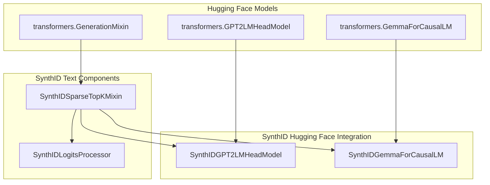
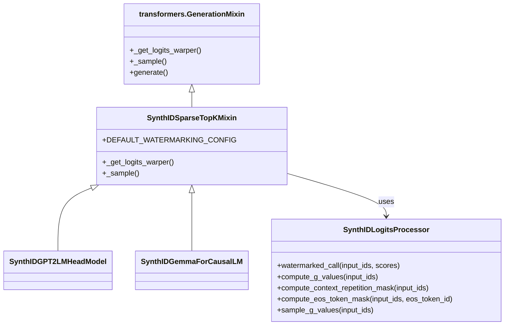
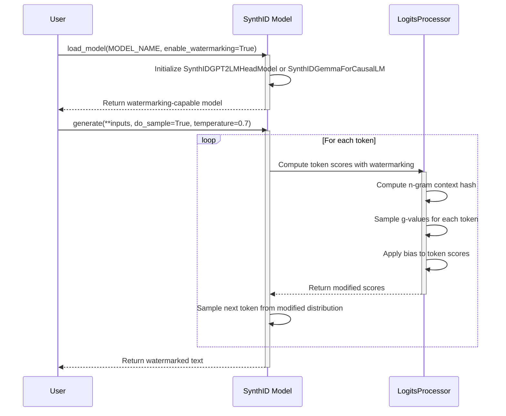
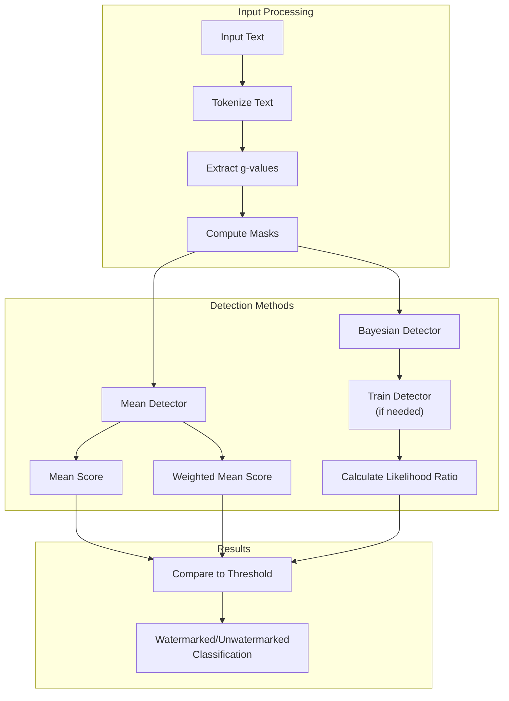

<!-- source: DeepWiki mcp.deepwiki.com · repo google-deepmind/synthid-text · page 3.1 Hugging Face Integration · fetched 2026-10-26 -->

# Hugging Face Integration

<details>
<summary>Relevant source files</summary>

The following files were used as context for generating this wiki page:

- [notebooks/synthid_text_huggingface_integration.ipynb](notebooks/synthid_text_huggingface_integration.ipynb)
- [notebooks/testing_huggingface_integration.ipynb](notebooks/testing_huggingface_integration.ipynb)

</details>


This document provides a detailed guide for integrating SynthID Text watermarking and detection capabilities with Hugging Face Transformers models. It covers how to set up, configure, and use SynthID Text with popular language models like Gemma and GPT-2 through the Hugging Face interface.

## Overview

SynthID Text integrates with Hugging Face Transformers through a specialized mixin pattern that extends model classes without modifying their original code. This allows for seamless watermarking of text generated by these models while maintaining text quality.



*Diagram: SynthID Text integration with Hugging Face Transformers models*

Sources: [notebooks/synthid_text_huggingface_integration.ipynb:197-215]()

## Setup and Installation

### Prerequisites

To use SynthID Text with Hugging Face models, you need to install:

```bash
pip install synthid-text[notebook]
```

This installation includes the SynthID Text library and additional dependencies needed for notebook usage.

### Required Imports

```python
from synthid_text import detector_mean
from synthid_text import logits_processing
from synthid_text import synthid_mixin
from synthid_text import detector_bayesian
import torch
import transformers
```

Sources: [notebooks/synthid_text_huggingface_integration.ipynb:62-77]()

## Supported Models

SynthID Text currently provides integration with the following models:

| Model | SynthID Class | Base Hugging Face Class |
|-------|---------------|-------------------------|
| GPT-2 | SynthIDGPT2LMHeadModel | transformers.GPT2LMHeadModel |
| Gemma | SynthIDGemmaForCausalLM | transformers.GemmaForCausalLM |

The implementation works with various model sizes:
- Gemma 2B
- Gemma 7B
- GPT-2 (all variants)

Sources: [notebooks/synthid_text_huggingface_integration.ipynb:95-105](), [notebooks/synthid_text_huggingface_integration.ipynb:197-225]()

## Integration Architecture

SynthID Text integrates with Hugging Face Transformers through a specialized mixin pattern that extends the base `GenerationMixin` class. This allows it to intercept and modify the text generation process to apply watermarks.



*Diagram: Class hierarchy of SynthID Text integration with Hugging Face*

Sources: [notebooks/synthid_text_huggingface_integration.ipynb:197-225]()

## Watermarking Configuration

SynthID Text uses a configuration dictionary to control the watermarking process. The most significant parameter is the `keys` sequence that makes each watermark unique.

### Default Configuration

```python
CONFIG = synthid_mixin.DEFAULT_WATERMARKING_CONFIG
```

The default configuration includes:
- `ngram_len`: Length of n-grams used for context hashing
- `keys`: Integer sequence for watermark identification
- `sampling_table_size`: Size of the hash table for watermark sampling
- `sampling_table_seed`: Random seed for reproducibility
- `context_history_size`: Size of context window for repetition detection

Sources: [notebooks/synthid_text_huggingface_integration.ipynb:154-155]()

## Generating Watermarked Text

### Loading a Watermarking-Enabled Model

To use SynthID Text for watermarking, you need to load a model from the SynthID classes rather than the base Hugging Face classes:



*Diagram: Watermarked text generation flow*

Sources: [notebooks/synthid_text_huggingface_integration.ipynb:197-225](), [notebooks/synthid_text_huggingface_integration.ipynb:308-325]()

### Example Code

```python
# Load a watermarking-enabled model
model = load_model(MODEL_NAME, expected_device=DEVICE, enable_watermarking=True)

# Tokenize input prompt
inputs = tokenizer(
    example_inputs,
    return_tensors='pt',
    padding=True,
).to(DEVICE)

# Generate watermarked text
outputs = model.generate(
    **inputs,
    do_sample=True,
    temperature=0.7,
    max_length=1024,
    top_k=40,
)

# Decode the output
for output in outputs:
    print(tokenizer.decode(output, skip_special_tokens=True))
```

Sources: [notebooks/synthid_text_huggingface_integration.ipynb:308-325]()

## Detecting Watermarks

SynthID Text provides two methods for detecting watermarks:

1. **Mean Detector**: A simple, training-free detector that computes average statistic values
2. **Bayesian Detector**: A more sophisticated detector that requires training but offers better detection accuracy

### Watermark Detection Flow



*Diagram: Watermark detection process*

Sources: [notebooks/synthid_text_huggingface_integration.ipynb:567-603](), [notebooks/synthid_text_huggingface_integration.ipynb:654-689](), [notebooks/synthid_text_huggingface_integration.ipynb:836-854]()

### Using the Mean Detector

The Mean Detector provides a fast, training-free method for watermark detection:

```python
# Compute g-values and masks
g_values, mask = generate_responses(example_inputs, enable_watermarking=True)

# Get Mean detector scores
mean_scores = detector_mean.mean_score(g_values.cpu().numpy(), mask.cpu().numpy())

# Alternatively, use weighted mean scoring
weighted_mean_scores = detector_mean.weighted_mean_score(
    g_values.cpu().numpy(), mask.cpu().numpy()
)
```

Sources: [notebooks/synthid_text_huggingface_integration.ipynb:654-689]()

### Using the Bayesian Detector

The Bayesian Detector offers better detection accuracy but requires training:

```python
# Train the Bayesian detector on watermarked and unwatermarked samples
bayesian_detector, test_loss = detector_bayesian.BayesianDetector.train_best_detector(
    tokenized_wm_outputs=wm_outputs,
    tokenized_uwm_outputs=tokenized_uwm_outputs,
    logits_processor=logits_processor,
    tokenizer=tokenizer,
    torch_device=DEVICE,
    max_padded_length=MAX_PADDED_LENGTH,
    pos_truncation_length=POS_TRUNCATION_LENGTH,
    neg_truncation_length=NEG_TRUNCATION_LENGTH,
    verbose=True,
    learning_rate=3e-3,
    n_epochs=100,
    l2_weights=np.zeros((1,)),
)

# Use the trained detector to score text
bayesian_scores = bayesian_detector.score(
    g_values.cpu().numpy(), mask.cpu().numpy()
)
```

Sources: [notebooks/synthid_text_huggingface_integration.ipynb:811-854]()

## Performance Considerations

### Text Quality

The SynthID Text watermarking process is designed to have minimal impact on the quality of generated text. You can verify this by comparing the perplexity of watermarked and unwatermarked text:

```python
# Perplexity of unwatermarked text
final_perplexity = torch.exp(torch.Tensor(np.sum(perplexities)) / (BATCH_SIZE * NUM_BATCHES))
print(f"Perplexity of unwatermarked model: {final_perplexity}")

# Perplexity of watermarked text
final_perplexity = torch.exp(torch.Tensor(np.sum(perplexities)) / (BATCH_SIZE * NUM_BATCHES))
print(f"Perplexity of watermarked model: {final_perplexity}")
```

Source: [notebooks/synthid_text_huggingface_integration.ipynb:434-436](), [notebooks/synthid_text_huggingface_integration.ipynb:513-516]()

### Hardware Requirements

Different models have different hardware requirements:

| Model | Recommended Hardware |
|-------|---------------------|
| Gemma 2B | GPU with 16GB of memory (e.g., T4) |
| Gemma 7B | GPU with 32GB of memory (e.g., A100) |
| GPT-2 | Works on CPU, but faster on any GPU |

Source: [notebooks/synthid_text_huggingface_integration.ipynb:117-133]()

## Limitations and Considerations

- The current implementation is intended for research review and reproduction, not production systems
- For production use, consider using the official SynthID logits processor in Hugging Face Transformers
- The effectiveness of watermark detection depends on text length and other factors
- Watermark configuration should be kept secret to prevent watermark removal attempts

Source: [notebooks/synthid_text_huggingface_integration.ipynb:9-37]()

---

