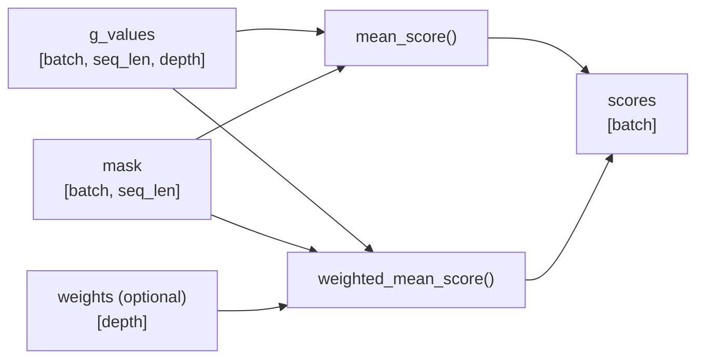
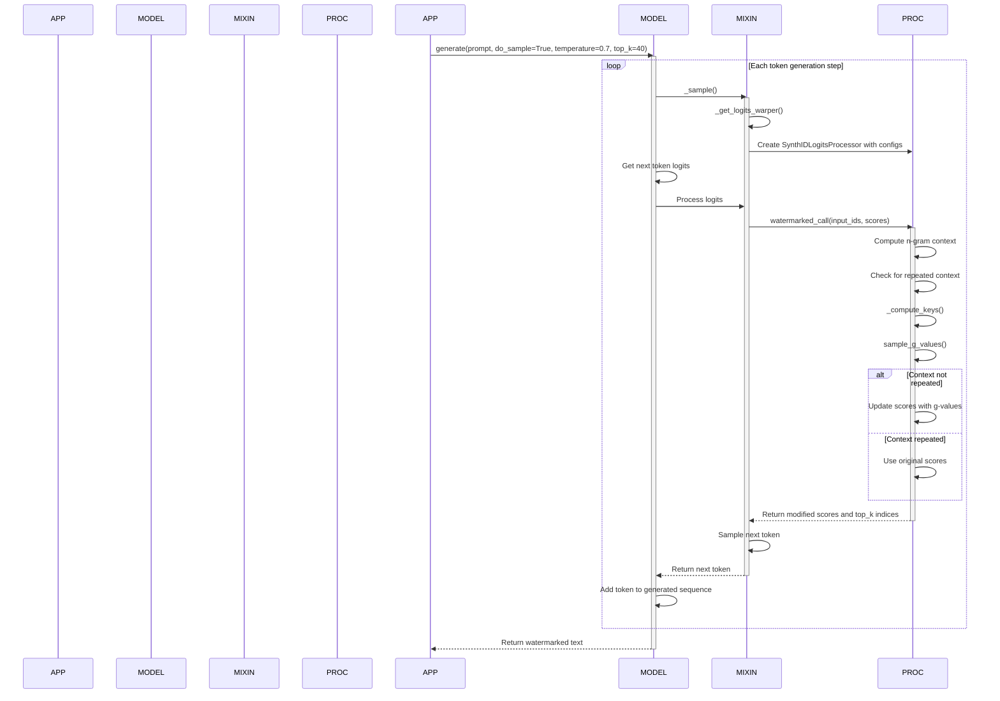
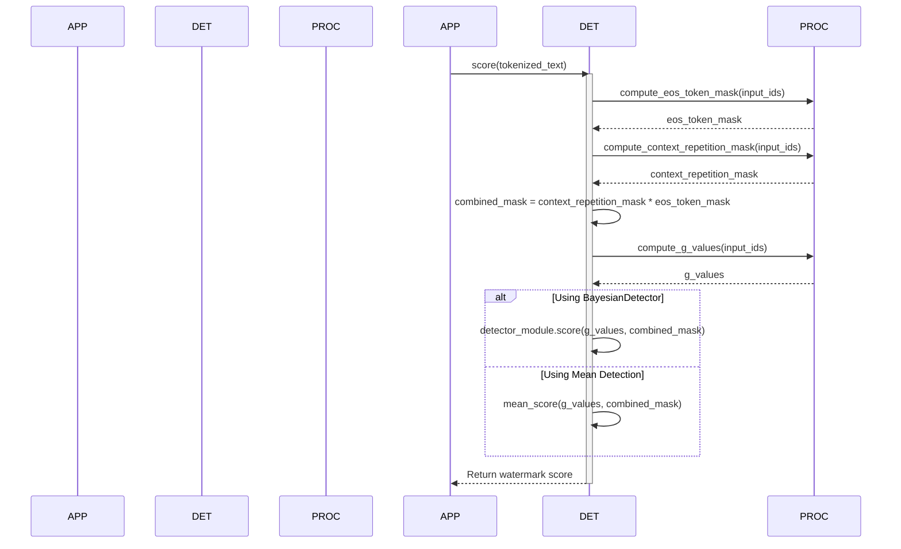

<!-- source: DeepWiki mcp.deepwiki.com · repo google-deepmind/synthid-text · page 4 API Reference · fetched 2026-10-26 -->

# API Reference

<details>
<summary>Relevant source files</summary>

The following files were used as context for generating this wiki page:

- [src/synthid_text/detector_bayesian.py](src/synthid_text/detector_bayesian.py)
- [src/synthid_text/detector_mean.py](src/synthid_text/detector_mean.py)
- [src/synthid_text/logits_processing.py](src/synthid_text/logits_processing.py)
- [src/synthid_text/synthid_mixin.py](src/synthid_text/synthid_mixin.py)

</details>


This document provides a comprehensive reference for the SynthID Text API, detailing the classes and functions available for watermarking and detecting AI-generated text. For integration guidance, see [Integration Guide](#3), and for more detailed explanations of the watermarking and detection systems, see [Watermarking System](#2.1) and [Detection System](#2.2) respectively.

## API Structure Overview

SynthID Text's API is divided into two primary components: the Watermarking API and the Detection API. The Watermarking API enables adding watermarks to text during generation, while the Detection API provides tools for detecting these watermarks in text.

```mermaid
classDiagram
    class "SynthID Text API" {
    }
    
    class "Watermarking API" {
    }
    
    class "Detection API" {
    }
    
    class "SynthIDSparseTopKMixin" {
        +_get_logits_warper()
        +_sample()
    }
    
    class "SynthIDLogitsProcessor" {
        +watermarked_call()
        +compute_g_values()
        +compute_context_repetition_mask()
    }
    
    class "SynthIDGPT2LMHeadModel" {
    }
    
    class "SynthIDGemmaForCausalLM" {
    }
    
    class "BayesianDetector" {
        +score()
        +train_best_detector()
    }
    
    class "BayesianDetectorModule" {
        +__call__()
        +score()
    }
    
    class "Mean Detection Functions" {
        +mean_score()
        +weighted_mean_score()
    }
    
    "SynthID Text API" --> "Watermarking API"
    "SynthID Text API" --> "Detection API"
    
    "Watermarking API" --> "SynthIDSparseTopKMixin"
    "Watermarking API" --> "SynthIDLogitsProcessor"
    "Watermarking API" --> "SynthIDGPT2LMHeadModel"
    "Watermarking API" --> "SynthIDGemmaForCausalLM"
    
    "Detection API" --> "BayesianDetector"
    "Detection API" --> "BayesianDetectorModule"
    "Detection API" --> "Mean Detection Functions"
```

Sources: [src/synthid_text/synthid_mixin.py](), [src/synthid_text/logits_processing.py](), [src/synthid_text/detector_bayesian.py](), [src/synthid_text/detector_mean.py]()

## Watermarking API

The Watermarking API provides classes for embedding watermarks in text generated by language models.

### Configuration Constants

```mermaid
classDiagram
    class "DEFAULT_WATERMARKING_CONFIG" {
        +ngram_len: 5
        +keys: [654, 400, 836, ...]
        +sampling_table_size: 2^16
        +sampling_table_seed: 0
        +context_history_size: 1024
        +device: torch.device
    }
```

`DEFAULT_WATERMARKING_CONFIG` is an immutable dictionary containing default watermarking parameters:

| Parameter | Type | Description |
|-----------|------|-------------|
| `ngram_len` | int | Length of n-grams used for watermarking (5 corresponds to H=4 context window in the paper) |
| `keys` | list of int | Watermarking keys used to generate hash values |
| `sampling_table_size` | int | Size of the sampling table for g-values |
| `sampling_table_seed` | int | Random seed for the sampling table |
| `context_history_size` | int | Number of contexts to track for repetition detection |
| `device` | torch.device | Device to use for computation (defaults to GPU if available) |

Sources: [src/synthid_text/synthid_mixin.py:28-70]()

### SynthIDSparseTopKMixin

This is a mixin class that extends Hugging Face's `transformers.GenerationMixin` to add watermarking capabilities to language models.

```mermaid
classDiagram
    class "transformers.GenerationMixin" {
        +_get_logits_warper()
        +_sample()
    }
    
    class "SynthIDSparseTopKMixin" {
        +_construct_warper_list()
        +_get_logits_warper()
        +_sample()
    }
    
    class "SynthIDGPT2LMHeadModel" {
    }
    
    class "SynthIDGemmaForCausalLM" {
    }
    
    class "transformers.GPT2LMHeadModel" {
    }
    
    class "transformers.GemmaForCausalLM" {
    }
    
    "transformers.GenerationMixin" <|-- "SynthIDSparseTopKMixin"
    "SynthIDSparseTopKMixin" <|-- "SynthIDGPT2LMHeadModel"
    "transformers.GPT2LMHeadModel" <|-- "SynthIDGPT2LMHeadModel"
    "SynthIDSparseTopKMixin" <|-- "SynthIDGemmaForCausalLM"
    "transformers.GemmaForCausalLM" <|-- "SynthIDGemmaForCausalLM"
```

#### Methods

| Method | Parameters | Returns | Description |
|--------|------------|---------|-------------|
| `_construct_warper_list` | `extra_params`: Mapping[str, Any] | transformers.LogitsProcessorList | Creates a list of logit processors that includes SynthIDLogitsProcessor |
| `_get_logits_warper` | `generation_config`: transformers.GenerationConfig | transformers.LogitsProcessorList | Constructs a list of logit warpers for text generation, handling temperature and top-k parameters |
| `_sample` | See method signature | Union[transformers.generation.utils.GenerateNonBeamOutput, torch.LongTensor] | Overrides the base class method to implement watermarking during token sampling |

Sources: [src/synthid_text/synthid_mixin.py:73-397]()

### Pre-built Watermarking Models

SynthID Text provides ready-to-use model classes that integrate the watermarking functionality:

- **SynthIDGPT2LMHeadModel**: A GPT-2 model with watermarking capabilities
- **SynthIDGemmaForCausalLM**: A Gemma model with watermarking capabilities

These classes combine `SynthIDSparseTopKMixin` with Hugging Face's model implementations to create watermarking-enabled models.

Sources: [src/synthid_text/synthid_mixin.py:399-408]()

### SynthIDLogitsProcessor

The core class for implementing watermarking logic during text generation.

```mermaid
classDiagram
    class "transformers.LogitsProcessor" {
    }
    
    class "SynthIDLogitsProcessor" {
        +watermarked_call()
        +compute_ngram_keys()
        +sample_g_values()
        +compute_g_values()
        +compute_context_repetition_mask()
        +compute_eos_token_mask()
    }
    
    class "SynthIDState" {
        +context
        +context_history
        +num_calls
    }
    
    "transformers.LogitsProcessor" <|-- "SynthIDLogitsProcessor"
    "SynthIDLogitsProcessor" --> "SynthIDState": uses
```

#### Constructor

```python
SynthIDLogitsProcessor(*, 
    ngram_len: int,
    keys: Sequence[int],
    sampling_table_size: int,
    sampling_table_seed: int,
    context_history_size: int,
    temperature: float,
    top_k: int,
    device: torch.device,
    skip_first_ngram_calls: bool = False,
    apply_top_k: bool = True,
    num_leaves: int = 2
)
```

| Parameter | Type | Description |
|-----------|------|-------------|
| `ngram_len` | int | Length of n-grams used for watermarking |
| `keys` | Sequence[int] | Sequence of watermarking keys, one for each depth |
| `sampling_table_size` | int | Size of the sampling table |
| `sampling_table_seed` | int | Random seed for sampling table generation |
| `context_history_size` | int | Size of the tensor to track seen contexts |
| `temperature` | float | Temperature for scaling logits |
| `top_k` | int | Number of top tokens to consider |
| `device` | torch.device | Device for computation |
| `skip_first_ngram_calls` | bool | Whether to skip watermarking for first n-gram |
| `apply_top_k` | bool | Whether to apply top-k to scores |
| `num_leaves` | int | Number of leaves per node in tournament tree |

#### Key Methods

| Method | Description |
|--------|-------------|
| `watermarked_call` | The main method that applies watermarking to logits during generation |
| `compute_ngram_keys` | Computes random keys for each n-gram and depth |
| `sample_g_values` | Samples g-values from Bernoulli distribution based on n-gram keys |
| `compute_g_values` | Computes g-values for a sequence of tokens |
| `compute_context_repetition_mask` | Identifies repeated contexts to avoid watermarking them |
| `compute_eos_token_mask` | Creates a mask for tokens that don't contain EOS tokens |

Sources: [src/synthid_text/logits_processing.py:95-542]()

## Detection API

The Detection API provides tools for detecting watermarks in potentially watermarked text.

### Bayesian Detection

```mermaid
classDiagram
    class "BayesianDetector" {
        +detector_module: BayesianDetectorModule
        +tokenizer
        +logits_processor: SynthIDLogitsProcessor
        +score()
        +process_raw_model_outputs()
        +train_best_detector()
    }
    
    class "BayesianDetectorModule" {
        +watermarking_depth: int
        +baserate: float
        +__call__()
        +score()
        +l2_loss()
    }
    
    class "LikelihoodModelWatermarked" {
        +watermarking_depth: int
        +__call__()
        +l2_loss()
    }
    
    class "LikelihoodModelUnwatermarked" {
        +__call__()
    }
    
    "BayesianDetector" *-- "BayesianDetectorModule": contains
    "BayesianDetectorModule" *-- "LikelihoodModelWatermarked": uses
    "BayesianDetectorModule" *-- "LikelihoodModelUnwatermarked": uses
```

#### BayesianDetector

The `BayesianDetector` class implements a sophisticated detector that uses Bayesian inference to determine if text contains a watermark.

| Method | Description |
|--------|-------------|
| `score` | Scores given text to determine if it's watermarked (0-1 scale) |
| `process_raw_model_outputs` | Processes model outputs into a format for training |
| `train_best_detector` | Trains the best detector based on watermarked and unwatermarked data |
| `train_best_detector_given_g_values` | Trains the best detector given pre-computed g-values |

```python
# Example initializing a BayesianDetector
detector = BayesianDetector(
    logits_processor=logits_processor,
    tokenizer=tokenizer,
    params=detector_module.params
)

# Example scoring text
score = detector.score(tokenized_text)
```

Sources: [src/synthid_text/detector_bayesian.py:704-1068]()

#### BayesianDetectorModule

This class implements the core Bayesian classification logic for watermark detection.

| Method | Description |
|--------|-------------|
| `__call__` | Computes the watermarked posterior probability given g-values |
| `score` | Public method to score g-values for watermarking |
| `l2_loss` | Computes the L2 loss for regularization during training |

Sources: [src/synthid_text/detector_bayesian.py:385-451]()

### Mean Detection

Mean detection provides simpler, training-free methods for watermark detection.



#### Functions

| Function | Description |
|----------|-------------|
| `mean_score(g_values, mask)` | Computes the mean of unmasked g-values, returning a score for each batch item |
| `weighted_mean_score(g_values, mask, weights=None)` | Computes a weighted mean of g-values, giving more importance to earlier layers |

```python
# Example using mean detection
score = mean_score(g_values, mask)

# Example using weighted mean detection
score = weighted_mean_score(g_values, mask)
```

Sources: [src/synthid_text/detector_mean.py:22-77]()

## Watermarking Process Flow



Sources: [src/synthid_text/synthid_mixin.py:132-396](), [src/synthid_text/logits_processing.py:235-337]()

## Detection Process Flow



Sources: [src/synthid_text/detector_bayesian.py:724-758](), [src/synthid_text/detector_mean.py:22-77]()

## Usage Examples

### Watermarking Text

```python
# Import necessary components
from transformers import AutoTokenizer
from synthid_text.synthid_mixin import SynthIDGPT2LMHeadModel

# Initialize model and tokenizer
tokenizer = AutoTokenizer.from_pretrained("gpt2")
model = SynthIDGPT2LMHeadModel.from_pretrained("gpt2")

# Generate watermarked text
prompt = "AI has the potential to"
output = model.generate(
    tokenizer(prompt, return_tensors="pt").input_ids,
    do_sample=True,
    temperature=0.7,
    top_k=40,
    max_length=100
)

# Decode the result
watermarked_text = tokenizer.decode(output[0], skip_special_tokens=True)
```

### Detecting Watermarks with Bayesian Detector

```python
# Training a Bayesian detector
from synthid_text.detector_bayesian import BayesianDetector
from synthid_text.logits_processing import SynthIDLogitsProcessor
import torch

# Initialize the logits processor with the same configuration as used for watermarking
logits_processor = SynthIDLogitsProcessor(
    ngram_len=5,
    keys=[654, 400, 836, ...],  # Same keys as used for watermarking
    sampling_table_size=2**16,
    sampling_table_seed=0,
    context_history_size=1024,
    temperature=0.7,
    top_k=40,
    device=torch.device("cuda" if torch.cuda.is_available() else "cpu")
)

# Train a detector using watermarked and unwatermarked texts
detector, _ = BayesianDetector.train_best_detector(
    tokenized_wm_outputs=watermarked_outputs,
    tokenized_uwm_outputs=unwatermarked_outputs,
    logits_processor=logits_processor,
    tokenizer=tokenizer,
    torch_device=torch.device("cpu")
)

# Score a piece of text
score = detector.score(tokenized_text)
```

### Detecting Watermarks with Mean Score

```python
# Using the simpler mean score detection
from synthid_text.detector_mean import mean_score, weighted_mean_score
from synthid_text.logits_processing import SynthIDLogitsProcessor

# Initialize the logits processor (same as above)
logits_processor = SynthIDLogitsProcessor(...)

# Process text to get g-values and masks
g_values = logits_processor.compute_g_values(tokenized_text)
eos_mask = logits_processor.compute_eos_token_mask(tokenized_text, tokenizer.eos_token_id)
context_mask = logits_processor.compute_context_repetition_mask(tokenized_text)
combined_mask = context_mask * eos_mask

# Get detection scores
basic_score = mean_score(g_values, combined_mask)
weighted_score = weighted_mean_score(g_values, combined_mask)
```

Sources: [src/synthid_text/synthid_mixin.py](), [src/synthid_text/detector_bayesian.py](), [src/synthid_text/detector_mean.py](), [src/synthid_text/logits_processing.py]()

## Summary

The SynthID Text API provides comprehensive tools for both watermarking and detecting AI-generated text:

1. **Watermarking Components**:
   - `SynthIDSparseTopKMixin`: Extends Hugging Face models with watermarking
   - `SynthIDLogitsProcessor`: Handles the core watermarking logic
   - Pre-built model classes for easy integration

2. **Detection Components**:
   - `BayesianDetector`: Sophisticated detector using Bayesian inference
   - Mean detection functions: Simple, training-free detection methods

These components work together to create a robust system for watermarking and detecting AI-generated text, with options for both simple and advanced use cases.

---

