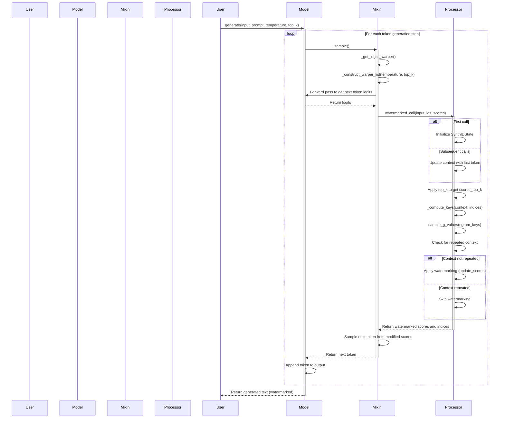
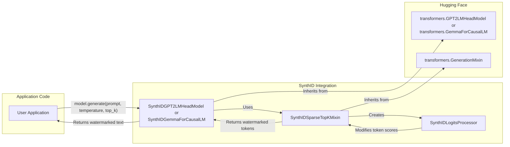
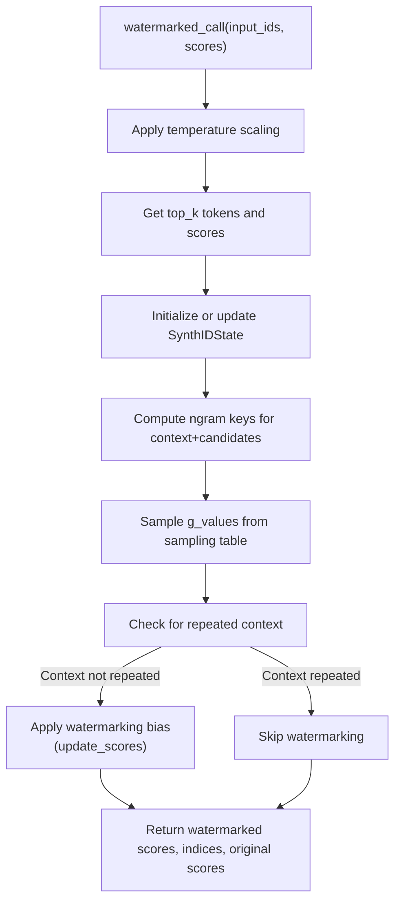

<!-- source: DeepWiki mcp.deepwiki.com · repo google-deepmind/synthid-text · page 4.1 Watermarking API · fetched 2026-10-26 -->

# Watermarking API

<details>
<summary>Relevant source files</summary>

The following files were used as context for generating this wiki page:

- [src/synthid_text/logits_processing.py](src/synthid_text/logits_processing.py)
- [src/synthid_text/synthid_mixin.py](src/synthid_text/synthid_mixin.py)

</details>


## Purpose and Scope

This document provides detailed technical documentation for the SynthID Text watermarking API. The API enables the integration of watermarking capabilities into language models built on the Hugging Face Transformers library, allowing for the embedding of undetectable watermarks in generated text. For information about detecting watermarks in text, see the [Detection API](#4.2).

The Watermarking API consists of a set of classes and methods that modify the token generation process to introduce statistical biases that serve as watermarks, without significantly affecting the quality of the generated text.

## API Architecture

The SynthID Text watermarking API is designed as a non-invasive extension to existing language models. It follows a mixin pattern to add watermarking capabilities to Hugging Face Transformer models.

```mermaid
classDiagram
    class "transformers.GenerationMixin" {
      +_get_logits_warper()
      +_sample()
    }
    
    class "SynthIDSparseTopKMixin" {
      +_get_logits_warper()
      +_sample()
      +_construct_warper_list()
      +DEFAULT_WATERMARKING_CONFIG
    }
    
    class "SynthIDLogitsProcessor" {
      +watermarked_call()
      +compute_g_values()
      +compute_context_repetition_mask()
      +compute_eos_token_mask()
      +sample_g_values()
      -_compute_keys()
    }
    
    class "SynthIDState" {
      +context
      +context_history
      +num_calls
    }
    
    class "SynthIDGPT2LMHeadModel" {
    }
    
    class "SynthIDGemmaForCausalLM" {
    }
    
    class "transformers.GPT2LMHeadModel" {
    }
    
    class "transformers.GemmaForCausalLM" {
    }
    
    "transformers.GenerationMixin" <|-- "SynthIDSparseTopKMixin"
    "SynthIDSparseTopKMixin" --* "SynthIDLogitsProcessor" : uses
    "SynthIDLogitsProcessor" --* "SynthIDState" : creates and manages
    
    "SynthIDSparseTopKMixin" <|-- "SynthIDGPT2LMHeadModel"
    "SynthIDSparseTopKMixin" <|-- "SynthIDGemmaForCausalLM"
    "transformers.GPT2LMHeadModel" <|-- "SynthIDGPT2LMHeadModel"
    "transformers.GemmaForCausalLM" <|-- "SynthIDGemmaForCausalLM"
```

Sources: [src/synthid_text/synthid_mixin.py:73-408](), [src/synthid_text/logits_processing.py:95-126]()

## Core Components

### SynthIDSparseTopKMixin

The `SynthIDSparseTopKMixin` class is the primary integration point between SynthID's watermarking functionality and Hugging Face's Transformers library. It inherits from `transformers.GenerationMixin` and overrides key methods to inject watermarking into the text generation process.

Key methods:

- `_get_logits_warper()`: Constructs a list of logits processors, focusing on the `SynthIDLogitsProcessor` for watermarking
- `_sample()`: Overrides the sampling method to incorporate watermarking during token selection
- `_construct_warper_list()`: Creates the list of warpers with the watermarking processor

The mixin includes `DEFAULT_WATERMARKING_CONFIG`, which defines parameters such as n-gram length, watermarking keys, and other configuration values for the watermarking process.

Sources: [src/synthid_text/synthid_mixin.py:73-396]()

### SynthIDLogitsProcessor

`SynthIDLogitsProcessor` is the core component that implements the actual watermarking algorithm. It inherits from `transformers.LogitsProcessor` and modifies token probabilities during generation to embed watermarks.

Key methods:

- `watermarked_call()`: The main method that applies watermarking to token scores
- `compute_g_values()`: Computes g-values for each n-gram in the input sequence
- `sample_g_values()`: Samples g-values from a Bernoulli distribution using a pre-computed sampling table
- `_compute_keys()`: Generates random keys for each n-gram and depth
- `compute_context_repetition_mask()`: Creates a mask to identify repeated contexts
- `compute_eos_token_mask()`: Creates a mask to identify end-of-sequence tokens

Sources: [src/synthid_text/logits_processing.py:126-542]()

### SynthIDState

`SynthIDState` is a helper class that maintains state information during the watermarking process. It keeps track of:

- `context`: Current context tokens (previous n-1 tokens)
- `context_history`: History of previously seen contexts
- `num_calls`: Counter for tracking calls to the processor

Sources: [src/synthid_text/logits_processing.py:95-124]()

## Watermarking Process Flow

The watermarking process modifies the token generation sequence by biasing the selection of tokens in a deterministic but imperceptible way.



Sources: [src/synthid_text/synthid_mixin.py:132-396](), [src/synthid_text/logits_processing.py:234-337]()

## Configuration Options

The watermarking API provides several configuration options through `DEFAULT_WATERMARKING_CONFIG` and additional parameters passed to the `SynthIDLogitsProcessor`.

| Parameter | Description | Default Value |
|-----------|-------------|---------------|
| `ngram_len` | Length of n-grams used for watermarking (corresponds to H+1 in the paper) | 5 |
| `keys` | Array of integer keys for watermarking | [654, 400, 836, ...] |
| `sampling_table_size` | Size of the pre-computed sampling table | 2^16 |
| `sampling_table_seed` | Random seed for generating the sampling table | 0 |
| `context_history_size` | Size of the tensor to track seen contexts | 1024 |
| `device` | Device to use for computations | CUDA if available, else CPU |
| `temperature` | Temperature for controlling randomness in generation | Required parameter |
| `top_k` | Number of highest probability tokens to consider | Required parameter |
| `skip_first_ngram_calls` | Whether to skip watermarking the first n-gram | Optional, default: False |
| `apply_top_k` | Whether to apply top-k filtering to scores | Optional, default: True |
| `num_leaves` | Number of leaves per node in the tournament tree | Optional, default: 2 |

Sources: [src/synthid_text/synthid_mixin.py:28-70](), [src/synthid_text/logits_processing.py:137-166]()

## API Integration Flow



Sources: [src/synthid_text/synthid_mixin.py:73-408]()

## Model Classes

SynthID provides two ready-to-use model classes that incorporate the watermarking functionality:

1. `SynthIDGPT2LMHeadModel` - A watermarked version of GPT-2
2. `SynthIDGemmaForCausalLM` - A watermarked version of Gemma

These classes inherit from both the corresponding Hugging Face model class and `SynthIDSparseTopKMixin`, providing a seamless way to add watermarking to these models.

Sources: [src/synthid_text/synthid_mixin.py:399-408]()

## Key Method Details

### watermarked_call

The `watermarked_call` method in `SynthIDLogitsProcessor` is the core function that applies watermarking to the token scores:



Sources: [src/synthid_text/logits_processing.py:234-337]()

### _compute_keys and sample_g_values

These methods are crucial for the watermarking process:

1. `_compute_keys` - Computes hash values for each possible n-gram (context + candidate token)
2. `sample_g_values` - Uses the pre-computed sampling table to deterministically map hash values to g-values (0 or 1)

Sources: [src/synthid_text/logits_processing.py:381-441]()

## Requirements and Limitations

When using the watermarking API, there are several requirements and limitations to be aware of:

1. Temperature must be between 0.0 and 1.0 (inclusive)
2. Top_k must be at least 1
3. The API currently only supports Hugging Face's Transformers models
4. Watermarking adds a slight computational overhead to the generation process

Additionally, the watermarking implementation is specific to this repository and may not be compatible with other watermarking techniques or systems.

Sources: [src/synthid_text/synthid_mixin.py:110-128]()

---

