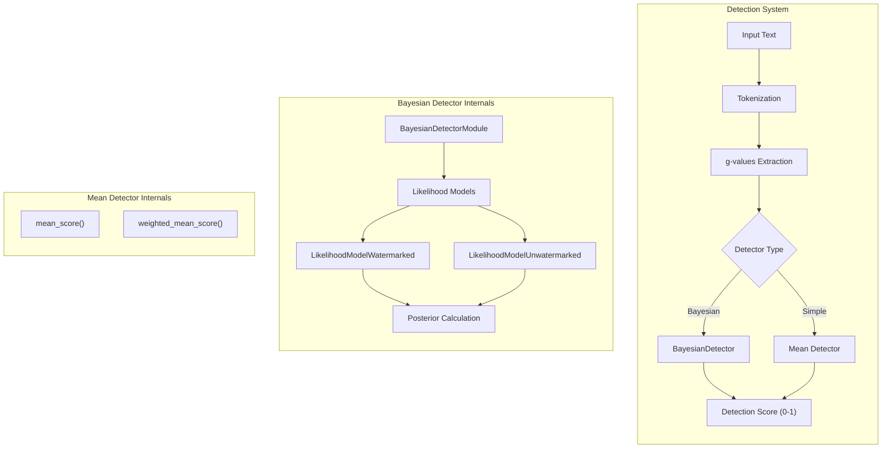
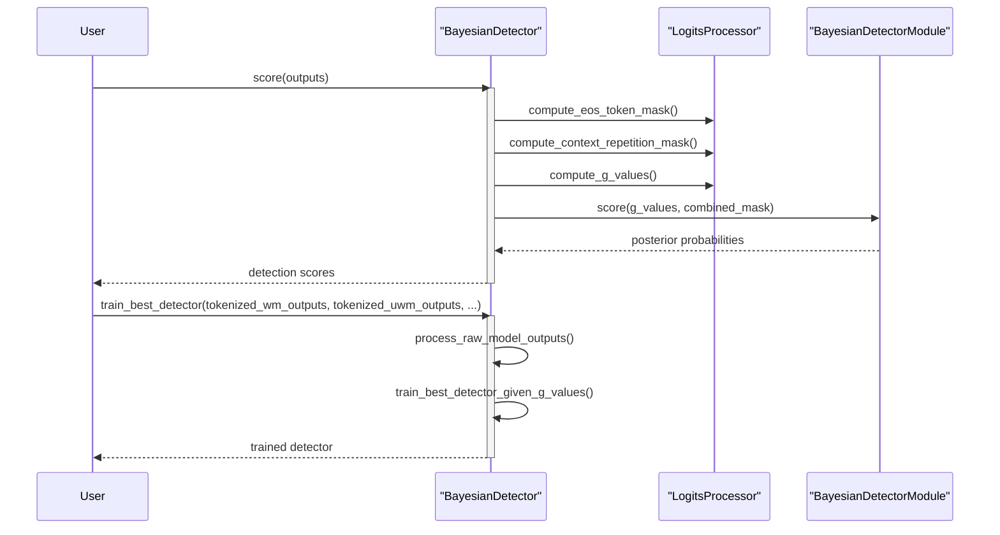
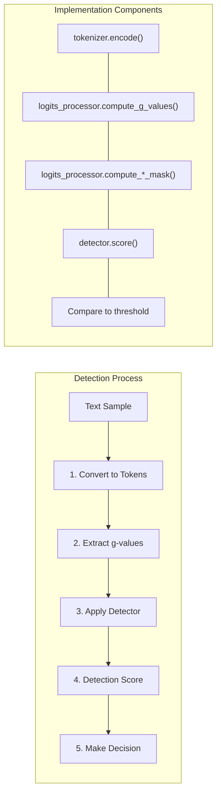
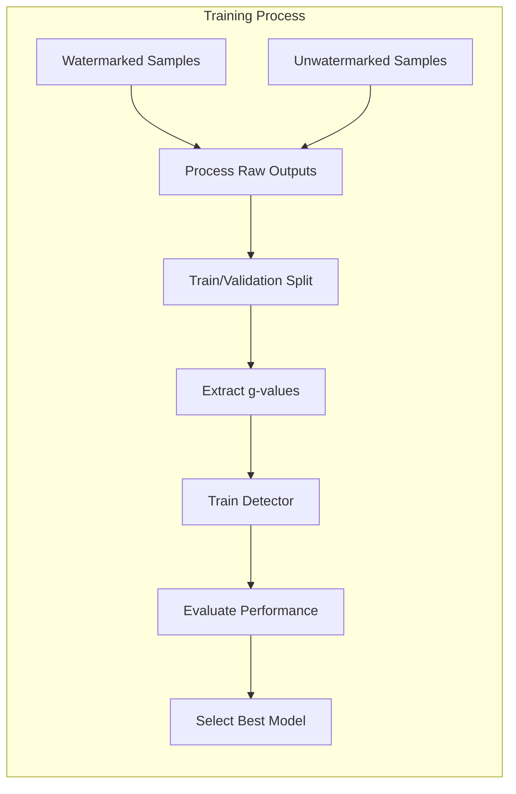
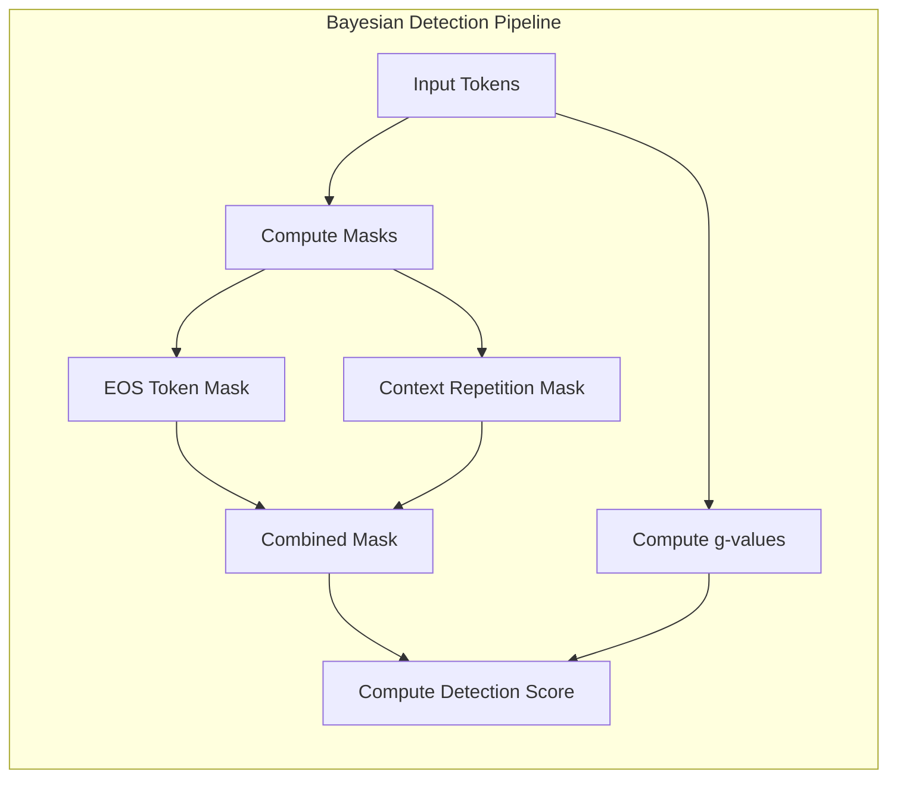

<!-- source: DeepWiki mcp.deepwiki.com · repo google-deepmind/synthid-text · page 4.2 Detection API · fetched 2026-10-26 -->

# Detection API

<details>
<summary>Relevant source files</summary>

The following files were used as context for generating this wiki page:

- [src/synthid_text/detector_bayesian.py](src/synthid_text/detector_bayesian.py)
- [src/synthid_text/detector_mean.py](src/synthid_text/detector_mean.py)

</details>


## Purpose and Scope

This document provides comprehensive documentation for the SynthID Text Detection API, which is responsible for analyzing text to determine whether it contains a watermark introduced by the Watermarking System. The Detection API offers multiple detection approaches with varying complexity and performance characteristics. For information about how watermarks are added to text, see [Watermarking API](#4.1).

## Detection API Overview

The Detection API provides methods to analyze text and determine the likelihood that it contains a SynthID watermark. The system supports two main detection approaches:

1. **Bayesian Detector** - A sophisticated detector that requires training but offers superior detection performance
2. **Mean Detector** - A simpler, training-free detector with slightly lower but still effective detection capabilities

Both detectors work by analyzing the statistical patterns of "g-values" - the binary values derived from token selections that may indicate the presence of a watermark.



Sources: [src/synthid_text/detector_bayesian.py:385-442](), [src/synthid_text/detector_mean.py:22-77]()

## Detector Types

### Bayesian Detector

The Bayesian Detector uses statistical methods to calculate the posterior probability that text contains a watermark. It works by:

1. Extracting g-values from the text
2. Using trained likelihood models to calculate the probability of observing these g-values in watermarked vs. unwatermarked text
3. Applying Bayes' rule to compute a posterior probability

The Bayesian Detector requires training on examples of watermarked and unwatermarked text to learn the statistical patterns that distinguish them.

### Mean Detector

The Mean Detector provides a simpler approach that requires no training. It calculates either:

1. The arithmetic mean of g-values (using `mean_score`)
2. A weighted mean of g-values (using `weighted_mean_score`)

Higher means indicate a higher likelihood of watermarking, as watermarked text tends to have more 1s than 0s in its g-values.

```mermaid
classDiagram
    class "BayesianDetector" {
        +detector_module: BayesianDetectorModule
        +tokenizer
        +logits_processor
        +score(outputs)
        +train_best_detector()
        +process_raw_model_outputs()
    }
    
    class "BayesianDetectorModule" {
        +watermarking_depth
        +baserate
        +__call__(g_values, mask)
        +score(g_values, mask)
        +l2_loss()
    }
    
    class "LikelihoodModelWatermarked" {
        +watermarking_depth
        +__call__(g_values)
        +l2_loss()
    }
    
    class "LikelihoodModelUnwatermarked" {
        +__call__(g_values)
    }
    
    class "Mean Detector Functions" {
        +mean_score(g_values, mask)
        +weighted_mean_score(g_values, mask, weights)
    }
    
    BayesianDetector --> BayesianDetectorModule : contains
    BayesianDetectorModule --> LikelihoodModelWatermarked : contains
    BayesianDetectorModule --> LikelihoodModelUnwatermarked : contains
```

Sources: [src/synthid_text/detector_bayesian.py:704-1068](), [src/synthid_text/detector_mean.py:22-77]()

## Bayesian Detector API

### BayesianDetector Class

The `BayesianDetector` class is the main interface for the Bayesian detection approach:



Sources: [src/synthid_text/detector_bayesian.py:704-1068]()

#### Constructor

```python
BayesianDetector(
    logits_processor: SynthIDLogitsProcessor,
    tokenizer: Any,
    params: Mapping[str, Mapping[str, Any]],
)
```

- **logits_processor**: The same logits processor used for watermarking
- **tokenizer**: The tokenizer used by the language model
- **params**: Parameters for the detector module (typically obtained through training)

#### Key Methods

1. **score**

```python
score(outputs: jnp.ndarray) -> jnp.ndarray
```

Scores text to determine if it's watermarked. Returns values in the range [0, 1], where higher values indicate stronger evidence of watermarking.

- **outputs**: A tensor of token IDs, shape [batch_size, output_len]
- **Returns**: Detection scores, shape [batch_size]

2. **train_best_detector**

```python
@classmethod
train_best_detector(
    tokenized_wm_outputs,
    tokenized_uwm_outputs,
    logits_processor,
    tokenizer,
    torch_device,
    test_size=0.3,
    pos_truncation_length=200,
    neg_truncation_length=100,
    max_padded_length=2300,
    n_epochs=50,
    learning_rate=2.1e-2,
    l2_weights=np.logspace(-3, -2, num=4),
    verbose=False,
) -> tuple["BayesianDetector", float]
```

Trains a detector on examples of watermarked and unwatermarked text.

- **tokenized_wm_outputs**: Tokenized watermarked text samples
- **tokenized_uwm_outputs**: Tokenized unwatermarked text samples
- **Returns**: A tuple of (trained detector, validation loss)

Sources: [src/synthid_text/detector_bayesian.py:724-734](), [src/synthid_text/detector_bayesian.py:986-1068]()

### BayesianDetectorModule

This is the core implementation of the Bayesian detector, built as a Flax module:

```python
BayesianDetectorModule(
    watermarking_depth: int,
    params: Optional[Mapping[str, Mapping[str, Any]]] = None,
    baserate: float = 0.5,
)
```

- **watermarking_depth**: Number of tournament layers in the watermarking scheme
- **params**: Optional pre-trained parameters
- **baserate**: Prior probability that text is watermarked

#### Key Methods

- **__call__(g_values, mask)**: Computes the posterior probability of watermarking
- **score(g_values, mask)**: Applies the trained model to calculate detection scores

Sources: [src/synthid_text/detector_bayesian.py:385-451]()

## Mean Detector API

The Mean Detector API consists of two simple functions:

### mean_score

```python
mean_score(
    g_values: jnp.ndarray,
    mask: jnp.ndarray,
) -> jnp.ndarray
```

Computes the mean of g-values as a watermark detection score.

- **g_values**: g-values, shape [batch_size, seq_len, watermarking_depth]
- **mask**: Binary mask indicating which values to use, shape [batch_size, seq_len]
- **Returns**: Mean scores, shape [batch_size]

### weighted_mean_score

```python
weighted_mean_score(
    g_values: jnp.ndarray,
    mask: jnp.ndarray,
    weights: Optional[jnp.ndarray] = None,
) -> jnp.ndarray
```

Computes a weighted mean of g-values as a watermark detection score.

- **g_values**: g-values, shape [batch_size, seq_len, watermarking_depth]
- **mask**: Binary mask indicating which values to use, shape [batch_size, seq_len]
- **weights**: Optional weights for different tournament layers, shape [watermarking_depth]
- **Returns**: Weighted mean scores, shape [batch_size]

Sources: [src/synthid_text/detector_mean.py:22-77]()

## Using the Detection API

The detection process follows these general steps:

1. **Preprocessing**: Convert text to token IDs using the same tokenizer used during generation
2. **Feature Extraction**: Extract g-values and compute masks for the tokens
3. **Detection**: Apply either the Bayesian or Mean detector to calculate detection scores
4. **Interpretation**: Compare scores to thresholds to make watermark detection decisions



Sources: [src/synthid_text/detector_bayesian.py:724-758](), [src/synthid_text/detector_mean.py:22-77]()

### Choosing Between Detector Types

| Detector Type | Advantages | Disadvantages | Use Cases |
|---------------|------------|--------------|-----------|
| Bayesian Detector | • Better detection accuracy<br>• Adaptable to specific watermarking patterns<br>• Provides probability estimates | • Requires training<br>• More complex to set up<br>• Computationally more expensive | • High-stakes applications<br>• When maximum accuracy is required<br>• When training data is available |
| Mean Detector | • No training required<br>• Simple to implement<br>• Computationally efficient | • Lower accuracy than Bayesian detector<br>• Less adaptable to specific patterns | • Quick prototyping<br>• Resource-constrained environments<br>• When training data is limited |

## Training a Bayesian Detector

The Bayesian detector requires training on samples of watermarked and unwatermarked text. The process involves:

1. Generating samples of watermarked and unwatermarked text
2. Processing the samples to extract g-values
3. Training the detector to distinguish between the patterns



Sources: [src/synthid_text/detector_bayesian.py:986-1068](), [src/synthid_text/detector_bayesian.py:513-701]()

### Key Training Parameters

- **pos_truncation_length**: Length to truncate watermarked outputs
- **neg_truncation_length**: Length to truncate unwatermarked outputs
- **max_padded_length**: Length to pad outputs for consistent processing
- **n_epochs**: Number of training epochs
- **learning_rate**: Learning rate for optimization
- **l2_weights**: Regularization weights to try during hyperparameter tuning

Sources: [src/synthid_text/detector_bayesian.py:986-1068]()

## Internal Detection Process

The detection process involves several internal steps:



Sources: [src/synthid_text/detector_bayesian.py:724-758]()

### Computing g-values

G-values are computed from input tokens using the same logits processor used during watermarking. These values represent the pseudo-random binary values derived from token n-grams that encode the watermark.

### Creating Masks

Two types of masks are used:

1. **EOS Token Mask**: Excludes EOS tokens from consideration
2. **Context Repetition Mask**: Excludes tokens that repeat context n-grams

### Scoring

The detection score is calculated based on the statistical analysis of g-values considering the applied masks:

- **Bayesian Detector**: Computes the posterior probability P(watermarked | g-values)
- **Mean Detector**: Computes the mean or weighted mean of g-values

Sources: [src/synthid_text/detector_bayesian.py:385-442](), [src/synthid_text/detector_mean.py:22-77]()

---

