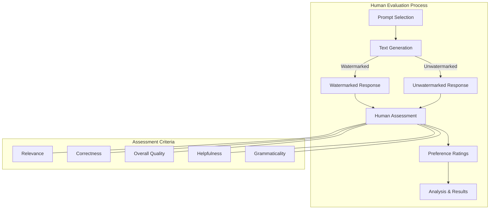
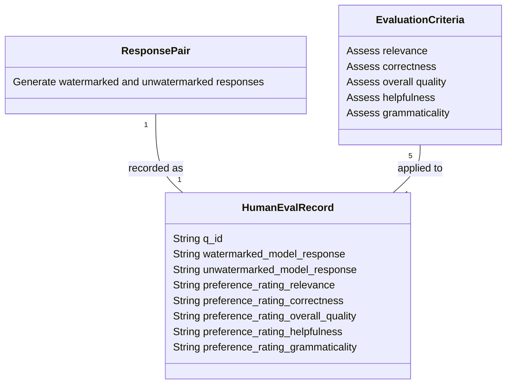
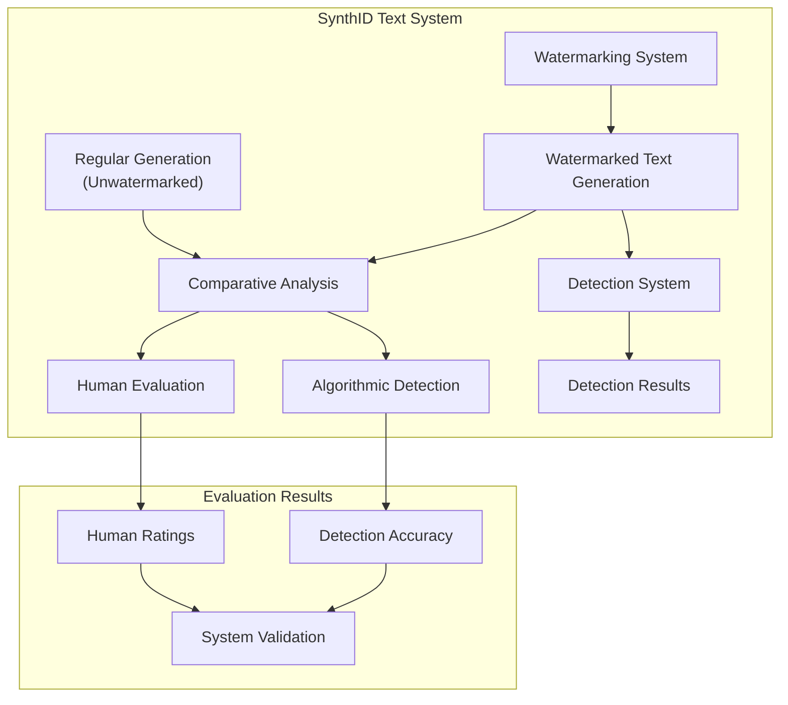

<!-- source: DeepWiki mcp.deepwiki.com · repo google-deepmind/synthid-text · page 5 Human Evaluation · fetched 2026-10-26 -->

# Human Evaluation

<details>
<summary>Relevant source files</summary>

The following files were used as context for generating this wiki page:

- [README.md](README.md)
- [data/human_eval.jsonl](data/human_eval.jsonl)

</details>


This page documents the human evaluation component of the SynthID Text system, describing how watermarked text was evaluated by human assessors to determine whether the watermarking process affects text quality from a human perspective.

## Purpose and Scope

The human evaluation study was designed to compare human perceptions of watermarked versus unwatermarked text generated from the Gemma 7B model. This evaluation helps validate that the SynthID Text watermarking system achieves its objective of being imperceptible to humans while remaining detectable by the algorithmic detection system.

For detailed information about the watermarking system itself, see [Watermarking System](#2.1). For information about detection methods, see [Detection System](#2.2).

Sources: [README.md:258-264]()

## Overview of Human Evaluation Process

The human evaluation process involved generating pairs of text responses - one watermarked and one unwatermarked - using the same input prompts. Human evaluators then rated both responses across multiple quality dimensions to determine if there were perceptible differences in quality.



Sources: [README.md:258-264](), [data/human_eval.jsonl]()

## Data Structure and Methodology

The human evaluation data consists of paired responses (watermarked and unwatermarked) to the same prompt questions, along with human preference ratings for five quality dimensions.

### Evaluation Dimensions

Human evaluators assessed the text pairs on these key dimensions:

| Dimension | Description |
|-----------|-------------|
| Relevance | How well the response addresses the question/prompt |
| Correctness | The factual accuracy of the response |
| Overall Quality | The general quality of the response |
| Helpfulness | How helpful the response would be to a user |
| Grammaticality | The grammatical correctness of the response |

### Rating Scale

For each dimension, evaluators indicated a preference for either:
- The watermarked response
- The unwatermarked response
- "Both are high quality" (no clear preference)
- "Both are low quality" (neither response was satisfactory)



Sources: [data/human_eval.jsonl]()

## Data Collection and Sources

The human evaluation dataset uses prompts from the ELI5 (Explain Like I'm 5) dataset from the LFQA_reddit split. This dataset contains questions that require detailed, explanatory answers, making it suitable for evaluating the quality of extended text generation.

### Dataset Location and Access

The human evaluation data is included in the SynthID Text repository and can be accessed at `data/human_eval.jsonl`. Each entry in this file contains:

1. The question ID (q_id)
2. The watermarked model response
3. The unwatermarked model response
4. Preference ratings for each evaluation dimension

### Accessing Question Prompts

The original question prompts are not directly included in the `human_eval.jsonl` file but can be retrieved using the question IDs. The README provides code for retrieving these prompts:

```python
import json
import tensorflow_datasets as tfds

ds = tfds.load('huggingface:eli5/LFQA_reddit', split='test_eli5')
id_to_prompt = {}
for x in ds.as_numpy_iterator():
  id_to_prompt[x['q_id'].decode()] = x['title'].decode()

full_data = []
with open('./data/human_eval.jsonl') as f:
  for json_str in f:
    x = json.loads(json_str)
    x['question'] = id_to_prompt[x['q_id']]
    full_data.append(x)
```

Sources: [README.md:266-279]()

## Relationship to SynthID Text System Components

The human evaluation provides a critical validation layer for the SynthID Text system, complementing the technical detection mechanisms.



Sources: [README.md:258-264](), [data/human_eval.jsonl]()

## Key Findings and Applications

### Purpose of the Human Evaluation

The human evaluation serves multiple important purposes in the SynthID Text project:

1. **Quality Validation**: Verifies that the watermarking process doesn't degrade text quality from a human perspective
2. **Imperceptibility Assessment**: Confirms that humans cannot reliably distinguish between watermarked and unwatermarked text
3. **Trade-off Analysis**: Helps understand the balance between watermark detectability and text quality preservation
4. **System Improvement**: Provides data to improve the watermarking algorithms to minimize any negative impacts on text quality

### Evaluation Insights

From examining the data in `human_eval.jsonl`, it appears that human evaluators frequently rated both watermarked and unwatermarked responses as similar in quality. This suggests that the SynthID Text watermarking system achieves good imperceptibility, with the watermark not significantly affecting perceived text quality across the evaluation dimensions.

Such findings are important for validating the practical usability of the watermarking system in real-world applications.

Sources: [data/human_eval.jsonl]()

## Using the Human Evaluation Data

Researchers and developers can use the human evaluation data to:

1. Compare their own watermarking techniques against the SynthID Text baseline
2. Develop improved watermarking methods that maintain or improve human-perceived quality
3. Train models to predict human quality assessments of watermarked text
4. Understand which types of text or content domains may be more or less affected by watermarking

The included data provides a valuable resource for benchmarking and further research in the field of text watermarking and AI-generated content detection.

Sources: [README.md:258-264](), [data/human_eval.jsonl]()

## Conclusion

The human evaluation component of SynthID Text provides essential validation that the watermarking system achieves its design goal of being imperceptible to humans while remaining detectable by algorithmic methods. This balance is crucial for practical deployment of watermarking technology in real-world applications, where both robustness of detection and preservation of text quality are important requirements.

---

