# Page: Overview

# Overview

<details>
<summary>Relevant source files</summary>

The following files were used as context for generating this wiki page:

- [README.md](README.md)
- [pyproject.toml](pyproject.toml)

</details>


## Purpose and Scope

SynthID Text is a reference implementation for watermarking and detecting text generated by large language models (LLMs). It provides tools to embed subtle statistical patterns into AI-generated text that can later be detected, while maintaining the quality and coherence of the text. This overview introduces the core concepts, components, and architecture of the SynthID Text system.

This document covers the high-level structure and functionality of the SynthID Text repository. For detailed information about the system architecture, see [System Architecture](#2), for integration guidance see [Integration Guide](#3), and for API documentation see [API Reference](#4).

Sources: [README.md:1-8](), [pyproject.toml:11-12]()

## Key Capabilities

SynthID Text provides two primary capabilities:

1. **Watermarking**: Embeds invisible statistical patterns in text during the generation process
2. **Detection**: Analyzes text to determine whether it contains a watermark

The system is designed to work with popular language models, including Gemma and GPT-2, through integration with the Hugging Face Transformers library.

Sources: [README.md:3-8](), [README.md:15-23]()

## System Overview

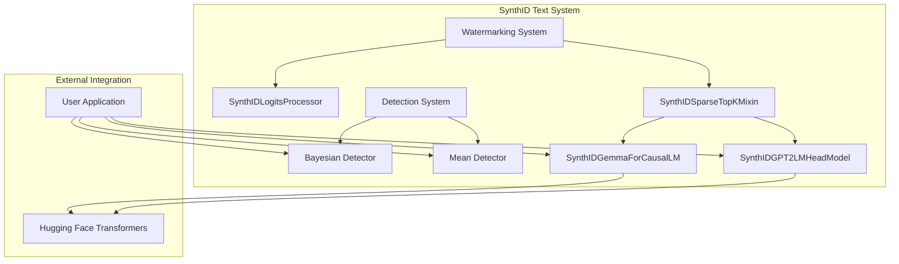

SynthID Text consists of two subsystems that work together: the watermarking system for embedding patterns in generated text, and the detection system for analyzing text to determine if it contains a watermark.

Sources: [README.md:15-23]()

## Watermarking System

The watermarking system modifies the text generation process by subtly altering token probabilities during sampling. This is done through:

1. A `SynthIDSparseTopKMixin` class that extends Hugging Face model classes
2. A `SynthIDLogitsProcessor` that handles the watermarking logic

Watermarking uses n-gram tokens to compute keys and modify token selection probabilities in a way that maintains text quality while embedding a detectable pattern.

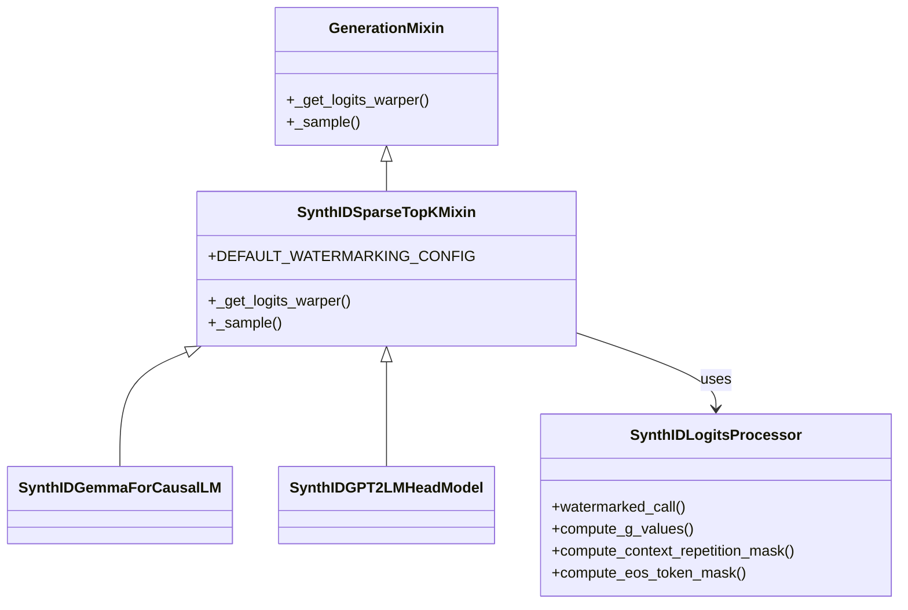

The diagram shows how the SynthID components extend the Hugging Face Transformers library to enable watermarking. The mixin approach allows watermarking to be added without modifying the original model code.

Sources: [README.md:15-19](), [README.md:92-124]()

## Detection System

The detection system analyzes text to determine if it contains a watermark. SynthID Text provides two detection methods:

1. **Mean Detector**: A simple, training-free approach that calculates mean scores of extracted watermark features
2. **Bayesian Detector**: A more sophisticated approach that requires training but offers better performance

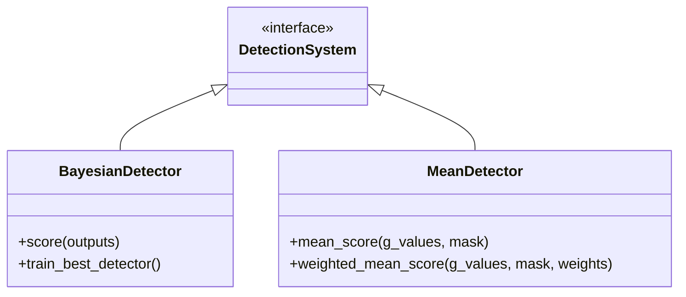

The detection process extracts "g-values" from text, which represent evidence of watermarking, and then applies statistical analysis to determine whether the text contains a watermark.

Sources: [README.md:20-27](), [README.md:175-185]()

## Watermarking Process Flow

The following diagram illustrates how text generation with watermarking works:

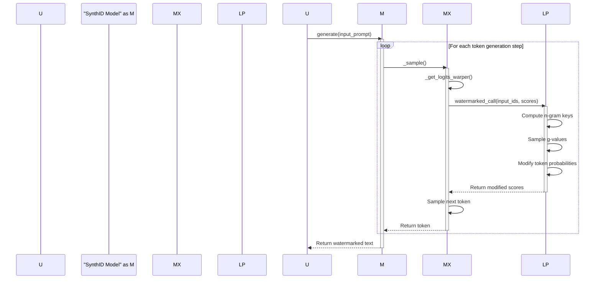

During text generation, the watermarking components modify the token selection process to subtly influence which tokens are selected, creating a statistical pattern that can later be detected.

Sources: [README.md:92-124](), [README.md:125-172]()

## Detection Process Flow

The following diagram shows how watermark detection works:

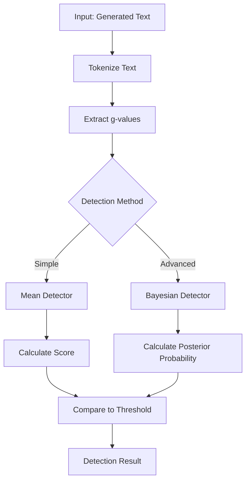

Detection involves extracting g-values from the text and analyzing them using either the Mean Detector or Bayesian Detector to determine if the text contains a watermark.

Sources: [README.md:175-255]()

## Watermarking Configuration

Watermarking is controlled by a configuration that specifies parameters such as n-gram length and keys. The default configuration is defined in `SynthIDSparseTopKMixin.DEFAULT_WATERMARKING_CONFIG`.

Key configuration parameters include:
- `ngram_len`: Length of n-grams used for key computation
- `keys`: Sequence of integers used to generate watermarks
- `sampling_table_size`: Size of the table used for sampling
- `context_history_size`: Size of the context history window

Sources: [README.md:92-124]()

## Limitations and Intended Use

SynthID Text is provided as a reference implementation for research purposes and is not intended for production use. The implementation uses a static watermarking configuration and does not provide cryptographic security guarantees.

For production use, it is recommended to use the official SynthID Text implementation in Hugging Face Transformers.

Sources: [README.md:38-49]()

## Conclusion

SynthID Text provides a framework for watermarking and detecting AI-generated text through integration with Hugging Face Transformers models. The system uses a mixin pattern to add watermarking capabilities during text generation and offers multiple methods for detecting watermarks in text.

For more details on:
- The system architecture, see [System Architecture](#2)
- Integrating with your application, see [Integration Guide](#3)
- API documentation, see [API Reference](#4)
- Human evaluation of watermarked text, see [Human Evaluation](#5)

Sources: [README.md:1-338]()

---

# Page: System Architecture

# System Architecture

<details>
<summary>Relevant source files</summary>

The following files were used as context for generating this wiki page:

- [src/synthid_text/detector_bayesian.py](src/synthid_text/detector_bayesian.py)
- [src/synthid_text/logits_processing.py](src/synthid_text/logits_processing.py)
- [src/synthid_text/synthid_mixin.py](src/synthid_text/synthid_mixin.py)

</details>


This document provides a comprehensive overview of the SynthID Text system architecture, detailing how the watermarking and detection components interact to enable AI-generated text identification. For specific integration instructions, see [Integration Guide](#3).

## Core Architecture Overview

SynthID Text consists of two primary subsystems:

1. **Watermarking System**: Embeds watermarks into text during generation
2. **Detection System**: Analyzes text to determine if it contains a watermark

These systems work together to provide a complete solution for watermarking and detecting AI-generated text:

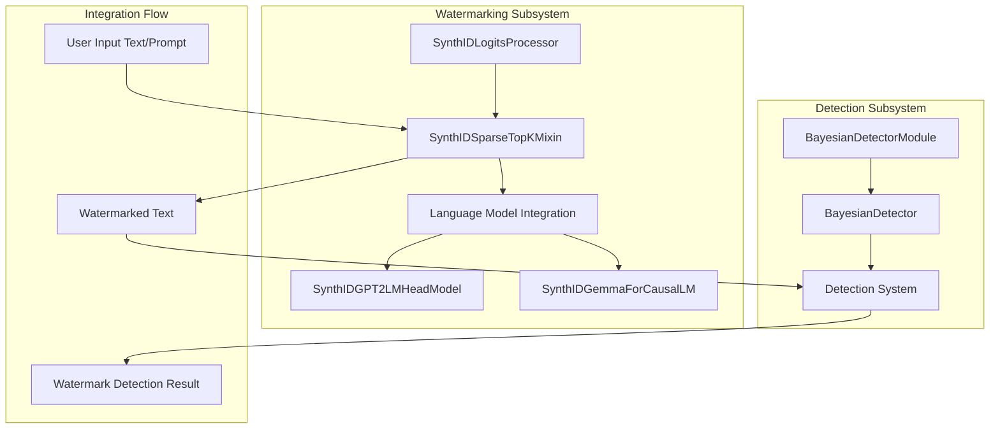

Sources: [src/synthid_text/synthid_mixin.py:16-408](), [src/synthid_text/detector_bayesian.py:16-1068](), [src/synthid_text/logits_processing.py:16-542]()

## Watermarking Architecture

The watermarking system modifies the token generation process of language models to subtly embed watermarks by biasing the token selection process.

### Watermarking Components

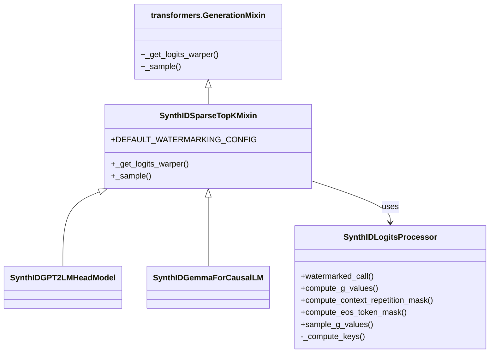

Sources: [src/synthid_text/synthid_mixin.py:73-408](), [src/synthid_text/logits_processing.py:126-542]()

### Key Watermarking Components:

1. **SynthIDSparseTopKMixin**: A mixin class that extends Hugging Face's `GenerationMixin` to add watermarking capabilities. It:
   - Overrides `_get_logits_warper()` to inject the watermarking logic
   - Overrides `_sample()` to modify the token selection process
   - Provides a default watermarking configuration

2. **SynthIDLogitsProcessor**: The core processor that implements the watermarking logic:
   - Computes g-values based on n-gram context
   - Updates token probability scores based on these g-values
   - Maintains state across generation steps
   - Handles watermark embedding through the `watermarked_call()` method

3. **Model Integration Classes**:
   - `SynthIDGPT2LMHeadModel`: GPT-2 model with watermarking capability
   - `SynthIDGemmaForCausalLM`: Gemma model with watermarking capability

Sources: [src/synthid_text/synthid_mixin.py:73-408](), [src/synthid_text/logits_processing.py:126-542]()

### Watermarking Process

The watermarking process modifies token probabilities during generation:

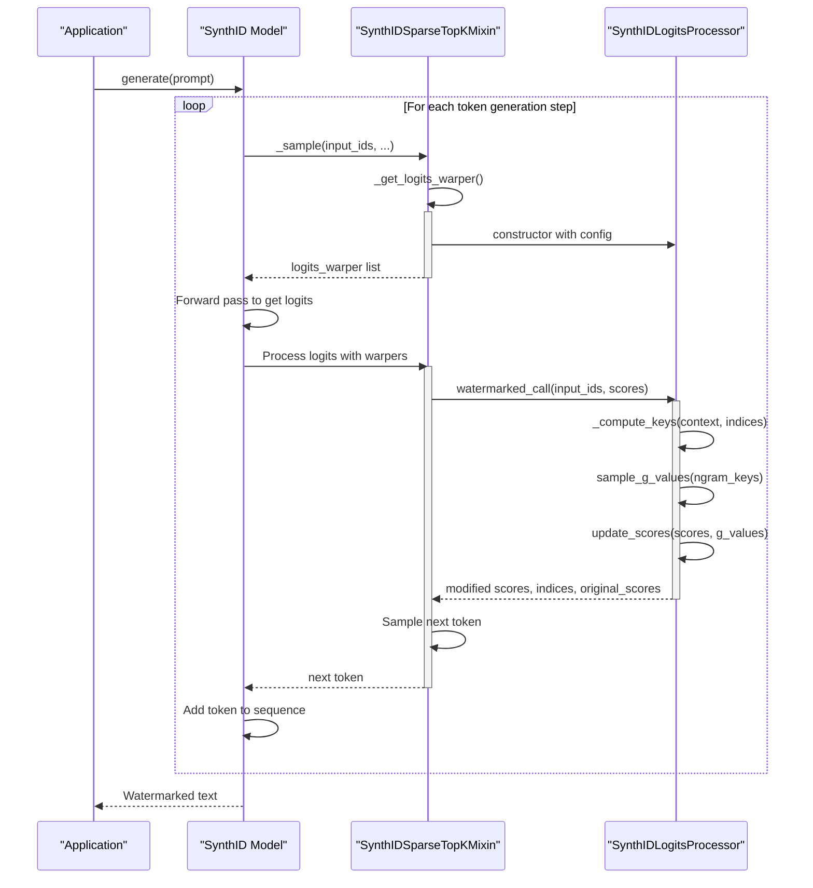

Sources: [src/synthid_text/synthid_mixin.py:132-396](), [src/synthid_text/logits_processing.py:235-337]()

### Default Watermarking Configuration

The system has the following default configuration parameters:

| Parameter | Value | Description |
|-----------|-------|-------------|
| ngram_len | 5 | Length of n-grams used for context (H=4 in paper) |
| keys | [654, 400, ...] | Keys for the watermarking hash function |
| sampling_table_size | 2^16 | Size of sampling table for g-values |
| sampling_table_seed | 0 | Seed for random sampling table |
| context_history_size | 1024 | Size of context history buffer |

Sources: [src/synthid_text/synthid_mixin.py:28-70]()

## Detection Architecture

The detection system analyzes text to determine if it contains watermarks embedded by the watermarking system.

### Detection Components

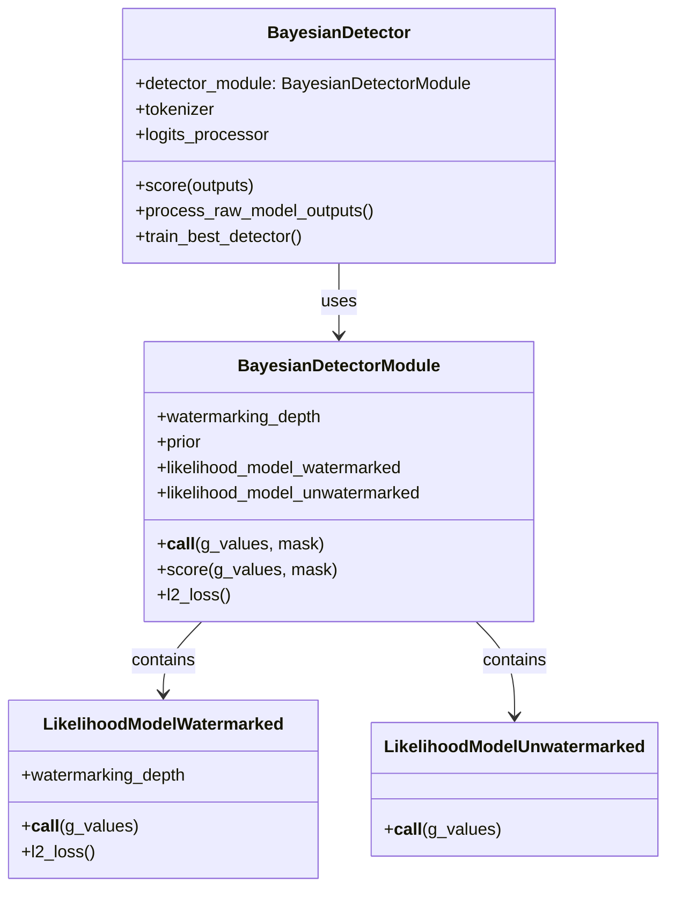

Sources: [src/synthid_text/detector_bayesian.py:704-1068](), [src/synthid_text/detector_bayesian.py:385-452]()

### Key Detection Components:

1. **BayesianDetector**: The main detector class that:
   - Scores text for the likelihood of being watermarked
   - Processes raw model outputs for detector training
   - Provides methods for training the best detector

2. **BayesianDetectorModule**: Core implementation that:
   - Computes the posterior probability of text being watermarked
   - Uses likelihood models for both watermarked and unwatermarked text
   - Applies Bayes' rule to compute final scores

3. **Likelihood Models**:
   - `LikelihoodModelWatermarked`: Models p(g_values|watermarked)
   - `LikelihoodModelUnwatermarked`: Models p(g_values|unwatermarked)

Sources: [src/synthid_text/detector_bayesian.py:385-452](), [src/synthid_text/detector_bayesian.py:209-336]()

### Detection Process

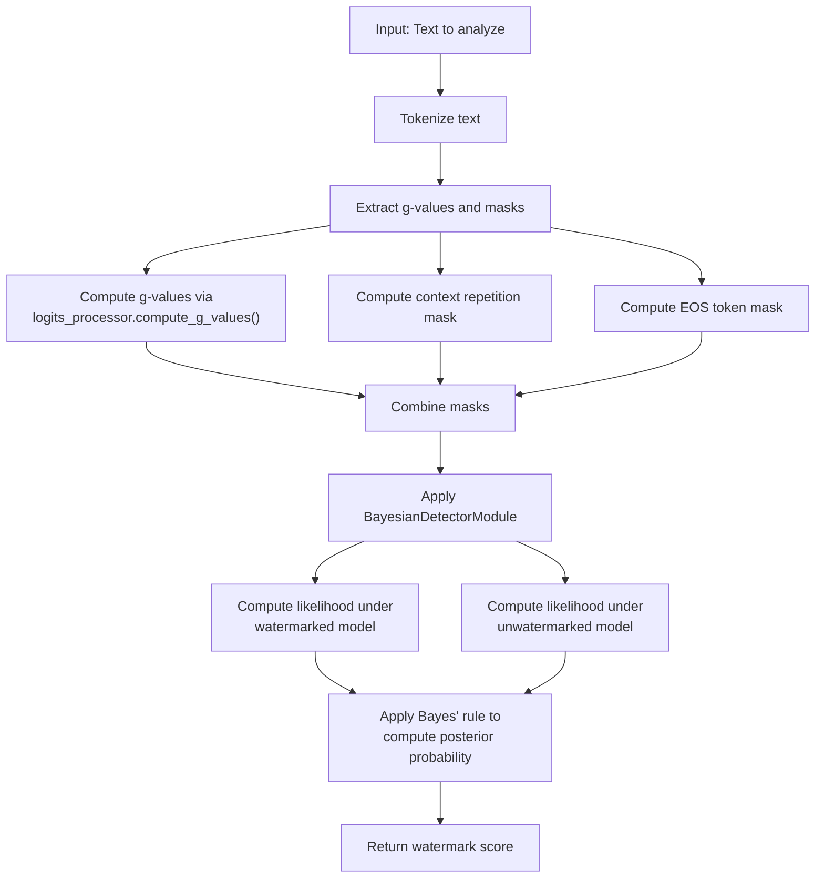

Sources: [src/synthid_text/detector_bayesian.py:724-758](), [src/synthid_text/logits_processing.py:451-542]()

## System Integration

SynthID Text integrates with existing language model frameworks, primarily Hugging Face Transformers:

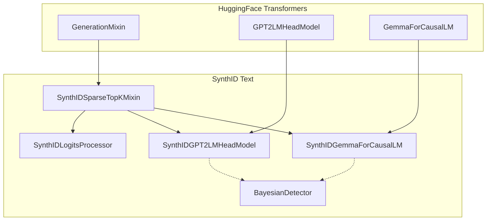

Sources: [src/synthid_text/synthid_mixin.py:399-408](), [src/synthid_text/detector_bayesian.py:704-723]()

## Data Flow Between Components

The following diagram shows the data flow within the SynthID Text system:

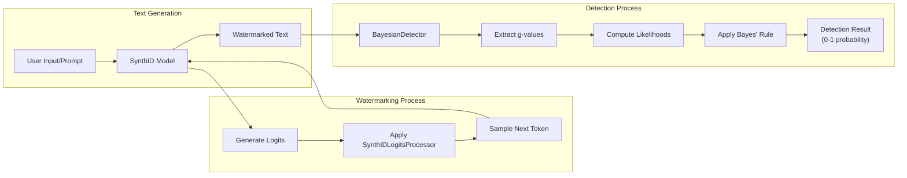

Sources: [src/synthid_text/synthid_mixin.py:132-396](), [src/synthid_text/detector_bayesian.py:724-758]()

## Key Implementation Details

### Watermarking Mechanism

The watermarking mechanism relies on several key techniques:

1. **Context-Based Hashing**: Uses n-grams from previous tokens to influence future token selection
2. **G-Value Computation**: Computes binary g-values based on hashing with predefined keys
3. **Probability Redistribution**: Modifies token probabilities based on g-values
4. **Sparse Top-K Approach**: Works only with the top-k token candidates for efficiency

The `SynthIDLogitsProcessor.watermarked_call()` method implements this process by:
1. Applying temperature and top-k filtering
2. Computing keys from context and candidate tokens
3. Sampling g-values for each candidate token
4. Updating token scores based on g-values
5. Checking for context repetition

Sources: [src/synthid_text/logits_processing.py:235-337](), [src/synthid_text/synthid_mixin.py:88-130]()

### Detection Implementation

The detection process follows these key steps:

1. **G-Value Extraction**: Extracts g-values from the text using the same algorithm used for watermarking
2. **Mask Computation**: Computes masks to filter out tokens that should not be considered
3. **Likelihood Calculation**: Calculates likelihood under both watermarked and unwatermarked models
4. **Posterior Computation**: Applies Bayes' rule to compute the posterior probability of the text being watermarked

The `BayesianDetector.score()` method:
1. Computes masks (EOS token mask, context repetition mask)
2. Extracts g-values from the text
3. Passes these to the `BayesianDetectorModule` for scoring

Sources: [src/synthid_text/detector_bayesian.py:724-758](), [src/synthid_text/detector_bayesian.py:420-442]()

## Conclusion

The SynthID Text architecture provides a comprehensive solution for watermarking and detecting AI-generated text through:

1. A flexible mixin-based approach that can be applied to different language models
2. A stateful watermarking process that modifies token probabilities during generation
3. A Bayesian detection system that can be trained on watermarked and unwatermarked samples
4. Integration with popular frameworks like Hugging Face Transformers

For details on how to use the system, see the [Integration Guide](#3), and for API reference information, see the [API Reference](#4).

---

# Page: Watermarking System

# Watermarking System

<details>
<summary>Relevant source files</summary>

The following files were used as context for generating this wiki page:

- [src/synthid_text/logits_processing.py](src/synthid_text/logits_processing.py)
- [src/synthid_text/synthid_mixin.py](src/synthid_text/synthid_mixin.py)
- [src/synthid_text/synthid_mixin_test.py](src/synthid_text/synthid_mixin_test.py)

</details>


## Purpose and Scope

This document describes the watermarking system in SynthID Text, which embeds detectable patterns into text generated by language models. The watermarking process subtly modifies token probabilities during text generation, creating statistical patterns that can be detected while maintaining text quality. For information about detecting watermarks in generated text, see [Detection System](#2.2).

Sources: [src/synthid_text/synthid_mixin.py:15-18](), [src/synthid_text/logits_processing.py:15-17]()

## Architecture Overview

The watermarking system integrates with Hugging Face Transformers models using a mixin pattern that overrides key generation methods without modifying the original model code.

### Watermarking System Architecture

```mermaid
classDiagram
    class "transformers.GenerationMixin" {
        +_get_logits_warper()
        +_sample()
    }
    
    class "SynthIDSparseTopKMixin" {
        +_get_logits_warper()
        +_sample()
        +_construct_warper_list()
        +DEFAULT_WATERMARKING_CONFIG
    }
    
    class "SynthIDLogitsProcessor" {
        +watermarked_call()
        +compute_g_values()
        +sample_g_values()
        -_compute_keys()
    }
    
    class "SynthIDGemmaForCausalLM" {
    }
    
    class "SynthIDGPT2LMHeadModel" {
    }
    
    "transformers.GenerationMixin" <|-- "SynthIDSparseTopKMixin"
    "SynthIDSparseTopKMixin" <|-- "SynthIDGemmaForCausalLM"
    "SynthIDSparseTopKMixin" <|-- "SynthIDGPT2LMHeadModel"
    "SynthIDSparseTopKMixin" --> "SynthIDLogitsProcessor" : uses
```

Sources: [src/synthid_text/synthid_mixin.py:73-86](), [src/synthid_text/logits_processing.py:126-136]()

## Key Components

### SynthIDSparseTopKMixin

The `SynthIDSparseTopKMixin` class extends Hugging Face's `GenerationMixin` to integrate watermarking capabilities:

- Overrides `_get_logits_warper()` to create a warper list containing the watermarking processor
- Overrides `_sample()` to apply watermarking during the token generation process
- Works with a sparse top-k implementation for efficiency
- Contains default watermarking configuration parameters

Sources: [src/synthid_text/synthid_mixin.py:73-96]()

### SynthIDLogitsProcessor

The `SynthIDLogitsProcessor` class implements the core watermarking functionality:

- Modifies token probabilities based on hash values derived from n-gram context
- Uses a pre-computed sampling table to map hashed n-gram keys to binary g-values
- Tracks context history to avoid watermarking repeated contexts
- Provides methods for computing g-values, context repetition masks, and EOS token masks

Sources: [src/synthid_text/logits_processing.py:126-214]()

### Default Configuration Parameters

The system uses a default configuration with the following key parameters:

| Parameter | Value | Description |
|-----------|-------|-------------|
| ngram_len | 5 | Length of n-grams used (context window size + 1) |
| keys | [654, 400, 836, ...] | 31 integer keys used for watermarking |
| sampling_table_size | 2^16 | Size of the pre-computed sampling table |
| sampling_table_seed | 0 | Random seed for generating the sampling table |
| context_history_size | 1024 | Size of the tensor tracking seen contexts |

Sources: [src/synthid_text/synthid_mixin.py:28-70]()

## Watermarking Process Flow

### Generation Process with Watermarking

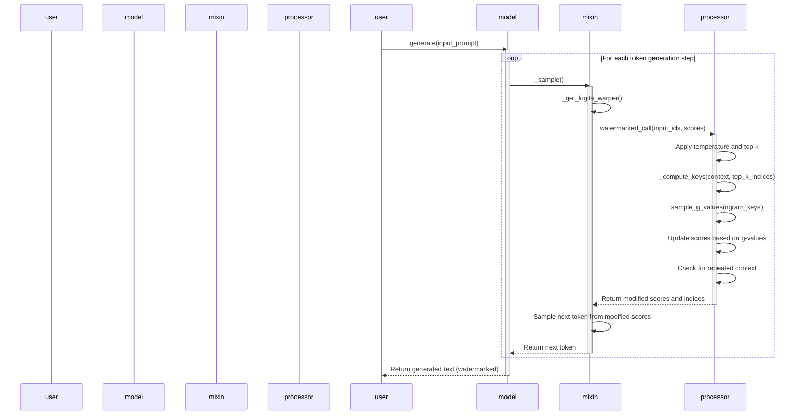

Sources: [src/synthid_text/synthid_mixin.py:132-396](), [src/synthid_text/logits_processing.py:234-337]()

## Watermarking Algorithm

### N-gram Hashing and G-value Computation

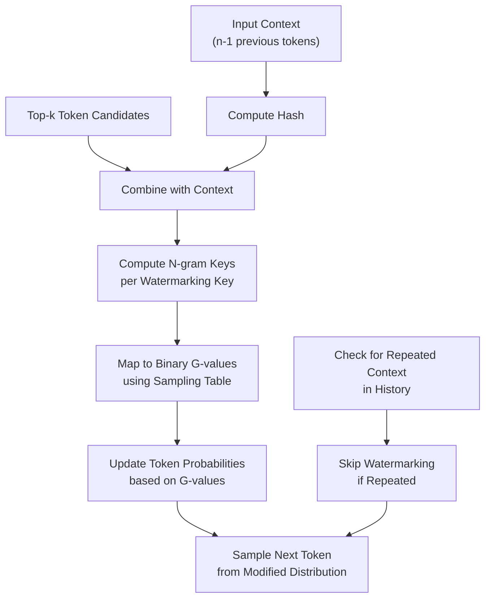

Sources: [src/synthid_text/logits_processing.py:338-442](), [src/synthid_text/logits_processing.py:26-54]()

The watermarking algorithm operates as follows:

1. For each token generation step, the system extracts the current context (previous n-1 tokens)
2. The top-k token candidates are selected based on their logit scores
3. For each candidate token, the system:
   - Computes a hash of the n-gram formed by the context plus the candidate token
   - For each watermarking key, computes a new hash to derive the final n-gram key
   - Maps each n-gram key to a binary g-value (0 or 1) using the pre-computed sampling table
4. Token probabilities are updated based on their g-values
5. The system checks if the current context was previously seen, and if so, skips watermarking
6. A token is sampled from the modified probability distribution

Sources: [src/synthid_text/logits_processing.py:234-337]()

### Token Probability Modification

The `update_scores` function modifies token probabilities based on the g-values:

```
For each depth in the g-values:
1. Calculate the current g-mass (weighted sum of g-values)
2. Update probabilities: p_new = p_old * (1 + g_value - g_mass)
3. Convert back to log probabilities
```

This approach subtly biases the selection toward tokens with g-value=1, creating a statistical pattern that can be detected.

Sources: [src/synthid_text/logits_processing.py:26-54]()

## Model Integration

The watermarking system integrates with Hugging Face models using concrete implementations:

- `SynthIDGPT2LMHeadModel`: Adds watermarking to GPT-2 models
- `SynthIDGemmaForCausalLM`: Adds watermarking to Gemma models

Both classes inherit from `SynthIDSparseTopKMixin` and their respective base model classes, allowing them to add watermarking while maintaining all original functionality.

Sources: [src/synthid_text/synthid_mixin.py:399-407]()

## Technical Implementation Details

### SynthIDState

The `SynthIDState` class maintains state during the watermarking process:

- Tracks the current context (last n-1 tokens)
- Maintains a history of previously seen contexts
- Counts the number of calls to enable skipping initial tokens if needed

Sources: [src/synthid_text/logits_processing.py:95-123]()

### Efficiency Considerations

The system implements several optimizations:

1. **Sparse Top-K Processing**: Only watermarks the top-k token candidates instead of the entire vocabulary
2. **Context Repetition Handling**: Avoids redundant watermarking of repeated contexts
3. **Pre-computed Sampling Table**: Uses a fixed-size table for efficient g-value lookup

Sources: [src/synthid_text/synthid_mixin.py:88-102](), [src/synthid_text/logits_processing.py:216-223]()

## Relationship to Detection

The watermarking system is designed to work in tandem with the detection system. The statistical patterns embedded by the watermarking process can be extracted and analyzed by the detectors to determine if text was generated with watermarking enabled. For details on how detection works, see the [Detection System](#2.2) page.

Sources: [src/synthid_text/logits_processing.py:338-467]()

---

# Page: Detection System

# Detection System

<details>
<summary>Relevant source files</summary>

The following files were used as context for generating this wiki page:

- [src/synthid_text/detector_bayesian.py](src/synthid_text/detector_bayesian.py)
- [src/synthid_text/detector_mean.py](src/synthid_text/detector_mean.py)
- [src/synthid_text/g_value_expectations.py](src/synthid_text/g_value_expectations.py)

</details>


The Detection System in SynthID Text is responsible for analyzing text to determine whether it has been watermarked using the system's watermarking methods. This page documents the detection approaches, their implementation, and how to use them. For information about the watermarking system itself, see [Watermarking System](#2.1).

## Overview

The SynthID Text Detection System offers two detection methods:

1. **Mean Detector** - A simple, training-free approach that calculates the average of g-values to detect watermarks
2. **Bayesian Detector** - A more sophisticated approach that uses Bayesian inference and requires training on watermarked and unwatermarked text

Both methods analyze the statistical patterns in the g-values embedded during the watermarking process to determine whether a given text was watermarked.

Sources: [src/synthid_text/detector_mean.py:16-17](), [src/synthid_text/detector_bayesian.py:16-17]()

## Detection System Architecture

The Detection System fits into the broader SynthID Text framework as shown below:

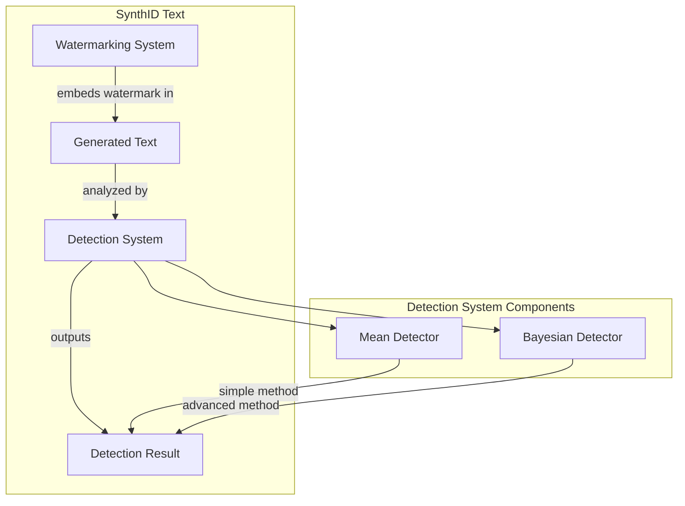

The Detection System operates on g-values, which are statistical features extracted from the tokenized text. These g-values carry the watermark signal that was embedded during text generation.

### Detection Components

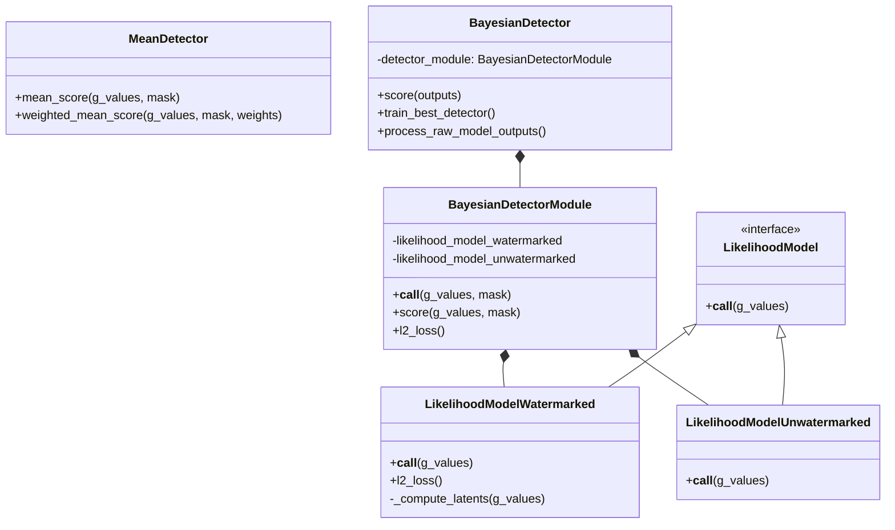

Sources: [src/synthid_text/detector_mean.py:22-77](), [src/synthid_text/detector_bayesian.py:704-1068](), [src/synthid_text/detector_bayesian.py:385-451](), [src/synthid_text/detector_bayesian.py:209-337]()

### Detection Process Flow

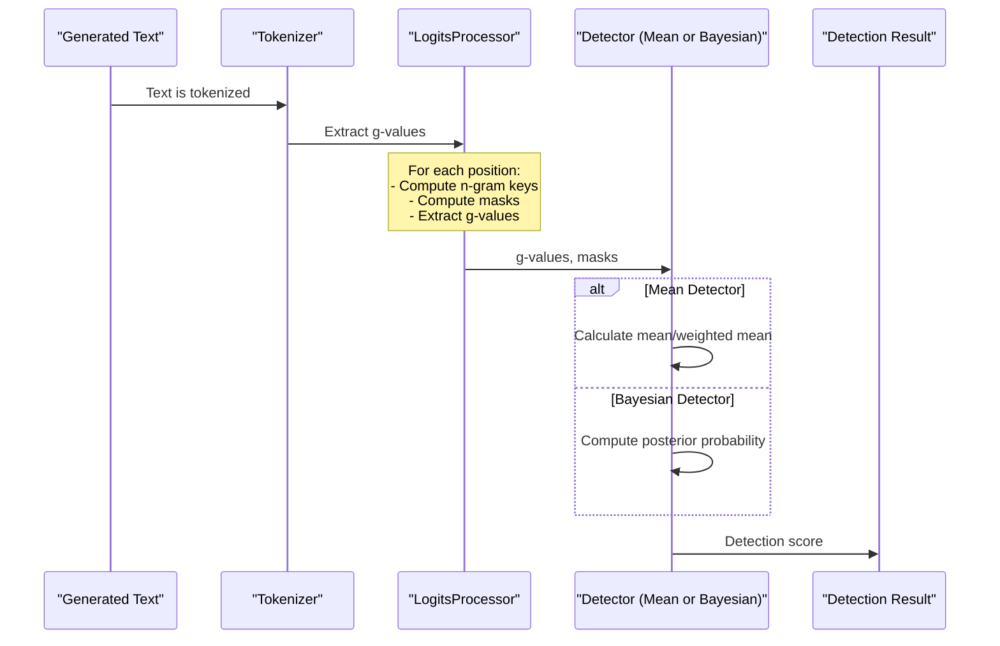

Sources: [src/synthid_text/detector_bayesian.py:724-758](), [src/synthid_text/detector_mean.py:22-77]()

## Mean Detector

The Mean Detector provides a simple, training-free method for watermark detection. It's based on the principle that watermarked text will have g-values with a mean significantly higher than 0.5 (the expected mean for unwatermarked text).

### Implementation

The Mean Detector offers two scoring functions:

1. **Mean Score** - Simple average of g-values:
   ```python
   def mean_score(g_values, mask):
       # ...returns the mean of masked g-values
   ```

2. **Weighted Mean Score** - Applies weights to g-values before averaging:
   ```python
   def weighted_mean_score(g_values, mask, weights=None):
       # ...returns weighted mean of masked g-values
   ```

Both functions take g-values (shape `[batch_size, seq_len, watermarking_depth]`) and a mask (shape `[batch_size, seq_len]`) as input and return scores of shape `[batch_size]`.

Sources: [src/synthid_text/detector_mean.py:22-77]()

### Expected G-Values

For watermarked text using a tournament tree with 2 leaves (the default configuration), the expected mean g-value can be calculated as:

```
expected_mean = 0.5 + 0.25 * (1 - (1 / vocab_size))
```

For unwatermarked text, the expected mean g-value is always 0.5.

Sources: [src/synthid_text/g_value_expectations.py:19-49]()

## Bayesian Detector

The Bayesian Detector is a more sophisticated approach that uses Bayesian inference to calculate the posterior probability that a text is watermarked given its g-values. It requires training on watermarked and unwatermarked examples to learn the parameters of the likelihood models.

### Architecture

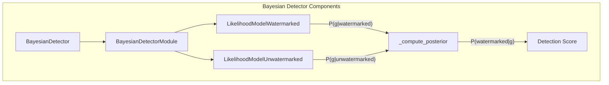

The Bayesian Detector has three main components:
1. **BayesianDetector** - The main class that handles detection
2. **BayesianDetectorModule** - A Flax module that implements the Bayesian classifier
3. **Likelihood Models** - Models that compute the likelihood of g-values under watermarked and unwatermarked hypotheses

Sources: [src/synthid_text/detector_bayesian.py:385-451](), [src/synthid_text/detector_bayesian.py:704-758](), [src/synthid_text/detector_bayesian.py:209-337]()

### Training Process

The Bayesian Detector requires training to learn the parameters of the likelihood models. The training process is shown below:

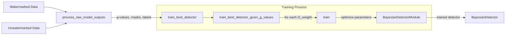

The training process consists of the following steps:
1. **Data Processing** - Raw model outputs are processed to extract g-values and masks
2. **Training** - The detector module is trained with different L2 regularization weights
3. **Selection** - The best detector (with the lowest validation loss) is selected

Sources: [src/synthid_text/detector_bayesian.py:940-1068](), [src/synthid_text/detector_bayesian.py:513-701]()

### Scoring Process

Once trained, the Bayesian Detector can be used to score text as follows:

```mermaid
sequenceDiagram
    participant Input as "Input Text"
    participant BD as "BayesianDetector"
    participant LP as "LogitsProcessor"
    participant BDM as "BayesianDetectorModule"
    
    Input->>BD: score(outputs)
    BD->>LP: compute_eos_token_mask
    BD->>LP: compute_context_repetition_mask
    BD->>LP: compute_g_values
    BD->>BDM: score(g_values, mask)
    BDM->>BD: Return posterior probability
    BD->>Input: Return detection score
```

The score returned is the posterior probability that the text is watermarked, given its g-values.

Sources: [src/synthid_text/detector_bayesian.py:724-758]()

## Usage Guide

### Using the Mean Detector

The Mean Detector functions are simple to use and don't require training:

```python
# Example usage
from synthid_text.detector_mean import mean_score, weighted_mean_score

# Calculate mean score
score = mean_score(g_values, mask)

# Calculate weighted mean score
weighted_score = weighted_mean_score(g_values, mask, weights=None)
```

Sources: [src/synthid_text/detector_mean.py:22-77]()

### Training and Using the Bayesian Detector

Training a Bayesian Detector requires watermarked and unwatermarked examples:

```python
# Example training
detector, min_val_loss = BayesianDetector.train_best_detector(
    tokenized_wm_outputs=watermarked_outputs,
    tokenized_uwm_outputs=unwatermarked_outputs,
    logits_processor=logits_processor,
    tokenizer=tokenizer,
    torch_device=device
)

# Using the trained detector
scores = detector.score(outputs)
```

The Bayesian Detector also provides more detailed methods to customize the training process:

| Method | Purpose |
|--------|---------|
| `train_best_detector` | End-to-end training from raw outputs |
| `process_raw_model_outputs` | Process outputs into g-values and masks |
| `train_best_detector_given_g_values` | Train detector from processed g-values |

Sources: [src/synthid_text/detector_bayesian.py:940-1068](), [src/synthid_text/detector_bayesian.py:761-938]()

## Performance Considerations

The choice between Mean Detector and Bayesian Detector involves trade-offs:

| Detector | Advantages | Disadvantages |
|----------|------------|---------------|
| Mean Detector | - No training required<br>- Simple implementation<br>- Fast inference | - Less accurate<br>- Higher false positive/negative rates |
| Bayesian Detector | - More accurate detection<br>- Better handling of edge cases<br>- Provides posterior probabilities | - Requires training<br>- More complex implementation<br>- More resource-intensive |

The Bayesian Detector is recommended for applications requiring high accuracy, while the Mean Detector is suitable for quick testing or resource-constrained environments.

Sources: [src/synthid_text/detector_bayesian.py:383-451](), [src/synthid_text/detector_mean.py:22-77]()

---

# Page: Integration Guide

# Integration Guide

<details>
<summary>Relevant source files</summary>

The following files were used as context for generating this wiki page:

- [README.md](README.md)
- [notebooks/synthid_text_huggingface_integration.ipynb](notebooks/synthid_text_huggingface_integration.ipynb)

</details>


This guide provides practical instructions for integrating SynthID Text watermarking and detection capabilities with language models. The focus is on integration with Hugging Face Transformers models, demonstrating how to apply watermarks during text generation and detect watermarks in generated text.

For a high-level overview of SynthID Text, see [Overview](#1). For details about the system architecture, see [System Architecture](#2). For specific details about Hugging Face integration, see [Hugging Face Integration](#3.1).

## Installation Options

Before integrating SynthID Text, you need to install the library using one of the following methods:

### PyPI Installation

```
pip install synthid-text
```

### Source Installation

```
# Clone the repository
git clone https://github.com/google-deepmind/synthid-text.git
cd synthid-text

# For local notebook use
pip install '.[notebook-local]'

# For running tests
pip install '.[test]'
```

Sources: [README.md:10-87]()

## Integration Architecture

SynthID Text integration revolves around two main components:

1. **Watermarking**: Adding a statistical watermark to LLM-generated text using a mixin class
2. **Detection**: Identifying watermarked text using either a Mean detector or Bayesian detector

The following diagram illustrates how these components interconnect during integration:

```mermaid
flowchart TD
    subgraph "SynthID Text Components"
        WMConfig["WatermarkingConfig"]
        MixinClass["SynthIDSparseTopKMixin"]
        LogitsProcessor["SynthIDLogitsProcessor"]
        MeanDet["detector_mean"]
        BayesDet["detector_bayesian"]
    end

    subgraph "Hugging Face Integration"
        HFModel["HuggingFace Model"]
        ExtendedModel["SynthID-enabled Model"]
        Tokenizer["AutoTokenizer"]
    end

    subgraph "Application Flow"
        Generate["Text Generation"]
        Extract["Extract g-values & masks"]
        Detect["Watermark Detection"]
    end

    WMConfig --> MixinClass
    MixinClass --> LogitsProcessor
    MixinClass --> ExtendedModel
    HFModel --> ExtendedModel
    ExtendedModel --> Generate
    Generate --> Extract
    Extract --> Detect
    MeanDet --> Detect
    BayesDet --> Detect
    Tokenizer --> Generate
    Tokenizer --> Extract
```

Title: SynthID Text Integration Architecture

Sources: [README.md:15-27](), [notebooks/synthid_text_huggingface_integration.ipynb:57-77]()

## Watermarking Integration

### Watermarking Configuration

SynthID Text uses a configuration object to define watermarking parameters. The most critical parameter is `keys`, which creates a unique watermark signature.

```mermaid
classDiagram
    class WatermarkingConfig {
        +ngram_len: int
        +keys: Sequence[int]
        +sampling_table_size: int
        +sampling_table_seed: int
        +context_history_size: int
        +device: torch.device
    }
```

Title: SynthID Text Watermarking Configuration Structure

In the reference implementation, a default static configuration is provided through `DEFAULT_WATERMARKING_CONFIG`:

```python
# Example configuration - actual values may differ
{
    "ngram_len": 3,
    "keys": [5702, 12702, 10473, 15123, 16711, 3087, 5, 3919, 19427, 11373],
    "sampling_table_size": 120000,
    "sampling_table_seed": 42,
    "context_history_size": 32,
    "device": torch.device("cpu")
}
```

**Note**: For production use, consider using unique keys for creating distinct watermarks.

Sources: [README.md:93-118](), [notebooks/synthid_text_huggingface_integration.ipynb:144-156]()

### Watermark-Enabled Models

SynthID Text extends Hugging Face models using a mixin pattern. Currently, it supports:

- `SynthIDGemmaForCausalLM` (for Gemma models)
- `SynthIDGPT2LMHeadModel` (for GPT-2 models)

Here's how to initialize a watermark-enabled model:

```python
from synthid_text import synthid_mixin
import transformers
import torch

# Choose device
DEVICE = torch.device('cuda:0') if torch.cuda.is_available() else torch.device('cpu')

# Initialize tokenizer
MODEL_NAME = 'google/gemma-2b-it'  # or 'gpt2', 'google/gemma-7b-it'
tokenizer = transformers.AutoTokenizer.from_pretrained(MODEL_NAME)

# Initialize SynthID-enabled model
model = synthid_mixin.SynthIDGemmaForCausalLM.from_pretrained(
    MODEL_NAME,
    device_map='auto',
    torch_dtype=torch.bfloat16,
)

# Generate watermarked text using standard HF API
inputs = tokenizer(
    ["I enjoy walking with my cute dog"],
    return_tensors='pt',
    padding=True,
).to(DEVICE)

outputs = model.generate(
    **inputs,
    do_sample=True,
    max_length=1024,
    temperature=0.5,
    top_k=40,
    top_p=0.99,
)
```

The watermarking process flows as follows:

```mermaid
sequenceDiagram
    participant App as "Application"
    participant Model as "SynthID Model"
    participant Mixin as "SynthIDSparseTopKMixin"
    participant Proc as "SynthIDLogitsProcessor"
    
    App->>Model: model.generate(inputs)
    activate Model
    
    loop For each token generation
        Model->>Mixin: _sample()
        activate Mixin
        
        Mixin->>Mixin: _get_logits_warper()
        Mixin->>Proc: watermarked_call(input_ids, scores)
        activate Proc
        
        Proc->>Proc: compute_keys()
        Proc->>Proc: sample_g_values()
        Proc->>Proc: Update token probabilities
        
        Proc-->>Mixin: Return modified scores
        deactivate Proc
        
        Mixin->>Mixin: Sample next token
        Mixin-->>Model: Return token
        deactivate Mixin
    end
    
    Model-->>App: Return watermarked text
    deactivate Model
```

Title: SynthID Text Watermarking Process Flow

Sources: [README.md:120-172](), [notebooks/synthid_text_huggingface_integration.ipynb:193-226](), [notebooks/synthid_text_huggingface_integration.ipynb:287-326]()

## Detection Integration

SynthID Text provides two approaches for detecting watermarks:

1. **Mean Detector**: Simple, no-training approach
2. **Bayesian Detector**: More sophisticated approach requiring training

The detection process involves:

```mermaid
flowchart TD
    subgraph "Text Processing"
        Text["Input Text"]
        Tokens["Tokenized Text"]
        GValues["G-Values"]
        EosMask["EOS Token Mask"]
        RepMask["Context Repetition Mask"]
        CombinedMask["Combined Mask"]
    end
    
    subgraph "Detection Methods"
        Mean["Mean Detector"]
        WeightedMean["Weighted Mean Detector"]
        Bayesian["Bayesian Detector"]
    end
    
    subgraph "Decision"
        Score["Detection Score"]
        Threshold["Compare to Threshold"]
        Result["Classification Result"]
    end
    
    Text --> Tokens
    Tokens --> GValues
    Tokens --> EosMask
    Tokens --> RepMask
    EosMask --> CombinedMask
    RepMask --> CombinedMask
    
    GValues --> Mean
    CombinedMask --> Mean
    Mean --> Score
    
    GValues --> WeightedMean
    CombinedMask --> WeightedMean
    WeightedMean --> Score
    
    GValues --> Bayesian
    CombinedMask --> Bayesian
    Bayesian --> Score
    
    Score --> Threshold
    Threshold --> Result
```

Title: SynthID Text Detection Integration Process

Sources: [README.md:174-255](), [notebooks/synthid_text_huggingface_integration.ipynb:523-532]()

### Mean Detector Integration

The Mean detector provides a straightforward approach without requiring training:

```python
from synthid_text import detector_mean, logits_processing

# Initialize the logits processor with the same configuration used for watermarking
CONFIG = synthid_mixin.DEFAULT_WATERMARKING_CONFIG
logits_processor = logits_processing.SynthIDLogitsProcessor(
    **CONFIG, top_k=40, temperature=0.5
)

# For generated text (outputs), compute masks
eos_token_mask = logits_processor.compute_eos_token_mask(
    input_ids=outputs,
    eos_token_id=tokenizer.eos_token_id,
)[:, CONFIG['ngram_len'] - 1 :]

context_repetition_mask = logits_processor.compute_context_repetition_mask(
    input_ids=outputs
)

combined_mask = context_repetition_mask * eos_token_mask

# Compute g-values
g_values = logits_processor.compute_g_values(
    input_ids=outputs,
)

# Get detection scores
mean_scores = detector_mean.mean_score(
    g_values.cpu().numpy(), combined_mask.cpu().numpy()
)

# Or use weighted mean for potentially better performance
weighted_mean_scores = detector_mean.weighted_mean_score(
    g_values.cpu().numpy(), combined_mask.cpu().numpy()
)
```

Higher scores indicate a higher likelihood of watermarked text.

Sources: [README.md:174-189](), [notebooks/synthid_text_huggingface_integration.ipynb:637-690]()

### Bayesian Detector Integration

The Bayesian detector provides more sophisticated detection but requires training:

1. **Generate training data**:
   - Create watermarked samples
   - Obtain unwatermarked samples

2. **Train the detector**:
   ```python
   from synthid_text import detector_bayesian
   
   bayesian_detector, test_loss = detector_bayesian.BayesianDetector.train_best_detector(
       tokenized_wm_outputs=watermarked_outputs,
       tokenized_uwm_outputs=unwatermarked_outputs,
       logits_processor=logits_processor,
       tokenizer=tokenizer,
       torch_device=device,
       max_padded_length=1000,
       pos_truncation_length=200,
       neg_truncation_length=200,
       verbose=True,
       learning_rate=3e-3,
       n_epochs=100,
   )
   ```

3. **Use the trained detector**:
   ```python
   bayesian_scores = bayesian_detector.score(
       g_values.cpu().numpy(), combined_mask.cpu().numpy()
   )
   ```

Sources: [README.md:190-214](), [notebooks/synthid_text_huggingface_integration.ipynb:694-853]()

## Complete Integration Workflow

Here's a comprehensive workflow for integrating SynthID Text:

```mermaid
sequenceDiagram
    participant App as "Application"
    participant HF as "HuggingFace Libraries"
    participant SynthID as "SynthID Components"
    participant WMModel as "SynthID-enabled Model"
    participant Detector as "Detector"
    
    App->>HF: Import transformers
    App->>SynthID: Import synthid_mixin, detectors
    App->>HF: Initialize tokenizer
    App->>SynthID: Get DEFAULT_WATERMARKING_CONFIG
    App->>WMModel: Initialize model with watermarking
    App->>WMModel: Generate text
    
    Note over App,WMModel: Text now contains watermark
    
    App->>SynthID: Initialize SynthIDLogitsProcessor
    App->>SynthID: Compute g-values from text
    App->>SynthID: Compute masks
    
    opt Simple Detection
        App->>Detector: Use Mean detector
        Detector-->>App: Return mean scores
    end
    
    opt Advanced Detection
        App->>Detector: Train Bayesian detector
        App->>Detector: Score with Bayesian detector
        Detector-->>App: Return Bayesian scores
    end
    
    App->>App: Compare scores to threshold
    App->>App: Make classification decision
```

Title: End-to-End SynthID Text Integration Workflow

Sources: [notebooks/synthid_text_huggingface_integration.ipynb:1-77](), [notebooks/synthid_text_huggingface_integration.ipynb:287-326](), [notebooks/synthid_text_huggingface_integration.ipynb:637-690](), [notebooks/synthid_text_huggingface_integration.ipynb:694-854]()

## Integration Considerations

### Hardware Requirements

Different models have different hardware requirements:

| Model | Recommended Hardware | Memory Requirement |
|-------|---------------------|-------------------|
| Gemma 2B IT | GPU with 16GB (e.g., T4) | ~16GB |
| Gemma 7B IT | GPU with 32GB (e.g., A100) | ~32GB |
| GPT-2 | Any runtime (CPU or GPU) | ~2GB |

### Watermarking Impact on Text Quality

Watermarking slightly modifies token selection probabilities, which may theoretically impact text quality. However, the SynthID approach is designed to maintain high-quality outputs with minimal perplexity increase.

You can measure this impact using perplexity comparison between watermarked and unwatermarked outputs, as demonstrated in the example notebook.

### Detection Thresholds

When using detection scores, you'll need to determine appropriate thresholds:

- Higher thresholds reduce false positives but may increase false negatives
- Lower thresholds reduce false negatives but may increase false positives

The optimal threshold depends on your specific use case and desired false positive/negative rates.

Sources: [notebooks/synthid_text_huggingface_integration.ipynb:109-134](), [notebooks/synthid_text_huggingface_integration.ipynb:334-343](), [notebooks/synthid_text_huggingface_integration.ipynb:637-690]()

## Limitations and Notes

- The reference implementation uses a static watermarking configuration. For production use, consider using unique keys.
- The hashing function used in the reference implementation does not provide cryptographic security guarantees.
- For production-ready implementation, refer to the official SynthID Text implementation in Hugging Face Transformers.

Sources: [README.md:38-49]()

---

# Page: Hugging Face Integration

# Hugging Face Integration

<details>
<summary>Relevant source files</summary>

The following files were used as context for generating this wiki page:

- [notebooks/synthid_text_huggingface_integration.ipynb](notebooks/synthid_text_huggingface_integration.ipynb)
- [notebooks/testing_huggingface_integration.ipynb](notebooks/testing_huggingface_integration.ipynb)

</details>


This document provides a detailed guide for integrating SynthID Text watermarking and detection capabilities with Hugging Face Transformers models. It covers how to set up, configure, and use SynthID Text with popular language models like Gemma and GPT-2 through the Hugging Face interface.

## Overview

SynthID Text integrates with Hugging Face Transformers through a specialized mixin pattern that extends model classes without modifying their original code. This allows for seamless watermarking of text generated by these models while maintaining text quality.

```mermaid
flowchart TD
    subgraph "SynthID Text Components"
        SLP["SynthIDLogitsProcessor"]
        STM["SynthIDSparseTopKMixin"]
    end
    
    subgraph "Hugging Face Models"
        GM["transformers.GenerationMixin"]
        GPT["transformers.GPT2LMHeadModel"]
        GEMMA["transformers.GemmaForCausalLM"]
    end
    
    subgraph "SynthID Hugging Face Integration"
        SGPT["SynthIDGPT2LMHeadModel"]
        SGEMMA["SynthIDGemmaForCausalLM"]
    end
    
    GM --> STM
    STM --> SLP
    STM --> SGPT
    STM --> SGEMMA
    GPT --> SGPT
    GEMMA --> SGEMMA
```

*Diagram: SynthID Text integration with Hugging Face Transformers models*

Sources: [notebooks/synthid_text_huggingface_integration.ipynb:197-215]()

## Setup and Installation

### Prerequisites

To use SynthID Text with Hugging Face models, you need to install:

```bash
pip install synthid-text[notebook]
```

This installation includes the SynthID Text library and additional dependencies needed for notebook usage.

### Required Imports

```python
from synthid_text import detector_mean
from synthid_text import logits_processing
from synthid_text import synthid_mixin
from synthid_text import detector_bayesian
import torch
import transformers
```

Sources: [notebooks/synthid_text_huggingface_integration.ipynb:62-77]()

## Supported Models

SynthID Text currently provides integration with the following models:

| Model | SynthID Class | Base Hugging Face Class |
|-------|---------------|-------------------------|
| GPT-2 | SynthIDGPT2LMHeadModel | transformers.GPT2LMHeadModel |
| Gemma | SynthIDGemmaForCausalLM | transformers.GemmaForCausalLM |

The implementation works with various model sizes:
- Gemma 2B
- Gemma 7B
- GPT-2 (all variants)

Sources: [notebooks/synthid_text_huggingface_integration.ipynb:95-105](), [notebooks/synthid_text_huggingface_integration.ipynb:197-225]()

## Integration Architecture

SynthID Text integrates with Hugging Face Transformers through a specialized mixin pattern that extends the base `GenerationMixin` class. This allows it to intercept and modify the text generation process to apply watermarks.

```mermaid
classDiagram
    class SynthIDLogitsProcessor {
        +watermarked_call(input_ids, scores)
        +compute_g_values(input_ids)
        +compute_context_repetition_mask(input_ids)
        +compute_eos_token_mask(input_ids, eos_token_id)
        +sample_g_values(input_ids)
    }

    class SynthIDSparseTopKMixin {
        +_get_logits_warper()
        +_sample()
        +DEFAULT_WATERMARKING_CONFIG
    }

    class SynthIDGPT2LMHeadModel {
    }

    class SynthIDGemmaForCausalLM {
    }

    class transformers.GenerationMixin {
        +_get_logits_warper()
        +_sample()
        +generate()
    }

    transformers.GenerationMixin <|-- SynthIDSparseTopKMixin
    SynthIDSparseTopKMixin <|-- SynthIDGPT2LMHeadModel
    SynthIDSparseTopKMixin <|-- SynthIDGemmaForCausalLM
    SynthIDSparseTopKMixin --> SynthIDLogitsProcessor : uses
```

*Diagram: Class hierarchy of SynthID Text integration with Hugging Face*

Sources: [notebooks/synthid_text_huggingface_integration.ipynb:197-225]()

## Watermarking Configuration

SynthID Text uses a configuration dictionary to control the watermarking process. The most significant parameter is the `keys` sequence that makes each watermark unique.

### Default Configuration

```python
CONFIG = synthid_mixin.DEFAULT_WATERMARKING_CONFIG
```

The default configuration includes:
- `ngram_len`: Length of n-grams used for context hashing
- `keys`: Integer sequence for watermark identification
- `sampling_table_size`: Size of the hash table for watermark sampling
- `sampling_table_seed`: Random seed for reproducibility
- `context_history_size`: Size of context window for repetition detection

Sources: [notebooks/synthid_text_huggingface_integration.ipynb:154-155]()

## Generating Watermarked Text

### Loading a Watermarking-Enabled Model

To use SynthID Text for watermarking, you need to load a model from the SynthID classes rather than the base Hugging Face classes:

```mermaid
sequenceDiagram
    participant User
    participant Model as SynthID Model
    participant Processor as LogitsProcessor
    
    User->>Model: load_model(MODEL_NAME, enable_watermarking=True)
    activate Model
    Model->>Model: Initialize SynthIDGPT2LMHeadModel or SynthIDGemmaForCausalLM
    Model-->>User: Return watermarking-capable model
    deactivate Model
    
    User->>Model: generate(**inputs, do_sample=True, temperature=0.7)
    activate Model
    
    loop For each token
        Model->>Processor: Compute token scores with watermarking
        activate Processor
        Processor->>Processor: Compute n-gram context hash
        Processor->>Processor: Sample g-values for each token
        Processor->>Processor: Apply bias to token scores
        Processor-->>Model: Return modified scores
        deactivate Processor
        
        Model->>Model: Sample next token from modified distribution
    end
    
    Model-->>User: Return watermarked text
    deactivate Model
```

*Diagram: Watermarked text generation flow*

Sources: [notebooks/synthid_text_huggingface_integration.ipynb:197-225](), [notebooks/synthid_text_huggingface_integration.ipynb:308-325]()

### Example Code

```python
# Load a watermarking-enabled model
model = load_model(MODEL_NAME, expected_device=DEVICE, enable_watermarking=True)

# Tokenize input prompt
inputs = tokenizer(
    example_inputs,
    return_tensors='pt',
    padding=True,
).to(DEVICE)

# Generate watermarked text
outputs = model.generate(
    **inputs,
    do_sample=True,
    temperature=0.7,
    max_length=1024,
    top_k=40,
)

# Decode the output
for output in outputs:
    print(tokenizer.decode(output, skip_special_tokens=True))
```

Sources: [notebooks/synthid_text_huggingface_integration.ipynb:308-325]()

## Detecting Watermarks

SynthID Text provides two methods for detecting watermarks:

1. **Mean Detector**: A simple, training-free detector that computes average statistic values
2. **Bayesian Detector**: A more sophisticated detector that requires training but offers better detection accuracy

### Watermark Detection Flow

```mermaid
flowchart TD
    subgraph "Input Processing"
        A["Input Text"] --> B["Tokenize Text"]
        B --> C["Extract g-values"]
        C --> D["Compute Masks"]
    end
    
    subgraph "Detection Methods"
        D --> E["Mean Detector"]
        D --> F["Bayesian Detector"]
        
        E --> E1["Mean Score"]
        E --> E2["Weighted Mean Score"]
        
        F --> F1["Train Detector\n(if needed)"]
        F1 --> F2["Calculate Likelihood Ratio"]
    end
    
    subgraph "Results"
        E1 --> G["Compare to Threshold"]
        E2 --> G
        F2 --> G
        
        G --> H["Watermarked/Unwatermarked\nClassification"]
    end
```

*Diagram: Watermark detection process*

Sources: [notebooks/synthid_text_huggingface_integration.ipynb:567-603](), [notebooks/synthid_text_huggingface_integration.ipynb:654-689](), [notebooks/synthid_text_huggingface_integration.ipynb:836-854]()

### Using the Mean Detector

The Mean Detector provides a fast, training-free method for watermark detection:

```python
# Compute g-values and masks
g_values, mask = generate_responses(example_inputs, enable_watermarking=True)

# Get Mean detector scores
mean_scores = detector_mean.mean_score(g_values.cpu().numpy(), mask.cpu().numpy())

# Alternatively, use weighted mean scoring
weighted_mean_scores = detector_mean.weighted_mean_score(
    g_values.cpu().numpy(), mask.cpu().numpy()
)
```

Sources: [notebooks/synthid_text_huggingface_integration.ipynb:654-689]()

### Using the Bayesian Detector

The Bayesian Detector offers better detection accuracy but requires training:

```python
# Train the Bayesian detector on watermarked and unwatermarked samples
bayesian_detector, test_loss = detector_bayesian.BayesianDetector.train_best_detector(
    tokenized_wm_outputs=wm_outputs,
    tokenized_uwm_outputs=tokenized_uwm_outputs,
    logits_processor=logits_processor,
    tokenizer=tokenizer,
    torch_device=DEVICE,
    max_padded_length=MAX_PADDED_LENGTH,
    pos_truncation_length=POS_TRUNCATION_LENGTH,
    neg_truncation_length=NEG_TRUNCATION_LENGTH,
    verbose=True,
    learning_rate=3e-3,
    n_epochs=100,
    l2_weights=np.zeros((1,)),
)

# Use the trained detector to score text
bayesian_scores = bayesian_detector.score(
    g_values.cpu().numpy(), mask.cpu().numpy()
)
```

Sources: [notebooks/synthid_text_huggingface_integration.ipynb:811-854]()

## Performance Considerations

### Text Quality

The SynthID Text watermarking process is designed to have minimal impact on the quality of generated text. You can verify this by comparing the perplexity of watermarked and unwatermarked text:

```python
# Perplexity of unwatermarked text
final_perplexity = torch.exp(torch.Tensor(np.sum(perplexities)) / (BATCH_SIZE * NUM_BATCHES))
print(f"Perplexity of unwatermarked model: {final_perplexity}")

# Perplexity of watermarked text
final_perplexity = torch.exp(torch.Tensor(np.sum(perplexities)) / (BATCH_SIZE * NUM_BATCHES))
print(f"Perplexity of watermarked model: {final_perplexity}")
```

Source: [notebooks/synthid_text_huggingface_integration.ipynb:434-436](), [notebooks/synthid_text_huggingface_integration.ipynb:513-516]()

### Hardware Requirements

Different models have different hardware requirements:

| Model | Recommended Hardware |
|-------|---------------------|
| Gemma 2B | GPU with 16GB of memory (e.g., T4) |
| Gemma 7B | GPU with 32GB of memory (e.g., A100) |
| GPT-2 | Works on CPU, but faster on any GPU |

Source: [notebooks/synthid_text_huggingface_integration.ipynb:117-133]()

## Limitations and Considerations

- The current implementation is intended for research review and reproduction, not production systems
- For production use, consider using the official SynthID logits processor in Hugging Face Transformers
- The effectiveness of watermark detection depends on text length and other factors
- Watermark configuration should be kept secret to prevent watermark removal attempts

Source: [notebooks/synthid_text_huggingface_integration.ipynb:9-37]()

---

# Page: API Reference

# API Reference

<details>
<summary>Relevant source files</summary>

The following files were used as context for generating this wiki page:

- [src/synthid_text/detector_bayesian.py](src/synthid_text/detector_bayesian.py)
- [src/synthid_text/detector_mean.py](src/synthid_text/detector_mean.py)
- [src/synthid_text/logits_processing.py](src/synthid_text/logits_processing.py)
- [src/synthid_text/synthid_mixin.py](src/synthid_text/synthid_mixin.py)

</details>


This document provides a comprehensive reference for the SynthID Text API, detailing the classes and functions available for watermarking and detecting AI-generated text. For integration guidance, see [Integration Guide](#3), and for more detailed explanations of the watermarking and detection systems, see [Watermarking System](#2.1) and [Detection System](#2.2) respectively.

## API Structure Overview

SynthID Text's API is divided into two primary components: the Watermarking API and the Detection API. The Watermarking API enables adding watermarks to text during generation, while the Detection API provides tools for detecting these watermarks in text.

```mermaid
classDiagram
    class "SynthID Text API" {
    }
    
    class "Watermarking API" {
    }
    
    class "Detection API" {
    }
    
    class "SynthIDSparseTopKMixin" {
        +_get_logits_warper()
        +_sample()
    }
    
    class "SynthIDLogitsProcessor" {
        +watermarked_call()
        +compute_g_values()
        +compute_context_repetition_mask()
    }
    
    class "SynthIDGPT2LMHeadModel" {
    }
    
    class "SynthIDGemmaForCausalLM" {
    }
    
    class "BayesianDetector" {
        +score()
        +train_best_detector()
    }
    
    class "BayesianDetectorModule" {
        +__call__()
        +score()
    }
    
    class "Mean Detection Functions" {
        +mean_score()
        +weighted_mean_score()
    }
    
    "SynthID Text API" --> "Watermarking API"
    "SynthID Text API" --> "Detection API"
    
    "Watermarking API" --> "SynthIDSparseTopKMixin"
    "Watermarking API" --> "SynthIDLogitsProcessor"
    "Watermarking API" --> "SynthIDGPT2LMHeadModel"
    "Watermarking API" --> "SynthIDGemmaForCausalLM"
    
    "Detection API" --> "BayesianDetector"
    "Detection API" --> "BayesianDetectorModule"
    "Detection API" --> "Mean Detection Functions"
```

Sources: [src/synthid_text/synthid_mixin.py](), [src/synthid_text/logits_processing.py](), [src/synthid_text/detector_bayesian.py](), [src/synthid_text/detector_mean.py]()

## Watermarking API

The Watermarking API provides classes for embedding watermarks in text generated by language models.

### Configuration Constants

```mermaid
classDiagram
    class "DEFAULT_WATERMARKING_CONFIG" {
        +ngram_len: 5
        +keys: [654, 400, 836, ...]
        +sampling_table_size: 2^16
        +sampling_table_seed: 0
        +context_history_size: 1024
        +device: torch.device
    }
```

`DEFAULT_WATERMARKING_CONFIG` is an immutable dictionary containing default watermarking parameters:

| Parameter | Type | Description |
|-----------|------|-------------|
| `ngram_len` | int | Length of n-grams used for watermarking (5 corresponds to H=4 context window in the paper) |
| `keys` | list of int | Watermarking keys used to generate hash values |
| `sampling_table_size` | int | Size of the sampling table for g-values |
| `sampling_table_seed` | int | Random seed for the sampling table |
| `context_history_size` | int | Number of contexts to track for repetition detection |
| `device` | torch.device | Device to use for computation (defaults to GPU if available) |

Sources: [src/synthid_text/synthid_mixin.py:28-70]()

### SynthIDSparseTopKMixin

This is a mixin class that extends Hugging Face's `transformers.GenerationMixin` to add watermarking capabilities to language models.

```mermaid
classDiagram
    class "transformers.GenerationMixin" {
        +_get_logits_warper()
        +_sample()
    }
    
    class "SynthIDSparseTopKMixin" {
        +_construct_warper_list()
        +_get_logits_warper()
        +_sample()
    }
    
    class "SynthIDGPT2LMHeadModel" {
    }
    
    class "SynthIDGemmaForCausalLM" {
    }
    
    class "transformers.GPT2LMHeadModel" {
    }
    
    class "transformers.GemmaForCausalLM" {
    }
    
    "transformers.GenerationMixin" <|-- "SynthIDSparseTopKMixin"
    "SynthIDSparseTopKMixin" <|-- "SynthIDGPT2LMHeadModel"
    "transformers.GPT2LMHeadModel" <|-- "SynthIDGPT2LMHeadModel"
    "SynthIDSparseTopKMixin" <|-- "SynthIDGemmaForCausalLM"
    "transformers.GemmaForCausalLM" <|-- "SynthIDGemmaForCausalLM"
```

#### Methods

| Method | Parameters | Returns | Description |
|--------|------------|---------|-------------|
| `_construct_warper_list` | `extra_params`: Mapping[str, Any] | transformers.LogitsProcessorList | Creates a list of logit processors that includes SynthIDLogitsProcessor |
| `_get_logits_warper` | `generation_config`: transformers.GenerationConfig | transformers.LogitsProcessorList | Constructs a list of logit warpers for text generation, handling temperature and top-k parameters |
| `_sample` | See method signature | Union[transformers.generation.utils.GenerateNonBeamOutput, torch.LongTensor] | Overrides the base class method to implement watermarking during token sampling |

Sources: [src/synthid_text/synthid_mixin.py:73-397]()

### Pre-built Watermarking Models

SynthID Text provides ready-to-use model classes that integrate the watermarking functionality:

- **SynthIDGPT2LMHeadModel**: A GPT-2 model with watermarking capabilities
- **SynthIDGemmaForCausalLM**: A Gemma model with watermarking capabilities

These classes combine `SynthIDSparseTopKMixin` with Hugging Face's model implementations to create watermarking-enabled models.

Sources: [src/synthid_text/synthid_mixin.py:399-408]()

### SynthIDLogitsProcessor

The core class for implementing watermarking logic during text generation.

```mermaid
classDiagram
    class "transformers.LogitsProcessor" {
    }
    
    class "SynthIDLogitsProcessor" {
        +watermarked_call()
        +compute_ngram_keys()
        +sample_g_values()
        +compute_g_values()
        +compute_context_repetition_mask()
        +compute_eos_token_mask()
    }
    
    class "SynthIDState" {
        +context
        +context_history
        +num_calls
    }
    
    "transformers.LogitsProcessor" <|-- "SynthIDLogitsProcessor"
    "SynthIDLogitsProcessor" --> "SynthIDState": uses
```

#### Constructor

```python
SynthIDLogitsProcessor(*, 
    ngram_len: int,
    keys: Sequence[int],
    sampling_table_size: int,
    sampling_table_seed: int,
    context_history_size: int,
    temperature: float,
    top_k: int,
    device: torch.device,
    skip_first_ngram_calls: bool = False,
    apply_top_k: bool = True,
    num_leaves: int = 2
)
```

| Parameter | Type | Description |
|-----------|------|-------------|
| `ngram_len` | int | Length of n-grams used for watermarking |
| `keys` | Sequence[int] | Sequence of watermarking keys, one for each depth |
| `sampling_table_size` | int | Size of the sampling table |
| `sampling_table_seed` | int | Random seed for sampling table generation |
| `context_history_size` | int | Size of the tensor to track seen contexts |
| `temperature` | float | Temperature for scaling logits |
| `top_k` | int | Number of top tokens to consider |
| `device` | torch.device | Device for computation |
| `skip_first_ngram_calls` | bool | Whether to skip watermarking for first n-gram |
| `apply_top_k` | bool | Whether to apply top-k to scores |
| `num_leaves` | int | Number of leaves per node in tournament tree |

#### Key Methods

| Method | Description |
|--------|-------------|
| `watermarked_call` | The main method that applies watermarking to logits during generation |
| `compute_ngram_keys` | Computes random keys for each n-gram and depth |
| `sample_g_values` | Samples g-values from Bernoulli distribution based on n-gram keys |
| `compute_g_values` | Computes g-values for a sequence of tokens |
| `compute_context_repetition_mask` | Identifies repeated contexts to avoid watermarking them |
| `compute_eos_token_mask` | Creates a mask for tokens that don't contain EOS tokens |

Sources: [src/synthid_text/logits_processing.py:95-542]()

## Detection API

The Detection API provides tools for detecting watermarks in potentially watermarked text.

### Bayesian Detection

```mermaid
classDiagram
    class "BayesianDetector" {
        +detector_module: BayesianDetectorModule
        +tokenizer
        +logits_processor: SynthIDLogitsProcessor
        +score()
        +process_raw_model_outputs()
        +train_best_detector()
    }
    
    class "BayesianDetectorModule" {
        +watermarking_depth: int
        +baserate: float
        +__call__()
        +score()
        +l2_loss()
    }
    
    class "LikelihoodModelWatermarked" {
        +watermarking_depth: int
        +__call__()
        +l2_loss()
    }
    
    class "LikelihoodModelUnwatermarked" {
        +__call__()
    }
    
    "BayesianDetector" *-- "BayesianDetectorModule": contains
    "BayesianDetectorModule" *-- "LikelihoodModelWatermarked": uses
    "BayesianDetectorModule" *-- "LikelihoodModelUnwatermarked": uses
```

#### BayesianDetector

The `BayesianDetector` class implements a sophisticated detector that uses Bayesian inference to determine if text contains a watermark.

| Method | Description |
|--------|-------------|
| `score` | Scores given text to determine if it's watermarked (0-1 scale) |
| `process_raw_model_outputs` | Processes model outputs into a format for training |
| `train_best_detector` | Trains the best detector based on watermarked and unwatermarked data |
| `train_best_detector_given_g_values` | Trains the best detector given pre-computed g-values |

```python
# Example initializing a BayesianDetector
detector = BayesianDetector(
    logits_processor=logits_processor,
    tokenizer=tokenizer,
    params=detector_module.params
)

# Example scoring text
score = detector.score(tokenized_text)
```

Sources: [src/synthid_text/detector_bayesian.py:704-1068]()

#### BayesianDetectorModule

This class implements the core Bayesian classification logic for watermark detection.

| Method | Description |
|--------|-------------|
| `__call__` | Computes the watermarked posterior probability given g-values |
| `score` | Public method to score g-values for watermarking |
| `l2_loss` | Computes the L2 loss for regularization during training |

Sources: [src/synthid_text/detector_bayesian.py:385-451]()

### Mean Detection

Mean detection provides simpler, training-free methods for watermark detection.

```mermaid
flowchart LR
    G["g_values
    [batch, seq_len, depth]"] --> MS["mean_score()"]
    G --> WMS["weighted_mean_score()"]
    M["mask
    [batch, seq_len]"] --> MS
    M --> WMS
    W["weights (optional)
    [depth]"] --> WMS
    MS --> S["scores
    [batch]"]
    WMS --> S
```

#### Functions

| Function | Description |
|----------|-------------|
| `mean_score(g_values, mask)` | Computes the mean of unmasked g-values, returning a score for each batch item |
| `weighted_mean_score(g_values, mask, weights=None)` | Computes a weighted mean of g-values, giving more importance to earlier layers |

```python
# Example using mean detection
score = mean_score(g_values, mask)

# Example using weighted mean detection
score = weighted_mean_score(g_values, mask)
```

Sources: [src/synthid_text/detector_mean.py:22-77]()

## Watermarking Process Flow

```mermaid
sequenceDiagram
    participant "Application" as APP
    participant "SynthIDModel" as MODEL
    participant "SynthIDSparseTopKMixin" as MIXIN
    participant "SynthIDLogitsProcessor" as PROC
    
    APP->>MODEL: generate(prompt, do_sample=True, temperature=0.7, top_k=40)
    activate MODEL
    
    loop Each token generation step
        MODEL->>MIXIN: _sample()
        activate MIXIN
        
        MIXIN->>MIXIN: _get_logits_warper()
        MIXIN->>PROC: Create SynthIDLogitsProcessor with configs
        
        MODEL->>MODEL: Get next token logits
        MODEL->>MIXIN: Process logits
        
        MIXIN->>PROC: watermarked_call(input_ids, scores)
        activate PROC
        
        PROC->>PROC: Compute n-gram context
        PROC->>PROC: Check for repeated context
        PROC->>PROC: _compute_keys()
        PROC->>PROC: sample_g_values()
        
        alt Context not repeated
            PROC->>PROC: Update scores with g-values
        else Context repeated
            PROC->>PROC: Use original scores
        end
        
        PROC-->>MIXIN: Return modified scores and top_k indices
        deactivate PROC
        
        MIXIN->>MIXIN: Sample next token
        MIXIN-->>MODEL: Return next token
        deactivate MIXIN
        
        MODEL->>MODEL: Add token to generated sequence
    end
    
    MODEL-->>APP: Return watermarked text
    deactivate MODEL
```

Sources: [src/synthid_text/synthid_mixin.py:132-396](), [src/synthid_text/logits_processing.py:235-337]()

## Detection Process Flow

```mermaid
sequenceDiagram
    participant "Application" as APP
    participant "Detector" as DET
    participant "SynthIDLogitsProcessor" as PROC
    
    APP->>DET: score(tokenized_text)
    activate DET
    
    DET->>PROC: compute_eos_token_mask(input_ids)
    PROC-->>DET: eos_token_mask
    
    DET->>PROC: compute_context_repetition_mask(input_ids)
    PROC-->>DET: context_repetition_mask
    
    DET->>DET: combined_mask = context_repetition_mask * eos_token_mask
    
    DET->>PROC: compute_g_values(input_ids)
    PROC-->>DET: g_values
    
    alt Using BayesianDetector
        DET->>DET: detector_module.score(g_values, combined_mask)
    else Using Mean Detection
        DET->>DET: mean_score(g_values, combined_mask)
    end
    
    DET-->>APP: Return watermark score
    deactivate DET
```

Sources: [src/synthid_text/detector_bayesian.py:724-758](), [src/synthid_text/detector_mean.py:22-77]()

## Usage Examples

### Watermarking Text

```python
# Import necessary components
from transformers import AutoTokenizer
from synthid_text.synthid_mixin import SynthIDGPT2LMHeadModel

# Initialize model and tokenizer
tokenizer = AutoTokenizer.from_pretrained("gpt2")
model = SynthIDGPT2LMHeadModel.from_pretrained("gpt2")

# Generate watermarked text
prompt = "AI has the potential to"
output = model.generate(
    tokenizer(prompt, return_tensors="pt").input_ids,
    do_sample=True,
    temperature=0.7,
    top_k=40,
    max_length=100
)

# Decode the result
watermarked_text = tokenizer.decode(output[0], skip_special_tokens=True)
```

### Detecting Watermarks with Bayesian Detector

```python
# Training a Bayesian detector
from synthid_text.detector_bayesian import BayesianDetector
from synthid_text.logits_processing import SynthIDLogitsProcessor
import torch

# Initialize the logits processor with the same configuration as used for watermarking
logits_processor = SynthIDLogitsProcessor(
    ngram_len=5,
    keys=[654, 400, 836, ...],  # Same keys as used for watermarking
    sampling_table_size=2**16,
    sampling_table_seed=0,
    context_history_size=1024,
    temperature=0.7,
    top_k=40,
    device=torch.device("cuda" if torch.cuda.is_available() else "cpu")
)

# Train a detector using watermarked and unwatermarked texts
detector, _ = BayesianDetector.train_best_detector(
    tokenized_wm_outputs=watermarked_outputs,
    tokenized_uwm_outputs=unwatermarked_outputs,
    logits_processor=logits_processor,
    tokenizer=tokenizer,
    torch_device=torch.device("cpu")
)

# Score a piece of text
score = detector.score(tokenized_text)
```

### Detecting Watermarks with Mean Score

```python
# Using the simpler mean score detection
from synthid_text.detector_mean import mean_score, weighted_mean_score
from synthid_text.logits_processing import SynthIDLogitsProcessor

# Initialize the logits processor (same as above)
logits_processor = SynthIDLogitsProcessor(...)

# Process text to get g-values and masks
g_values = logits_processor.compute_g_values(tokenized_text)
eos_mask = logits_processor.compute_eos_token_mask(tokenized_text, tokenizer.eos_token_id)
context_mask = logits_processor.compute_context_repetition_mask(tokenized_text)
combined_mask = context_mask * eos_mask

# Get detection scores
basic_score = mean_score(g_values, combined_mask)
weighted_score = weighted_mean_score(g_values, combined_mask)
```

Sources: [src/synthid_text/synthid_mixin.py](), [src/synthid_text/detector_bayesian.py](), [src/synthid_text/detector_mean.py](), [src/synthid_text/logits_processing.py]()

## Summary

The SynthID Text API provides comprehensive tools for both watermarking and detecting AI-generated text:

1. **Watermarking Components**:
   - `SynthIDSparseTopKMixin`: Extends Hugging Face models with watermarking
   - `SynthIDLogitsProcessor`: Handles the core watermarking logic
   - Pre-built model classes for easy integration

2. **Detection Components**:
   - `BayesianDetector`: Sophisticated detector using Bayesian inference
   - Mean detection functions: Simple, training-free detection methods

These components work together to create a robust system for watermarking and detecting AI-generated text, with options for both simple and advanced use cases.

---

# Page: Watermarking API

# Watermarking API

<details>
<summary>Relevant source files</summary>

The following files were used as context for generating this wiki page:

- [src/synthid_text/logits_processing.py](src/synthid_text/logits_processing.py)
- [src/synthid_text/synthid_mixin.py](src/synthid_text/synthid_mixin.py)

</details>


## Purpose and Scope

This document provides detailed technical documentation for the SynthID Text watermarking API. The API enables the integration of watermarking capabilities into language models built on the Hugging Face Transformers library, allowing for the embedding of undetectable watermarks in generated text. For information about detecting watermarks in text, see the [Detection API](#4.2).

The Watermarking API consists of a set of classes and methods that modify the token generation process to introduce statistical biases that serve as watermarks, without significantly affecting the quality of the generated text.

## API Architecture

The SynthID Text watermarking API is designed as a non-invasive extension to existing language models. It follows a mixin pattern to add watermarking capabilities to Hugging Face Transformer models.

```mermaid
classDiagram
    class "transformers.GenerationMixin" {
      +_get_logits_warper()
      +_sample()
    }
    
    class "SynthIDSparseTopKMixin" {
      +_get_logits_warper()
      +_sample()
      +_construct_warper_list()
      +DEFAULT_WATERMARKING_CONFIG
    }
    
    class "SynthIDLogitsProcessor" {
      +watermarked_call()
      +compute_g_values()
      +compute_context_repetition_mask()
      +compute_eos_token_mask()
      +sample_g_values()
      -_compute_keys()
    }
    
    class "SynthIDState" {
      +context
      +context_history
      +num_calls
    }
    
    class "SynthIDGPT2LMHeadModel" {
    }
    
    class "SynthIDGemmaForCausalLM" {
    }
    
    class "transformers.GPT2LMHeadModel" {
    }
    
    class "transformers.GemmaForCausalLM" {
    }
    
    "transformers.GenerationMixin" <|-- "SynthIDSparseTopKMixin"
    "SynthIDSparseTopKMixin" --* "SynthIDLogitsProcessor" : uses
    "SynthIDLogitsProcessor" --* "SynthIDState" : creates and manages
    
    "SynthIDSparseTopKMixin" <|-- "SynthIDGPT2LMHeadModel"
    "SynthIDSparseTopKMixin" <|-- "SynthIDGemmaForCausalLM"
    "transformers.GPT2LMHeadModel" <|-- "SynthIDGPT2LMHeadModel"
    "transformers.GemmaForCausalLM" <|-- "SynthIDGemmaForCausalLM"
```

Sources: [src/synthid_text/synthid_mixin.py:73-408](), [src/synthid_text/logits_processing.py:95-126]()

## Core Components

### SynthIDSparseTopKMixin

The `SynthIDSparseTopKMixin` class is the primary integration point between SynthID's watermarking functionality and Hugging Face's Transformers library. It inherits from `transformers.GenerationMixin` and overrides key methods to inject watermarking into the text generation process.

Key methods:

- `_get_logits_warper()`: Constructs a list of logits processors, focusing on the `SynthIDLogitsProcessor` for watermarking
- `_sample()`: Overrides the sampling method to incorporate watermarking during token selection
- `_construct_warper_list()`: Creates the list of warpers with the watermarking processor

The mixin includes `DEFAULT_WATERMARKING_CONFIG`, which defines parameters such as n-gram length, watermarking keys, and other configuration values for the watermarking process.

Sources: [src/synthid_text/synthid_mixin.py:73-396]()

### SynthIDLogitsProcessor

`SynthIDLogitsProcessor` is the core component that implements the actual watermarking algorithm. It inherits from `transformers.LogitsProcessor` and modifies token probabilities during generation to embed watermarks.

Key methods:

- `watermarked_call()`: The main method that applies watermarking to token scores
- `compute_g_values()`: Computes g-values for each n-gram in the input sequence
- `sample_g_values()`: Samples g-values from a Bernoulli distribution using a pre-computed sampling table
- `_compute_keys()`: Generates random keys for each n-gram and depth
- `compute_context_repetition_mask()`: Creates a mask to identify repeated contexts
- `compute_eos_token_mask()`: Creates a mask to identify end-of-sequence tokens

Sources: [src/synthid_text/logits_processing.py:126-542]()

### SynthIDState

`SynthIDState` is a helper class that maintains state information during the watermarking process. It keeps track of:

- `context`: Current context tokens (previous n-1 tokens)
- `context_history`: History of previously seen contexts
- `num_calls`: Counter for tracking calls to the processor

Sources: [src/synthid_text/logits_processing.py:95-124]()

## Watermarking Process Flow

The watermarking process modifies the token generation sequence by biasing the selection of tokens in a deterministic but imperceptible way.

```mermaid
sequenceDiagram
    participant "User" as User
    participant "SynthIDModel" as Model
    participant "SynthIDSparseTopKMixin" as Mixin
    participant "SynthIDLogitsProcessor" as Processor
    
    User->>Model: generate(input_prompt, temperature, top_k)
    activate Model
    
    loop For each token generation step
        Model->>Mixin: _sample()
        activate Mixin
        
        Mixin->>Mixin: _get_logits_warper()
        Mixin->>Mixin: _construct_warper_list(temperature, top_k)
        
        Mixin->>Model: Forward pass to get next token logits
        Model-->>Mixin: Return logits
        
        Mixin->>Processor: watermarked_call(input_ids, scores)
        activate Processor
        
        alt First call
            Processor->>Processor: Initialize SynthIDState
        else Subsequent calls
            Processor->>Processor: Update context with last token
        end
        
        Processor->>Processor: Apply top_k to get scores_top_k
        Processor->>Processor: _compute_keys(context, indices)
        Processor->>Processor: sample_g_values(ngram_keys)
        
        Processor->>Processor: Check for repeated context
        
        alt Context not repeated
            Processor->>Processor: Apply watermarking (update_scores)
        else Context repeated
            Processor->>Processor: Skip watermarking
        end
        
        Processor-->>Mixin: Return watermarked scores and indices
        deactivate Processor
        
        Mixin->>Mixin: Sample next token from modified scores
        Mixin-->>Model: Return next token
        deactivate Mixin
        
        Model->>Model: Append token to output
    end
    
    Model-->>User: Return generated text (watermarked)
    deactivate Model
```

Sources: [src/synthid_text/synthid_mixin.py:132-396](), [src/synthid_text/logits_processing.py:234-337]()

## Configuration Options

The watermarking API provides several configuration options through `DEFAULT_WATERMARKING_CONFIG` and additional parameters passed to the `SynthIDLogitsProcessor`.

| Parameter | Description | Default Value |
|-----------|-------------|---------------|
| `ngram_len` | Length of n-grams used for watermarking (corresponds to H+1 in the paper) | 5 |
| `keys` | Array of integer keys for watermarking | [654, 400, 836, ...] |
| `sampling_table_size` | Size of the pre-computed sampling table | 2^16 |
| `sampling_table_seed` | Random seed for generating the sampling table | 0 |
| `context_history_size` | Size of the tensor to track seen contexts | 1024 |
| `device` | Device to use for computations | CUDA if available, else CPU |
| `temperature` | Temperature for controlling randomness in generation | Required parameter |
| `top_k` | Number of highest probability tokens to consider | Required parameter |
| `skip_first_ngram_calls` | Whether to skip watermarking the first n-gram | Optional, default: False |
| `apply_top_k` | Whether to apply top-k filtering to scores | Optional, default: True |
| `num_leaves` | Number of leaves per node in the tournament tree | Optional, default: 2 |

Sources: [src/synthid_text/synthid_mixin.py:28-70](), [src/synthid_text/logits_processing.py:137-166]()

## API Integration Flow

```mermaid
flowchart LR
    subgraph "Application Code"
        A["User Application"]
    end
    
    subgraph "SynthID Integration"
        B["SynthIDGPT2LMHeadModel or\nSynthIDGemmaForCausalLM"]
        C["SynthIDSparseTopKMixin"]
        D["SynthIDLogitsProcessor"]
    end
    
    subgraph "Hugging Face"
        E["transformers.GPT2LMHeadModel or\ntransformers.GemmaForCausalLM"]
        F["transformers.GenerationMixin"]
    end
    
    A -->|"model.generate(prompt, temperature, top_k)"| B
    B -->|"Inherits from"| E
    B -->|"Uses"| C
    C -->|"Inherits from"| F
    C -->|"Creates"| D
    D -->|"Modifies token scores"| C
    C -->|"Returns watermarked tokens"| B
    B -->|"Returns watermarked text"| A
```

Sources: [src/synthid_text/synthid_mixin.py:73-408]()

## Model Classes

SynthID provides two ready-to-use model classes that incorporate the watermarking functionality:

1. `SynthIDGPT2LMHeadModel` - A watermarked version of GPT-2
2. `SynthIDGemmaForCausalLM` - A watermarked version of Gemma

These classes inherit from both the corresponding Hugging Face model class and `SynthIDSparseTopKMixin`, providing a seamless way to add watermarking to these models.

Sources: [src/synthid_text/synthid_mixin.py:399-408]()

## Key Method Details

### watermarked_call

The `watermarked_call` method in `SynthIDLogitsProcessor` is the core function that applies watermarking to the token scores:

```mermaid
flowchart TD
    A["watermarked_call(input_ids, scores)"] --> B["Apply temperature scaling"]
    B --> C["Get top_k tokens and scores"]
    C --> D["Initialize or update SynthIDState"]
    D --> E["Compute ngram keys for context+candidates"]
    E --> F["Sample g_values from sampling table"]
    F --> G["Check for repeated context"]
    
    G -->|"Context not repeated"| H["Apply watermarking bias\n(update_scores)"]
    G -->|"Context repeated"| I["Skip watermarking"]
    
    H --> J["Return watermarked scores, indices, original scores"]
    I --> J
```

Sources: [src/synthid_text/logits_processing.py:234-337]()

### _compute_keys and sample_g_values

These methods are crucial for the watermarking process:

1. `_compute_keys` - Computes hash values for each possible n-gram (context + candidate token)
2. `sample_g_values` - Uses the pre-computed sampling table to deterministically map hash values to g-values (0 or 1)

Sources: [src/synthid_text/logits_processing.py:381-441]()

## Requirements and Limitations

When using the watermarking API, there are several requirements and limitations to be aware of:

1. Temperature must be between 0.0 and 1.0 (inclusive)
2. Top_k must be at least 1
3. The API currently only supports Hugging Face's Transformers models
4. Watermarking adds a slight computational overhead to the generation process

Additionally, the watermarking implementation is specific to this repository and may not be compatible with other watermarking techniques or systems.

Sources: [src/synthid_text/synthid_mixin.py:110-128]()

---

# Page: Detection API

# Detection API

<details>
<summary>Relevant source files</summary>

The following files were used as context for generating this wiki page:

- [src/synthid_text/detector_bayesian.py](src/synthid_text/detector_bayesian.py)
- [src/synthid_text/detector_mean.py](src/synthid_text/detector_mean.py)

</details>


## Purpose and Scope

This document provides comprehensive documentation for the SynthID Text Detection API, which is responsible for analyzing text to determine whether it contains a watermark introduced by the Watermarking System. The Detection API offers multiple detection approaches with varying complexity and performance characteristics. For information about how watermarks are added to text, see [Watermarking API](#4.1).

## Detection API Overview

The Detection API provides methods to analyze text and determine the likelihood that it contains a SynthID watermark. The system supports two main detection approaches:

1. **Bayesian Detector** - A sophisticated detector that requires training but offers superior detection performance
2. **Mean Detector** - A simpler, training-free detector with slightly lower but still effective detection capabilities

Both detectors work by analyzing the statistical patterns of "g-values" - the binary values derived from token selections that may indicate the presence of a watermark.

```mermaid
flowchart TD
    subgraph "Detection System"
        direction TB
        Text["Input Text"] --> Tokenization["Tokenization"]
        Tokenization --> GValues["g-values Extraction"]
        GValues --> DetectorChoice{"Detector Type"}
        DetectorChoice -->|Bayesian| BD["BayesianDetector"]
        DetectorChoice -->|Simple| MD["Mean Detector"]
        BD --> Score["Detection Score (0-1)"]
        MD --> Score
    end

    subgraph "Bayesian Detector Internals"
        direction TB
        BD_Module["BayesianDetectorModule"] --> LikelihoodModel["Likelihood Models"]
        LikelihoodModel --> WatermarkedModel["LikelihoodModelWatermarked"]
        LikelihoodModel --> UnwatermarkedModel["LikelihoodModelUnwatermarked"]
        WatermarkedModel --> Posterior["Posterior Calculation"]
        UnwatermarkedModel --> Posterior
    end

    subgraph "Mean Detector Internals"
        direction TB
        MeanScore["mean_score()"]
        WeightedMeanScore["weighted_mean_score()"]
    end
```

Sources: [src/synthid_text/detector_bayesian.py:385-442](), [src/synthid_text/detector_mean.py:22-77]()

## Detector Types

### Bayesian Detector

The Bayesian Detector uses statistical methods to calculate the posterior probability that text contains a watermark. It works by:

1. Extracting g-values from the text
2. Using trained likelihood models to calculate the probability of observing these g-values in watermarked vs. unwatermarked text
3. Applying Bayes' rule to compute a posterior probability

The Bayesian Detector requires training on examples of watermarked and unwatermarked text to learn the statistical patterns that distinguish them.

### Mean Detector

The Mean Detector provides a simpler approach that requires no training. It calculates either:

1. The arithmetic mean of g-values (using `mean_score`)
2. A weighted mean of g-values (using `weighted_mean_score`)

Higher means indicate a higher likelihood of watermarking, as watermarked text tends to have more 1s than 0s in its g-values.

```mermaid
classDiagram
    class "BayesianDetector" {
        +detector_module: BayesianDetectorModule
        +tokenizer
        +logits_processor
        +score(outputs)
        +train_best_detector()
        +process_raw_model_outputs()
    }
    
    class "BayesianDetectorModule" {
        +watermarking_depth
        +baserate
        +__call__(g_values, mask)
        +score(g_values, mask)
        +l2_loss()
    }
    
    class "LikelihoodModelWatermarked" {
        +watermarking_depth
        +__call__(g_values)
        +l2_loss()
    }
    
    class "LikelihoodModelUnwatermarked" {
        +__call__(g_values)
    }
    
    class "Mean Detector Functions" {
        +mean_score(g_values, mask)
        +weighted_mean_score(g_values, mask, weights)
    }
    
    BayesianDetector --> BayesianDetectorModule : contains
    BayesianDetectorModule --> LikelihoodModelWatermarked : contains
    BayesianDetectorModule --> LikelihoodModelUnwatermarked : contains
```

Sources: [src/synthid_text/detector_bayesian.py:704-1068](), [src/synthid_text/detector_mean.py:22-77]()

## Bayesian Detector API

### BayesianDetector Class

The `BayesianDetector` class is the main interface for the Bayesian detection approach:

```mermaid
sequenceDiagram
    participant User
    participant BD as "BayesianDetector"
    participant LP as "LogitsProcessor"
    participant BDM as "BayesianDetectorModule"
    
    User->>BD: score(outputs)
    activate BD
    BD->>LP: compute_eos_token_mask()
    BD->>LP: compute_context_repetition_mask()
    BD->>LP: compute_g_values()
    BD->>BDM: score(g_values, combined_mask)
    BDM-->>BD: posterior probabilities
    BD-->>User: detection scores
    deactivate BD
    
    User->>BD: train_best_detector(tokenized_wm_outputs, tokenized_uwm_outputs, ...)
    activate BD
    BD->>BD: process_raw_model_outputs()
    BD->>BD: train_best_detector_given_g_values()
    BD-->>User: trained detector
    deactivate BD
```

Sources: [src/synthid_text/detector_bayesian.py:704-1068]()

#### Constructor

```python
BayesianDetector(
    logits_processor: SynthIDLogitsProcessor,
    tokenizer: Any,
    params: Mapping[str, Mapping[str, Any]],
)
```

- **logits_processor**: The same logits processor used for watermarking
- **tokenizer**: The tokenizer used by the language model
- **params**: Parameters for the detector module (typically obtained through training)

#### Key Methods

1. **score**

```python
score(outputs: jnp.ndarray) -> jnp.ndarray
```

Scores text to determine if it's watermarked. Returns values in the range [0, 1], where higher values indicate stronger evidence of watermarking.

- **outputs**: A tensor of token IDs, shape [batch_size, output_len]
- **Returns**: Detection scores, shape [batch_size]

2. **train_best_detector**

```python
@classmethod
train_best_detector(
    tokenized_wm_outputs,
    tokenized_uwm_outputs,
    logits_processor,
    tokenizer,
    torch_device,
    test_size=0.3,
    pos_truncation_length=200,
    neg_truncation_length=100,
    max_padded_length=2300,
    n_epochs=50,
    learning_rate=2.1e-2,
    l2_weights=np.logspace(-3, -2, num=4),
    verbose=False,
) -> tuple["BayesianDetector", float]
```

Trains a detector on examples of watermarked and unwatermarked text.

- **tokenized_wm_outputs**: Tokenized watermarked text samples
- **tokenized_uwm_outputs**: Tokenized unwatermarked text samples
- **Returns**: A tuple of (trained detector, validation loss)

Sources: [src/synthid_text/detector_bayesian.py:724-734](), [src/synthid_text/detector_bayesian.py:986-1068]()

### BayesianDetectorModule

This is the core implementation of the Bayesian detector, built as a Flax module:

```python
BayesianDetectorModule(
    watermarking_depth: int,
    params: Optional[Mapping[str, Mapping[str, Any]]] = None,
    baserate: float = 0.5,
)
```

- **watermarking_depth**: Number of tournament layers in the watermarking scheme
- **params**: Optional pre-trained parameters
- **baserate**: Prior probability that text is watermarked

#### Key Methods

- **__call__(g_values, mask)**: Computes the posterior probability of watermarking
- **score(g_values, mask)**: Applies the trained model to calculate detection scores

Sources: [src/synthid_text/detector_bayesian.py:385-451]()

## Mean Detector API

The Mean Detector API consists of two simple functions:

### mean_score

```python
mean_score(
    g_values: jnp.ndarray,
    mask: jnp.ndarray,
) -> jnp.ndarray
```

Computes the mean of g-values as a watermark detection score.

- **g_values**: g-values, shape [batch_size, seq_len, watermarking_depth]
- **mask**: Binary mask indicating which values to use, shape [batch_size, seq_len]
- **Returns**: Mean scores, shape [batch_size]

### weighted_mean_score

```python
weighted_mean_score(
    g_values: jnp.ndarray,
    mask: jnp.ndarray,
    weights: Optional[jnp.ndarray] = None,
) -> jnp.ndarray
```

Computes a weighted mean of g-values as a watermark detection score.

- **g_values**: g-values, shape [batch_size, seq_len, watermarking_depth]
- **mask**: Binary mask indicating which values to use, shape [batch_size, seq_len]
- **weights**: Optional weights for different tournament layers, shape [watermarking_depth]
- **Returns**: Weighted mean scores, shape [batch_size]

Sources: [src/synthid_text/detector_mean.py:22-77]()

## Using the Detection API

The detection process follows these general steps:

1. **Preprocessing**: Convert text to token IDs using the same tokenizer used during generation
2. **Feature Extraction**: Extract g-values and compute masks for the tokens
3. **Detection**: Apply either the Bayesian or Mean detector to calculate detection scores
4. **Interpretation**: Compare scores to thresholds to make watermark detection decisions

```mermaid
flowchart LR
    subgraph "Detection Process"
        Text["Text Sample"] --> Tokens["1. Convert to Tokens"]
        Tokens --> Extract["2. Extract g-values"]
        Extract --> Detector["3. Apply Detector"]
        Detector --> Score["4. Detection Score"]
        Score --> Decision["5. Make Decision"]
    end
    
    subgraph "Implementation Components"
        direction TB
        Tokens1["tokenizer.encode()"] --- Extract1["logits_processor.compute_g_values()"]
        Extract1 --- Mask1["logits_processor.compute_*_mask()"]
        Mask1 --- BD1["detector.score()"]
        BD1 --- Threshold["Compare to threshold"]
    end
```

Sources: [src/synthid_text/detector_bayesian.py:724-758](), [src/synthid_text/detector_mean.py:22-77]()

### Choosing Between Detector Types

| Detector Type | Advantages | Disadvantages | Use Cases |
|---------------|------------|--------------|-----------|
| Bayesian Detector | • Better detection accuracy<br>• Adaptable to specific watermarking patterns<br>• Provides probability estimates | • Requires training<br>• More complex to set up<br>• Computationally more expensive | • High-stakes applications<br>• When maximum accuracy is required<br>• When training data is available |
| Mean Detector | • No training required<br>• Simple to implement<br>• Computationally efficient | • Lower accuracy than Bayesian detector<br>• Less adaptable to specific patterns | • Quick prototyping<br>• Resource-constrained environments<br>• When training data is limited |

## Training a Bayesian Detector

The Bayesian detector requires training on samples of watermarked and unwatermarked text. The process involves:

1. Generating samples of watermarked and unwatermarked text
2. Processing the samples to extract g-values
3. Training the detector to distinguish between the patterns

```mermaid
flowchart TD
    subgraph "Training Process"
        direction TB
        WM["Watermarked Samples"] --> Process["Process Raw Outputs"]
        UWM["Unwatermarked Samples"] --> Process
        Process --> Split["Train/Validation Split"]
        Split --> ExtractGV["Extract g-values"]
        ExtractGV --> Train["Train Detector"]
        Train --> Evaluate["Evaluate Performance"]
        Evaluate --> SelectBest["Select Best Model"]
    end
```

Sources: [src/synthid_text/detector_bayesian.py:986-1068](), [src/synthid_text/detector_bayesian.py:513-701]()

### Key Training Parameters

- **pos_truncation_length**: Length to truncate watermarked outputs
- **neg_truncation_length**: Length to truncate unwatermarked outputs
- **max_padded_length**: Length to pad outputs for consistent processing
- **n_epochs**: Number of training epochs
- **learning_rate**: Learning rate for optimization
- **l2_weights**: Regularization weights to try during hyperparameter tuning

Sources: [src/synthid_text/detector_bayesian.py:986-1068]()

## Internal Detection Process

The detection process involves several internal steps:

```mermaid
flowchart TD
    subgraph "Bayesian Detection Pipeline"
        direction TB
        Input["Input Tokens"] --> CreateMasks["Compute Masks"]
        CreateMasks --> EOSMask["EOS Token Mask"]
        CreateMasks --> RepetitionMask["Context Repetition Mask"]
        EOSMask --> CombinedMask["Combined Mask"]
        RepetitionMask --> CombinedMask
        Input --> ComputeG["Compute g-values"]
        CombinedMask --> Score["Compute Detection Score"]
        ComputeG --> Score
    end
```

Sources: [src/synthid_text/detector_bayesian.py:724-758]()

### Computing g-values

G-values are computed from input tokens using the same logits processor used during watermarking. These values represent the pseudo-random binary values derived from token n-grams that encode the watermark.

### Creating Masks

Two types of masks are used:

1. **EOS Token Mask**: Excludes EOS tokens from consideration
2. **Context Repetition Mask**: Excludes tokens that repeat context n-grams

### Scoring

The detection score is calculated based on the statistical analysis of g-values considering the applied masks:

- **Bayesian Detector**: Computes the posterior probability P(watermarked | g-values)
- **Mean Detector**: Computes the mean or weighted mean of g-values

Sources: [src/synthid_text/detector_bayesian.py:385-442](), [src/synthid_text/detector_mean.py:22-77]()

---

# Page: Human Evaluation

# Human Evaluation

<details>
<summary>Relevant source files</summary>

The following files were used as context for generating this wiki page:

- [README.md](README.md)
- [data/human_eval.jsonl](data/human_eval.jsonl)

</details>


This page documents the human evaluation component of the SynthID Text system, describing how watermarked text was evaluated by human assessors to determine whether the watermarking process affects text quality from a human perspective.

## Purpose and Scope

The human evaluation study was designed to compare human perceptions of watermarked versus unwatermarked text generated from the Gemma 7B model. This evaluation helps validate that the SynthID Text watermarking system achieves its objective of being imperceptible to humans while remaining detectable by the algorithmic detection system.

For detailed information about the watermarking system itself, see [Watermarking System](#2.1). For information about detection methods, see [Detection System](#2.2).

Sources: [README.md:258-264]()

## Overview of Human Evaluation Process

The human evaluation process involved generating pairs of text responses - one watermarked and one unwatermarked - using the same input prompts. Human evaluators then rated both responses across multiple quality dimensions to determine if there were perceptible differences in quality.

```mermaid
flowchart TD
    subgraph "Human Evaluation Process"
        A["Prompt Selection"] --> B["Text Generation"]
        B --> |"Watermarked"| C["Watermarked Response"]
        B --> |"Unwatermarked"| D["Unwatermarked Response"]
        C --> E["Human Assessment"]
        D --> E
        E --> F["Preference Ratings"]
        F --> G["Analysis & Results"]
    end

    subgraph "Assessment Criteria"
        CR1["Relevance"]
        CR2["Correctness"]
        CR3["Overall Quality"]
        CR4["Helpfulness"]
        CR5["Grammaticality"]
    end

    E --- CR1
    E --- CR2
    E --- CR3
    E --- CR4
    E --- CR5
```

Sources: [README.md:258-264](), [data/human_eval.jsonl]()

## Data Structure and Methodology

The human evaluation data consists of paired responses (watermarked and unwatermarked) to the same prompt questions, along with human preference ratings for five quality dimensions.

### Evaluation Dimensions

Human evaluators assessed the text pairs on these key dimensions:

| Dimension | Description |
|-----------|-------------|
| Relevance | How well the response addresses the question/prompt |
| Correctness | The factual accuracy of the response |
| Overall Quality | The general quality of the response |
| Helpfulness | How helpful the response would be to a user |
| Grammaticality | The grammatical correctness of the response |

### Rating Scale

For each dimension, evaluators indicated a preference for either:
- The watermarked response
- The unwatermarked response
- "Both are high quality" (no clear preference)
- "Both are low quality" (neither response was satisfactory)

```mermaid
classDiagram
    class HumanEvalRecord {
        String q_id
        String watermarked_model_response
        String unwatermarked_model_response
        String preference_rating_relevance
        String preference_rating_correctness
        String preference_rating_overall_quality
        String preference_rating_helpfulness
        String preference_rating_grammaticality
    }

    class ResponsePair {
        Generate watermarked and unwatermarked responses
    }

    class EvaluationCriteria {
        Assess relevance
        Assess correctness
        Assess overall quality
        Assess helpfulness
        Assess grammaticality
    }

    ResponsePair "1" -- "1" HumanEvalRecord: recorded as
    EvaluationCriteria "5" -- "1" HumanEvalRecord: applied to
```

Sources: [data/human_eval.jsonl]()

## Data Collection and Sources

The human evaluation dataset uses prompts from the ELI5 (Explain Like I'm 5) dataset from the LFQA_reddit split. This dataset contains questions that require detailed, explanatory answers, making it suitable for evaluating the quality of extended text generation.

### Dataset Location and Access

The human evaluation data is included in the SynthID Text repository and can be accessed at `data/human_eval.jsonl`. Each entry in this file contains:

1. The question ID (q_id)
2. The watermarked model response
3. The unwatermarked model response
4. Preference ratings for each evaluation dimension

### Accessing Question Prompts

The original question prompts are not directly included in the `human_eval.jsonl` file but can be retrieved using the question IDs. The README provides code for retrieving these prompts:

```python
import json
import tensorflow_datasets as tfds

ds = tfds.load('huggingface:eli5/LFQA_reddit', split='test_eli5')
id_to_prompt = {}
for x in ds.as_numpy_iterator():
  id_to_prompt[x['q_id'].decode()] = x['title'].decode()

full_data = []
with open('./data/human_eval.jsonl') as f:
  for json_str in f:
    x = json.loads(json_str)
    x['question'] = id_to_prompt[x['q_id']]
    full_data.append(x)
```

Sources: [README.md:266-279]()

## Relationship to SynthID Text System Components

The human evaluation provides a critical validation layer for the SynthID Text system, complementing the technical detection mechanisms.

```mermaid
flowchart TD
    subgraph "SynthID Text System"
        WM["Watermarking System"] --> GEN["Watermarked Text Generation"]
        UNWM["Regular Generation\n(Unwatermarked)"] --> COMP["Comparative Analysis"]
        GEN --> COMP
        COMP --> HE["Human Evaluation"]
        COMP --> AD["Algorithmic Detection"]
        
        GEN --> DET["Detection System"]
        DET --> RES["Detection Results"]
    end

    subgraph "Evaluation Results"
        HE --> HR["Human Ratings"]
        AD --> AR["Detection Accuracy"]
        HR --> VL["System Validation"]
        AR --> VL
    end
```

Sources: [README.md:258-264](), [data/human_eval.jsonl]()

## Key Findings and Applications

### Purpose of the Human Evaluation

The human evaluation serves multiple important purposes in the SynthID Text project:

1. **Quality Validation**: Verifies that the watermarking process doesn't degrade text quality from a human perspective
2. **Imperceptibility Assessment**: Confirms that humans cannot reliably distinguish between watermarked and unwatermarked text
3. **Trade-off Analysis**: Helps understand the balance between watermark detectability and text quality preservation
4. **System Improvement**: Provides data to improve the watermarking algorithms to minimize any negative impacts on text quality

### Evaluation Insights

From examining the data in `human_eval.jsonl`, it appears that human evaluators frequently rated both watermarked and unwatermarked responses as similar in quality. This suggests that the SynthID Text watermarking system achieves good imperceptibility, with the watermark not significantly affecting perceived text quality across the evaluation dimensions.

Such findings are important for validating the practical usability of the watermarking system in real-world applications.

Sources: [data/human_eval.jsonl]()

## Using the Human Evaluation Data

Researchers and developers can use the human evaluation data to:

1. Compare their own watermarking techniques against the SynthID Text baseline
2. Develop improved watermarking methods that maintain or improve human-perceived quality
3. Train models to predict human quality assessments of watermarked text
4. Understand which types of text or content domains may be more or less affected by watermarking

The included data provides a valuable resource for benchmarking and further research in the field of text watermarking and AI-generated content detection.

Sources: [README.md:258-264](), [data/human_eval.jsonl]()

## Conclusion

The human evaluation component of SynthID Text provides essential validation that the watermarking system achieves its design goal of being imperceptible to humans while remaining detectable by algorithmic methods. This balance is crucial for practical deployment of watermarking technology in real-world applications, where both robustness of detection and preservation of text quality are important requirements.

---

# Page: Development Guide

# Development Guide

<details>
<summary>Relevant source files</summary>

The following files were used as context for generating this wiki page:

- [CONTRIBUTING.md](CONTRIBUTING.md)
- [src/synthid_text/logits_processing_test.py](src/synthid_text/logits_processing_test.py)
- [src/synthid_text/synthid_mixin_test.py](src/synthid_text/synthid_mixin_test.py)

</details>


This guide provides comprehensive information for developers who want to contribute to the SynthID Text project. It covers development workflow, code organization, testing practices, and contribution guidelines. For information about using SynthID Text in your applications, see the [Integration Guide](#3).

## Development Environment Setup

### Prerequisites

- Python 3.8 or higher
- PyTorch
- Hugging Face Transformers

### Installation for Development

```bash
git clone https://github.com/google-deepmind/synthid-text.git
cd synthid-text
pip install -e .
```

## Development Workflow

```mermaid
flowchart TD
    A["Clone Repository"] --> B["Install Dependencies"]
    B --> C["Understand Code Structure"]
    C --> D["Make Code Changes"]
    D --> E["Run Tests"]
    E -->|"Tests Pass"| F["Submit Pull Request"]
    E -->|"Tests Fail"| D
    F --> G["Address Review Feedback"]
    G --> H["PR Merged"]
```

Sources: [CONTRIBUTING.md:15-20]()

## Code Organization

The SynthID Text codebase is organized into two main subsystems:

```mermaid
classDiagram
    class "SynthIDLogitsProcessor" {
        +watermarked_call()
        +compute_g_values()
        +compute_context_repetition_mask()
        +sample_g_values()
        -_compute_keys()
    }
    
    class "SynthIDSparseTopKMixin" {
        +_get_logits_warper()
        +_sample()
        +DEFAULT_WATERMARKING_CONFIG
    }
    
    class "transformers.GenerationMixin" {
        +_get_logits_warper()
        +_sample()
    }
    
    class "BayesianDetector" {
        +score(outputs)
        +train_best_detector()
    }
    
    class "MeanDetector" {
        +mean_score(g_values, mask)
        +weighted_mean_score(g_values, mask)
    }
    
    "transformers.GenerationMixin" <|-- "SynthIDSparseTopKMixin"
    "SynthIDSparseTopKMixin" --> "SynthIDLogitsProcessor" : uses
```

### Key Files in the Codebase

| File Path | Description |
|-----------|-------------|
| `src/synthid_text/synthid_mixin.py` | Contains the `SynthIDSparseTopKMixin` class that integrates watermarking with Hugging Face models |
| `src/synthid_text/logits_processing.py` | Implements `SynthIDLogitsProcessor` for modifying token probabilities during generation |
| `src/synthid_text/detection.py` | Contains watermark detection implementations (Bayesian and Mean detectors) |
| `src/synthid_text/g_value_expectations.py` | Statistical utilities for g-value calculations |

Sources: [src/synthid_text/logits_processing_test.py:25-27](), [src/synthid_text/synthid_mixin_test.py:24-25]()

## Testing Framework

SynthID Text uses the `absl.testing` framework for unit and integration tests. Understanding the testing approach is crucial for contributors.

### Test Structure

```mermaid
flowchart TD
    A["Unit Tests"] --> B["Statistical Tests"]
    A --> C["Integration Tests"]
    
    subgraph "Unit Tests"
        D["LogitsProcessorTest"] --> D1["test_compute_g_values_shape"]
        D --> D2["test_watermarked_call_shape"]
        E["SynthidMixinTest"] --> E1["test_sampling_from_mixin_includes_watermarking"]
    end
    
    subgraph "Statistical Tests"
        F["LogitsProcessorCorrectnessTest"] --> F1["test_g_value_uniformity_for_random_ngrams"]
        F --> F2["test_g_values_uniformity_across_vocab_size"]
        F --> F3["test_distributional_convergence"]
        F --> F4["test_bias_from_logits_processor"]
    end
```

Sources: [src/synthid_text/logits_processing_test.py:127-142](), [src/synthid_text/logits_processing_test.py:321-439](), [src/synthid_text/synthid_mixin_test.py:61-94]()

### Key Test Types

1. **Shape Tests**: Verify that functions output tensors of the expected shape
   ```python
   def test_compute_g_values_shape(self):
       # ...
       g_values = logits_processor.compute_g_values(sequences)
       self.assertEqual(g_values.shape, expected_shape)
   ```

2. **Statistical Tests**: Verify the statistical properties of the watermarking system
   ```python
   def test_g_value_uniformity_for_random_ngrams(self):
       # ...
       g_values_mean = torch.mean(torch.mean(g_values.float(), dim=0))
       self.assertAlmostEqual(g_values_mean, 0.5, delta=0.01)
   ```

3. **Integration Tests**: Verify component interactions
   ```python
   def test_sampling_from_mixin_includes_watermarking(self):
       # ...
       synthid_model._sample(input_ids, ...)
       self.assertEqual(mock_watermarked_call.call_count, 1)
   ```

Sources: [src/synthid_text/logits_processing_test.py:143-169](), [src/synthid_text/logits_processing_test.py:353-366](), [src/synthid_text/synthid_mixin_test.py:63-94]()

### Running Tests

```bash
# Run a specific test file
python -m absl.testing.absltest src/synthid_text/logits_processing_test.py

# Run a specific test class
python -m absl.testing.absltest src/synthid_text/logits_processing_test.py::LogitsProcessorTest

# Run a specific test method
python -m absl.testing.absltest src/synthid_text/logits_processing_test.py::LogitsProcessorTest::test_compute_g_values_shape
```

Sources: [src/synthid_text/logits_processing_test.py:441-442](), [src/synthid_text/synthid_mixin_test.py:97-98]()

## Common Development Tasks

### Modifying the Watermarking Algorithm

1. Understand the current implementation in `SynthIDLogitsProcessor`
2. Make changes to relevant methods (e.g., `watermarked_call`, `compute_g_values`)
3. Update tests to verify new behavior
4. Ensure statistical properties are maintained

### Adding Support for a New Model

1. Create a new class that inherits from `SynthIDSparseTopKMixin`
2. Implement model-specific logic if needed
3. Add tests similar to `synthid_mixin_test.py`

### Improving the Detection System

1. Modify detector implementations in the detection module
2. Update detection tests
3. Benchmark detection performance against baseline

## Statistical Testing Guidelines

Statistical tests are critical for ensuring the watermarking system works correctly. When modifying code:

1. **G-Value Uniformity**: For unwatermarked text, g-values should be uniformly distributed with mean approximately 0.5
2. **Distributional Convergence**: Watermarked distributions should converge to the input distribution as sample size increases
3. **Theoretical Expectations**: Empirical means should match theoretical expectations within tolerance

```mermaid
flowchart TB
    A["Statistical Property Tests"] --> B["G-Value Uniformity Tests"]
    A --> C["Distributional Convergence Tests"]
    A --> D["Mean G-Value Tests"]
    
    B --> B1["Should have mean ≈ 0.5 for random text"]
    C --> C1["Softmax distribution should converge to input"]
    D --> D1["Empirical mean should match theoretical mean"]
```

Sources: [src/synthid_text/logits_processing_test.py:143-169](), [src/synthid_text/logits_processing_test.py:217-263](), [src/synthid_text/logits_processing_test.py:304-318]()

## Contribution Process

### Contributor License Agreement

All contributions must be accompanied by a Contributor License Agreement (CLA). You can sign it at https://cla.developers.google.com/.

### Code Review Process

1. Submit a pull request with your changes
2. Address feedback from reviewers
3. Once approved, your code will be merged

### Code Style

Follow Google's Python style guide:
- Use consistent indentation
- Write comprehensive docstrings
- Follow naming conventions
- Keep functions focused and modular

Sources: [CONTRIBUTING.md:3-13](), [CONTRIBUTING.md:15-20]()

## Debugging Common Issues

### Watermarking Issues

- **Incorrect G-Values**: Check for proper context handling in `compute_g_values`
- **Statistical Anomalies**: Run the statistical tests to verify properties

### Detection Issues

- **False Positives/Negatives**: Tune detector thresholds and parameters
- **Performance Issues**: Check tensor operations for unnecessary copies or computations

## Performance Considerations

1. **Batch Processing**: Use batch operations where possible
2. **Memory Usage**: Be mindful of memory consumption, especially for large models
3. **Device Management**: Ensure consistent device placement for tensors

## Community Guidelines

This project follows [Google's Open Source Community Guidelines](https://opensource.google/conduct/).

Sources: [CONTRIBUTING.md:22-25]()