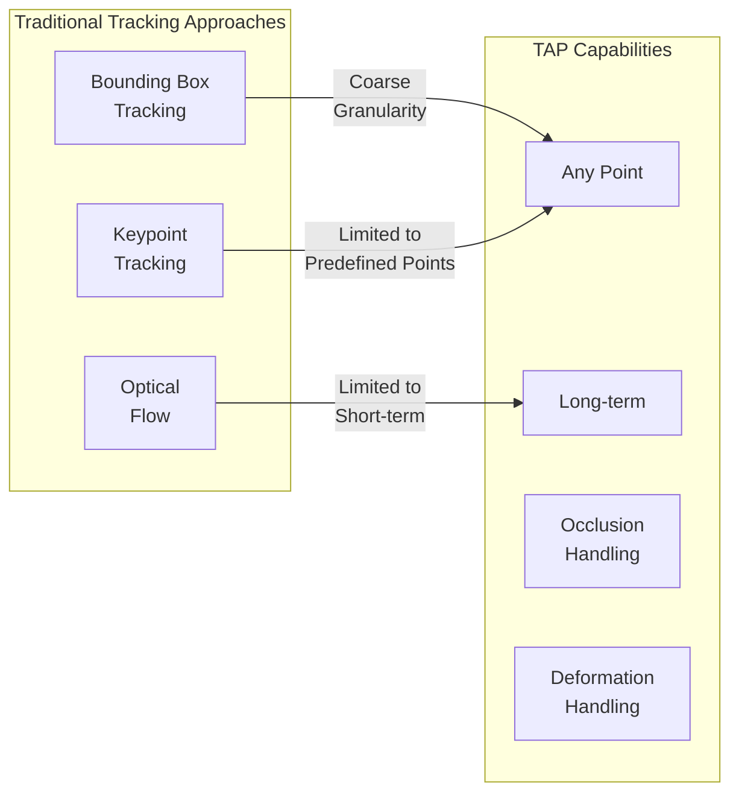
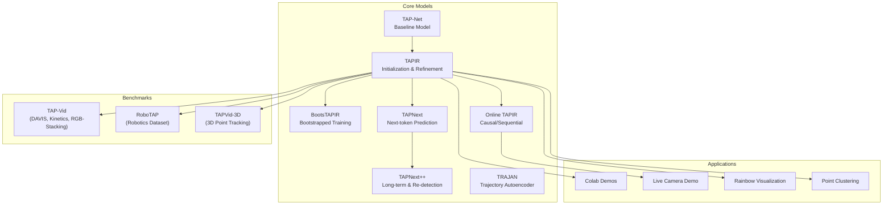
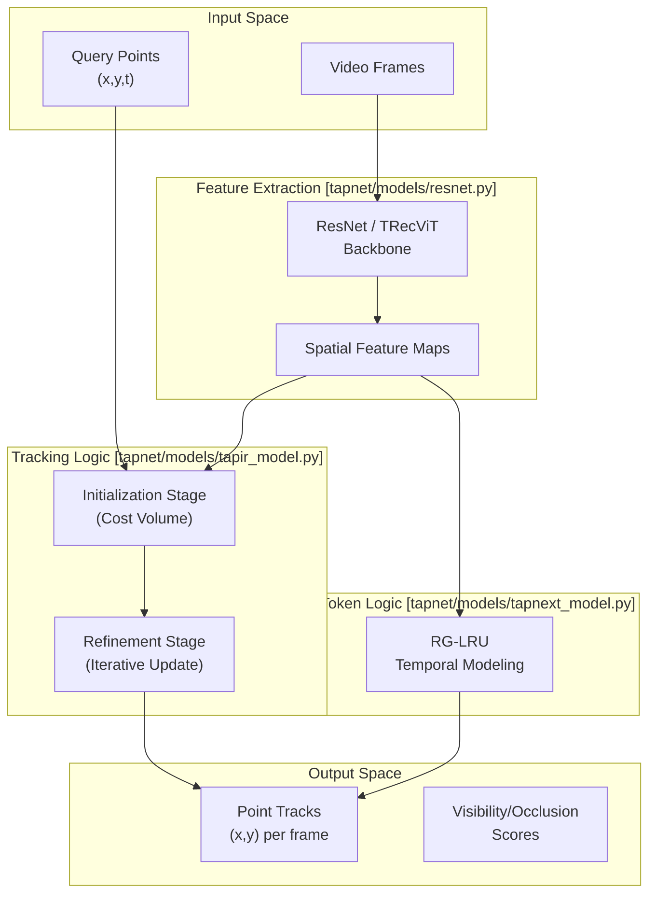
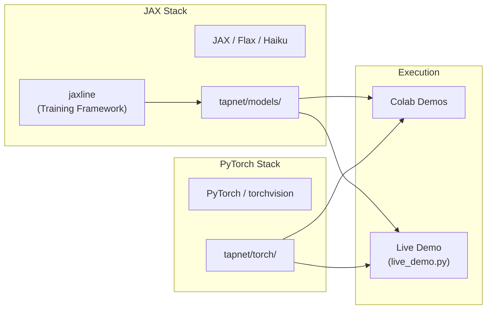

<!-- source: DeepWiki mcp.deepwiki.com · repo google-deepmind/tapnet · page 1 Overview · fetched 2026-10-26 -->

# Overview

Relevant source files

The following files were used as context for generating this wiki page:

- [.gitignore](.gitignore)
- [CONTRIBUTING.md](CONTRIBUTING.md)
- [README.md](README.md)
- [configs/tapnet_config.py](configs/tapnet_config.py)
- [pyproject.toml](pyproject.toml)

This document provides a technical introduction to the Tracking Any Point (TAP) repository, which offers a comprehensive ecosystem for point tracking in videos. Point tracking refers to the task of following specific points on objects throughout a video sequence, regardless of object deformation, occlusion, or camera motion.

## What is Point Tracking?

Point tracking involves locating and following specific points on objects or surfaces across video frames. Unlike traditional object tracking (which focuses on bounding boxes), keypoint tracking (which focuses on specific predefined points like human joints), or optical flow (which typically works only between adjacent frames), TAP addresses the more general problem of tracking arbitrary points on any surface over potentially long durations.

Sources: [README.md:1-17](), [README.md:99-102]()

## Repository Overview

The TAP repository contains several point tracking models with progressively increasing capabilities, along with datasets for evaluation, and tools for visualization and deployment.

Sources: [README.md:8-17](), [README.md:19-28]()

## Model Evolution

The repository features a progression of models, each improving on previous capabilities:

| Model | Description | Key Innovations | Backbone |
|-------|-------------|-----------------|----------|
| **TAP-Net** | Baseline model | Cost-volume regression | TSM-ResNet18 |
| **TAPIR** | Two-stage algorithm | Per-frame initialization + iterative refinement | ResNet18 |
| **Online TAPIR** | Causal variant | Sequential processing for real-time streaming | ResNet18 |
| **BootsTAPIR** | Bootstrapped version | Self-supervised training on unlabeled real-world video | ResNet18 |
| **TAPNext** | Next-token formulation | Temporal modeling via RG-LRU | TRecViT-B |
| **TAPNext++** | Enhanced TAPNext | 40x longer stable tracking, re-detection, occlusion handling | TRecViT-B |
| **TRAJAN** | Trajectory Autoencoder | Reconstructs trajectories conditioned on support points | N/A |

Sources: [README.md:10-17](), [README.md:41-52](), [configs/tapnet_config.py:86-88]()

## Technical Architecture

The point tracking models generally follow a pipeline of feature extraction followed by trajectory estimation. While earlier models like TAPIR use cost volumes, newer models like TAPNext utilize recurrent token prediction.

Sources: [README.md:11-15](), [configs/tapnet_config.py:107-113]()

## Framework Implementation

The repository supports both JAX and PyTorch implementations. Training is primarily handled via the JAX-based `jaxline` framework.

Sources: [pyproject.toml:5-19](), [pyproject.toml:33-36](), [README.md:26-27](), [configs/tapnet_config.py:18-26]()

## Benchmarks and Datasets

1.  **TAP-Vid**: Benchmark for point tracking evaluation using DAVIS, Kinetics, and RGB-Stacking. [README.md:10]()
2.  **RoboTAP**: Dataset for robotics manipulation with ground-truth points on real videos. [README.md:12]()
3.  **TAPVid-3D**: 3D point tracking benchmark with 1M+ trajectories on 4,000+ videos. [README.md:14]()
4.  **Kubric**: Synthetic data generation used for large-scale supervised training. [configs/tapnet_config.py:34](), [pyproject.toml:29]()

## User Interfaces and Applications

| Interface | Description | Implementation |
|-----------|-------------|----------------|
| **Colab Demos** | Web-based testing for all major models | JAX & PyTorch |
| **Live Camera Demo** | Real-time tracking from webcam | `live_demo.py` (JAX), `pytorch_live_demo.py` (Torch) |
| **Rainbow Visualization** | Tracks with motion trails and camera motion correction | `tapir_rainbow_demo.ipynb` |
| **Clustering** | Motion-based object segmentation | `tapir_clustering` module |

Sources: [README.md:21-25](), [README.md:41-55](), [README.md:58-64]()

## System Requirements

The project defines dependencies for multiple environments:
- **Core**: `jax`, `dm-haiku`, `optax`, `mediapy`, `opencv-python`. [pyproject.toml:5-19]()
- **Training**: `tensorflow`, `kubric`, `recurrentgemma`. [pyproject.toml:22-31]()
- **PyTorch**: `torch`, `torchvision`. [pyproject.toml:33-36]()
- **3D Evaluation**: `einops`, `visu3d`, `projectaria-tools`. [pyproject.toml:37-58]()

Sources: [pyproject.toml:1-63]()

---

