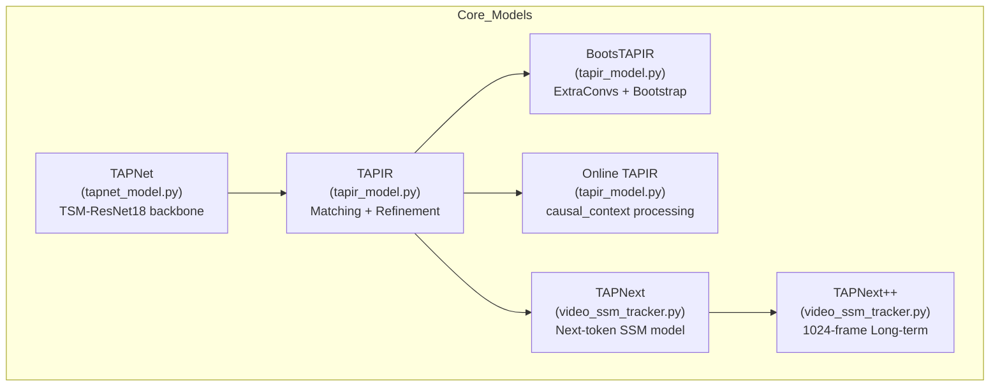
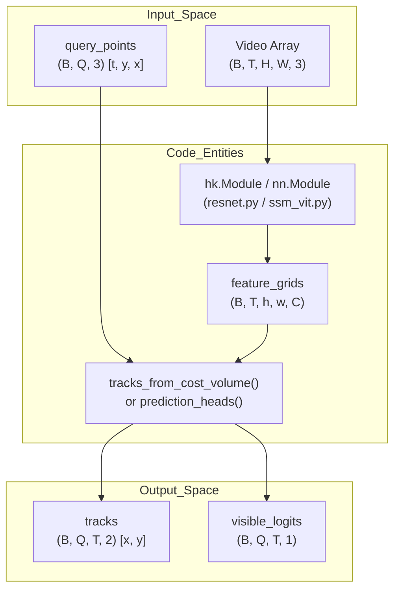

<!-- source: DeepWiki mcp.deepwiki.com · repo google-deepmind/tapnet · page 2 Models · fetched 2026-10-26 -->

# Models

Relevant source files

The following files were used as context for generating this wiki page:

- [README.md](README.md)
- [configs/tapnet_config.py](configs/tapnet_config.py)
- [tapnet/models/ssm_vit.py](tapnet/models/ssm_vit.py)
- [tapnet/models/tapir_model.py](tapnet/models/tapir_model.py)
- [tapnet/models/tapnet_model.py](tapnet/models/tapnet_model.py)
- [tapnet/models/video_ssm_tracker.py](tapnet/models/video_ssm_tracker.py)

This page provides an overview of the different model architectures in the TAP (Tracking Any Point) repository. These models are designed for tracking arbitrary points in videos, with each model offering different trade-offs between performance, speed, and capability. For training instructions, see [Training](#5.1). For evaluation metrics, see [Evaluation Metrics](#7).

## Model Evolution and Hierarchy

Sources: [README.md:10-17](), [tapnet/models/tapir_model.py:101-157](), [tapnet/models/video_ssm_tracker.py:56-126]()

## Model Architecture Comparison

The TAP repository contains several model variants with different architectures, each designed for specific use cases:

| Model | Backbone | Training Approach | Key Features | Performance (DAVIS First AJ) | Real-time Capable |
|-------|----------|-------------------|--------------|------------------------------|-------------------|
| TAP-Net | TSM-ResNet18 | Supervised | Baseline model | 33.0% | No |
| TAPIR | ResNet18 | Supervised | Two-stage: matching + refinement | 58.5% | No |
| Online TAPIR | ResNet18 | Supervised | Causal variant for streaming | 56.2% | Yes |
| BootsTAPIR | ResNet18 + `ExtraConvs` | Self-supervised + Supervised | Improved with unlabeled data | 62.4% | No |
| TAPNext | TRecViT-B | Self-supervised + Supervised | Next-token prediction (SSM) | 65.25% | Yes |
| TAPNext++ | TRecViT-B | Long-term fine-tuning | 40x longer stable tracking | - | Yes |

Sources: [README.md:11-17](), [tapnet/models/tapir_model.py:159-187]()

## Data Flow in Point Tracking Models

All TAP models follow a general pattern for processing input data and producing tracks:

Sources: [tapnet/models/tapnet_model.py:111-171](), [tapnet/models/video_ssm_tracker.py:92-125]()

## TAPIR

TAPIR (Tracking Any Point with per-frame Initialization and Refinement) is a two-stage algorithm. It first performs global matching to find candidates and then uses an iterative refinement stage inspired by PIPs to improve accuracy [tapnet/models/tapir_model.py:16-17]().

For details, see [TAPIR](#2.1).

## BootsTAPIR

BootsTAPIR (Bootstrapped TAPIR) uses a large dataset of unlabeled real-world video to improve accuracy. It employs a consistency loss across different spatial transformations and query point selections [README.md:13-13](). Architecturally, it is similar to TAPIR but often utilizes `ExtraConvs` for enhanced feature representation [tapnet/models/tapir_model.py:159-187]().

For details, see [BootsTAPIR](#2.2).

## Online TAPIR

Online TAPIR is the sequential causal variant that allows for online tracking. It uses a `causal_context` to maintain state across frames, enabling real-time GPU processing without access to future frames [tapnet/models/tapir_model.py:43-89]().

For details, see [Online TAPIR](#2.3).

## TAPNext

TAPNext formulates point tracking as a next-token prediction problem [README.md:15-15](). It utilizes a `TRecViT-B` backbone which combines Vision Transformers (ViT) for spatial attention and Real-Gated Linear Recurrent Units (RG-LRU) for temporal modeling [tapnet/models/ssm_vit.py:137-234]().

For details, see [TAPNext](#2.4).

## TAPNext++

TAPNext++ is an improved version of TAPNext fine-tuned on 1024-frame sequences (PointOdyssey and Kubric-1024) [README.md:41-41](). It features significantly improved long-term stability and re-detection capabilities through occlusions [README.md:17-17]().

For details, see [TAPNext++](#2.5).

## TAP-Net

TAP-Net is the original baseline model that uses a `TSMResNetV2` backbone [tapnet/models/tapnet_model.py:70-77](). It tracks points by computing a cost volume between interpolated query features and the video feature grid, followed by cost-volume regression [tapnet/models/tapnet_model.py:145-171]().

For details, see [TAP-Net](#2.6).

## TRAJAN

TRAJAN (Point Trajectory Autoencoder) is designed to reconstruct held-out point trajectories conditioned on support points [README.md:16-16](). It is primarily used to evaluate motion realism and consistency in generated videos rather than for direct tracking tasks.

For details, see [TRAJAN](#2.7).

## Framework Support

Models are implemented in both **JAX** (using Haiku and Flax) and **PyTorch**.
*   **JAX Implementation:** The primary development framework. JAX models like `TAPNet` and `TAPIR` are defined using Haiku [tapnet/models/tapnet_model.py:44](), [tapnet/models/tapir_model.py:653](), while `TAPNext` uses Flax [tapnet/models/video_ssm_tracker.py:56]().
*   **PyTorch Implementation:** Available for inference and deployment. PyTorch versions are designed to match JAX outputs exactly by restoring from JAX checkpoints [README.md:46-46]().

Sources: [README.md:26-27](), [tapnet/models/tapir_model.py:653](), [tapnet/models/video_ssm_tracker.py:56]()

---

