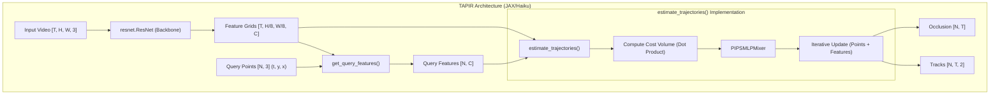
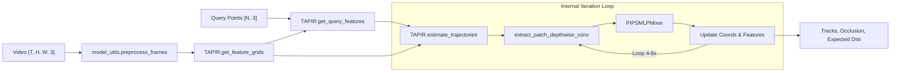

<!-- source: DeepWiki mcp.deepwiki.com · repo google-deepmind/tapnet · page 2.1 TAPIR · fetched 2026-10-26 -->

# TAPIR

Relevant source files

The following files were used as context for generating this wiki page:

- [colabs/causal_tapir_demo.ipynb](colabs/causal_tapir_demo.ipynb)
- [colabs/tapir_demo.ipynb](colabs/tapir_demo.ipynb)
- [requirements_inference.txt](requirements_inference.txt)
- [tapnet/models/resnet.py](tapnet/models/resnet.py)
- [tapnet/models/tapir_model.py](tapnet/models/tapir_model.py)
- [tapnet/models/tsm_utils.py](tapnet/models/tsm_utils.py)

## Purpose and Scope

This document details **TAPIR** (Tracking Any Point with per-frame Initialization and Refinement), the core point tracking model in the TAP repository. TAPIR is designed to track arbitrary points on objects through video sequences with high accuracy. It introduces a two-stage approach: a matching stage that performs independent per-frame initialization to avoid drift, and a refinement stage that uses temporal context to smooth trajectories and handle occlusions [colabs/tapir_demo.ipynb:31-31]().

## TAPIR Overview

TAPIR combines the strengths of global matching and local refinement. It employs the following key innovations:
- **Independent matching** on each frame to initialize tracking, preventing the error accumulation common in optical-flow-based methods.
- **Iterative refinement** of both trajectories and query features using a specialized MLP-Mixer architecture [tapnet/models/tapir_model.py:127-138]().
- **Per-point tracking**, allowing the model to track any coordinate $(x, y)$ regardless of whether it belongs to a predefined object class.
- **Occlusion detection** through an "expected distance" and occlusion probability estimation [tapnet/models/tapir_model.py:657-674]().

### TAPIR Architecture

The architecture consists of a feature backbone, a query extraction mechanism, and a refinement pipeline.

Sources: [tapnet/models/tapir_model.py:539-623](), [tapnet/models/tapir_model.py:127-157]()

---

## Key Components

### Feature Extraction
TAPIR utilizes a ResNet18 backbone to extract feature grids from video frames. By default, it uses a ResNet V1 architecture [tapnet/models/resnet.py:305-305](). For the standard TAPIR model, the `pyramid_level` is typically set to 0, resulting in a single feature resolution [colabs/tapir_demo.ipynb:146-146]().

- **Offline Mode:** Uses standard `resnet.ResNet`.
- **Online/Causal Mode:** Uses causal convolutions to ensure the model does not "see" the future [tapnet/models/tapir_model.py:104-107]().
- **TSM Variant:** Incorporates a Temporal Shift Module (`apply_temporal_shift`) to move channels across the time dimension without adding parameters, improving temporal awareness [tapnet/models/tsm_utils.py:78-95]().

Sources: [tapnet/models/resnet.py:305-447](), [tapnet/models/tsm_utils.py:78-95]()

### Query Feature Extraction
When a user selects a point to track, the model calls `get_query_features`. This function samples the feature grid at the query frame and coordinates using bilinear interpolation [tapnet/models/tapir_model.py:557-567]().
- It extracts a local feature vector that represents the "identity" of the point.
- These features are later refined iteratively alongside the coordinates to adapt to appearance changes [tapnet/models/tapir_model.py:146-156]().

Sources: [tapnet/models/tapir_model.py:539-573](), [colabs/causal_tapir_demo.ipynb:175-184]()

### Cost Volume and Refinement (PIPs)
The refinement stage is inspired by PIPs (Particle Video Revisited). It computes a local cost volume by taking the dot product between query features and the feature grid in a search window around the current estimate [tapnet/models/tapir_model.py:214-230]().

The `PIPSMLPMixer` is the core refinement engine:
- It consists of `PIPsConvBlock` units [tapnet/models/tapir_model.py:101-124]().
- It uses `depthwise_conv_residual` for temporal smoothing [tapnet/models/tapir_model.py:39-89]().
- It outputs coordinate deltas, occlusion logits, and updated query features for the next iteration [tapnet/models/tapir_model.py:146-156]().

Sources: [tapnet/models/tapir_model.py:101-157](), [tapnet/models/tapir_model.py:214-230]()

---

## Data Flow and Code Entities

The following diagram maps the logical data flow to specific classes and functions in `tapir_model.py`.

Sources: [tapnet/models/tapir_model.py:539-674](), [tapnet/utils/model_utils.py:136-150]()

---

## Offline vs. Online Variants

### Standard TAPIR (Offline)
The offline model processes the entire video sequence as a single batch. It uses non-causal convolutions in the refinement stage, allowing the trajectory at time $t$ to be influenced by frames at $t+n$.
- **Initialization:** `ParameterizedTAPIR` is initialized with `use_causal_conv=False` [colabs/tapir_demo.ipynb:146-151]().
- **Use Case:** High-accuracy batch processing of existing videos.

### Online TAPIR (Causal)
The online variant processes frames one by one. It maintains a `causal_context` (a dictionary of arrays) to store temporal features from previous frames [tapnet/models/tapir_model.py:43-45]().
- **Initialization:** Uses `use_causal_conv=True` [colabs/causal_tapir_demo.ipynb:145-149]().
- **State Management:** The `PIPSMLPMixer` returns a `new_causal_context` which must be passed into the next frame's prediction [tapnet/models/tapir_model.py:146-156]().
- **Key Functions:** `online_model_init` and `online_model_predict` [colabs/causal_tapir_demo.ipynb:175-215]().

Sources: [tapnet/models/tapir_model.py:146-156](), [colabs/causal_tapir_demo.ipynb:145-215]()

---

## Coordinate Handling

TAPIR uses a normalized coordinate system where $(0,0)$ is the top-left and $(1,1)$ is the bottom-right of the image.
- **Internal Scaling:** Coordinates are converted to raster space (pixels) during cost volume extraction using `transforms.convert_grid_coordinates` [tapnet/models/tapir_model.py:611-615]().
- **Resolution Independence:** Because features are sampled bilinearly, the model can theoretically track at resolutions higher than the training resolution (typically 256x256).

Sources: [tapnet/models/tapir_model.py:611-615](), [tapnet/utils/transforms.py:46-64]()

## Performance Summary

| Model Variant | Feature Backbone | Resolution | Temporal Handling |
| :--- | :--- | :--- | :--- |
| **TAPIR** | ResNet18 | 256 / 512 | Non-causal Conv |
| **Online TAPIR** | ResNet18 | 256 | Causal Conv + State |
| **BootsTAPIR** | ResNet18 + ExtraConvs | 512 | Non-causal + Pyramid |

Sources: [README.md:143-150](), [colabs/tapir_demo.ipynb:147-150]()

---

