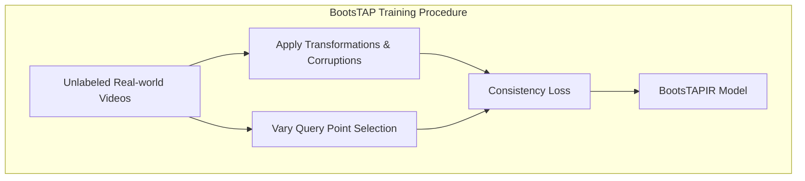
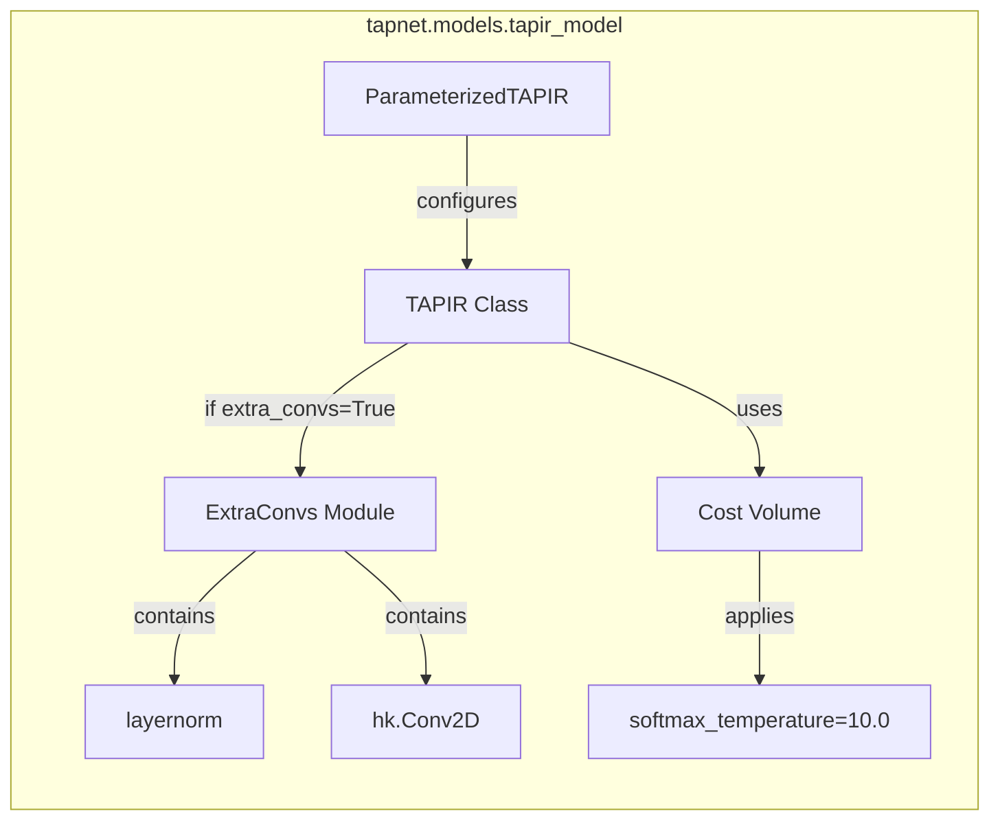
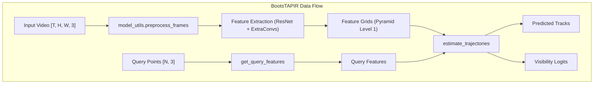

<!-- source: DeepWiki mcp.deepwiki.com · repo google-deepmind/tapnet · page 2.2 BootsTAPIR · fetched 2026-10-26 -->

# BootsTAPIR

<details>
<summary>Relevant source files</summary>

The following files were used as context for generating this wiki page:

- [colabs/causal_tapir_demo.ipynb](colabs/causal_tapir_demo.ipynb)
- [colabs/tapir_demo.ipynb](colabs/tapir_demo.ipynb)
- [configs/causal_tapir_config.py](configs/causal_tapir_config.py)
- [configs/tapir_bootstrap_config.py](configs/tapir_bootstrap_config.py)
- [configs/tapir_config.py](configs/tapir_config.py)
- [requirements_inference.txt](requirements_inference.txt)
- [tapnet/models/tapir_model.py](tapnet/models/tapir_model.py)

</details>


BootsTAPIR is an enhanced version of TAPIR (Tracking Any Point with per-frame Initialization and Refinement) that employs a bootstrapping training technique called BootsTAP. This model substantially improves tracking accuracy over the base TAPIR model while maintaining the same interface and usage patterns.

## Bootstrapped Training (BootsTAP)

BootsTAP (Bootstrapped Training for TAP) uses a large dataset of unlabeled, real-world video to improve tracking accuracy. The key insight behind this approach is training the model to give consistent predictions across spatial transformations and different query point selections. This self-supervised consistency training allows the model to learn robust features from unlabeled data.

### Consistency Constraints
The training procedure enforces that the model's predictions remain stable when the input undergoes:
1.  **Spatial Transformations**: Rotations, scaling, or translations of the video frames.
2.  **Corruptions**: Synthetic noise or blur applied to the video.
3.  **Query Point Selection**: Different choices of query points on the same physical object should yield trajectories consistent with the object's motion.


Sources: [colabs/tapir_demo.ipynb:82-83](), [colabs/causal_tapir_demo.ipynb:82-83]()

## Architectural Enhancements

While BootsTAPIR maintains the core `tapir_model.py` architecture, it is instantiated with specific hyperparameters that distinguish it from the baseline TAPIR.

### Key Parameter Differences

| Parameter | TAPIR (Baseline) | BootsTAPIR |
| :--- | :--- | :--- |
| `pyramid_level` | 0 | 1 |
| `extra_convs` | False | True |
| `softmax_temperature` | 1.0 (default) | 10.0 |
| `use_causal_conv` | False | False (True for Online) |

### Implementation Details
*   **Feature Pyramid**: By setting `pyramid_level=1`, the model utilizes higher-resolution feature maps for the cost volume computation [configs/tapir_bootstrap_config.py:78-78]().
*   **Extra Convolutions**: The `ExtraConvs` module [tapnet/models/tapir_model.py:159-186]() is enabled. This module adds 5 layers of depthwise-convolutional residual blocks with GELU activations to the feature extraction backbone [tapnet/models/tapir_model.py:174-186]().
*   **Softmax Temperature**: A temperature of 10.0 is applied during training to the cost volume, which affects the sharpness of the point initialization [configs/tapir_bootstrap_config.py:82-82]().


Sources: [tapnet/models/tapir_model.py:159-186](), [configs/tapir_bootstrap_config.py:76-83](), [colabs/tapir_demo.ipynb:146-151]()

## Point Tracking Workflow

The point tracking workflow in BootsTAPIR follows the standard TAPIR approach but with the enhanced feature processing path.


Sources: [tapnet/models/tapir_model.py:653-690](), [colabs/tapir_demo.ipynb:183-213]()

## Model Variants

BootsTAPIR is available in two configurations, defined by their respective `jaxline` configs:

1.  **Standard BootsTAPIR**: Defined in `configs/tapir_bootstrap_config.py`. It processes the entire video sequence and is non-causal.
    *   `use_causal_conv=False` [configs/tapir_bootstrap_config.py:79-79]()
2.  **Online BootsTAPIR**: Defined in `configs/causal_tapir_config.py` (when using BootsTAP weights). It processes frames sequentially for real-time applications.
    *   `use_causal_conv=True` [configs/causal_tapir_config.py:79-79]()
    *   Utilizes the `causal_context` in `PIPsMLPMixer` to maintain temporal state [tapnet/models/tapir_model.py:146-157]().

Sources: [configs/tapir_bootstrap_config.py:76-83](), [configs/causal_tapir_config.py:76-81](), [colabs/causal_tapir_demo.ipynb:138-154]()

## Usage and Checkpoints

BootsTAPIR checkpoints are distributed as `.npy` files for JAX/Haiku.

### Loading the Model (JAX)
The model is typically instantiated via `ParameterizedTAPIR`, which handles the parameter mapping between the saved checkpoint and the Haiku module.

```python
# Configuration for BootsTAPIR
kwargs = dict(
    bilinear_interp_with_depthwise_conv=False,
    pyramid_level=1, 
    extra_convs=True, 
    softmax_temperature=10.0
)

# Load checkpoint
ckpt_state = np.load('bootstapir_checkpoint_v2.npy', allow_pickle=True).item()
tapir = tapir_model.ParameterizedTAPIR(
    ckpt_state['params'], 
    ckpt_state['state'], 
    tapir_kwargs=kwargs
)
```
Sources: [colabs/tapir_demo.ipynb:142-151](), [colabs/causal_tapir_demo.ipynb:141-154]()

### Available Checkpoints
*   **Standard**: `https://storage.googleapis.com/dm-tapnet/bootstap/bootstapir_checkpoint_v2.npy` [colabs/tapir_demo.ipynb:100-100]()
*   **Causal**: `https://storage.googleapis.com/dm-tapnet/bootstap/causal_bootstapir_checkpoint.npy` [colabs/causal_tapir_demo.ipynb:100-100]()

---

