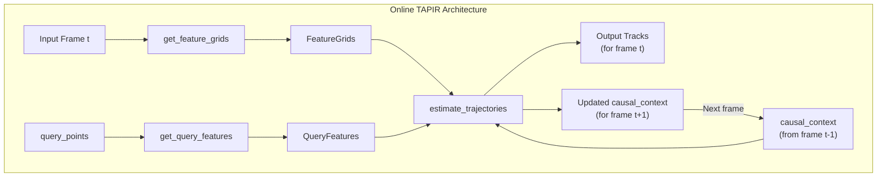
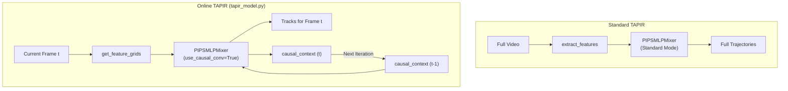
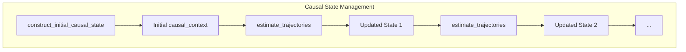
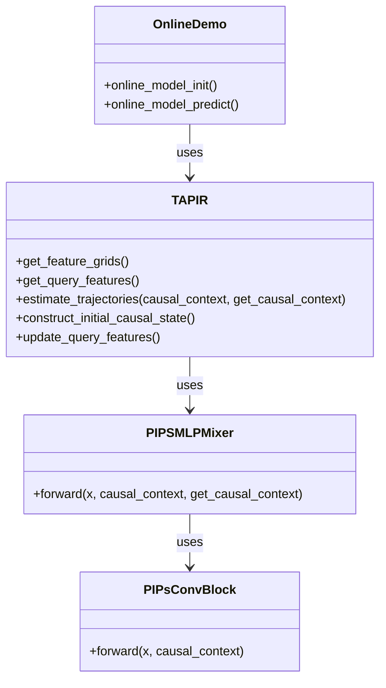

<!-- source: DeepWiki mcp.deepwiki.com · repo google-deepmind/tapnet · page 2.3 Online TAPIR · fetched 2026-10-26 -->

# Online TAPIR

<details>
<summary>Relevant source files</summary>

The following files were used as context for generating this wiki page:

- [colabs/causal_tapir_demo.ipynb](colabs/causal_tapir_demo.ipynb)
- [colabs/tapir_demo.ipynb](colabs/tapir_demo.ipynb)
- [colabs/torch_causal_tapir_demo.ipynb](colabs/torch_causal_tapir_demo.ipynb)
- [colabs/torch_tapir_demo.ipynb](colabs/torch_tapir_demo.ipynb)
- [requirements_inference.txt](requirements_inference.txt)
- [tapnet/live_demo.py](tapnet/live_demo.py)
- [tapnet/models/tsm_resnet.py](tapnet/models/tsm_resnet.py)
- [tapnet/pytorch_live_demo.py](tapnet/pytorch_live_demo.py)
- [tapnet/torch/nets.py](tapnet/torch/nets.py)
- [tapnet/torch/tapir_model.py](tapnet/torch/tapir_model.py)
- [tapnet/torch/utils.py](tapnet/torch/utils.py)

</details>


Online TAPIR is a causal variant of TAPIR (Tracking Any Point with per-frame Initialization and Refinement) that processes video frames sequentially in real-time. Unlike standard TAPIR described in [TAPIR](2.1), which operates on all frames of a video simultaneously, Online TAPIR maintains a state between frames to enable streaming applications like live camera tracking.

## Overview

Online TAPIR modifies the standard TAPIR architecture to use causal convolutions and maintain state between frames, allowing it to process video streams one frame at a time without requiring future frames. This makes it suitable for real-time applications where latency is critical.

### Architecture Data Flow
The diagram below shows how the `causal_context` flows through the system during sequential processing.



Sources: [tapnet/torch/tapir_model.py:70-89](), [tapnet/live_demo.py:62-77](), [tapnet/pytorch_live_demo.py:62-85]()

## Key Components

Online TAPIR introduces several key modifications to the standard TAPIR architecture:

1.  **Causal Convolutions**: Instead of standard convolutions that can access future frames, Online TAPIR uses causal convolutions that only operate on the current and past frames.
2.  **State Management**: A `causal_context` is maintained between frames to preserve temporal information.
3.  **Sequential Processing**: Frames are processed one at a time, with the model state updated after each frame.

### Causal vs Standard Execution
The following diagram bridges the logical concept of causal processing to the specific `PIPSMLPMixer` implementation.



Sources: [tapnet/torch/tapir_model.py:128-132](), [tapnet/torch/nets.py:189-200](), [tapnet/torch/nets.py:234-245]()

## Implementation Details

### Causal Convolutions

The core of Online TAPIR's sequential processing capability comes from replacing standard convolutions with causal convolutions in the temporal dimension. In the PyTorch implementation, this is handled within `PIPsConvBlock`.

When `use_causal_conv` is enabled, the model pads the input features such that the convolution kernel only overlaps with current and past time steps. The hidden states required for the next frame's convolution are stored in the `causal_context`.

Sources: [tapnet/torch/nets.py:110-115](), [tapnet/torch/nets.py:149-178](), [tapnet/torch/tapir_model.py:106-107]()

### Causal State Management

Online TAPIR maintains a causal state between frames, which includes hidden states from previous frames needed for the causal convolutions. The initial state is created using `construct_initial_causal_state`.



Sources: [tapnet/torch/tapir_model.py:763-772](), [tapnet/pytorch_live_demo.py:143-146]()

### Sequential Tracking Process

The online tracking process involves initializing query features and then updating tracks frame by frame:

1.  **Initialization**:
    *   Extract features from the first frame via `get_feature_grids`.
    *   Initialize `QueryFeatures` for the points to track using `get_query_features`.
    *   Create initial `causal_context` via `construct_initial_causal_state`.
2.  **Sequential Processing**:
    *   For each new frame, call `estimate_trajectories` with `get_causal_context=True`.
    *   The model returns both the predicted tracks and the updated `causal_context`.

Sources: [tapnet/pytorch_live_demo.py:44-85](), [tapnet/torch/tapir_model.py:192-200](), [tapnet/torch/tapir_model.py:763-772]()

## Model Components and Code Structure

The key components of Online TAPIR are implemented across several files:



Sources: [tapnet/torch/tapir_model.py:70-132](), [tapnet/torch/nets.py:107-142](), [tapnet/pytorch_live_demo.py:62-85]()

## Usage and API

### Initialization

To use Online TAPIR, you first need to create a model with causal convolutions enabled:

```python
# PyTorch implementation
from tapnet.torch import tapir_model
model = tapir_model.TAPIR(pyramid_level=1, use_casual_conv=True)
model.load_state_dict(torch.load("tapnet/checkpoints/causal_bootstapir_checkpoint.pt"))
```

Sources: [tapnet/pytorch_live_demo.py:110-114](), [tapnet/torch/tapir_model.py:88-89]()

### Query Feature Initialization

Query features are initialized for the points you want to track:

```python
# In tapnet/pytorch_live_demo.py
query_features = online_model_init(
    frames=frame[None, None], 
    points=query_points[None, :]
)

causal_state = model.construct_initial_causal_state(
    NUM_POINTS, len(query_features.resolutions) - 1
)
```

Sources: [tapnet/pytorch_live_demo.py:139-146](), [tapnet/torch/tapir_model.py:763-772]()

### Frame-by-Frame Processing

For each new frame, the model updates the tracks and causal state:

```python
# In tapnet/pytorch_live_demo.py
tracks, visibles, causal_state = online_model_predict(
    frames=frame[None, None],
    features=query_features,
    causal_context=causal_state,
)
```

Sources: [tapnet/pytorch_live_demo.py:202-206](), [tapnet/pytorch_live_demo.py:62-85]()

### Adding New Query Points

Online TAPIR supports dynamic addition of points. The `update_query_features` method allows replacing or adding points to the active tracking set without resetting the entire `causal_context`.

```python
# Update the existing query features with a new point
query_features, causal_state = model.update_query_features(
    query_features=query_features,
    new_query_features=init_query_features,
    idx_to_update=np.array([next_query_idx]),
    causal_state=causal_state,
)
```

Sources: [tapnet/pytorch_live_demo.py:192-197](), [tapnet/torch/tapir_model.py:774-806]()

## Implementation Details

### Causal Context Structure

The `causal_context` is a dictionary where keys correspond to block names and values are the temporal buffers required for causal convolutions.

```python
# Structure of causal_context in tapnet/torch/nets.py
{
    'block_0_causal_1': torch.Tensor, # shape [batch, num_points, kernel_size-1, channels]
    'block_0_causal_2': torch.Tensor,
    ...
}
```

Sources: [tapnet/torch/nets.py:146-168](), [tapnet/torch/tapir_model.py:763-772]()

## Performance and Applications

Online TAPIR is optimized for low-latency streaming. While slightly less accurate than the full-batch TAPIR due to the lack of future context, it is suitable for real-time robotics and UI interaction.

### Live Demo
The repository provides two live demo scripts that use the online model:
*   `tapnet/live_demo.py`: JAX implementation.
*   `tapnet/pytorch_live_demo.py`: PyTorch implementation.

These scripts demonstrate capturing camera frames via OpenCV, performing online inference, and visualizing tracks in real-time.

Sources: [tapnet/live_demo.py:16-25](), [tapnet/pytorch_live_demo.py:16-25](), [tapnet/pytorch_live_demo.py:98-105]()

---

