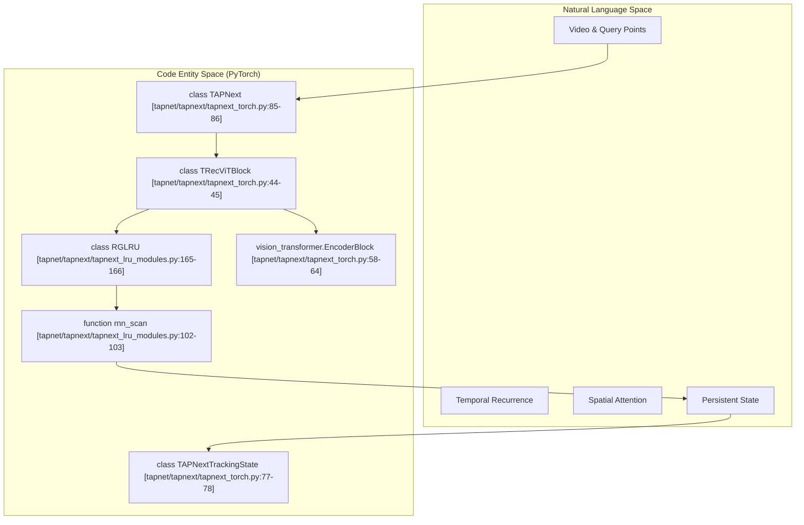
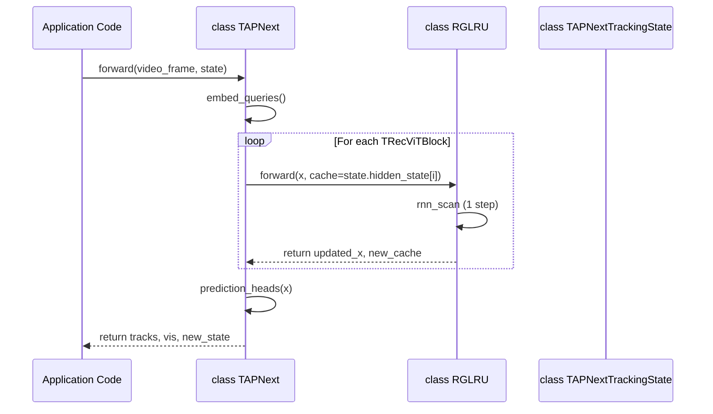

<!-- source: DeepWiki mcp.deepwiki.com · repo google-deepmind/tapnet · page 2.4 TAPNext · fetched 2026-10-26 -->

# TAPNext

Relevant source files

The following files were used as context for generating this wiki page:

- [colabs/tapnext_demo.ipynb](colabs/tapnext_demo.ipynb)
- [colabs/torch_tapnext_demo.ipynb](colabs/torch_tapnext_demo.ipynb)
- [requirements.txt](requirements.txt)
- [tapnet/models/ssm_vit.py](tapnet/models/ssm_vit.py)
- [tapnet/models/video_ssm_tracker.py](tapnet/models/video_ssm_tracker.py)
- [tapnet/tapnext/pscan.py](tapnet/tapnext/pscan.py)
- [tapnet/tapnext/tapnext_benchmark_pytorch.ipynb](tapnet/tapnext/tapnext_benchmark_pytorch.ipynb)
- [tapnet/tapnext/tapnext_lru_modules.py](tapnet/tapnext/tapnext_lru_modules.py)
- [tapnet/tapnext/tapnext_torch.py](tapnet/tapnext/tapnext_torch.py)
- [tapnet/tapnext/tapnext_torch_utils.py](tapnet/tapnext/tapnext_torch_utils.py)
- [tapnet/tapnext/torch_losses.py](tapnet/tapnext/torch_losses.py)

TAPNext is a point tracking model in the TAP (Tracking Any Point) ecosystem that formulates tracking as a **next token prediction** task. It utilizes a **TRecViT-B** backbone, which combines Vision Transformers (ViT) for spatial modeling with Real-Gated Linear Recurrent Units (RG-LRU) for temporal modeling. Unlike the two-stage refinement process of TAPIR, TAPNext employs a simpler, single-pass sequence prediction framework optimized for high-speed inference and long-term temporal consistency.

For information about the improved variant fine-tuned for 1024-frame sequences, see [TAPNext++](#2.5).

## Architecture Overview

TAPNext architecture bridges the gap between spatial feature extraction and temporal state propagation. It treats video frames and query points as sequences of tokens.

### System Mapping: Conceptual to Code

The following diagram maps the high-level tracking components to their specific implementations in the `tapnext_torch.py` and `tapnext_lru_modules.py` files.

Sources: [tapnet/tapnext/tapnext_torch.py:44-160](), [tapnet/tapnext/tapnext_lru_modules.py:102-226]().

## TRecViT Backbone

The core of TAPNext is the **TRecViTBlock** [tapnet/tapnext/tapnext_torch.py:44-45](). Each block alternates between temporal processing via a State Space Model (SSM) and spatial processing via a Transformer.

### Temporal Modeling: RG-LRU
The temporal component uses a **Real-Gated Linear Recurrent Unit (RG-LRU)** [tapnet/tapnext/tapnext_lru_modules.py:165-166]().
- **Gating Mechanism**: It employs `input_gate` and `a_gate` to control information flow [tapnet/tapnext/tapnext_lru_modules.py:185-198]().
- **Recurrence**: The recurrence is defined as $h_t = a \odot h_{t-1} + \text{gated\_x} \odot \sqrt{1 - a^2}$ [tapnet/tapnext/tapnext_lru_modules.py:210-220]().
- **Parallel Scan**: During training or batch processing, it uses `pscan` (Parallel Scan) to compute the recurrence in $O(\log T)$ time [tapnet/tapnext/tapnext_lru_modules.py:143-145]().

### Spatial Modeling: ViT
After the temporal update, features are rearranged to apply spatial attention using a standard `vision_transformer.EncoderBlock` [tapnet/tapnext/tapnext_torch.py:58-64](). This allows query tokens to attend to image patch tokens within the same frame.

Sources: [tapnet/tapnext/tapnext_torch.py:44-73](), [tapnet/tapnext/tapnext_lru_modules.py:165-226](), [tapnet/tapnext/pscan.py:29-105]().

## Data Flow and Tokenization

TAPNext represents the video as a set of tokens. The sequence length is $(H/8 \times W/8) + Q$, where $Q$ is the number of query points.

1.  **Image Tokenization**: A 2D Convolution `lin_proj` with $8 \times 8$ stride converts frames into patch embeddings [tapnet/tapnext/tapnext_torch.py:104-109]().
2.  **Query Tokenization**: `embed_queries` creates tokens for query points [tapnet/tapnext/tapnext_torch.py:162-163](). It uses `posemb_sincos_2d` to encode the spatial $(x, y)$ location of the query [tapnet/tapnext/tapnext_torch.py:31-41]().
3.  **Token Types**:
    *   **Mask Token**: Used for future frames or frames where the query is not yet active [tapnet/tapnext/tapnext_torch.py:122-124]().
    *   **Unknown Token**: Used for frames before the query point appears [tapnet/tapnext/tapnext_torch.py:125-127]().
    *   **Point Query Token**: The actual representation of the tracked point at its query time [tapnet/tapnext/tapnext_torch.py:128-130]().

### Online Tracking Data Flow
In online mode, the model processes one frame at a time while maintaining a `TAPNextTrackingState` [tapnet/tapnext/tapnext_torch.py:77-83]().

Sources: [tapnet/tapnext/tapnext_torch.py:162-260](), [tapnet/tapnext/tapnext_lru_modules.py:102-145]().

## Prediction Heads and Loss Functions

TAPNext uses two MLP heads for output generation [tapnet/tapnext/tapnext_torch.py:143-160]():

1.  **Coordinate Head**: Predicts $x$ and $y$ coordinates by outputting 512 bins for each axis [tapnet/tapnext/tapnext_torch.py:152-160](). These are converted to sub-pixel coordinates via a **soft argmax** over a window defined by `radius` [tapnet/tapnext/tapnext_torch_utils.py:24-35]().
2.  **Visible Head**: Predicts a single logit representing the probability that the point is visible [tapnet/tapnext/tapnext_torch.py:143-151]().

### Training Objectives
The model is trained using a combination of losses implemented in `torch_losses.py`:
*   **Huber Loss**: Applied to the continuous coordinate predictions [tapnet/tapnext/torch_losses.py:23-52]().
*   **Cross Entropy (Softmax) Loss**: Applied to the 512-bin coordinate logits to improve localization [tapnet/tapnext/torch_losses.py:55-83]().
*   **Binary Cross Entropy**: Applied to the visibility logits [tapnet/tapnext/torch_losses.py:122-124]().

Sources: [tapnet/tapnext/tapnext_torch.py:262-289](), [tapnet/tapnext/torch_losses.py:86-127](), [tapnet/tapnext/tapnext_torch_utils.py:38-57]().

## Checkpoint Compatibility

TAPNext provides utilities to load weights from JAX `.npz` checkpoints into the PyTorch implementation. The function `restore_model_from_jax_checkpoint` maps JAX parameter names (e.g., `backbone/Transformer/encoderblock_0/ssm_block`) to PyTorch `nn.Module` parameters, handling weight transposition where necessary [tapnet/tapnext/tapnext_torch_utils.py:60-205]().

Sources: [tapnet/tapnext/tapnext_torch_utils.py:60-205](), [colabs/torch_tapnext_demo.ipynb:23-24]().

---

