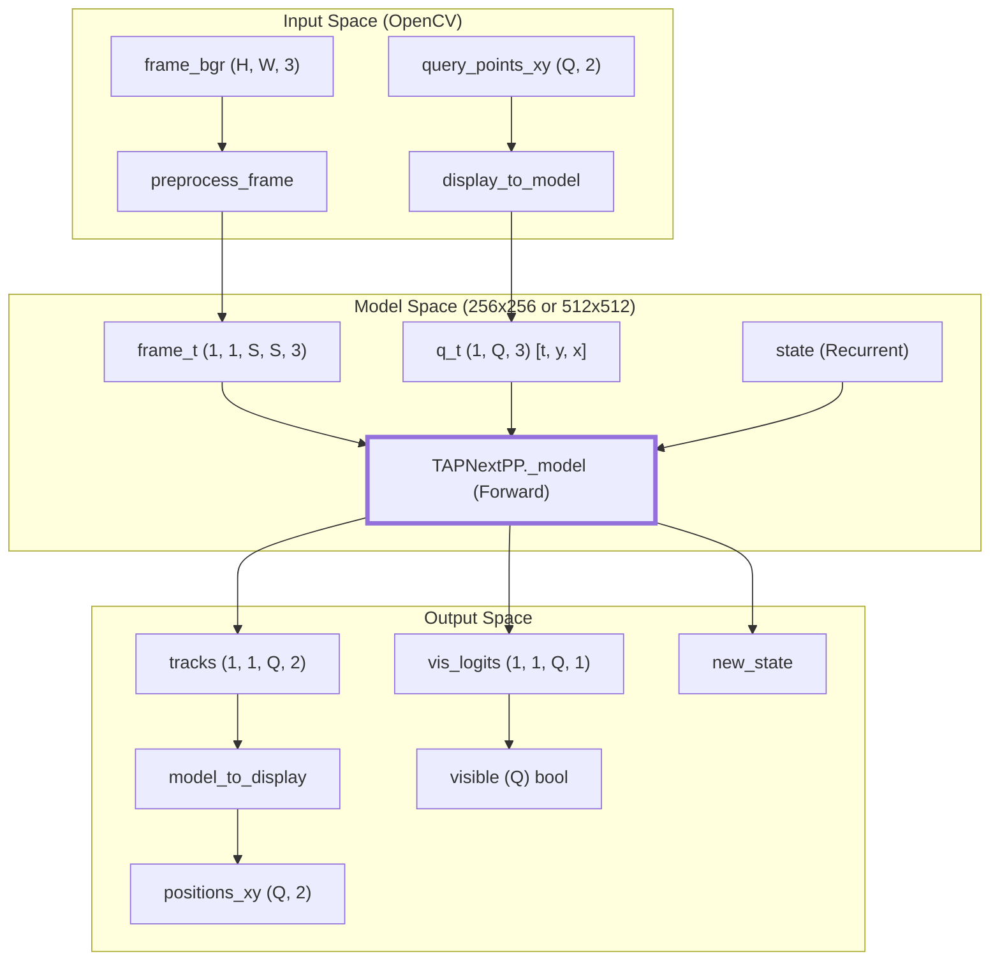
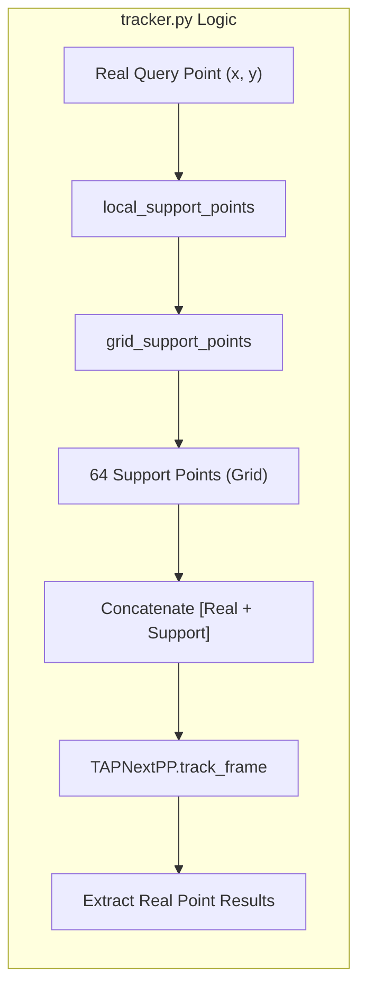

<!-- source: DeepWiki mcp.deepwiki.com · repo google-deepmind/tapnet · page 2.5 TAPNext++ · fetched 2026-10-26 -->

# TAPNext++

Relevant source files

The following files were used as context for generating this wiki page:

- [colabs/torch_tapnextpp_demo.ipynb](colabs/torch_tapnextpp_demo.ipynb)
- [tapnet/__init__.py](tapnet/__init__.py)
- [tapnet/tapnextpp/README.md](tapnet/tapnextpp/README.md)
- [tapnet/tapnextpp/augmentations/homography.py](tapnet/tapnextpp/augmentations/homography.py)
- [tapnet/tapnextpp/augmentations/homography_visualization.py](tapnet/tapnextpp/augmentations/homography_visualization.py)
- [tapnet/tapnextpp/augmentations/roll.py](tapnet/tapnextpp/augmentations/roll.py)
- [tapnet/tapnextpp/augmentations/roll_visualization.py](tapnet/tapnextpp/augmentations/roll_visualization.py)
- [tapnet/tapnextpp/metrics/aj_rd.py](tapnet/tapnextpp/metrics/aj_rd.py)
- [tapnet/tapnextpp/votsp2026/README.md](tapnet/tapnextpp/votsp2026/README.md)
- [tapnet/tapnextpp/votsp2026/model.py](tapnet/tapnextpp/votsp2026/model.py)
- [tapnet/tapnextpp/votsp2026/tracker.py](tapnet/tapnextpp/votsp2026/tracker.py)
- [tapnet/tapnextpp/votsp2026/trackers.ini](tapnet/tapnextpp/votsp2026/trackers.ini)
- [tapnet/tapnextpp/votsp2026/utils.py](tapnet/tapnextpp/votsp2026/utils.py)

TAPNext++ is an enhanced version of the TAPNext model, specifically optimized for long-duration point tracking (up to 1024 frames) and improved re-detection capabilities [tapnet/tapnextpp/README.md:1-11](). It introduces specialized augmentations, a new evaluation metric for re-detection, and a high-level wrapper for causal, frame-by-frame inference [tapnet/tapnextpp/votsp2026/model.py:16-17]().

## Overview and Key Improvements

TAPNext++ improves upon the base TAPNext architecture through:
*   **Extended Context:** Fine-tuned on **PointOdyssey v1.2** and **Kubric-1024** using 1024-frame sequences [tapnet/tapnextpp/README.md:9-16]().
*   **Advanced Augmentations:** Introduction of **Roll** and **Homography** augmentations to improve robustness against camera motion and perspective shifts [tapnet/tapnextpp/README.md:48-50]().
*   **Re-Detection Focus:** Introduction of the **$AJ_{RD}$ (Re-Detection Average Jaccard)** metric to specifically measure the ability to recover tracks after occlusion [tapnet/tapnextpp/README.md:10-11]().
*   **High-Resolution Fine-tuning:** Checkpoints available for both 256x256 and 512x512 input resolutions [tapnet/tapnextpp/votsp2026/README.md:9-12]().

## Implementation Details

The implementation provides a high-level wrapper, `TAPNextPP`, which encapsulates the `tapnext_torch.TAPNext` model and handles coordinate transformations between display space and model space [tapnet/tapnextpp/votsp2026/model.py:30-47]().

### Inference Data Flow
The model operates in a strictly causal, online fashion. For each frame, it consumes the current BGR image and the recurrent state from the previous step [tapnet/tapnextpp/votsp2026/README.md:7-8]().

#### TAPNext++ Inference Pipeline

**Sources:** [tapnet/tapnextpp/votsp2026/model.py:116-169](), [tapnet/tapnextpp/votsp2026/utils.py:25-52]()

### Key Classes and Functions

| Entity | Location | Description |
| :--- | :--- | :--- |
| `TAPNextPP` | [tapnet/tapnextpp/votsp2026/model.py:30]() | Main PyTorch wrapper for online inference. |
| `track_frame` | [tapnet/tapnextpp/votsp2026/model.py:116]() | Processes a single frame and updates the recurrent state. |
| `preprocess_frame` | [tapnet/tapnextpp/votsp2026/utils.py:25]() | Resizes and normalizes BGR frames to model-ready tensors. |
| `display_to_model` | [tapnet/tapnextpp/votsp2026/utils.py:55]() | Scales pixel coordinates to the model's internal square resolution. |
| `compute_redetection_metrics` | [tapnet/tapnextpp/metrics/aj_rd.py:46]() | Implements the $AJ_{RD}$ metric calculation. |

**Sources:** [tapnet/tapnextpp/votsp2026/model.py:30-170](), [tapnet/tapnextpp/votsp2026/utils.py:25-100](), [tapnet/tapnextpp/README.md:46]()

## Augmentations

TAPNext++ utilizes two specific augmentations during training to improve temporal consistency and re-detection.

### Roll Augmentation
The `RollAugmentation` mimics camera roll and jitter by applying sinusoidal shifts and rotations to video frames [tapnet/tapnextpp/augmentations/roll.py:22-28]().
*   **Frequency Modeling:** Uses low-frequency and high-frequency sinusoids to generate shifts (`shift_x_arr`, `shift_y_arr`) and angles (`angle_arr`) [tapnet/tapnextpp/augmentations/roll.py:102-136]().
*   **Trajectory Sync:** Automatically adjusts the `trajs_2d` coordinates to match the transformed frames [tapnet/tapnextpp/augmentations/roll.py:151-175]().

### Homography Augmentation
The `HomographyAugmentation` applies projective transformations to mimic complex camera motions [tapnet/tapnextpp/augmentations/homography.py:44-50]().
*   **Corner Perturbation:** Perturbs the four corners of the image using sinusoidal functions [tapnet/tapnextpp/augmentations/homography.py:83-103]().
*   **Safety Margins:** Uses a reflection function (`_reflect`) to ensure corners stay within valid margins, preventing image flipping [tapnet/tapnextpp/augmentations/homography.py:127-137]().

**Sources:** [tapnet/tapnextpp/augmentations/roll.py:22-193](), [tapnet/tapnextpp/augmentations/homography.py:44-153]()

## VOTSp2026 Submission

For the VOTSp2026 competition, TAPNext++ utilizes a **support point** strategy to improve tracking stability [tapnet/tapnextpp/votsp2026/README.md:9-12]().

### Support Point Mechanism
For every query point provided by the challenge, the tracker generates a local grid of **64 support points** within a 32-pixel radius (in model space) [tapnet/tapnextpp/votsp2026/tracker.py:27-31](). These points are:
1.  **Co-tracked:** Processed via the same attention mechanism as the real query point.
2.  **Discarded:** Used only for internal context and never included in the final output files [tapnet/tapnextpp/votsp2026/tracker.py:29-30]().

#### Support Point Generation Logic

**Sources:** [tapnet/tapnextpp/votsp2026/tracker.py:96-129](), [tapnet/tapnextpp/votsp2026/tracker.py:201-220]()

## Evaluation Metrics: $AJ_{RD}$

The **Re-Detection Average Jaccard ($AJ_{RD}$)** is a key metric introduced for TAPNext++. It focuses on the model's ability to re-acquire a point after it has been occluded for a significant period.

| Dataset | Metric | Value |
| :--- | :--- | :--- |
| **PointOdyssey** | $AJ_{RD}$ | 23.3 |
| **RoboTAP** | $AJ_{RD}$ | 52.6 |

**Sources:** [tapnet/tapnextpp/README.md:18-34](), [tapnet/tapnextpp/metrics/aj_rd.py:46]()

---

