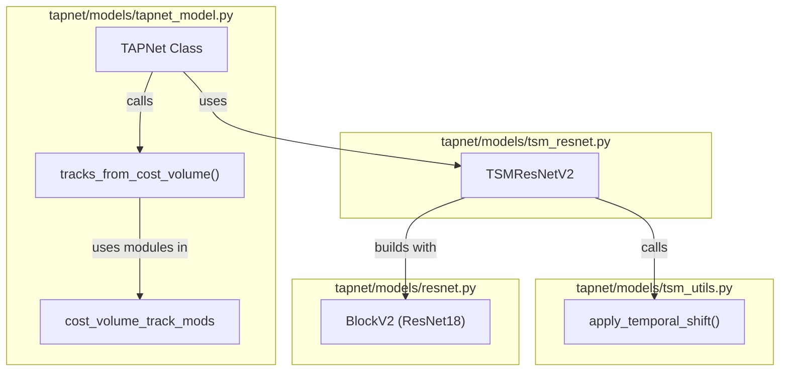
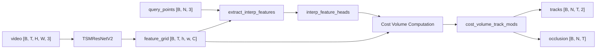

<!-- source: DeepWiki mcp.deepwiki.com · repo google-deepmind/tapnet · page 2.6 TAP-Net · fetched 2026-10-26 -->

# TAP-Net

Relevant source files

The following files were used as context for generating this wiki page:

- [README.md](README.md)
- [configs/tapnet_config.py](configs/tapnet_config.py)
- [tapnet/models/resnet.py](tapnet/models/resnet.py)
- [tapnet/models/tapnet_model.py](tapnet/models/tapnet_model.py)
- [tapnet/models/tsm_utils.py](tapnet/models/tsm_utils.py)

## Purpose and Scope

This page documents the **TAP-Net** model, the baseline architecture introduced in the original TAP-Vid paper. It employs a **TSM-ResNet18** backbone for temporal-aware feature extraction and a **cost-volume regression** head to predict point trajectories and occlusion states. TAP-Net serves as the technical foundation for subsequent models in the repository, including [TAPIR](2.1) and [TAPNext](2.4).

Sources:
- [tapnet/models/tapnet_model.py:16-17]()
- [configs/tapnet_config.py:16-16]()
- [README.md:10-15]()

## Architecture and Implementation

TAP-Net is implemented as a Haiku module (`TAPNet`) that processes video sequences to produce coordinate tracks and occlusion logits.

### Model Components Diagram
The following diagram maps the logical components of TAP-Net to their specific implementations in the `tapnet/models` directory.

Sources:
- [tapnet/models/tapnet_model.py:44-109]()
- [tapnet/models/tsm_resnet.py:24-30]()
- [tapnet/models/tsm_utils.py:78-83]()

### Feature Extraction: TSM-ResNet18
The backbone is a **Temporal Shift Module (TSM)** ResNet. Unlike standard 2D ResNets, TSM enables temporal modeling by shifting a fraction of channels along the time dimension between frames without adding 3D convolution parameters.

*   **Backbone**: `tsm_resnet.TSMResNetV2` [tapnet/models/tapnet_model.py:70-77]().
*   **Shift Mechanism**: Implemented in `apply_temporal_shift` [tapnet/models/tsm_utils.py:78-95](), which supports both GPU-style (reshape-based) and TPU-optimized (mask-and-sum) shifting.
*   **Channel Shift**: Defaults to 12.5% (`0.125`) of channels shifted forward and 12.5% backward [tapnet/models/tapnet_model.py:75-75]().
*   **Stride**: Defaults to a feature grid stride of 8 [tapnet/models/tapnet_model.py:49-49]().

### Cost Volume and Regression
Tracking is formulated as a similarity search between a query feature and the feature grid of every frame in the video.

1.  **Feature Sampling**: Query features are extracted from the `feature_grid` using bilinear interpolation at the `query_points` coordinates via `model_utils.extract_interp_features` [tapnet/models/tapnet_model.py:218-223]().
2.  **Cost Volume**: Computed using `jnp.einsum` between query features and the full feature grid [tapnet/models/tapnet_model.py:145-149]().
3.  **Regression Head**: A series of 3D and Linear layers process the cost volume to produce:
    *   **Points**: Converted from heatmaps via `model_utils.heatmaps_to_points` [tapnet/models/tapnet_model.py:159-161]().
    *   **Occlusion**: Logits where higher values indicate the point is occluded [tapnet/models/tapnet_model.py:163-171]().

Sources:
- [tapnet/models/tapnet_model.py:111-171]()
- [tapnet/models/tsm_utils.py:114-146]()

## Data Flow

The `__call__` method of `TAPNet` manages the execution pipeline from raw video to tracked coordinates.

Sources:
- [tapnet/models/tapnet_model.py:173-238]()
- [tapnet/models/tapnet_model.py:143-171]()

## Configuration and Training

The model is configured via `configs/tapnet_config.py`. It is designed to be trained using the **Jaxline** framework on synthetic datasets like **Kubric**.

### Training Hyperparameters
| Parameter | Value | Code Pointer |
| :--- | :--- | :--- |
| **Backbone** | TSM-ResNet18 | [tapnet/models/tapnet_model.py:70]() |
| **Optimizer** | Adam (b1=0.9, b2=0.95) | [configs/tapnet_config.py:63-69]() |
| **Learning Rate** | 2e-3 (Cosine Decay) | [configs/tapnet_config.py:54-57]() |
| **Weight Decay** | 1e-2 | [configs/tapnet_config.py:56-56]() |
| **Training Steps** | 100,000 | [configs/tapnet_config.py:29-29]() |
| **Input Resolution**| 256 x 256 | [configs/tapnet_config.py:83-83]() |
| **Prediction Algo** | `cost_volume_regressor` | [configs/tapnet_config.py:87-87]() |

Sources:
- [configs/tapnet_config.py:24-116]()

## Evaluation Metrics

TAP-Net evaluation is integrated into the `jaxline` experiment loop, supporting multiple datasets:
*   **DAVIS** (`eval_davis_points`)
*   **JHMDB** (`eval_jhmdb`)
*   **Kinetics** (`eval_kinetics_points`)
*   **RoboTAP** (`eval_robotics_points`)

The baseline performance targets the **Average Jaccard (AJ)** metric, which measures the precision of the predicted tracks relative to ground truth, accounting for occlusion.

Sources:
- [configs/tapnet_config.py:35-41]()
- [README.md:144-150]()

## Comparison with Successors

While TAP-Net introduced the cost-volume approach, it lacks the iterative refinement found in **TAPIR**. TAPIR replaces the TSM backbone with a standard ResNet and adds a second stage that uses local correlations to refine the trajectory and query features, leading to significant performance gains (e.g., ~33% AJ for TAP-Net vs ~58% AJ for TAPIR on DAVIS).

Sources:
- [README.md:10-15]()
- [README.md:144-150]()

---

