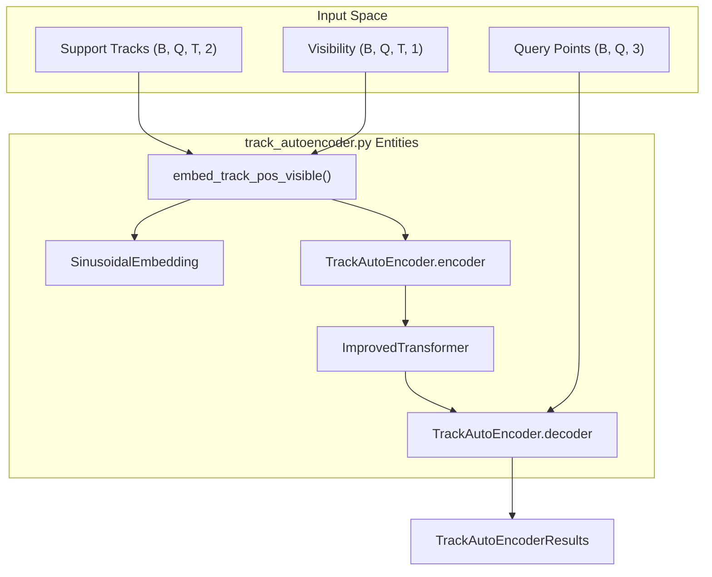
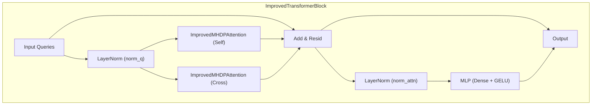

<!-- source: DeepWiki mcp.deepwiki.com · repo google-deepmind/tapnet · page 2.7 TRAJAN · fetched 2026-10-26 -->

# TRAJAN

Relevant source files

The following files were used as context for generating this wiki page:

- [colabs/trajan_demo.ipynb](colabs/trajan_demo.ipynb)
- [tapnet/trajan/__init__.py](tapnet/trajan/__init__.py)
- [tapnet/trajan/attention.py](tapnet/trajan/attention.py)
- [tapnet/trajan/track_autoencoder.py](tapnet/trajan/track_autoencoder.py)

TRAJAN (Point Trajectory Autoencoder) is a model designed to reconstruct held-out point trajectories conditioned on a set of support points. In the context of the TAP repository, it is primarily used as a direct motion model for assessing the realism and consistency of generated videos by evaluating how well the model can predict the motion of unseen points given a sparse set of observations.

Sources: [colabs/trajan_demo.ipynb:31-31](), [tapnet/trajan/track_autoencoder.py:16-16]()

## Overview and Purpose

The TRAJAN architecture formulates motion modeling as an autoencoding task where:
1.  **Support Tracks**: A set of known point trajectories (x, y coordinates and visibility) are provided as input.
2.  **Latent Representation**: The encoder compresses these tracks into a set of latent tokens.
3.  **Query Reconstruction**: The decoder reconstructs the full trajectory of specific query points, conditioned on the latent representation and the query point's initial location.

This model is particularly useful for evaluating whether a video generator produces motion that follows physical constraints and temporal consistency observed in real-world data.

Sources: [tapnet/trajan/track_autoencoder.py:71-85](), [tapnet/trajan/track_autoencoder.py:132-135]()

## System Architecture

The model is implemented in JAX/Flax and relies heavily on a custom transformer architecture.

### Code Entity Map: Trajectory Processing

The following diagram illustrates how the code entities in `track_autoencoder.py` map to the logical stages of trajectory encoding and decoding.

Sources: [tapnet/trajan/track_autoencoder.py:33-53](), [tapnet/trajan/track_autoencoder.py:132-189](), [tapnet/trajan/track_autoencoder.py:200-213]()

### Implementation Details

#### 1. Sinusoidal Embedding
Trajectories and point identities are projected into a high-dimensional space using `SinusoidalEmbedding` [tapnet/trajan/track_autoencoder.py:33-54](). This class creates Fourier features by concatenating sine and cosine transformations of the input coordinates scaled by various frequencies [tapnet/trajan/track_autoencoder.py:43-51]().

#### 2. The Encoder
The encoder transforms input tracks into latent tokens through several stages:
*   **Track Embedding**: `embed_track_pos_visible` combines track coordinates and visibility flags into a single embedding [tapnet/trajan/track_autoencoder.py:200-213]().
*   **Track Transformation**: The `input_track_transformer` (an `ImprovedTransformer` instance) processes the embeddings [tapnet/trajan/track_autoencoder.py:163-168]().
*   **Latent Compression**: The `tracks_to_latents` transformer reduces the information into a fixed number of latent tokens (`num_latent_tokens`) [tapnet/trajan/track_autoencoder.py:169-174]().

#### 3. The Decoder
The decoder reconstructs the trajectories for `query_points` [tapnet/trajan/track_autoencoder.py:83-83]():
*   **Identity Encoding**: `encode_point_identities` embeds the query point locations [tapnet/trajan/track_autoencoder.py:190-199]().
*   **Cross-Attention**: The `track_readout_attn` uses cross-attention between the query embeddings and the latent tokens to retrieve relevant motion information [tapnet/trajan/track_autoencoder.py:181-186]().
*   **Prediction**: A final `Dense` layer (`track_predictor`) outputs the coordinates and visibility/certainty logits [tapnet/trajan/track_autoencoder.py:188-188]().

### Attention Mechanism
TRAJAN uses a specialized `ImprovedTransformer` which implements features from ViT-22B:
*   **Normalization**: Uses `RMSNorm` for keys and queries before the dot-product [tapnet/trajan/attention.py:188-189]().
*   **Parallel Operations**: Self-attention and cross-attention are computed and summed before the MLP stage [tapnet/trajan/attention.py:99-119]().

Sources: [tapnet/trajan/attention.py:72-126](), [tapnet/trajan/attention.py:129-207]()

## Data Flow and Output

The model returns a `TrackAutoEncoderResults` dataclass containing:
*   `tracks`: Predicted (x, y) locations over time [tapnet/trajan/track_autoencoder.py:101-101]().
*   `visible_logits`: Raw visibility predictions [tapnet/trajan/track_autoencoder.py:103-103]().
*   `certain_logits`: Raw certainty predictions [tapnet/trajan/track_autoencoder.py:105-105]().

The class provides properties to convert these logits into hard masks (`visible`, `certain`) or a combined `visible_and_certain` flag [tapnet/trajan/track_autoencoder.py:108-120]().

Sources: [tapnet/trajan/track_autoencoder.py:87-121]()

## Usage in Demos

In the provided Colab demo, TRAJAN is typically used alongside a tracking model like TAPIR. TAPIR extracts initial trajectories from a video, which are then passed to the `TrackAutoEncoder` to verify motion consistency or reconstruct missing segments.

Key functions for inference:
*   `TrackAutoEncoder.__call__`: The main entry point for the Flax module [tapnet/trajan/track_autoencoder.py:238-278]().
*   `TrackAutoEncoder.encode`: Specifically runs the encoding path to generate latents [tapnet/trajan/track_autoencoder.py:280-302]().

Sources: [colabs/trajan_demo.ipynb:136-136](), [tapnet/trajan/track_autoencoder.py:238-302]()

---

