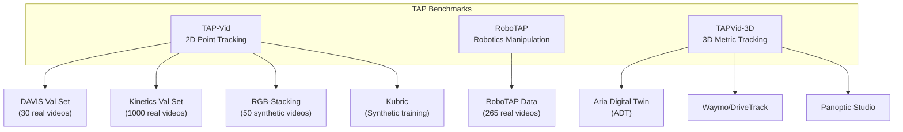
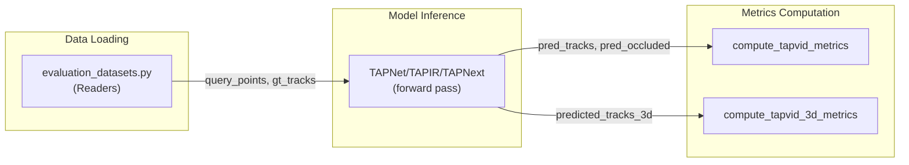

<!-- source: DeepWiki mcp.deepwiki.com · repo google-deepmind/tapnet · page 3 Benchmarks and Datasets · fetched 2026-10-26 -->

# Benchmarks and Datasets

Relevant source files

The following files were used as context for generating this wiki page:

- [README.md](README.md)
- [configs/tapnet_config.py](configs/tapnet_config.py)
- [tapnet/tapvid/README.md](tapnet/tapvid/README.md)
- [tapnet/tapvid/evaluation_datasets.py](tapnet/tapvid/evaluation_datasets.py)
- [tapnet/tapvid/requirements.txt](tapnet/tapvid/requirements.txt)
- [tapnet/tapvid3d/LICENSE](tapnet/tapvid3d/LICENSE)
- [tapnet/training/README.md](tapnet/training/README.md)

This page provides a high-level overview of the benchmarks and datasets used for training and evaluating point tracking algorithms in the TAP repository. These benchmarks test the ability of models to track arbitrary points on solid physical surfaces across video frames in 2D, 3D, and robotics contexts.

## Overview of Benchmarks

The TAP repository supports three primary benchmarks for evaluating point tracking capabilities, each targeting different spatial and task requirements.

### Benchmark Data Hierarchy

Sources: [README.md:9-15](), [tapnet/tapvid/README.md:7-9](), [tapnet/tapvid/README.md:77-81]()

### System Evaluation Flow

This diagram bridges the conceptual evaluation flow to the code entities responsible for processing and measuring performance.

Sources: [tapnet/tapvid/evaluation_datasets.py:48-56](), [tapnet/tapvid/README.md:13-31]()

## TAP-Vid

TAP-Vid is the core 2D benchmark for "Tracking Any Point." It evaluates tracking on deformable surfaces, long-term sequences, and class-agnostic objects [tapnet/tapvid/README.md:5-9]().

*   **Datasets**: Includes DAVIS (real), Kinetics (real), and RGB-Stacking (synthetic) [tapnet/tapvid/README.md:7-8]().
*   **Training**: Models are primarily trained on the synthetic **Kubric** dataset [tapnet/tapvid/README.md:7-9]().
*   **Evaluation Modes**: Supports `first` (querying the first visible point) and `strided` (querying multiple times per trajectory) [tapnet/tapvid/evaluation_datasets.py:112-120]().
*   **Key Metrics**: Average Jaccard (AJ), Occlusion Accuracy (OA), and Points Within Threshold [tapnet/tapvid/evaluation_datasets.py:97-105]().

For detailed data formats, downloading instructions, and reader implementation, see **[TAP-Vid](#3.1)**.

## RoboTAP

RoboTAP is a dataset and system focused on utilizing point tracks for robotics manipulation tasks through few-shot imitation [README.md:12-12]().

*   **Content**: 265 real-world robotics manipulation videos with manual annotations [tapnet/tapvid/README.md:79-81]().
*   **Format**: Follows the same pickle-based annotation format as TAP-Vid (frames, points, occlusions) [tapnet/tapvid/README.md:79-84]().
*   **Applications**: Used for motion clustering to segment objects and visual imitation learning [README.md:24-24]().

For details on the robotics-specific annotations and clustering utilities, see **[RoboTAP](#3.2)**.

## TAPVid-3D

TAPVid-3D extends tracking into 3D metric space, featuring over 1 million trajectories on 4,000+ real-world videos [README.md:14-14]().

*   **Data Sources**: Derived from Aria Digital Twin (ADT), Waymo Open Dataset (DriveTrack), and Panoptic Studio [tapnet/tapvid3d/README.md:10-17]().
*   **Data Format**: Stored as `.npz` files containing `images_jpeg_bytes`, `intrinsics`, `extrinsics_w2c`, and `tracks_xyz` [tapnet/tapvid3d/README.md:86-113]().
*   **Metrics**: Introduces 3D-specific metrics including **3D-AJ** (3D Average Jaccard) and **APD** (Average Position Discrepancy) [tapnet/tapvid3d/README.md:27-35]().

For the 3D annotation generation pipeline and metric definitions, see **[TAPVid-3D](#3.3)**.

## Benchmark Summary Table

| Benchmark | Dimension | Primary Metrics | Key Dataset Subsets |
| :--- | :--- | :--- | :--- |
| **TAP-Vid** | 2D | AJ, OA, Pts @ Threshold | DAVIS, Kinetics, Kubric |
| **RoboTAP** | 2D | AJ, OA | Robotics Manipulation |
| **TAPVid-3D** | 3D | 3D-AJ, APD, OA | ADT, DriveTrack, PStudio |

Sources: [tapnet/tapvid/evaluation_datasets.py:97-105](), [tapnet/tapvid3d/README.md:27-35](), [configs/tapnet_config.py:36-41]()

---

