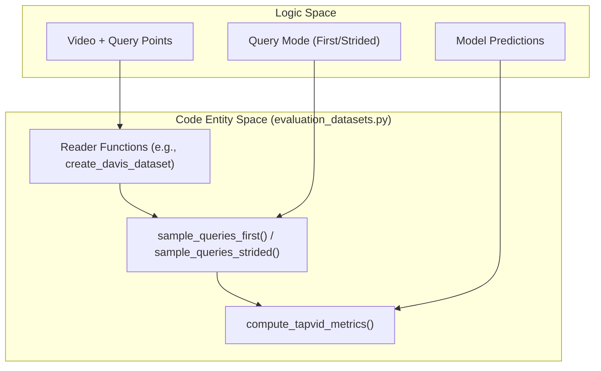
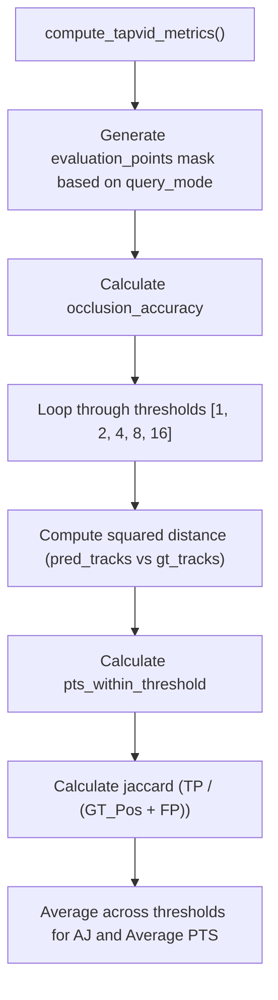

<!-- source: DeepWiki mcp.deepwiki.com · repo google-deepmind/tapnet · page 3.1 TAP-Vid · fetched 2026-10-26 -->

# TAP-Vid

Relevant source files

The following files were used as context for generating this wiki page:

- [colabs/optical_flow_track_assist.ipynb](colabs/optical_flow_track_assist.ipynb)
- [tapnet/tapvid/README.md](tapnet/tapvid/README.md)
- [tapnet/tapvid/__init__.py](tapnet/tapvid/__init__.py)
- [tapnet/tapvid/evaluation_datasets.py](tapnet/tapvid/evaluation_datasets.py)
- [tapnet/tapvid/generate_tapvid.py](tapnet/tapvid/generate_tapvid.py)
- [tapnet/tapvid/requirements.txt](tapnet/tapvid/requirements.txt)
- [tapnet/tapvid/visualize.py](tapnet/tapvid/visualize.py)
- [tapnet/tapvid3d/LICENSE](tapnet/tapvid3d/LICENSE)
- [tapnet/training/README.md](tapnet/training/README.md)
- [tapnet/training/task.py](tapnet/training/task.py)
- [tapnet/utils/__init__.py](tapnet/utils/__init__.py)

## Purpose and Scope

TAP-Vid is a benchmark dataset and evaluation suite for the task of Tracking Any Point (TAP) in a video. Unlike traditional object tracking which focuses on bounding boxes or segments, TAP-Vid requires tracking specific physical points on any solid surface with pixel-level precision. The benchmark evaluates three key capabilities:
1.  **Coordinate Prediction**: Determining the $(x, y)$ location of a point if it is visible.
2.  **Occlusion Prediction**: Determining whether the point is currently visible or occluded.
3.  **Long-term Consistency**: Maintaining the track across the entire video duration, potentially through deformations and long-term occlusions.

Sources: [tapnet/tapvid/README.md:1-10](), [tapnet/tapvid/evaluation_datasets.py:57-67]()

## Dataset Subsets

The benchmark incorporates four distinct data sources to provide a comprehensive evaluation across real-world and synthetic scenarios:

| Subset | Scale | Type | Source / Annotation |
| :--- | :--- | :--- | :--- |
| **DAVIS** | 30 videos | Real-world | Manually annotated with optical flow assistance. [tapnet/tapvid/README.md:7-7]() |
| **Kinetics** | 1000 videos | Real-world | Manually annotated validation clips from Kinetics-700-2020. [tapnet/tapvid/README.md:7-7](), [tapnet/tapvid/generate_tapvid.py:45-48]() |
| **RGB-Stacking** | 50 videos | Synthetic | DeepMind Robotics simulation with perfect ground truth. [tapnet/tapvid/README.md:7-7]() |
| **Kubric** | Infinite | Synthetic | Large-scale training data with full physical ground truth. [tapnet/tapvid/README.md:7-7]() |

### Data Format
Data is typically stored in `.pkl` (pickle) files. For DAVIS and RGB-Stacking, the format is a dictionary or list where each entry contains:
*   `video`: A 4D `uint8` tensor `[frames, height, width, 3]`. [tapnet/tapvid/README.md:54-57]()
*   `points`: A 3D `float32` tensor `[num_points, num_frames, 2]` containing normalized $(x, y)$ coordinates. [tapnet/tapvid/README.md:54-57]()
*   `occluded`: A 2D `bool` tensor `[num_points, num_frames]` where `True` indicates occlusion. [tapnet/tapvid/README.md:54-57]()

Sources: [tapnet/tapvid/README.md:54-57](), [tapnet/tapvid/generate_tapvid.py:158-199]()

## Evaluation Methodology

### Query Modes
The benchmark supports two modes for selecting the "query" (the starting point provided to the algorithm):
1.  **First Mode (`first`)**: The algorithm is given the first frame where a point is visible. It must track the point for all subsequent frames. Frames before the query are ignored in evaluation. [tapnet/tapvid/evaluation_datasets.py:85-88](), [tapnet/tapvid/evaluation_datasets.py:112-114]()
2.  **Strided Mode (`strided`)**: Each trajectory is queried multiple times at a fixed stride. The algorithm must track the point both forward and backward in time for all frames except the query frame itself. [tapnet/tapvid/evaluation_datasets.py:85-88](), [tapnet/tapvid/evaluation_datasets.py:115-117]()

### Key Metrics
Metrics are computed using `compute_tapvid_metrics` in `evaluation_datasets.py` [tapnet/tapvid/evaluation_datasets.py:48-56]().

*   **Average Jaccard (AJ)**: The primary metric. It combines coordinate precision and occlusion accuracy. A point is a "True Positive" if it is predicted as visible, is ground-truth visible, and the distance is within a threshold $\delta$. [tapnet/tapvid/evaluation_datasets.py:101-104](), [tapnet/tapvid/evaluation_datasets.py:162-180]()
*   **Occlusion Accuracy (OA)**: Simple accuracy of the binary occlusion prediction. [tapnet/tapvid/evaluation_datasets.py:97-97](), [tapnet/tapvid/evaluation_datasets.py:127-131]()
*   **Points Within Threshold (PTS)**: The fraction of visible points predicted within a pixel threshold (evaluated at 1, 2, 4, 8, and 16 pixels). [tapnet/tapvid/evaluation_datasets.py:98-100](), [tapnet/tapvid/evaluation_datasets.py:148-160]()

Sources: [tapnet/tapvid/evaluation_datasets.py:48-181](), [tapnet/tapvid/README.md:27-30]()

## Implementation Details

### Data Flow and Evaluation Logic
The following diagram bridges the logical benchmark concepts to the specific Python entities in `evaluation_datasets.py`.

**Benchmark to Code Mapping**

Sources: [tapnet/tapvid/evaluation_datasets.py:48-56](), [tapnet/tapvid/evaluation_datasets.py:490-502](), [tapnet/tapvid/evaluation_datasets.py:535-548]()

### Metric Computation Flow
The `compute_tapvid_metrics` function processes batches of trajectories.

**Metric Calculation Sequence**

Sources: [tapnet/tapvid/evaluation_datasets.py:111-124](), [tapnet/tapvid/evaluation_datasets.py:139-181]()

## Dataset Preparation

### Kinetics Generation
Since Kinetics videos are large, the repository provides `generate_tapvid.py` to process raw MP4 clips into the evaluation format.
1.  **CSV Parsing**: `csv_to_dataset` reads YouTube IDs and timestamps. [tapnet/tapvid/generate_tapvid.py:75-123]()
2.  **Frame Extraction**: `extract_frames` uses `ffmpeg` to pull JPEGs at 25 FPS. [tapnet/tapvid/generate_tapvid.py:145-155]()
3.  **Coordinate Scaling**: Coordinates are converted from absolute pixels to normalized $[0, 1]$ range in `generate_example`. [tapnet/tapvid/generate_tapvid.py:185-197]()

Sources: [tapnet/tapvid/generate_tapvid.py:75-200](), [tapnet/tapvid/README.md:58-76]()

### Reader Utilities
`evaluation_datasets.py` contains several `create_*_dataset` functions that yield `DatasetElement` objects. These readers handle:
*   **Resizing**: Resizing videos to 256x256 via `resize_video`. [tapnet/tapvid/evaluation_datasets.py:41-45]()
*   **Query Sampling**: Applying `sample_queries_first` or `sample_queries_strided` to the ground truth tracks. [tapnet/tapvid/evaluation_datasets.py:490-533](), [tapnet/tapvid/evaluation_datasets.py:535-608]()

Sources: [tapnet/tapvid/evaluation_datasets.py:41-45](), [tapnet/tapvid/evaluation_datasets.py:490-608]()

---

